# Per-class feature analysis of the ML models (MARIDA and MADOS)

## Folder layout

Every figure exists for both datasets (`MARIDA/`, `MADOS/` subfolders) and all
five ML models (RF, XGBoost, LightGBM, AdaBoost, linear SVM). Files at the top
of a folder compare the two datasets.
[`06_reports/README.md`](06_reports/README.md) lists every figure with a
one-line description.

| Folder | What it answers |
|---|---|
| [`01_global_importance/`](01_global_importance) | Which features does each model use overall? |
| [`02_class_specific/`](02_class_specific) | Which features make a pixel Water, Debris, Algae or Other? Also: per-class feature distributions (`<dataset>/feature_distributions/`) and SHAP tables (`<dataset>/shap_summary/`). |
| [`03_cross_model_comparison/`](03_cross_model_comparison) | Do the models (and the two datasets) agree? Also: per-class effect of every staged experiment (`<dataset>/staged_experiments/`). |
| [`04_dependence_and_interactions/`](04_dependence_and_interactions) | How does each feature's value change the prediction, and which features act together? |
| [`05_individual_predictions/`](05_individual_predictions) | Why was this pixel classified as it was, and what causes the errors? |
| [`06_reports/`](06_reports) | Figure index, tables, per-class feature selection (`<dataset>/feature_selection/`), per-dataset summaries. |

Reproduce: `scripts/feature_analysis/` (see its README). This folder is built
by `python scripts/feature_analysis/export_analysis.py --name Analysis1`.


This document explains, **class by class**, which features the five ML models
(Random Forest, XGBoost, LightGBM, AdaBoost, linear SVM) use, and why. It covers:

1. how every feature is computed (section 2);
2. what each feature looks like per class, without any model (section 3);
3. how the staged experiments chose the stage-8 feature set, and what each
   stage did to each class (section 4);
4. SHAP explanations per class for every model, as used by the other team
   (section 5);
5. a per-class feature selection driven by SHAP and checked by retraining,
   which is the justification for the choices (section 6).

All figures and tables are produced by the scripts in
`scripts/feature_analysis/`: `per_class_features.py` (analysis) and
`shap_figures.py` (the full SHAP figure set).

## Key findings

- **Each class relies on different features, and the four tree models agree
  on which ones.**
  - **Water:** nir/red and GLCM contrast. Water is dark in the NIR and smooth.
  - **Marine Debris:** swir1/nir, nir/red, NDWI and nir/green. Debris is a
    floating object whose NIR sits just above water, without the very high
    NIR of algae, and whose SWIR1 is low relative to NIR.
  - **Algae/Sargassum:** nir/red dominates (vegetation red edge), followed by
    the blue/green bands B2 and B3.
  - **Other:** GLCM texture (contrast, dissimilarity) and SWIR (B11, B12).
    These are land, ships, waves and haze: bright in SWIR and textured.
- **The linear SVM is the exception.** It spreads importance over strongly
  correlated bands, often with opposite signs. Its rankings say less about
  the physics and more about the collinearity of the inputs.
- **Several candidate features are exact duplicates for tree models.** NDVI is
  a monotone function of nir/red, NDMI of swir1/nir, and NDWI of nir/green.
  Each pair has identical one-vs-rest AUCs (section 3.3). This explains why
  NDVI and NDMI added nothing in stage 2. It also shows that stage 8 still
  contains one such pair (NDWI and nir/green): the tree models split SHAP
  credit between them arbitrarily.
- **Per-class SHAP selection (RF):**

  | Class | MARIDA: features needed (F1 vs all 22) | MADOS: features needed (F1 vs all 22) |
  |---|---|---|
  | Water | **2** (0.994 vs 0.998) | 22 |
  | Algae/Sargassum | **6** (0.981 vs 0.987) | 15 |
  | Marine Debris | **11** (**0.844** vs 0.838) | **15** (**0.729** vs 0.698) |
  | Other | 22 | 22 |

  For RF, XGBoost and LightGBM, the union of the per-class sets is the full
  stage-8 set on both datasets. **The 22 features are justified: every one is
  needed by at least one class.** AdaBoost (13–18 features) and the linear
  SVM (20 on MADOS) do better with fewer features.
- These rankings agree with the global and class-wise SHAP heatmaps produced
  independently by the other team. Section 5.4 explains the one systematic
  difference (NDWI vs nir/green in XGBoost).

## 1. Data and set-up

- Datasets: `MARIDA_5Class` and `MADOS_5Class`. Labels 0–4; **class 0
  (unannotated, cloud, cloud shadow) is ignored**, leaving 1 Water,
  2 Marine Debris, 3 Algae/Sargassum, 4 Other.
- Pixels: every annotated pixel of the official train split (training) and of
  the official test split (testing). The splits are scene-disjoint.

| Dataset | Train pixels | Test pixels |
|---|---|---|
| MARIDA | 358,442 | 158,371 |
| MADOS | 761,887 | 361,147 |

- Models: the five ML models of `scripts/staged_ml/common.py`, unchanged:
  Random Forest (100 trees), XGBoost and LightGBM (100 trees, depth 6),
  AdaBoost (100 depth-3 trees), linear SVM (standardised features).
- Class weighting: log weights, 1 / ln(1.03 + class frequency), the paper's
  main setting.
- Seed 42 everywhere. Everything below is reproduced by
  `python scripts/feature_analysis/per_class_features.py`.

## 2. How each feature is extracted

Every feature is computed **per pixel**. The 24 spectral features come from
`src/features/pixel_features.py`. The 6 texture features come from
`scripts/staged_ml/glcm_features.py`. Band order (both datasets):

| Index | Band | Centre (nm) | Region |
|---|---|---|---|
| 0 | B1 | 443 | coastal aerosol |
| 1 | B2 | 490 | blue |
| 2 | B3 | 560 | green |
| 3 | B4 | 665 | red |
| 4 | B5 | 705 | red edge 1 |
| 5 | B6 | 740 | red edge 2 |
| 6 | B7 | 783 | red edge 3 |
| 7 | B8 | 842 | NIR |
| 8 | B8A | 865 | narrow NIR |
| 9 | B11 | 1610 | SWIR 1 |
| 10 | B12 | 2190 | SWIR 2 |

### 2.1 Spectral bands (11)
The surface reflectance of the pixel in each band, used as is. This is the
pixel's raw spectral signature (see `spectral_signatures.png`).

### 2.2 Spectral indices (5)
ε = 1e-6 avoids division by zero.

| Feature | Formula | What it responds to |
|---|---|---|
| NDVI | (B8 − B4) / (B8 + B4 + ε) | vegetation / floating biomass: NIR reflects strongly, red is absorbed |
| NDWI (McFeeters) | (B3 − B8) / (B3 + B8 + ε) | open water: green above NIR; anything floating raises NIR and lowers NDWI |
| FAI (Hu 2009) | B8 − [B4 + (B11 − B4)·(842 − 665)/(1610 − 665)] | NIR height above the red–SWIR1 baseline: floating algae |
| FDI (Biermann 2020) | B8 − [B6 + (B11 − B6)·(842 − 665)/(1610 − 665)·10] | NIR height above the red-edge–SWIR1 baseline: floating debris |
| NDMI | (B8 − B11) / (B8 + B11 + ε) | moisture: NIR vs SWIR1 |

### 2.3 Band ratios (4)

| Feature | Formula | Meaning |
|---|---|---|
| red/green | B4 / (B3 + ε) | colour of the water: turbid / sediment water is redder |
| nir/red | B8 / (B4 + ε) | the simple ratio behind NDVI (same ranking, different scale) |
| nir/green | B8 / (B3 + ε) | the ratio behind NDWI |
| swir1/nir | B11 / (B8 + ε) | separates dry or bright surfaces from vegetation |

### 2.4 Spectral statistics (4)
Over the 11 bands of the pixel: mean, standard deviation, maximum and
Euclidean norm. They describe overall brightness and how much the spectrum
varies, but not its shape.

### 2.5 GLCM texture (6)
These describe the **neighbourhood** of the pixel, not its spectrum. The
computation follows the MARIDA reference code:

1. RGB composite of B4, B3, B2, clipped to [0, 0.15] and scaled to [0, 1].
2. Converted to grey (0.2125 R + 0.7154 G + 0.0721 B) and quantised to 17 grey levels.
3. A 13 × 13 window centred on the pixel (image padded by reflection).
4. Grey-level co-occurrence matrix P at distance 1 in 4 directions (0°, 45°,
   90°, 135°), symmetric and normalised, averaged over directions.
5. Six properties of P (i, j = grey levels):

| Feature | Formula | High when |
|---|---|---|
| contrast | Σ P(i,j)(i − j)² | the window contains sharp grey-level jumps (edges) |
| dissimilarity | Σ P(i,j)·abs(i − j) | like contrast, but linear in the jump size |
| homogeneity | Σ P(i,j) / (1 + (i − j)²) | neighbouring pixels have the same grey level (smooth sea) |
| energy | √ASM | the window is uniform / repetitive |
| correlation | Σ P(i,j)(i − μi)(j − μj) / (σi σj) | grey levels change linearly across the window |
| ASM | Σ P(i,j)² | same as energy, squared |

Energy = √ASM, so the two carry the same ranking. Any tree model (and SHAP)
will split credit between them arbitrarily.

### 2.6 The feature set the models use (stage 8)
The staged experiments ended with **22 features**: the 11 bands, NDWI, the 4
ratios and the 6 GLCM features. NDVI, FAI, FDI, NDMI and the 4 spectral
statistics were dropped (section 4). Section 3 still looks at all 30 so you
can see why.

## 3. Each feature per class, without a model

Model-free statistics come first, so the SHAP results in section 5 can be
checked against the data itself.

### 3.1 Spectral signatures

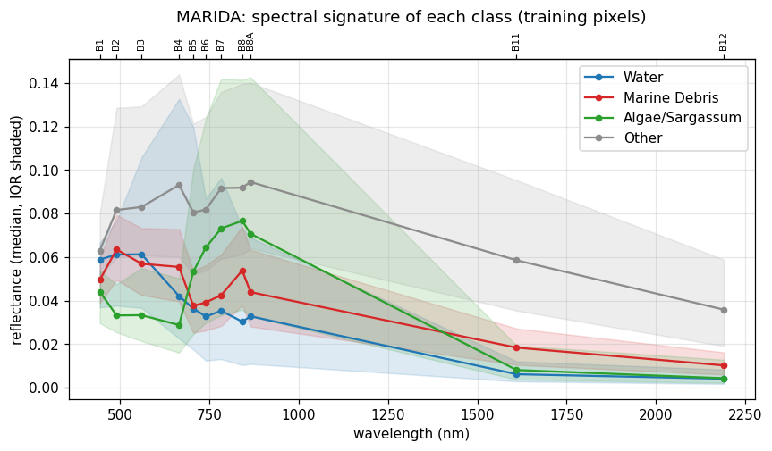
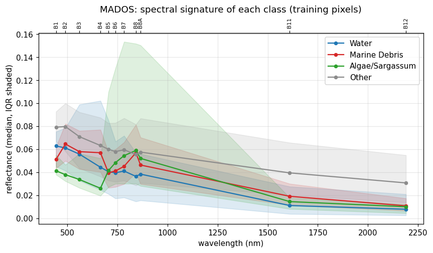

Median reflectance per band, with the inter-quartile range shaded.

- **Water** is darkest from the red edge onward: NIR and SWIR are absorbed.
- **Algae/Sargassum** has the vegetation shape: a dip in the red (B4), then a
  steep rise through the red edge to a NIR peak (B7–B8A).
- **Marine Debris** sits between the two: slightly raised NIR, no red-edge
  jump, and SWIR1 above water.
- **Other** is bright everywhere, including the SWIR.

### 3.2 Distributions per class (violin plots)

One figure per feature group, using 3,000 training pixels per class. Values
are clipped to the 0.5–99.5 % range so the outlying ratios do not squash the
plots.

| Group | MARIDA | MADOS |
|---|---|---|
| Bands | 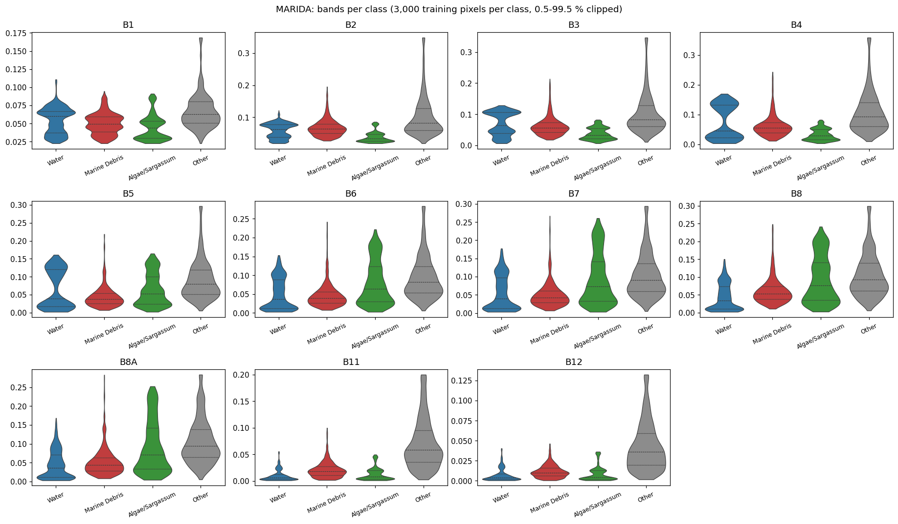 | 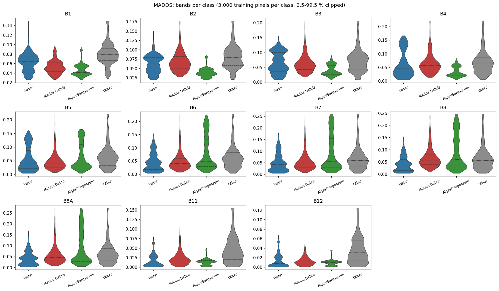 |
| Indices | 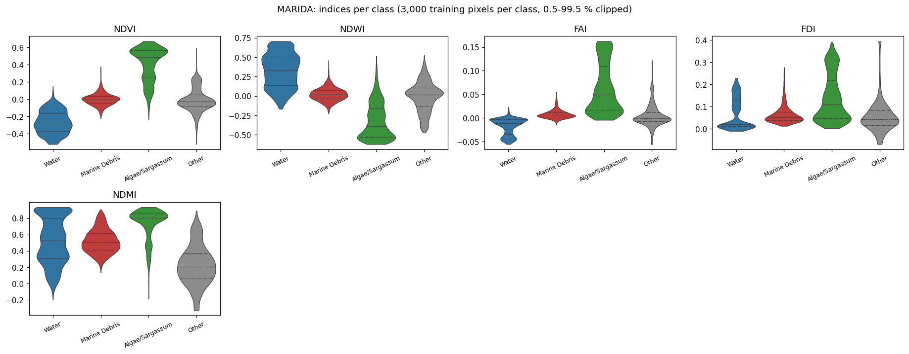 | 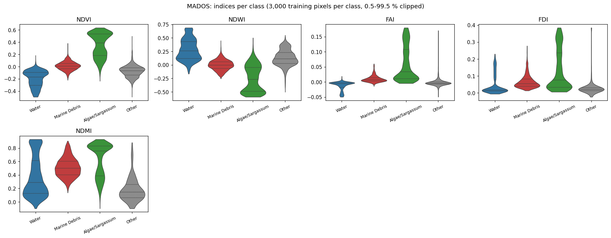 |
| Ratios | 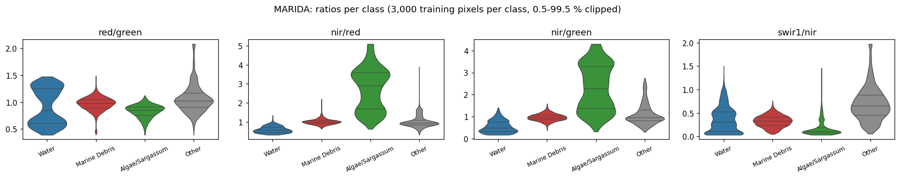 | 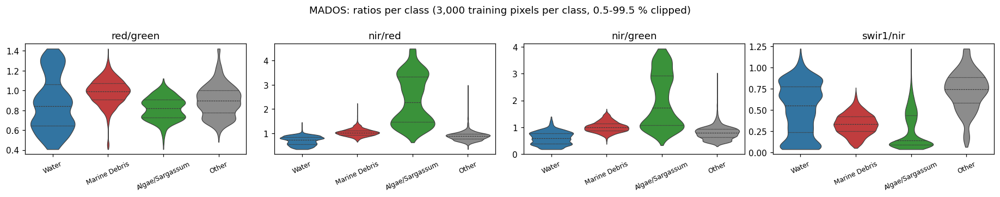 |
| Spectral statistics | 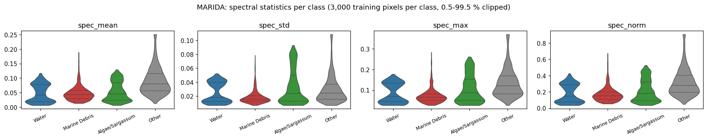 | 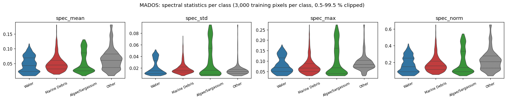 |
| GLCM texture | 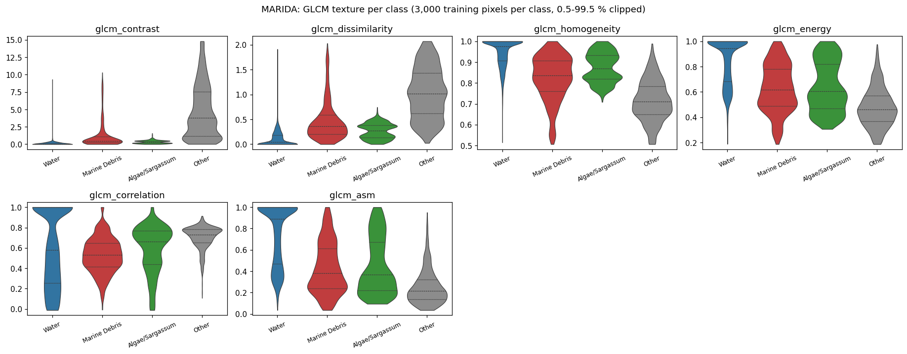 | 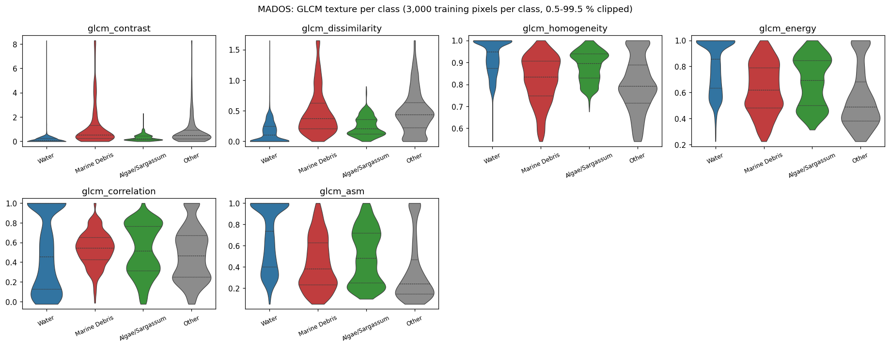 |

Medians of the most informative features (training pixels):

| Feature | MARIDA Water | Debris | Algae | Other | MADOS Water | Debris | Algae | Other |
|---|---|---|---|---|---|---|---|---|
| nir/red | 0.57 | 1.00 | 2.91 | 0.94 | 0.72 | 1.02 | 2.29 | 0.87 |
| nir/green | 0.49 | 0.97 | 2.28 | 0.96 | 0.58 | 1.00 | 1.74 | 0.79 |
| NDWI | 0.35 | 0.02 | −0.39 | 0.02 | 0.27 | 0.00 | −0.27 | 0.12 |
| swir1/nir | 0.32 | 0.33 | 0.11 | 0.65 | 0.54 | 0.33 | 0.14 | 0.75 |
| B11 (SWIR1) | 0.006 | 0.018 | 0.008 | 0.059 | 0.011 | 0.019 | 0.015 | 0.039 |
| glcm_contrast | 0.05 | 0.48 | 0.31 | 3.78 | 0.10 | 0.54 | 0.23 | 0.48 |

Debris has nir/red ≈ 1 (NIR ≈ red). Water is below 1 and algae well above 2.
That single ratio places debris between the other two classes on both
datasets.

### 3.3 How well each feature alone separates each class (one-vs-rest ROC AUC)

For each feature and class, the AUC measures how well the feature on its own
ranks pixels of that class above all other pixels:
- **0.5:** no information.
- **Close to 1:** the class has higher values.
- **Close to 0:** the class has lower values (equally useful, opposite direction).

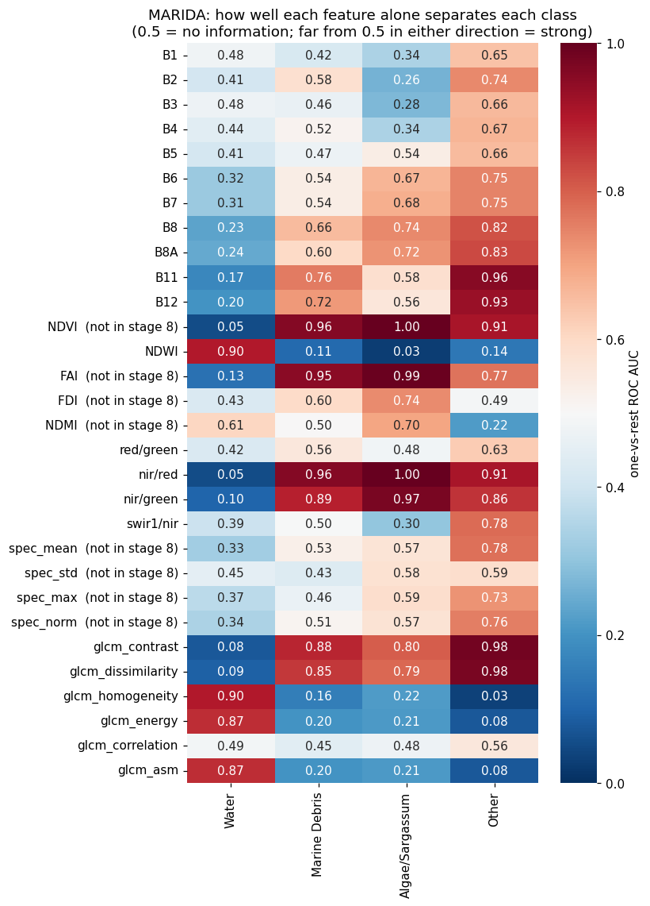
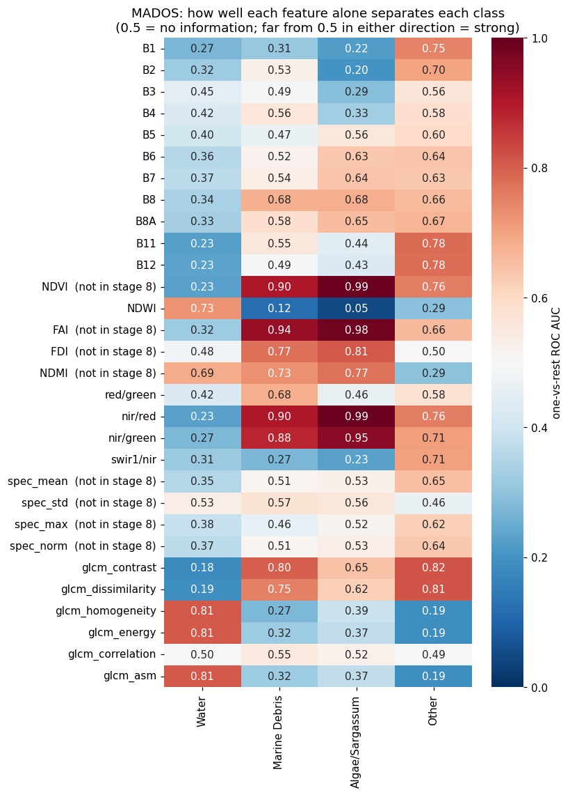

Strongest single features (AUC in brackets):

| Class | MARIDA | MADOS |
|---|---|---|
| Water | nir/red (0.05), NDVI (0.05), glcm_contrast (0.08), glcm_dissimilarity (0.09), glcm_homogeneity (0.90), NDWI (0.90) | glcm_contrast (0.18), glcm_dissimilarity (0.19), glcm_homogeneity (0.81), glcm_energy (0.81), glcm_asm (0.81), B11 (0.23) |
| Marine Debris | nir/red (0.96), NDVI (0.96), FAI (0.95), NDWI (0.11), nir/green (0.89), glcm_contrast (0.88) | FAI (0.94), nir/red (0.90), NDVI (0.90), NDWI (0.12), nir/green (0.88), glcm_contrast (0.80) |
| Algae/Sargassum | NDVI (1.00), nir/red (1.00), FAI (0.99), NDWI (0.03), nir/green (0.97), glcm_contrast (0.80) | NDVI (0.99), nir/red (0.99), FAI (0.98), NDWI (0.05), nir/green (0.95), FDI (0.81) |
| Other | glcm_contrast (0.98), glcm_dissimilarity (0.98), glcm_homogeneity (0.03), B11 (0.96), B12 (0.93), glcm_asm (0.08) | glcm_contrast (0.82), glcm_dissimilarity (0.81), glcm_homogeneity (0.19), glcm_energy (0.19), glcm_asm (0.19), B11 (0.78) |

**Redundant pairs.** Some features are monotone transforms of others. With
r = nir/red, NDVI = (r − 1)/(r + 1), and the same pattern holds for
NDWI ↔ nir/green (inverted) and NDMI ↔ swir1/nir (inverted). Their AUCs are
therefore identical, as the table shows for NDVI and nir/red. A tree only
looks at the order of values, so for RF, XGBoost, LightGBM and AdaBoost each
pair is literally the same feature. The same holds for energy = √ASM. This is
why:
- adding NDVI or NDMI in stage 2 did not help the tree models (section 4);
- NDWI and nir/green in stage 8 share SHAP credit between them (section 5.4).

FAI is a strong single feature for debris and algae but was not kept. It is a
linear combination of B4, B8 and B11. In stage 2c it changed the per-class F1
by −0.3 to −4.3 points on average, because nir/red already carries the same
"NIR above red" information.

## 4. How the staged experiments selected the features

`scripts/staged_ml` built the feature set step by step with the same pixels,
models and seed. Only the feature columns changed between stages:

1. Stage 1: the 11 bands.
2. Stage 2: the bands plus **one** extra group at a time (NDVI, NDWI, FAI,
   FDI, NDMI, the 4 ratios, the 4 spectral statistics).
3. Stage 5: the bands plus the two best stage-2 additions, NDWI and the ratios.
4. Stage 7: the bands plus GLCM.
5. Stage 8: stage 5 plus GLCM. Stage 8 was run because stage 7 passed a rule
   fixed in advance.

Below is the change in **per-class** F1 against stage 1, in percentage points,
averaged over the five models (log weights). The per-model heatmaps follow.

| Stage | MARIDA Water | Debris | Algae | Other | MADOS Water | Debris | Algae | Other |
|---|---|---|---|---|---|---|---|---|
| 2a + NDVI | −0.2 | −4.1 | +1.7 | +1.0 | +0.5 | −0.7 | +1.1 | +0.8 |
| 2b + NDWI | +0.3 | **+13.0** | +5.9 | +0.5 | +1.6 | **+13.6** | +2.0 | +1.9 |
| 2c + FAI | 0.0 | −0.3 | −0.4 | −0.2 | −0.7 | −4.3 | +1.9 | −0.4 |
| 2d + FDI | 0.0 | +2.3 | −0.8 | −0.5 | +0.2 | −0.3 | 0.0 | +0.1 |
| 2e + NDMI | 0.0 | +3.1 | −0.4 | −1.1 | +0.1 | −3.1 | +1.3 | −0.1 |
| 2f + 4 ratios | +0.3 | **+16.2** | **+9.1** | +1.3 | +1.2 | +6.7 | +1.8 | +1.2 |
| 2g + spectral stats | +0.2 | +2.8 | **+9.8** | −0.1 | +1.6 | +9.4 | +3.2 | +1.7 |
| 5 NDWI + ratios | +0.3 | +18.3 | +6.9 | +1.7 | +1.2 | +14.8 | +2.1 | +1.0 |
| 7 + GLCM | 0.0 | −2.7 | +0.6 | +0.4 | **+7.4** | −2.7 | +1.5 | **+9.0** |
| 8 NDWI + ratios + GLCM | +0.3 | **+19.5** | +6.9 | +2.1 | +6.8 | +9.1 | +3.9 | +8.2 |

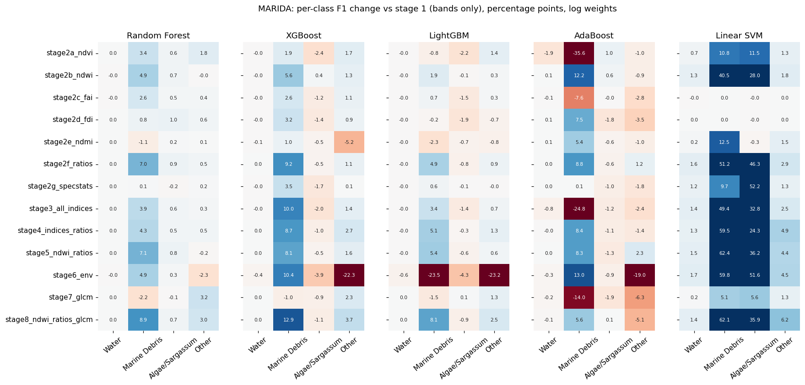
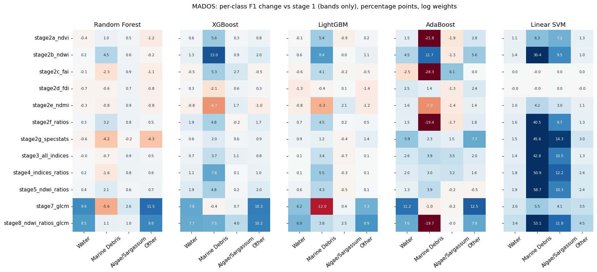

**Per class, the staged results say:**
- **Marine Debris** gains most from NDWI and the ratios (+13 to +18 points).
  GLCM alone hurts it, because texture on its own confuses small debris
  patches with the textured "Other" class. Together with NDWI and the ratios,
  GLCM no longer hurts debris on MARIDA.
- **Water and Other on MADOS** gain most from GLCM (+7 to +9 points). MADOS
  "Other" contains far more textured surfaces (wakes, waves, sun-glint, ships).
- **Algae** is already well separated by the bands. The ratios add a little.
- NDVI, FAI, FDI and NDMI add little or nothing on average. Section 3.3
  explains why: they duplicate a ratio, or are linear in the bands.

So the staged approach picked features by their **average** effect over
classes and models. The SHAP analysis below asks the per-class question
directly.

## 5. SHAP per class

### 5.1 Method

The five stage-8 models (22 features) are trained exactly as in the staged
experiments: full training split, log weights, seed 42. Their test scores
reproduce the repo's stage-8 results:

| Model | MARIDA macro F1 | Debris F1 | MADOS macro F1 | Debris F1 |
|---|---|---|---|---|
| Random Forest | 0.916 | 0.831 | 0.761 | 0.708 |
| XGBoost | 0.883 | 0.774 | 0.736 | 0.526 |
| LightGBM | 0.885 | 0.778 | 0.736 | 0.540 |
| AdaBoost | 0.799 | 0.488 | 0.602 | 0.165 |
| Linear SVM | 0.847 | 0.745 | 0.714 | 0.615 |

(MADOS XGBoost debris F1 is 0.526 here vs 0.530 in the repo. Multithreaded
XGBoost is not bit-for-bit deterministic.)

SHAP assigns each feature a contribution φ to each class output for one
pixel. The contributions add up to the difference between that pixel's
prediction and the average prediction over a background set.

| Model | Explainer | Output explained |
|---|---|---|
| RF | interventional TreeSHAP (exact) | class probability |
| XGBoost, LightGBM | interventional TreeSHAP (exact) | class log-odds |
| AdaBoost | permutation SHAP (sklearn's AdaBoost is not supported by TreeSHAP) | class probability |
| Linear SVM | exact linear SHAP, coef × (z − mean background z) | one-vs-rest decision score |

- **Background:** 100 training pixels, 25 per class. Each class therefore
  counts equally in the baseline.
- **Explained pixels:** 2,000 test pixels, 500 per class. The same pixels are
  used for every model.
- **Comparing models:** the output units differ, so every comparison uses each
  feature's **share** of the class's total mean |SHAP|:

  share(j, k) = mean|φ(j, k)| / Σ_f mean|φ(f, k)|

  for feature j and class k.

### 5.2 Beeswarm (swarm) plots

How to read them:
- Each dot is a pixel.
- Horizontal position is its SHAP value: right pushes towards the class,
  left away from it.
- Colour is the feature's value: red high, blue low.
- Features are sorted by mean |SHAP|.

**One class, all five models.** Use these to compare the models.

| Class | MARIDA | MADOS |
|---|---|---|
| Water | 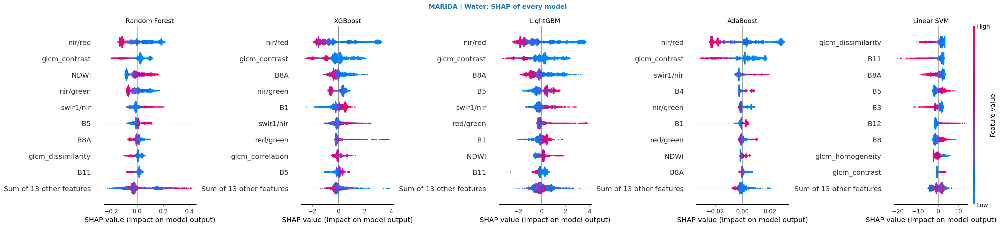 | 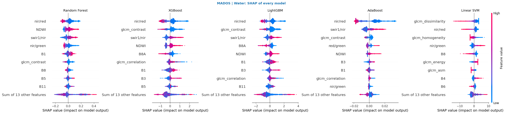 |
| Marine Debris | 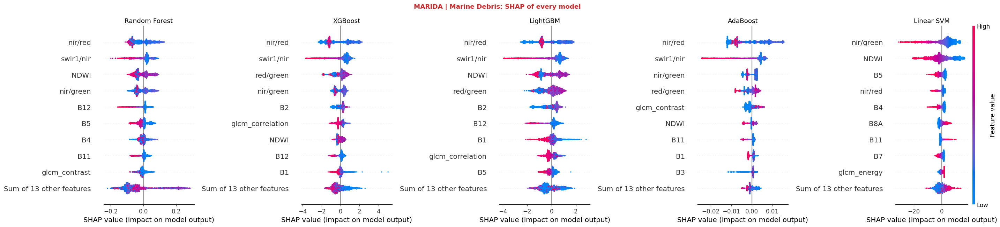 | 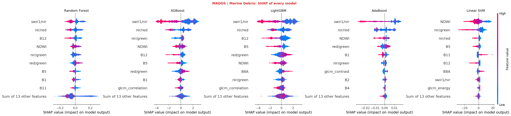 |
| Algae/Sargassum | 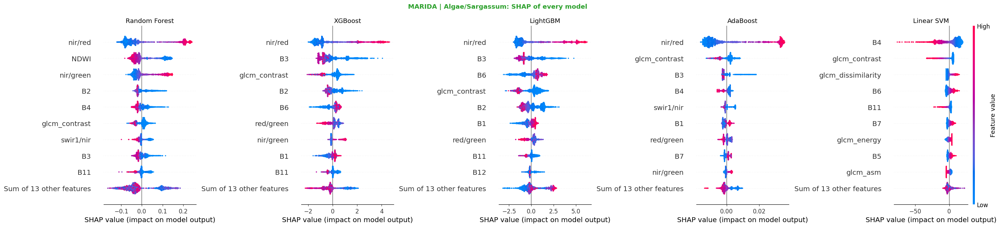 | 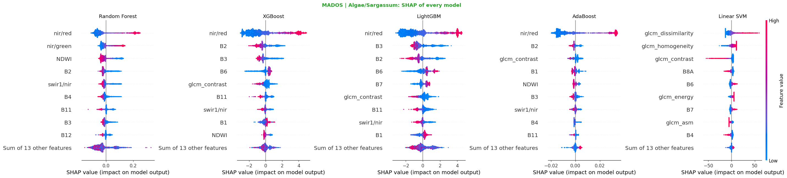 |
| Other | 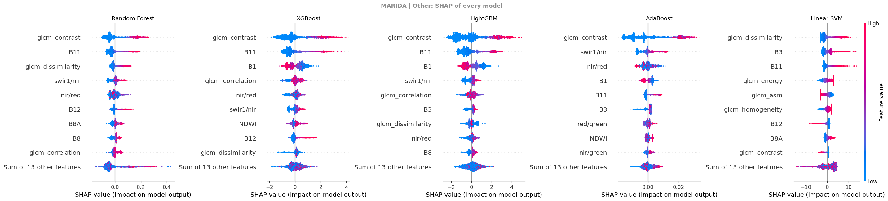 | 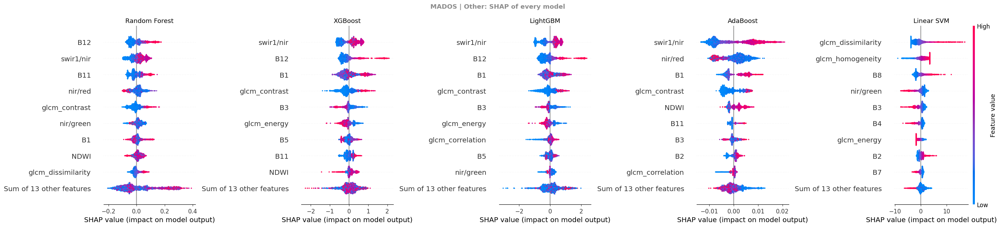 |

**One model, all four classes:** one `beeswarm_<model>.png` per model and
dataset, for example
[RF on MARIDA](02_class_specific/MARIDA/shap_summary/beeswarm_rf.png) and
[RF on MADOS](02_class_specific/MADOS/shap_summary/beeswarm_rf.png).

### 5.3 Share of SHAP per class and model

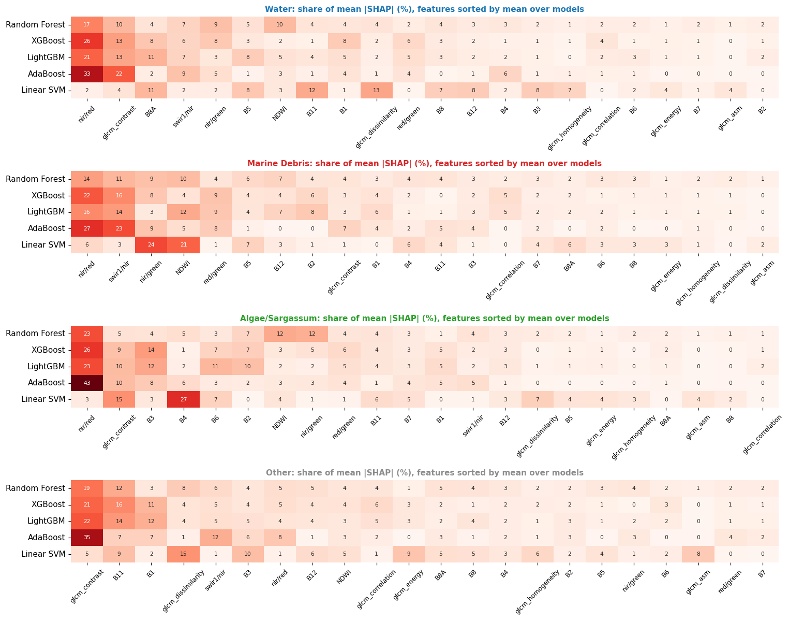
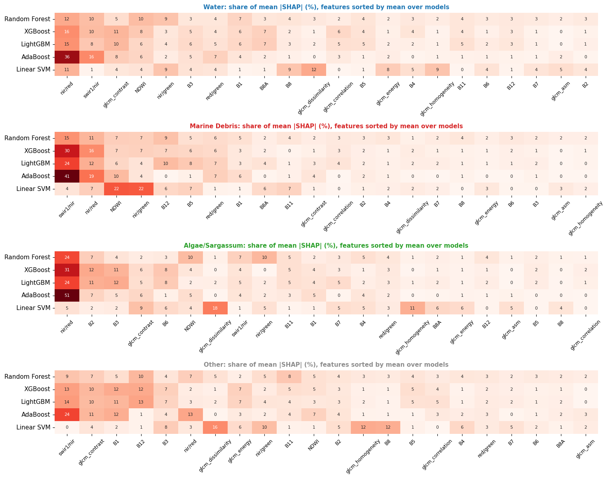

The same shares summed by feature group:

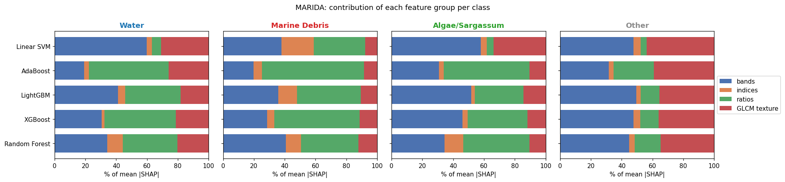
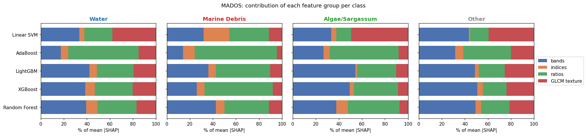

Averaged over the five models, by group (%):

| Class | MARIDA bands / NDWI / ratios / GLCM | MADOS bands / NDWI / ratios / GLCM |
|---|---|---|
| Water | 37 / 5 / 35 / 23 | 34 / 7 / 37 / 22 |
| Marine Debris | 33 / 11 / 47 / 10 | 30 / 11 / 50 / 9 |
| Algae/Sargassum | 44 / 5 / 35 / 16 | 40 / 5 / 38 / 17 |
| Other | 44 / 4 / 14 / 38 | 45 / 4 / 25 / 26 |

Marine Debris is the class that relies most on the ratios: half of its SHAP
mass, on both datasets. "Other" relies most on texture.

### 5.4 Class by class: what the models use, and why it makes sense

Top features by mean share over the four **tree** models (RF, XGBoost,
LightGBM, AdaBoost). The linear SVM is discussed separately below.

| Class | MARIDA | MADOS |
|---|---|---|
| Water | nir/red 24 %, glcm_contrast 15 %, swir1/nir 7 %, nir/green 7 %, B8A 6 % | nir/red 20 %, swir1/nir 11 %, glcm_contrast 8 %, NDWI 8 %, B1 6 % |
| Marine Debris | nir/red 20 %, swir1/nir 16 %, NDWI 8 %, nir/green 7 %, red/green 7 % | **swir1/nir 28 %**, nir/red 14 %, NDWI 8 %, B12 6 %, red/green 6 % |
| Algae/Sargassum | nir/red 29 %, B3 10 %, glcm_contrast 8 %, B2 6 %, B6 6 % | nir/red 33 %, B2 9 %, B3 8 %, NDWI 5 %, B6 5 % |
| Other | glcm_contrast 24 %, B11 12 %, B1 8 %, swir1/nir 7 %, nir/red 6 % | swir1/nir 15 %, B1 10 %, glcm_contrast 10 %, B12 9 %, nir/red 6 % |

**Water.**
- Low nir/red and smooth texture (low glcm_contrast) push towards Water.
- Water absorbs NIR almost completely and the open sea is homogeneous.

**Marine Debris.**
- nir/red near 1 (neither water-low nor algae-high) and **low swir1/nir**
  push towards debris. In the beeswarms, high swir1/nir pushes strongly away.
- Floating plastics and debris raise the NIR a little above the water, so
  NDWI drops to about 0. They lack the red-edge jump of vegetation.
- SWIR1 stays low compared with NIR, which separates debris from land, ships
  and haze ("Other": swir1/nir ≈ 0.65–0.75).
- This is the classic floating-matter signal (the same physics as FDI and FAI)
  expressed as ratios. On MADOS, swir1/nir is the top feature for all four
  tree models.
- The dependence plots
  ([RF, MARIDA](04_dependence_and_interactions/MARIDA/dependence/c2_Debris_rf.png))
  show the rule directly. The debris SHAP is a narrow **peak** at
  nir/red ≈ 1, nir/green ≈ 1 and NDWI ≈ 0, and is positive only for
  swir1/nir below about 0.5. The models learned a window, not a threshold.

**Algae/Sargassum.**
- High nir/red (> 2) is decisive, with 23–43 % of the SHAP mass depending on
  the model.
- Low B2 and B3 add to it: chlorophyll absorbs blue and green.
- This is the vegetation red-edge signature.

**Other.**
- High glcm_contrast and dissimilarity (textured surroundings) and bright
  SWIR (B11, B12) push towards Other.
- The class mixes land, ships, wakes and clouds, which are rough and bright
  in the SWIR.

**Linear SVM.**
- Its top features are often GLCM dissimilarity or homogeneity, B4, or a
  single band. On MADOS, "Other" is led by glcm_dissimilarity and
  glcm_homogeneity rather than SWIR.
- A linear model on standardised, highly correlated inputs gives large
  opposite-sign weights to near-duplicates: B8 vs B8A, and the GLCM features
  among themselves. SHAP faithfully reports those weights.
- Its rankings are therefore less physically interpretable. Section 6 shows
  the SVM is also the model that gains most from dropping features.

**Comparison with the other team's figures.** Summing the per-class shares
over the four classes reproduces the other team's global per-model SHAP
shares within about 0.5 points. Examples for MARIDA, ours vs theirs:

| Feature, model | Ours | Theirs |
|---|---|---|
| nir/red, RF | 15.0 | 14.5 |
| nir/red, AdaBoost | 28.4 | 28.0 |
| glcm_contrast, LightGBM | 11.6 | 11.6 |
| B4, SVM | 13.7 | 13.2 |

Their class-wise heatmap matches ours cell by cell within 1–3 points. The one
systematic difference is XGBoost's split between **NDWI and nir/green**: ours
3.5 / 5.6, theirs 5.7 / 3.5, with nearly the same sum. NDWI is a monotone
function of nir/green, so a tree can split on either one with the same
result. Which one gets the credit depends on tiny training differences. It
is not a disagreement about the data.

### 5.5 Full SHAP figure set for comparison

`scripts/feature_analysis/shap_figures.py` draws every figure for both
datasets and all five models, in six folders. The complete list, with a
one-line description of each figure, is in
[`06_reports/README.md`](06_reports/README.md).

| Folder | Contents |
|---|---|
| `01_global_importance/` | Global SHAP share per model, split by class (stacked bars). True-class beeswarm per model. The models × features heatmap (the other team's Fig. 11 layout). Feature-group shares. Cumulative importance curves. MARIDA vs MADOS scatter. |
| `02_class_specific/` | Per class: shares by model, beeswarms over all pixels and over the class's own pixels, signed contribution on true members, and SHAP boxplots split by true class. Per model: 4-class beeswarm and class fingerprint. The features × (model, class) heatmap (the other team's Fig. 53 layout). |
| `03_cross_model_comparison/` | Per class: Spearman rank agreement and top-5 overlap between models, and rank bump charts. SHAP vs built-in importance. A feature × (model, class) small-multiples grid. MARIDA vs MADOS rank correlation per model and class. |
| `04_dependence_and_interactions/` | Dependence plots (top 4 features per model and class, coloured by the strongest interacting feature, plus the top 3 features in every model coloured by true class). How SHAP credit is split within near-duplicate pairs. Feature and SHAP correlation matrices. Exact TreeSHAP interaction heatmaps for XGBoost and LightGBM. |
| `05_individual_predictions/` | Waterfall plots of a typical correct pixel and the most confidently misclassified pixel of each class, per model. Decision plots of 60 pixels per class. "What pushes pixels into the wrong class" heatmaps for each confusion. |
| `06_reports/` | Figure index, global-share tables and model-agreement table (CSV). |

Two results stand out from these figures:
- **Datasets:** the same model ranks features very similarly on MARIDA and
  MADOS for Water, Debris and Algae (Spearman 0.80–0.92 for RF, XGBoost and
  LightGBM). "Other" is less stable (0.57–0.69) because its content differs
  between the datasets.
- **Models:** XGBoost and LightGBM agree almost perfectly with each other
  (Spearman 0.94 for debris on MARIDA). RF agrees with both at about 0.65–0.70.
  The linear SVM agrees with none of them.
- **Interactions matter for the boosted models.** In exact TreeSHAP
  interaction values, 53 % (XGBoost) and 63–65 % (LightGBM) of the
  attribution mass is in feature **pairs**, not single features, on both
  datasets. The strongest
  pairs:
  - Debris: **nir/red × swir1/nir**.
  - Algae: nir/red × glcm_contrast and nir/red × B3.
  - Water: nir/red × glcm_contrast.
  - Other: B11 × glcm_contrast.

  So a pixel is called debris when nir/red is near 1 **and** swir1/nir is low;
  neither condition is enough on its own.
- **Errors have readable causes.** Example: a debris pixel that the RF called
  Water ([waterfall](05_individual_predictions/MARIDA/waterfall/rf/c2_Debris_wrong_trueclass.png))
  has swir1/nir = 0.64. That one feature drops its debris score from the 0.24
  baseline to 0.08. Over all 29 debris pixels the RF misclassified as Water,
  swir1/nir and B8 are what push them there
  ([confusions](05_individual_predictions/MARIDA/confusions/rf.png)).
  These are debris pixels with weak floating signal: thin or submerged debris.
- **Additivity check:** on the explained pixels, the SHAP values plus the base
  value reproduce each model's output to within 1e-5 for XGBoost, LightGBM,
  AdaBoost and the SVM, and to within 0.01 (probability) for RF.

## 6. Per-class feature selection from SHAP, and its justification

### 6.1 Method

For each model and each class k:

1. Rank the 22 stage-8 features by that model's SHAP share for class k.
2. Retrain the model on only the top-k features, for
   k ∈ {1, 2, 3, 4, 6, 8, 11, 15, 22}.
3. Measure **class k's F1** on the full test split.
4. Choose the **smallest k whose F1 is within 0.01 of the best k**.

Then train on the **union** of the per-class choices and compare with all 22
features.

- Refits use the full training split with log weights, so k = 22 reproduces
  the stage-8 scores. RF can differ by about ±0.003 because column order
  changes its random feature subsets.
- AdaBoost takes minutes per fit, so it uses a stratified 20 % of the training
  split. That keeps the class proportions, and therefore the log weights.

### 6.2 MARIDA

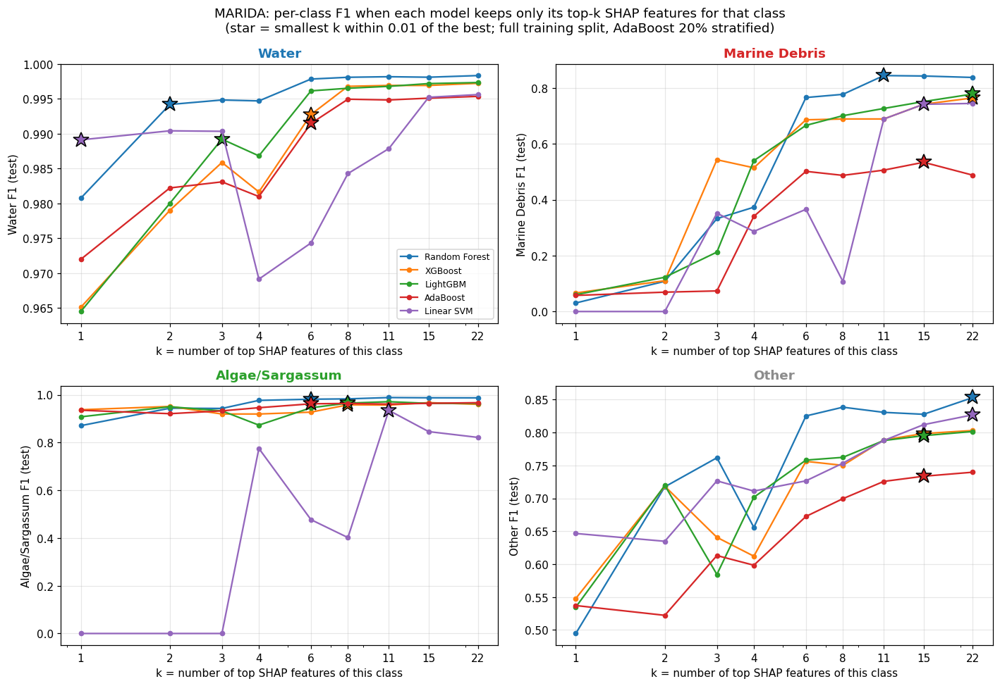

| Model | Water | Marine Debris | Algae/Sargassum | Other |
|---|---|---|---|---|
| Random Forest | **2** (0.994 / 0.998) | **11** (0.844 / 0.838) | **6** (0.981 / 0.987) | 22 (0.853) |
| XGBoost | 6 (0.993 / 0.997) | 22 (0.764) | 8 (0.958 / 0.960) | 15 (0.798 / 0.803) |
| LightGBM | 3 (0.989 / 0.997) | 22 (0.778) | 8 (0.965 / 0.964) | 15 (0.795 / 0.802) |
| AdaBoost | 6 (0.991 / 0.995) | 15 (**0.534** / 0.488) | 6 (0.962 / 0.967) | 15 (0.734 / 0.740) |
| Linear SVM | 1 (0.989 / 0.996) | 15 (0.742 / 0.745) | 11 (**0.935** / 0.821) | 22 (0.827) |

Each cell gives the chosen k and that class's F1 (at k / with all 22).

The selected sets for RF:

| Class | k | Features |
|---|---|---|
| Water | 2 | nir/red, glcm_contrast |
| Marine Debris | 11 | nir/red, swir1/nir, NDWI, nir/green, B12, B5, B4, B11, glcm_contrast, red/green, B2 |
| Algae/Sargassum | 6 | nir/red, NDWI, nir/green, B2, B4, glcm_contrast |
| Other | 22 | all |

Union of the per-class sets vs all 22 features (macro F1):

| Model | Union (n) | Macro F1, union | Macro F1, all 22 |
|---|---|---|---|
| Random Forest | 22 | 0.919 | 0.919 |
| XGBoost | 22 | 0.881 | 0.881 |
| LightGBM | 22 | 0.885 | 0.885 |
| AdaBoost | 18 | **0.801** | 0.797 |
| Linear SVM | 22 | 0.847 | 0.847 |

### 6.3 MADOS

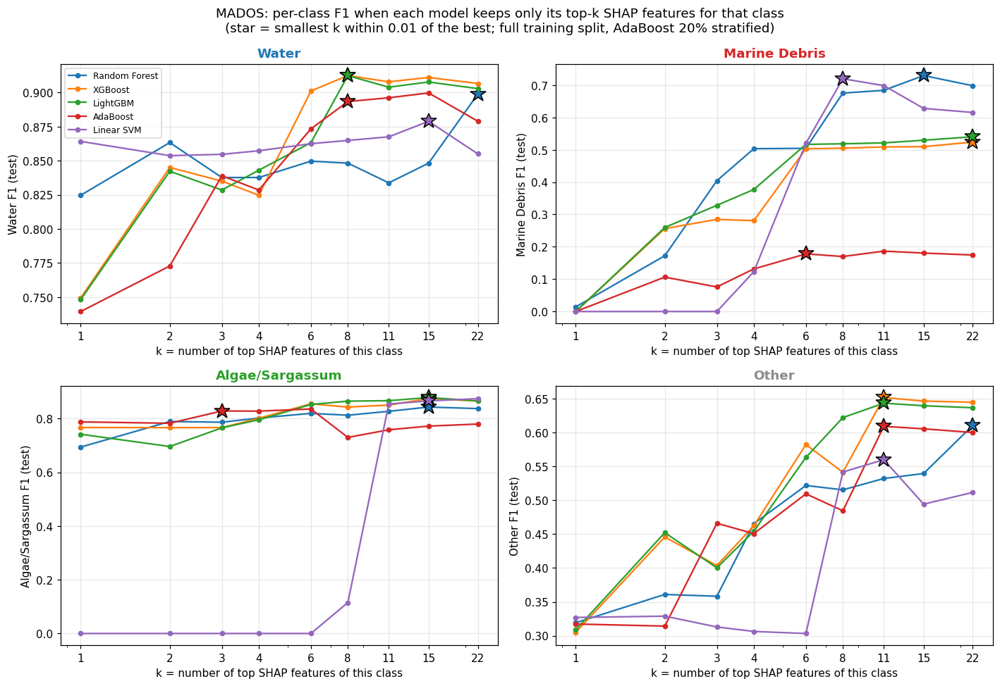

| Model | Water | Marine Debris | Algae/Sargassum | Other |
|---|---|---|---|---|
| Random Forest | 22 (0.899) | **15** (**0.729** / 0.698) | 15 (0.843 / 0.837) | 22 (0.611) |
| XGBoost | 8 (0.912 / 0.907) | 22 (0.524) | 15 (0.874 / 0.865) | 11 (0.652 / 0.645) |
| LightGBM | 8 (0.912 / 0.903) | 22 (0.540) | 15 (0.878 / 0.866) | 11 (0.644 / 0.637) |
| AdaBoost | 8 (0.893 / 0.879) | 6 (0.178 / 0.175) | **3** (0.828 / 0.779) | 11 (0.609 / 0.600) |
| Linear SVM | 15 (0.879 / 0.855) | **8** (**0.720** / 0.615) | 15 (0.865 / 0.874) | 11 (0.560 / 0.512) |

The selected debris sets:

| Model | k | Features |
|---|---|---|
| Random Forest | 15 | swir1/nir, nir/red, B12, NDWI, nir/green, red/green, B5, B1, B11, B8, B4, B6, glcm_correlation, B2, B7 |
| Linear SVM | 8 | NDWI, nir/green, nir/red, B5, B11, B12, B8A, swir1/nir |
| AdaBoost | 6 | swir1/nir, nir/red, NDWI, red/green, B1, nir/green |

Union of the per-class sets vs all 22 features (macro F1):

| Model | Union (n) | Macro F1, union | Macro F1, all 22 |
|---|---|---|---|
| Random Forest | 22 | 0.761 | 0.761 |
| XGBoost | 22 | 0.735 | 0.735 |
| LightGBM | 22 | 0.736 | 0.736 |
| AdaBoost | 13 | **0.633** | 0.608 |
| Linear SVM | 20 | **0.722** | 0.714 |

MADOS is harder than MARIDA, and every class needs more features:
- **Water** needs 8 features for the boosted models and all 22 for RF. MADOS
  water includes turbid and sun-glint pixels, so texture and SWIR are needed
  as well as nir/red.
- **Debris** again starts with swir1/nir, nir/red and NDWI. For RF, the top 15
  beat all 22 by 3 points (0.729 vs 0.698): the 7 dropped features are 5 GLCM
  features, B3 and B8A.

### 6.4 What the selection justifies

- **Easy classes need very few features (on MARIDA).**
  - Water: 2–6 features reach F1 ≥ 0.99. One feature (nir/red for the trees,
    glcm_dissimilarity for the SVM) already reaches 0.96–0.99.
  - Algae/Sargassum: about 6–8 features are within 0.01 of the best.
  - In both cases the top features are the physically expected ones (3.3, 5.4).
  - On the harder MADOS data, the same classes need 8–15 features.
- **Marine Debris is the hard class.**
  - Its curve rises steeply over the first 6 features (swir1/nir, nir/red,
    NDWI, nir/green, the other ratios, SWIR).
  - On both datasets, for RF, a subset beats all 22 features:
    - MARIDA: top 11, F1 0.844 vs 0.838.
    - MADOS: top 15, F1 0.729 vs 0.698.
  - The features dropped from that subset are mostly GLCM, which adds noise
    for this class (stage 7 already showed GLCM alone hurts debris).
- **"Other" needs nearly everything.** It is a mixed class (land, ships,
  wakes, clouds), so many features each describe part of it.
- **Every stage-8 feature is in the top-k of at least one class for the three
  best models.** For RF, XGBoost and LightGBM, the union of the per-class
  choices is the full 22-feature set on both datasets, with the same F1. This
  is the per-class justification for stage 8: no feature is useless for every
  class.
- **AdaBoost and the linear SVM do better with fewer features.**
  - AdaBoost: 18 features on MARIDA, 13 on MADOS (macro F1 0.633 vs 0.608).
  - Linear SVM: 20 features on MADOS (0.722 vs 0.714).
  - Per class the SVM gains are large: Algae/Sargassum on MARIDA rises from
    0.821 to 0.935 (top 11), and Marine Debris on MADOS from 0.615 to 0.720
    (top 8). Removing collinear inputs stabilises the linear weights.
- **Candidate simplification:** for the tree models, drop **either NDWI or
  nir/green**. They are the same feature to a tree (section 3.3). Not run here.

## 7. Limitations

- SHAP explains the model, not the physics. Where a model is wrong, its SHAP
  values describe the wrong reasoning faithfully.
- Interventional SHAP assumes features can vary independently. Bands, ratios
  and indices are strongly correlated, so credit within a correlated group
  (B8/B8A, NDWI/nir/green, energy/ASM) can move between members. Group shares
  (5.3) are more stable than individual ranks.
- SHAP uses 500 explained test pixels per class and 100 background pixels.
  Re-sampling changes individual shares by about 1–3 points (compare the
  other team's figures). The top 3–5 features per class are stable.
- The AdaBoost selection uses a 20 % stratified training sample, and AdaBoost
  SHAP uses permutation sampling (10 permutations).
- The top-k selection uses the test split to choose k, so its F1 values are
  slightly optimistic. They justify the ranking, not a final reported score.

## 8. Reproduce

```powershell
pip install shap numba
python scripts/feature_analysis/per_class_features.py                  # both datasets, all parts (~4 h on 12 CPU cores)
python scripts/feature_analysis/per_class_features.py --parts select   # selection only, reuses the SHAP ranking
```

Details and options: [`scripts/feature_analysis/README.md`](../../scripts/feature_analysis/README.md).
