# SHAP analysis of the five stage-8 pixel classifiers (MARIDA and MADOS)

All numbers in this report are produced by `scripts/shap_analysis/run_shap_analysis.py`; the per-figure findings are filled in from the computed SHAP values (see `06_reports/tables/`).

## Scope

- **Models:** the five models of the staged pipeline, stage 8 (`scripts/staged_ml/stage8_ndwi_ratios_glcm.py`), log class weighting, seed 42: Random Forest, XGBoost, LightGBM, AdaBoost (SAMME, depth-3 trees) and a linear SVM (StandardScaler + LinearSVC). The pipeline never saved fitted models, so they were re-fitted once with the pipeline's own functions (`scripts/shap_analysis/train_stage8_models.py`) and saved to `models/stage8_log/`; every model reproduces the recorded test metrics in `outputs/staged/log_weights/stage8_ndwi_ratios_glcm/` (max |difference| <= 1.1e-16).
- **Classes** (labels 1-4 encoded 0-3, from `scripts/utilities/convert.py`): 1 Water = Marine Water, Sediment-Laden Water, Turbid, Shallow, Waves, Wakes, Mixed Water; 2 Marine Debris; 3 Sargassum = dense + sparse Sargassum (MADOS: dense Sargassum + sparse floating algae); 4 Other = Ship, Natural Organic Material, Foam (MADOS additionally maps original classes 6, 13, 14, 15 - Oil Spill, Oil Platform, Jellyfish, Sea snot in the MADOS class list - to 4). Class 0 (unannotated, clouds, cloud shadows) is excluded, as in training.
- **SHAP only.** Explained quantity per model:

| Model | Explainer | Output explained (one SHAP vector per class) |
|---|---|---|
| Random Forest | TreeExplainer, interventional | class probability (predict_proba) |
| XGBoost | TreeExplainer, interventional | raw softmax margin (log-odds scale) |
| LightGBM | TreeExplainer, interventional | raw softmax margin (log-odds scale) |
| AdaBoost | TreeExplainer, interventional, on an exact tree-ensemble rewrite of the SAMME decision_function | SAMME score d_k = sum_m (w_m/W)(1[tree_m = k] - 1/3[tree_m != k]); predict_proba = softmax(d/3) |
| Linear SVM | LinearExplainer, interventional (exact); validated with KernelSHAP | one-vs-rest margin (LinearSVC has no probabilities) |

SHAP values are relative to the mean output over the shared class-balanced training background. Raw SHAP magnitudes are only compared within a model; cross-model comparisons use normalised shares (share = mean|SHAP_f| / sum of mean|SHAP| over all 22 features, per model and output).

## Features (stage 8, in model input order)

| Feature | Source | Computational meaning |
|---|---|---|
| B1 ... B12 (11 columns) | `pixel_features.py` | Sentinel-2 surface reflectance of bands B1 (443 nm), B2 (490), B3 (560), B4 (665), B5 (705), B6 (740), B7 (783), B8 (842), B8A (865), B11 (1610), B12 (2190). MARIDA: Rayleigh-corrected patches; MADOS: ACOLITE rhorc. |
| NDWI | `pixel_features.py` | (B3 - B8) / (B3 + B8) (McFeeters). Higher = green reflectance high relative to NIR. |
| red/green | `pixel_features.py` | B4 / B3 |
| nir/red | `pixel_features.py` | B8 / B4 |
| nir/green | `pixel_features.py` | B8 / B3 |
| swir1/nir | `pixel_features.py` | B11 / B8 |
| glcm_contrast | `glcm_features.py` | sum p(i,j)(i-j)^2 - large when neighbouring grey levels differ strongly. |
| glcm_dissimilarity | `glcm_features.py` | sum p(i,j)|i-j| - like contrast but linear in the grey-level difference. |
| glcm_homogeneity | `glcm_features.py` | sum p(i,j)/(1+(i-j)^2) - large when co-occurring grey levels are similar. |
| glcm_energy | `glcm_features.py` | sqrt(ASM). |
| glcm_correlation | `glcm_features.py` | linear correlation of grey levels of neighbouring pixels; 1 for a flat window. |
| glcm_asm | `glcm_features.py` | angular second moment sum p(i,j)^2 - large when few grey-level pairs dominate (uniform window). |

GLCM details (`glcm_features.py`, MARIDA reference implementation): grey image = 0.2125 B4 + 0.7154 B3 + 0.0721 B2 after clipping to [0, 0.15] and scaling; 17 grey levels; 13 x 13 window centred on the pixel (reflect padding); co-occurrence at distance 1, averaged over 0/45/90/135 degrees. GLCM features therefore describe the visible-band texture of a ~130 m x 130 m neighbourhood, not the pixel itself. energy = sqrt(ASM), so the two are perfectly rank-correlated and any split of credit between them is arbitrary; contrast and dissimilarity are also strongly related. Statements below about what a texture value 'means' for debris or Sargassum are hypotheses; SHAP only shows how the models use these numbers.

## Overall findings (computed results only)

All shares below are **normalised SHAP importance**: a feature's mean |SHAP| divided by the sum over all 22 features, for one model (and one class output where stated). They are computed on 300 stratified test pixels per class. Raw SHAP magnitudes are never compared across models. "Direction" is the Spearman correlation (rho) between a feature's value and its SHAP value on the stated output.

### 1. Most influential features globally

| Rank (mean over 5 models) | MARIDA | MADOS |
|---|---|---|
| 1 | nir/red 16.4% | nir/red 16.3% |
| 2 | glcm_contrast 11.7% | swir1/nir 11.9% |
| 3 | swir1/nir 6.7% | NDWI 6.7% |
| 4 | NDWI 6.3% | glcm_contrast 6.0% |
| 5 | B11 5.6% | nir/green 5.5% |

- **nir/red (B8/B4) is the top feature for all four tree models in both datasets.** Its share is 14.5–28.0% on MARIDA and 13.2–29.5% on MADOS, with AdaBoost the most concentrated. For the linear SVM it carries only 3.1% (MARIDA) and 6.0% (MADOS).
- **GLCM texture matters more on MARIDA than on MADOS.** The six GLCM features together take 18–22% for the tree models on MARIDA and 12–14% on MADOS. In both datasets nearly all of that is `glcm_contrast`. The SVM spreads more weight over the GLCM features: 28% (MARIDA) and 37% (MADOS).
- **`glcm_asm` is effectively unused by XGBoost and LightGBM** (0.00–0.01% share in both datasets). Since `glcm_energy` = sqrt(`glcm_asm`), the two are perfectly rank-correlated, and these split-based models only ever split on energy. Any importance difference between these two features is therefore arbitrary and should not be interpreted.

### 2. Most influential features per class (tree models; SVM listed separately in section 3)

| Class output | MARIDA | MADOS | Direction (both datasets) |
|---|---|---|---|
| **1 Water** | nir/red top for RF, XGB, LGBM, AdaBoost (16–33%); then glcm_contrast (10–22%) | nir/red top for all four tree models (13–37%); then NDWI (RF), glcm_contrast (XGB, LGBM) or swir1/nir (AdaBoost) | high nir/red lowers the Water score (rho -0.90 to -0.97); high NDWI raises it (rho +0.86 to +0.96); high glcm_contrast lowers it (rho -0.70 to -0.90) |
| **2 Marine Debris** | nir/red top for all four (13–26%); swir1/nir second (10–24%) | swir1/nir top for all four (15–42%); nir/red second (11–18%) | **nir/red acts as a window, not a slope**: debris SHAP is positive only for nir/red ≈ 0.8–1.5 and peaks at 1.0–1.2 in every tree model and both datasets. It is negative below 0.8 and above 1.5. The median debris pixel has nir/red 0.93 (MARIDA) / 0.99 (MADOS), against 0.50 / 0.75 for water and 2.57 / 2.33 for Sargassum. **Low swir1/nir raises the debris score** (rho -0.52 to -0.61 on MARIDA, -0.72 to -0.82 on MADOS). |
| **3 Sargassum** | nir/red top for all four (23–42%) | nir/red top for all four (23–51%) | high nir/red raises the Sargassum score (rho +0.79 to +0.94); for XGB and LightGBM, high B2/B3 (blue, green) lower it (rho -0.81 to -0.95) |
| **4 Other** (ships, natural organic material, foam; MADOS adds oil spill, oil platform, jellyfish, sea snot) | **glcm_contrast top for all four (19–35%)**, then B11 (RF, XGB, LGBM) or swir1/nir (AdaBoost) | swir1/nir top for XGB, LGBM, AdaBoost (13–24%); B12 top for RF (10%); glcm_contrast 8–11% | high glcm_contrast, high B11/B12 and high swir1/nir raise the Other score (rho +0.74 to +0.96; the one exception is AdaBoost's B11 on MARIDA, +0.49) |

What this does and does not show:
- The models separate Water, Debris and Sargassum mainly along nir/red. Debris is the intermediate range between water (low) and Sargassum (high). swir1/nir is the second axis for debris.
- "Other" is the class where neighbourhood texture (`glcm_contrast` over the 13 x 13 window of the visible-band grey image) carries the most weight in MARIDA. Its median is 5.59 for Other pixels against 0.13 for water. On MADOS that texture gap is much smaller (median 0.28 vs 0.10), and the models rely on SWIR instead. One possible reason is that MADOS's class 4 contains different materials, but that is a hypothesis.
- These are attributions of fitted models. They do not show that a physical property of debris or Sargassum causes the values. A texture statistic describes the grey-level pattern around a pixel, not the material.

### 3. How the five models use features differently

- **XGBoost and LightGBM are nearly interchangeable**: Spearman rank agreement of global importance is 0.95 in both datasets.
- **RF and AdaBoost broadly agree with them** (rank agreement 0.61–0.79 MARIDA, 0.65–0.77 MADOS). AdaBoost is the most concentrated model: on MARIDA nir/red + glcm_contrast take 47% of its attribution, and on MADOS nir/red + swir1/nir take 51%. Its depth-3 trees use few features.
- **The linear SVM ranks features very differently from all tree models**: rank agreement -0.19 to 0.40 on MARIDA and -0.37 to -0.10 on MADOS. Its top feature is B4 (MARIDA) and glcm_dissimilarity (MADOS). It assigns large, opposing linear weights to strongly correlated features. For example, nir/green and NDWI both have rho = -1.00 on its debris output, and their contributions partly cancel. This is a property of a linear fit on collinear inputs, not evidence that those features matter more for the SVM than nir/red does for the trees.
- **Interactions**: in the tree models, 36–70% of the absolute SHAP-interaction mass is off-diagonal. AdaBoost has the smallest interaction share (0.36–0.50) and LightGBM the largest (0.59–0.70), so none of the tree models behaves additively. For the debris output the strongest pair is **nir/red x swir1/nir** for XGBoost, LightGBM and AdaBoost in both datasets, and for RF on MADOS. For RF on MARIDA it is NDWI x nir/red. The linear SVM has no interactions by construction.

### 4. What drives the main confusions

The confusion pairs below are ranked by total test errors over the five models. Values are mean feature values of the explained misclassified pixels against all stratified pixels of the true and predicted class (XGBoost case-study table).

- **Water → Other** is the most frequent error in both datasets: 2,393 errors in MARIDA and 220,773 in MADOS, summed over models.
  - On MARIDA every tree model's error is driven by `glcm_contrast`. The misclassified water pixels have mean contrast 2.94, against 0.17 for water and 5.44 for Other, so they sit between the two.
  - On MADOS the dominant terms are B3, B1 and nir/red for XGBoost and LightGBM, and nir/red for RF and AdaBoost. Texture is not the main factor there.
- **Water → Debris** (MARIDA 966, MADOS 5,722; on MADOS 5,423 of these come from AdaBoost).
  - On MARIDA nir/red is the main term in every tree model. On MADOS it is swir1/nir for XGBoost and LightGBM (nir/red second) and nir/red for RF and AdaBoost.
  - The misclassified water pixels have nir/red 1.00 (MARIDA) / 0.97 (MADOS), inside the debris window, against 0.55 / 0.69 for typical water.
- **Debris → Water** (MARIDA 101, MADOS 244). These debris pixels have nir/red 0.76 / 0.85 and NDWI 0.16 / 0.16. That is lower nir/red and higher NDWI than typical debris (0.95 / 0.98 and 0.05 / 0.03), so they look more water-like on both main axes.
- **Water ↔ Sargassum** (MARIDA water→Sargassum 904; MADOS Sargassum→water 1,322, water→Sargassum 996).
  - Again nir/red dominates. The Sargassum pixels predicted as water have nir/red 0.90 (MARIDA) / 0.93 (MADOS), against 2.56 / 2.16 for typical Sargassum.
  - The water pixels predicted as Sargassum have nir/red 1.16 / 1.12. For XGBoost and LightGBM, B2/B3 also push towards Sargassum.

Overall, most errors come from pixels whose nir/red (and, for Other on MARIDA, glcm_contrast) value lies in the range the models associate with the other class. This is consistent with the class-specific attribution patterns above. It does not establish whether those pixels are mixed or ambiguous or whether the labels are wrong.

## Overall SHAP contribution rate of all 22 features

Contribution rate of a feature = its normalised SHAP importance (mean |SHAP| / sum over the 22 features, averaged over the 4 class outputs) averaged over the five models, so each model counts equally whatever its output scale; the rates sum to 1. 'Both datasets' averages the MARIDA and MADOS rates with equal weight. Values: `03_cross_model_comparison/overall/overall_contribution_rates.csv`.

#### Fig. O-1. Overall SHAP contribution rate, MARIDA (5-model mean)

- **What it shows:** all 22 features ranked by contribution rate for MARIDA.
- **How to read:** bar length and colour = contribution rate (share of total attribution); labels give the value.
- **Findings:** top five **nir/red** 0.164, **glcm_contrast** 0.117, **swir1/nir** 0.067, **NDWI** 0.063, **B11** 0.056; the top five together carry 0.467. Lowest: glcm_energy 0.019, glcm_homogeneity 0.016, glcm_asm 0.011.
- **Limitations:** unsigned (no direction), averaged over classes and models; per-class and per-model differences are in sections A1, A3 and B6.

#### Fig. O-2. Overall SHAP contribution rate, MADOS (5-model mean)

- **What it shows:** all 22 features ranked by contribution rate for MADOS.
- **How to read:** bar length and colour = contribution rate (share of total attribution); labels give the value.
- **Findings:** top five **nir/red** 0.163, **swir1/nir** 0.119, **NDWI** 0.067, **glcm_contrast** 0.060, **nir/green** 0.055; the top five together carry 0.463. Lowest: B8 0.022, glcm_correlation 0.021, glcm_asm 0.014.
- **Limitations:** unsigned (no direction), averaged over classes and models; per-class and per-model differences are in sections A1, A3 and B6.

#### Fig. O-3. Overall SHAP contribution rate, MARIDA + MADOS (5-model mean)

- **What it shows:** all 22 features ranked by contribution rate for MARIDA + MADOS.
- **How to read:** bar length and colour = contribution rate (share of total attribution); labels give the value.
- **Findings:** top five **nir/red** 0.163, **swir1/nir** 0.093, **glcm_contrast** 0.088, **NDWI** 0.065, **nir/green** 0.054; the top five together carry 0.463. Lowest: glcm_correlation 0.020, glcm_homogeneity 0.020, glcm_asm 0.012.
- **Limitations:** unsigned (no direction), averaged over classes and models; per-class and per-model differences are in sections A1, A3 and B6.

## Limitations and computational compromises

- **Attribution, not causation.** SHAP describes how each fitted model's output depends on its inputs over the chosen background; it says nothing about physical causes.
- **Retrained models.** No fitted models existed on disk; they were re-fitted with the pipeline's own code and seed and reproduce the recorded test metrics to 1e-16, but library versions differ from the original run (see `models/stage8_log/<dataset>/meta.json`).
- **Sampling.** Global and class plots use a class-stratified sample of the test split (up to 300 pixels per class), so importance is class-balanced, not frequency-weighted. Water dominates the real test set (MARIDA ~98%), so frequency-weighted importance would be close to the Water output's importance.
- **Background.** A 200-pixel class-balanced training background is used for all explainers. Base values and SHAP values change with the background; interventional SHAP breaks feature correlations, so strongly correlated features (adjacent bands, band ratios built from the same bands, energy/ASM) can receive credit for off-manifold combinations, and credit can be split between them.
- **Different output scales.** RF explains probabilities, XGBoost/LightGBM log-odds margins, AdaBoost SAMME scores and SVM margins. Raw magnitudes are never compared across models; only normalised shares and ranks.
- **Interactions.** SHAP interaction values are only defined (in SHAP) for tree models via path-dependent TreeSHAP; they use the training cover as reference (a different reference from the interventional main values) and were computed on a smaller subset. AdaBoost's cover was recomputed from the log-weighted training pixels because the stored node weights reflect boosting re-weighting. The linear SVM has no interactions.
- **SVM.** KernelSHAP was run only as a correctness check on a small sample; the exact LinearExplainer values are used for all plots.
- **Single pixels.** Waterfall and decision plots explain individual pixels and should be read together with the population plots; annotated polygons can contain mixed pixels at their edges.

# Part 1: MARIDA

## MARIDA - Data, models and validation

- Train pixels per class (1-4): [350057, 1943, 1961, 4481]; test pixels per class: [154739, 381, 1641, 1610] (official scene-disjoint splits).
- Explanation set: 1200 stratified test pixels (per class [300, 300, 300, 300], cap 300) plus 615 extra misclassified test pixels (up to 30 per model and confusion pair) used only for section D. Global/class plots use the stratified part, so each class weighs equally regardless of its frequency.
- Background: 200 training pixels ([50, 50, 50, 50] per class), shared by all five explainers. Interaction subset: 160 stratified test pixels.
- Feature order verified identical to training (22 features); class encoding 0-3 = labels 1-4 verified for every model (classes_ = [0, 1, 2, 3]).

| Model | Explainer | Explained output | Test macro F1 (reproduced / recorded) | Additivity max error | SHAP array |
|---|---|---|---|---|---|
| Random Forest | TreeExplainer (interventional TreeSHAP) | class probability | 0.9165 / 0.9165 | 1.0e-02 (max output 1; 7 of 1815 px > 1e-5) | (1815, 22, 4) |
| XGBoost | TreeExplainer (interventional TreeSHAP) | raw softmax margin (log-odds scale) | 0.8828 / 0.8828 | 3.0e-06 (max output 6.59) | (1815, 22, 4) |
| LightGBM | TreeExplainer (interventional TreeSHAP) | raw softmax margin (log-odds scale) | 0.8855 / 0.8855 | 2.7e-07 (max output 10.4) | (1815, 22, 4) |
| AdaBoost | TreeExplainer (interventional TreeSHAP) on exact tree rewrite of SAMME decision_function | SAMME decision score | 0.7988 / 0.7988 | 5.6e-09 (max output 0.816) | (1815, 22, 4) |
| Linear SVM | LinearExplainer (interventional; exact for linear margin), validated with KernelExplainer | one-vs-rest SVM margin | 0.8472 / 0.8472 | 3.5e-06 (max output 63.3) | (1815, 22, 4) |

Random Forest additivity: all but a handful of pixels are exact to < 1e-5; the outliers differ by exactly 0.01 = 1/100 trees, i.e. one tree routes the pixel differently because SHAP stores the sklearn split thresholds at lower precision (a value lying exactly on a rounded threshold). Not an analysis error.

Interaction values: sum over the full 22 x 22 matrix + base value reproduces the model output to Random Forest 3.2e-13, XGBoost 6.6e-06, LightGBM 3.5e-14, AdaBoost 2.1e-12.

SVM check: KernelSHAP (same background, 4096 coalitions, no L1 selection) on 40 pixels agrees with LinearExplainer to 2.4e-06 (max |SHAP| 27.2; correlation 1.000000).

Per-class test F1 (reproduced):

| Model | Water | Marine Debris | Sargassum | Other |
|---|---|---|---|---|
| Random Forest | 0.998 | 0.831 | 0.987 | 0.850 |
| XGBoost | 0.997 | 0.774 | 0.958 | 0.802 |
| LightGBM | 0.997 | 0.778 | 0.964 | 0.802 |
| AdaBoost | 0.995 | 0.488 | 0.965 | 0.747 |
| Linear SVM | 0.996 | 0.745 | 0.821 | 0.827 |

## MARIDA - Section A - Overall feature importance

### MARIDA - A1. Global SHAP bar plots

#### Fig. MARIDA-1. Random Forest: global SHAP importance (mean |SHAP| over the 4 class outputs)

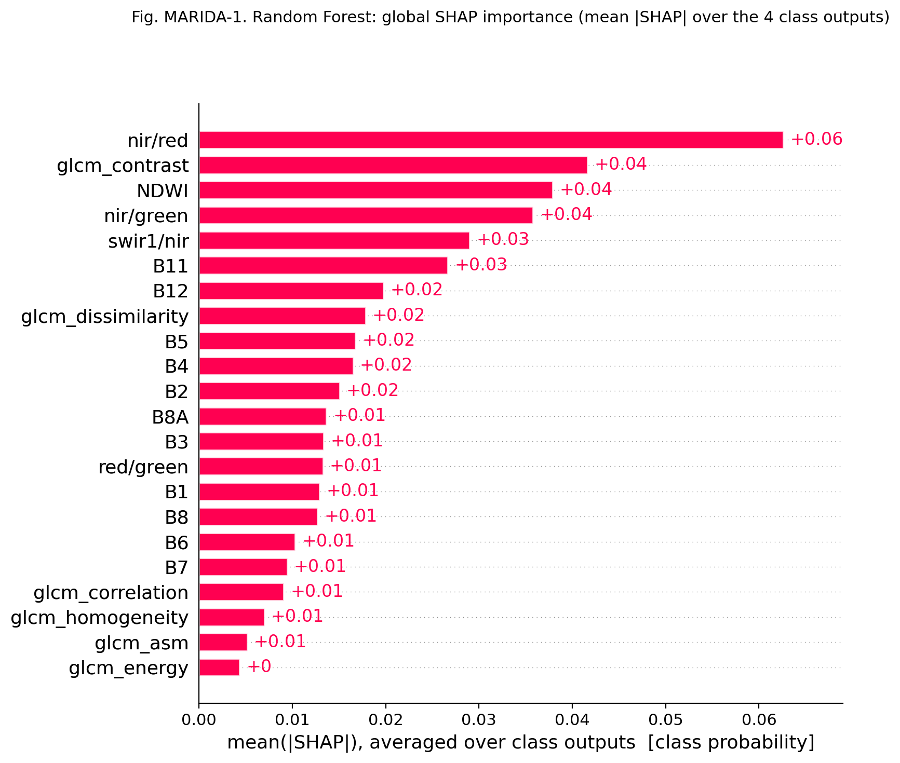

- **What it shows:** Global importance of all 22 features for Random Forest: mean |SHAP| over the class-stratified test sample and over the four class outputs (class probability).
- **How to read:** Bar length = average absolute contribution of a feature, in the model's output unit; sign is ignored. Features are sorted by importance.
- **Findings:** Top five (share of the model's total): **nir/red** (14.5%), **glcm_contrast** (9.7%), **NDWI** (8.8%), **nir/green** (8.3%), **swir1/nir** (6.7%). The top three together carry 33.0%. Least used: glcm_energy, glcm_asm, glcm_homogeneity.
- **Meaning:** Random Forest separates the four classes mainly through nir/red and glcm_contrast; features at the bottom could be perturbed with little change in its outputs.
- **Limitations:** Magnitudes are in this model's own unit and are not comparable across models (see the normalised comparison in section A3). Correlated features (e.g. adjacent bands, energy/ASM) can share or swap credit.

#### Fig. MARIDA-2. XGBoost: global SHAP importance (mean |SHAP| over the 4 class outputs)

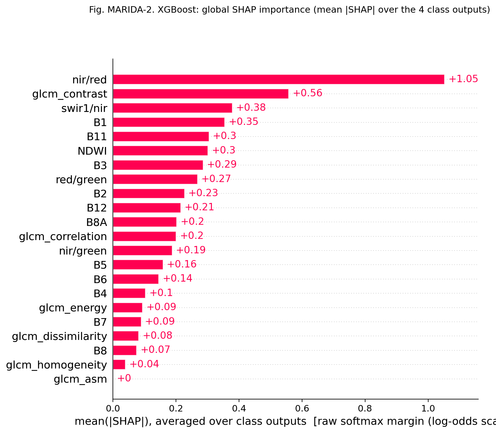

- **What it shows:** Global importance of all 22 features for XGBoost: mean |SHAP| over the class-stratified test sample and over the four class outputs (raw softmax margin (log-odds scale)).
- **How to read:** Bar length = average absolute contribution of a feature, in the model's output unit; sign is ignored. Features are sorted by importance.
- **Findings:** Top five (share of the model's total): **nir/red** (19.8%), **glcm_contrast** (10.5%), **swir1/nir** (7.1%), **B1** (6.7%), **B11** (5.7%). The top three together carry 37.4%. Least used: glcm_asm, glcm_homogeneity, B8.
- **Meaning:** XGBoost separates the four classes mainly through nir/red and glcm_contrast; features at the bottom could be perturbed with little change in its outputs.
- **Limitations:** Magnitudes are in this model's own unit and are not comparable across models (see the normalised comparison in section A3). Correlated features (e.g. adjacent bands, energy/ASM) can share or swap credit.

#### Fig. MARIDA-3. LightGBM: global SHAP importance (mean |SHAP| over the 4 class outputs)

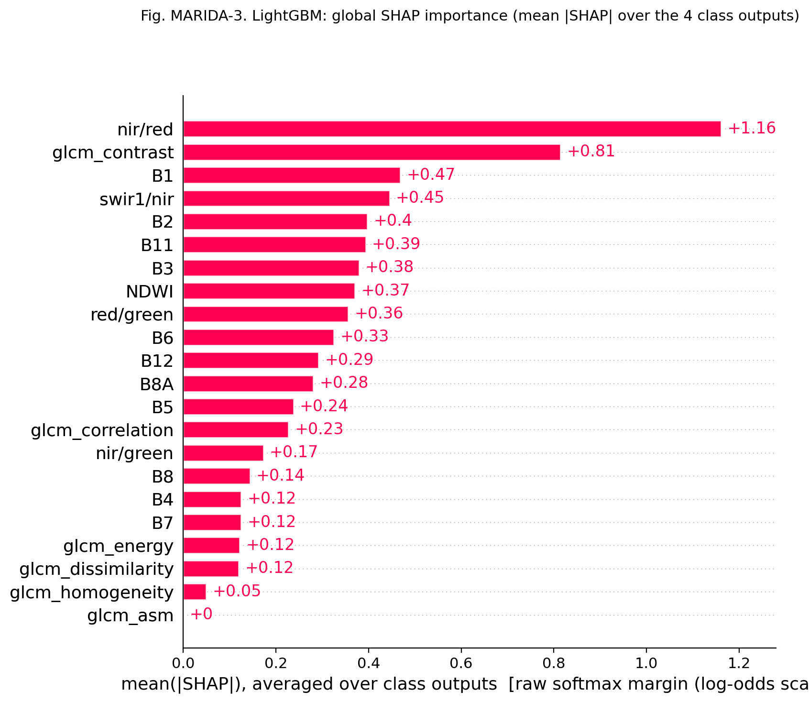

- **What it shows:** Global importance of all 22 features for LightGBM: mean |SHAP| over the class-stratified test sample and over the four class outputs (raw softmax margin (log-odds scale)).
- **How to read:** Bar length = average absolute contribution of a feature, in the model's output unit; sign is ignored. Features are sorted by importance.
- **Findings:** Top five (share of the model's total): **nir/red** (16.6%), **glcm_contrast** (11.6%), **B1** (6.7%), **swir1/nir** (6.4%), **B2** (5.7%). The top three together carry 34.9%. Least used: glcm_asm, glcm_homogeneity, glcm_dissimilarity.
- **Meaning:** LightGBM separates the four classes mainly through nir/red and glcm_contrast; features at the bottom could be perturbed with little change in its outputs.
- **Limitations:** Magnitudes are in this model's own unit and are not comparable across models (see the normalised comparison in section A3). Correlated features (e.g. adjacent bands, energy/ASM) can share or swap credit.

#### Fig. MARIDA-4. AdaBoost: global SHAP importance (mean |SHAP| over the 4 class outputs)

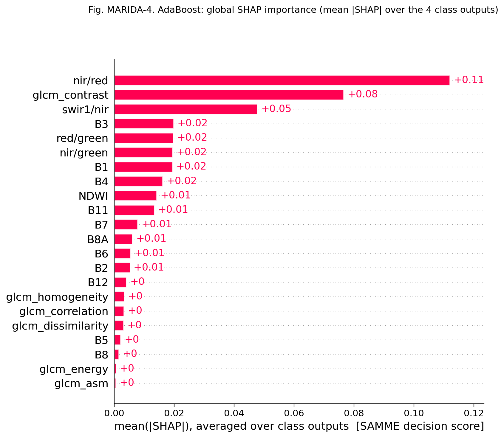

- **What it shows:** Global importance of all 22 features for AdaBoost: mean |SHAP| over the class-stratified test sample and over the four class outputs (SAMME decision score).
- **How to read:** Bar length = average absolute contribution of a feature, in the model's output unit; sign is ignored. Features are sorted by importance.
- **Findings:** Top five (share of the model's total): **nir/red** (28.0%), **glcm_contrast** (19.1%), **swir1/nir** (11.9%), **B3** (4.9%), **red/green** (4.9%). The top three together carry 59.0%. Least used: glcm_asm, glcm_energy, B8.
- **Meaning:** AdaBoost separates the four classes mainly through nir/red and glcm_contrast; features at the bottom could be perturbed with little change in its outputs.
- **Limitations:** Magnitudes are in this model's own unit and are not comparable across models (see the normalised comparison in section A3). Correlated features (e.g. adjacent bands, energy/ASM) can share or swap credit.

#### Fig. MARIDA-5. Linear SVM: global SHAP importance (mean |SHAP| over the 4 class outputs)

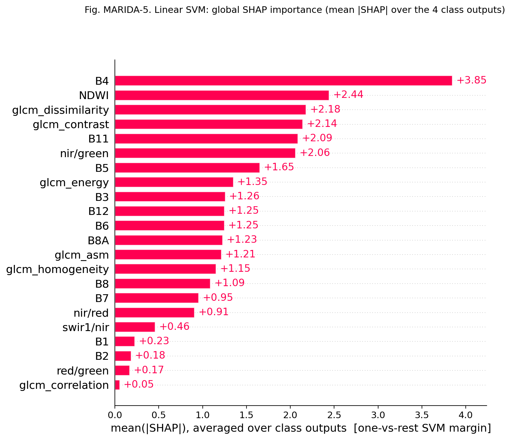

- **What it shows:** Global importance of all 22 features for Linear SVM: mean |SHAP| over the class-stratified test sample and over the four class outputs (one-vs-rest SVM margin).
- **How to read:** Bar length = average absolute contribution of a feature, in the model's output unit; sign is ignored. Features are sorted by importance.
- **Findings:** Top five (share of the model's total): **B4** (13.2%), **NDWI** (8.4%), **glcm_dissimilarity** (7.5%), **glcm_contrast** (7.4%), **B11** (7.2%). The top three together carry 29.1%. Least used: glcm_correlation, red/green, B2.
- **Meaning:** Linear SVM separates the four classes mainly through B4 and NDWI; features at the bottom could be perturbed with little change in its outputs.
- **Limitations:** Magnitudes are in this model's own unit and are not comparable across models (see the normalised comparison in section A3). Correlated features (e.g. adjacent bands, energy/ASM) can share or swap credit.

### MARIDA - A2. Global SHAP beeswarm plots

#### Fig. MARIDA-6. Random Forest: SHAP beeswarm of each pixel's TRUE-class output

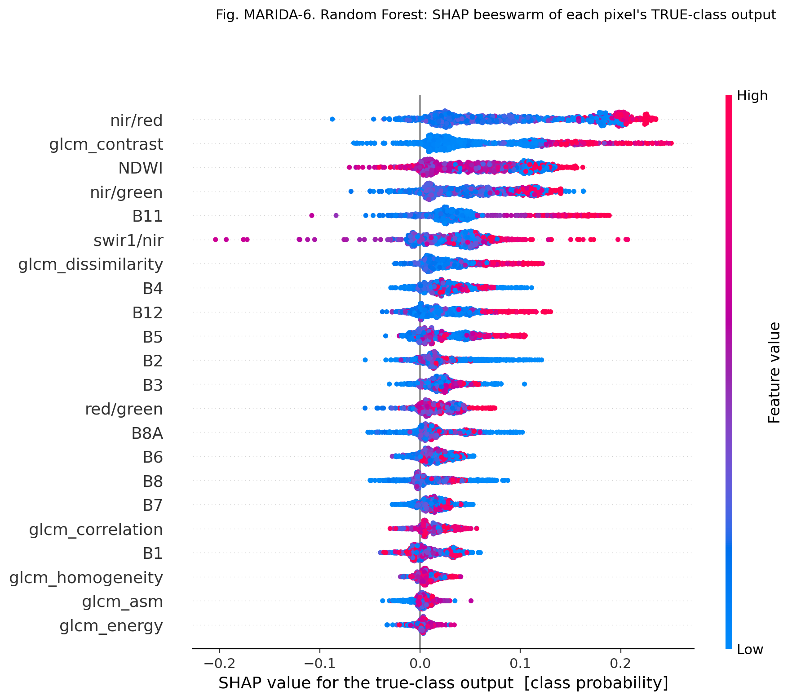

- **What it shows:** Distribution of Random Forest SHAP values for each pixel's own (true-class) output, so every point shows how a feature moved the score of the correct class.
- **How to read:** One dot per pixel; x = SHAP value (right = pushes the true-class output up), colour = the feature's value (SHAP red = high, blue = low), rows sorted by mean |SHAP|.
- **Findings:** **nir/red**: mean|SHAP| 0.104, pooled rho +0.30, mean SHAP +0.102; **glcm_contrast**: mean|SHAP| 0.0686, pooled rho +0.23, mean SHAP +0.0666; **NDWI**: mean|SHAP| 0.0615, pooled rho -0.12, mean SHAP +0.0596; **nir/green**: mean|SHAP| 0.059, pooled rho +0.15, mean SHAP +0.057; **B11**: mean|SHAP| 0.0437, pooled rho +0.02, mean SHAP +0.0412. rho = Spearman correlation between feature value and true-class SHAP, pooled over the four classes; it is not a per-class direction (see section B5). A positive mean SHAP means the feature on average supports the correct label.
- **Meaning:** A positive spread means the feature generally supports the correct label; mixed colours on both sides mean the direction depends on the class (see the class-specific beeswarms).
- **Limitations:** Pools four different outputs (one per true class), so a monotonic colour pattern is not expected; directions must be read per class in section B.

#### Fig. MARIDA-7. XGBoost: SHAP beeswarm of each pixel's TRUE-class output

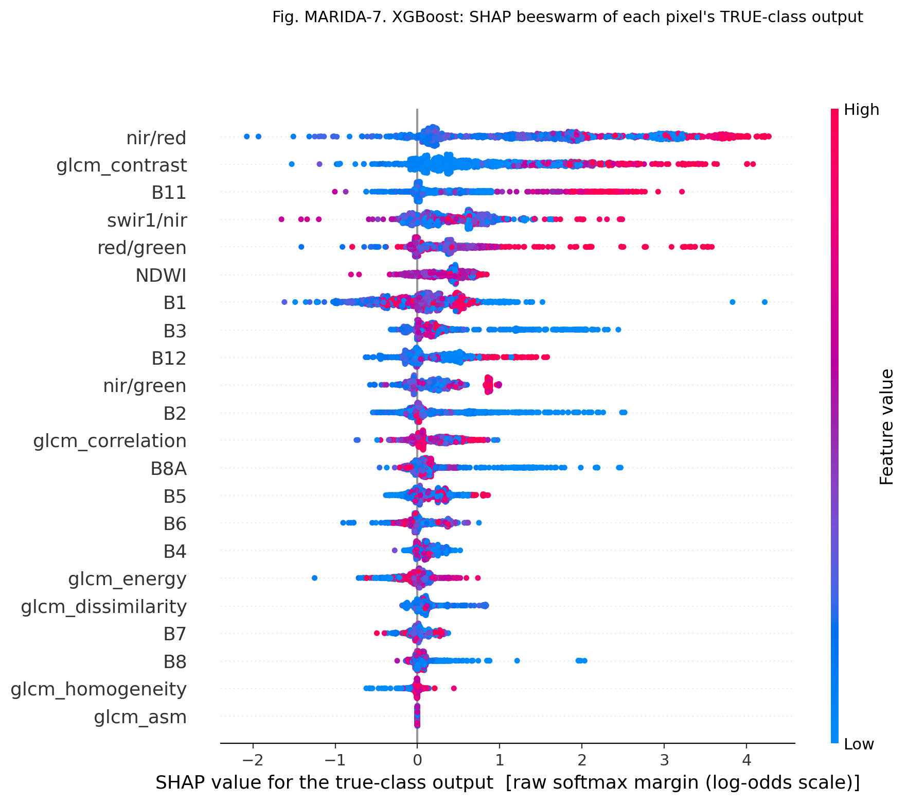

- **What it shows:** Distribution of XGBoost SHAP values for each pixel's own (true-class) output, so every point shows how a feature moved the score of the correct class.
- **How to read:** One dot per pixel; x = SHAP value (right = pushes the true-class output up), colour = the feature's value (SHAP red = high, blue = low), rows sorted by mean |SHAP|.
- **Findings:** **nir/red**: mean|SHAP| 1.64, pooled rho +0.22, mean SHAP +1.59; **glcm_contrast**: mean|SHAP| 0.887, pooled rho +0.16, mean SHAP +0.85; **B11**: mean|SHAP| 0.476, pooled rho +0.16, mean SHAP +0.448; **swir1/nir**: mean|SHAP| 0.455, pooled rho +0.02, mean SHAP +0.405; **red/green**: mean|SHAP| 0.387, pooled rho +0.05, mean SHAP +0.357. rho = Spearman correlation between feature value and true-class SHAP, pooled over the four classes; it is not a per-class direction (see section B5). A positive mean SHAP means the feature on average supports the correct label.
- **Meaning:** A positive spread means the feature generally supports the correct label; mixed colours on both sides mean the direction depends on the class (see the class-specific beeswarms).
- **Limitations:** Pools four different outputs (one per true class), so a monotonic colour pattern is not expected; directions must be read per class in section B.

#### Fig. MARIDA-8. LightGBM: SHAP beeswarm of each pixel's TRUE-class output

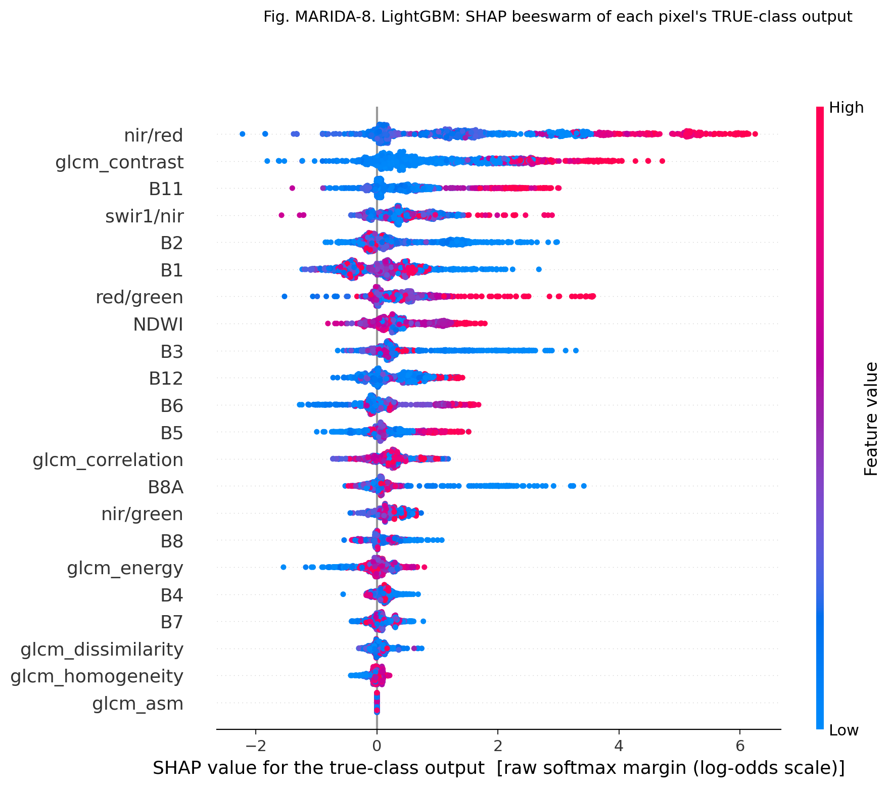

- **What it shows:** Distribution of LightGBM SHAP values for each pixel's own (true-class) output, so every point shows how a feature moved the score of the correct class.
- **How to read:** One dot per pixel; x = SHAP value (right = pushes the true-class output up), colour = the feature's value (SHAP red = high, blue = low), rows sorted by mean |SHAP|.
- **Findings:** **nir/red**: mean|SHAP| 1.95, pooled rho +0.32, mean SHAP +1.9; **glcm_contrast**: mean|SHAP| 1.16, pooled rho +0.19, mean SHAP +1.11; **B11**: mean|SHAP| 0.56, pooled rho +0.11, mean SHAP +0.512; **swir1/nir**: mean|SHAP| 0.492, pooled rho +0.03, mean SHAP +0.437; **B2**: mean|SHAP| 0.476, pooled rho -0.50, mean SHAP +0.339. rho = Spearman correlation between feature value and true-class SHAP, pooled over the four classes; it is not a per-class direction (see section B5). A positive mean SHAP means the feature on average supports the correct label.
- **Meaning:** A positive spread means the feature generally supports the correct label; mixed colours on both sides mean the direction depends on the class (see the class-specific beeswarms).
- **Limitations:** Pools four different outputs (one per true class), so a monotonic colour pattern is not expected; directions must be read per class in section B.

#### Fig. MARIDA-9. AdaBoost: SHAP beeswarm of each pixel's TRUE-class output

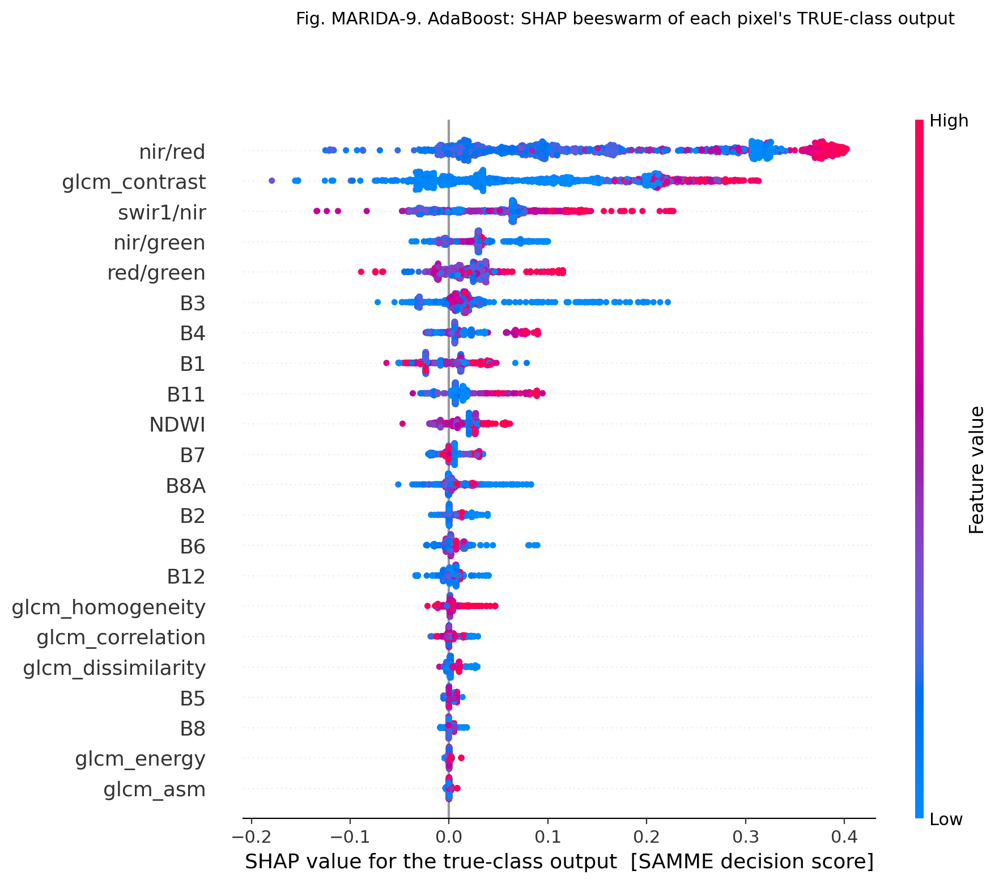

- **What it shows:** Distribution of AdaBoost SHAP values for each pixel's own (true-class) output, so every point shows how a feature moved the score of the correct class.
- **How to read:** One dot per pixel; x = SHAP value (right = pushes the true-class output up), colour = the feature's value (SHAP red = high, blue = low), rows sorted by mean |SHAP|.
- **Findings:** **nir/red**: mean|SHAP| 0.179, pooled rho +0.25, mean SHAP +0.175; **glcm_contrast**: mean|SHAP| 0.107, pooled rho +0.32, mean SHAP +0.0938; **swir1/nir**: mean|SHAP| 0.0553, pooled rho +0.31, mean SHAP +0.0431; **nir/green**: mean|SHAP| 0.0271, pooled rho -0.08, mean SHAP +0.0228; **red/green**: mean|SHAP| 0.025, pooled rho -0.10, mean SHAP +0.0192. rho = Spearman correlation between feature value and true-class SHAP, pooled over the four classes; it is not a per-class direction (see section B5). A positive mean SHAP means the feature on average supports the correct label.
- **Meaning:** A positive spread means the feature generally supports the correct label; mixed colours on both sides mean the direction depends on the class (see the class-specific beeswarms).
- **Limitations:** Pools four different outputs (one per true class), so a monotonic colour pattern is not expected; directions must be read per class in section B.

#### Fig. MARIDA-10. Linear SVM: SHAP beeswarm of each pixel's TRUE-class output

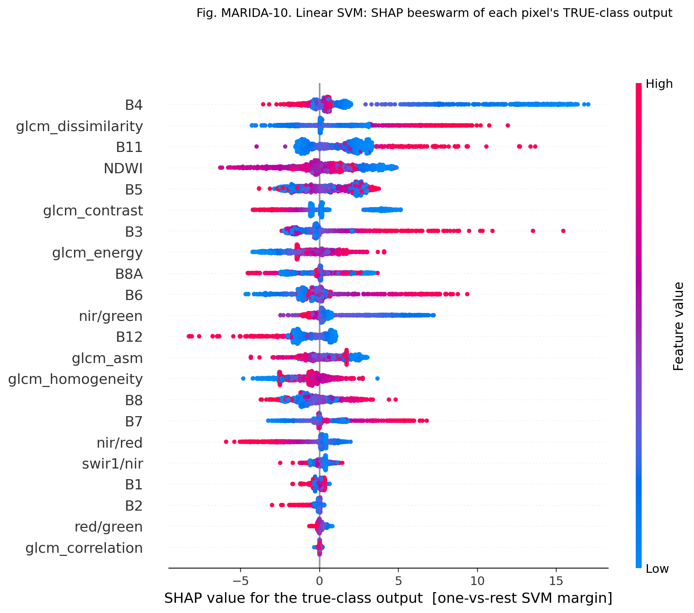

- **What it shows:** Distribution of Linear SVM SHAP values for each pixel's own (true-class) output, so every point shows how a feature moved the score of the correct class.
- **How to read:** One dot per pixel; x = SHAP value (right = pushes the true-class output up), colour = the feature's value (SHAP red = high, blue = low), rows sorted by mean |SHAP|.
- **Findings:** **B4**: mean|SHAP| 3.38, pooled rho -0.67, mean SHAP +3.04; **glcm_dissimilarity**: mean|SHAP| 2.23, pooled rho +0.23, mean SHAP +1.34; **B11**: mean|SHAP| 2.02, pooled rho -0.00, mean SHAP +1.41; **NDWI**: mean|SHAP| 1.69, pooled rho -0.50, mean SHAP +0.583; **B5**: mean|SHAP| 1.62, pooled rho -0.02, mean SHAP +0.618. rho = Spearman correlation between feature value and true-class SHAP, pooled over the four classes; it is not a per-class direction (see section B5). A positive mean SHAP means the feature on average supports the correct label.
- **Meaning:** A positive spread means the feature generally supports the correct label; mixed colours on both sides mean the direction depends on the class (see the class-specific beeswarms).
- **Limitations:** Pools four different outputs (one per true class), so a monotonic colour pattern is not expected; directions must be read per class in section B.

### MARIDA - A3. Cross-model comparison

#### Fig. MARIDA-11. Cross-model comparison of normalised global SHAP importance

- **What it shows:** Normalised global importance of every feature for the five models, side by side.
- **How to read:** Each column is one model; cell = that feature's share of the model's total mean |SHAP| (columns sum to 100%). Rows sorted by mean share. Shares, not raw SHAP values, are compared because the models explain outputs on different scales.
- **Findings:** Highest mean share: **nir/red** (16.4%), **glcm_contrast** (11.7%), **swir1/nir** (6.7%), **NDWI** (6.3%), **B11** (5.6%), **nir/green** (5.2%). Most important feature per model: Random Forest: nir/red, XGBoost: nir/red, LightGBM: nir/red, AdaBoost: nir/red, Linear SVM: B4. Share of 11 bands / NDWI + 4 ratios / 6 GLCM features: Random Forest 38.8% / 41.5% / 19.7%; XGBoost 40.6% / 41.1% / 18.3%; LightGBM 45.2% / 35.8% / 19.0%; AdaBoost 25.1% / 53.2% / 21.8%; Linear SVM 51.5% / 20.7% / 27.8%. Rank range across models of the leading features: nir/red (rank 1-17), glcm_contrast (rank 2-4), swir1/nir (rank 3-18), NDWI (rank 2-9), B11 (rank 5-10), nir/green (rank 4-15).
- **Meaning:** Features that rank high in all columns are used consistently by every model; a feature that is high in one column only is a model-specific choice.
- **Limitations:** Normalisation removes scale but not the dependence of SHAP on the background and on correlated features.

#### Fig. MARIDA-12. Agreement of global feature rankings between models

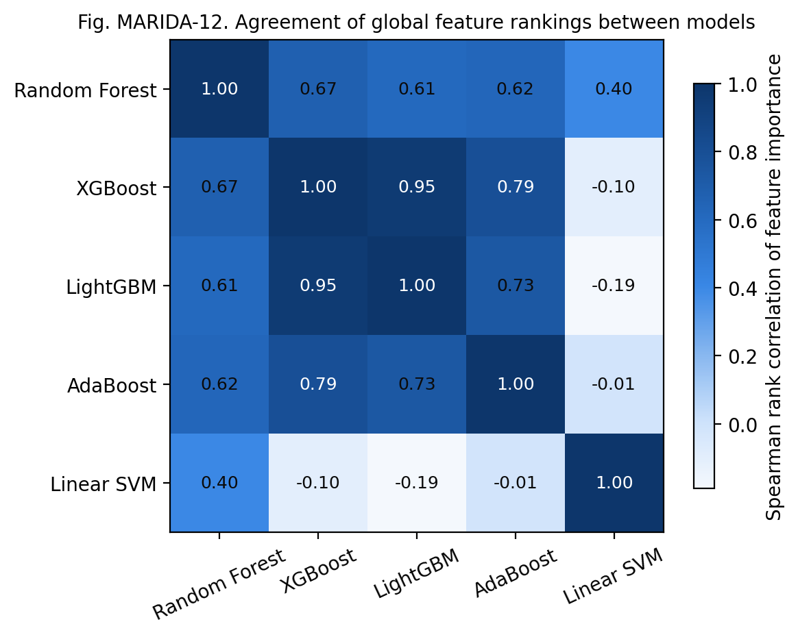

- **What it shows:** How similarly the five models rank the 22 features globally.
- **How to read:** Cell = Spearman correlation between two models' normalised importance vectors (1 = identical ranking).
- **Findings:** Most similar: XGBoost vs LightGBM (rho = 0.95); least similar: LightGBM vs Linear SVM (rho = -0.19). All pairs: XGBoost-LightGBM 0.95, XGBoost-AdaBoost 0.79, LightGBM-AdaBoost 0.73, Random Forest-XGBoost 0.67, Random Forest-AdaBoost 0.62, Random Forest-LightGBM 0.61, Random Forest-Linear SVM 0.40, AdaBoost-Linear SVM -0.01, XGBoost-Linear SVM -0.10, LightGBM-Linear SVM -0.19.
- **Meaning:** Low agreement means two models reach their predictions through different features.
- **Limitations:** Rank correlation over 22 features is sensitive to the many small, noisy low-importance features.

## MARIDA - Section B - Class-specific feature importance

### MARIDA - B4. Class-specific bar plots

#### Fig. MARIDA-13. Random Forest: SHAP importance for the Class 1 Water output

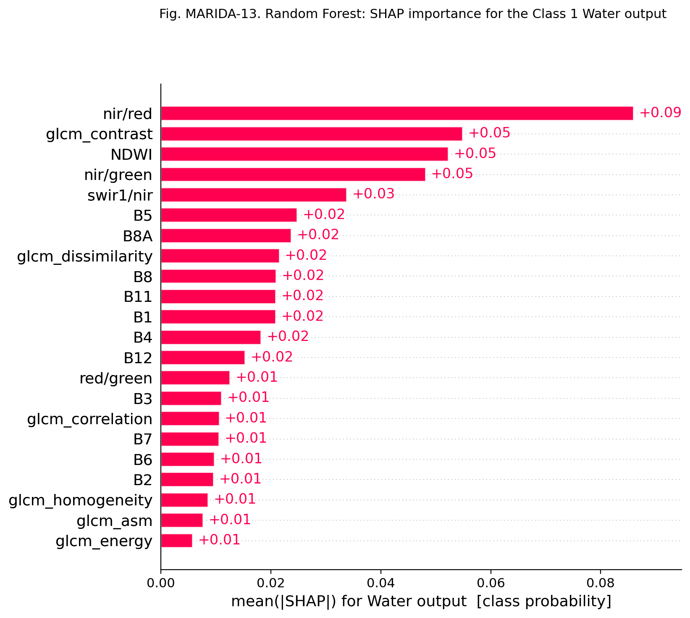

- **What it shows:** Random Forest importance of each feature for the Class 1 Water output only (class probability).
- **How to read:** Bar = mean |SHAP of the Water output| over the whole stratified sample (all four true classes), i.e. how much each feature moves this class's score anywhere in the data.
- **Findings:** Top five: **nir/red** (16.3%), **glcm_contrast** (10.4%), **NDWI** (9.9%), **nir/green** (9.1%), **swir1/nir** (6.4%). Restricted to pixels whose true class is Water, the top three are **nir/red** (18.6%), **glcm_contrast** (11.2%), **NDWI** (10.5%).
- **Meaning:** These are the features Random Forest relies on most to raise or lower its Water score.
- **Limitations:** Unsigned; see the matching beeswarm for direction.

#### Fig. MARIDA-14. Random Forest: SHAP importance for the Class 2 Marine Debris output

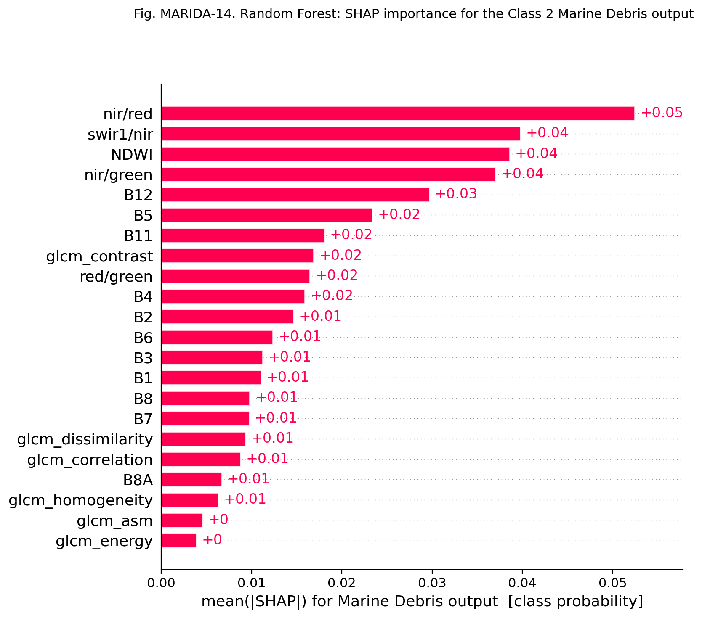

- **What it shows:** Random Forest importance of each feature for the Class 2 Marine Debris output only (class probability).
- **How to read:** Bar = mean |SHAP of the Marine Debris output| over the whole stratified sample (all four true classes), i.e. how much each feature moves this class's score anywhere in the data.
- **Findings:** Top five: **nir/red** (13.2%), **swir1/nir** (10.0%), **NDWI** (9.7%), **nir/green** (9.3%), **B12** (7.5%). Restricted to pixels whose true class is Marine Debris, the top three are **nir/red** (11.3%), **swir1/nir** (9.0%), **NDWI** (9.0%).
- **Meaning:** These are the features Random Forest relies on most to raise or lower its Marine Debris score.
- **Limitations:** Unsigned; see the matching beeswarm for direction.

#### Fig. MARIDA-15. Random Forest: SHAP importance for the Class 3 Sargassum output

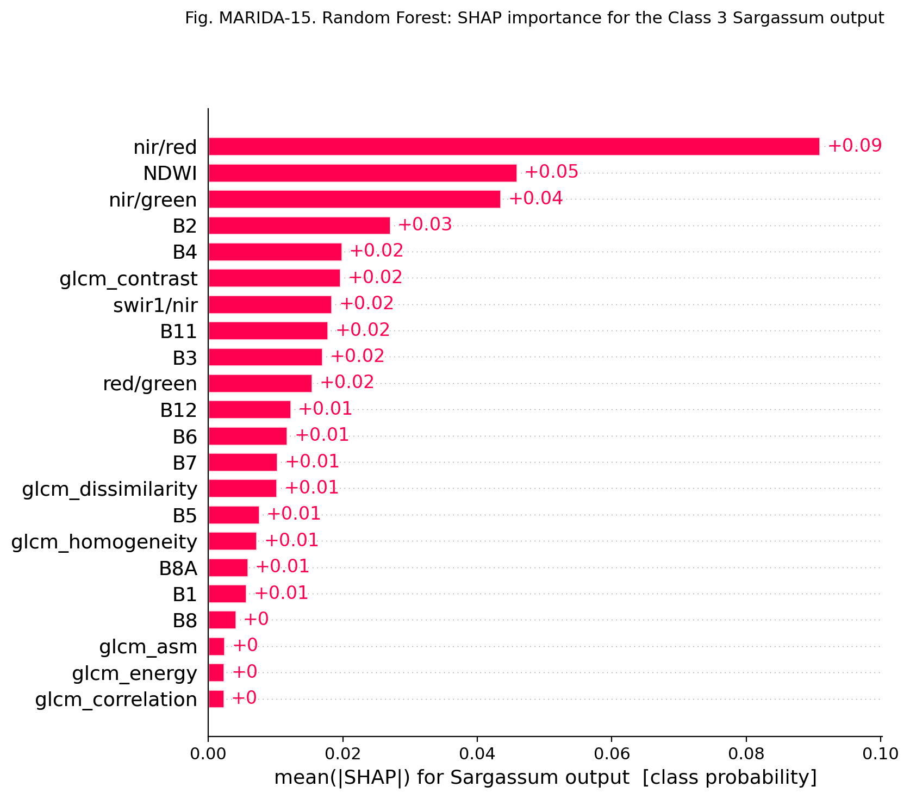

- **What it shows:** Random Forest importance of each feature for the Class 3 Sargassum output only (class probability).
- **How to read:** Bar = mean |SHAP of the Sargassum output| over the whole stratified sample (all four true classes), i.e. how much each feature moves this class's score anywhere in the data.
- **Findings:** Top five: **nir/red** (22.9%), **NDWI** (11.5%), **nir/green** (10.9%), **B2** (6.8%), **B4** (5.0%). Restricted to pixels whose true class is Sargassum, the top three are **nir/red** (25.8%), **NDWI** (13.1%), **nir/green** (12.8%).
- **Meaning:** These are the features Random Forest relies on most to raise or lower its Sargassum score.
- **Limitations:** Unsigned; see the matching beeswarm for direction.

#### Fig. MARIDA-16. Random Forest: SHAP importance for the Class 4 Other output

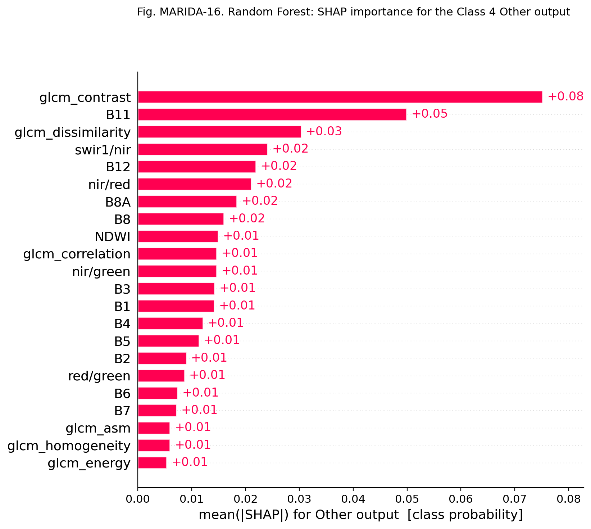

- **What it shows:** Random Forest importance of each feature for the Class 4 Other output only (class probability).
- **How to read:** Bar = mean |SHAP of the Other output| over the whole stratified sample (all four true classes), i.e. how much each feature moves this class's score anywhere in the data.
- **Findings:** Top five: **glcm_contrast** (18.7%), **B11** (12.4%), **glcm_dissimilarity** (7.5%), **swir1/nir** (6.0%), **B12** (5.4%). Restricted to pixels whose true class is Other, the top three are **glcm_contrast** (22.4%), **B11** (12.6%), **glcm_dissimilarity** (9.8%).
- **Meaning:** These are the features Random Forest relies on most to raise or lower its Other score.
- **Limitations:** Unsigned; see the matching beeswarm for direction.

#### Fig. MARIDA-17. XGBoost: SHAP importance for the Class 1 Water output

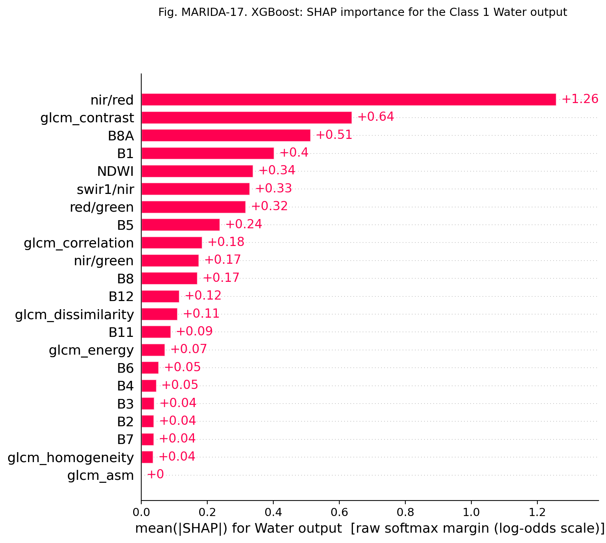

- **What it shows:** XGBoost importance of each feature for the Class 1 Water output only (raw softmax margin (log-odds scale)).
- **How to read:** Bar = mean |SHAP of the Water output| over the whole stratified sample (all four true classes), i.e. how much each feature moves this class's score anywhere in the data.
- **Findings:** Top five: **nir/red** (24.2%), **glcm_contrast** (12.3%), **B8A** (9.9%), **B1** (7.7%), **NDWI** (6.5%). Restricted to pixels whose true class is Water, the top three are **nir/red** (30.0%), **glcm_contrast** (15.1%), **red/green** (7.8%).
- **Meaning:** These are the features XGBoost relies on most to raise or lower its Water score.
- **Limitations:** Unsigned; see the matching beeswarm for direction.

#### Fig. MARIDA-18. XGBoost: SHAP importance for the Class 2 Marine Debris output

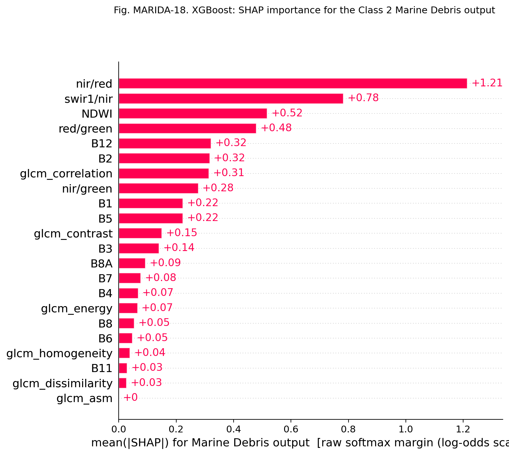

- **What it shows:** XGBoost importance of each feature for the Class 2 Marine Debris output only (raw softmax margin (log-odds scale)).
- **How to read:** Bar = mean |SHAP of the Marine Debris output| over the whole stratified sample (all four true classes), i.e. how much each feature moves this class's score anywhere in the data.
- **Findings:** Top five: **nir/red** (22.2%), **swir1/nir** (14.3%), **NDWI** (9.5%), **red/green** (8.8%), **B12** (5.9%). Restricted to pixels whose true class is Marine Debris, the top three are **nir/red** (23.6%), **swir1/nir** (12.5%), **red/green** (9.5%).
- **Meaning:** These are the features XGBoost relies on most to raise or lower its Marine Debris score.
- **Limitations:** Unsigned; see the matching beeswarm for direction.

#### Fig. MARIDA-19. XGBoost: SHAP importance for the Class 3 Sargassum output

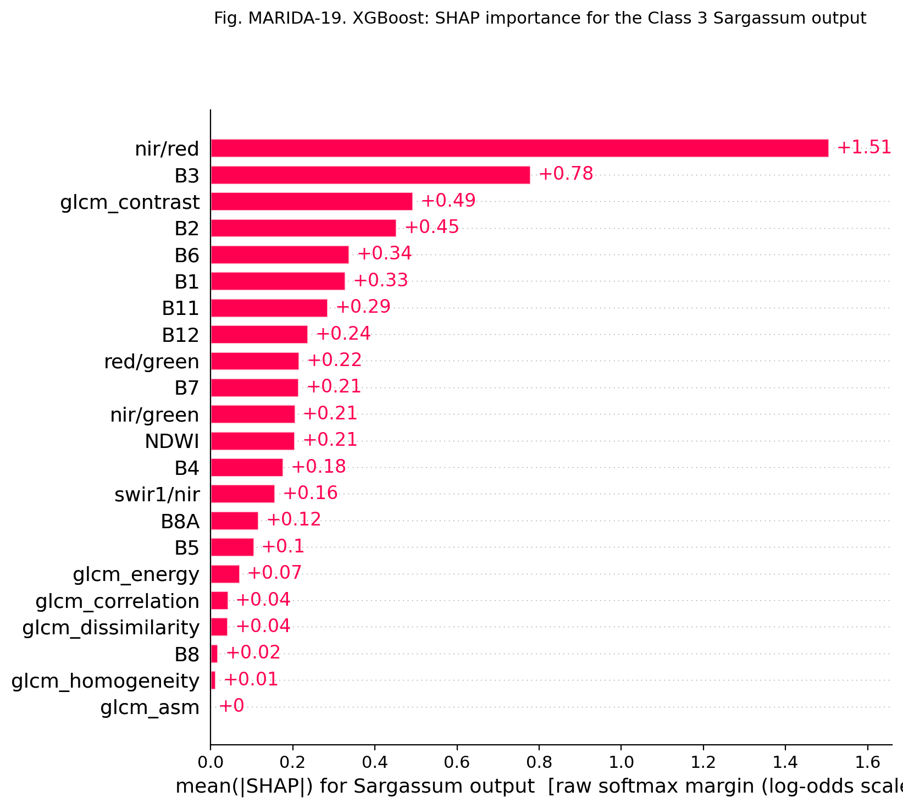

- **What it shows:** XGBoost importance of each feature for the Class 3 Sargassum output only (raw softmax margin (log-odds scale)).
- **How to read:** Bar = mean |SHAP of the Sargassum output| over the whole stratified sample (all four true classes), i.e. how much each feature moves this class's score anywhere in the data.
- **Findings:** Top five: **nir/red** (25.1%), **B3** (13.0%), **glcm_contrast** (8.2%), **B2** (7.5%), **B6** (5.6%). Restricted to pixels whose true class is Sargassum, the top three are **nir/red** (30.2%), **B2** (9.1%), **B3** (8.8%).
- **Meaning:** These are the features XGBoost relies on most to raise or lower its Sargassum score.
- **Limitations:** Unsigned; see the matching beeswarm for direction.

#### Fig. MARIDA-20. XGBoost: SHAP importance for the Class 4 Other output

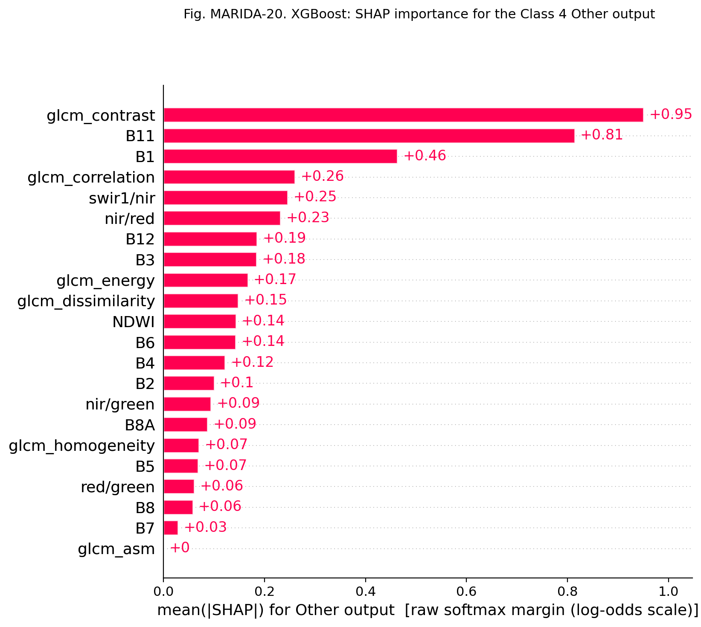

- **What it shows:** XGBoost importance of each feature for the Class 4 Other output only (raw softmax margin (log-odds scale)).
- **How to read:** Bar = mean |SHAP of the Other output| over the whole stratified sample (all four true classes), i.e. how much each feature moves this class's score anywhere in the data.
- **Findings:** Top five: **glcm_contrast** (20.6%), **B11** (17.6%), **B1** (10.0%), **glcm_correlation** (5.6%), **swir1/nir** (5.3%). Restricted to pixels whose true class is Other, the top three are **glcm_contrast** (31.0%), **B11** (19.8%), **B12** (6.1%).
- **Meaning:** These are the features XGBoost relies on most to raise or lower its Other score.
- **Limitations:** Unsigned; see the matching beeswarm for direction.

#### Fig. MARIDA-21. LightGBM: SHAP importance for the Class 1 Water output

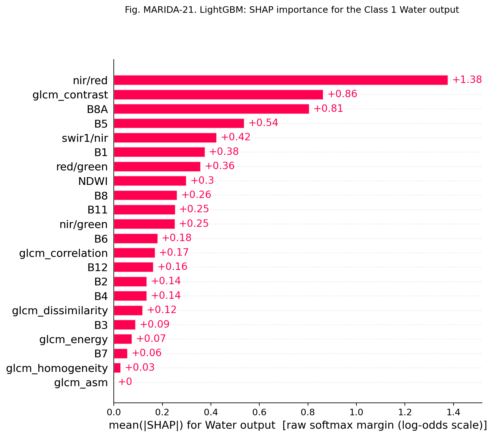

- **What it shows:** LightGBM importance of each feature for the Class 1 Water output only (raw softmax margin (log-odds scale)).
- **How to read:** Bar = mean |SHAP of the Water output| over the whole stratified sample (all four true classes), i.e. how much each feature moves this class's score anywhere in the data.
- **Findings:** Top five: **nir/red** (19.8%), **glcm_contrast** (12.4%), **B8A** (11.6%), **B5** (7.7%), **swir1/nir** (6.1%). Restricted to pixels whose true class is Water, the top three are **nir/red** (24.6%), **glcm_contrast** (15.8%), **B5** (7.9%).
- **Meaning:** These are the features LightGBM relies on most to raise or lower its Water score.
- **Limitations:** Unsigned; see the matching beeswarm for direction.

#### Fig. MARIDA-22. LightGBM: SHAP importance for the Class 2 Marine Debris output

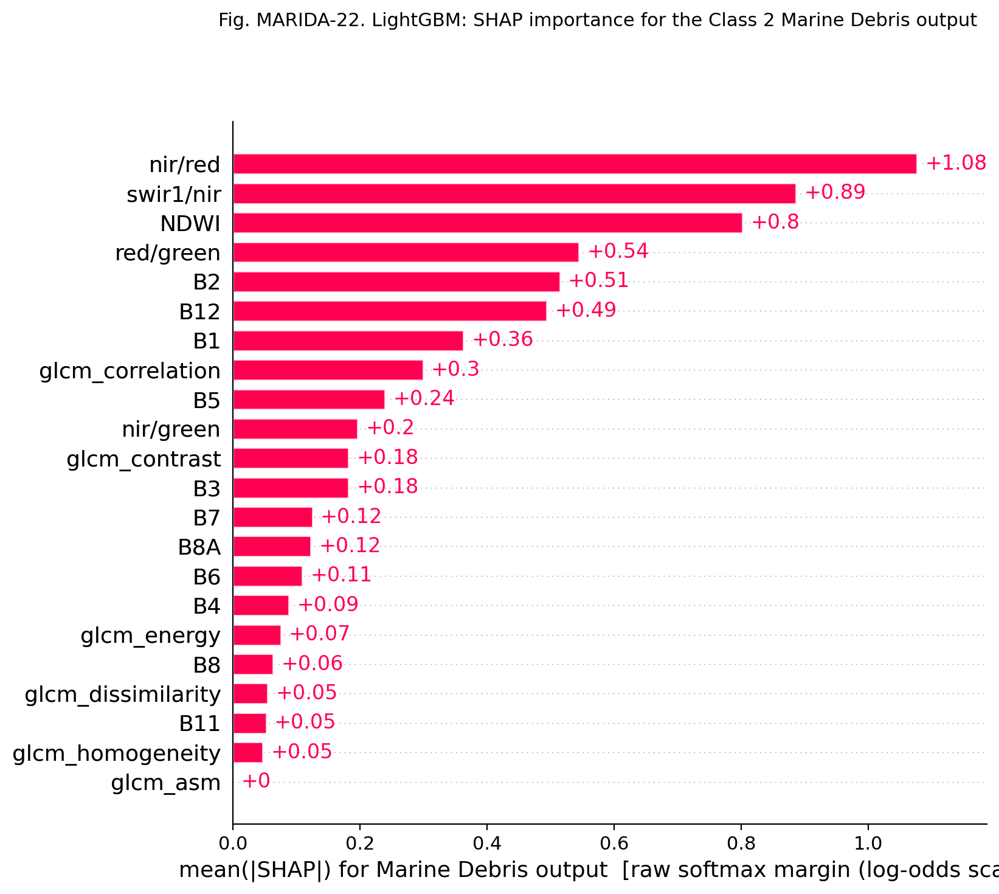

- **What it shows:** LightGBM importance of each feature for the Class 2 Marine Debris output only (raw softmax margin (log-odds scale)).
- **How to read:** Bar = mean |SHAP of the Marine Debris output| over the whole stratified sample (all four true classes), i.e. how much each feature moves this class's score anywhere in the data.
- **Findings:** Top five: **nir/red** (16.5%), **swir1/nir** (13.6%), **NDWI** (12.3%), **red/green** (8.4%), **B2** (7.9%). Restricted to pixels whose true class is Marine Debris, the top three are **nir/red** (18.0%), **swir1/nir** (11.9%), **NDWI** (11.2%).
- **Meaning:** These are the features LightGBM relies on most to raise or lower its Marine Debris score.
- **Limitations:** Unsigned; see the matching beeswarm for direction.

#### Fig. MARIDA-23. LightGBM: SHAP importance for the Class 3 Sargassum output

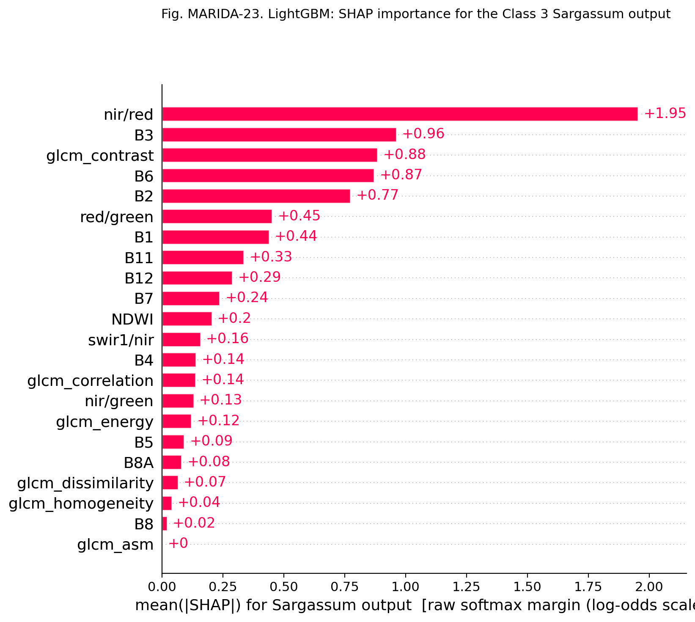

- **What it shows:** LightGBM importance of each feature for the Class 3 Sargassum output only (raw softmax margin (log-odds scale)).
- **How to read:** Bar = mean |SHAP of the Sargassum output| over the whole stratified sample (all four true classes), i.e. how much each feature moves this class's score anywhere in the data.
- **Findings:** Top five: **nir/red** (23.3%), **B3** (11.5%), **glcm_contrast** (10.6%), **B6** (10.4%), **B2** (9.2%). Restricted to pixels whose true class is Sargassum, the top three are **nir/red** (34.2%), **B2** (11.2%), **B3** (7.9%).
- **Meaning:** These are the features LightGBM relies on most to raise or lower its Sargassum score.
- **Limitations:** Unsigned; see the matching beeswarm for direction.

#### Fig. MARIDA-24. LightGBM: SHAP importance for the Class 4 Other output

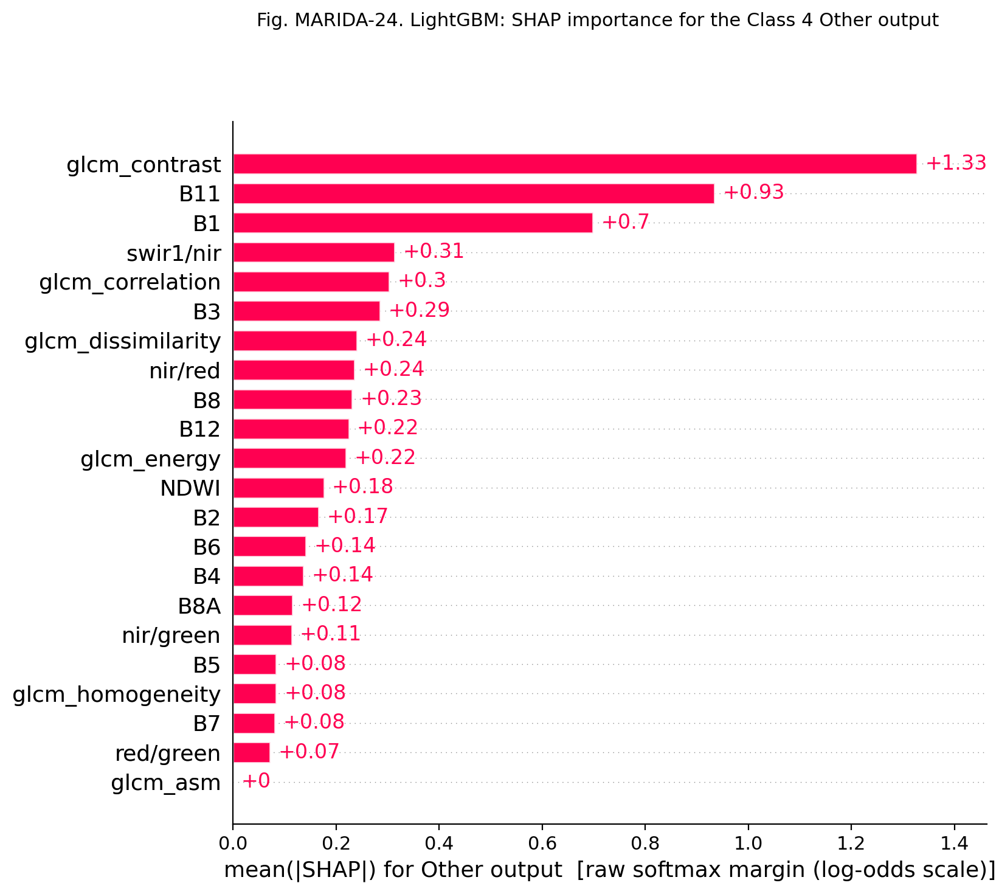

- **What it shows:** LightGBM importance of each feature for the Class 4 Other output only (raw softmax margin (log-odds scale)).
- **How to read:** Bar = mean |SHAP of the Other output| over the whole stratified sample (all four true classes), i.e. how much each feature moves this class's score anywhere in the data.
- **Findings:** Top five: **glcm_contrast** (21.5%), **B11** (15.1%), **B1** (11.3%), **swir1/nir** (5.1%), **glcm_correlation** (4.9%). Restricted to pixels whose true class is Other, the top three are **glcm_contrast** (32.9%), **B11** (18.4%), **B12** (5.4%).
- **Meaning:** These are the features LightGBM relies on most to raise or lower its Other score.
- **Limitations:** Unsigned; see the matching beeswarm for direction.

#### Fig. MARIDA-25. AdaBoost: SHAP importance for the Class 1 Water output

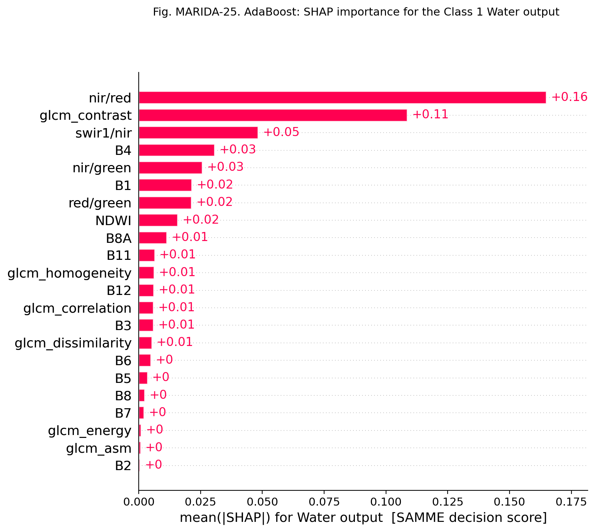

- **What it shows:** AdaBoost importance of each feature for the Class 1 Water output only (SAMME decision score).
- **How to read:** Bar = mean |SHAP of the Water output| over the whole stratified sample (all four true classes), i.e. how much each feature moves this class's score anywhere in the data.
- **Findings:** Top five: **nir/red** (33.1%), **glcm_contrast** (21.8%), **swir1/nir** (9.7%), **B4** (6.2%), **nir/green** (5.2%). Restricted to pixels whose true class is Water, the top three are **nir/red** (35.5%), **glcm_contrast** (21.4%), **B4** (7.6%).
- **Meaning:** These are the features AdaBoost relies on most to raise or lower its Water score.
- **Limitations:** Unsigned; see the matching beeswarm for direction.

#### Fig. MARIDA-26. AdaBoost: SHAP importance for the Class 2 Marine Debris output

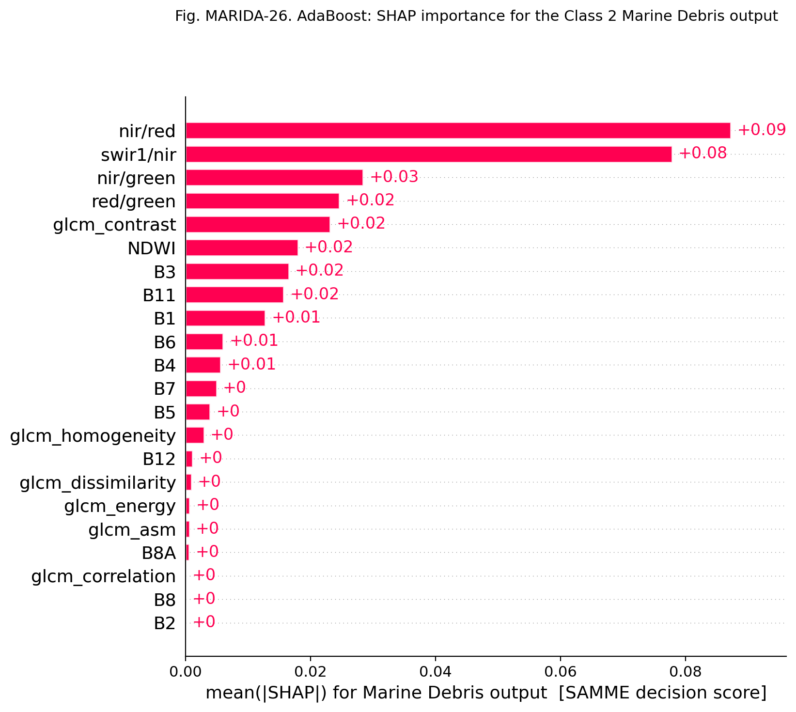

- **What it shows:** AdaBoost importance of each feature for the Class 2 Marine Debris output only (SAMME decision score).
- **How to read:** Bar = mean |SHAP of the Marine Debris output| over the whole stratified sample (all four true classes), i.e. how much each feature moves this class's score anywhere in the data.
- **Findings:** Top five: **nir/red** (26.4%), **swir1/nir** (23.5%), **nir/green** (8.6%), **red/green** (7.4%), **glcm_contrast** (7.0%). Restricted to pixels whose true class is Marine Debris, the top three are **nir/red** (29.0%), **swir1/nir** (19.8%), **nir/green** (8.9%).
- **Meaning:** These are the features AdaBoost relies on most to raise or lower its Marine Debris score.
- **Limitations:** Unsigned; see the matching beeswarm for direction.

#### Fig. MARIDA-27. AdaBoost: SHAP importance for the Class 3 Sargassum output

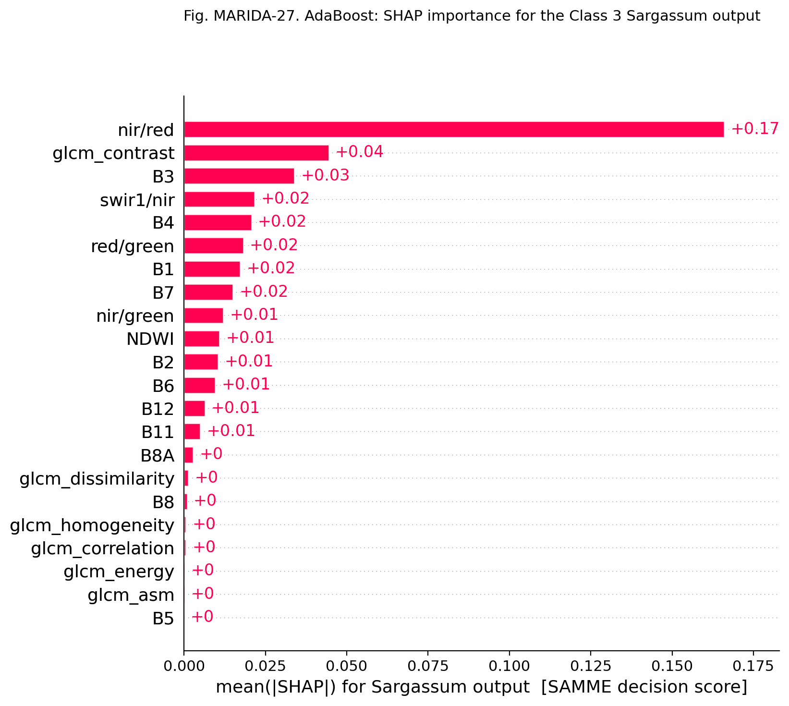

- **What it shows:** AdaBoost importance of each feature for the Class 3 Sargassum output only (SAMME decision score).
- **How to read:** Bar = mean |SHAP of the Sargassum output| over the whole stratified sample (all four true classes), i.e. how much each feature moves this class's score anywhere in the data.
- **Findings:** Top five: **nir/red** (41.7%), **glcm_contrast** (11.2%), **B3** (8.5%), **swir1/nir** (5.5%), **B4** (5.2%). Restricted to pixels whose true class is Sargassum, the top three are **nir/red** (50.2%), **swir1/nir** (7.8%), **B3** (6.8%).
- **Meaning:** These are the features AdaBoost relies on most to raise or lower its Sargassum score.
- **Limitations:** Unsigned; see the matching beeswarm for direction.

#### Fig. MARIDA-28. AdaBoost: SHAP importance for the Class 4 Other output

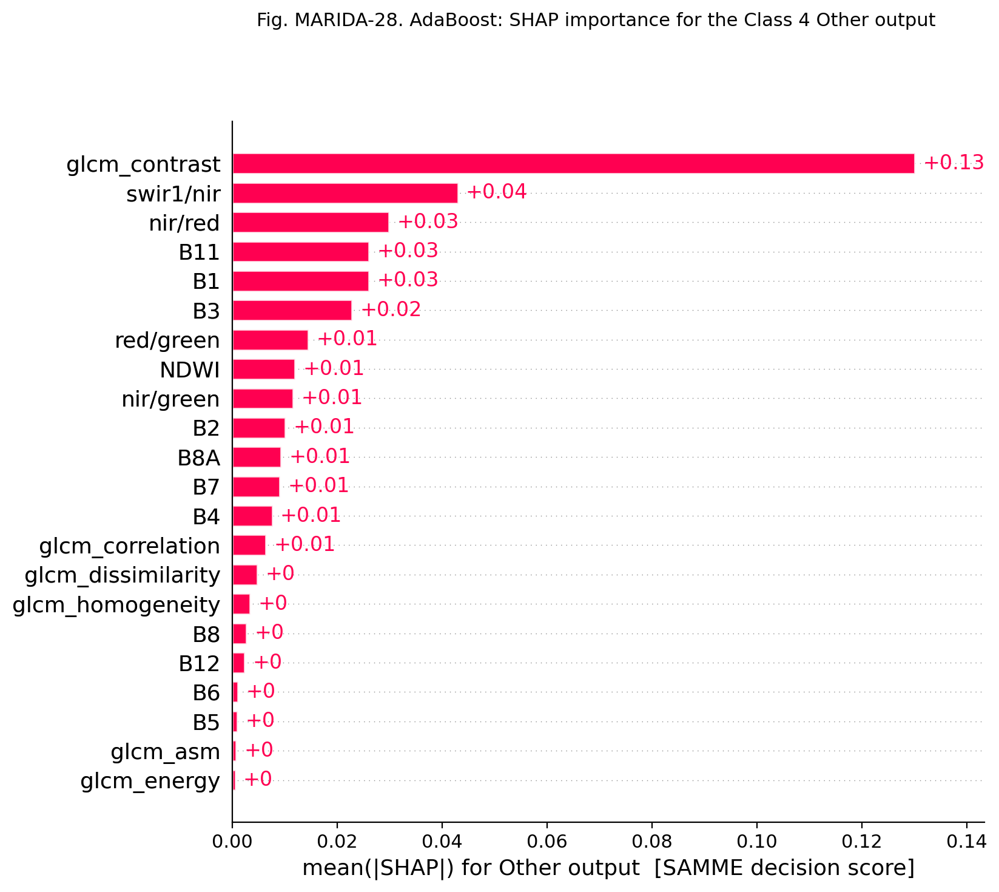

- **What it shows:** AdaBoost importance of each feature for the Class 4 Other output only (SAMME decision score).
- **How to read:** Bar = mean |SHAP of the Other output| over the whole stratified sample (all four true classes), i.e. how much each feature moves this class's score anywhere in the data.
- **Findings:** Top five: **glcm_contrast** (34.8%), **swir1/nir** (11.5%), **nir/red** (8.0%), **B11** (7.0%), **B1** (7.0%). Restricted to pixels whose true class is Other, the top three are **glcm_contrast** (43.0%), **swir1/nir** (13.6%), **B11** (9.7%).
- **Meaning:** These are the features AdaBoost relies on most to raise or lower its Other score.
- **Limitations:** Unsigned; see the matching beeswarm for direction.

#### Fig. MARIDA-29. Linear SVM: SHAP importance for the Class 1 Water output

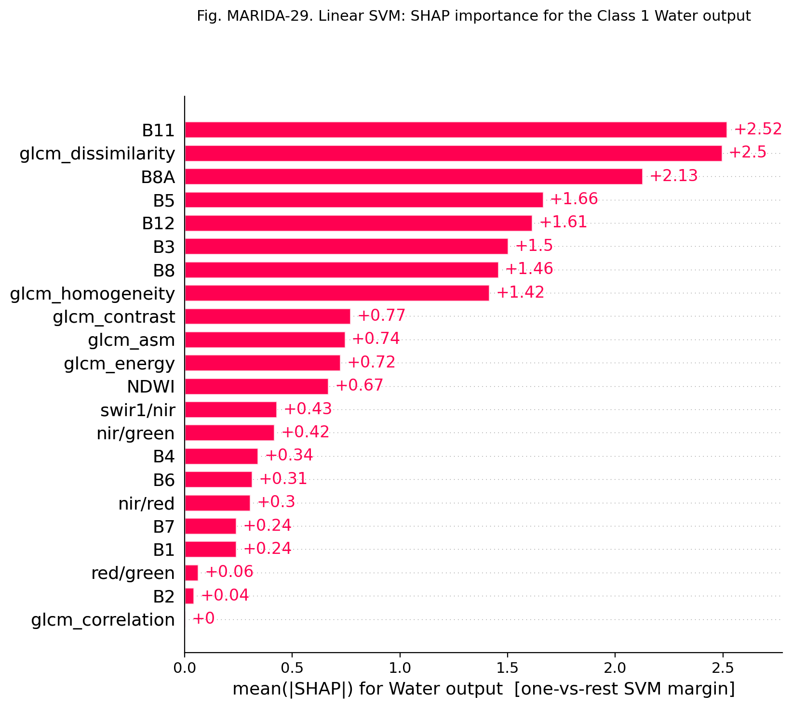

- **What it shows:** Linear SVM importance of each feature for the Class 1 Water output only (one-vs-rest SVM margin).
- **How to read:** Bar = mean |SHAP of the Water output| over the whole stratified sample (all four true classes), i.e. how much each feature moves this class's score anywhere in the data.
- **Findings:** Top five: **B11** (12.5%), **glcm_dissimilarity** (12.4%), **B8A** (10.6%), **B5** (8.3%), **B12** (8.0%). Restricted to pixels whose true class is Water, the top three are **glcm_dissimilarity** (11.3%), **B8A** (10.5%), **B5** (10.3%).
- **Meaning:** These are the features Linear SVM relies on most to raise or lower its Water score.
- **Limitations:** Unsigned; see the matching beeswarm for direction.

#### Fig. MARIDA-30. Linear SVM: SHAP importance for the Class 2 Marine Debris output

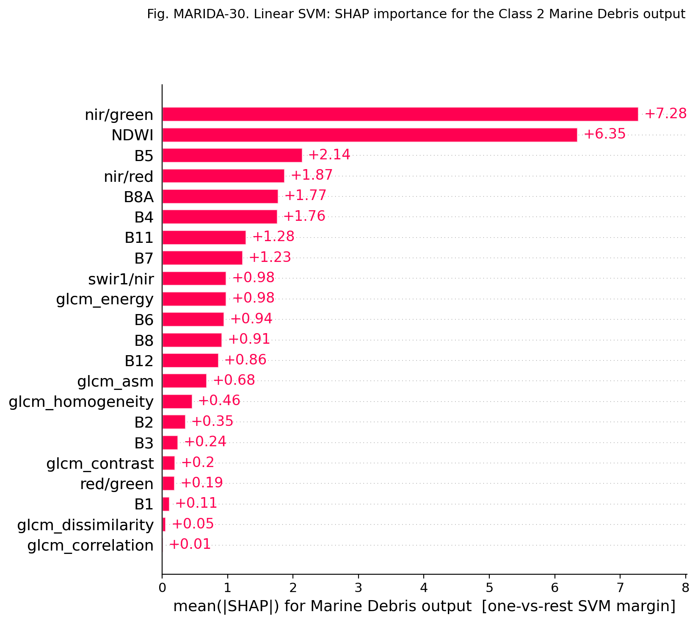

- **What it shows:** Linear SVM importance of each feature for the Class 2 Marine Debris output only (one-vs-rest SVM margin).
- **How to read:** Bar = mean |SHAP of the Marine Debris output| over the whole stratified sample (all four true classes), i.e. how much each feature moves this class's score anywhere in the data.
- **Findings:** Top five: **nir/green** (23.8%), **NDWI** (20.7%), **B5** (7.0%), **nir/red** (6.1%), **B8A** (5.8%). Restricted to pixels whose true class is Marine Debris, the top three are **nir/green** (18.2%), **NDWI** (11.4%), **B5** (11.2%).
- **Meaning:** These are the features Linear SVM relies on most to raise or lower its Marine Debris score.
- **Limitations:** Unsigned; see the matching beeswarm for direction.

#### Fig. MARIDA-31. Linear SVM: SHAP importance for the Class 3 Sargassum output

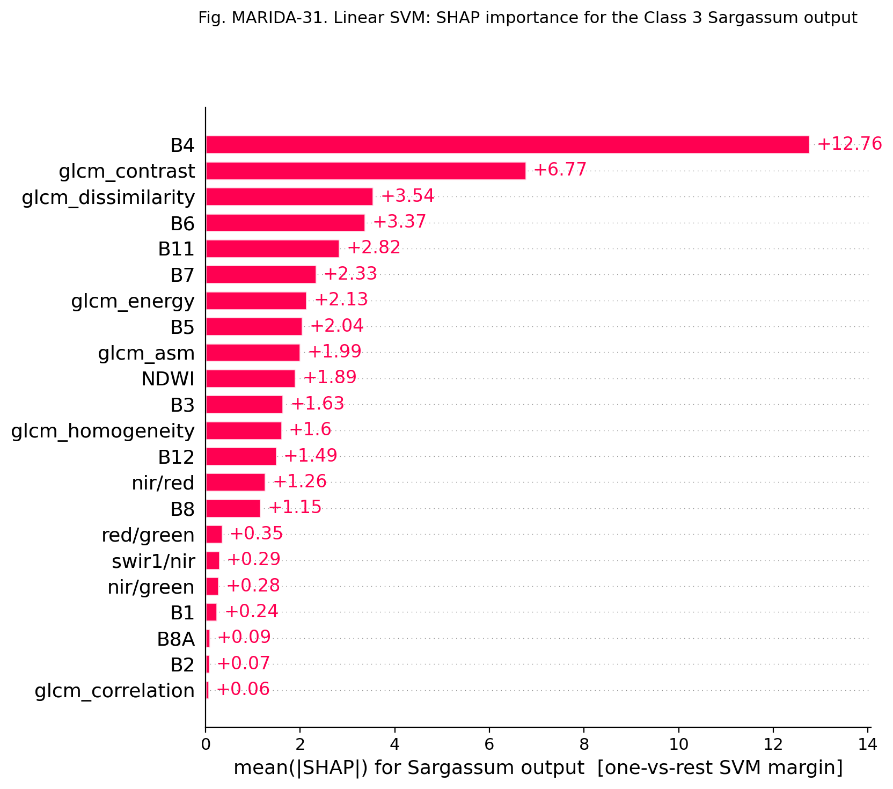

- **What it shows:** Linear SVM importance of each feature for the Class 3 Sargassum output only (one-vs-rest SVM margin).
- **How to read:** Bar = mean |SHAP of the Sargassum output| over the whole stratified sample (all four true classes), i.e. how much each feature moves this class's score anywhere in the data.
- **Findings:** Top five: **B4** (26.5%), **glcm_contrast** (14.1%), **glcm_dissimilarity** (7.4%), **B6** (7.0%), **B11** (5.9%). Restricted to pixels whose true class is Sargassum, the top three are **B4** (27.3%), **glcm_contrast** (9.7%), **B6** (7.8%).
- **Meaning:** These are the features Linear SVM relies on most to raise or lower its Sargassum score.
- **Limitations:** Unsigned; see the matching beeswarm for direction.

#### Fig. MARIDA-32. Linear SVM: SHAP importance for the Class 4 Other output

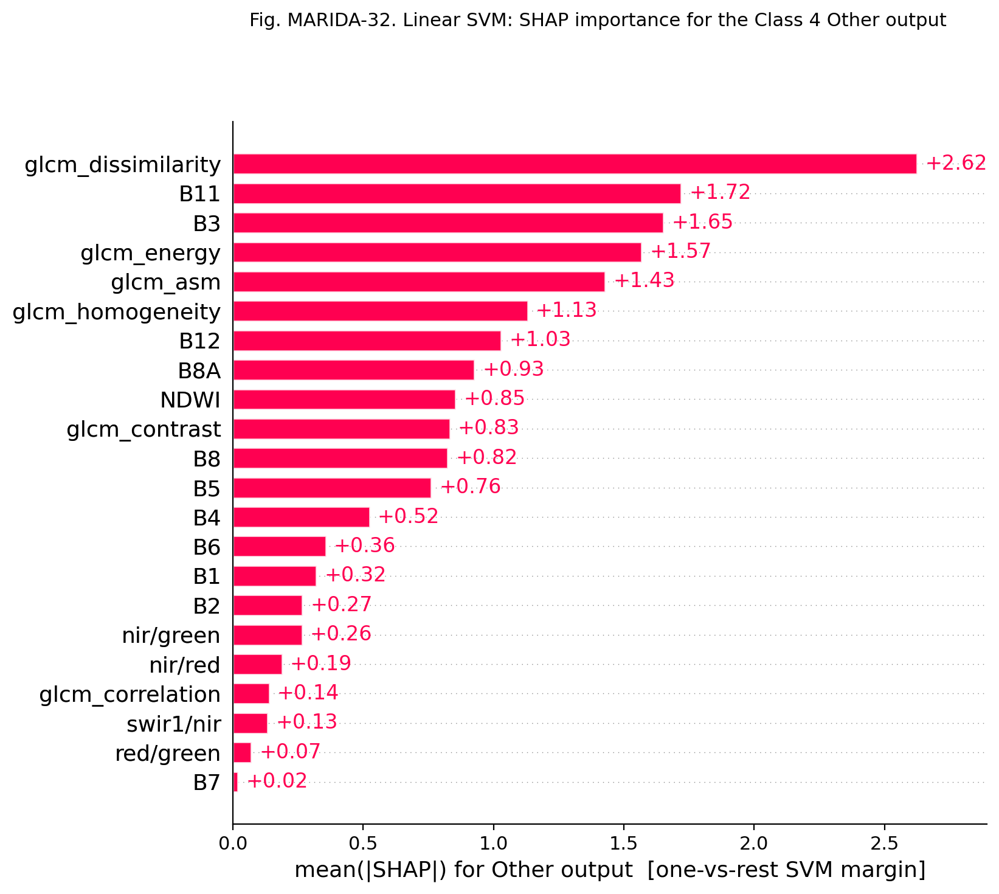

- **What it shows:** Linear SVM importance of each feature for the Class 4 Other output only (one-vs-rest SVM margin).
- **How to read:** Bar = mean |SHAP of the Other output| over the whole stratified sample (all four true classes), i.e. how much each feature moves this class's score anywhere in the data.
- **Findings:** Top five: **glcm_dissimilarity** (14.9%), **B11** (9.8%), **B3** (9.4%), **glcm_energy** (8.9%), **glcm_asm** (8.1%). Restricted to pixels whose true class is Other, the top three are **glcm_dissimilarity** (20.9%), **B11** (11.5%), **B3** (10.1%).
- **Meaning:** These are the features Linear SVM relies on most to raise or lower its Other score.
- **Limitations:** Unsigned; see the matching beeswarm for direction.

### MARIDA - B5. Class-specific beeswarm plots

#### Fig. MARIDA-33. Random Forest: SHAP beeswarm for the Class 1 Water output

- **What it shows:** Signed Random Forest SHAP values for the Class 1 Water output, for all pixels of the stratified sample.
- **How to read:** x > 0 pushes the Water score up; colour = feature value (red high, blue low); rho = Spearman correlation between feature value and SHAP value.
- **Findings:** **nir/red**: high values lower it (rho = -0.97), mean SHAP on Water pixels +0.14 vs -0.0332 on other pixels; **glcm_contrast**: high values lower it (rho = -0.70), mean SHAP on Water pixels +0.0844 vs -0.0185 on other pixels; **NDWI**: high values raise it (rho = +0.96), mean SHAP on Water pixels +0.0798 vs -0.0188 on other pixels; **nir/green**: high values lower it (rho = -0.96), mean SHAP on Water pixels +0.0761 vs -0.0166 on other pixels; **swir1/nir**: high values tend to raise it (rho = +0.48), mean SHAP on Water pixels +0.0235 vs -0.00343 on other pixels.
- **Meaning:** Features whose mean SHAP is positive on Water pixels and negative elsewhere are the ones that discriminate Water for this model.
- **Limitations:** |rho| < 0.2 does not mean unimportant: tree models can use a feature non-monotonically (see dependence plots). Attribution is not causation.

#### Fig. MARIDA-34. Random Forest: SHAP beeswarm for the Class 2 Marine Debris output

- **What it shows:** Signed Random Forest SHAP values for the Class 2 Marine Debris output, for all pixels of the stratified sample.
- **How to read:** x > 0 pushes the Marine Debris score up; colour = feature value (red high, blue low); rho = Spearman correlation between feature value and SHAP value.
- **Findings:** **nir/red**: no consistent monotonic direction (rho = -0.15), mean SHAP on Marine Debris pixels +0.0629 vs -0.0357 on other pixels; **swir1/nir**: high values lower it (rho = -0.60), mean SHAP on Marine Debris pixels +0.0392 vs -0.0122 on other pixels; **NDWI**: high values tend to lower it (rho = -0.31), mean SHAP on Marine Debris pixels +0.0471 vs -0.0259 on other pixels; **nir/green**: high values tend to raise it (rho = +0.23), mean SHAP on Marine Debris pixels +0.0427 vs -0.0259 on other pixels; **B12**: high values lower it (rho = -0.59), mean SHAP on Marine Debris pixels +0.0415 vs -0.00648 on other pixels.
- **Meaning:** Features whose mean SHAP is positive on Marine Debris pixels and negative elsewhere are the ones that discriminate Marine Debris for this model.
- **Limitations:** |rho| < 0.2 does not mean unimportant: tree models can use a feature non-monotonically (see dependence plots). Attribution is not causation.

#### Fig. MARIDA-35. Random Forest: SHAP beeswarm for the Class 3 Sargassum output

- **What it shows:** Signed Random Forest SHAP values for the Class 3 Sargassum output, for all pixels of the stratified sample.
- **How to read:** x > 0 pushes the Sargassum score up; colour = feature value (red high, blue low); rho = Spearman correlation between feature value and SHAP value.
- **Findings:** **nir/red**: high values raise it (rho = +0.89), mean SHAP on Sargassum pixels +0.187 vs -0.0576 on other pixels; **NDWI**: high values lower it (rho = -0.91), mean SHAP on Sargassum pixels +0.0937 vs -0.0285 on other pixels; **nir/green**: high values raise it (rho = +0.94), mean SHAP on Sargassum pixels +0.0919 vs -0.0264 on other pixels; **B2**: high values lower it (rho = -0.88), mean SHAP on Sargassum pixels +0.0502 vs -0.0151 on other pixels; **B4**: high values lower it (rho = -0.89), mean SHAP on Sargassum pixels +0.0322 vs -0.013 on other pixels.
- **Meaning:** Features whose mean SHAP is positive on Sargassum pixels and negative elsewhere are the ones that discriminate Sargassum for this model.
- **Limitations:** |rho| < 0.2 does not mean unimportant: tree models can use a feature non-monotonically (see dependence plots). Attribution is not causation.

#### Fig. MARIDA-36. Random Forest: SHAP beeswarm for the Class 4 Other output

- **What it shows:** Signed Random Forest SHAP values for the Class 4 Other output, for all pixels of the stratified sample.
- **How to read:** x > 0 pushes the Other score up; colour = feature value (red high, blue low); rho = Spearman correlation between feature value and SHAP value.
- **Findings:** **glcm_contrast**: high values raise it (rho = +0.85), mean SHAP on Other pixels +0.137 vs -0.0511 on other pixels; **B11**: high values raise it (rho = +0.74), mean SHAP on Other pixels +0.0721 vs -0.0393 on other pixels; **glcm_dissimilarity**: high values raise it (rho = +0.85), mean SHAP on Other pixels +0.0598 vs -0.0195 on other pixels; **swir1/nir**: high values raise it (rho = +0.87), mean SHAP on Other pixels +0.0301 vs -0.0168 on other pixels; **B12**: high values raise it (rho = +0.65), mean SHAP on Other pixels +0.0353 vs -0.0156 on other pixels.
- **Meaning:** Features whose mean SHAP is positive on Other pixels and negative elsewhere are the ones that discriminate Other for this model.
- **Limitations:** |rho| < 0.2 does not mean unimportant: tree models can use a feature non-monotonically (see dependence plots). Attribution is not causation.

#### Fig. MARIDA-37. XGBoost: SHAP beeswarm for the Class 1 Water output

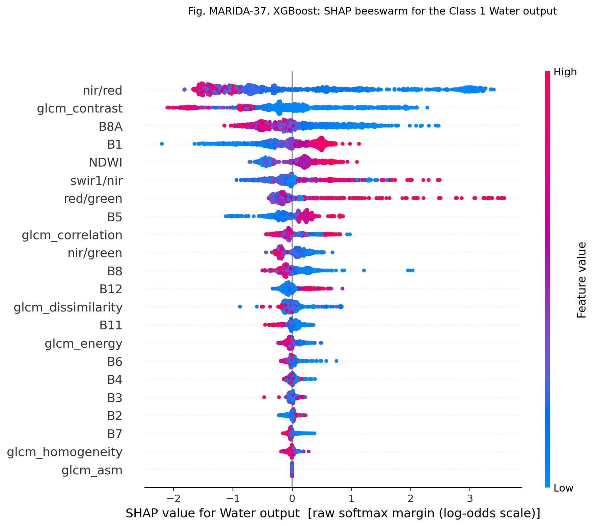

- **What it shows:** Signed XGBoost SHAP values for the Class 1 Water output, for all pixels of the stratified sample.
- **How to read:** x > 0 pushes the Water score up; colour = feature value (red high, blue low); rho = Spearman correlation between feature value and SHAP value.
- **Findings:** **nir/red**: high values lower it (rho = -0.93), mean SHAP on Water pixels +2.1 vs -0.634 on other pixels; **glcm_contrast**: high values lower it (rho = -0.90), mean SHAP on Water pixels +1.08 vs -0.393 on other pixels; **B8A**: high values lower it (rho = -0.92), mean SHAP on Water pixels +0.43 vs +0.028 on other pixels; **B1**: high values raise it (rho = +0.96), mean SHAP on Water pixels +0.352 vs -0.215 on other pixels; **NDWI**: high values raise it (rho = +0.90), mean SHAP on Water pixels +0.399 vs -0.0705 on other pixels.
- **Meaning:** Features whose mean SHAP is positive on Water pixels and negative elsewhere are the ones that discriminate Water for this model.
- **Limitations:** |rho| < 0.2 does not mean unimportant: tree models can use a feature non-monotonically (see dependence plots). Attribution is not causation.

#### Fig. MARIDA-38. XGBoost: SHAP beeswarm for the Class 2 Marine Debris output

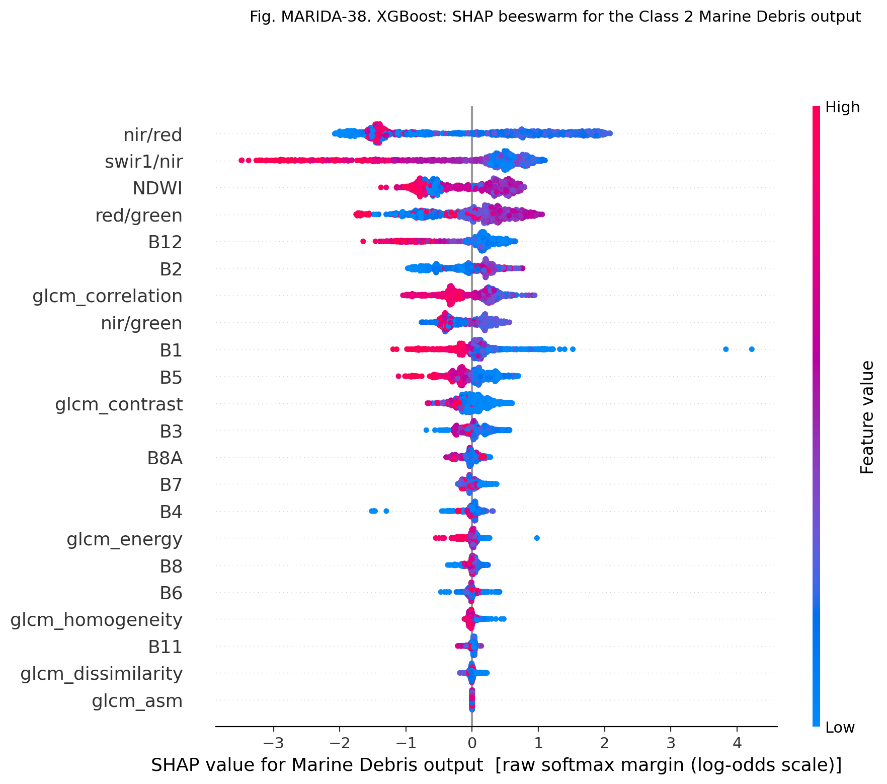

- **What it shows:** Signed XGBoost SHAP values for the Class 2 Marine Debris output, for all pixels of the stratified sample.
- **How to read:** x > 0 pushes the Marine Debris score up; colour = feature value (red high, blue low); rho = Spearman correlation between feature value and SHAP value.
- **Findings:** **nir/red**: no consistent monotonic direction (rho = +0.13), mean SHAP on Marine Debris pixels +1.36 vs -0.688 on other pixels; **swir1/nir**: high values lower it (rho = -0.61), mean SHAP on Marine Debris pixels +0.693 vs -0.184 on other pixels; **NDWI**: high values tend to lower it (rho = -0.30), mean SHAP on Marine Debris pixels +0.476 vs -0.281 on other pixels; **red/green**: high values tend to raise it (rho = +0.38), mean SHAP on Marine Debris pixels +0.504 vs -0.163 on other pixels; **B12**: high values lower it (rho = -0.54), mean SHAP on Marine Debris pixels +0.393 vs -0.0575 on other pixels.
- **Meaning:** Features whose mean SHAP is positive on Marine Debris pixels and negative elsewhere are the ones that discriminate Marine Debris for this model.
- **Limitations:** |rho| < 0.2 does not mean unimportant: tree models can use a feature non-monotonically (see dependence plots). Attribution is not causation.

#### Fig. MARIDA-39. XGBoost: SHAP beeswarm for the Class 3 Sargassum output

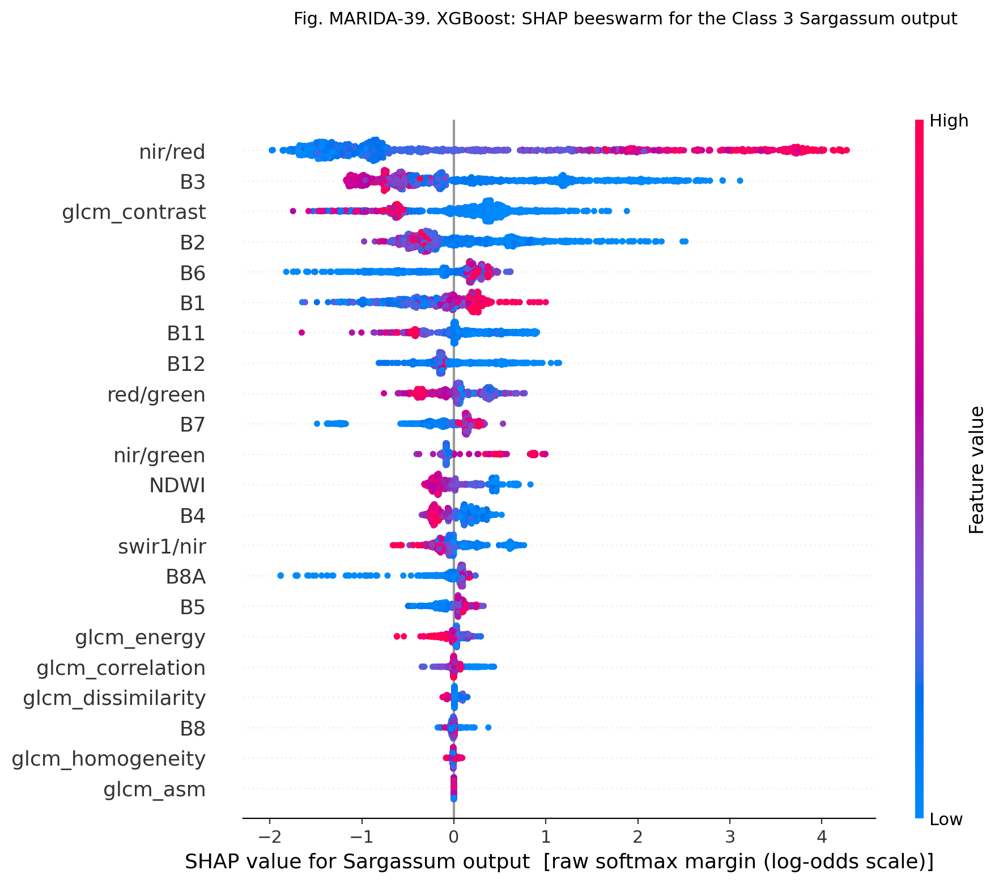

- **What it shows:** Signed XGBoost SHAP values for the Class 3 Sargassum output, for all pixels of the stratified sample.
- **How to read:** x > 0 pushes the Sargassum score up; colour = feature value (red high, blue low); rho = Spearman correlation between feature value and SHAP value.
- **Findings:** **nir/red**: high values raise it (rho = +0.89), mean SHAP on Sargassum pixels +2.78 vs -0.934 on other pixels; **B3**: high values lower it (rho = -0.92), mean SHAP on Sargassum pixels +0.71 vs -0.227 on other pixels; **glcm_contrast**: high values lower it (rho = -0.87), mean SHAP on Sargassum pixels +0.374 vs -0.00763 on other pixels; **B2**: high values lower it (rho = -0.87), mean SHAP on Sargassum pixels +0.823 vs -0.199 on other pixels; **B6**: high values raise it (rho = +0.75), mean SHAP on Sargassum pixels +0.237 vs -0.111 on other pixels.
- **Meaning:** Features whose mean SHAP is positive on Sargassum pixels and negative elsewhere are the ones that discriminate Sargassum for this model.
- **Limitations:** |rho| < 0.2 does not mean unimportant: tree models can use a feature non-monotonically (see dependence plots). Attribution is not causation.

#### Fig. MARIDA-40. XGBoost: SHAP beeswarm for the Class 4 Other output

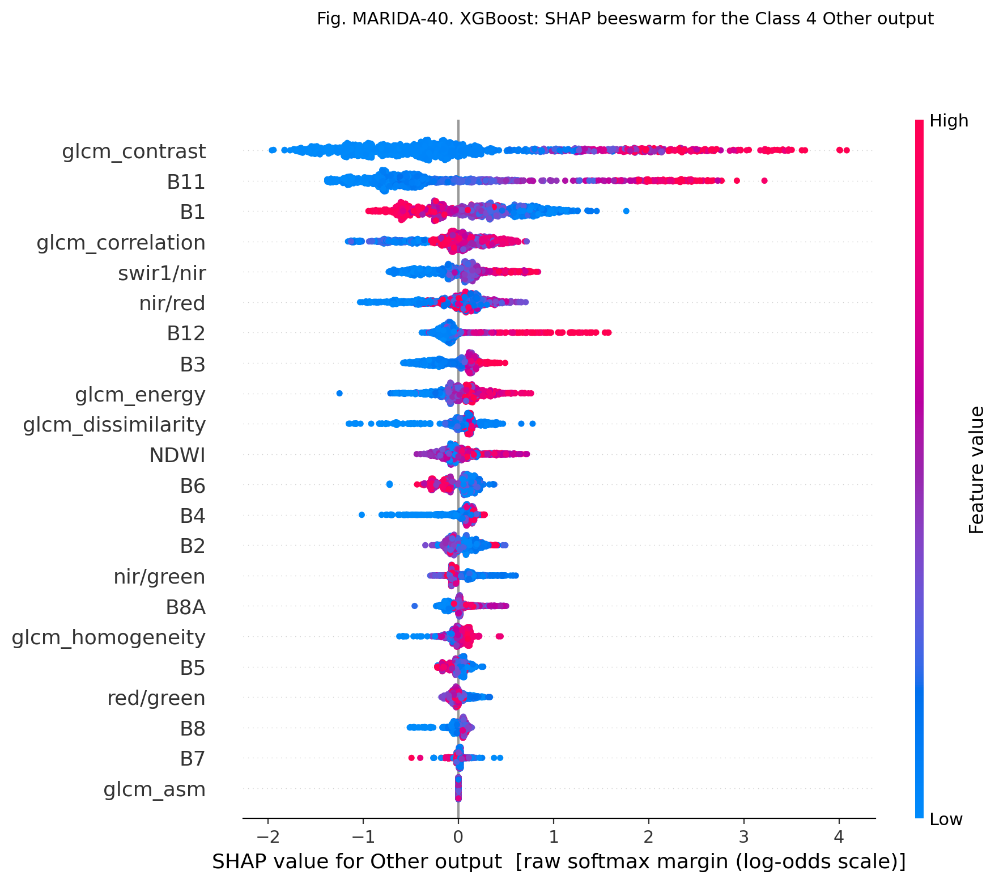

- **What it shows:** Signed XGBoost SHAP values for the Class 4 Other output, for all pixels of the stratified sample.
- **How to read:** x > 0 pushes the Other score up; colour = feature value (red high, blue low); rho = Spearman correlation between feature value and SHAP value.
- **Findings:** **glcm_contrast**: high values raise it (rho = +0.95), mean SHAP on Other pixels +1.8 vs -0.564 on other pixels; **B11**: high values raise it (rho = +0.91), mean SHAP on Other pixels +1.1 vs -0.657 on other pixels; **B1**: high values lower it (rho = -0.92), mean SHAP on Other pixels -0.0778 vs +0.22 on other pixels; **glcm_correlation**: high values tend to raise it (rho = +0.29), mean SHAP on Other pixels +0.285 vs -0.137 on other pixels; **swir1/nir**: high values raise it (rho = +0.87), mean SHAP on Other pixels +0.261 vs -0.125 on other pixels.
- **Meaning:** Features whose mean SHAP is positive on Other pixels and negative elsewhere are the ones that discriminate Other for this model.
- **Limitations:** |rho| < 0.2 does not mean unimportant: tree models can use a feature non-monotonically (see dependence plots). Attribution is not causation.

#### Fig. MARIDA-41. LightGBM: SHAP beeswarm for the Class 1 Water output

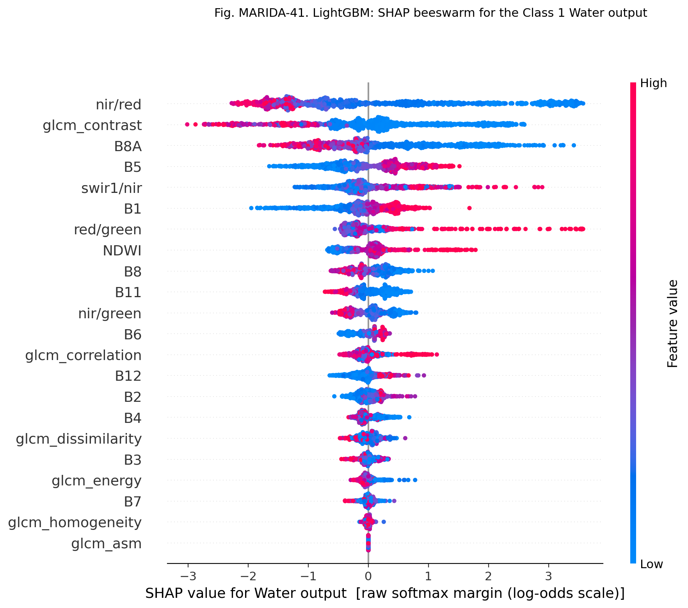

- **What it shows:** Signed LightGBM SHAP values for the Class 1 Water output, for all pixels of the stratified sample.
- **How to read:** x > 0 pushes the Water score up; colour = feature value (red high, blue low); rho = Spearman correlation between feature value and SHAP value.
- **Findings:** **nir/red**: high values lower it (rho = -0.95), mean SHAP on Water pixels +2.22 vs -0.703 on other pixels; **glcm_contrast**: high values lower it (rho = -0.89), mean SHAP on Water pixels +1.44 vs -0.463 on other pixels; **B8A**: high values lower it (rho = -0.94), mean SHAP on Water pixels +0.57 vs +0.0363 on other pixels; **B5**: high values raise it (rho = +0.90), mean SHAP on Water pixels +0.473 vs -0.18 on other pixels; **swir1/nir**: high values raise it (rho = +0.55), mean SHAP on Water pixels +0.398 vs -0.0957 on other pixels.
- **Meaning:** Features whose mean SHAP is positive on Water pixels and negative elsewhere are the ones that discriminate Water for this model.
- **Limitations:** |rho| < 0.2 does not mean unimportant: tree models can use a feature non-monotonically (see dependence plots). Attribution is not causation.

#### Fig. MARIDA-42. LightGBM: SHAP beeswarm for the Class 2 Marine Debris output

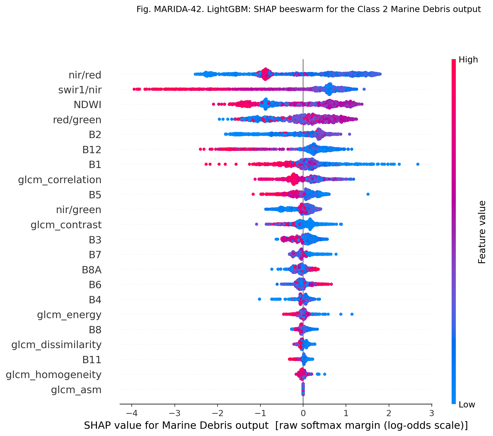

- **What it shows:** Signed LightGBM SHAP values for the Class 2 Marine Debris output, for all pixels of the stratified sample.
- **How to read:** x > 0 pushes the Marine Debris score up; colour = feature value (red high, blue low); rho = Spearman correlation between feature value and SHAP value.
- **Findings:** **nir/red**: high values tend to raise it (rho = +0.28), mean SHAP on Marine Debris pixels +1.21 vs -0.602 on other pixels; **swir1/nir**: high values lower it (rho = -0.61), mean SHAP on Marine Debris pixels +0.794 vs -0.188 on other pixels; **NDWI**: high values tend to lower it (rho = -0.25), mean SHAP on Marine Debris pixels +0.746 vs -0.446 on other pixels; **red/green**: high values tend to raise it (rho = +0.46), mean SHAP on Marine Debris pixels +0.531 vs -0.205 on other pixels; **B2**: high values raise it (rho = +0.70), mean SHAP on Marine Debris pixels +0.0506 vs -0.233 on other pixels.
- **Meaning:** Features whose mean SHAP is positive on Marine Debris pixels and negative elsewhere are the ones that discriminate Marine Debris for this model.
- **Limitations:** |rho| < 0.2 does not mean unimportant: tree models can use a feature non-monotonically (see dependence plots). Attribution is not causation.

#### Fig. MARIDA-43. LightGBM: SHAP beeswarm for the Class 3 Sargassum output

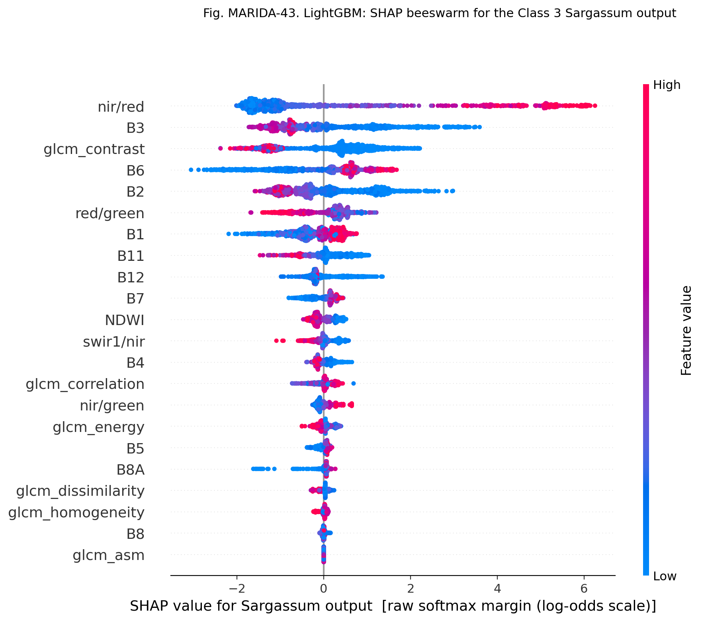

- **What it shows:** Signed LightGBM SHAP values for the Class 3 Sargassum output, for all pixels of the stratified sample.
- **How to read:** x > 0 pushes the Sargassum score up; colour = feature value (red high, blue low); rho = Spearman correlation between feature value and SHAP value.
- **Findings:** **nir/red**: high values raise it (rho = +0.89), mean SHAP on Sargassum pixels +4.11 vs -1.12 on other pixels; **B3**: high values lower it (rho = -0.90), mean SHAP on Sargassum pixels +0.893 vs -0.261 on other pixels; **glcm_contrast**: high values lower it (rho = -0.92), mean SHAP on Sargassum pixels +0.486 vs +0.0588 on other pixels; **B6**: high values raise it (rho = +0.89), mean SHAP on Sargassum pixels +0.598 vs -0.325 on other pixels; **B2**: high values lower it (rho = -0.95), mean SHAP on Sargassum pixels +1.35 vs -0.343 on other pixels.
- **Meaning:** Features whose mean SHAP is positive on Sargassum pixels and negative elsewhere are the ones that discriminate Sargassum for this model.
- **Limitations:** |rho| < 0.2 does not mean unimportant: tree models can use a feature non-monotonically (see dependence plots). Attribution is not causation.

#### Fig. MARIDA-44. LightGBM: SHAP beeswarm for the Class 4 Other output

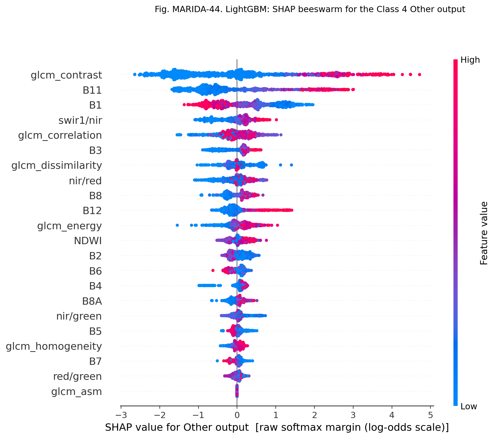

- **What it shows:** Signed LightGBM SHAP values for the Class 4 Other output, for all pixels of the stratified sample.
- **How to read:** x > 0 pushes the Other score up; colour = feature value (red high, blue low); rho = Spearman correlation between feature value and SHAP value.
- **Findings:** **glcm_contrast**: high values raise it (rho = +0.96), mean SHAP on Other pixels +2.31 vs -0.77 on other pixels; **B11**: high values raise it (rho = +0.93), mean SHAP on Other pixels +1.24 vs -0.719 on other pixels; **B1**: high values lower it (rho = -0.93), mean SHAP on Other pixels -0.173 vs +0.355 on other pixels; **swir1/nir**: high values raise it (rho = +0.87), mean SHAP on Other pixels +0.243 vs -0.173 on other pixels; **glcm_correlation**: no consistent monotonic direction (rho = +0.06), mean SHAP on Other pixels +0.175 vs -0.102 on other pixels.
- **Meaning:** Features whose mean SHAP is positive on Other pixels and negative elsewhere are the ones that discriminate Other for this model.
- **Limitations:** |rho| < 0.2 does not mean unimportant: tree models can use a feature non-monotonically (see dependence plots). Attribution is not causation.

#### Fig. MARIDA-45. AdaBoost: SHAP beeswarm for the Class 1 Water output

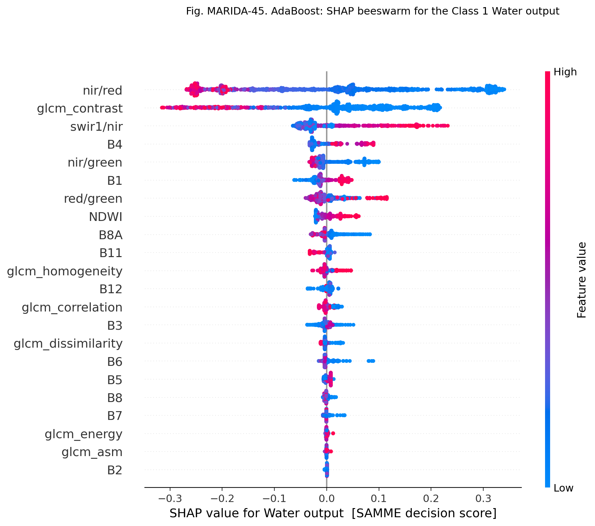

- **What it shows:** Signed AdaBoost SHAP values for the Class 1 Water output, for all pixels of the stratified sample.
- **How to read:** x > 0 pushes the Water score up; colour = feature value (red high, blue low); rho = Spearman correlation between feature value and SHAP value.
- **Findings:** **nir/red**: high values lower it (rho = -0.96), mean SHAP on Water pixels +0.252 vs -0.0748 on other pixels; **glcm_contrast**: high values lower it (rho = -0.88), mean SHAP on Water pixels +0.151 vs -0.0382 on other pixels; **swir1/nir**: high values tend to raise it (rho = +0.40), mean SHAP on Water pixels +0.0107 vs -0.00939 on other pixels; **B4**: high values raise it (rho = +0.67), mean SHAP on Water pixels +0.0437 vs -0.0149 on other pixels; **nir/green**: high values lower it (rho = -0.86), mean SHAP on Water pixels +0.0406 vs -0.0119 on other pixels.
- **Meaning:** Features whose mean SHAP is positive on Water pixels and negative elsewhere are the ones that discriminate Water for this model.
- **Limitations:** |rho| < 0.2 does not mean unimportant: tree models can use a feature non-monotonically (see dependence plots). Attribution is not causation.

#### Fig. MARIDA-46. AdaBoost: SHAP beeswarm for the Class 2 Marine Debris output

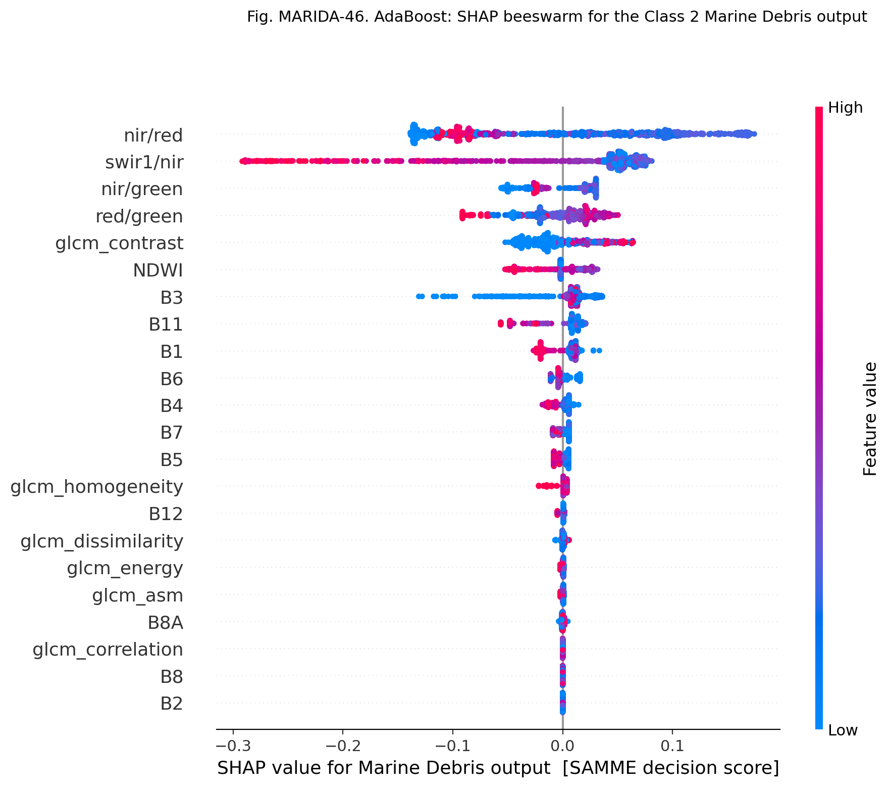

- **What it shows:** Signed AdaBoost SHAP values for the Class 2 Marine Debris output, for all pixels of the stratified sample.
- **How to read:** x > 0 pushes the Marine Debris score up; colour = feature value (red high, blue low); rho = Spearman correlation between feature value and SHAP value.
- **Findings:** **nir/red**: high values tend to raise it (rho = +0.25), mean SHAP on Marine Debris pixels +0.0889 vs -0.0436 on other pixels; **swir1/nir**: high values lower it (rho = -0.52), mean SHAP on Marine Debris pixels +0.0591 vs -0.0116 on other pixels; **nir/green**: no consistent monotonic direction (rho = +0.15), mean SHAP on Marine Debris pixels +0.0287 vs -0.00941 on other pixels; **red/green**: high values tend to raise it (rho = +0.43), mean SHAP on Marine Debris pixels +0.0131 vs -0.00754 on other pixels; **glcm_contrast**: high values raise it (rho = +0.66), mean SHAP on Marine Debris pixels -0.0141 vs -0.0048 on other pixels.
- **Meaning:** Features whose mean SHAP is positive on Marine Debris pixels and negative elsewhere are the ones that discriminate Marine Debris for this model.
- **Limitations:** |rho| < 0.2 does not mean unimportant: tree models can use a feature non-monotonically (see dependence plots). Attribution is not causation.

#### Fig. MARIDA-47. AdaBoost: SHAP beeswarm for the Class 3 Sargassum output

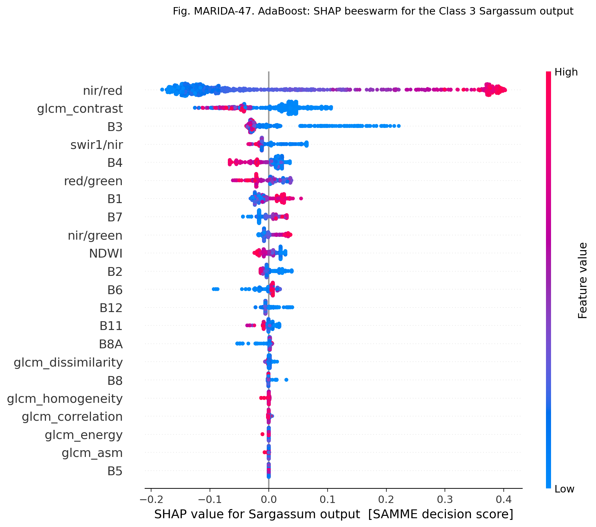

- **What it shows:** Signed AdaBoost SHAP values for the Class 3 Sargassum output, for all pixels of the stratified sample.
- **How to read:** x > 0 pushes the Sargassum score up; colour = feature value (red high, blue low); rho = Spearman correlation between feature value and SHAP value.
- **Findings:** **nir/red**: high values raise it (rho = +0.93), mean SHAP on Sargassum pixels +0.33 vs -0.101 on other pixels; **glcm_contrast**: high values lower it (rho = -0.87), mean SHAP on Sargassum pixels +0.0342 vs +0.00593 on other pixels; **B3**: high values lower it (rho = -0.73), mean SHAP on Sargassum pixels +0.0226 vs -0.0168 on other pixels; **swir1/nir**: high values lower it (rho = -0.85), mean SHAP on Sargassum pixels +0.0457 vs -0.0108 on other pixels; **B4**: high values lower it (rho = -0.76), mean SHAP on Sargassum pixels +0.0201 vs -0.00776 on other pixels.
- **Meaning:** Features whose mean SHAP is positive on Sargassum pixels and negative elsewhere are the ones that discriminate Sargassum for this model.
- **Limitations:** |rho| < 0.2 does not mean unimportant: tree models can use a feature non-monotonically (see dependence plots). Attribution is not causation.

#### Fig. MARIDA-48. AdaBoost: SHAP beeswarm for the Class 4 Other output

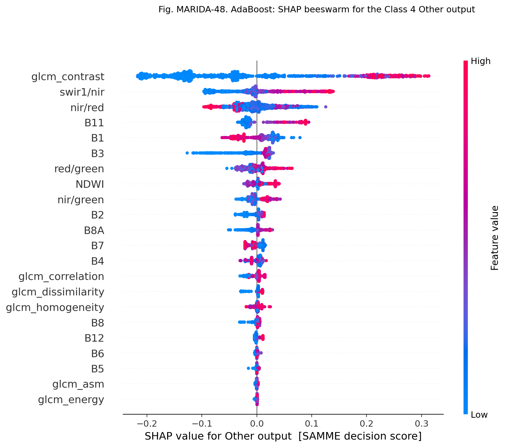

- **What it shows:** Signed AdaBoost SHAP values for the Class 4 Other output, for all pixels of the stratified sample.
- **How to read:** x > 0 pushes the Other score up; colour = feature value (red high, blue low); rho = Spearman correlation between feature value and SHAP value.
- **Findings:** **glcm_contrast**: high values raise it (rho = +0.92), mean SHAP on Other pixels +0.204 vs -0.088 on other pixels; **swir1/nir**: high values raise it (rho = +0.92), mean SHAP on Other pixels +0.057 vs -0.0257 on other pixels; **nir/red**: no consistent monotonic direction (rho = +0.01), mean SHAP on Other pixels +0.0288 vs -0.0143 on other pixels; **B11**: high values tend to raise it (rho = +0.49), mean SHAP on Other pixels +0.0344 vs -0.0186 on other pixels; **B1**: high values lower it (rho = -0.90), mean SHAP on Other pixels -0.00885 vs +0.00979 on other pixels.
- **Meaning:** Features whose mean SHAP is positive on Other pixels and negative elsewhere are the ones that discriminate Other for this model.
- **Limitations:** |rho| < 0.2 does not mean unimportant: tree models can use a feature non-monotonically (see dependence plots). Attribution is not causation.

#### Fig. MARIDA-49. Linear SVM: SHAP beeswarm for the Class 1 Water output

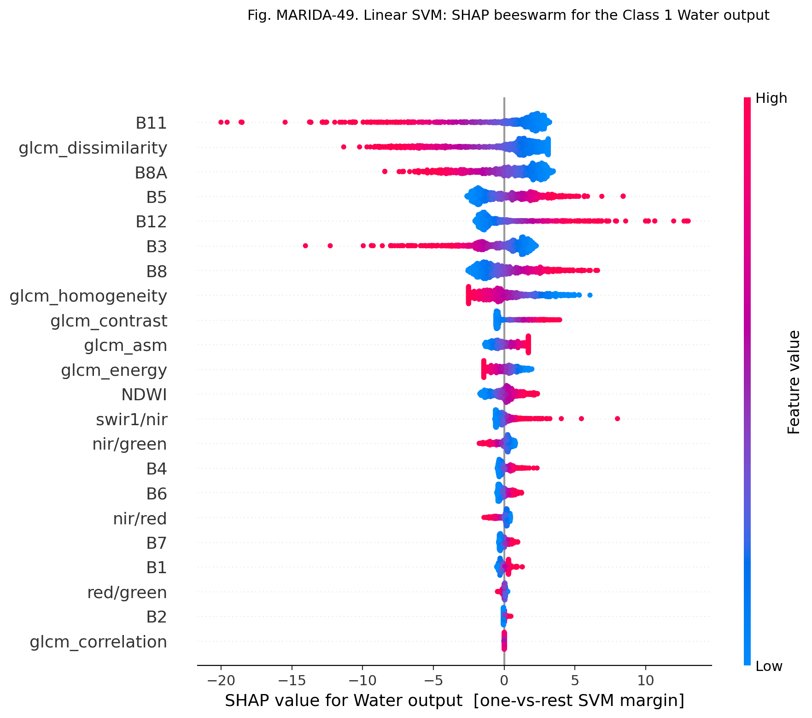

- **What it shows:** Signed Linear SVM SHAP values for the Class 1 Water output, for all pixels of the stratified sample.
- **How to read:** x > 0 pushes the Water score up; colour = feature value (red high, blue low); rho = Spearman correlation between feature value and SHAP value.
- **Findings:** **B11**: high values lower it (rho = -1.00), mean SHAP on Water pixels +1.88 vs +0.156 on other pixels; **glcm_dissimilarity**: high values lower it (rho = -1.00), mean SHAP on Water pixels +2.08 vs -0.554 on other pixels; **B8A**: high values lower it (rho = -1.00), mean SHAP on Water pixels +0.837 vs +0.0425 on other pixels; **B5**: high values raise it (rho = +1.00), mean SHAP on Water pixels +0.803 vs -0.265 on other pixels; **B12**: high values raise it (rho = +1.00), mean SHAP on Water pixels -1.08 vs -0.164 on other pixels.
- **Meaning:** Features whose mean SHAP is positive on Water pixels and negative elsewhere are the ones that discriminate Water for this model.
- **Limitations:** |rho| < 0.2 does not mean unimportant: tree models can use a feature non-monotonically (see dependence plots). Attribution is not causation.

#### Fig. MARIDA-50. Linear SVM: SHAP beeswarm for the Class 2 Marine Debris output

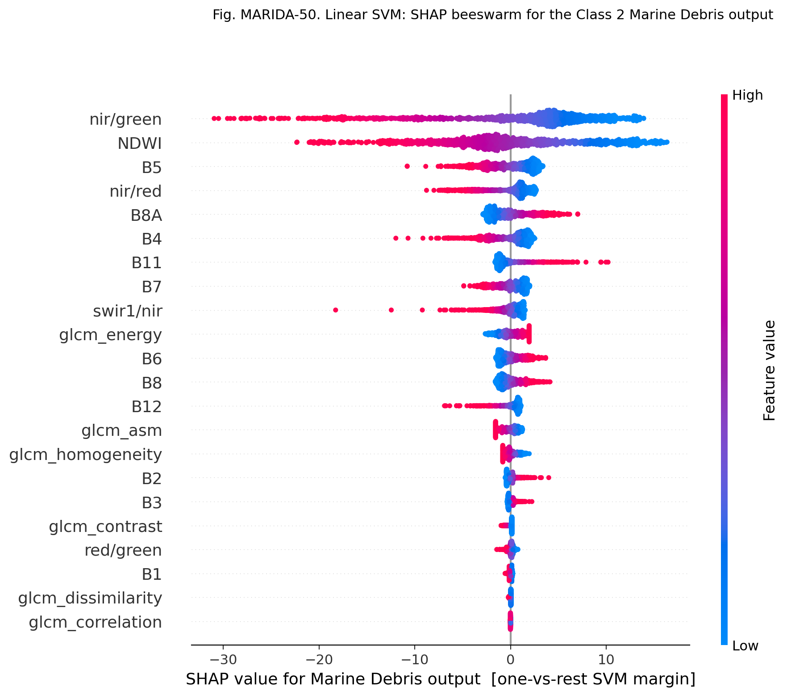

- **What it shows:** Signed Linear SVM SHAP values for the Class 2 Marine Debris output, for all pixels of the stratified sample.
- **How to read:** x > 0 pushes the Marine Debris score up; colour = feature value (red high, blue low); rho = Spearman correlation between feature value and SHAP value.
- **Findings:** **nir/green**: high values lower it (rho = -1.00), mean SHAP on Marine Debris pixels +3.46 vs -0.293 on other pixels; **NDWI**: high values lower it (rho = -1.00), mean SHAP on Marine Debris pixels -1.22 vs -0.248 on other pixels; **B5**: high values lower it (rho = -1.00), mean SHAP on Marine Debris pixels +2.27 vs -0.76 on other pixels; **nir/red**: high values lower it (rho = -1.00), mean SHAP on Marine Debris pixels +0.823 vs -0.225 on other pixels; **B8A**: high values raise it (rho = +1.00), mean SHAP on Marine Debris pixels -1.84 vs +0.345 on other pixels.
- **Meaning:** Features whose mean SHAP is positive on Marine Debris pixels and negative elsewhere are the ones that discriminate Marine Debris for this model.
- **Limitations:** |rho| < 0.2 does not mean unimportant: tree models can use a feature non-monotonically (see dependence plots). Attribution is not causation.

#### Fig. MARIDA-51. Linear SVM: SHAP beeswarm for the Class 3 Sargassum output

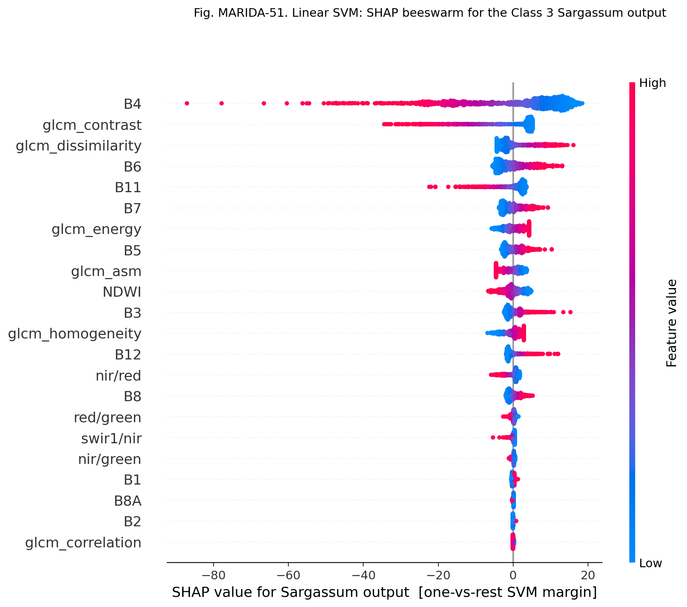

- **What it shows:** Signed Linear SVM SHAP values for the Class 3 Sargassum output, for all pixels of the stratified sample.
- **How to read:** x > 0 pushes the Sargassum score up; colour = feature value (red high, blue low); rho = Spearman correlation between feature value and SHAP value.
- **Findings:** **B4**: high values lower it (rho = -1.00), mean SHAP on Sargassum pixels +11.2 vs -3.77 on other pixels; **glcm_contrast**: high values lower it (rho = -1.00), mean SHAP on Sargassum pixels +3.98 vs -1.55 on other pixels; **glcm_dissimilarity**: high values raise it (rho = +1.00), mean SHAP on Sargassum pixels -1.59 vs +0.331 on other pixels; **B6**: high values raise it (rho = +1.00), mean SHAP on Sargassum pixels +1.15 vs -0.59 on other pixels; **B11**: high values lower it (rho = -1.00), mean SHAP on Sargassum pixels +2.32 vs +0.101 on other pixels.
- **Meaning:** Features whose mean SHAP is positive on Sargassum pixels and negative elsewhere are the ones that discriminate Sargassum for this model.
- **Limitations:** |rho| < 0.2 does not mean unimportant: tree models can use a feature non-monotonically (see dependence plots). Attribution is not causation.

#### Fig. MARIDA-52. Linear SVM: SHAP beeswarm for the Class 4 Other output

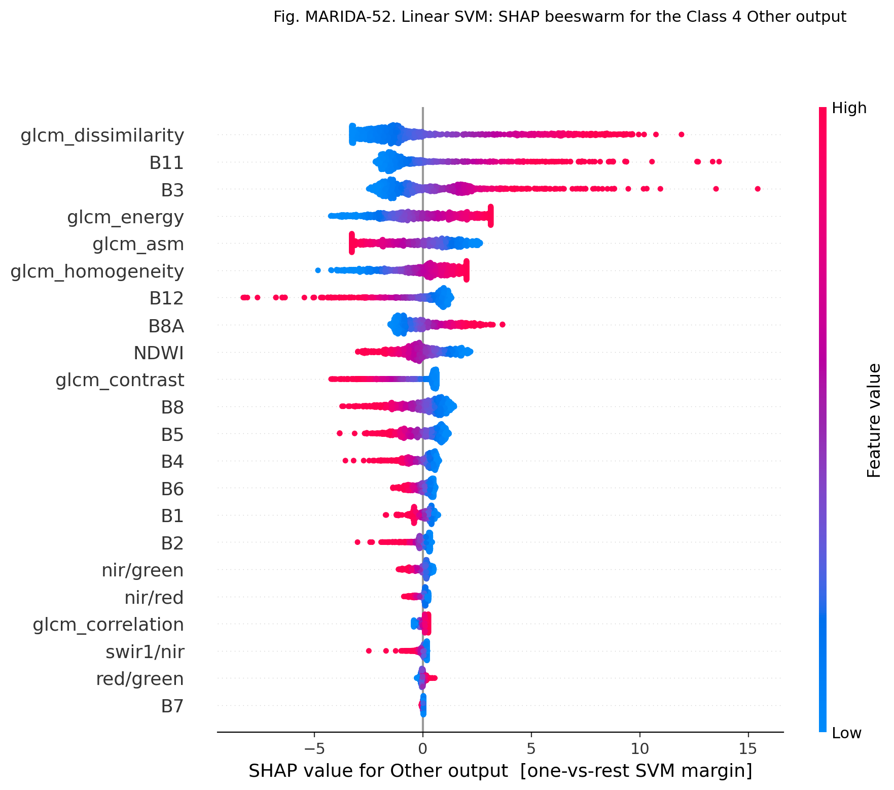

- **What it shows:** Signed Linear SVM SHAP values for the Class 4 Other output, for all pixels of the stratified sample.
- **How to read:** x > 0 pushes the Other score up; colour = feature value (red high, blue low); rho = Spearman correlation between feature value and SHAP value.
- **Findings:** **glcm_dissimilarity**: high values raise it (rho = +1.00), mean SHAP on Other pixels +4.84 vs -1.76 on other pixels; **B11**: high values raise it (rho = +1.00), mean SHAP on Other pixels +2.42 vs -1.34 on other pixels; **B3**: high values raise it (rho = +1.00), mean SHAP on Other pixels +2.08 vs -0.528 on other pixels; **glcm_energy**: high values raise it (rho = +1.00), mean SHAP on Other pixels -1.33 vs +0.536 on other pixels; **glcm_asm**: high values lower it (rho = -1.00), mean SHAP on Other pixels +1.11 vs -0.45 on other pixels.
- **Meaning:** Features whose mean SHAP is positive on Other pixels and negative elsewhere are the ones that discriminate Other for this model.
- **Limitations:** |rho| < 0.2 does not mean unimportant: tree models can use a feature non-monotonically (see dependence plots). Attribution is not causation.

### MARIDA - B6. Class-wise comparison heatmap

#### Fig. MARIDA-53. Class-wise SHAP importance across all five models and four class outputs

- **What it shows:** Normalised class-specific importance for every model x class output (20 columns).
- **How to read:** Cell = feature's share of the total mean |SHAP| of that model's class output (each column sums to 100%). White separators split models.
- **Findings:** Water: mean top features **nir/red** (19.0%), **glcm_contrast** (12.2%), **B8A** (7.8%), **swir1/nir** (6.1%); top-1 per model Random Forest nir/red, XGBoost nir/red, LightGBM nir/red, AdaBoost nir/red, Linear SVM B11 | Marine Debris: mean top features **nir/red** (16.9%), **swir1/nir** (12.9%), **NDWI** (11.5%), **nir/green** (10.0%); top-1 per model Random Forest nir/red, XGBoost nir/red, LightGBM nir/red, AdaBoost nir/red, Linear SVM nir/green | Sargassum: mean top features **nir/red** (23.1%), **glcm_contrast** (9.8%), **B4** (8.3%), **B3** (8.1%); top-1 per model Random Forest nir/red, XGBoost nir/red, LightGBM nir/red, AdaBoost nir/red, Linear SVM B4 | Other: mean top features **glcm_contrast** (20.0%), **B11** (12.4%), **B1** (6.7%), **glcm_dissimilarity** (6.2%); top-1 per model Random Forest glcm_contrast, XGBoost glcm_contrast, LightGBM glcm_contrast, AdaBoost glcm_contrast, Linear SVM glcm_dissimilarity.
- **Meaning:** Rows that light up for one class across all models are class-specific cues shared by the models.
- **Limitations:** Shares within a column depend on how concentrated that output's attribution is.

### MARIDA - B7. Class-versus-rest explanations

Class-versus-rest contrast = SHAP_k - mean_{j != k} SHAP_j. For Random Forest it reduces exactly to 4/3 x the class-probability SHAP (max deviation 1.2e-09) because the four probabilities sum to 1, and for AdaBoost to 4/3 x the SAMME-score SHAP (max deviation 1.4e-09) because the SAMME scores sum to 0; those plots would duplicate B4/B5 and are not repeated. The linear SVM is trained one-vs-rest, so its class margins (B4/B5) already are class-versus-rest scores. Only XGBoost and LightGBM (softmax margins) get separate contrast plots. Class probabilities are explained directly only for Random Forest; for XGBoost/LightGBM the contrast is on the log-probability-ratio scale; AdaBoost and SVM explain raw scores.

#### Fig. MARIDA-54. XGBoost: class-versus-rest SHAP for Class 1 Water (log[p_k / geometric mean of other p])

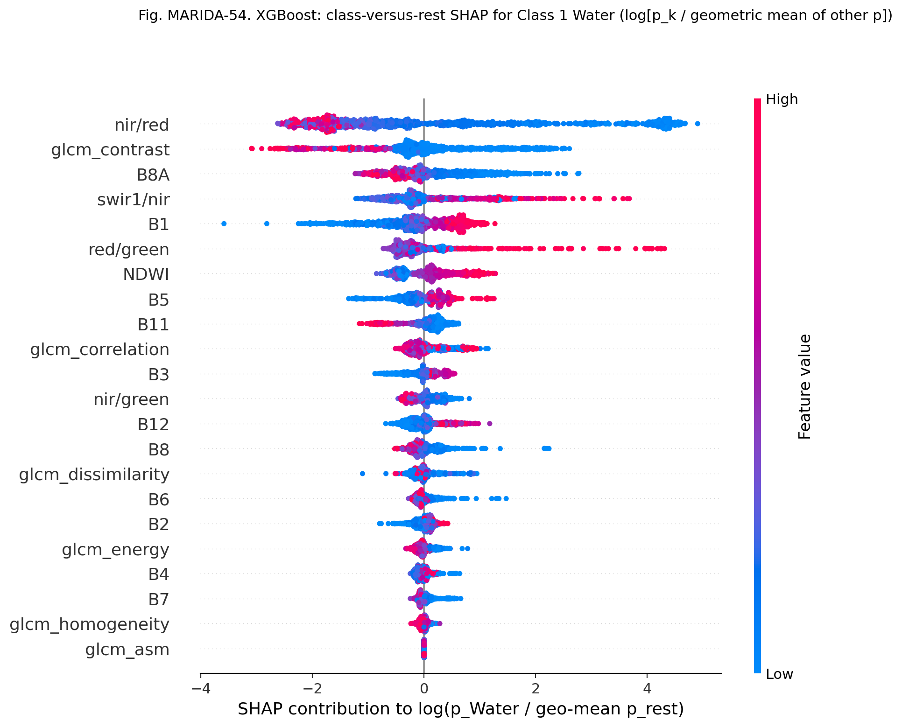

- **What it shows:** XGBoost class-versus-rest SHAP for Class 1 Water: contribution to s_k - mean of the other three margins, which for a softmax model equals log(p_k / geometric mean of the other three probabilities). It is exactly additive (difference of SHAP vectors).
- **How to read:** x > 0 = the feature raises this class's probability relative to the competing classes.
- **Findings:** Top five (contrast): **nir/red** (24.2%), **glcm_contrast** (10.5%), **B8A** (7.6%), **swir1/nir** (7.5%), **B1** (7.2%); top five for the plain Water margin: **nir/red** (24.2%), **glcm_contrast** (12.3%), **B8A** (9.9%), **B1** (7.7%), **NDWI** (6.5%); rank correlation of the two importance vectors 0.93. Directions: nir/red high values lower it (rho = -0.95); glcm_contrast high values lower it (rho = -0.89); B8A high values lower it (rho = -0.92).
- **Meaning:** Where the two rankings differ, a feature raises (or lowers) all class margins together and so does not discriminate; the contrast removes that shared part.
- **Limitations:** Values are on the log-probability-ratio scale, not on the probability scale; the softmax probability itself is not additive in SHAP.

#### Fig. MARIDA-55. XGBoost: class-versus-rest SHAP for Class 2 Marine Debris (log[p_k / geometric mean of other p])

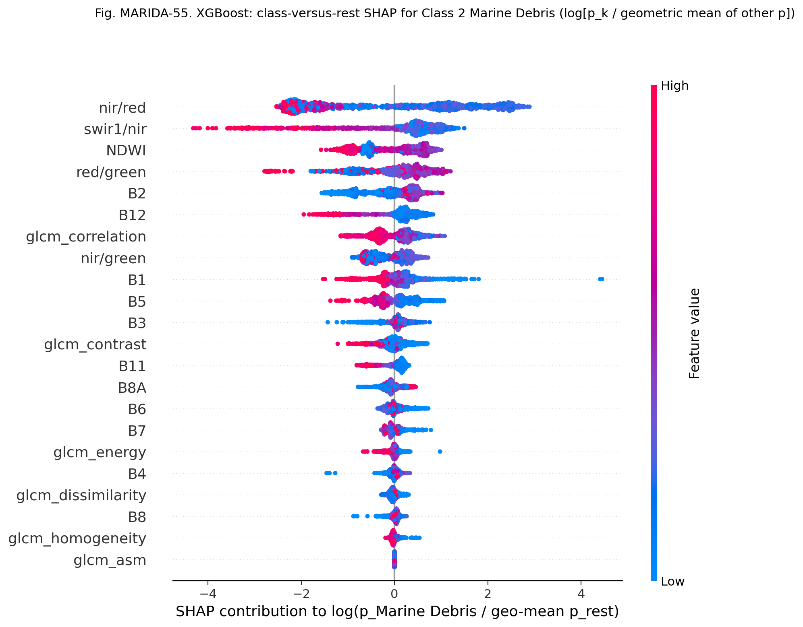

- **What it shows:** XGBoost class-versus-rest SHAP for Class 2 Marine Debris: contribution to s_k - mean of the other three margins, which for a softmax model equals log(p_k / geometric mean of the other three probabilities). It is exactly additive (difference of SHAP vectors).
- **How to read:** x > 0 = the feature raises this class's probability relative to the competing classes.
- **Findings:** Top five (contrast): **nir/red** (21.9%), **swir1/nir** (12.5%), **NDWI** (8.2%), **red/green** (8.0%), **B2** (6.6%); top five for the plain Marine Debris margin: **nir/red** (22.2%), **swir1/nir** (14.3%), **NDWI** (9.5%), **red/green** (8.8%), **B12** (5.9%); rank correlation of the two importance vectors 0.95. Directions: nir/red no consistent monotonic direction (rho = -0.04); swir1/nir high values lower it (rho = -0.57); NDWI high values tend to lower it (rho = -0.34).
- **Meaning:** Where the two rankings differ, a feature raises (or lowers) all class margins together and so does not discriminate; the contrast removes that shared part.
- **Limitations:** Values are on the log-probability-ratio scale, not on the probability scale; the softmax probability itself is not additive in SHAP.

#### Fig. MARIDA-56. XGBoost: class-versus-rest SHAP for Class 3 Sargassum (log[p_k / geometric mean of other p])

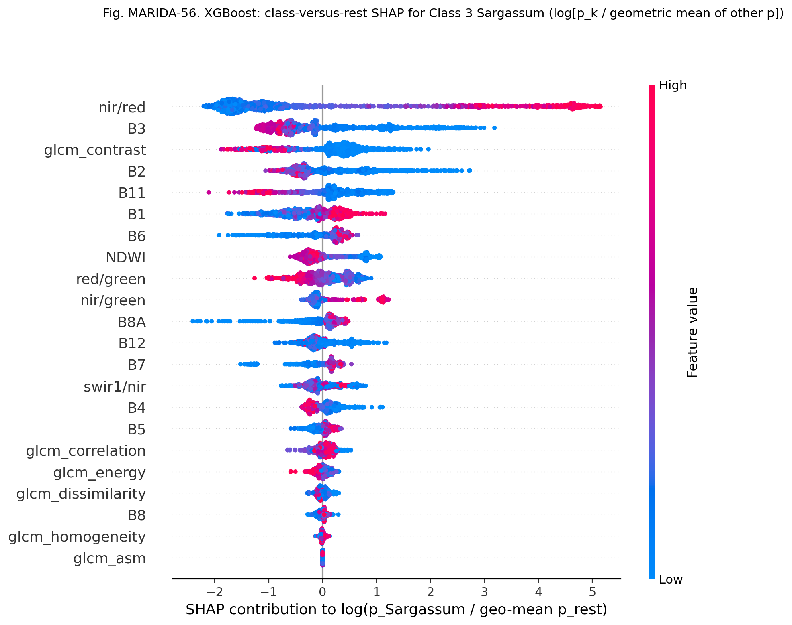

- **What it shows:** XGBoost class-versus-rest SHAP for Class 3 Sargassum: contribution to s_k - mean of the other three margins, which for a softmax model equals log(p_k / geometric mean of the other three probabilities). It is exactly additive (difference of SHAP vectors).
- **How to read:** x > 0 = the feature raises this class's probability relative to the competing classes.
- **Findings:** Top five (contrast): **nir/red** (24.3%), **B3** (10.5%), **glcm_contrast** (7.6%), **B2** (7.0%), **B11** (6.7%); top five for the plain Sargassum margin: **nir/red** (25.1%), **B3** (13.0%), **glcm_contrast** (8.2%), **B2** (7.5%), **B6** (5.6%); rank correlation of the two importance vectors 0.96. Directions: nir/red high values raise it (rho = +0.84); B3 high values lower it (rho = -0.92); glcm_contrast high values lower it (rho = -0.78).
- **Meaning:** Where the two rankings differ, a feature raises (or lowers) all class margins together and so does not discriminate; the contrast removes that shared part.
- **Limitations:** Values are on the log-probability-ratio scale, not on the probability scale; the softmax probability itself is not additive in SHAP.

#### Fig. MARIDA-57. XGBoost: class-versus-rest SHAP for Class 4 Other (log[p_k / geometric mean of other p])

- **What it shows:** XGBoost class-versus-rest SHAP for Class 4 Other: contribution to s_k - mean of the other three margins, which for a softmax model equals log(p_k / geometric mean of the other three probabilities). It is exactly additive (difference of SHAP vectors).
- **How to read:** x > 0 = the feature raises this class's probability relative to the competing classes.
- **Findings:** Top five (contrast): **glcm_contrast** (19.8%), **B11** (13.8%), **B1** (9.2%), **B3** (6.9%), **swir1/nir** (6.3%); top five for the plain Other margin: **glcm_contrast** (20.6%), **B11** (17.6%), **B1** (10.0%), **glcm_correlation** (5.6%), **swir1/nir** (5.3%); rank correlation of the two importance vectors 0.93. Directions: glcm_contrast high values raise it (rho = +0.95); B11 high values raise it (rho = +0.89); B1 high values lower it (rho = -0.92).
- **Meaning:** Where the two rankings differ, a feature raises (or lowers) all class margins together and so does not discriminate; the contrast removes that shared part.
- **Limitations:** Values are on the log-probability-ratio scale, not on the probability scale; the softmax probability itself is not additive in SHAP.

#### Fig. MARIDA-58. LightGBM: class-versus-rest SHAP for Class 1 Water (log[p_k / geometric mean of other p])

- **What it shows:** LightGBM class-versus-rest SHAP for Class 1 Water: contribution to s_k - mean of the other three margins, which for a softmax model equals log(p_k / geometric mean of the other three probabilities). It is exactly additive (difference of SHAP vectors).
- **How to read:** x > 0 = the feature raises this class's probability relative to the competing classes.
- **Findings:** Top five (contrast): **nir/red** (21.6%), **glcm_contrast** (10.5%), **B8A** (9.1%), **swir1/nir** (7.1%), **B5** (6.4%); top five for the plain Water margin: **nir/red** (19.8%), **glcm_contrast** (12.4%), **B8A** (11.6%), **B5** (7.7%), **swir1/nir** (6.1%); rank correlation of the two importance vectors 0.96. Directions: nir/red high values lower it (rho = -0.97); glcm_contrast high values lower it (rho = -0.88); B8A high values lower it (rho = -0.94).
- **Meaning:** Where the two rankings differ, a feature raises (or lowers) all class margins together and so does not discriminate; the contrast removes that shared part.
- **Limitations:** Values are on the log-probability-ratio scale, not on the probability scale; the softmax probability itself is not additive in SHAP.

#### Fig. MARIDA-59. LightGBM: class-versus-rest SHAP for Class 2 Marine Debris (log[p_k / geometric mean of other p])

- **What it shows:** LightGBM class-versus-rest SHAP for Class 2 Marine Debris: contribution to s_k - mean of the other three margins, which for a softmax model equals log(p_k / geometric mean of the other three probabilities). It is exactly additive (difference of SHAP vectors).
- **How to read:** x > 0 = the feature raises this class's probability relative to the competing classes.
- **Findings:** Top five (contrast): **nir/red** (17.6%), **swir1/nir** (11.7%), **NDWI** (9.9%), **B2** (8.6%), **red/green** (7.2%); top five for the plain Marine Debris margin: **nir/red** (16.5%), **swir1/nir** (13.6%), **NDWI** (12.3%), **red/green** (8.4%), **B2** (7.9%); rank correlation of the two importance vectors 0.95. Directions: nir/red no consistent monotonic direction (rho = +0.08); swir1/nir high values lower it (rho = -0.68); NDWI high values tend to lower it (rho = -0.27).
- **Meaning:** Where the two rankings differ, a feature raises (or lowers) all class margins together and so does not discriminate; the contrast removes that shared part.
- **Limitations:** Values are on the log-probability-ratio scale, not on the probability scale; the softmax probability itself is not additive in SHAP.

#### Fig. MARIDA-60. LightGBM: class-versus-rest SHAP for Class 3 Sargassum (log[p_k / geometric mean of other p])

- **What it shows:** LightGBM class-versus-rest SHAP for Class 3 Sargassum: contribution to s_k - mean of the other three margins, which for a softmax model equals log(p_k / geometric mean of the other three probabilities). It is exactly additive (difference of SHAP vectors).
- **How to read:** x > 0 = the feature raises this class's probability relative to the competing classes.
- **Findings:** Top five (contrast): **nir/red** (21.9%), **B3** (9.9%), **glcm_contrast** (9.6%), **B2** (8.9%), **B6** (8.1%); top five for the plain Sargassum margin: **nir/red** (23.3%), **B3** (11.5%), **glcm_contrast** (10.6%), **B6** (10.4%), **B2** (9.2%); rank correlation of the two importance vectors 0.95. Directions: nir/red high values raise it (rho = +0.87); B3 high values lower it (rho = -0.89); glcm_contrast high values lower it (rho = -0.92).
- **Meaning:** Where the two rankings differ, a feature raises (or lowers) all class margins together and so does not discriminate; the contrast removes that shared part.
- **Limitations:** Values are on the log-probability-ratio scale, not on the probability scale; the softmax probability itself is not additive in SHAP.

#### Fig. MARIDA-61. LightGBM: class-versus-rest SHAP for Class 4 Other (log[p_k / geometric mean of other p])

- **What it shows:** LightGBM class-versus-rest SHAP for Class 4 Other: contribution to s_k - mean of the other three margins, which for a softmax model equals log(p_k / geometric mean of the other three probabilities). It is exactly additive (difference of SHAP vectors).
- **How to read:** x > 0 = the feature raises this class's probability relative to the competing classes.
- **Findings:** Top five (contrast): **glcm_contrast** (20.6%), **B11** (12.1%), **B1** (9.1%), **B3** (6.9%), **swir1/nir** (5.2%); top five for the plain Other margin: **glcm_contrast** (21.5%), **B11** (15.1%), **B1** (11.3%), **swir1/nir** (5.1%), **glcm_correlation** (4.9%); rank correlation of the two importance vectors 0.84. Directions: glcm_contrast high values raise it (rho = +0.95); B11 high values raise it (rho = +0.93); B1 high values lower it (rho = -0.92).
- **Meaning:** Where the two rankings differ, a feature raises (or lowers) all class margins together and so does not discriminate; the contrast removes that shared part.
- **Limitations:** Values are on the log-probability-ratio scale, not on the probability scale; the softmax probability itself is not additive in SHAP.

## MARIDA - Section C - How individual features affect predictions

### MARIDA - C8. Dependence plots

#### Fig. MARIDA-62. Random Forest: dependence plots of the 3 most important features for the Class 1 Water output

- **What it shows:** How the value of Random Forest's three most important features for the Class 1 Water output maps to their SHAP contribution.
- **How to read:** x = feature value, y = SHAP value for this class output, colour = value of the feature that SHAP's approximate_interactions picks as the strongest interaction partner. Grey histogram = distribution of x. Vertical spread at a fixed x indicates interaction.
- **Findings:** **nir/red** (coloured by glcm_contrast): high values lower it (rho = -0.97), 5-95% value range 0.367-3.08; **glcm_contrast** (coloured by B3): high values lower it (rho = -0.70), 5-95% value range 0.00828-8.36; **NDWI** (coloured by B4): high values raise it (rho = +0.96), 5-95% value range -0.448-0.484.
- **Meaning:** Threshold-like jumps show the value ranges at which the model switches its decision for this class.
- **Limitations:** Interventional SHAP evaluates feature values off the data manifold when features are correlated; the colour partner is a heuristic, not a measured interaction (see section C9).

#### Fig. MARIDA-63. Random Forest: dependence plots of the 3 most important features for the Class 2 Marine Debris output

- **What it shows:** How the value of Random Forest's three most important features for the Class 2 Marine Debris output maps to their SHAP contribution.
- **How to read:** x = feature value, y = SHAP value for this class output, colour = value of the feature that SHAP's approximate_interactions picks as the strongest interaction partner. Grey histogram = distribution of x. Vertical spread at a fixed x indicates interaction.
- **Findings:** **nir/red** (coloured by B5): no consistent monotonic direction (rho = -0.15), 5-95% value range 0.367-3.08; **swir1/nir** (coloured by B5): high values lower it (rho = -0.60), 5-95% value range 0.0794-0.943; **NDWI** (coloured by B6): high values tend to lower it (rho = -0.31), 5-95% value range -0.448-0.484.
- **Meaning:** Threshold-like jumps show the value ranges at which the model switches its decision for this class.
- **Limitations:** Interventional SHAP evaluates feature values off the data manifold when features are correlated; the colour partner is a heuristic, not a measured interaction (see section C9).

#### Fig. MARIDA-64. Random Forest: dependence plots of the 3 most important features for the Class 3 Sargassum output

- **What it shows:** How the value of Random Forest's three most important features for the Class 3 Sargassum output maps to their SHAP contribution.
- **How to read:** x = feature value, y = SHAP value for this class output, colour = value of the feature that SHAP's approximate_interactions picks as the strongest interaction partner. Grey histogram = distribution of x. Vertical spread at a fixed x indicates interaction.
- **Findings:** **nir/red** (coloured by glcm_dissimilarity): high values raise it (rho = +0.89), 5-95% value range 0.367-3.08; **NDWI** (coloured by B8A): high values lower it (rho = -0.91), 5-95% value range -0.448-0.484; **nir/green** (coloured by B11): high values raise it (rho = +0.94), 5-95% value range 0.348-2.62.
- **Meaning:** Threshold-like jumps show the value ranges at which the model switches its decision for this class.
- **Limitations:** Interventional SHAP evaluates feature values off the data manifold when features are correlated; the colour partner is a heuristic, not a measured interaction (see section C9).

#### Fig. MARIDA-65. Random Forest: dependence plots of the 3 most important features for the Class 4 Other output

- **What it shows:** How the value of Random Forest's three most important features for the Class 4 Other output maps to their SHAP contribution.
- **How to read:** x = feature value, y = SHAP value for this class output, colour = value of the feature that SHAP's approximate_interactions picks as the strongest interaction partner. Grey histogram = distribution of x. Vertical spread at a fixed x indicates interaction.
- **Findings:** **glcm_contrast** (coloured by B2): high values raise it (rho = +0.85), 5-95% value range 0.00828-8.36; **B11** (coloured by nir/green): high values raise it (rho = +0.74), 5-95% value range 0.00464-0.0972; **glcm_dissimilarity** (coloured by B4): high values raise it (rho = +0.85), 5-95% value range 0.00828-1.56.
- **Meaning:** Threshold-like jumps show the value ranges at which the model switches its decision for this class.
- **Limitations:** Interventional SHAP evaluates feature values off the data manifold when features are correlated; the colour partner is a heuristic, not a measured interaction (see section C9).

#### Fig. MARIDA-66. XGBoost: dependence plots of the 3 most important features for the Class 1 Water output

- **What it shows:** How the value of XGBoost's three most important features for the Class 1 Water output maps to their SHAP contribution.
- **How to read:** x = feature value, y = SHAP value for this class output, colour = value of the feature that SHAP's approximate_interactions picks as the strongest interaction partner. Grey histogram = distribution of x. Vertical spread at a fixed x indicates interaction.
- **Findings:** **nir/red** (coloured by glcm_contrast): high values lower it (rho = -0.93), 5-95% value range 0.367-3.08; **glcm_contrast** (coloured by B3): high values lower it (rho = -0.90), 5-95% value range 0.00828-8.36; **B8A** (coloured by B11): high values lower it (rho = -0.92), 5-95% value range 0.0147-0.167.
- **Meaning:** Threshold-like jumps show the value ranges at which the model switches its decision for this class.
- **Limitations:** Interventional SHAP evaluates feature values off the data manifold when features are correlated; the colour partner is a heuristic, not a measured interaction (see section C9).

#### Fig. MARIDA-67. XGBoost: dependence plots of the 3 most important features for the Class 2 Marine Debris output

- **What it shows:** How the value of XGBoost's three most important features for the Class 2 Marine Debris output maps to their SHAP contribution.
- **How to read:** x = feature value, y = SHAP value for this class output, colour = value of the feature that SHAP's approximate_interactions picks as the strongest interaction partner. Grey histogram = distribution of x. Vertical spread at a fixed x indicates interaction.
- **Findings:** **nir/red** (coloured by B5): no consistent monotonic direction (rho = +0.13), 5-95% value range 0.367-3.08; **swir1/nir** (coloured by B5): high values lower it (rho = -0.61), 5-95% value range 0.0794-0.943; **NDWI** (coloured by B1): high values tend to lower it (rho = -0.30), 5-95% value range -0.448-0.484.
- **Meaning:** Threshold-like jumps show the value ranges at which the model switches its decision for this class.
- **Limitations:** Interventional SHAP evaluates feature values off the data manifold when features are correlated; the colour partner is a heuristic, not a measured interaction (see section C9).

#### Fig. MARIDA-68. XGBoost: dependence plots of the 3 most important features for the Class 3 Sargassum output

- **What it shows:** How the value of XGBoost's three most important features for the Class 3 Sargassum output maps to their SHAP contribution.
- **How to read:** x = feature value, y = SHAP value for this class output, colour = value of the feature that SHAP's approximate_interactions picks as the strongest interaction partner. Grey histogram = distribution of x. Vertical spread at a fixed x indicates interaction.
- **Findings:** **nir/red** (coloured by glcm_dissimilarity): high values raise it (rho = +0.89), 5-95% value range 0.367-3.08; **B3** (coloured by nir/red): high values lower it (rho = -0.92), 5-95% value range 0.0225-0.162; **glcm_contrast** (coloured by nir/red): high values lower it (rho = -0.87), 5-95% value range 0.00828-8.36.
- **Meaning:** Threshold-like jumps show the value ranges at which the model switches its decision for this class.
- **Limitations:** Interventional SHAP evaluates feature values off the data manifold when features are correlated; the colour partner is a heuristic, not a measured interaction (see section C9).

#### Fig. MARIDA-69. XGBoost: dependence plots of the 3 most important features for the Class 4 Other output

- **What it shows:** How the value of XGBoost's three most important features for the Class 4 Other output maps to their SHAP contribution.
- **How to read:** x = feature value, y = SHAP value for this class output, colour = value of the feature that SHAP's approximate_interactions picks as the strongest interaction partner. Grey histogram = distribution of x. Vertical spread at a fixed x indicates interaction.
- **Findings:** **glcm_contrast** (coloured by nir/red): high values raise it (rho = +0.95), 5-95% value range 0.00828-8.36; **B11** (coloured by nir/red): high values raise it (rho = +0.91), 5-95% value range 0.00464-0.0972; **B1** (coloured by glcm_dissimilarity): high values lower it (rho = -0.92), 5-95% value range 0.027-0.0808.
- **Meaning:** Threshold-like jumps show the value ranges at which the model switches its decision for this class.
- **Limitations:** Interventional SHAP evaluates feature values off the data manifold when features are correlated; the colour partner is a heuristic, not a measured interaction (see section C9).

#### Fig. MARIDA-70. LightGBM: dependence plots of the 3 most important features for the Class 1 Water output

- **What it shows:** How the value of LightGBM's three most important features for the Class 1 Water output maps to their SHAP contribution.
- **How to read:** x = feature value, y = SHAP value for this class output, colour = value of the feature that SHAP's approximate_interactions picks as the strongest interaction partner. Grey histogram = distribution of x. Vertical spread at a fixed x indicates interaction.
- **Findings:** **nir/red** (coloured by glcm_contrast): high values lower it (rho = -0.95), 5-95% value range 0.367-3.08; **glcm_contrast** (coloured by B3): high values lower it (rho = -0.89), 5-95% value range 0.00828-8.36; **B8A** (coloured by B11): high values lower it (rho = -0.94), 5-95% value range 0.0147-0.167.
- **Meaning:** Threshold-like jumps show the value ranges at which the model switches its decision for this class.
- **Limitations:** Interventional SHAP evaluates feature values off the data manifold when features are correlated; the colour partner is a heuristic, not a measured interaction (see section C9).

#### Fig. MARIDA-71. LightGBM: dependence plots of the 3 most important features for the Class 2 Marine Debris output

- **What it shows:** How the value of LightGBM's three most important features for the Class 2 Marine Debris output maps to their SHAP contribution.
- **How to read:** x = feature value, y = SHAP value for this class output, colour = value of the feature that SHAP's approximate_interactions picks as the strongest interaction partner. Grey histogram = distribution of x. Vertical spread at a fixed x indicates interaction.
- **Findings:** **nir/red** (coloured by B5): high values tend to raise it (rho = +0.28), 5-95% value range 0.367-3.08; **swir1/nir** (coloured by B5): high values lower it (rho = -0.61), 5-95% value range 0.0794-0.943; **NDWI** (coloured by glcm_dissimilarity): high values tend to lower it (rho = -0.25), 5-95% value range -0.448-0.484.
- **Meaning:** Threshold-like jumps show the value ranges at which the model switches its decision for this class.
- **Limitations:** Interventional SHAP evaluates feature values off the data manifold when features are correlated; the colour partner is a heuristic, not a measured interaction (see section C9).

#### Fig. MARIDA-72. LightGBM: dependence plots of the 3 most important features for the Class 3 Sargassum output

- **What it shows:** How the value of LightGBM's three most important features for the Class 3 Sargassum output maps to their SHAP contribution.
- **How to read:** x = feature value, y = SHAP value for this class output, colour = value of the feature that SHAP's approximate_interactions picks as the strongest interaction partner. Grey histogram = distribution of x. Vertical spread at a fixed x indicates interaction.
- **Findings:** **nir/red** (coloured by glcm_dissimilarity): high values raise it (rho = +0.89), 5-95% value range 0.367-3.08; **B3** (coloured by nir/red): high values lower it (rho = -0.90), 5-95% value range 0.0225-0.162; **glcm_contrast** (coloured by nir/red): high values lower it (rho = -0.92), 5-95% value range 0.00828-8.36.
- **Meaning:** Threshold-like jumps show the value ranges at which the model switches its decision for this class.
- **Limitations:** Interventional SHAP evaluates feature values off the data manifold when features are correlated; the colour partner is a heuristic, not a measured interaction (see section C9).

#### Fig. MARIDA-73. LightGBM: dependence plots of the 3 most important features for the Class 4 Other output

- **What it shows:** How the value of LightGBM's three most important features for the Class 4 Other output maps to their SHAP contribution.
- **How to read:** x = feature value, y = SHAP value for this class output, colour = value of the feature that SHAP's approximate_interactions picks as the strongest interaction partner. Grey histogram = distribution of x. Vertical spread at a fixed x indicates interaction.
- **Findings:** **glcm_contrast** (coloured by nir/red): high values raise it (rho = +0.96), 5-95% value range 0.00828-8.36; **B11** (coloured by nir/red): high values raise it (rho = +0.93), 5-95% value range 0.00464-0.0972; **B1** (coloured by glcm_dissimilarity): high values lower it (rho = -0.93), 5-95% value range 0.027-0.0808.
- **Meaning:** Threshold-like jumps show the value ranges at which the model switches its decision for this class.
- **Limitations:** Interventional SHAP evaluates feature values off the data manifold when features are correlated; the colour partner is a heuristic, not a measured interaction (see section C9).

#### Fig. MARIDA-74. AdaBoost: dependence plots of the 3 most important features for the Class 1 Water output

- **What it shows:** How the value of AdaBoost's three most important features for the Class 1 Water output maps to their SHAP contribution.
- **How to read:** x = feature value, y = SHAP value for this class output, colour = value of the feature that SHAP's approximate_interactions picks as the strongest interaction partner. Grey histogram = distribution of x. Vertical spread at a fixed x indicates interaction.
- **Findings:** **nir/red** (coloured by glcm_contrast): high values lower it (rho = -0.96), 5-95% value range 0.367-3.08; **glcm_contrast** (coloured by B2): high values lower it (rho = -0.88), 5-95% value range 0.00828-8.36; **swir1/nir** (coloured by B5): high values tend to raise it (rho = +0.40), 5-95% value range 0.0794-0.943.
- **Meaning:** Threshold-like jumps show the value ranges at which the model switches its decision for this class.
- **Limitations:** Interventional SHAP evaluates feature values off the data manifold when features are correlated; the colour partner is a heuristic, not a measured interaction (see section C9).

#### Fig. MARIDA-75. AdaBoost: dependence plots of the 3 most important features for the Class 2 Marine Debris output

- **What it shows:** How the value of AdaBoost's three most important features for the Class 2 Marine Debris output maps to their SHAP contribution.
- **How to read:** x = feature value, y = SHAP value for this class output, colour = value of the feature that SHAP's approximate_interactions picks as the strongest interaction partner. Grey histogram = distribution of x. Vertical spread at a fixed x indicates interaction.
- **Findings:** **nir/red** (coloured by swir1/nir): high values tend to raise it (rho = +0.25), 5-95% value range 0.367-3.08; **swir1/nir** (coloured by NDWI): high values lower it (rho = -0.52), 5-95% value range 0.0794-0.943; **nir/green** (coloured by swir1/nir): no consistent monotonic direction (rho = +0.15), 5-95% value range 0.348-2.62.
- **Meaning:** Threshold-like jumps show the value ranges at which the model switches its decision for this class.
- **Limitations:** Interventional SHAP evaluates feature values off the data manifold when features are correlated; the colour partner is a heuristic, not a measured interaction (see section C9).

#### Fig. MARIDA-76. AdaBoost: dependence plots of the 3 most important features for the Class 3 Sargassum output

- **What it shows:** How the value of AdaBoost's three most important features for the Class 3 Sargassum output maps to their SHAP contribution.
- **How to read:** x = feature value, y = SHAP value for this class output, colour = value of the feature that SHAP's approximate_interactions picks as the strongest interaction partner. Grey histogram = distribution of x. Vertical spread at a fixed x indicates interaction.
- **Findings:** **nir/red** (coloured by glcm_homogeneity): high values raise it (rho = +0.93), 5-95% value range 0.367-3.08; **glcm_contrast** (coloured by nir/red): high values lower it (rho = -0.87), 5-95% value range 0.00828-8.36; **B3** (coloured by swir1/nir): high values lower it (rho = -0.73), 5-95% value range 0.0225-0.162.
- **Meaning:** Threshold-like jumps show the value ranges at which the model switches its decision for this class.
- **Limitations:** Interventional SHAP evaluates feature values off the data manifold when features are correlated; the colour partner is a heuristic, not a measured interaction (see section C9).

#### Fig. MARIDA-77. AdaBoost: dependence plots of the 3 most important features for the Class 4 Other output

- **What it shows:** How the value of AdaBoost's three most important features for the Class 4 Other output maps to their SHAP contribution.
- **How to read:** x = feature value, y = SHAP value for this class output, colour = value of the feature that SHAP's approximate_interactions picks as the strongest interaction partner. Grey histogram = distribution of x. Vertical spread at a fixed x indicates interaction.
- **Findings:** **glcm_contrast** (coloured by B2): high values raise it (rho = +0.92), 5-95% value range 0.00828-8.36; **swir1/nir** (coloured by glcm_contrast): high values raise it (rho = +0.92), 5-95% value range 0.0794-0.943; **nir/red** (coloured by glcm_contrast): no consistent monotonic direction (rho = +0.01), 5-95% value range 0.367-3.08.
- **Meaning:** Threshold-like jumps show the value ranges at which the model switches its decision for this class.
- **Limitations:** Interventional SHAP evaluates feature values off the data manifold when features are correlated; the colour partner is a heuristic, not a measured interaction (see section C9).

#### Fig. MARIDA-78. Linear SVM: dependence plots of the 3 most important features for the Class 1 Water output

- **What it shows:** How the value of Linear SVM's three most important features for the Class 1 Water output maps to their SHAP contribution.
- **How to read:** x = feature value, y = SHAP value for this class output, colour = value of the feature that SHAP's approximate_interactions picks as the strongest interaction partner. Grey histogram = distribution of x. Vertical spread at a fixed x indicates interaction.
- **Findings:** **B11** (coloured by B12): high values lower it (rho = -1.00), 5-95% value range 0.00464-0.0972; **glcm_dissimilarity** (coloured by glcm_homogeneity): high values lower it (rho = -1.00), 5-95% value range 0.00828-1.56; **B8A** (coloured by B7): high values lower it (rho = -1.00), 5-95% value range 0.0147-0.167.
- **Meaning:** Threshold-like jumps show the value ranges at which the model switches its decision for this class.
- **Limitations:** Interventional SHAP evaluates feature values off the data manifold when features are correlated; the colour partner is a heuristic, not a measured interaction (see section C9).

#### Fig. MARIDA-79. Linear SVM: dependence plots of the 3 most important features for the Class 2 Marine Debris output

- **What it shows:** How the value of Linear SVM's three most important features for the Class 2 Marine Debris output maps to their SHAP contribution.
- **How to read:** x = feature value, y = SHAP value for this class output, colour = value of the feature that SHAP's approximate_interactions picks as the strongest interaction partner. Grey histogram = distribution of x. Vertical spread at a fixed x indicates interaction.
- **Findings:** **nir/green** (coloured by NDWI): high values lower it (rho = -1.00), 5-95% value range 0.348-2.62; **NDWI** (coloured by nir/green): high values lower it (rho = -1.00), 5-95% value range -0.448-0.484; **B5** (coloured by B7): high values lower it (rho = -1.00), 5-95% value range 0.0148-0.15.
- **Meaning:** Threshold-like jumps show the value ranges at which the model switches its decision for this class.
- **Limitations:** Interventional SHAP evaluates feature values off the data manifold when features are correlated; the colour partner is a heuristic, not a measured interaction (see section C9).

#### Fig. MARIDA-80. Linear SVM: dependence plots of the 3 most important features for the Class 3 Sargassum output

- **What it shows:** How the value of Linear SVM's three most important features for the Class 3 Sargassum output maps to their SHAP contribution.
- **How to read:** x = feature value, y = SHAP value for this class output, colour = value of the feature that SHAP's approximate_interactions picks as the strongest interaction partner. Grey histogram = distribution of x. Vertical spread at a fixed x indicates interaction.
- **Findings:** **B4** (coloured by B3): high values lower it (rho = -1.00), 5-95% value range 0.0174-0.17; **glcm_contrast** (coloured by glcm_dissimilarity): high values lower it (rho = -1.00), 5-95% value range 0.00828-8.36; **glcm_dissimilarity** (coloured by glcm_homogeneity): high values raise it (rho = +1.00), 5-95% value range 0.00828-1.56.
- **Meaning:** Threshold-like jumps show the value ranges at which the model switches its decision for this class.
- **Limitations:** Interventional SHAP evaluates feature values off the data manifold when features are correlated; the colour partner is a heuristic, not a measured interaction (see section C9).

#### Fig. MARIDA-81. Linear SVM: dependence plots of the 3 most important features for the Class 4 Other output

- **What it shows:** How the value of Linear SVM's three most important features for the Class 4 Other output maps to their SHAP contribution.
- **How to read:** x = feature value, y = SHAP value for this class output, colour = value of the feature that SHAP's approximate_interactions picks as the strongest interaction partner. Grey histogram = distribution of x. Vertical spread at a fixed x indicates interaction.
- **Findings:** **glcm_dissimilarity** (coloured by glcm_homogeneity): high values raise it (rho = +1.00), 5-95% value range 0.00828-1.56; **B11** (coloured by B12): high values raise it (rho = +1.00), 5-95% value range 0.00464-0.0972; **B3** (coloured by B4): high values raise it (rho = +1.00), 5-95% value range 0.0225-0.162.
- **Meaning:** Threshold-like jumps show the value ranges at which the model switches its decision for this class.
- **Limitations:** Interventional SHAP evaluates feature values off the data manifold when features are correlated; the colour partner is a heuristic, not a measured interaction (see section C9).

### MARIDA - C9. Feature interactions

SHAP interaction values (path-dependent TreeSHAP) were computed for the four tree models. The linear SVM decision function is a weighted sum of standardised features, so all its SHAP interaction values are exactly zero; no plot is produced for it.

#### Fig. MARIDA-82. Random Forest: mean |SHAP interaction| between the top features, per class output

- **What it shows:** Pairwise SHAP interaction strength for Random Forest (path-dependent TreeSHAP interaction values, n = 160 stratified test pixels), one panel per class output.
- **How to read:** Cell (i, j) = mean |phi_ij| + mean |phi_ji| in the model's output unit; the diagonal (main effects) is blanked. 'Off-diagonal share' = fraction of the total |interaction matrix| mass that is interaction rather than main effect.
- **Findings:** Water: off-diagonal share 49.4%, strongest pairs NDWI x nir/red (0.0248), nir/red x glcm_contrast (0.0238), nir/red x nir/green (0.0212) | Marine Debris: off-diagonal share 64.3%, strongest pairs NDWI x nir/red (0.0168), nir/red x swir1/nir (0.0142), nir/red x nir/green (0.0128) | Sargassum: off-diagonal share 54.8%, strongest pairs NDWI x nir/red (0.0105), B2 x nir/red (0.00914), nir/red x glcm_contrast (0.00877) | Other: off-diagonal share 55.2%, strongest pairs B11 x glcm_contrast (0.0141), nir/red x glcm_contrast (0.0137), glcm_contrast x glcm_homogeneity (0.0127).
- **Meaning:** A small off-diagonal share means the model behaves close to additively for that class.
- **Limitations:** Path-dependent TreeSHAP uses the training cover as reference (not the interventional background used elsewhere); for AdaBoost the cover was recomputed from the log-weighted training pixels. The linear SVM margin has no interactions by construction.

#### Fig. MARIDA-83. Random Forest: strongest interaction pair for the Marine Debris output (NDWI x nir/red)

- **What it shows:** The strongest Marine Debris interaction of Random Forest (NDWI x nir/red), from both sides.
- **How to read:** y = interaction value phi_ij + phi_ji (the part of the debris score that depends jointly on both features); x = one feature, colour = the other.
- **Findings:** Interaction values range -0.0682 to 0.0197 probability, versus a main-effect range of -0.0342 to 0.0737 for NDWI. Spearman(value, interaction): NDWI +0.81, nir/red -0.86.
- **Meaning:** The effect of NDWI on the debris score depends on the level of nir/red (and vice versa).
- **Limitations:** Based on 160 pixels; rare value combinations are poorly sampled.

#### Fig. MARIDA-84. XGBoost: mean |SHAP interaction| between the top features, per class output

- **What it shows:** Pairwise SHAP interaction strength for XGBoost (path-dependent TreeSHAP interaction values, n = 160 stratified test pixels), one panel per class output.
- **How to read:** Cell (i, j) = mean |phi_ij| + mean |phi_ji| in the model's output unit; the diagonal (main effects) is blanked. 'Off-diagonal share' = fraction of the total |interaction matrix| mass that is interaction rather than main effect.
- **Findings:** Water: off-diagonal share 52.1%, strongest pairs nir/red x glcm_contrast (0.706), B8A x swir1/nir (0.244), nir/red x swir1/nir (0.213) | Marine Debris: off-diagonal share 56.7%, strongest pairs nir/red x swir1/nir (0.381), red/green x nir/red (0.228), NDWI x nir/red (0.218) | Sargassum: off-diagonal share 50.1%, strongest pairs B3 x nir/red (0.518), nir/red x glcm_contrast (0.433), B2 x nir/red (0.379) | Other: off-diagonal share 55.2%, strongest pairs B11 x glcm_contrast (0.336), nir/red x glcm_contrast (0.229), B1 x glcm_contrast (0.176).
- **Meaning:** A small off-diagonal share means the model behaves close to additively for that class.
- **Limitations:** Path-dependent TreeSHAP uses the training cover as reference (not the interventional background used elsewhere); for AdaBoost the cover was recomputed from the log-weighted training pixels. The linear SVM margin has no interactions by construction.

#### Fig. MARIDA-85. XGBoost: strongest interaction pair for the Marine Debris output (nir/red x swir1/nir)

- **What it shows:** The strongest Marine Debris interaction of XGBoost (nir/red x swir1/nir), from both sides.
- **How to read:** y = interaction value phi_ij + phi_ji (the part of the debris score that depends jointly on both features); x = one feature, colour = the other.
- **Findings:** Interaction values range -1.41 to 1.35 log-odds margin, versus a main-effect range of -1.82 to 1.84 for nir/red. Spearman(value, interaction): nir/red -0.12, swir1/nir +0.27.
- **Meaning:** The effect of nir/red on the debris score depends on the level of swir1/nir (and vice versa).
- **Limitations:** Based on 160 pixels; rare value combinations are poorly sampled.

#### Fig. MARIDA-86. LightGBM: mean |SHAP interaction| between the top features, per class output

- **What it shows:** Pairwise SHAP interaction strength for LightGBM (path-dependent TreeSHAP interaction values, n = 160 stratified test pixels), one panel per class output.
- **How to read:** Cell (i, j) = mean |phi_ij| + mean |phi_ji| in the model's output unit; the diagonal (main effects) is blanked. 'Off-diagonal share' = fraction of the total |interaction matrix| mass that is interaction rather than main effect.
- **Findings:** Water: off-diagonal share 65.5%, strongest pairs nir/red x glcm_contrast (0.768), red/green x nir/red (0.55), nir/red x swir1/nir (0.513) | Marine Debris: off-diagonal share 66.4%, strongest pairs nir/red x swir1/nir (0.459), NDWI x nir/red (0.455), NDWI x swir1/nir (0.368) | Sargassum: off-diagonal share 59.5%, strongest pairs B3 x B6 (0.443), B3 x nir/red (0.31), nir/red x glcm_contrast (0.308) | Other: off-diagonal share 60.4%, strongest pairs nir/red x glcm_contrast (0.293), B11 x glcm_contrast (0.223), glcm_contrast x glcm_correlation (0.204).
- **Meaning:** A small off-diagonal share means the model behaves close to additively for that class.
- **Limitations:** Path-dependent TreeSHAP uses the training cover as reference (not the interventional background used elsewhere); for AdaBoost the cover was recomputed from the log-weighted training pixels. The linear SVM margin has no interactions by construction.

#### Fig. MARIDA-87. LightGBM: strongest interaction pair for the Marine Debris output (nir/red x swir1/nir)

- **What it shows:** The strongest Marine Debris interaction of LightGBM (nir/red x swir1/nir), from both sides.
- **How to read:** y = interaction value phi_ij + phi_ji (the part of the debris score that depends jointly on both features); x = one feature, colour = the other.
- **Findings:** Interaction values range -1.11 to 1.31 log-odds margin, versus a main-effect range of -0.238 to 1.56 for nir/red. Spearman(value, interaction): nir/red +0.30, swir1/nir -0.22.
- **Meaning:** The effect of nir/red on the debris score depends on the level of swir1/nir (and vice versa).
- **Limitations:** Based on 160 pixels; rare value combinations are poorly sampled.

#### Fig. MARIDA-88. AdaBoost: mean |SHAP interaction| between the top features, per class output

- **What it shows:** Pairwise SHAP interaction strength for AdaBoost (path-dependent TreeSHAP interaction values, n = 160 stratified test pixels), one panel per class output.
- **How to read:** Cell (i, j) = mean |phi_ij| + mean |phi_ji| in the model's output unit; the diagonal (main effects) is blanked. 'Off-diagonal share' = fraction of the total |interaction matrix| mass that is interaction rather than main effect.
- **Findings:** Water: off-diagonal share 36.0%, strongest pairs nir/red x glcm_contrast (0.0566), B4 x glcm_contrast (0.0239), nir/red x swir1/nir (0.0171) | Marine Debris: off-diagonal share 41.2%, strongest pairs nir/red x swir1/nir (0.0222), swir1/nir x glcm_contrast (0.0118), red/green x swir1/nir (0.0102) | Sargassum: off-diagonal share 42.6%, strongest pairs B3 x B6 (0.019), nir/red x glcm_contrast (0.0187), red/green x nir/red (0.0121) | Other: off-diagonal share 45.1%, strongest pairs nir/red x glcm_contrast (0.0488), B11 x nir/red (0.0137), red/green x nir/red (0.0129).
- **Meaning:** A small off-diagonal share means the model behaves close to additively for that class.
- **Limitations:** Path-dependent TreeSHAP uses the training cover as reference (not the interventional background used elsewhere); for AdaBoost the cover was recomputed from the log-weighted training pixels. The linear SVM margin has no interactions by construction.

#### Fig. MARIDA-89. AdaBoost: strongest interaction pair for the Marine Debris output (nir/red x swir1/nir)

- **What it shows:** The strongest Marine Debris interaction of AdaBoost (nir/red x swir1/nir), from both sides.
- **How to read:** y = interaction value phi_ij + phi_ji (the part of the debris score that depends jointly on both features); x = one feature, colour = the other.
- **Findings:** Interaction values range -0.0543 to 0.0381 SAMME score, versus a main-effect range of -0.0577 to 0.189 for nir/red. Spearman(value, interaction): nir/red +0.22, swir1/nir -0.15.
- **Meaning:** The effect of nir/red on the debris score depends on the level of swir1/nir (and vice versa).
- **Limitations:** Based on 160 pixels; rare value combinations are poorly sampled.

### MARIDA - C10. SHAP distribution plots

#### Fig. MARIDA-90. Distribution of normalised SHAP values of the 6 most important features for the Class 1 Water output, all models

- **What it shows:** Spread of SHAP values for the Class 1 Water output of the six features with the highest mean normalised importance, compared across models.
- **How to read:** Each violin = one model; y = SHAP value divided by that model's mean total |SHAP| for this output (unit-free, so models can be compared). Line = median.
- **Findings:** nir/red: widest 5-95% range for AdaBoost (-0.51 to +0.64); glcm_contrast: widest 5-95% range for AdaBoost (-0.51 to +0.41); B8A: widest 5-95% range for LightGBM (-0.17 to +0.30); swir1/nir: widest 5-95% range for AdaBoost (-0.11 to +0.34); NDWI: widest 5-95% range for Random Forest (-0.15 to +0.22); B5: widest 5-95% range for LightGBM (-0.15 to +0.14).
- **Meaning:** A wide, one-sided violin means the model sometimes relies very heavily on that feature for this class (typically on the few pixels of that class).
- **Limitations:** The normalisation is a presentation choice; it does not make the outputs' semantics equal.

#### Fig. MARIDA-91. Distribution of normalised SHAP values of the 6 most important features for the Class 2 Marine Debris output, all models

- **What it shows:** Spread of SHAP values for the Class 2 Marine Debris output of the six features with the highest mean normalised importance, compared across models.
- **How to read:** Each violin = one model; y = SHAP value divided by that model's mean total |SHAP| for this output (unit-free, so models can be compared). Line = median.
- **Findings:** nir/red: widest 5-95% range for AdaBoost (-0.41 to +0.47); swir1/nir: widest 5-95% range for AdaBoost (-0.77 to +0.22); NDWI: widest 5-95% range for Linear SVM (-0.44 to +0.43); nir/green: widest 5-95% range for Linear SVM (-0.62 to +0.36); red/green: widest 5-95% range for XGBoost (-0.19 to +0.14); B12: widest 5-95% range for Random Forest (-0.25 to +0.13).
- **Meaning:** A wide, one-sided violin means the model sometimes relies very heavily on that feature for this class (typically on the few pixels of that class).
- **Limitations:** The normalisation is a presentation choice; it does not make the outputs' semantics equal.

#### Fig. MARIDA-92. Distribution of normalised SHAP values of the 6 most important features for the Class 3 Sargassum output, all models

- **What it shows:** Spread of SHAP values for the Class 3 Sargassum output of the six features with the highest mean normalised importance, compared across models.
- **How to read:** Each violin = one model; y = SHAP value divided by that model's mean total |SHAP| for this output (unit-free, so models can be compared). Line = median.
- **Findings:** nir/red: widest 5-95% range for AdaBoost (-0.40 to +0.97); glcm_contrast: widest 5-95% range for Linear SVM (-0.49 to +0.11); B4: widest 5-95% range for Linear SVM (-0.56 to +0.32); B3: widest 5-95% range for XGBoost (-0.18 to +0.34); B6: widest 5-95% range for LightGBM (-0.25 to +0.15); B2: widest 5-95% range for LightGBM (-0.13 to +0.18).
- **Meaning:** A wide, one-sided violin means the model sometimes relies very heavily on that feature for this class (typically on the few pixels of that class).
- **Limitations:** The normalisation is a presentation choice; it does not make the outputs' semantics equal.

#### Fig. MARIDA-93. Distribution of normalised SHAP values of the 6 most important features for the Class 4 Other output, all models

- **What it shows:** Spread of SHAP values for the Class 4 Other output of the six features with the highest mean normalised importance, compared across models.
- **How to read:** Each violin = one model; y = SHAP value divided by that model's mean total |SHAP| for this output (unit-free, so models can be compared). Line = median.
- **Findings:** glcm_contrast: widest 5-95% range for AdaBoost (-0.55 to +0.69); B11: widest 5-95% range for XGBoost (-0.26 to +0.48); B1: widest 5-95% range for LightGBM (-0.14 to +0.23); glcm_dissimilarity: widest 5-95% range for Linear SVM (-0.18 to +0.44); swir1/nir: widest 5-95% range for AdaBoost (-0.25 to +0.33); B3: widest 5-95% range for Linear SVM (-0.12 to +0.23).
- **Meaning:** A wide, one-sided violin means the model sometimes relies very heavily on that feature for this class (typically on the few pixels of that class).
- **Limitations:** The normalisation is a presentation choice; it does not make the outputs' semantics equal.

## MARIDA - Section D - Individual prediction explanations

### MARIDA - D11. Waterfall plots

#### Fig. MARIDA-94. Random Forest: waterfall for a correctly classified Water pixel (explaining the Water output)

- **What it shows:** How Random Forest builds its Water output for one representative Water pixel (test index 73935; correctly classified by all five models, closest to the class median).
- **How to read:** Starts at E[f(X)] (mean output over the background) and adds each feature's SHAP value; red bars raise, blue lower the output; grey numbers are the pixel's feature values.
- **Findings:** Output goes from 0.263 to 1 (class probability). Largest contributions: nir/red = 0.38 contributes +0.181; glcm_contrast = 0.166 contributes +0.107; nir/green = 0.436 contributes +0.0967.
- **Meaning:** Shows which cues a typical, easy pixel of this class uses.
- **Limitations:** A single pixel; the beeswarms show how typical these contributions are.

#### Fig. MARIDA-95. XGBoost: waterfall for a correctly classified Water pixel (explaining the Water output)

- **What it shows:** How XGBoost builds its Water output for one representative Water pixel (test index 73935; correctly classified by all five models, closest to the class median).
- **How to read:** Starts at E[f(X)] (mean output over the background) and adds each feature's SHAP value; red bars raise, blue lower the output; grey numbers are the pixel's feature values.
- **Findings:** Output goes from -0.84 to 5.73 (raw softmax margin (log-odds scale)). Largest contributions: nir/red = 0.38 contributes +3.05; glcm_contrast = 0.166 contributes +1.55; NDWI = 0.393 contributes +0.656.
- **Meaning:** Shows which cues a typical, easy pixel of this class uses.
- **Limitations:** A single pixel; the beeswarms show how typical these contributions are.

#### Fig. MARIDA-96. LightGBM: waterfall for a correctly classified Water pixel (explaining the Water output)

- **What it shows:** How LightGBM builds its Water output for one representative Water pixel (test index 73935; correctly classified by all five models, closest to the class median).
- **How to read:** Starts at E[f(X)] (mean output over the background) and adds each feature's SHAP value; red bars raise, blue lower the output; grey numbers are the pixel's feature values.
- **Findings:** Output goes from -2.92 to 5.21 (raw softmax margin (log-odds scale)). Largest contributions: nir/red = 0.38 contributes +3.06; glcm_contrast = 0.166 contributes +1.92; B5 = 0.104 contributes +0.958.
- **Meaning:** Shows which cues a typical, easy pixel of this class uses.
- **Limitations:** A single pixel; the beeswarms show how typical these contributions are.

#### Fig. MARIDA-97. AdaBoost: waterfall for a correctly classified Water pixel (explaining the Water output)

- **What it shows:** How AdaBoost builds its Water output for one representative Water pixel (test index 73935; correctly classified by all five models, closest to the class median).
- **How to read:** Starts at E[f(X)] (mean output over the background) and adds each feature's SHAP value; red bars raise, blue lower the output; grey numbers are the pixel's feature values.
- **Findings:** Output goes from 0.0366 to 0.73 (SAMME decision score). Largest contributions: nir/red = 0.38 contributes +0.308; glcm_contrast = 0.166 contributes +0.205; nir/green = 0.436 contributes +0.0722.
- **Meaning:** Shows which cues a typical, easy pixel of this class uses.
- **Limitations:** A single pixel; the beeswarms show how typical these contributions are.

#### Fig. MARIDA-98. Linear SVM: waterfall for a correctly classified Water pixel (explaining the Water output)

- **What it shows:** How Linear SVM builds its Water output for one representative Water pixel (test index 73935; correctly classified by all five models, closest to the class median).
- **How to read:** Starts at E[f(X)] (mean output over the background) and adds each feature's SHAP value; red bars raise, blue lower the output; grey numbers are the pixel's feature values.
- **Findings:** Output goes from -0.556 to 3.07 (one-vs-rest SVM margin). Largest contributions: B11 = 0.0103 contributes +2.19; glcm_dissimilarity = 0.166 contributes +2; B3 = 0.109 contributes -1.59.
- **Meaning:** Shows which cues a typical, easy pixel of this class uses.
- **Limitations:** A single pixel; the beeswarms show how typical these contributions are.

#### Fig. MARIDA-99. Random Forest: waterfall for a correctly classified Marine Debris pixel (explaining the Marine Debris output)

- **What it shows:** How Random Forest builds its Marine Debris output for one representative Marine Debris pixel (test index 10406; correctly classified by all five models, closest to the class median).
- **How to read:** Starts at E[f(X)] (mean output over the background) and adds each feature's SHAP value; red bars raise, blue lower the output; grey numbers are the pixel's feature values.
- **Findings:** Output goes from 0.241 to 0.89 (class probability). Largest contributions: NDWI = 0.053 contributes +0.0722; nir/red = 0.935 contributes +0.0706; nir/green = 0.899 contributes +0.068.
- **Meaning:** Shows which cues a typical, easy pixel of this class uses.
- **Limitations:** A single pixel; the beeswarms show how typical these contributions are.

#### Fig. MARIDA-100. XGBoost: waterfall for a correctly classified Marine Debris pixel (explaining the Marine Debris output)

- **What it shows:** How XGBoost builds its Marine Debris output for one representative Marine Debris pixel (test index 10406; correctly classified by all five models, closest to the class median).
- **How to read:** Starts at E[f(X)] (mean output over the background) and adds each feature's SHAP value; red bars raise, blue lower the output; grey numbers are the pixel's feature values.
- **Findings:** Output goes from -2.17 to 3.9 (raw softmax margin (log-odds scale)). Largest contributions: nir/red = 0.935 contributes +1.77; swir1/nir = 0.35 contributes +0.792; red/green = 0.962 contributes +0.744.
- **Meaning:** Shows which cues a typical, easy pixel of this class uses.
- **Limitations:** A single pixel; the beeswarms show how typical these contributions are.

#### Fig. MARIDA-101. LightGBM: waterfall for a correctly classified Marine Debris pixel (explaining the Marine Debris output)

- **What it shows:** How LightGBM builds its Marine Debris output for one representative Marine Debris pixel (test index 10406; correctly classified by all five models, closest to the class median).
- **How to read:** Starts at E[f(X)] (mean output over the background) and adds each feature's SHAP value; red bars raise, blue lower the output; grey numbers are the pixel's feature values.
- **Findings:** Output goes from -4.42 to 3.02 (raw softmax margin (log-odds scale)). Largest contributions: nir/red = 0.935 contributes +1.57; NDWI = 0.053 contributes +1.15; swir1/nir = 0.35 contributes +0.937.
- **Meaning:** Shows which cues a typical, easy pixel of this class uses.
- **Limitations:** A single pixel; the beeswarms show how typical these contributions are.

#### Fig. MARIDA-102. AdaBoost: waterfall for a correctly classified Marine Debris pixel (explaining the Marine Debris output)

- **What it shows:** How AdaBoost builds its Marine Debris output for one representative Marine Debris pixel (test index 10406; correctly classified by all five models, closest to the class median).
- **How to read:** Starts at E[f(X)] (mean output over the background) and adds each feature's SHAP value; red bars raise, blue lower the output; grey numbers are the pixel's feature values.
- **Findings:** Output goes from 0.0119 to 0.32 (SAMME decision score). Largest contributions: nir/red = 0.935 contributes +0.102; swir1/nir = 0.35 contributes +0.0706; glcm_contrast = 0.428 contributes -0.0376.
- **Meaning:** Shows which cues a typical, easy pixel of this class uses.
- **Limitations:** A single pixel; the beeswarms show how typical these contributions are.

#### Fig. MARIDA-103. Linear SVM: waterfall for a correctly classified Marine Debris pixel (explaining the Marine Debris output)

- **What it shows:** How Linear SVM builds its Marine Debris output for one representative Marine Debris pixel (test index 10406; correctly classified by all five models, closest to the class median).
- **How to read:** Starts at E[f(X)] (mean output over the background) and adds each feature's SHAP value; red bars raise, blue lower the output; grey numbers are the pixel's feature values.
- **Findings:** Output goes from -2.77 to 1.56 (one-vs-rest SVM margin). Largest contributions: nir/green = 0.899 contributes +3.63; B5 = 0.0215 contributes +2.5; B8A = 0.0224 contributes -2.14.
- **Meaning:** Shows which cues a typical, easy pixel of this class uses.
- **Limitations:** A single pixel; the beeswarms show how typical these contributions are.

#### Fig. MARIDA-104. Random Forest: waterfall for a correctly classified Sargassum pixel (explaining the Sargassum output)

- **What it shows:** How Random Forest builds its Sargassum output for one representative Sargassum pixel (test index 140297; correctly classified by all five models, closest to the class median).
- **How to read:** Starts at E[f(X)] (mean output over the background) and adds each feature's SHAP value; red bars raise, blue lower the output; grey numbers are the pixel's feature values.
- **Findings:** Output goes from 0.247 to 0.98 (class probability). Largest contributions: nir/red = 2.56 contributes +0.194; NDWI = -0.345 contributes +0.128; nir/green = 2.05 contributes +0.12.
- **Meaning:** Shows which cues a typical, easy pixel of this class uses.
- **Limitations:** A single pixel; the beeswarms show how typical these contributions are.

#### Fig. MARIDA-105. XGBoost: waterfall for a correctly classified Sargassum pixel (explaining the Sargassum output)

- **What it shows:** How XGBoost builds its Sargassum output for one representative Sargassum pixel (test index 140297; correctly classified by all five models, closest to the class median).
- **How to read:** Starts at E[f(X)] (mean output over the background) and adds each feature's SHAP value; red bars raise, blue lower the output; grey numbers are the pixel's feature values.
- **Findings:** Output goes from -2.79 to 5.71 (raw softmax margin (log-odds scale)). Largest contributions: nir/red = 2.56 contributes +3.11; nir/green = 2.05 contributes +0.879; B11 = 0.00663 contributes +0.799.
- **Meaning:** Shows which cues a typical, easy pixel of this class uses.
- **Limitations:** A single pixel; the beeswarms show how typical these contributions are.

#### Fig. MARIDA-106. LightGBM: waterfall for a correctly classified Sargassum pixel (explaining the Sargassum output)

- **What it shows:** How LightGBM builds its Sargassum output for one representative Sargassum pixel (test index 140297; correctly classified by all five models, closest to the class median).
- **How to read:** Starts at E[f(X)] (mean output over the background) and adds each feature's SHAP value; red bars raise, blue lower the output; grey numbers are the pixel's feature values.
- **Findings:** Output goes from -5.54 to 5.83 (raw softmax margin (log-odds scale)). Largest contributions: nir/red = 2.56 contributes +4.53; B2 = 0.0315 contributes +1.26; B6 = 0.0747 contributes +1.07.
- **Meaning:** Shows which cues a typical, easy pixel of this class uses.
- **Limitations:** A single pixel; the beeswarms show how typical these contributions are.

#### Fig. MARIDA-107. AdaBoost: waterfall for a correctly classified Sargassum pixel (explaining the Sargassum output)

- **What it shows:** How AdaBoost builds its Sargassum output for one representative Sargassum pixel (test index 140297; correctly classified by all five models, closest to the class median).
- **How to read:** Starts at E[f(X)] (mean output over the background) and adds each feature's SHAP value; red bars raise, blue lower the output; grey numbers are the pixel's feature values.
- **Findings:** Output goes from -0.104 to 0.558 (SAMME decision score). Largest contributions: nir/red = 2.56 contributes +0.376; swir1/nir = 0.0911 contributes +0.0644; glcm_contrast = 0.328 contributes +0.0344.
- **Meaning:** Shows which cues a typical, easy pixel of this class uses.
- **Limitations:** A single pixel; the beeswarms show how typical these contributions are.

#### Fig. MARIDA-108. Linear SVM: waterfall for a correctly classified Sargassum pixel (explaining the Sargassum output)

- **What it shows:** How Linear SVM builds its Sargassum output for one representative Sargassum pixel (test index 140297; correctly classified by all five models, closest to the class median).
- **How to read:** Starts at E[f(X)] (mean output over the background) and adds each feature's SHAP value; red bars raise, blue lower the output; grey numbers are the pixel's feature values.
- **Findings:** Output goes from -5.79 to 10.3 (one-vs-rest SVM margin). Largest contributions: B4 = 0.0284 contributes +12.2; glcm_contrast = 0.328 contributes +4.06; NDWI = -0.345 contributes +3.04.
- **Meaning:** Shows which cues a typical, easy pixel of this class uses.
- **Limitations:** A single pixel; the beeswarms show how typical these contributions are.

#### Fig. MARIDA-109. Random Forest: waterfall for a correctly classified Other pixel (explaining the Other output)

- **What it shows:** How Random Forest builds its Other output for one representative Other pixel (test index 9926; correctly classified by all five models, closest to the class median).
- **How to read:** Starts at E[f(X)] (mean output over the background) and adds each feature's SHAP value; red bars raise, blue lower the output; grey numbers are the pixel's feature values.
- **Findings:** Output goes from 0.249 to 0.9 (class probability). Largest contributions: glcm_contrast = 5.34 contributes +0.185; glcm_dissimilarity = 1.29 contributes +0.0975; B11 = 0.0579 contributes +0.0908.
- **Meaning:** Shows which cues a typical, easy pixel of this class uses.
- **Limitations:** A single pixel; the beeswarms show how typical these contributions are.

#### Fig. MARIDA-110. XGBoost: waterfall for a correctly classified Other pixel (explaining the Other output)

- **What it shows:** How XGBoost builds its Other output for one representative Other pixel (test index 9926; correctly classified by all five models, closest to the class median).
- **How to read:** Starts at E[f(X)] (mean output over the background) and adds each feature's SHAP value; red bars raise, blue lower the output; grey numbers are the pixel's feature values.
- **Findings:** Output goes from -0.742 to 4.11 (raw softmax margin (log-odds scale)). Largest contributions: B11 = 0.0579 contributes +1.65; glcm_contrast = 5.34 contributes +1.42; B8A = 0.103 contributes +0.484.
- **Meaning:** Shows which cues a typical, easy pixel of this class uses.
- **Limitations:** A single pixel; the beeswarms show how typical these contributions are.

#### Fig. MARIDA-111. LightGBM: waterfall for a correctly classified Other pixel (explaining the Other output)

- **What it shows:** How LightGBM builds its Other output for one representative Other pixel (test index 9926; correctly classified by all five models, closest to the class median).
- **How to read:** Starts at E[f(X)] (mean output over the background) and adds each feature's SHAP value; red bars raise, blue lower the output; grey numbers are the pixel's feature values.
- **Findings:** Output goes from -2.91 to 2.18 (raw softmax margin (log-odds scale)). Largest contributions: glcm_contrast = 5.34 contributes +2.19; B11 = 0.0579 contributes +1.79; B1 = 0.0814 contributes -0.714.
- **Meaning:** Shows which cues a typical, easy pixel of this class uses.
- **Limitations:** A single pixel; the beeswarms show how typical these contributions are.

#### Fig. MARIDA-112. AdaBoost: waterfall for a correctly classified Other pixel (explaining the Other output)

- **What it shows:** How AdaBoost builds its Other output for one representative Other pixel (test index 9926; correctly classified by all five models, closest to the class median).
- **How to read:** Starts at E[f(X)] (mean output over the background) and adds each feature's SHAP value; red bars raise, blue lower the output; grey numbers are the pixel's feature values.
- **Findings:** Output goes from 0.0552 to 0.589 (SAMME decision score). Largest contributions: glcm_contrast = 5.34 contributes +0.288; swir1/nir = 0.67 contributes +0.103; B11 = 0.0579 contributes +0.039.
- **Meaning:** Shows which cues a typical, easy pixel of this class uses.
- **Limitations:** A single pixel; the beeswarms show how typical these contributions are.

#### Fig. MARIDA-113. Linear SVM: waterfall for a correctly classified Other pixel (explaining the Other output)

- **What it shows:** How Linear SVM builds its Other output for one representative Other pixel (test index 9926; correctly classified by all five models, closest to the class median).
- **How to read:** Starts at E[f(X)] (mean output over the background) and adds each feature's SHAP value; red bars raise, blue lower the output; grey numbers are the pixel's feature values.
- **Findings:** Output goes from 0.218 to 2.95 (one-vs-rest SVM margin). Largest contributions: glcm_dissimilarity = 1.29 contributes +5.79; glcm_homogeneity = 0.644 contributes -2.44; B3 = 0.123 contributes +2.37.
- **Meaning:** Shows which cues a typical, easy pixel of this class uses.
- **Limitations:** A single pixel; the beeswarms show how typical these contributions are.

#### Fig. MARIDA-114. Random Forest: misclassified pixel (true Water, predicted Other), explaining the predicted-class output (Other)

- **What it shows:** Random Forest predicted-class output (Other) for a pixel whose true class is Water but which is predicted Other (one of this model's two most frequent confusions, 219 such test errors; the pixel with the median error margin).
- **How to read:** As for the other waterfalls; compare with the companion plot for the other class output.
- **Findings:** Output goes from 0.249 to 0.66 (class probability). Largest contributions: glcm_contrast = 4.12 contributes +0.155; glcm_dissimilarity = 1.11 contributes +0.0681; B12 = 0.0108 contributes +0.0252.
- **Meaning:** Features pushing the predicted-class output up (or the true-class output down) are the ones responsible for the error on this pixel.
- **Limitations:** Ground truth is a polygon annotation; a single mislabeled-looking pixel can be an annotation edge.

#### Fig. MARIDA-115. Random Forest: misclassified pixel (true Water, predicted Other), explaining the true-class output (Water)

- **What it shows:** Random Forest true-class output (Water) for a pixel whose true class is Water but which is predicted Other (one of this model's two most frequent confusions, 219 such test errors; the pixel with the median error margin).
- **How to read:** As for the other waterfalls; compare with the companion plot for the other class output.
- **Findings:** Output goes from 0.263 to 0.34 (class probability). Largest contributions: glcm_contrast = 4.12 contributes -0.108; NDWI = 0.336 contributes +0.0858; nir/green = 0.497 contributes +0.0767.
- **Meaning:** Features pushing the predicted-class output up (or the true-class output down) are the ones responsible for the error on this pixel.
- **Limitations:** Ground truth is a polygon annotation; a single mislabeled-looking pixel can be an annotation edge.

#### Fig. MARIDA-116. Random Forest: misclassified pixel (true Other, predicted Water), explaining the predicted-class output (Water)

- **What it shows:** Random Forest predicted-class output (Water) for a pixel whose true class is Other but which is predicted Water (one of this model's two most frequent confusions, 196 such test errors; the pixel with the median error margin).
- **How to read:** As for the other waterfalls; compare with the companion plot for the other class output.
- **Findings:** Output goes from 0.263 to 0.77 (class probability). Largest contributions: nir/red = 0.69 contributes +0.086; NDWI = 0.25 contributes +0.0854; swir1/nir = 0.549 contributes +0.0738.
- **Meaning:** Features pushing the predicted-class output up (or the true-class output down) are the ones responsible for the error on this pixel.
- **Limitations:** Ground truth is a polygon annotation; a single mislabeled-looking pixel can be an annotation edge.

#### Fig. MARIDA-117. Random Forest: misclassified pixel (true Other, predicted Water), explaining the true-class output (Other)

- **What it shows:** Random Forest true-class output (Other) for a pixel whose true class is Other but which is predicted Water (one of this model's two most frequent confusions, 196 such test errors; the pixel with the median error margin).
- **How to read:** As for the other waterfalls; compare with the companion plot for the other class output.
- **Findings:** Output goes from 0.249 to 0.21 (class probability). Largest contributions: B8A = 0.0276 contributes -0.0409; B8 = 0.0212 contributes -0.0314; nir/green = 0.6 contributes +0.0288.
- **Meaning:** Features pushing the predicted-class output up (or the true-class output down) are the ones responsible for the error on this pixel.
- **Limitations:** Ground truth is a polygon annotation; a single mislabeled-looking pixel can be an annotation edge.

#### Fig. MARIDA-118. XGBoost: misclassified pixel (true Water, predicted Other), explaining the predicted-class output (Other)

- **What it shows:** XGBoost predicted-class output (Other) for a pixel whose true class is Water but which is predicted Other (one of this model's two most frequent confusions, 540 such test errors; the pixel with the median error margin).
- **How to read:** As for the other waterfalls; compare with the companion plot for the other class output.
- **Findings:** Output goes from -0.742 to 1.6 (raw softmax margin (log-odds scale)). Largest contributions: glcm_contrast = 3.54 contributes +1.81; nir/green = 0.785 contributes +0.382; B1 = 0.0586 contributes -0.225.
- **Meaning:** Features pushing the predicted-class output up (or the true-class output down) are the ones responsible for the error on this pixel.
- **Limitations:** Ground truth is a polygon annotation; a single mislabeled-looking pixel can be an annotation edge.

#### Fig. MARIDA-119. XGBoost: misclassified pixel (true Water, predicted Other), explaining the true-class output (Water)

- **What it shows:** XGBoost true-class output (Water) for a pixel whose true class is Water but which is predicted Other (one of this model's two most frequent confusions, 540 such test errors; the pixel with the median error margin).
- **How to read:** As for the other waterfalls; compare with the companion plot for the other class output.
- **Findings:** Output goes from -0.84 to -0.85 (raw softmax margin (log-odds scale)). Largest contributions: glcm_contrast = 3.54 contributes -0.811; swir1/nir = 0.577 contributes +0.437; B8 = 0.0371 contributes +0.432.
- **Meaning:** Features pushing the predicted-class output up (or the true-class output down) are the ones responsible for the error on this pixel.
- **Limitations:** Ground truth is a polygon annotation; a single mislabeled-looking pixel can be an annotation edge.

#### Fig. MARIDA-120. XGBoost: misclassified pixel (true Water, predicted Marine Debris), explaining the predicted-class output (Marine Debris)

- **What it shows:** XGBoost predicted-class output (Marine Debris) for a pixel whose true class is Water but which is predicted Marine Debris (one of this model's two most frequent confusions, 115 such test errors; the pixel with the median error margin).
- **How to read:** As for the other waterfalls; compare with the companion plot for the other class output.
- **Findings:** Output goes from -2.17 to 2.54 (raw softmax margin (log-odds scale)). Largest contributions: nir/red = 0.979 contributes +1.88; swir1/nir = 0.448 contributes +0.413; glcm_correlation = 0.34 contributes +0.412.
- **Meaning:** Features pushing the predicted-class output up (or the true-class output down) are the ones responsible for the error on this pixel.
- **Limitations:** Ground truth is a polygon annotation; a single mislabeled-looking pixel can be an annotation edge.

#### Fig. MARIDA-121. XGBoost: misclassified pixel (true Water, predicted Marine Debris), explaining the true-class output (Water)

- **What it shows:** XGBoost true-class output (Water) for a pixel whose true class is Water but which is predicted Marine Debris (one of this model's two most frequent confusions, 115 such test errors; the pixel with the median error margin).
- **How to read:** As for the other waterfalls; compare with the companion plot for the other class output.
- **Findings:** Output goes from -0.84 to -0.487 (raw softmax margin (log-odds scale)). Largest contributions: nir/red = 0.979 contributes -1.14; B8A = 0.0242 contributes +0.98; B8 = 0.034 contributes +0.341.
- **Meaning:** Features pushing the predicted-class output up (or the true-class output down) are the ones responsible for the error on this pixel.
- **Limitations:** Ground truth is a polygon annotation; a single mislabeled-looking pixel can be an annotation edge.

#### Fig. MARIDA-122. LightGBM: misclassified pixel (true Water, predicted Other), explaining the predicted-class output (Other)

- **What it shows:** LightGBM predicted-class output (Other) for a pixel whose true class is Water but which is predicted Other (one of this model's two most frequent confusions, 530 such test errors; the pixel with the median error margin).
- **How to read:** As for the other waterfalls; compare with the companion plot for the other class output.
- **Findings:** Output goes from -2.91 to -0.145 (raw softmax margin (log-odds scale)). Largest contributions: glcm_contrast = 1.26 contributes +1.47; B11 = 0.0274 contributes +0.335; nir/green = 0.762 contributes +0.305.
- **Meaning:** Features pushing the predicted-class output up (or the true-class output down) are the ones responsible for the error on this pixel.
- **Limitations:** Ground truth is a polygon annotation; a single mislabeled-looking pixel can be an annotation edge.

#### Fig. MARIDA-123. LightGBM: misclassified pixel (true Water, predicted Other), explaining the true-class output (Water)

- **What it shows:** LightGBM true-class output (Water) for a pixel whose true class is Water but which is predicted Other (one of this model's two most frequent confusions, 530 such test errors; the pixel with the median error margin).
- **How to read:** As for the other waterfalls; compare with the companion plot for the other class output.
- **Findings:** Output goes from -2.92 to -3.14 (raw softmax margin (log-odds scale)). Largest contributions: glcm_contrast = 1.26 contributes -0.405; nir/red = 0.946 contributes -0.395; swir1/nir = 0.522 contributes +0.355.
- **Meaning:** Features pushing the predicted-class output up (or the true-class output down) are the ones responsible for the error on this pixel.
- **Limitations:** Ground truth is a polygon annotation; a single mislabeled-looking pixel can be an annotation edge.

#### Fig. MARIDA-124. LightGBM: misclassified pixel (true Water, predicted Marine Debris), explaining the predicted-class output (Marine Debris)

- **What it shows:** LightGBM predicted-class output (Marine Debris) for a pixel whose true class is Water but which is predicted Marine Debris (one of this model's two most frequent confusions, 115 such test errors; the pixel with the median error margin).
- **How to read:** As for the other waterfalls; compare with the companion plot for the other class output.
- **Findings:** Output goes from -4.42 to 0.91 (raw softmax margin (log-odds scale)). Largest contributions: nir/red = 0.938 contributes +1.45; NDWI = 0.112 contributes +0.846; B12 = 0.0102 contributes +0.779.
- **Meaning:** Features pushing the predicted-class output up (or the true-class output down) are the ones responsible for the error on this pixel.
- **Limitations:** Ground truth is a polygon annotation; a single mislabeled-looking pixel can be an annotation edge.

#### Fig. MARIDA-125. LightGBM: misclassified pixel (true Water, predicted Marine Debris), explaining the true-class output (Water)

- **What it shows:** LightGBM true-class output (Water) for a pixel whose true class is Water but which is predicted Marine Debris (one of this model's two most frequent confusions, 115 such test errors; the pixel with the median error margin).
- **How to read:** As for the other waterfalls; compare with the companion plot for the other class output.
- **Findings:** Output goes from -2.92 to -2.17 (raw softmax margin (log-odds scale)). Largest contributions: B8A = 0.0242 contributes +1.44; nir/red = 0.938 contributes -1.02; B5 = 0.0285 contributes -0.455.
- **Meaning:** Features pushing the predicted-class output up (or the true-class output down) are the ones responsible for the error on this pixel.
- **Limitations:** Ground truth is a polygon annotation; a single mislabeled-looking pixel can be an annotation edge.

#### Fig. MARIDA-126. AdaBoost: misclassified pixel (true Water, predicted Other), explaining the predicted-class output (Other)

- **What it shows:** AdaBoost predicted-class output (Other) for a pixel whose true class is Water but which is predicted Other (one of this model's two most frequent confusions, 745 such test errors; the pixel with the median error margin).
- **How to read:** As for the other waterfalls; compare with the companion plot for the other class output.
- **Findings:** Output goes from 0.0552 to 0.277 (SAMME decision score). Largest contributions: glcm_contrast = 3.54 contributes +0.179; swir1/nir = 0.577 contributes +0.0613; B8A = 0.0369 contributes -0.0283.
- **Meaning:** Features pushing the predicted-class output up (or the true-class output down) are the ones responsible for the error on this pixel.
- **Limitations:** Ground truth is a polygon annotation; a single mislabeled-looking pixel can be an annotation edge.

#### Fig. MARIDA-127. AdaBoost: misclassified pixel (true Water, predicted Other), explaining the true-class output (Water)

- **What it shows:** AdaBoost true-class output (Water) for a pixel whose true class is Water but which is predicted Other (one of this model's two most frequent confusions, 745 such test errors; the pixel with the median error margin).
- **How to read:** As for the other waterfalls; compare with the companion plot for the other class output.
- **Findings:** Output goes from 0.0366 to -0.0539 (SAMME decision score). Largest contributions: glcm_contrast = 3.54 contributes -0.149; swir1/nir = 0.577 contributes +0.0432; B8A = 0.0369 contributes +0.0285.
- **Meaning:** Features pushing the predicted-class output up (or the true-class output down) are the ones responsible for the error on this pixel.
- **Limitations:** Ground truth is a polygon annotation; a single mislabeled-looking pixel can be an annotation edge.

#### Fig. MARIDA-128. AdaBoost: misclassified pixel (true Water, predicted Marine Debris), explaining the predicted-class output (Marine Debris)

- **What it shows:** AdaBoost predicted-class output (Marine Debris) for a pixel whose true class is Water but which is predicted Marine Debris (one of this model's two most frequent confusions, 549 such test errors; the pixel with the median error margin).
- **How to read:** As for the other waterfalls; compare with the companion plot for the other class output.
- **Findings:** Output goes from 0.0119 to 0.216 (SAMME decision score). Largest contributions: nir/red = 1.05 contributes +0.147; red/green = 1.33 contributes -0.0748; swir1/nir = 0.122 contributes +0.0611.
- **Meaning:** Features pushing the predicted-class output up (or the true-class output down) are the ones responsible for the error on this pixel.
- **Limitations:** Ground truth is a polygon annotation; a single mislabeled-looking pixel can be an annotation edge.

#### Fig. MARIDA-129. AdaBoost: misclassified pixel (true Water, predicted Marine Debris), explaining the true-class output (Water)

- **What it shows:** AdaBoost true-class output (Water) for a pixel whose true class is Water but which is predicted Marine Debris (one of this model's two most frequent confusions, 549 such test errors; the pixel with the median error margin).
- **How to read:** As for the other waterfalls; compare with the companion plot for the other class output.
- **Findings:** Output goes from 0.0366 to -0.00899 (SAMME decision score). Largest contributions: nir/red = 1.05 contributes -0.0956; red/green = 1.33 contributes +0.0909; glcm_contrast = 0.682 contributes -0.0894.
- **Meaning:** Features pushing the predicted-class output up (or the true-class output down) are the ones responsible for the error on this pixel.
- **Limitations:** Ground truth is a polygon annotation; a single mislabeled-looking pixel can be an annotation edge.

#### Fig. MARIDA-130. Linear SVM: misclassified pixel (true Water, predicted Sargassum), explaining the predicted-class output (Sargassum)

- **What it shows:** Linear SVM predicted-class output (Sargassum) for a pixel whose true class is Water but which is predicted Sargassum (one of this model's two most frequent confusions, 687 such test errors; the pixel with the median error margin).
- **How to read:** As for the other waterfalls; compare with the companion plot for the other class output.
- **Findings:** Output goes from -5.79 to 0.574 (one-vs-rest SVM margin). Largest contributions: B4 = 0.133 contributes -16.9; B6 = 0.147 contributes +6.92; B7 = 0.162 contributes +4.55.
- **Meaning:** Features pushing the predicted-class output up (or the true-class output down) are the ones responsible for the error on this pixel.
- **Limitations:** Ground truth is a polygon annotation; a single mislabeled-looking pixel can be an annotation edge.

#### Fig. MARIDA-131. Linear SVM: misclassified pixel (true Water, predicted Sargassum), explaining the true-class output (Water)

- **What it shows:** Linear SVM true-class output (Water) for a pixel whose true class is Water but which is predicted Sargassum (one of this model's two most frequent confusions, 687 such test errors; the pixel with the median error margin).
- **How to read:** As for the other waterfalls; compare with the companion plot for the other class output.
- **Findings:** Output goes from -0.556 to 0.0869 (one-vs-rest SVM margin). Largest contributions: B8A = 0.165 contributes -4.58; B5 = 0.135 contributes +2.77; B8 = 0.141 contributes +2.38.
- **Meaning:** Features pushing the predicted-class output up (or the true-class output down) are the ones responsible for the error on this pixel.
- **Limitations:** Ground truth is a polygon annotation; a single mislabeled-looking pixel can be an annotation edge.

#### Fig. MARIDA-132. Linear SVM: misclassified pixel (true Water, predicted Other), explaining the predicted-class output (Other)

- **What it shows:** Linear SVM predicted-class output (Other) for a pixel whose true class is Water but which is predicted Other (one of this model's two most frequent confusions, 359 such test errors; the pixel with the median error margin).
- **How to read:** As for the other waterfalls; compare with the companion plot for the other class output.
- **Findings:** Output goes from 0.218 to 0.664 (one-vs-rest SVM margin). Largest contributions: glcm_dissimilarity = 0.887 contributes +2.98; glcm_energy = 0.408 contributes -2.1; glcm_homogeneity = 0.676 contributes -2.03.
- **Meaning:** Features pushing the predicted-class output up (or the true-class output down) are the ones responsible for the error on this pixel.
- **Limitations:** Ground truth is a polygon annotation; a single mislabeled-looking pixel can be an annotation edge.

#### Fig. MARIDA-133. Linear SVM: misclassified pixel (true Water, predicted Other), explaining the true-class output (Water)

- **What it shows:** Linear SVM true-class output (Water) for a pixel whose true class is Water but which is predicted Other (one of this model's two most frequent confusions, 359 such test errors; the pixel with the median error margin).
- **How to read:** As for the other waterfalls; compare with the companion plot for the other class output.
- **Findings:** Output goes from -0.556 to -0.364 (one-vs-rest SVM margin). Largest contributions: glcm_dissimilarity = 0.887 contributes -2.83; glcm_homogeneity = 0.676 contributes +2.54; B8A = 0.0504 contributes +1.17.
- **Meaning:** Features pushing the predicted-class output up (or the true-class output down) are the ones responsible for the error on this pixel.
- **Limitations:** Ground truth is a polygon annotation; a single mislabeled-looking pixel can be an annotation edge.

### MARIDA - D12. Decision plots

#### Fig. MARIDA-134. Random Forest: multi-output decision plot for the misclassified pixel of its waterfalls (true Water, predicted Other)

- **What it shows:** All four Random Forest class outputs for the misclassified pixel of the preceding waterfalls (true Water, predicted Other), built up feature by feature.
- **How to read:** Each line starts at its class's base value at the bottom and moves by each feature's SHAP value (features ordered by total effect; only the top 12 are shown, the rest are applied first). The highest line at the top is the prediction.
- **Findings:** Final outputs (class probability): Water 0.34, Marine Debris 0, Sargassum 0, Other 0.66.
- **Meaning:** Shows where along the feature list the predicted class overtakes the true class.
- **Limitations:** Feature order is a display choice; SHAP values do not depend on it.

#### Fig. MARIDA-135. XGBoost: multi-output decision plot for the misclassified pixel of its waterfalls (true Water, predicted Marine Debris)

- **What it shows:** All four XGBoost class outputs for the misclassified pixel of the preceding waterfalls (true Water, predicted Marine Debris), built up feature by feature.
- **How to read:** Each line starts at its class's base value at the bottom and moves by each feature's SHAP value (features ordered by total effect; only the top 12 are shown, the rest are applied first). The highest line at the top is the prediction.
- **Findings:** Final outputs (raw softmax margin (log-odds scale)): Water -0.487, Marine Debris 2.54, Sargassum -5.65, Other -2.24.
- **Meaning:** Shows where along the feature list the predicted class overtakes the true class.
- **Limitations:** Feature order is a display choice; SHAP values do not depend on it.

#### Fig. MARIDA-136. LightGBM: multi-output decision plot for the misclassified pixel of its waterfalls (true Water, predicted Marine Debris)

- **What it shows:** All four LightGBM class outputs for the misclassified pixel of the preceding waterfalls (true Water, predicted Marine Debris), built up feature by feature.
- **How to read:** Each line starts at its class's base value at the bottom and moves by each feature's SHAP value (features ordered by total effect; only the top 12 are shown, the rest are applied first). The highest line at the top is the prediction.
- **Findings:** Final outputs (raw softmax margin (log-odds scale)): Water -2.17, Marine Debris 0.91, Sargassum -8.1, Other -4.72.
- **Meaning:** Shows where along the feature list the predicted class overtakes the true class.
- **Limitations:** Feature order is a display choice; SHAP values do not depend on it.

#### Fig. MARIDA-137. AdaBoost: multi-output decision plot for the misclassified pixel of its waterfalls (true Water, predicted Marine Debris)

- **What it shows:** All four AdaBoost class outputs for the misclassified pixel of the preceding waterfalls (true Water, predicted Marine Debris), built up feature by feature.
- **How to read:** Each line starts at its class's base value at the bottom and moves by each feature's SHAP value (features ordered by total effect; only the top 12 are shown, the rest are applied first). The highest line at the top is the prediction.
- **Findings:** Final outputs (SAMME decision score): Water -0.00899, Marine Debris 0.216, Sargassum -0.282, Other 0.0748.
- **Meaning:** Shows where along the feature list the predicted class overtakes the true class.
- **Limitations:** Feature order is a display choice; SHAP values do not depend on it.

#### Fig. MARIDA-138. Linear SVM: multi-output decision plot for the misclassified pixel of its waterfalls (true Water, predicted Sargassum)

- **What it shows:** All four Linear SVM class outputs for the misclassified pixel of the preceding waterfalls (true Water, predicted Sargassum), built up feature by feature.
- **How to read:** Each line starts at its class's base value at the bottom and moves by each feature's SHAP value (features ordered by total effect; only the top 12 are shown, the rest are applied first). The highest line at the top is the prediction.
- **Findings:** Final outputs (one-vs-rest SVM margin): Water 0.0869, Marine Debris -0.361, Sargassum 0.574, Other -0.856.
- **Meaning:** Shows where along the feature list the predicted class overtakes the true class.
- **Limitations:** Feature order is a display choice; SHAP values do not depend on it.

### MARIDA - D13. Class-confusion case studies

Confusion pairs with at least 20 test errors summed over the five models (true -> predicted): Class 1 Water -> Class 4 Other (2393), Class 1 Water -> Class 2 Marine Debris (966), Class 1 Water -> Class 3 Sargassum (904), Class 4 Other -> Class 1 Water (606), Class 4 Other -> Class 2 Marine Debris (333), Class 2 Marine Debris -> Class 1 Water (101), Class 3 Sargassum -> Class 4 Other (85), Class 3 Sargassum -> Class 2 Marine Debris (67), Class 3 Sargassum -> Class 1 Water (39), Class 2 Marine Debris -> Class 4 Other (38). Case studies are shown for the 10 most frequent of these 10 pairs.

#### Fig. MARIDA-139. Confusion case study: true Class 1 Water predicted as Class 4 Other (2393 test errors summed over the 5 models)

- **What it shows:** Why Class 1 Water pixels are predicted Class 4 Other: per model, the mean of SHAP(Other) - SHAP(Water) per feature over the misclassified pixels, compared with the same quantity for correctly classified Water pixels.
- **How to read:** Bar > 0 = the feature favours the wrong class on the errors; diamond = its usual value on correct pixels. For softmax models the difference is the feature's contribution to log(p_pred / p_true); RF: probability difference; AdaBoost: SAMME score difference (= 3 x log ratio); SVM: margin difference.
- **Findings:** Random Forest (n = 61 of 219 errors): glcm_contrast +0.23 (correct -0.16), glcm_dissimilarity +0.0864 (correct -0.0627), nir/red -0.0249 (correct -0.164) | XGBoost (n = 128 of 540 errors): glcm_contrast +2.61 (correct -2.1), nir/red -0.224 (correct -2.48), glcm_correlation +0.259 (correct -0.546) | LightGBM (n = 114 of 530 errors): glcm_contrast +3.41 (correct -2.92), nir/red -0.319 (correct -2.62), B11 +0.298 (correct -0.71) | AdaBoost (n = 128 of 745 errors): glcm_contrast +0.353 (correct -0.312), nir/red -0.0218 (correct -0.28), B4 +0.00562 (correct -0.0523) | Linear SVM (n = 82 of 359 errors): glcm_dissimilarity +6.27 (correct -4.27), glcm_homogeneity -3.46 (correct +2.42), glcm_energy -2.25 (correct +1.86). Mean feature values (misclassified / all Water / all Other stratified pixels): glcm_contrast 2.94 / 0.173 / 5.44; glcm_dissimilarity 0.793 / 0.153 / 1.15 (XGBoost errors).
- **Meaning:** Where a bar and its diamond have opposite signs, the feature's contribution on the errors is the reverse of its usual contribution on correctly classified pixels: on these pixels the model reads that feature as Other-like.
- **Limitations:** Uses the explained error pixels only: every test pixel selected for any model's errors (up to 30 per model and confusion pair) or in the stratified sample, so n can exceed 30; not every test error is explained.

#### Fig. MARIDA-140. Confusion case study: true Class 1 Water predicted as Class 2 Marine Debris (966 test errors summed over the 5 models)

- **What it shows:** Why Class 1 Water pixels are predicted Class 2 Marine Debris: per model, the mean of SHAP(Marine Debris) - SHAP(Water) per feature over the misclassified pixels, compared with the same quantity for correctly classified Water pixels.
- **How to read:** Bar > 0 = the feature favours the wrong class on the errors; diamond = its usual value on correct pixels. For softmax models the difference is the feature's contribution to log(p_pred / p_true); RF: probability difference; AdaBoost: SAMME score difference (= 3 x log ratio); SVM: margin difference.
- **Findings:** Random Forest (n = 36 of 50 errors): nir/red +0.0932 (correct -0.179), NDWI +0.0485 (correct -0.115), nir/green +0.052 (correct -0.108) | XGBoost (n = 67 of 115 errors): nir/red +2.26 (correct -3.15), red/green +0.454 (correct -0.966), NDWI +0.36 (correct -0.862) | LightGBM (n = 67 of 115 errors): nir/red +2.02 (correct -3.5), NDWI +0.8 (correct -1.15), glcm_contrast +0.184 (correct -1.33) | AdaBoost (n = 128 of 549 errors): nir/red +0.212 (correct -0.335), glcm_contrast +0.00184 (correct -0.181), nir/green +0.0137 (correct -0.0615) | Linear SVM (n = 70 of 137 errors): NDWI -1.98 (correct -9.42), B5 +3.25 (correct -1.84), nir/green +3.71 (correct +7.33). Mean feature values (misclassified / all Water / all Marine Debris stratified pixels): nir/red 1 / 0.55 / 0.953; NDWI 0.0492 / 0.307 / 0.0531 (XGBoost errors).
- **Meaning:** Where a bar and its diamond have opposite signs, the feature's contribution on the errors is the reverse of its usual contribution on correctly classified pixels: on these pixels the model reads that feature as Marine Debris-like.
- **Limitations:** Uses the explained error pixels only: every test pixel selected for any model's errors (up to 30 per model and confusion pair) or in the stratified sample, so n can exceed 30; not every test error is explained.

#### Fig. MARIDA-141. Confusion case study: true Class 1 Water predicted as Class 3 Sargassum (904 test errors summed over the 5 models)

- **What it shows:** Why Class 1 Water pixels are predicted Class 3 Sargassum: per model, the mean of SHAP(Sargassum) - SHAP(Water) per feature over the misclassified pixels, compared with the same quantity for correctly classified Water pixels.
- **How to read:** Bar > 0 = the feature favours the wrong class on the errors; diamond = its usual value on correct pixels. For softmax models the difference is the feature's contribution to log(p_pred / p_true); RF: probability difference; AdaBoost: SAMME score difference (= 3 x log ratio); SVM: margin difference.
- **Findings:** Random Forest (n = 9 of 9 errors): nir/red +0.163 (correct -0.218), NDWI +0.028 (correct -0.117), nir/green +0.0288 (correct -0.11) | XGBoost (n = 58 of 74 errors): nir/red +2.01 (correct -3.52), B3 +1.48 (correct -0.594), B2 +1.73 (correct -0.314) | LightGBM (n = 58 of 71 errors): nir/red +2.3 (correct -3.8), B2 +2.4 (correct -0.505), B3 +1.94 (correct -0.82) | AdaBoost (n = 45 of 63 errors): nir/red +0.273 (correct -0.397), glcm_contrast +0.0396 (correct -0.118), B3 +0.111 (correct -0.0191) | Linear SVM (n = 45 of 687 errors): NDWI +1.46 (correct -3.44), B6 +3.4 (correct -0.293), B8A +2.38 (correct -0.803). Mean feature values (misclassified / all Water / all Sargassum stratified pixels): nir/red 1.16 / 0.55 / 2.56; NDWI 0.276 / 0.307 / -0.332 (XGBoost errors).
- **Meaning:** Where a bar and its diamond have opposite signs, the feature's contribution on the errors is the reverse of its usual contribution on correctly classified pixels: on these pixels the model reads that feature as Sargassum-like.
- **Limitations:** Uses the explained error pixels only: every test pixel selected for any model's errors (up to 30 per model and confusion pair) or in the stratified sample, so n can exceed 30; not every test error is explained.

#### Fig. MARIDA-142. Confusion case study: true Class 4 Other predicted as Class 1 Water (606 test errors summed over the 5 models)

- **What it shows:** Why Class 4 Other pixels are predicted Class 1 Water: per model, the mean of SHAP(Water) - SHAP(Other) per feature over the misclassified pixels, compared with the same quantity for correctly classified Other pixels.
- **How to read:** Bar > 0 = the feature favours the wrong class on the errors; diamond = its usual value on correct pixels. For softmax models the difference is the feature's contribution to log(p_pred / p_true); RF: probability difference; AdaBoost: SAMME score difference (= 3 x log ratio); SVM: margin difference.
- **Findings:** Random Forest (n = 128 of 196 errors): glcm_contrast -0.00683 (correct -0.253), B11 +0.0373 (correct -0.112), B8A +0.0534 (correct -0.0636) | XGBoost (n = 72 of 82 errors): glcm_contrast +0.0118 (correct -3.01), B11 +0.292 (correct -1.34), B8A +0.813 (correct -0.547) | LightGBM (n = 80 of 93 errors): glcm_contrast -0.0721 (correct -3.95), B8A +1.15 (correct -0.898), B11 +0.216 (correct -1.69) | AdaBoost (n = 77 of 92 errors): glcm_contrast +0.117 (correct -0.415), nir/red +0.171 (correct -0.0143), B11 +0.0162 (correct -0.0504) | Linear SVM (n = 104 of 143 errors): glcm_dissimilarity -0.01 (correct -10.6), B11 +2 (correct -7.02), B12 -1.12 (correct +4.19). Mean feature values (misclassified / all Other / all Water stratified pixels): glcm_contrast 0.855 / 5.44 / 0.173; glcm_dissimilarity 0.321 / 1.15 / 0.153 (XGBoost errors).
- **Meaning:** Where a bar and its diamond have opposite signs, the feature's contribution on the errors is the reverse of its usual contribution on correctly classified pixels: on these pixels the model reads that feature as Water-like.
- **Limitations:** Uses the explained error pixels only: every test pixel selected for any model's errors (up to 30 per model and confusion pair) or in the stratified sample, so n can exceed 30; not every test error is explained.

#### Fig. MARIDA-143. Confusion case study: true Class 4 Other predicted as Class 2 Marine Debris (333 test errors summed over the 5 models)

- **What it shows:** Why Class 4 Other pixels are predicted Class 2 Marine Debris: per model, the mean of SHAP(Marine Debris) - SHAP(Other) per feature over the misclassified pixels, compared with the same quantity for correctly classified Other pixels.
- **How to read:** Bar > 0 = the feature favours the wrong class on the errors; diamond = its usual value on correct pixels. For softmax models the difference is the feature's contribution to log(p_pred / p_true); RF: probability difference; AdaBoost: SAMME score difference (= 3 x log ratio); SVM: margin difference.
- **Findings:** Random Forest (n = 51 of 52 errors): glcm_contrast +0.00391 (correct -0.168), B11 +0.0376 (correct -0.119), B12 +0.0346 (correct -0.0916) | XGBoost (n = 54 of 55 errors): glcm_contrast -0.305 (correct -2.14), swir1/nir +0.48 (correct -1.27), B11 +0.213 (correct -1.23) | LightGBM (n = 53 of 56 errors): glcm_contrast -0.355 (correct -2.77), swir1/nir +0.503 (correct -1.33), B12 +0.641 (correct -1.13) | AdaBoost (n = 79 of 108 errors): swir1/nir +0.0736 (correct -0.161), glcm_contrast -0.0634 (correct -0.196), nir/red +0.101 (correct -0.00263) | Linear SVM (n = 54 of 62 errors): glcm_dissimilarity +1.21 (correct -5.52), glcm_homogeneity -0.933 (correct +2.65), B3 +0.334 (correct -2.05). Mean feature values (misclassified / all Other / all Marine Debris stratified pixels): glcm_contrast 1.22 / 5.44 / 0.278; swir1/nir 0.372 / 0.682 / 0.331; glcm_dissimilarity 0.382 / 1.15 / 0.193 (XGBoost errors).
- **Meaning:** Where a bar and its diamond have opposite signs, the feature's contribution on the errors is the reverse of its usual contribution on correctly classified pixels: on these pixels the model reads that feature as Marine Debris-like.
- **Limitations:** Uses the explained error pixels only: every test pixel selected for any model's errors (up to 30 per model and confusion pair) or in the stratified sample, so n can exceed 30; not every test error is explained.

#### Fig. MARIDA-144. Confusion case study: true Class 2 Marine Debris predicted as Class 1 Water (101 test errors summed over the 5 models)

- **What it shows:** Why Class 2 Marine Debris pixels are predicted Class 1 Water: per model, the mean of SHAP(Water) - SHAP(Marine Debris) per feature over the misclassified pixels, compared with the same quantity for correctly classified Marine Debris pixels.
- **How to read:** Bar > 0 = the feature favours the wrong class on the errors; diamond = its usual value on correct pixels. For softmax models the difference is the feature's contribution to log(p_pred / p_true); RF: probability difference; AdaBoost: SAMME score difference (= 3 x log ratio); SVM: margin difference.
- **Findings:** Random Forest (n = 29 of 29 errors): swir1/nir +0.132 (correct -0.0874), NDWI +0.0547 (correct -0.0554), nir/red +0.0241 (correct -0.0737) | XGBoost (n = 8 of 8 errors): nir/red +1.14 (correct -2.08), swir1/nir +1.3 (correct -1.05), NDWI +0.28 (correct -0.401) | LightGBM (n = 7 of 7 errors): nir/red +0.692 (correct -1.89), swir1/nir +1.23 (correct -1.11), NDWI +0.0176 (correct -0.757) | AdaBoost (n = 33 of 33 errors): nir/red +0.151 (correct -0.126), swir1/nir -0.0246 (correct -0.109), glcm_contrast +0.127 (correct +0.0607) | Linear SVM (n = 24 of 24 errors): NDWI +4.22 (correct +1.31), nir/green -5.25 (correct -3.26), swir1/nir +0.712 (correct -0.408). Mean feature values (misclassified / all Marine Debris / all Water stratified pixels): swir1/nir 0.507 / 0.331 / 0.36; nir/red 0.756 / 0.953 / 0.55; NDWI 0.156 / 0.0531 / 0.307 (XGBoost errors).
- **Meaning:** Where a bar and its diamond have opposite signs, the feature's contribution on the errors is the reverse of its usual contribution on correctly classified pixels: on these pixels the model reads that feature as Water-like.
- **Limitations:** Uses the explained error pixels only: every test pixel selected for any model's errors (up to 30 per model and confusion pair) or in the stratified sample, so n can exceed 30; not every test error is explained.

#### Fig. MARIDA-145. Confusion case study: true Class 3 Sargassum predicted as Class 4 Other (85 test errors summed over the 5 models)

- **What it shows:** Why Class 3 Sargassum pixels are predicted Class 4 Other: per model, the mean of SHAP(Other) - SHAP(Sargassum) per feature over the misclassified pixels, compared with the same quantity for correctly classified Sargassum pixels.
- **How to read:** Bar > 0 = the feature favours the wrong class on the errors; diamond = its usual value on correct pixels. For softmax models the difference is the feature's contribution to log(p_pred / p_true); RF: probability difference; AdaBoost: SAMME score difference (= 3 x log ratio); SVM: margin difference.
- **Findings:** Random Forest (n = 11 of 11 errors): nir/red +0.0398 (correct -0.194), nir/green +0.0252 (correct -0.0932), NDWI +0.0243 (correct -0.0899) | XGBoost (n = 39 of 40 errors): nir/red -0.881 (correct -2.75), B11 -0.281 (correct -1.51), swir1/nir +0.261 (correct -0.713) | LightGBM (n = 27 of 27 errors): nir/red -1.51 (correct -3.95), B11 -0.13 (correct -1.64), B6 +0.639 (correct -0.668) | AdaBoost (n = 7 of 7 errors): nir/red -0.132 (correct -0.355), swir1/nir +0.0206 (correct -0.115), glcm_contrast +0.0685 (correct -0.0659) | Linear SVM: 0 explained pixels (0 test errors) - too few. Mean feature values (misclassified / all Sargassum / all Other stratified pixels): nir/red 1.89 / 2.56 / 0.884 (XGBoost errors).
- **Meaning:** Where a bar and its diamond have opposite signs, the feature's contribution on the errors is the reverse of its usual contribution on correctly classified pixels: on these pixels the model reads that feature as Other-like.
- **Limitations:** Uses the explained error pixels only: every test pixel selected for any model's errors (up to 30 per model and confusion pair) or in the stratified sample, so n can exceed 30; not every test error is explained.

#### Fig. MARIDA-146. Confusion case study: true Class 3 Sargassum predicted as Class 2 Marine Debris (67 test errors summed over the 5 models)

- **What it shows:** Why Class 3 Sargassum pixels are predicted Class 2 Marine Debris: per model, the mean of SHAP(Marine Debris) - SHAP(Sargassum) per feature over the misclassified pixels, compared with the same quantity for correctly classified Sargassum pixels.
- **How to read:** Bar > 0 = the feature favours the wrong class on the errors; diamond = its usual value on correct pixels. For softmax models the difference is the feature's contribution to log(p_pred / p_true); RF: probability difference; AdaBoost: SAMME score difference (= 3 x log ratio); SVM: margin difference.
- **Findings:** Random Forest (n = 5 of 5 errors): nir/red -0.0386 (correct -0.264), nir/green +0.0304 (correct -0.126), NDWI +0.0258 (correct -0.125) | XGBoost (n = 13 of 13 errors): nir/red +0.00573 (correct -4.15), NDWI +0.539 (correct -0.799), nir/green +0.314 (correct -0.876) | LightGBM (n = 10 of 10 errors): nir/red +0.389 (correct -4.86), NDWI +0.713 (correct -0.926), B2 -1.01 (correct -2.48) | AdaBoost (n = 34 of 34 errors): nir/red -0.0458 (correct -0.417), nir/green +0.0286 (correct -0.0434), swir1/nir +0.0606 (correct +0.00658) | Linear SVM (n = 5 of 5 errors): nir/green +1.78 (correct -11.9), NDWI +0.411 (correct +6.93), B7 +4.43 (correct -1.41). Mean feature values (misclassified / all Sargassum / all Marine Debris stratified pixels): nir/red 1.25 / 2.56 / 0.953; nir/green 1.13 / 2.11 / 0.912 (XGBoost errors).
- **Meaning:** Where a bar and its diamond have opposite signs, the feature's contribution on the errors is the reverse of its usual contribution on correctly classified pixels: on these pixels the model reads that feature as Marine Debris-like.
- **Limitations:** Uses the explained error pixels only: every test pixel selected for any model's errors (up to 30 per model and confusion pair) or in the stratified sample, so n can exceed 30; not every test error is explained.

#### Fig. MARIDA-147. Confusion case study: true Class 3 Sargassum predicted as Class 1 Water (39 test errors summed over the 5 models)

- **What it shows:** Why Class 3 Sargassum pixels are predicted Class 1 Water: per model, the mean of SHAP(Water) - SHAP(Sargassum) per feature over the misclassified pixels, compared with the same quantity for correctly classified Sargassum pixels.
- **How to read:** Bar > 0 = the feature favours the wrong class on the errors; diamond = its usual value on correct pixels. For softmax models the difference is the feature's contribution to log(p_pred / p_true); RF: probability difference; AdaBoost: SAMME score difference (= 3 x log ratio); SVM: margin difference.
- **Findings:** Random Forest (n = 17 of 17 errors): nir/red +0.00467 (correct -0.3), NDWI +0.0382 (correct -0.167), nir/green +0.0262 (correct -0.154) | XGBoost (n = 6 of 6 errors): nir/red +0.519 (correct -4.17), swir1/nir +1.29 (correct -0.409), B3 -2.07 (correct -0.734) | LightGBM (n = 5 of 5 errors): nir/red +0.285 (correct -5.74), swir1/nir +1.64 (correct -0.657), B3 -2.93 (correct -0.887) | AdaBoost (n = 8 of 8 errors): nir/red +0.121 (correct -0.567), swir1/nir +0.126 (correct -0.0791), B3 -0.103 (correct -0.0284) | Linear SVM: 3 explained pixels (3 test errors) - too few. Mean feature values (misclassified / all Sargassum / all Water stratified pixels): nir/red 0.901 / 2.56 / 0.55 (XGBoost errors).
- **Meaning:** Where a bar and its diamond have opposite signs, the feature's contribution on the errors is the reverse of its usual contribution on correctly classified pixels: on these pixels the model reads that feature as Water-like.
- **Limitations:** Uses the explained error pixels only: every test pixel selected for any model's errors (up to 30 per model and confusion pair) or in the stratified sample, so n can exceed 30; not every test error is explained.

#### Fig. MARIDA-148. Confusion case study: true Class 2 Marine Debris predicted as Class 4 Other (38 test errors summed over the 5 models)

- **What it shows:** Why Class 2 Marine Debris pixels are predicted Class 4 Other: per model, the mean of SHAP(Other) - SHAP(Marine Debris) per feature over the misclassified pixels, compared with the same quantity for correctly classified Marine Debris pixels.
- **How to read:** Bar > 0 = the feature favours the wrong class on the errors; diamond = its usual value on correct pixels. For softmax models the difference is the feature's contribution to log(p_pred / p_true); RF: probability difference; AdaBoost: SAMME score difference (= 3 x log ratio); SVM: margin difference.
- **Findings:** Random Forest: 4 explained pixels (4 test errors) - too few | XGBoost (n = 12 of 12 errors): glcm_contrast +0.556 (correct -0.605), nir/red -0.585 (correct -1.36), red/green +0.0779 (correct -0.561) | LightGBM (n = 13 of 13 errors): glcm_contrast +0.72 (correct -0.946), NDWI -0.0424 (correct -0.927), nir/red -0.659 (correct -1.27) | AdaBoost: 2 explained pixels (2 test errors) - too few | Linear SVM (n = 7 of 7 errors): nir/green -0.147 (correct -3.33), NDWI -2.07 (correct +1.03), B8 -0.307 (correct +1.56). Mean feature values (misclassified / all Marine Debris / all Other stratified pixels): glcm_contrast 0.537 / 0.278 / 5.44; nir/green 0.952 / 0.912 / 0.895 (XGBoost errors).
- **Meaning:** Where a bar and its diamond have opposite signs, the feature's contribution on the errors is the reverse of its usual contribution on correctly classified pixels: on these pixels the model reads that feature as Other-like.
- **Limitations:** Uses the explained error pixels only: every test pixel selected for any model's errors (up to 30 per model and confusion pair) or in the stratified sample, so n can exceed 30; not every test error is explained.

# Part 2: MADOS

## MADOS - Data, models and validation

- Train pixels per class (1-4): [591224, 2561, 4397, 163705]; test pixels per class: [294020, 973, 3089, 63065] (official scene-disjoint splits).
- Explanation set: 1200 stratified test pixels (per class [300, 300, 300, 300], cap 300) plus 1243 extra misclassified test pixels (up to 30 per model and confusion pair) used only for section D. Global/class plots use the stratified part, so each class weighs equally regardless of its frequency.
- Background: 200 training pixels ([50, 50, 50, 50] per class), shared by all five explainers. Interaction subset: 160 stratified test pixels.
- Feature order verified identical to training (22 features); class encoding 0-3 = labels 1-4 verified for every model (classes_ = [0, 1, 2, 3]).

| Model | Explainer | Explained output | Test macro F1 (reproduced / recorded) | Additivity max error | SHAP array |
|---|---|---|---|---|---|
| Random Forest | TreeExplainer (interventional TreeSHAP) | class probability | 0.7609 / 0.7609 | 1.0e-02 (max output 1; 1 of 2443 px > 1e-5) | (2443, 22, 4) |
| XGBoost | TreeExplainer (interventional TreeSHAP) | raw softmax margin (log-odds scale) | 0.7360 / 0.7360 | 2.9e-06 (max output 7.14) | (2443, 22, 4) |
| LightGBM | TreeExplainer (interventional TreeSHAP) | raw softmax margin (log-odds scale) | 0.7364 / 0.7364 | 3.1e-07 (max output 10.7) | (2443, 22, 4) |
| AdaBoost | TreeExplainer (interventional TreeSHAP) on exact tree rewrite of SAMME decision_function | SAMME decision score | 0.6016 / 0.6016 | 5.9e-09 (max output 0.826) | (2443, 22, 4) |
| Linear SVM | LinearExplainer (interventional; exact for linear margin), validated with KernelExplainer | one-vs-rest SVM margin | 0.7140 / 0.7140 | 4.2e-06 (max output 57.2) | (2443, 22, 4) |

Random Forest additivity: all but a handful of pixels are exact to < 1e-5; the outliers differ by exactly 0.01 = 1/100 trees, i.e. one tree routes the pixel differently because SHAP stores the sklearn split thresholds at lower precision (a value lying exactly on a rounded threshold). Not an analysis error.

Interaction values: sum over the full 22 x 22 matrix + base value reproduces the model output to Random Forest 5.4e-12, XGBoost 7.6e-06, LightGBM 2.3e-14, AdaBoost 4.6e-12.

SVM check: KernelSHAP (same background, 4096 coalitions, no L1 selection) on 40 pixels agrees with LinearExplainer to 2.6e-06 (max |SHAP| 42.4; correlation 1.000000).

Per-class test F1 (reproduced):

| Model | Water | Marine Debris | Sargassum | Other |
|---|---|---|---|---|
| Random Forest | 0.898 | 0.708 | 0.829 | 0.608 |
| XGBoost | 0.905 | 0.530 | 0.866 | 0.643 |
| LightGBM | 0.903 | 0.540 | 0.866 | 0.637 |
| AdaBoost | 0.881 | 0.165 | 0.770 | 0.590 |
| Linear SVM | 0.855 | 0.615 | 0.874 | 0.512 |

## MADOS - Section A - Overall feature importance

### MADOS - A1. Global SHAP bar plots

#### Fig. MADOS-1. Random Forest: global SHAP importance (mean |SHAP| over the 4 class outputs)

- **What it shows:** Global importance of all 22 features for Random Forest: mean |SHAP| over the class-stratified test sample and over the four class outputs (class probability).
- **How to read:** Bar length = average absolute contribution of a feature, in the model's output unit; sign is ignored. Features are sorted by importance.
- **Findings:** Top five (share of the model's total): **nir/red** (13.2%), **swir1/nir** (9.8%), **NDWI** (7.8%), **nir/green** (7.7%), **B12** (6.4%). The top three together carry 30.7%. Least used: glcm_energy, glcm_asm, glcm_homogeneity.
- **Meaning:** Random Forest separates the four classes mainly through nir/red and swir1/nir; features at the bottom could be perturbed with little change in its outputs.
- **Limitations:** Magnitudes are in this model's own unit and are not comparable across models (see the normalised comparison in section A3). Correlated features (e.g. adjacent bands, energy/ASM) can share or swap credit.

#### Fig. MADOS-2. XGBoost: global SHAP importance (mean |SHAP| over the 4 class outputs)

- **What it shows:** Global importance of all 22 features for XGBoost: mean |SHAP| over the class-stratified test sample and over the four class outputs (raw softmax margin (log-odds scale)).
- **How to read:** Bar length = average absolute contribution of a feature, in the model's output unit; sign is ignored. Features are sorted by importance.
- **Findings:** Top five (share of the model's total): **nir/red** (18.0%), **swir1/nir** (14.5%), **B3** (6.9%), **glcm_contrast** (6.3%), **NDWI** (5.7%). The top three together carry 39.3%. Least used: glcm_asm, glcm_homogeneity, B8.
- **Meaning:** XGBoost separates the four classes mainly through nir/red and swir1/nir; features at the bottom could be perturbed with little change in its outputs.
- **Limitations:** Magnitudes are in this model's own unit and are not comparable across models (see the normalised comparison in section A3). Correlated features (e.g. adjacent bands, energy/ASM) can share or swap credit.

#### Fig. MADOS-3. LightGBM: global SHAP importance (mean |SHAP| over the 4 class outputs)

- **What it shows:** Global importance of all 22 features for LightGBM: mean |SHAP| over the class-stratified test sample and over the four class outputs (raw softmax margin (log-odds scale)).
- **How to read:** Bar length = average absolute contribution of a feature, in the model's output unit; sign is ignored. Features are sorted by importance.
- **Findings:** Top five (share of the model's total): **nir/red** (14.8%), **swir1/nir** (12.4%), **B3** (7.2%), **B12** (6.5%), **glcm_contrast** (6.2%). The top three together carry 34.4%. Least used: glcm_asm, glcm_homogeneity, B8.
- **Meaning:** LightGBM separates the four classes mainly through nir/red and swir1/nir; features at the bottom could be perturbed with little change in its outputs.
- **Limitations:** Magnitudes are in this model's own unit and are not comparable across models (see the normalised comparison in section A3). Correlated features (e.g. adjacent bands, energy/ASM) can share or swap credit.

#### Fig. MADOS-4. AdaBoost: global SHAP importance (mean |SHAP| over the 4 class outputs)

- **What it shows:** Global importance of all 22 features for AdaBoost: mean |SHAP| over the class-stratified test sample and over the four class outputs (SAMME decision score).
- **How to read:** Bar length = average absolute contribution of a feature, in the model's output unit; sign is ignored. Features are sorted by importance.
- **Findings:** Top five (share of the model's total): **nir/red** (29.5%), **swir1/nir** (21.3%), **NDWI** (7.4%), **glcm_contrast** (6.7%), **B1** (6.5%). The top three together carry 58.3%. Least used: glcm_dissimilarity, B7, glcm_homogeneity.
- **Meaning:** AdaBoost separates the four classes mainly through nir/red and swir1/nir; features at the bottom could be perturbed with little change in its outputs.
- **Limitations:** Magnitudes are in this model's own unit and are not comparable across models (see the normalised comparison in section A3). Correlated features (e.g. adjacent bands, energy/ASM) can share or swap credit.

#### Fig. MADOS-5. Linear SVM: global SHAP importance (mean |SHAP| over the 4 class outputs)

- **What it shows:** Global importance of all 22 features for Linear SVM: mean |SHAP| over the class-stratified test sample and over the four class outputs (one-vs-rest SVM margin).
- **How to read:** Bar length = average absolute contribution of a feature, in the model's output unit; sign is ignored. Features are sorted by importance.
- **Findings:** Top five (share of the model's total): **glcm_dissimilarity** (12.9%), **nir/green** (10.0%), **glcm_homogeneity** (8.3%), **NDWI** (8.0%), **glcm_contrast** (6.2%). The top three together carry 31.2%. Least used: glcm_correlation, B1, swir1/nir.
- **Meaning:** Linear SVM separates the four classes mainly through glcm_dissimilarity and nir/green; features at the bottom could be perturbed with little change in its outputs.
- **Limitations:** Magnitudes are in this model's own unit and are not comparable across models (see the normalised comparison in section A3). Correlated features (e.g. adjacent bands, energy/ASM) can share or swap credit.

### MADOS - A2. Global SHAP beeswarm plots

#### Fig. MADOS-6. Random Forest: SHAP beeswarm of each pixel's TRUE-class output

- **What it shows:** Distribution of Random Forest SHAP values for each pixel's own (true-class) output, so every point shows how a feature moved the score of the correct class.
- **How to read:** One dot per pixel; x = SHAP value (right = pushes the true-class output up), colour = the feature's value (SHAP red = high, blue = low), rows sorted by mean |SHAP|.
- **Findings:** **nir/red**: mean|SHAP| 0.0814, pooled rho +0.23, mean SHAP +0.0763; **swir1/nir**: mean|SHAP| 0.052, pooled rho -0.20, mean SHAP +0.0463; **NDWI**: mean|SHAP| 0.0467, pooled rho -0.14, mean SHAP +0.0416; **nir/green**: mean|SHAP| 0.0465, pooled rho +0.15, mean SHAP +0.0413; **B12**: mean|SHAP| 0.0383, pooled rho -0.11, mean SHAP +0.026. rho = Spearman correlation between feature value and true-class SHAP, pooled over the four classes; it is not a per-class direction (see section B5). A positive mean SHAP means the feature on average supports the correct label.
- **Meaning:** A positive spread means the feature generally supports the correct label; mixed colours on both sides mean the direction depends on the class (see the class-specific beeswarms).
- **Limitations:** Pools four different outputs (one per true class), so a monotonic colour pattern is not expected; directions must be read per class in section B.

#### Fig. MADOS-7. XGBoost: SHAP beeswarm of each pixel's TRUE-class output

- **What it shows:** Distribution of XGBoost SHAP values for each pixel's own (true-class) output, so every point shows how a feature moved the score of the correct class.
- **How to read:** One dot per pixel; x = SHAP value (right = pushes the true-class output up), colour = the feature's value (SHAP red = high, blue = low), rows sorted by mean |SHAP|.
- **Findings:** **nir/red**: mean|SHAP| 1.28, pooled rho +0.48, mean SHAP +1.18; **swir1/nir**: mean|SHAP| 0.831, pooled rho -0.15, mean SHAP +0.755; **B3**: mean|SHAP| 0.372, pooled rho -0.01, mean SHAP +0.196; **glcm_contrast**: mean|SHAP| 0.346, pooled rho -0.26, mean SHAP +0.217; **B12**: mean|SHAP| 0.337, pooled rho -0.21, mean SHAP +0.157. rho = Spearman correlation between feature value and true-class SHAP, pooled over the four classes; it is not a per-class direction (see section B5). A positive mean SHAP means the feature on average supports the correct label.
- **Meaning:** A positive spread means the feature generally supports the correct label; mixed colours on both sides mean the direction depends on the class (see the class-specific beeswarms).
- **Limitations:** Pools four different outputs (one per true class), so a monotonic colour pattern is not expected; directions must be read per class in section B.

#### Fig. MADOS-8. LightGBM: SHAP beeswarm of each pixel's TRUE-class output

- **What it shows:** Distribution of LightGBM SHAP values for each pixel's own (true-class) output, so every point shows how a feature moved the score of the correct class.
- **How to read:** One dot per pixel; x = SHAP value (right = pushes the true-class output up), colour = the feature's value (SHAP red = high, blue = low), rows sorted by mean |SHAP|.
- **Findings:** **nir/red**: mean|SHAP| 1.3, pooled rho +0.45, mean SHAP +1.2; **swir1/nir**: mean|SHAP| 0.875, pooled rho -0.20, mean SHAP +0.807; **B12**: mean|SHAP| 0.491, pooled rho -0.14, mean SHAP +0.232; **B3**: mean|SHAP| 0.484, pooled rho -0.03, mean SHAP +0.239; **B2**: mean|SHAP| 0.424, pooled rho -0.36, mean SHAP +0.393. rho = Spearman correlation between feature value and true-class SHAP, pooled over the four classes; it is not a per-class direction (see section B5). A positive mean SHAP means the feature on average supports the correct label.
- **Meaning:** A positive spread means the feature generally supports the correct label; mixed colours on both sides mean the direction depends on the class (see the class-specific beeswarms).
- **Limitations:** Pools four different outputs (one per true class), so a monotonic colour pattern is not expected; directions must be read per class in section B.

#### Fig. MADOS-9. AdaBoost: SHAP beeswarm of each pixel's TRUE-class output

- **What it shows:** Distribution of AdaBoost SHAP values for each pixel's own (true-class) output, so every point shows how a feature moved the score of the correct class.
- **How to read:** One dot per pixel; x = SHAP value (right = pushes the true-class output up), colour = the feature's value (SHAP red = high, blue = low), rows sorted by mean |SHAP|.
- **Findings:** **nir/red**: mean|SHAP| 0.16, pooled rho +0.28, mean SHAP +0.151; **swir1/nir**: mean|SHAP| 0.087, pooled rho +0.27, mean SHAP +0.0721; **NDWI**: mean|SHAP| 0.0347, pooled rho +0.21, mean SHAP +0.0306; **glcm_contrast**: mean|SHAP| 0.0295, pooled rho +0.10, mean SHAP +0.011; **B1**: mean|SHAP| 0.0294, pooled rho +0.03, mean SHAP +0.0216. rho = Spearman correlation between feature value and true-class SHAP, pooled over the four classes; it is not a per-class direction (see section B5). A positive mean SHAP means the feature on average supports the correct label.
- **Meaning:** A positive spread means the feature generally supports the correct label; mixed colours on both sides mean the direction depends on the class (see the class-specific beeswarms).
- **Limitations:** Pools four different outputs (one per true class), so a monotonic colour pattern is not expected; directions must be read per class in section B.

#### Fig. MADOS-10. Linear SVM: SHAP beeswarm of each pixel's TRUE-class output

- **What it shows:** Distribution of Linear SVM SHAP values for each pixel's own (true-class) output, so every point shows how a feature moved the score of the correct class.
- **How to read:** One dot per pixel; x = SHAP value (right = pushes the true-class output up), colour = the feature's value (SHAP red = high, blue = low), rows sorted by mean |SHAP|.
- **Findings:** **glcm_dissimilarity**: mean|SHAP| 2.51, pooled rho +0.33, mean SHAP -0.0119; **nir/green**: mean|SHAP| 2.27, pooled rho +0.48, mean SHAP +1.17; **glcm_homogeneity**: mean|SHAP| 1.82, pooled rho +0.33, mean SHAP -0.221; **nir/red**: mean|SHAP| 1.81, pooled rho -0.64, mean SHAP -0.332; **NDWI**: mean|SHAP| 1.68, pooled rho -0.72, mean SHAP +0.651. rho = Spearman correlation between feature value and true-class SHAP, pooled over the four classes; it is not a per-class direction (see section B5). A positive mean SHAP means the feature on average supports the correct label.
- **Meaning:** A positive spread means the feature generally supports the correct label; mixed colours on both sides mean the direction depends on the class (see the class-specific beeswarms).
- **Limitations:** Pools four different outputs (one per true class), so a monotonic colour pattern is not expected; directions must be read per class in section B.

### MADOS - A3. Cross-model comparison

#### Fig. MADOS-11. Cross-model comparison of normalised global SHAP importance

- **What it shows:** Normalised global importance of every feature for the five models, side by side.
- **How to read:** Each column is one model; cell = that feature's share of the model's total mean |SHAP| (columns sum to 100%). Rows sorted by mean share. Shares, not raw SHAP values, are compared because the models explain outputs on different scales.
- **Findings:** Highest mean share: **nir/red** (16.3%), **swir1/nir** (11.9%), **NDWI** (6.7%), **glcm_contrast** (6.0%), **nir/green** (5.5%), **B3** (4.9%). Most important feature per model: Random Forest: nir/red, XGBoost: nir/red, LightGBM: nir/red, AdaBoost: nir/red, Linear SVM: glcm_dissimilarity. Share of 11 bands / NDWI + 4 ratios / 6 GLCM features: Random Forest 43.2% / 42.4% / 14.4%; XGBoost 40.8% / 45.9% / 13.3%; LightGBM 46.4% / 39.4% / 14.2%; AdaBoost 22.8% / 65.6% / 11.5%; Linear SVM 35.2% / 27.8% / 37.0%. Rank range across models of the leading features: nir/red (rank 1-6), swir1/nir (rank 2-20), NDWI (rank 3-10), glcm_contrast (rank 4-8), nir/green (rank 2-14), B3 (rank 3-14).
- **Meaning:** Features that rank high in all columns are used consistently by every model; a feature that is high in one column only is a model-specific choice.
- **Limitations:** Normalisation removes scale but not the dependence of SHAP on the background and on correlated features.

#### Fig. MADOS-12. Agreement of global feature rankings between models

- **What it shows:** How similarly the five models rank the 22 features globally.
- **How to read:** Cell = Spearman correlation between two models' normalised importance vectors (1 = identical ranking).
- **Findings:** Most similar: XGBoost vs LightGBM (rho = 0.95); least similar: LightGBM vs Linear SVM (rho = -0.37). All pairs: XGBoost-LightGBM 0.95, XGBoost-AdaBoost 0.77, Random Forest-XGBoost 0.75, Random Forest-LightGBM 0.71, Random Forest-AdaBoost 0.67, LightGBM-AdaBoost 0.65, Random Forest-Linear SVM -0.10, AdaBoost-Linear SVM -0.14, XGBoost-Linear SVM -0.28, LightGBM-Linear SVM -0.37.
- **Meaning:** Low agreement means two models reach their predictions through different features.
- **Limitations:** Rank correlation over 22 features is sensitive to the many small, noisy low-importance features.

## MADOS - Section B - Class-specific feature importance

### MADOS - B4. Class-specific bar plots

#### Fig. MADOS-13. Random Forest: SHAP importance for the Class 1 Water output

- **What it shows:** Random Forest importance of each feature for the Class 1 Water output only (class probability).
- **How to read:** Bar = mean |SHAP of the Water output| over the whole stratified sample (all four true classes), i.e. how much each feature moves this class's score anywhere in the data.
- **Findings:** Top five: **nir/red** (12.6%), **NDWI** (9.7%), **swir1/nir** (9.1%), **nir/green** (8.9%), **B1** (6.8%). Restricted to pixels whose true class is Water, the top three are **nir/red** (13.8%), **NDWI** (9.3%), **nir/green** (8.5%).
- **Meaning:** These are the features Random Forest relies on most to raise or lower its Water score.
- **Limitations:** Unsigned; see the matching beeswarm for direction.

#### Fig. MADOS-14. Random Forest: SHAP importance for the Class 2 Marine Debris output

- **What it shows:** Random Forest importance of each feature for the Class 2 Marine Debris output only (class probability).
- **How to read:** Bar = mean |SHAP of the Marine Debris output| over the whole stratified sample (all four true classes), i.e. how much each feature moves this class's score anywhere in the data.
- **Findings:** Top five: **swir1/nir** (15.0%), **nir/red** (10.6%), **B12** (9.0%), **NDWI** (7.4%), **nir/green** (7.1%). Restricted to pixels whose true class is Marine Debris, the top three are **swir1/nir** (14.3%), **B12** (10.7%), **nir/red** (9.6%).
- **Meaning:** These are the features Random Forest relies on most to raise or lower its Marine Debris score.
- **Limitations:** Unsigned; see the matching beeswarm for direction.

#### Fig. MADOS-15. Random Forest: SHAP importance for the Class 3 Sargassum output

- **What it shows:** Random Forest importance of each feature for the Class 3 Sargassum output only (class probability).
- **How to read:** Bar = mean |SHAP of the Sargassum output| over the whole stratified sample (all four true classes), i.e. how much each feature moves this class's score anywhere in the data.
- **Findings:** Top five: **nir/red** (23.5%), **nir/green** (9.9%), **NDWI** (9.5%), **B2** (8.3%), **swir1/nir** (6.6%). Restricted to pixels whose true class is Sargassum, the top three are **nir/red** (25.8%), **nir/green** (11.2%), **NDWI** (10.8%).
- **Meaning:** These are the features Random Forest relies on most to raise or lower its Sargassum score.
- **Limitations:** Unsigned; see the matching beeswarm for direction.

#### Fig. MADOS-16. Random Forest: SHAP importance for the Class 4 Other output

- **What it shows:** Random Forest importance of each feature for the Class 4 Other output only (class probability).
- **How to read:** Bar = mean |SHAP of the Other output| over the whole stratified sample (all four true classes), i.e. how much each feature moves this class's score anywhere in the data.
- **Findings:** Top five: **B12** (10.3%), **swir1/nir** (9.0%), **B11** (8.6%), **glcm_contrast** (7.7%), **nir/red** (7.0%). Restricted to pixels whose true class is Other, the top three are **B12** (9.6%), **swir1/nir** (8.8%), **B11** (8.1%).
- **Meaning:** These are the features Random Forest relies on most to raise or lower its Other score.
- **Limitations:** Unsigned; see the matching beeswarm for direction.

#### Fig. MADOS-17. XGBoost: SHAP importance for the Class 1 Water output

- **What it shows:** XGBoost importance of each feature for the Class 1 Water output only (raw softmax margin (log-odds scale)).
- **How to read:** Bar = mean |SHAP of the Water output| over the whole stratified sample (all four true classes), i.e. how much each feature moves this class's score anywhere in the data.
- **Findings:** Top five: **nir/red** (16.2%), **glcm_contrast** (11.0%), **swir1/nir** (8.7%), **B3** (7.7%), **NDWI** (7.6%). Restricted to pixels whose true class is Water, the top three are **nir/red** (17.1%), **B3** (11.4%), **glcm_contrast** (11.4%).
- **Meaning:** These are the features XGBoost relies on most to raise or lower its Water score.
- **Limitations:** Unsigned; see the matching beeswarm for direction.

#### Fig. MADOS-18. XGBoost: SHAP importance for the Class 2 Marine Debris output

- **What it shows:** XGBoost importance of each feature for the Class 2 Marine Debris output only (raw softmax margin (log-odds scale)).
- **How to read:** Bar = mean |SHAP of the Marine Debris output| over the whole stratified sample (all four true classes), i.e. how much each feature moves this class's score anywhere in the data.
- **Findings:** Top five: **swir1/nir** (29.1%), **nir/red** (15.1%), **nir/green** (7.6%), **NDWI** (7.5%), **B5** (7.1%). Restricted to pixels whose true class is Marine Debris, the top three are **swir1/nir** (29.8%), **nir/red** (16.2%), **B12** (7.8%).
- **Meaning:** These are the features XGBoost relies on most to raise or lower its Marine Debris score.
- **Limitations:** Unsigned; see the matching beeswarm for direction.

#### Fig. MADOS-19. XGBoost: SHAP importance for the Class 3 Sargassum output

- **What it shows:** XGBoost importance of each feature for the Class 3 Sargassum output only (raw softmax margin (log-odds scale)).
- **How to read:** Bar = mean |SHAP of the Sargassum output| over the whole stratified sample (all four true classes), i.e. how much each feature moves this class's score anywhere in the data.
- **Findings:** Top five: **nir/red** (29.7%), **B2** (12.6%), **B3** (12.0%), **B6** (7.7%), **glcm_contrast** (5.9%). Restricted to pixels whose true class is Sargassum, the top three are **nir/red** (36.3%), **B2** (13.4%), **B3** (6.9%).
- **Meaning:** These are the features XGBoost relies on most to raise or lower its Sargassum score.
- **Limitations:** Unsigned; see the matching beeswarm for direction.

#### Fig. MADOS-20. XGBoost: SHAP importance for the Class 4 Other output

- **What it shows:** XGBoost importance of each feature for the Class 4 Other output only (raw softmax margin (log-odds scale)).
- **How to read:** Bar = mean |SHAP of the Other output| over the whole stratified sample (all four true classes), i.e. how much each feature moves this class's score anywhere in the data.
- **Findings:** Top five: **swir1/nir** (14.4%), **B1** (11.5%), **B12** (11.1%), **glcm_contrast** (10.7%), **glcm_energy** (6.7%). Restricted to pixels whose true class is Other, the top three are **B1** (13.5%), **swir1/nir** (13.3%), **B12** (13.2%).
- **Meaning:** These are the features XGBoost relies on most to raise or lower its Other score.
- **Limitations:** Unsigned; see the matching beeswarm for direction.

#### Fig. MADOS-21. LightGBM: SHAP importance for the Class 1 Water output

- **What it shows:** LightGBM importance of each feature for the Class 1 Water output only (raw softmax margin (log-odds scale)).
- **How to read:** Bar = mean |SHAP of the Water output| over the whole stratified sample (all four true classes), i.e. how much each feature moves this class's score anywhere in the data.
- **Findings:** Top five: **nir/red** (15.5%), **glcm_contrast** (9.6%), **swir1/nir** (8.1%), **B8A** (8.1%), **NDWI** (6.6%). Restricted to pixels whose true class is Water, the top three are **nir/red** (16.4%), **glcm_contrast** (10.3%), **B3** (10.2%).
- **Meaning:** These are the features LightGBM relies on most to raise or lower its Water score.
- **Limitations:** Unsigned; see the matching beeswarm for direction.

#### Fig. MADOS-22. LightGBM: SHAP importance for the Class 2 Marine Debris output

- **What it shows:** LightGBM importance of each feature for the Class 2 Marine Debris output only (raw softmax margin (log-odds scale)).
- **How to read:** Bar = mean |SHAP of the Marine Debris output| over the whole stratified sample (all four true classes), i.e. how much each feature moves this class's score anywhere in the data.
- **Findings:** Top five: **swir1/nir** (23.2%), **nir/red** (11.4%), **B12** (10.1%), **B5** (8.3%), **NDWI** (6.6%). Restricted to pixels whose true class is Marine Debris, the top three are **swir1/nir** (23.3%), **B12** (11.9%), **nir/red** (11.7%).
- **Meaning:** These are the features LightGBM relies on most to raise or lower its Marine Debris score.
- **Limitations:** Unsigned; see the matching beeswarm for direction.

#### Fig. MADOS-23. LightGBM: SHAP importance for the Class 3 Sargassum output

- **What it shows:** LightGBM importance of each feature for the Class 3 Sargassum output only (raw softmax margin (log-odds scale)).
- **How to read:** Bar = mean |SHAP of the Sargassum output| over the whole stratified sample (all four true classes), i.e. how much each feature moves this class's score anywhere in the data.
- **Findings:** Top five: **nir/red** (23.5%), **B3** (12.4%), **B2** (12.1%), **B6** (7.4%), **B7** (5.3%). Restricted to pixels whose true class is Sargassum, the top three are **nir/red** (29.5%), **B2** (13.2%), **B6** (8.5%).
- **Meaning:** These are the features LightGBM relies on most to raise or lower its Sargassum score.
- **Limitations:** Unsigned; see the matching beeswarm for direction.

#### Fig. MADOS-24. LightGBM: SHAP importance for the Class 4 Other output

- **What it shows:** LightGBM importance of each feature for the Class 4 Other output only (raw softmax margin (log-odds scale)).
- **How to read:** Bar = mean |SHAP of the Other output| over the whole stratified sample (all four true classes), i.e. how much each feature moves this class's score anywhere in the data.
- **Findings:** Top five: **swir1/nir** (13.5%), **B12** (12.4%), **B1** (10.8%), **glcm_contrast** (10.4%), **B3** (6.9%). Restricted to pixels whose true class is Other, the top three are **B12** (13.9%), **swir1/nir** (12.6%), **B1** (11.7%).
- **Meaning:** These are the features LightGBM relies on most to raise or lower its Other score.
- **Limitations:** Unsigned; see the matching beeswarm for direction.

#### Fig. MADOS-25. AdaBoost: SHAP importance for the Class 1 Water output

- **What it shows:** AdaBoost importance of each feature for the Class 1 Water output only (SAMME decision score).
- **How to read:** Bar = mean |SHAP of the Water output| over the whole stratified sample (all four true classes), i.e. how much each feature moves this class's score anywhere in the data.
- **Findings:** Top five: **nir/red** (37.2%), **swir1/nir** (15.9%), **red/green** (7.0%), **glcm_contrast** (6.7%), **NDWI** (6.7%). Restricted to pixels whose true class is Water, the top three are **nir/red** (37.8%), **swir1/nir** (12.0%), **NDWI** (8.4%).
- **Meaning:** These are the features AdaBoost relies on most to raise or lower its Water score.
- **Limitations:** Unsigned; see the matching beeswarm for direction.

#### Fig. MADOS-26. AdaBoost: SHAP importance for the Class 2 Marine Debris output

- **What it shows:** AdaBoost importance of each feature for the Class 2 Marine Debris output only (SAMME decision score).
- **How to read:** Bar = mean |SHAP of the Marine Debris output| over the whole stratified sample (all four true classes), i.e. how much each feature moves this class's score anywhere in the data.
- **Findings:** Top five: **swir1/nir** (41.6%), **nir/red** (18.4%), **NDWI** (11.0%), **red/green** (7.1%), **B1** (5.4%). Restricted to pixels whose true class is Marine Debris, the top three are **swir1/nir** (38.0%), **nir/red** (20.0%), **red/green** (8.7%).
- **Meaning:** These are the features AdaBoost relies on most to raise or lower its Marine Debris score.
- **Limitations:** Unsigned; see the matching beeswarm for direction.

#### Fig. MADOS-27. AdaBoost: SHAP importance for the Class 3 Sargassum output

- **What it shows:** AdaBoost importance of each feature for the Class 3 Sargassum output only (SAMME decision score).
- **How to read:** Bar = mean |SHAP of the Sargassum output| over the whole stratified sample (all four true classes), i.e. how much each feature moves this class's score anywhere in the data.
- **Findings:** Top five: **nir/red** (50.8%), **B2** (7.1%), **glcm_contrast** (6.3%), **B1** (5.7%), **NDWI** (5.0%). Restricted to pixels whose true class is Sargassum, the top three are **nir/red** (58.7%), **B2** (6.5%), **NDWI** (5.2%).
- **Meaning:** These are the features AdaBoost relies on most to raise or lower its Sargassum score.
- **Limitations:** Unsigned; see the matching beeswarm for direction.

#### Fig. MADOS-28. AdaBoost: SHAP importance for the Class 4 Other output

- **What it shows:** AdaBoost importance of each feature for the Class 4 Other output only (SAMME decision score).
- **How to read:** Bar = mean |SHAP of the Other output| over the whole stratified sample (all four true classes), i.e. how much each feature moves this class's score anywhere in the data.
- **Findings:** Top five: **swir1/nir** (24.3%), **nir/red** (12.1%), **B1** (11.4%), **glcm_contrast** (10.0%), **NDWI** (7.0%). Restricted to pixels whose true class is Other, the top three are **swir1/nir** (25.1%), **B1** (13.6%), **nir/red** (10.2%).
- **Meaning:** These are the features AdaBoost relies on most to raise or lower its Other score.
- **Limitations:** Unsigned; see the matching beeswarm for direction.

#### Fig. MADOS-29. Linear SVM: SHAP importance for the Class 1 Water output

- **What it shows:** Linear SVM importance of each feature for the Class 1 Water output only (one-vs-rest SVM margin).
- **How to read:** Bar = mean |SHAP of the Water output| over the whole stratified sample (all four true classes), i.e. how much each feature moves this class's score anywhere in the data.
- **Findings:** Top five: **glcm_dissimilarity** (12.3%), **nir/red** (10.7%), **B8** (8.9%), **nir/green** (8.6%), **glcm_homogeneity** (8.5%). Restricted to pixels whose true class is Water, the top three are **glcm_dissimilarity** (10.6%), **nir/red** (10.3%), **glcm_homogeneity** (8.8%).
- **Meaning:** These are the features Linear SVM relies on most to raise or lower its Water score.
- **Limitations:** Unsigned; see the matching beeswarm for direction.

#### Fig. MADOS-30. Linear SVM: SHAP importance for the Class 2 Marine Debris output

- **What it shows:** Linear SVM importance of each feature for the Class 2 Marine Debris output only (one-vs-rest SVM margin).
- **How to read:** Bar = mean |SHAP of the Marine Debris output| over the whole stratified sample (all four true classes), i.e. how much each feature moves this class's score anywhere in the data.
- **Findings:** Top five: **NDWI** (21.9%), **nir/green** (21.5%), **nir/red** (7.3%), **B5** (7.2%), **B11** (7.0%). Restricted to pixels whose true class is Marine Debris, the top three are **nir/green** (12.4%), **NDWI** (12.0%), **B5** (10.8%).
- **Meaning:** These are the features Linear SVM relies on most to raise or lower its Marine Debris score.
- **Limitations:** Unsigned; see the matching beeswarm for direction.

#### Fig. MADOS-31. Linear SVM: SHAP importance for the Class 3 Sargassum output

- **What it shows:** Linear SVM importance of each feature for the Class 3 Sargassum output only (one-vs-rest SVM margin).
- **How to read:** Bar = mean |SHAP of the Sargassum output| over the whole stratified sample (all four true classes), i.e. how much each feature moves this class's score anywhere in the data.
- **Findings:** Top five: **glcm_dissimilarity** (17.6%), **glcm_homogeneity** (10.8%), **glcm_contrast** (10.2%), **B8A** (6.4%), **B6** (5.9%). Restricted to pixels whose true class is Sargassum, the top three are **glcm_dissimilarity** (9.7%), **nir/red** (9.4%), **nir/green** (9.1%).
- **Meaning:** These are the features Linear SVM relies on most to raise or lower its Sargassum score.
- **Limitations:** Unsigned; see the matching beeswarm for direction.

#### Fig. MADOS-32. Linear SVM: SHAP importance for the Class 4 Other output

- **What it shows:** Linear SVM importance of each feature for the Class 4 Other output only (one-vs-rest SVM margin).
- **How to read:** Bar = mean |SHAP of the Other output| over the whole stratified sample (all four true classes), i.e. how much each feature moves this class's score anywhere in the data.
- **Findings:** Top five: **glcm_dissimilarity** (15.6%), **B8** (11.8%), **glcm_homogeneity** (11.3%), **nir/green** (9.4%), **B3** (7.9%). Restricted to pixels whose true class is Other, the top three are **glcm_dissimilarity** (18.2%), **glcm_homogeneity** (12.8%), **B8** (11.8%).
- **Meaning:** These are the features Linear SVM relies on most to raise or lower its Other score.
- **Limitations:** Unsigned; see the matching beeswarm for direction.

### MADOS - B5. Class-specific beeswarm plots

#### Fig. MADOS-33. Random Forest: SHAP beeswarm for the Class 1 Water output

- **What it shows:** Signed Random Forest SHAP values for the Class 1 Water output, for all pixels of the stratified sample.
- **How to read:** x > 0 pushes the Water score up; colour = feature value (red high, blue low); rho = Spearman correlation between feature value and SHAP value.
- **Findings:** **nir/red**: high values lower it (rho = -0.90), mean SHAP on Water pixels +0.0872 vs -0.0155 on other pixels; **NDWI**: high values raise it (rho = +0.95), mean SHAP on Water pixels +0.0567 vs -0.0157 on other pixels; **swir1/nir**: high values raise it (rho = +0.66), mean SHAP on Water pixels +0.0355 vs -0.0146 on other pixels; **nir/green**: high values lower it (rho = -0.94), mean SHAP on Water pixels +0.0517 vs -0.0162 on other pixels; **B1**: high values raise it (rho = +0.51), mean SHAP on Water pixels +0.0261 vs +4.51e-05 on other pixels.
- **Meaning:** Features whose mean SHAP is positive on Water pixels and negative elsewhere are the ones that discriminate Water for this model.
- **Limitations:** |rho| < 0.2 does not mean unimportant: tree models can use a feature non-monotonically (see dependence plots). Attribution is not causation.

#### Fig. MADOS-34. Random Forest: SHAP beeswarm for the Class 2 Marine Debris output

- **What it shows:** Signed Random Forest SHAP values for the Class 2 Marine Debris output, for all pixels of the stratified sample.
- **How to read:** x > 0 pushes the Marine Debris score up; colour = feature value (red high, blue low); rho = Spearman correlation between feature value and SHAP value.
- **Findings:** **swir1/nir**: high values lower it (rho = -0.76), mean SHAP on Marine Debris pixels +0.061 vs -0.0255 on other pixels; **nir/red**: no consistent monotonic direction (rho = -0.03), mean SHAP on Marine Debris pixels +0.0494 vs -0.0222 on other pixels; **B12**: high values lower it (rho = -0.86), mean SHAP on Marine Debris pixels +0.028 vs -0.0132 on other pixels; **NDWI**: high values tend to lower it (rho = -0.50), mean SHAP on Marine Debris pixels +0.0299 vs -0.0186 on other pixels; **nir/green**: high values tend to raise it (rho = +0.48), mean SHAP on Marine Debris pixels +0.0292 vs -0.0176 on other pixels.
- **Meaning:** Features whose mean SHAP is positive on Marine Debris pixels and negative elsewhere are the ones that discriminate Marine Debris for this model.
- **Limitations:** |rho| < 0.2 does not mean unimportant: tree models can use a feature non-monotonically (see dependence plots). Attribution is not causation.

#### Fig. MADOS-35. Random Forest: SHAP beeswarm for the Class 3 Sargassum output

- **What it shows:** Signed Random Forest SHAP values for the Class 3 Sargassum output, for all pixels of the stratified sample.
- **How to read:** x > 0 pushes the Sargassum score up; colour = feature value (red high, blue low); rho = Spearman correlation between feature value and SHAP value.
- **Findings:** **nir/red**: high values raise it (rho = +0.79), mean SHAP on Sargassum pixels +0.139 vs -0.0585 on other pixels; **nir/green**: high values raise it (rho = +0.92), mean SHAP on Sargassum pixels +0.0548 vs -0.0237 on other pixels; **NDWI**: high values lower it (rho = -0.93), mean SHAP on Sargassum pixels +0.0529 vs -0.0229 on other pixels; **B2**: high values lower it (rho = -0.76), mean SHAP on Sargassum pixels +0.0373 vs -0.0223 on other pixels; **swir1/nir**: high values lower it (rho = -0.89), mean SHAP on Sargassum pixels +0.0418 vs -0.0155 on other pixels.
- **Meaning:** Features whose mean SHAP is positive on Sargassum pixels and negative elsewhere are the ones that discriminate Sargassum for this model.
- **Limitations:** |rho| < 0.2 does not mean unimportant: tree models can use a feature non-monotonically (see dependence plots). Attribution is not causation.

#### Fig. MADOS-36. Random Forest: SHAP beeswarm for the Class 4 Other output

- **What it shows:** Signed Random Forest SHAP values for the Class 4 Other output, for all pixels of the stratified sample.
- **How to read:** x > 0 pushes the Other score up; colour = feature value (red high, blue low); rho = Spearman correlation between feature value and SHAP value.
- **Findings:** **B12**: high values raise it (rho = +0.82), mean SHAP on Other pixels +0.047 vs -0.0119 on other pixels; **swir1/nir**: high values raise it (rho = +0.78), mean SHAP on Other pixels +0.0468 vs -0.00608 on other pixels; **B11**: high values raise it (rho = +0.82), mean SHAP on Other pixels +0.0408 vs -0.0106 on other pixels; **glcm_contrast**: high values raise it (rho = +0.76), mean SHAP on Other pixels +0.0154 vs -0.0114 on other pixels; **nir/red**: high values tend to lower it (rho = -0.25), mean SHAP on Other pixels +0.029 vs -0.00541 on other pixels.
- **Meaning:** Features whose mean SHAP is positive on Other pixels and negative elsewhere are the ones that discriminate Other for this model.
- **Limitations:** |rho| < 0.2 does not mean unimportant: tree models can use a feature non-monotonically (see dependence plots). Attribution is not causation.

#### Fig. MADOS-37. XGBoost: SHAP beeswarm for the Class 1 Water output

- **What it shows:** Signed XGBoost SHAP values for the Class 1 Water output, for all pixels of the stratified sample.
- **How to read:** x > 0 pushes the Water score up; colour = feature value (red high, blue low); rho = Spearman correlation between feature value and SHAP value.
- **Findings:** **nir/red**: high values lower it (rho = -0.90), mean SHAP on Water pixels +0.9 vs -0.203 on other pixels; **glcm_contrast**: high values lower it (rho = -0.76), mean SHAP on Water pixels +0.586 vs -0.0372 on other pixels; **swir1/nir**: high values raise it (rho = +0.71), mean SHAP on Water pixels +0.271 vs -0.105 on other pixels; **B3**: high values raise it (rho = +0.84), mean SHAP on Water pixels +0.409 vs -0.11 on other pixels; **NDWI**: high values raise it (rho = +0.87), mean SHAP on Water pixels +0.366 vs -0.126 on other pixels.
- **Meaning:** Features whose mean SHAP is positive on Water pixels and negative elsewhere are the ones that discriminate Water for this model.
- **Limitations:** |rho| < 0.2 does not mean unimportant: tree models can use a feature non-monotonically (see dependence plots). Attribution is not causation.

#### Fig. MADOS-38. XGBoost: SHAP beeswarm for the Class 2 Marine Debris output

- **What it shows:** Signed XGBoost SHAP values for the Class 2 Marine Debris output, for all pixels of the stratified sample.
- **How to read:** x > 0 pushes the Marine Debris score up; colour = feature value (red high, blue low); rho = Spearman correlation between feature value and SHAP value.
- **Findings:** **swir1/nir**: high values lower it (rho = -0.72), mean SHAP on Marine Debris pixels +1.87 vs -0.506 on other pixels; **nir/red**: no consistent monotonic direction (rho = +0.02), mean SHAP on Marine Debris pixels +1.07 vs -0.346 on other pixels; **nir/green**: high values tend to raise it (rho = +0.49), mean SHAP on Marine Debris pixels +0.451 vs -0.233 on other pixels; **NDWI**: high values lower it (rho = -0.81), mean SHAP on Marine Debris pixels +0.328 vs -0.188 on other pixels; **B5**: high values lower it (rho = -0.90), mean SHAP on Marine Debris pixels +0.385 vs -0.114 on other pixels.
- **Meaning:** Features whose mean SHAP is positive on Marine Debris pixels and negative elsewhere are the ones that discriminate Marine Debris for this model.
- **Limitations:** |rho| < 0.2 does not mean unimportant: tree models can use a feature non-monotonically (see dependence plots). Attribution is not causation.

#### Fig. MADOS-39. XGBoost: SHAP beeswarm for the Class 3 Sargassum output

- **What it shows:** Signed XGBoost SHAP values for the Class 3 Sargassum output, for all pixels of the stratified sample.
- **How to read:** x > 0 pushes the Sargassum score up; colour = feature value (red high, blue low); rho = Spearman correlation between feature value and SHAP value.
- **Findings:** **nir/red**: high values raise it (rho = +0.91), mean SHAP on Sargassum pixels +2.66 vs -1.19 on other pixels; **B2**: high values lower it (rho = -0.89), mean SHAP on Sargassum pixels +1.04 vs -0.485 on other pixels; **B3**: high values lower it (rho = -0.88), mean SHAP on Sargassum pixels +0.215 vs -0.22 on other pixels; **B6**: high values raise it (rho = +0.88), mean SHAP on Sargassum pixels +0.359 vs -0.0767 on other pixels; **glcm_contrast**: high values lower it (rho = -0.92), mean SHAP on Sargassum pixels +0.198 vs -0.0314 on other pixels.
- **Meaning:** Features whose mean SHAP is positive on Sargassum pixels and negative elsewhere are the ones that discriminate Sargassum for this model.
- **Limitations:** |rho| < 0.2 does not mean unimportant: tree models can use a feature non-monotonically (see dependence plots). Attribution is not causation.

#### Fig. MADOS-40. XGBoost: SHAP beeswarm for the Class 4 Other output

- **What it shows:** Signed XGBoost SHAP values for the Class 4 Other output, for all pixels of the stratified sample.
- **How to read:** x > 0 pushes the Other score up; colour = feature value (red high, blue low); rho = Spearman correlation between feature value and SHAP value.
- **Findings:** **swir1/nir**: high values raise it (rho = +0.80), mean SHAP on Other pixels +0.446 vs -0.128 on other pixels; **B1**: high values tend to raise it (rho = +0.35), mean SHAP on Other pixels +0.316 vs -0.103 on other pixels; **B12**: high values raise it (rho = +0.85), mean SHAP on Other pixels +0.341 vs -0.129 on other pixels; **glcm_contrast**: high values raise it (rho = +0.91), mean SHAP on Other pixels +0.071 vs -0.101 on other pixels; **glcm_energy**: high values lower it (rho = -0.81), mean SHAP on Other pixels +0.0755 vs -0.0408 on other pixels.
- **Meaning:** Features whose mean SHAP is positive on Other pixels and negative elsewhere are the ones that discriminate Other for this model.
- **Limitations:** |rho| < 0.2 does not mean unimportant: tree models can use a feature non-monotonically (see dependence plots). Attribution is not causation.

#### Fig. MADOS-41. LightGBM: SHAP beeswarm for the Class 1 Water output

- **What it shows:** Signed LightGBM SHAP values for the Class 1 Water output, for all pixels of the stratified sample.
- **How to read:** x > 0 pushes the Water score up; colour = feature value (red high, blue low); rho = Spearman correlation between feature value and SHAP value.
- **Findings:** **nir/red**: high values lower it (rho = -0.90), mean SHAP on Water pixels +1.03 vs -0.267 on other pixels; **glcm_contrast**: high values lower it (rho = -0.78), mean SHAP on Water pixels +0.634 vs -0.0452 on other pixels; **swir1/nir**: high values raise it (rho = +0.77), mean SHAP on Water pixels +0.305 vs -0.109 on other pixels; **B8A**: high values lower it (rho = -0.91), mean SHAP on Water pixels +0.154 vs -0.032 on other pixels; **NDWI**: high values raise it (rho = +0.86), mean SHAP on Water pixels +0.372 vs -0.143 on other pixels.
- **Meaning:** Features whose mean SHAP is positive on Water pixels and negative elsewhere are the ones that discriminate Water for this model.
- **Limitations:** |rho| < 0.2 does not mean unimportant: tree models can use a feature non-monotonically (see dependence plots). Attribution is not causation.

#### Fig. MADOS-42. LightGBM: SHAP beeswarm for the Class 2 Marine Debris output

- **What it shows:** Signed LightGBM SHAP values for the Class 2 Marine Debris output, for all pixels of the stratified sample.
- **How to read:** x > 0 pushes the Marine Debris score up; colour = feature value (red high, blue low); rho = Spearman correlation between feature value and SHAP value.
- **Findings:** **swir1/nir**: high values lower it (rho = -0.74), mean SHAP on Marine Debris pixels +1.85 vs -0.493 on other pixels; **nir/red**: no consistent monotonic direction (rho = +0.10), mean SHAP on Marine Debris pixels +0.978 vs -0.354 on other pixels; **B12**: high values lower it (rho = -0.79), mean SHAP on Marine Debris pixels +0.445 vs -0.138 on other pixels; **B5**: high values lower it (rho = -0.92), mean SHAP on Marine Debris pixels +0.51 vs -0.152 on other pixels; **NDWI**: high values lower it (rho = -0.53), mean SHAP on Marine Debris pixels +0.512 vs -0.231 on other pixels.
- **Meaning:** Features whose mean SHAP is positive on Marine Debris pixels and negative elsewhere are the ones that discriminate Marine Debris for this model.
- **Limitations:** |rho| < 0.2 does not mean unimportant: tree models can use a feature non-monotonically (see dependence plots). Attribution is not causation.

#### Fig. MADOS-43. LightGBM: SHAP beeswarm for the Class 3 Sargassum output

- **What it shows:** Signed LightGBM SHAP values for the Class 3 Sargassum output, for all pixels of the stratified sample.
- **How to read:** x > 0 pushes the Sargassum score up; colour = feature value (red high, blue low); rho = Spearman correlation between feature value and SHAP value.
- **Findings:** **nir/red**: high values raise it (rho = +0.94), mean SHAP on Sargassum pixels +2.71 vs -1.15 on other pixels; **B3**: high values lower it (rho = -0.81), mean SHAP on Sargassum pixels +0.274 vs -0.379 on other pixels; **B2**: high values lower it (rho = -0.93), mean SHAP on Sargassum pixels +1.32 vs -0.593 on other pixels; **B6**: high values raise it (rho = +0.89), mean SHAP on Sargassum pixels +0.712 vs -0.102 on other pixels; **B7**: high values raise it (rho = +0.92), mean SHAP on Sargassum pixels +0.274 vs -0.0939 on other pixels.
- **Meaning:** Features whose mean SHAP is positive on Sargassum pixels and negative elsewhere are the ones that discriminate Sargassum for this model.
- **Limitations:** |rho| < 0.2 does not mean unimportant: tree models can use a feature non-monotonically (see dependence plots). Attribution is not causation.

#### Fig. MADOS-44. LightGBM: SHAP beeswarm for the Class 4 Other output

- **What it shows:** Signed LightGBM SHAP values for the Class 4 Other output, for all pixels of the stratified sample.
- **How to read:** x > 0 pushes the Other score up; colour = feature value (red high, blue low); rho = Spearman correlation between feature value and SHAP value.
- **Findings:** **swir1/nir**: high values raise it (rho = +0.85), mean SHAP on Other pixels +0.505 vs -0.118 on other pixels; **B12**: high values raise it (rho = +0.87), mean SHAP on Other pixels +0.456 vs -0.173 on other pixels; **B1**: high values tend to raise it (rho = +0.22), mean SHAP on Other pixels +0.272 vs -0.11 on other pixels; **glcm_contrast**: high values raise it (rho = +0.89), mean SHAP on Other pixels +0.103 vs -0.118 on other pixels; **B3**: high values lower it (rho = -0.79), mean SHAP on Other pixels +0.074 vs -0.0745 on other pixels.
- **Meaning:** Features whose mean SHAP is positive on Other pixels and negative elsewhere are the ones that discriminate Other for this model.
- **Limitations:** |rho| < 0.2 does not mean unimportant: tree models can use a feature non-monotonically (see dependence plots). Attribution is not causation.

#### Fig. MADOS-45. AdaBoost: SHAP beeswarm for the Class 1 Water output

- **What it shows:** Signed AdaBoost SHAP values for the Class 1 Water output, for all pixels of the stratified sample.
- **How to read:** x > 0 pushes the Water score up; colour = feature value (red high, blue low); rho = Spearman correlation between feature value and SHAP value.
- **Findings:** **nir/red**: high values lower it (rho = -0.97), mean SHAP on Water pixels +0.201 vs -0.042 on other pixels; **swir1/nir**: high values raise it (rho = +0.66), mean SHAP on Water pixels +0.0462 vs -0.0204 on other pixels; **red/green**: high values lower it (rho = -0.51), mean SHAP on Water pixels +0.0191 vs -0.0112 on other pixels; **glcm_contrast**: high values lower it (rho = -0.82), mean SHAP on Water pixels +0.0281 vs -0.00212 on other pixels; **NDWI**: high values raise it (rho = +0.90), mean SHAP on Water pixels +0.0406 vs -0.0127 on other pixels.
- **Meaning:** Features whose mean SHAP is positive on Water pixels and negative elsewhere are the ones that discriminate Water for this model.
- **Limitations:** |rho| < 0.2 does not mean unimportant: tree models can use a feature non-monotonically (see dependence plots). Attribution is not causation.

#### Fig. MADOS-46. AdaBoost: SHAP beeswarm for the Class 2 Marine Debris output

- **What it shows:** Signed AdaBoost SHAP values for the Class 2 Marine Debris output, for all pixels of the stratified sample.
- **How to read:** x > 0 pushes the Marine Debris score up; colour = feature value (red high, blue low); rho = Spearman correlation between feature value and SHAP value.
- **Findings:** **swir1/nir**: high values lower it (rho = -0.82), mean SHAP on Marine Debris pixels +0.127 vs -0.0343 on other pixels; **nir/red**: no consistent monotonic direction (rho = +0.18), mean SHAP on Marine Debris pixels +0.0728 vs -0.0328 on other pixels; **NDWI**: high values lower it (rho = -0.81), mean SHAP on Marine Debris pixels +0.0327 vs -0.0171 on other pixels; **red/green**: high values raise it (rho = +0.67), mean SHAP on Marine Debris pixels +0.0278 vs -0.00911 on other pixels; **B1**: high values lower it (rho = -0.86), mean SHAP on Marine Debris pixels +0.0126 vs -0.00596 on other pixels.
- **Meaning:** Features whose mean SHAP is positive on Marine Debris pixels and negative elsewhere are the ones that discriminate Marine Debris for this model.
- **Limitations:** |rho| < 0.2 does not mean unimportant: tree models can use a feature non-monotonically (see dependence plots). Attribution is not causation.

#### Fig. MADOS-47. AdaBoost: SHAP beeswarm for the Class 3 Sargassum output

- **What it shows:** Signed AdaBoost SHAP values for the Class 3 Sargassum output, for all pixels of the stratified sample.
- **How to read:** x > 0 pushes the Sargassum score up; colour = feature value (red high, blue low); rho = Spearman correlation between feature value and SHAP value.
- **Findings:** **nir/red**: high values raise it (rho = +0.90), mean SHAP on Sargassum pixels +0.286 vs -0.112 on other pixels; **B2**: high values lower it (rho = -0.93), mean SHAP on Sargassum pixels +0.0313 vs -0.0144 on other pixels; **glcm_contrast**: high values lower it (rho = -0.90), mean SHAP on Sargassum pixels +0.00854 vs -0.00143 on other pixels; **B1**: high values lower it (rho = -0.85), mean SHAP on Sargassum pixels +0.0121 vs -0.0148 on other pixels; **NDWI**: high values lower it (rho = -0.78), mean SHAP on Sargassum pixels +0.02 vs -0.0102 on other pixels.
- **Meaning:** Features whose mean SHAP is positive on Sargassum pixels and negative elsewhere are the ones that discriminate Sargassum for this model.
- **Limitations:** |rho| < 0.2 does not mean unimportant: tree models can use a feature non-monotonically (see dependence plots). Attribution is not causation.

#### Fig. MADOS-48. AdaBoost: SHAP beeswarm for the Class 4 Other output

- **What it shows:** Signed AdaBoost SHAP values for the Class 4 Other output, for all pixels of the stratified sample.
- **How to read:** x > 0 pushes the Other score up; colour = feature value (red high, blue low); rho = Spearman correlation between feature value and SHAP value.
- **Findings:** **swir1/nir**: high values raise it (rho = +0.92), mean SHAP on Other pixels +0.0978 vs -0.0342 on other pixels; **nir/red**: high values tend to lower it (rho = -0.39), mean SHAP on Other pixels +0.0428 vs -0.0137 on other pixels; **B1**: high values raise it (rho = +0.86), mean SHAP on Other pixels +0.0524 vs -0.00838 on other pixels; **glcm_contrast**: high values raise it (rho = +0.93), mean SHAP on Other pixels +0.000328 vs -0.00696 on other pixels; **NDWI**: high values raise it (rho = +0.80), mean SHAP on Other pixels +0.0289 vs -0.000812 on other pixels.
- **Meaning:** Features whose mean SHAP is positive on Other pixels and negative elsewhere are the ones that discriminate Other for this model.
- **Limitations:** |rho| < 0.2 does not mean unimportant: tree models can use a feature non-monotonically (see dependence plots). Attribution is not causation.

#### Fig. MADOS-49. Linear SVM: SHAP beeswarm for the Class 1 Water output

- **What it shows:** Signed Linear SVM SHAP values for the Class 1 Water output, for all pixels of the stratified sample.
- **How to read:** x > 0 pushes the Water score up; colour = feature value (red high, blue low); rho = Spearman correlation between feature value and SHAP value.
- **Findings:** **glcm_dissimilarity**: high values lower it (rho = -1.00), mean SHAP on Water pixels +1.67 vs -0.473 on other pixels; **nir/red**: high values lower it (rho = -1.00), mean SHAP on Water pixels +1.85 vs -0.232 on other pixels; **B8**: high values lower it (rho = -1.00), mean SHAP on Water pixels +0.701 vs +0.00265 on other pixels; **nir/green**: high values raise it (rho = +1.00), mean SHAP on Water pixels -1.53 vs +0.136 on other pixels; **glcm_homogeneity**: high values lower it (rho = -1.00), mean SHAP on Water pixels -1.19 vs +0.236 on other pixels.
- **Meaning:** Features whose mean SHAP is positive on Water pixels and negative elsewhere are the ones that discriminate Water for this model.
- **Limitations:** |rho| < 0.2 does not mean unimportant: tree models can use a feature non-monotonically (see dependence plots). Attribution is not causation.

#### Fig. MADOS-50. Linear SVM: SHAP beeswarm for the Class 2 Marine Debris output

- **What it shows:** Signed Linear SVM SHAP values for the Class 2 Marine Debris output, for all pixels of the stratified sample.
- **How to read:** x > 0 pushes the Marine Debris score up; colour = feature value (red high, blue low); rho = Spearman correlation between feature value and SHAP value.
- **Findings:** **NDWI**: high values lower it (rho = -1.00), mean SHAP on Marine Debris pixels +0.323 vs -0.585 on other pixels; **nir/green**: high values lower it (rho = -1.00), mean SHAP on Marine Debris pixels +1.91 vs +0.754 on other pixels; **nir/red**: high values lower it (rho = -1.00), mean SHAP on Marine Debris pixels +0.899 vs +0.0865 on other pixels; **B5**: high values lower it (rho = -1.00), mean SHAP on Marine Debris pixels +0.703 vs -0.297 on other pixels; **B11**: high values raise it (rho = +1.00), mean SHAP on Marine Debris pixels -0.171 vs +0.046 on other pixels.
- **Meaning:** Features whose mean SHAP is positive on Marine Debris pixels and negative elsewhere are the ones that discriminate Marine Debris for this model.
- **Limitations:** |rho| < 0.2 does not mean unimportant: tree models can use a feature non-monotonically (see dependence plots). Attribution is not causation.

#### Fig. MADOS-51. Linear SVM: SHAP beeswarm for the Class 3 Sargassum output

- **What it shows:** Signed Linear SVM SHAP values for the Class 3 Sargassum output, for all pixels of the stratified sample.
- **How to read:** x > 0 pushes the Sargassum score up; colour = feature value (red high, blue low); rho = Spearman correlation between feature value and SHAP value.
- **Findings:** **glcm_dissimilarity**: high values raise it (rho = +1.00), mean SHAP on Sargassum pixels -3 vs +0.651 on other pixels; **glcm_homogeneity**: high values raise it (rho = +1.00), mean SHAP on Sargassum pixels +1 vs +0.253 on other pixels; **glcm_contrast**: high values lower it (rho = -1.00), mean SHAP on Sargassum pixels +2.53 vs -1.18 on other pixels; **B8A**: high values lower it (rho = -1.00), mean SHAP on Sargassum pixels -1.21 vs +0.668 on other pixels; **B6**: high values raise it (rho = +1.00), mean SHAP on Sargassum pixels +1.15 vs -0.424 on other pixels.
- **Meaning:** Features whose mean SHAP is positive on Sargassum pixels and negative elsewhere are the ones that discriminate Sargassum for this model.
- **Limitations:** |rho| < 0.2 does not mean unimportant: tree models can use a feature non-monotonically (see dependence plots). Attribution is not causation.

#### Fig. MADOS-52. Linear SVM: SHAP beeswarm for the Class 4 Other output

- **What it shows:** Signed Linear SVM SHAP values for the Class 4 Other output, for all pixels of the stratified sample.
- **How to read:** x > 0 pushes the Other score up; colour = feature value (red high, blue low); rho = Spearman correlation between feature value and SHAP value.
- **Findings:** **glcm_dissimilarity**: high values raise it (rho = +1.00), mean SHAP on Other pixels +0.858 vs -0.387 on other pixels; **B8**: high values raise it (rho = +1.00), mean SHAP on Other pixels -0.34 vs -0.18 on other pixels; **glcm_homogeneity**: high values raise it (rho = +1.00), mean SHAP on Other pixels -0.554 vs +0.383 on other pixels; **nir/green**: high values lower it (rho = -1.00), mean SHAP on Other pixels +1.12 vs +0.00768 on other pixels; **B3**: high values lower it (rho = -1.00), mean SHAP on Other pixels -0.47 vs +0.0607 on other pixels.
- **Meaning:** Features whose mean SHAP is positive on Other pixels and negative elsewhere are the ones that discriminate Other for this model.
- **Limitations:** |rho| < 0.2 does not mean unimportant: tree models can use a feature non-monotonically (see dependence plots). Attribution is not causation.

### MADOS - B6. Class-wise comparison heatmap

#### Fig. MADOS-53. Class-wise SHAP importance across all five models and four class outputs

- **What it shows:** Normalised class-specific importance for every model x class output (20 columns).
- **How to read:** Cell = feature's share of the total mean |SHAP| of that model's class output (each column sums to 100%). White separators split models.
- **Findings:** Water: mean top features **nir/red** (18.4%), **swir1/nir** (8.5%), **glcm_contrast** (7.4%), **NDWI** (7.0%); top-1 per model Random Forest nir/red, XGBoost nir/red, LightGBM nir/red, AdaBoost nir/red, Linear SVM glcm_dissimilarity | Marine Debris: mean top features **swir1/nir** (22.6%), **nir/red** (12.6%), **NDWI** (10.9%), **nir/green** (9.0%); top-1 per model Random Forest swir1/nir, XGBoost swir1/nir, LightGBM swir1/nir, AdaBoost swir1/nir, Linear SVM NDWI | Sargassum: mean top features **nir/red** (26.4%), **B2** (8.4%), **B3** (7.3%), **glcm_contrast** (6.0%); top-1 per model Random Forest nir/red, XGBoost nir/red, LightGBM nir/red, AdaBoost nir/red, Linear SVM glcm_dissimilarity | Other: mean top features **swir1/nir** (12.3%), **glcm_contrast** (8.6%), **B1** (8.3%), **B12** (7.1%); top-1 per model Random Forest B12, XGBoost swir1/nir, LightGBM swir1/nir, AdaBoost swir1/nir, Linear SVM glcm_dissimilarity.
- **Meaning:** Rows that light up for one class across all models are class-specific cues shared by the models.
- **Limitations:** Shares within a column depend on how concentrated that output's attribution is.

### MADOS - B7. Class-versus-rest explanations

Class-versus-rest contrast = SHAP_k - mean_{j != k} SHAP_j. For Random Forest it reduces exactly to 4/3 x the class-probability SHAP (max deviation 9.9e-10) because the four probabilities sum to 1, and for AdaBoost to 4/3 x the SAMME-score SHAP (max deviation 1.1e-09) because the SAMME scores sum to 0; those plots would duplicate B4/B5 and are not repeated. The linear SVM is trained one-vs-rest, so its class margins (B4/B5) already are class-versus-rest scores. Only XGBoost and LightGBM (softmax margins) get separate contrast plots. Class probabilities are explained directly only for Random Forest; for XGBoost/LightGBM the contrast is on the log-probability-ratio scale; AdaBoost and SVM explain raw scores.

#### Fig. MADOS-54. XGBoost: class-versus-rest SHAP for Class 1 Water (log[p_k / geometric mean of other p])

- **What it shows:** XGBoost class-versus-rest SHAP for Class 1 Water: contribution to s_k - mean of the other three margins, which for a softmax model equals log(p_k / geometric mean of the other three probabilities). It is exactly additive (difference of SHAP vectors).
- **How to read:** x > 0 = the feature raises this class's probability relative to the competing classes.
- **Findings:** Top five (contrast): **nir/red** (18.6%), **swir1/nir** (14.0%), **B3** (8.7%), **NDWI** (7.4%), **glcm_contrast** (6.6%); top five for the plain Water margin: **nir/red** (16.2%), **glcm_contrast** (11.0%), **swir1/nir** (8.7%), **B3** (7.7%), **NDWI** (7.6%); rank correlation of the two importance vectors 0.94. Directions: nir/red high values lower it (rho = -0.95); swir1/nir high values raise it (rho = +0.69); B3 high values raise it (rho = +0.93).
- **Meaning:** Where the two rankings differ, a feature raises (or lowers) all class margins together and so does not discriminate; the contrast removes that shared part.
- **Limitations:** Values are on the log-probability-ratio scale, not on the probability scale; the softmax probability itself is not additive in SHAP.

#### Fig. MADOS-55. XGBoost: class-versus-rest SHAP for Class 2 Marine Debris (log[p_k / geometric mean of other p])

- **What it shows:** XGBoost class-versus-rest SHAP for Class 2 Marine Debris: contribution to s_k - mean of the other three margins, which for a softmax model equals log(p_k / geometric mean of the other three probabilities). It is exactly additive (difference of SHAP vectors).
- **How to read:** x > 0 = the feature raises this class's probability relative to the competing classes.
- **Findings:** Top five (contrast): **swir1/nir** (24.4%), **nir/red** (16.0%), **NDWI** (6.5%), **B12** (6.2%), **B5** (6.0%); top five for the plain Marine Debris margin: **swir1/nir** (29.1%), **nir/red** (15.1%), **nir/green** (7.6%), **NDWI** (7.5%), **B5** (7.1%); rank correlation of the two importance vectors 0.94. Directions: swir1/nir high values lower it (rho = -0.74); nir/red no consistent monotonic direction (rho = -0.13); NDWI high values lower it (rho = -0.81).
- **Meaning:** Where the two rankings differ, a feature raises (or lowers) all class margins together and so does not discriminate; the contrast removes that shared part.
- **Limitations:** Values are on the log-probability-ratio scale, not on the probability scale; the softmax probability itself is not additive in SHAP.

#### Fig. MADOS-56. XGBoost: class-versus-rest SHAP for Class 3 Sargassum (log[p_k / geometric mean of other p])

- **What it shows:** XGBoost class-versus-rest SHAP for Class 3 Sargassum: contribution to s_k - mean of the other three margins, which for a softmax model equals log(p_k / geometric mean of the other three probabilities). It is exactly additive (difference of SHAP vectors).
- **How to read:** x > 0 = the feature raises this class's probability relative to the competing classes.
- **Findings:** Top five (contrast): **nir/red** (29.7%), **B2** (11.6%), **B3** (10.5%), **B6** (6.8%), **swir1/nir** (4.8%); top five for the plain Sargassum margin: **nir/red** (29.7%), **B2** (12.6%), **B3** (12.0%), **B6** (7.7%), **glcm_contrast** (5.9%); rank correlation of the two importance vectors 0.96. Directions: nir/red high values raise it (rho = +0.89); B2 high values lower it (rho = -0.89); B3 high values lower it (rho = -0.89).
- **Meaning:** Where the two rankings differ, a feature raises (or lowers) all class margins together and so does not discriminate; the contrast removes that shared part.
- **Limitations:** Values are on the log-probability-ratio scale, not on the probability scale; the softmax probability itself is not additive in SHAP.

#### Fig. MADOS-57. XGBoost: class-versus-rest SHAP for Class 4 Other (log[p_k / geometric mean of other p])

- **What it shows:** XGBoost class-versus-rest SHAP for Class 4 Other: contribution to s_k - mean of the other three margins, which for a softmax model equals log(p_k / geometric mean of the other three probabilities). It is exactly additive (difference of SHAP vectors).
- **How to read:** x > 0 = the feature raises this class's probability relative to the competing classes.
- **Findings:** Top five (contrast): **swir1/nir** (17.2%), **glcm_contrast** (11.4%), **B12** (10.1%), **B1** (7.7%), **nir/red** (7.4%); top five for the plain Other margin: **swir1/nir** (14.4%), **B1** (11.5%), **B12** (11.1%), **glcm_contrast** (10.7%), **glcm_energy** (6.7%); rank correlation of the two importance vectors 0.92. Directions: swir1/nir high values raise it (rho = +0.91); glcm_contrast high values raise it (rho = +0.91); B12 high values raise it (rho = +0.86).
- **Meaning:** Where the two rankings differ, a feature raises (or lowers) all class margins together and so does not discriminate; the contrast removes that shared part.
- **Limitations:** Values are on the log-probability-ratio scale, not on the probability scale; the softmax probability itself is not additive in SHAP.

#### Fig. MADOS-58. LightGBM: class-versus-rest SHAP for Class 1 Water (log[p_k / geometric mean of other p])

- **What it shows:** LightGBM class-versus-rest SHAP for Class 1 Water: contribution to s_k - mean of the other three margins, which for a softmax model equals log(p_k / geometric mean of the other three probabilities). It is exactly additive (difference of SHAP vectors).
- **How to read:** x > 0 = the feature raises this class's probability relative to the competing classes.
- **Findings:** Top five (contrast): **nir/red** (17.3%), **swir1/nir** (12.1%), **B3** (7.4%), **B8A** (6.2%), **NDWI** (6.1%); top five for the plain Water margin: **nir/red** (15.5%), **glcm_contrast** (9.6%), **swir1/nir** (8.1%), **B8A** (8.1%), **NDWI** (6.6%); rank correlation of the two importance vectors 0.93. Directions: nir/red high values lower it (rho = -0.96); swir1/nir high values raise it (rho = +0.75); B3 high values raise it (rho = +0.91).
- **Meaning:** Where the two rankings differ, a feature raises (or lowers) all class margins together and so does not discriminate; the contrast removes that shared part.
- **Limitations:** Values are on the log-probability-ratio scale, not on the probability scale; the softmax probability itself is not additive in SHAP.

#### Fig. MADOS-59. LightGBM: class-versus-rest SHAP for Class 2 Marine Debris (log[p_k / geometric mean of other p])

- **What it shows:** LightGBM class-versus-rest SHAP for Class 2 Marine Debris: contribution to s_k - mean of the other three margins, which for a softmax model equals log(p_k / geometric mean of the other three probabilities). It is exactly additive (difference of SHAP vectors).
- **How to read:** x > 0 = the feature raises this class's probability relative to the competing classes.
- **Findings:** Top five (contrast): **swir1/nir** (20.1%), **nir/red** (12.1%), **B12** (9.1%), **B5** (7.3%), **red/green** (5.7%); top five for the plain Marine Debris margin: **swir1/nir** (23.2%), **nir/red** (11.4%), **B12** (10.1%), **B5** (8.3%), **NDWI** (6.6%); rank correlation of the two importance vectors 0.94. Directions: swir1/nir high values lower it (rho = -0.76); nir/red no consistent monotonic direction (rho = -0.09); B12 high values lower it (rho = -0.81).
- **Meaning:** Where the two rankings differ, a feature raises (or lowers) all class margins together and so does not discriminate; the contrast removes that shared part.
- **Limitations:** Values are on the log-probability-ratio scale, not on the probability scale; the softmax probability itself is not additive in SHAP.

#### Fig. MADOS-60. LightGBM: class-versus-rest SHAP for Class 3 Sargassum (log[p_k / geometric mean of other p])

- **What it shows:** LightGBM class-versus-rest SHAP for Class 3 Sargassum: contribution to s_k - mean of the other three margins, which for a softmax model equals log(p_k / geometric mean of the other three probabilities). It is exactly additive (difference of SHAP vectors).
- **How to read:** x > 0 = the feature raises this class's probability relative to the competing classes.
- **Findings:** Top five (contrast): **nir/red** (24.0%), **B2** (11.5%), **B3** (11.2%), **B6** (6.8%), **B7** (5.1%); top five for the plain Sargassum margin: **nir/red** (23.5%), **B3** (12.4%), **B2** (12.1%), **B6** (7.4%), **B7** (5.3%); rank correlation of the two importance vectors 0.94. Directions: nir/red high values raise it (rho = +0.93); B2 high values lower it (rho = -0.93); B3 high values lower it (rho = -0.82).
- **Meaning:** Where the two rankings differ, a feature raises (or lowers) all class margins together and so does not discriminate; the contrast removes that shared part.
- **Limitations:** Values are on the log-probability-ratio scale, not on the probability scale; the softmax probability itself is not additive in SHAP.

#### Fig. MADOS-61. LightGBM: class-versus-rest SHAP for Class 4 Other (log[p_k / geometric mean of other p])

- **What it shows:** LightGBM class-versus-rest SHAP for Class 4 Other: contribution to s_k - mean of the other three margins, which for a softmax model equals log(p_k / geometric mean of the other three probabilities). It is exactly additive (difference of SHAP vectors).
- **How to read:** x > 0 = the feature raises this class's probability relative to the competing classes.
- **Findings:** Top five (contrast): **swir1/nir** (15.0%), **B12** (11.7%), **glcm_contrast** (11.1%), **B1** (7.1%), **nir/red** (7.0%); top five for the plain Other margin: **swir1/nir** (13.5%), **B12** (12.4%), **B1** (10.8%), **glcm_contrast** (10.4%), **B3** (6.9%); rank correlation of the two importance vectors 0.88. Directions: swir1/nir high values raise it (rho = +0.94); B12 high values raise it (rho = +0.84); glcm_contrast high values raise it (rho = +0.93).
- **Meaning:** Where the two rankings differ, a feature raises (or lowers) all class margins together and so does not discriminate; the contrast removes that shared part.
- **Limitations:** Values are on the log-probability-ratio scale, not on the probability scale; the softmax probability itself is not additive in SHAP.

## MADOS - Section C - How individual features affect predictions

### MADOS - C8. Dependence plots

#### Fig. MADOS-62. Random Forest: dependence plots of the 3 most important features for the Class 1 Water output

- **What it shows:** How the value of Random Forest's three most important features for the Class 1 Water output maps to their SHAP contribution.
- **How to read:** x = feature value, y = SHAP value for this class output, colour = value of the feature that SHAP's approximate_interactions picks as the strongest interaction partner. Grey histogram = distribution of x. Vertical spread at a fixed x indicates interaction.
- **Findings:** **nir/red** (coloured by glcm_homogeneity): high values lower it (rho = -0.90), 5-95% value range 0.461-2.87; **NDWI** (coloured by swir1/nir): high values raise it (rho = +0.95), 5-95% value range -0.422-0.431; **swir1/nir** (coloured by B1): high values raise it (rho = +0.66), 5-95% value range 0.0676-0.943.
- **Meaning:** Threshold-like jumps show the value ranges at which the model switches its decision for this class.
- **Limitations:** Interventional SHAP evaluates feature values off the data manifold when features are correlated; the colour partner is a heuristic, not a measured interaction (see section C9).

#### Fig. MADOS-63. Random Forest: dependence plots of the 3 most important features for the Class 2 Marine Debris output

- **What it shows:** How the value of Random Forest's three most important features for the Class 2 Marine Debris output maps to their SHAP contribution.
- **How to read:** x = feature value, y = SHAP value for this class output, colour = value of the feature that SHAP's approximate_interactions picks as the strongest interaction partner. Grey histogram = distribution of x. Vertical spread at a fixed x indicates interaction.
- **Findings:** **swir1/nir** (coloured by B5): high values lower it (rho = -0.76), 5-95% value range 0.0676-0.943; **nir/red** (coloured by B5): no consistent monotonic direction (rho = -0.03), 5-95% value range 0.461-2.87; **B12** (coloured by B11): high values lower it (rho = -0.86), 5-95% value range 0.00214-0.061.
- **Meaning:** Threshold-like jumps show the value ranges at which the model switches its decision for this class.
- **Limitations:** Interventional SHAP evaluates feature values off the data manifold when features are correlated; the colour partner is a heuristic, not a measured interaction (see section C9).

#### Fig. MADOS-64. Random Forest: dependence plots of the 3 most important features for the Class 3 Sargassum output

- **What it shows:** How the value of Random Forest's three most important features for the Class 3 Sargassum output maps to their SHAP contribution.
- **How to read:** x = feature value, y = SHAP value for this class output, colour = value of the feature that SHAP's approximate_interactions picks as the strongest interaction partner. Grey histogram = distribution of x. Vertical spread at a fixed x indicates interaction.
- **Findings:** **nir/red** (coloured by B2): high values raise it (rho = +0.79), 5-95% value range 0.461-2.87; **nir/green** (coloured by B4): high values raise it (rho = +0.92), 5-95% value range 0.398-2.46; **NDWI** (coloured by B4): high values lower it (rho = -0.93), 5-95% value range -0.422-0.431.
- **Meaning:** Threshold-like jumps show the value ranges at which the model switches its decision for this class.
- **Limitations:** Interventional SHAP evaluates feature values off the data manifold when features are correlated; the colour partner is a heuristic, not a measured interaction (see section C9).

#### Fig. MADOS-65. Random Forest: dependence plots of the 3 most important features for the Class 4 Other output

- **What it shows:** How the value of Random Forest's three most important features for the Class 4 Other output maps to their SHAP contribution.
- **How to read:** x = feature value, y = SHAP value for this class output, colour = value of the feature that SHAP's approximate_interactions picks as the strongest interaction partner. Grey histogram = distribution of x. Vertical spread at a fixed x indicates interaction.
- **Findings:** **B12** (coloured by B1): high values raise it (rho = +0.82), 5-95% value range 0.00214-0.061; **swir1/nir** (coloured by NDWI): high values raise it (rho = +0.78), 5-95% value range 0.0676-0.943; **B11** (coloured by nir/green): high values raise it (rho = +0.82), 5-95% value range 0.00381-0.088.
- **Meaning:** Threshold-like jumps show the value ranges at which the model switches its decision for this class.
- **Limitations:** Interventional SHAP evaluates feature values off the data manifold when features are correlated; the colour partner is a heuristic, not a measured interaction (see section C9).

#### Fig. MADOS-66. XGBoost: dependence plots of the 3 most important features for the Class 1 Water output

- **What it shows:** How the value of XGBoost's three most important features for the Class 1 Water output maps to their SHAP contribution.
- **How to read:** x = feature value, y = SHAP value for this class output, colour = value of the feature that SHAP's approximate_interactions picks as the strongest interaction partner. Grey histogram = distribution of x. Vertical spread at a fixed x indicates interaction.
- **Findings:** **nir/red** (coloured by B5): high values lower it (rho = -0.90), 5-95% value range 0.461-2.87; **glcm_contrast** (coloured by B4): high values lower it (rho = -0.76), 5-95% value range 0-5.32; **swir1/nir** (coloured by B4): high values raise it (rho = +0.71), 5-95% value range 0.0676-0.943.
- **Meaning:** Threshold-like jumps show the value ranges at which the model switches its decision for this class.
- **Limitations:** Interventional SHAP evaluates feature values off the data manifold when features are correlated; the colour partner is a heuristic, not a measured interaction (see section C9).

#### Fig. MADOS-67. XGBoost: dependence plots of the 3 most important features for the Class 2 Marine Debris output

- **What it shows:** How the value of XGBoost's three most important features for the Class 2 Marine Debris output maps to their SHAP contribution.
- **How to read:** x = feature value, y = SHAP value for this class output, colour = value of the feature that SHAP's approximate_interactions picks as the strongest interaction partner. Grey histogram = distribution of x. Vertical spread at a fixed x indicates interaction.
- **Findings:** **swir1/nir** (coloured by B5): high values lower it (rho = -0.72), 5-95% value range 0.0676-0.943; **nir/red** (coloured by swir1/nir): no consistent monotonic direction (rho = +0.02), 5-95% value range 0.461-2.87; **nir/green** (coloured by B12): high values tend to raise it (rho = +0.49), 5-95% value range 0.398-2.46.
- **Meaning:** Threshold-like jumps show the value ranges at which the model switches its decision for this class.
- **Limitations:** Interventional SHAP evaluates feature values off the data manifold when features are correlated; the colour partner is a heuristic, not a measured interaction (see section C9).

#### Fig. MADOS-68. XGBoost: dependence plots of the 3 most important features for the Class 3 Sargassum output

- **What it shows:** How the value of XGBoost's three most important features for the Class 3 Sargassum output maps to their SHAP contribution.
- **How to read:** x = feature value, y = SHAP value for this class output, colour = value of the feature that SHAP's approximate_interactions picks as the strongest interaction partner. Grey histogram = distribution of x. Vertical spread at a fixed x indicates interaction.
- **Findings:** **nir/red** (coloured by B8): high values raise it (rho = +0.91), 5-95% value range 0.461-2.87; **B2** (coloured by nir/red): high values lower it (rho = -0.89), 5-95% value range 0.0297-0.115; **B3** (coloured by B2): high values lower it (rho = -0.88), 5-95% value range 0.0241-0.125.
- **Meaning:** Threshold-like jumps show the value ranges at which the model switches its decision for this class.
- **Limitations:** Interventional SHAP evaluates feature values off the data manifold when features are correlated; the colour partner is a heuristic, not a measured interaction (see section C9).

#### Fig. MADOS-69. XGBoost: dependence plots of the 3 most important features for the Class 4 Other output

- **What it shows:** How the value of XGBoost's three most important features for the Class 4 Other output maps to their SHAP contribution.
- **How to read:** x = feature value, y = SHAP value for this class output, colour = value of the feature that SHAP's approximate_interactions picks as the strongest interaction partner. Grey histogram = distribution of x. Vertical spread at a fixed x indicates interaction.
- **Findings:** **swir1/nir** (coloured by B2): high values raise it (rho = +0.80), 5-95% value range 0.0676-0.943; **B1** (coloured by B5): high values tend to raise it (rho = +0.35), 5-95% value range 0.0337-0.0924; **B12** (coloured by B1): high values raise it (rho = +0.85), 5-95% value range 0.00214-0.061.
- **Meaning:** Threshold-like jumps show the value ranges at which the model switches its decision for this class.
- **Limitations:** Interventional SHAP evaluates feature values off the data manifold when features are correlated; the colour partner is a heuristic, not a measured interaction (see section C9).

#### Fig. MADOS-70. LightGBM: dependence plots of the 3 most important features for the Class 1 Water output

- **What it shows:** How the value of LightGBM's three most important features for the Class 1 Water output maps to their SHAP contribution.
- **How to read:** x = feature value, y = SHAP value for this class output, colour = value of the feature that SHAP's approximate_interactions picks as the strongest interaction partner. Grey histogram = distribution of x. Vertical spread at a fixed x indicates interaction.
- **Findings:** **nir/red** (coloured by B5): high values lower it (rho = -0.90), 5-95% value range 0.461-2.87; **glcm_contrast** (coloured by B4): high values lower it (rho = -0.78), 5-95% value range 0-5.32; **swir1/nir** (coloured by B4): high values raise it (rho = +0.77), 5-95% value range 0.0676-0.943.
- **Meaning:** Threshold-like jumps show the value ranges at which the model switches its decision for this class.
- **Limitations:** Interventional SHAP evaluates feature values off the data manifold when features are correlated; the colour partner is a heuristic, not a measured interaction (see section C9).

#### Fig. MADOS-71. LightGBM: dependence plots of the 3 most important features for the Class 2 Marine Debris output

- **What it shows:** How the value of LightGBM's three most important features for the Class 2 Marine Debris output maps to their SHAP contribution.
- **How to read:** x = feature value, y = SHAP value for this class output, colour = value of the feature that SHAP's approximate_interactions picks as the strongest interaction partner. Grey histogram = distribution of x. Vertical spread at a fixed x indicates interaction.
- **Findings:** **swir1/nir** (coloured by B5): high values lower it (rho = -0.74), 5-95% value range 0.0676-0.943; **nir/red** (coloured by swir1/nir): no consistent monotonic direction (rho = +0.10), 5-95% value range 0.461-2.87; **B12** (coloured by B6): high values lower it (rho = -0.79), 5-95% value range 0.00214-0.061.
- **Meaning:** Threshold-like jumps show the value ranges at which the model switches its decision for this class.
- **Limitations:** Interventional SHAP evaluates feature values off the data manifold when features are correlated; the colour partner is a heuristic, not a measured interaction (see section C9).

#### Fig. MADOS-72. LightGBM: dependence plots of the 3 most important features for the Class 3 Sargassum output

- **What it shows:** How the value of LightGBM's three most important features for the Class 3 Sargassum output maps to their SHAP contribution.
- **How to read:** x = feature value, y = SHAP value for this class output, colour = value of the feature that SHAP's approximate_interactions picks as the strongest interaction partner. Grey histogram = distribution of x. Vertical spread at a fixed x indicates interaction.
- **Findings:** **nir/red** (coloured by glcm_homogeneity): high values raise it (rho = +0.94), 5-95% value range 0.461-2.87; **B3** (coloured by nir/red): high values lower it (rho = -0.81), 5-95% value range 0.0241-0.125; **B2** (coloured by nir/red): high values lower it (rho = -0.93), 5-95% value range 0.0297-0.115.
- **Meaning:** Threshold-like jumps show the value ranges at which the model switches its decision for this class.
- **Limitations:** Interventional SHAP evaluates feature values off the data manifold when features are correlated; the colour partner is a heuristic, not a measured interaction (see section C9).

#### Fig. MADOS-73. LightGBM: dependence plots of the 3 most important features for the Class 4 Other output

- **What it shows:** How the value of LightGBM's three most important features for the Class 4 Other output maps to their SHAP contribution.
- **How to read:** x = feature value, y = SHAP value for this class output, colour = value of the feature that SHAP's approximate_interactions picks as the strongest interaction partner. Grey histogram = distribution of x. Vertical spread at a fixed x indicates interaction.
- **Findings:** **swir1/nir** (coloured by B2): high values raise it (rho = +0.85), 5-95% value range 0.0676-0.943; **B12** (coloured by glcm_energy): high values raise it (rho = +0.87), 5-95% value range 0.00214-0.061; **B1** (coloured by glcm_asm): high values tend to raise it (rho = +0.22), 5-95% value range 0.0337-0.0924.
- **Meaning:** Threshold-like jumps show the value ranges at which the model switches its decision for this class.
- **Limitations:** Interventional SHAP evaluates feature values off the data manifold when features are correlated; the colour partner is a heuristic, not a measured interaction (see section C9).

#### Fig. MADOS-74. AdaBoost: dependence plots of the 3 most important features for the Class 1 Water output

- **What it shows:** How the value of AdaBoost's three most important features for the Class 1 Water output maps to their SHAP contribution.
- **How to read:** x = feature value, y = SHAP value for this class output, colour = value of the feature that SHAP's approximate_interactions picks as the strongest interaction partner. Grey histogram = distribution of x. Vertical spread at a fixed x indicates interaction.
- **Findings:** **nir/red** (coloured by swir1/nir): high values lower it (rho = -0.97), 5-95% value range 0.461-2.87; **swir1/nir** (coloured by B4): high values raise it (rho = +0.66), 5-95% value range 0.0676-0.943; **red/green** (coloured by swir1/nir): high values lower it (rho = -0.51), 5-95% value range 0.665-1.25.
- **Meaning:** Threshold-like jumps show the value ranges at which the model switches its decision for this class.
- **Limitations:** Interventional SHAP evaluates feature values off the data manifold when features are correlated; the colour partner is a heuristic, not a measured interaction (see section C9).

#### Fig. MADOS-75. AdaBoost: dependence plots of the 3 most important features for the Class 2 Marine Debris output

- **What it shows:** How the value of AdaBoost's three most important features for the Class 2 Marine Debris output maps to their SHAP contribution.
- **How to read:** x = feature value, y = SHAP value for this class output, colour = value of the feature that SHAP's approximate_interactions picks as the strongest interaction partner. Grey histogram = distribution of x. Vertical spread at a fixed x indicates interaction.
- **Findings:** **swir1/nir** (coloured by NDWI): high values lower it (rho = -0.82), 5-95% value range 0.0676-0.943; **nir/red** (coloured by swir1/nir): no consistent monotonic direction (rho = +0.18), 5-95% value range 0.461-2.87; **NDWI** (coloured by swir1/nir): high values lower it (rho = -0.81), 5-95% value range -0.422-0.431.
- **Meaning:** Threshold-like jumps show the value ranges at which the model switches its decision for this class.
- **Limitations:** Interventional SHAP evaluates feature values off the data manifold when features are correlated; the colour partner is a heuristic, not a measured interaction (see section C9).

#### Fig. MADOS-76. AdaBoost: dependence plots of the 3 most important features for the Class 3 Sargassum output

- **What it shows:** How the value of AdaBoost's three most important features for the Class 3 Sargassum output maps to their SHAP contribution.
- **How to read:** x = feature value, y = SHAP value for this class output, colour = value of the feature that SHAP's approximate_interactions picks as the strongest interaction partner. Grey histogram = distribution of x. Vertical spread at a fixed x indicates interaction.
- **Findings:** **nir/red** (coloured by B2): high values raise it (rho = +0.90), 5-95% value range 0.461-2.87; **B2** (coloured by nir/red): high values lower it (rho = -0.93), 5-95% value range 0.0297-0.115; **glcm_contrast** (coloured by nir/red): high values lower it (rho = -0.90), 5-95% value range 0-5.32.
- **Meaning:** Threshold-like jumps show the value ranges at which the model switches its decision for this class.
- **Limitations:** Interventional SHAP evaluates feature values off the data manifold when features are correlated; the colour partner is a heuristic, not a measured interaction (see section C9).

#### Fig. MADOS-77. AdaBoost: dependence plots of the 3 most important features for the Class 4 Other output

- **What it shows:** How the value of AdaBoost's three most important features for the Class 4 Other output maps to their SHAP contribution.
- **How to read:** x = feature value, y = SHAP value for this class output, colour = value of the feature that SHAP's approximate_interactions picks as the strongest interaction partner. Grey histogram = distribution of x. Vertical spread at a fixed x indicates interaction.
- **Findings:** **swir1/nir** (coloured by B6): high values raise it (rho = +0.92), 5-95% value range 0.0676-0.943; **nir/red** (coloured by B4): high values tend to lower it (rho = -0.39), 5-95% value range 0.461-2.87; **B1** (coloured by swir1/nir): high values raise it (rho = +0.86), 5-95% value range 0.0337-0.0924.
- **Meaning:** Threshold-like jumps show the value ranges at which the model switches its decision for this class.
- **Limitations:** Interventional SHAP evaluates feature values off the data manifold when features are correlated; the colour partner is a heuristic, not a measured interaction (see section C9).

#### Fig. MADOS-78. Linear SVM: dependence plots of the 3 most important features for the Class 1 Water output

- **What it shows:** How the value of Linear SVM's three most important features for the Class 1 Water output maps to their SHAP contribution.
- **How to read:** x = feature value, y = SHAP value for this class output, colour = value of the feature that SHAP's approximate_interactions picks as the strongest interaction partner. Grey histogram = distribution of x. Vertical spread at a fixed x indicates interaction.
- **Findings:** **glcm_dissimilarity** (coloured by glcm_homogeneity): high values lower it (rho = -1.00), 5-95% value range 0-1.31; **nir/red** (coloured by nir/green): high values lower it (rho = -1.00), 5-95% value range 0.461-2.87; **B8** (coloured by B6): high values lower it (rho = -1.00), 5-95% value range 0.0159-0.151.
- **Meaning:** Threshold-like jumps show the value ranges at which the model switches its decision for this class.
- **Limitations:** Interventional SHAP evaluates feature values off the data manifold when features are correlated; the colour partner is a heuristic, not a measured interaction (see section C9).

#### Fig. MADOS-79. Linear SVM: dependence plots of the 3 most important features for the Class 2 Marine Debris output

- **What it shows:** How the value of Linear SVM's three most important features for the Class 2 Marine Debris output maps to their SHAP contribution.
- **How to read:** x = feature value, y = SHAP value for this class output, colour = value of the feature that SHAP's approximate_interactions picks as the strongest interaction partner. Grey histogram = distribution of x. Vertical spread at a fixed x indicates interaction.
- **Findings:** **NDWI** (coloured by nir/green): high values lower it (rho = -1.00), 5-95% value range -0.422-0.431; **nir/green** (coloured by NDWI): high values lower it (rho = -1.00), 5-95% value range 0.398-2.46; **nir/red** (coloured by nir/green): high values lower it (rho = -1.00), 5-95% value range 0.461-2.87.
- **Meaning:** Threshold-like jumps show the value ranges at which the model switches its decision for this class.
- **Limitations:** Interventional SHAP evaluates feature values off the data manifold when features are correlated; the colour partner is a heuristic, not a measured interaction (see section C9).

#### Fig. MADOS-80. Linear SVM: dependence plots of the 3 most important features for the Class 3 Sargassum output

- **What it shows:** How the value of Linear SVM's three most important features for the Class 3 Sargassum output maps to their SHAP contribution.
- **How to read:** x = feature value, y = SHAP value for this class output, colour = value of the feature that SHAP's approximate_interactions picks as the strongest interaction partner. Grey histogram = distribution of x. Vertical spread at a fixed x indicates interaction.
- **Findings:** **glcm_dissimilarity** (coloured by glcm_homogeneity): high values raise it (rho = +1.00), 5-95% value range 0-1.31; **glcm_homogeneity** (coloured by glcm_dissimilarity): high values raise it (rho = +1.00), 5-95% value range 0.613-1; **glcm_contrast** (coloured by glcm_dissimilarity): high values lower it (rho = -1.00), 5-95% value range 0-5.32.
- **Meaning:** Threshold-like jumps show the value ranges at which the model switches its decision for this class.
- **Limitations:** Interventional SHAP evaluates feature values off the data manifold when features are correlated; the colour partner is a heuristic, not a measured interaction (see section C9).

#### Fig. MADOS-81. Linear SVM: dependence plots of the 3 most important features for the Class 4 Other output

- **What it shows:** How the value of Linear SVM's three most important features for the Class 4 Other output maps to their SHAP contribution.
- **How to read:** x = feature value, y = SHAP value for this class output, colour = value of the feature that SHAP's approximate_interactions picks as the strongest interaction partner. Grey histogram = distribution of x. Vertical spread at a fixed x indicates interaction.
- **Findings:** **glcm_dissimilarity** (coloured by glcm_homogeneity): high values raise it (rho = +1.00), 5-95% value range 0-1.31; **B8** (coloured by B6): high values raise it (rho = +1.00), 5-95% value range 0.0159-0.151; **glcm_homogeneity** (coloured by glcm_dissimilarity): high values raise it (rho = +1.00), 5-95% value range 0.613-1.
- **Meaning:** Threshold-like jumps show the value ranges at which the model switches its decision for this class.
- **Limitations:** Interventional SHAP evaluates feature values off the data manifold when features are correlated; the colour partner is a heuristic, not a measured interaction (see section C9).

### MADOS - C9. Feature interactions

SHAP interaction values (path-dependent TreeSHAP) were computed for the four tree models. The linear SVM decision function is a weighted sum of standardised features, so all its SHAP interaction values are exactly zero; no plot is produced for it.

#### Fig. MADOS-82. Random Forest: mean |SHAP interaction| between the top features, per class output

- **What it shows:** Pairwise SHAP interaction strength for Random Forest (path-dependent TreeSHAP interaction values, n = 160 stratified test pixels), one panel per class output.
- **How to read:** Cell (i, j) = mean |phi_ij| + mean |phi_ji| in the model's output unit; the diagonal (main effects) is blanked. 'Off-diagonal share' = fraction of the total |interaction matrix| mass that is interaction rather than main effect.
- **Findings:** Water: off-diagonal share 56.7%, strongest pairs NDWI x nir/red (0.0153), nir/red x nir/green (0.0138), B1 x swir1/nir (0.0122) | Marine Debris: off-diagonal share 65.3%, strongest pairs nir/red x swir1/nir (0.0132), NDWI x swir1/nir (0.0101), nir/green x swir1/nir (0.00999) | Sargassum: off-diagonal share 56.5%, strongest pairs B2 x nir/red (0.00847), NDWI x nir/red (0.0081), nir/red x glcm_energy (0.00806) | Other: off-diagonal share 57.4%, strongest pairs B1 x B2 (0.0123), B1 x B12 (0.0106), B1 x nir/red (0.0104).
- **Meaning:** A small off-diagonal share means the model behaves close to additively for that class.
- **Limitations:** Path-dependent TreeSHAP uses the training cover as reference (not the interventional background used elsewhere); for AdaBoost the cover was recomputed from the log-weighted training pixels. The linear SVM margin has no interactions by construction.

#### Fig. MADOS-83. Random Forest: strongest interaction pair for the Marine Debris output (nir/red x swir1/nir)

- **What it shows:** The strongest Marine Debris interaction of Random Forest (nir/red x swir1/nir), from both sides.
- **How to read:** y = interaction value phi_ij + phi_ji (the part of the debris score that depends jointly on both features); x = one feature, colour = the other.
- **Findings:** Interaction values range -0.0531 to 0.0561 probability, versus a main-effect range of -0.0221 to 0.146 for nir/red. Spearman(value, interaction): nir/red -0.31, swir1/nir +0.01.
- **Meaning:** The effect of nir/red on the debris score depends on the level of swir1/nir (and vice versa).
- **Limitations:** Based on 160 pixels; rare value combinations are poorly sampled.

#### Fig. MADOS-84. XGBoost: mean |SHAP interaction| between the top features, per class output

- **What it shows:** Pairwise SHAP interaction strength for XGBoost (path-dependent TreeSHAP interaction values, n = 160 stratified test pixels), one panel per class output.
- **How to read:** Cell (i, j) = mean |phi_ij| + mean |phi_ji| in the model's output unit; the diagonal (main effects) is blanked. 'Off-diagonal share' = fraction of the total |interaction matrix| mass that is interaction rather than main effect.
- **Findings:** Water: off-diagonal share 58.0%, strongest pairs nir/red x glcm_contrast (0.244), swir1/nir x glcm_correlation (0.149), B1 x glcm_correlation (0.136) | Marine Debris: off-diagonal share 51.9%, strongest pairs nir/red x swir1/nir (0.562), B5 x swir1/nir (0.262), NDWI x swir1/nir (0.261) | Sargassum: off-diagonal share 49.0%, strongest pairs B2 x nir/red (0.495), nir/red x swir1/nir (0.313), nir/red x glcm_contrast (0.299) | Other: off-diagonal share 55.5%, strongest pairs B1 x glcm_energy (0.151), B1 x swir1/nir (0.151), B1 x B5 (0.151).
- **Meaning:** A small off-diagonal share means the model behaves close to additively for that class.
- **Limitations:** Path-dependent TreeSHAP uses the training cover as reference (not the interventional background used elsewhere); for AdaBoost the cover was recomputed from the log-weighted training pixels. The linear SVM margin has no interactions by construction.

#### Fig. MADOS-85. XGBoost: strongest interaction pair for the Marine Debris output (nir/red x swir1/nir)

- **What it shows:** The strongest Marine Debris interaction of XGBoost (nir/red x swir1/nir), from both sides.
- **How to read:** y = interaction value phi_ij + phi_ji (the part of the debris score that depends jointly on both features); x = one feature, colour = the other.
- **Findings:** Interaction values range -1.09 to 1.18 log-odds margin, versus a main-effect range of -1.24 to 1.49 for nir/red. Spearman(value, interaction): nir/red -0.03, swir1/nir -0.33.
- **Meaning:** The effect of nir/red on the debris score depends on the level of swir1/nir (and vice versa).
- **Limitations:** Based on 160 pixels; rare value combinations are poorly sampled.

#### Fig. MADOS-86. LightGBM: mean |SHAP interaction| between the top features, per class output

- **What it shows:** Pairwise SHAP interaction strength for LightGBM (path-dependent TreeSHAP interaction values, n = 160 stratified test pixels), one panel per class output.
- **How to read:** Cell (i, j) = mean |phi_ij| + mean |phi_ji| in the model's output unit; the diagonal (main effects) is blanked. 'Off-diagonal share' = fraction of the total |interaction matrix| mass that is interaction rather than main effect.
- **Findings:** Water: off-diagonal share 63.0%, strongest pairs red/green x nir/green (0.301), nir/red x glcm_contrast (0.281), B3 x nir/red (0.26) | Marine Debris: off-diagonal share 69.6%, strongest pairs nir/red x swir1/nir (0.591), B5 x swir1/nir (0.366), NDWI x swir1/nir (0.331) | Sargassum: off-diagonal share 66.3%, strongest pairs B11 x nir/red (0.373), B3 x B6 (0.357), B2 x nir/red (0.349) | Other: off-diagonal share 58.7%, strongest pairs B1 x B3 (0.16), B1 x glcm_correlation (0.155), B12 x glcm_energy (0.155).
- **Meaning:** A small off-diagonal share means the model behaves close to additively for that class.
- **Limitations:** Path-dependent TreeSHAP uses the training cover as reference (not the interventional background used elsewhere); for AdaBoost the cover was recomputed from the log-weighted training pixels. The linear SVM margin has no interactions by construction.

#### Fig. MADOS-87. LightGBM: strongest interaction pair for the Marine Debris output (nir/red x swir1/nir)

- **What it shows:** The strongest Marine Debris interaction of LightGBM (nir/red x swir1/nir), from both sides.
- **How to read:** y = interaction value phi_ij + phi_ji (the part of the debris score that depends jointly on both features); x = one feature, colour = the other.
- **Findings:** Interaction values range -0.986 to 1.68 log-odds margin, versus a main-effect range of -0.451 to 1.17 for nir/red. Spearman(value, interaction): nir/red +0.28, swir1/nir -0.67.
- **Meaning:** The effect of nir/red on the debris score depends on the level of swir1/nir (and vice versa).
- **Limitations:** Based on 160 pixels; rare value combinations are poorly sampled.

#### Fig. MADOS-88. AdaBoost: mean |SHAP interaction| between the top features, per class output

- **What it shows:** Pairwise SHAP interaction strength for AdaBoost (path-dependent TreeSHAP interaction values, n = 160 stratified test pixels), one panel per class output.
- **How to read:** Cell (i, j) = mean |phi_ij| + mean |phi_ji| in the model's output unit; the diagonal (main effects) is blanked. 'Off-diagonal share' = fraction of the total |interaction matrix| mass that is interaction rather than main effect.
- **Findings:** Water: off-diagonal share 46.3%, strongest pairs nir/red x swir1/nir (0.0529), red/green x swir1/nir (0.0184), B3 x nir/red (0.0165) | Marine Debris: off-diagonal share 48.5%, strongest pairs nir/red x swir1/nir (0.0385), NDWI x swir1/nir (0.0343), red/green x swir1/nir (0.018) | Sargassum: off-diagonal share 50.4%, strongest pairs nir/red x swir1/nir (0.0221), B2 x nir/red (0.0164), nir/red x glcm_contrast (0.0146) | Other: off-diagonal share 50.3%, strongest pairs NDWI x swir1/nir (0.0246), B3 x nir/red (0.024), nir/red x swir1/nir (0.0201).
- **Meaning:** A small off-diagonal share means the model behaves close to additively for that class.
- **Limitations:** Path-dependent TreeSHAP uses the training cover as reference (not the interventional background used elsewhere); for AdaBoost the cover was recomputed from the log-weighted training pixels. The linear SVM margin has no interactions by construction.

#### Fig. MADOS-89. AdaBoost: strongest interaction pair for the Marine Debris output (nir/red x swir1/nir)

- **What it shows:** The strongest Marine Debris interaction of AdaBoost (nir/red x swir1/nir), from both sides.
- **How to read:** y = interaction value phi_ij + phi_ji (the part of the debris score that depends jointly on both features); x = one feature, colour = the other.
- **Findings:** Interaction values range -0.101 to 0.101 SAMME score, versus a main-effect range of -0.0278 to 0.141 for nir/red. Spearman(value, interaction): nir/red +0.18, swir1/nir -0.51.
- **Meaning:** The effect of nir/red on the debris score depends on the level of swir1/nir (and vice versa).
- **Limitations:** Based on 160 pixels; rare value combinations are poorly sampled.

### MADOS - C10. SHAP distribution plots

#### Fig. MADOS-90. Distribution of normalised SHAP values of the 6 most important features for the Class 1 Water output, all models

- **What it shows:** Spread of SHAP values for the Class 1 Water output of the six features with the highest mean normalised importance, compared across models.
- **How to read:** Each violin = one model; y = SHAP value divided by that model's mean total |SHAP| for this output (unit-free, so models can be compared). Line = median.
- **Findings:** nir/red: widest 5-95% range for AdaBoost (-0.51 to +0.80); swir1/nir: widest 5-95% range for AdaBoost (-0.22 to +0.41); glcm_contrast: widest 5-95% range for XGBoost (-0.21 to +0.27); NDWI: widest 5-95% range for Random Forest (-0.15 to +0.24); nir/green: widest 5-95% range for Linear SVM (-0.13 to +0.24); B3: widest 5-95% range for XGBoost (-0.10 to +0.31).
- **Meaning:** A wide, one-sided violin means the model sometimes relies very heavily on that feature for this class (typically on the few pixels of that class).
- **Limitations:** The normalisation is a presentation choice; it does not make the outputs' semantics equal.

#### Fig. MADOS-91. Distribution of normalised SHAP values of the 6 most important features for the Class 2 Marine Debris output, all models

- **What it shows:** Spread of SHAP values for the Class 2 Marine Debris output of the six features with the highest mean normalised importance, compared across models.
- **How to read:** Each violin = one model; y = SHAP value divided by that model's mean total |SHAP| for this output (unit-free, so models can be compared). Line = median.
- **Findings:** swir1/nir: widest 5-95% range for AdaBoost (-0.82 to +0.50); nir/red: widest 5-95% range for AdaBoost (-0.32 to +0.32); NDWI: widest 5-95% range for Linear SVM (-0.45 to +0.53); nir/green: widest 5-95% range for Linear SVM (-0.60 to +0.33); B12: widest 5-95% range for Random Forest (-0.25 to +0.20); B5: widest 5-95% range for LightGBM (-0.18 to +0.13).
- **Meaning:** A wide, one-sided violin means the model sometimes relies very heavily on that feature for this class (typically on the few pixels of that class).
- **Limitations:** The normalisation is a presentation choice; it does not make the outputs' semantics equal.

#### Fig. MADOS-92. Distribution of normalised SHAP values of the 6 most important features for the Class 3 Sargassum output, all models

- **What it shows:** Spread of SHAP values for the Class 3 Sargassum output of the six features with the highest mean normalised importance, compared across models.
- **How to read:** Each violin = one model; y = SHAP value divided by that model's mean total |SHAP| for this output (unit-free, so models can be compared). Line = median.
- **Findings:** nir/red: widest 5-95% range for AdaBoost (-0.58 to +1.18); B2: widest 5-95% range for XGBoost (-0.19 to +0.30); B3: widest 5-95% range for XGBoost (-0.18 to +0.28); glcm_contrast: widest 5-95% range for Linear SVM (-0.50 to +0.08); B6: widest 5-95% range for XGBoost (-0.27 to +0.10); NDWI: widest 5-95% range for Random Forest (-0.12 to +0.30).
- **Meaning:** A wide, one-sided violin means the model sometimes relies very heavily on that feature for this class (typically on the few pixels of that class).
- **Limitations:** The normalisation is a presentation choice; it does not make the outputs' semantics equal.

#### Fig. MADOS-93. Distribution of normalised SHAP values of the 6 most important features for the Class 4 Other output, all models

- **What it shows:** Spread of SHAP values for the Class 4 Other output of the six features with the highest mean normalised importance, compared across models.
- **How to read:** Each violin = one model; y = SHAP value divided by that model's mean total |SHAP| for this output (unit-free, so models can be compared). Line = median.
- **Findings:** swir1/nir: widest 5-95% range for AdaBoost (-0.32 to +0.46); glcm_contrast: widest 5-95% range for XGBoost (-0.20 to +0.26); B1: widest 5-95% range for XGBoost (-0.17 to +0.29); B12: widest 5-95% range for LightGBM (-0.18 to +0.50); B3: widest 5-95% range for LightGBM (-0.16 to +0.14); nir/red: widest 5-95% range for AdaBoost (-0.26 to +0.21).
- **Meaning:** A wide, one-sided violin means the model sometimes relies very heavily on that feature for this class (typically on the few pixels of that class).
- **Limitations:** The normalisation is a presentation choice; it does not make the outputs' semantics equal.

## MADOS - Section D - Individual prediction explanations

### MADOS - D11. Waterfall plots

#### Fig. MADOS-94. Random Forest: waterfall for a correctly classified Water pixel (explaining the Water output)

- **What it shows:** How Random Forest builds its Water output for one representative Water pixel (test index 131382; correctly classified by all five models, closest to the class median).
- **How to read:** Starts at E[f(X)] (mean output over the background) and adds each feature's SHAP value; red bars raise, blue lower the output; grey numbers are the pixel's feature values.
- **Findings:** Output goes from 0.265 to 0.99 (class probability). Largest contributions: nir/red = 0.41 contributes +0.184; NDWI = 0.388 contributes +0.0939; nir/green = 0.441 contributes +0.0925.
- **Meaning:** Shows which cues a typical, easy pixel of this class uses.
- **Limitations:** A single pixel; the beeswarms show how typical these contributions are.

#### Fig. MADOS-95. XGBoost: waterfall for a correctly classified Water pixel (explaining the Water output)

- **What it shows:** How XGBoost builds its Water output for one representative Water pixel (test index 131382; correctly classified by all five models, closest to the class median).
- **How to read:** Starts at E[f(X)] (mean output over the background) and adds each feature's SHAP value; red bars raise, blue lower the output; grey numbers are the pixel's feature values.
- **Findings:** Output goes from -0.383 to 5.27 (raw softmax margin (log-odds scale)). Largest contributions: nir/red = 0.41 contributes +1.75; B3 = 0.0843 contributes +1.17; glcm_contrast = 0.0335 contributes +0.707.
- **Meaning:** Shows which cues a typical, easy pixel of this class uses.
- **Limitations:** A single pixel; the beeswarms show how typical these contributions are.

#### Fig. MADOS-96. LightGBM: waterfall for a correctly classified Water pixel (explaining the Water output)

- **What it shows:** How LightGBM builds its Water output for one representative Water pixel (test index 131382; correctly classified by all five models, closest to the class median).
- **How to read:** Starts at E[f(X)] (mean output over the background) and adds each feature's SHAP value; red bars raise, blue lower the output; grey numbers are the pixel's feature values.
- **Findings:** Output goes from -2.41 to 3.96 (raw softmax margin (log-odds scale)). Largest contributions: nir/red = 0.41 contributes +1.88; B3 = 0.0843 contributes +0.92; glcm_contrast = 0.0335 contributes +0.713.
- **Meaning:** Shows which cues a typical, easy pixel of this class uses.
- **Limitations:** A single pixel; the beeswarms show how typical these contributions are.

#### Fig. MADOS-97. AdaBoost: waterfall for a correctly classified Water pixel (explaining the Water output)

- **What it shows:** How AdaBoost builds its Water output for one representative Water pixel (test index 131382; correctly classified by all five models, closest to the class median).
- **How to read:** Starts at E[f(X)] (mean output over the background) and adds each feature's SHAP value; red bars raise, blue lower the output; grey numbers are the pixel's feature values.
- **Findings:** Output goes from 0.0498 to 0.623 (SAMME decision score). Largest contributions: nir/red = 0.41 contributes +0.365; NDWI = 0.388 contributes +0.0788; B3 = 0.0843 contributes +0.0707.
- **Meaning:** Shows which cues a typical, easy pixel of this class uses.
- **Limitations:** A single pixel; the beeswarms show how typical these contributions are.

#### Fig. MADOS-98. Linear SVM: waterfall for a correctly classified Water pixel (explaining the Water output)

- **What it shows:** How Linear SVM builds its Water output for one representative Water pixel (test index 131382; correctly classified by all five models, closest to the class median).
- **How to read:** Starts at E[f(X)] (mean output over the background) and adds each feature's SHAP value; red bars raise, blue lower the output; grey numbers are the pixel's feature values.
- **Findings:** Output goes from 0.0764 to 1.61 (one-vs-rest SVM margin). Largest contributions: nir/red = 0.41 contributes +2.74; glcm_dissimilarity = 0.0335 contributes +2.61; glcm_homogeneity = 0.983 contributes -2.14.
- **Meaning:** Shows which cues a typical, easy pixel of this class uses.
- **Limitations:** A single pixel; the beeswarms show how typical these contributions are.

#### Fig. MADOS-99. Random Forest: waterfall for a correctly classified Marine Debris pixel (explaining the Marine Debris output)

- **What it shows:** How Random Forest builds its Marine Debris output for one representative Marine Debris pixel (test index 276574; correctly classified by all five models, closest to the class median).
- **How to read:** Starts at E[f(X)] (mean output over the background) and adds each feature's SHAP value; red bars raise, blue lower the output; grey numbers are the pixel's feature values.
- **Findings:** Output goes from 0.228 to 0.94 (class probability). Largest contributions: swir1/nir = 0.278 contributes +0.107; nir/red = 0.95 contributes +0.0822; B12 = 0.00746 contributes +0.066.
- **Meaning:** Shows which cues a typical, easy pixel of this class uses.
- **Limitations:** A single pixel; the beeswarms show how typical these contributions are.

#### Fig. MADOS-100. XGBoost: waterfall for a correctly classified Marine Debris pixel (explaining the Marine Debris output)

- **What it shows:** How XGBoost builds its Marine Debris output for one representative Marine Debris pixel (test index 276574; correctly classified by all five models, closest to the class median).
- **How to read:** Starts at E[f(X)] (mean output over the background) and adds each feature's SHAP value; red bars raise, blue lower the output; grey numbers are the pixel's feature values.
- **Findings:** Output goes from -2.77 to 4.22 (raw softmax margin (log-odds scale)). Largest contributions: swir1/nir = 0.278 contributes +2.4; nir/red = 0.95 contributes +1.23; B5 = 0.0321 contributes +0.601.
- **Meaning:** Shows which cues a typical, easy pixel of this class uses.
- **Limitations:** A single pixel; the beeswarms show how typical these contributions are.

#### Fig. MADOS-101. LightGBM: waterfall for a correctly classified Marine Debris pixel (explaining the Marine Debris output)

- **What it shows:** How LightGBM builds its Marine Debris output for one representative Marine Debris pixel (test index 276574; correctly classified by all five models, closest to the class median).
- **How to read:** Starts at E[f(X)] (mean output over the background) and adds each feature's SHAP value; red bars raise, blue lower the output; grey numbers are the pixel's feature values.
- **Findings:** Output goes from -5.11 to 2.66 (raw softmax margin (log-odds scale)). Largest contributions: swir1/nir = 0.278 contributes +2.43; B12 = 0.00746 contributes +1.13; nir/red = 0.95 contributes +1.03.
- **Meaning:** Shows which cues a typical, easy pixel of this class uses.
- **Limitations:** A single pixel; the beeswarms show how typical these contributions are.

#### Fig. MADOS-102. AdaBoost: waterfall for a correctly classified Marine Debris pixel (explaining the Marine Debris output)

- **What it shows:** How AdaBoost builds its Marine Debris output for one representative Marine Debris pixel (test index 276574; correctly classified by all five models, closest to the class median).
- **How to read:** Starts at E[f(X)] (mean output over the background) and adds each feature's SHAP value; red bars raise, blue lower the output; grey numbers are the pixel's feature values.
- **Findings:** Output goes from -0.0656 to 0.34 (SAMME decision score). Largest contributions: swir1/nir = 0.278 contributes +0.185; nir/red = 0.95 contributes +0.0656; NDWI = 0.046 contributes +0.0449.
- **Meaning:** Shows which cues a typical, easy pixel of this class uses.
- **Limitations:** A single pixel; the beeswarms show how typical these contributions are.

#### Fig. MADOS-103. Linear SVM: waterfall for a correctly classified Marine Debris pixel (explaining the Marine Debris output)

- **What it shows:** How Linear SVM builds its Marine Debris output for one representative Marine Debris pixel (test index 276574; correctly classified by all five models, closest to the class median).
- **How to read:** Starts at E[f(X)] (mean output over the background) and adds each feature's SHAP value; red bars raise, blue lower the output; grey numbers are the pixel's feature values.
- **Findings:** Output goes from -3.18 to 1.39 (one-vs-rest SVM margin). Largest contributions: nir/green = 0.912 contributes +2.46; B5 = 0.0321 contributes +1.46; B11 = 0.0107 contributes -1.35.
- **Meaning:** Shows which cues a typical, easy pixel of this class uses.
- **Limitations:** A single pixel; the beeswarms show how typical these contributions are.

#### Fig. MADOS-104. Random Forest: waterfall for a correctly classified Sargassum pixel (explaining the Sargassum output)

- **What it shows:** How Random Forest builds its Sargassum output for one representative Sargassum pixel (test index 137368; correctly classified by all five models, closest to the class median).
- **How to read:** Starts at E[f(X)] (mean output over the background) and adds each feature's SHAP value; red bars raise, blue lower the output; grey numbers are the pixel's feature values.
- **Findings:** Output goes from 0.244 to 1 (class probability). Largest contributions: nir/red = 2.65 contributes +0.239; nir/green = 2.12 contributes +0.103; NDWI = -0.358 contributes +0.0874.
- **Meaning:** Shows which cues a typical, easy pixel of this class uses.
- **Limitations:** A single pixel; the beeswarms show how typical these contributions are.

#### Fig. MADOS-105. XGBoost: waterfall for a correctly classified Sargassum pixel (explaining the Sargassum output)

- **What it shows:** How XGBoost builds its Sargassum output for one representative Sargassum pixel (test index 137368; correctly classified by all five models, closest to the class median).
- **How to read:** Starts at E[f(X)] (mean output over the background) and adds each feature's SHAP value; red bars raise, blue lower the output; grey numbers are the pixel's feature values.
- **Findings:** Output goes from -2.75 to 5.98 (raw softmax margin (log-odds scale)). Largest contributions: nir/red = 2.65 contributes +3.81; B2 = 0.0313 contributes +1.58; swir1/nir = 0.074 contributes +0.702.
- **Meaning:** Shows which cues a typical, easy pixel of this class uses.
- **Limitations:** A single pixel; the beeswarms show how typical these contributions are.

#### Fig. MADOS-106. LightGBM: waterfall for a correctly classified Sargassum pixel (explaining the Sargassum output)

- **What it shows:** How LightGBM builds its Sargassum output for one representative Sargassum pixel (test index 137368; correctly classified by all five models, closest to the class median).
- **How to read:** Starts at E[f(X)] (mean output over the background) and adds each feature's SHAP value; red bars raise, blue lower the output; grey numbers are the pixel's feature values.
- **Findings:** Output goes from -5.4 to 5.3 (raw softmax margin (log-odds scale)). Largest contributions: nir/red = 2.65 contributes +3.97; B2 = 0.0313 contributes +1.88; B6 = 0.0805 contributes +1.21.
- **Meaning:** Shows which cues a typical, easy pixel of this class uses.
- **Limitations:** A single pixel; the beeswarms show how typical these contributions are.

#### Fig. MADOS-107. AdaBoost: waterfall for a correctly classified Sargassum pixel (explaining the Sargassum output)

- **What it shows:** How AdaBoost builds its Sargassum output for one representative Sargassum pixel (test index 137368; correctly classified by all five models, closest to the class median).
- **How to read:** Starts at E[f(X)] (mean output over the background) and adds each feature's SHAP value; red bars raise, blue lower the output; grey numbers are the pixel's feature values.
- **Findings:** Output goes from -0.108 to 0.472 (SAMME decision score). Largest contributions: nir/red = 2.65 contributes +0.389; B2 = 0.0313 contributes +0.0533; swir1/nir = 0.074 contributes +0.0319.
- **Meaning:** Shows which cues a typical, easy pixel of this class uses.
- **Limitations:** A single pixel; the beeswarms show how typical these contributions are.

#### Fig. MADOS-108. Linear SVM: waterfall for a correctly classified Sargassum pixel (explaining the Sargassum output)

- **What it shows:** How Linear SVM builds its Sargassum output for one representative Sargassum pixel (test index 137368; correctly classified by all five models, closest to the class median).
- **How to read:** Starts at E[f(X)] (mean output over the background) and adds each feature's SHAP value; red bars raise, blue lower the output; grey numbers are the pixel's feature values.
- **Findings:** Output goes from -2.39 to 6.43 (one-vs-rest SVM margin). Largest contributions: nir/red = 2.65 contributes -5.68; nir/green = 2.12 contributes +4.84; NDWI = -0.358 contributes +4.53.
- **Meaning:** Shows which cues a typical, easy pixel of this class uses.
- **Limitations:** A single pixel; the beeswarms show how typical these contributions are.

#### Fig. MADOS-109. Random Forest: waterfall for a correctly classified Other pixel (explaining the Other output)

- **What it shows:** How Random Forest builds its Other output for one representative Other pixel (test index 360630; correctly classified by all five models, closest to the class median).
- **How to read:** Starts at E[f(X)] (mean output over the background) and adds each feature's SHAP value; red bars raise, blue lower the output; grey numbers are the pixel's feature values.
- **Findings:** Output goes from 0.263 to 0.65 (class probability). Largest contributions: B12 = 0.0391 contributes +0.0687; B1 = 0.0859 contributes -0.0687; B11 = 0.0462 contributes +0.0442.
- **Meaning:** Shows which cues a typical, easy pixel of this class uses.
- **Limitations:** A single pixel; the beeswarms show how typical these contributions are.

#### Fig. MADOS-110. XGBoost: waterfall for a correctly classified Other pixel (explaining the Other output)

- **What it shows:** How XGBoost builds its Other output for one representative Other pixel (test index 360630; correctly classified by all five models, closest to the class median).
- **How to read:** Starts at E[f(X)] (mean output over the background) and adds each feature's SHAP value; red bars raise, blue lower the output; grey numbers are the pixel's feature values.
- **Findings:** Output goes from 0.233 to 2.69 (raw softmax margin (log-odds scale)). Largest contributions: glcm_energy = 0.441 contributes +0.598; swir1/nir = 0.771 contributes +0.557; B5 = 0.0593 contributes +0.462.
- **Meaning:** Shows which cues a typical, easy pixel of this class uses.
- **Limitations:** A single pixel; the beeswarms show how typical these contributions are.

#### Fig. MADOS-111. LightGBM: waterfall for a correctly classified Other pixel (explaining the Other output)

- **What it shows:** How LightGBM builds its Other output for one representative Other pixel (test index 360630; correctly classified by all five models, closest to the class median).
- **How to read:** Starts at E[f(X)] (mean output over the background) and adds each feature's SHAP value; red bars raise, blue lower the output; grey numbers are the pixel's feature values.
- **Findings:** Output goes from -1.78 to 0.39 (raw softmax margin (log-odds scale)). Largest contributions: glcm_energy = 0.441 contributes +0.64; swir1/nir = 0.771 contributes +0.53; B12 = 0.0391 contributes +0.483.
- **Meaning:** Shows which cues a typical, easy pixel of this class uses.
- **Limitations:** A single pixel; the beeswarms show how typical these contributions are.

#### Fig. MADOS-112. AdaBoost: waterfall for a correctly classified Other pixel (explaining the Other output)

- **What it shows:** How AdaBoost builds its Other output for one representative Other pixel (test index 360630; correctly classified by all five models, closest to the class median).
- **How to read:** Starts at E[f(X)] (mean output over the background) and adds each feature's SHAP value; red bars raise, blue lower the output; grey numbers are the pixel's feature values.
- **Findings:** Output goes from 0.124 to 0.49 (SAMME decision score). Largest contributions: swir1/nir = 0.771 contributes +0.18; B1 = 0.0859 contributes +0.0385; B2 = 0.0862 contributes +0.0333.
- **Meaning:** Shows which cues a typical, easy pixel of this class uses.
- **Limitations:** A single pixel; the beeswarms show how typical these contributions are.

#### Fig. MADOS-113. Linear SVM: waterfall for a correctly classified Other pixel (explaining the Other output)

- **What it shows:** How Linear SVM builds its Other output for one representative Other pixel (test index 360630; correctly classified by all five models, closest to the class median).
- **How to read:** Starts at E[f(X)] (mean output over the background) and adds each feature's SHAP value; red bars raise, blue lower the output; grey numbers are the pixel's feature values.
- **Findings:** Output goes from -0.2 to 1.33 (one-vs-rest SVM margin). Largest contributions: glcm_homogeneity = 0.801 contributes -1.34; glcm_energy = 0.441 contributes +1.09; B2 = 0.0862 contributes +0.925.
- **Meaning:** Shows which cues a typical, easy pixel of this class uses.
- **Limitations:** A single pixel; the beeswarms show how typical these contributions are.

#### Fig. MADOS-114. Random Forest: misclassified pixel (true Water, predicted Other), explaining the predicted-class output (Other)

- **What it shows:** Random Forest predicted-class output (Other) for a pixel whose true class is Water but which is predicted Other (one of this model's two most frequent confusions, 39748 such test errors; the pixel with the median error margin).
- **How to read:** As for the other waterfalls; compare with the companion plot for the other class output.
- **Findings:** Output goes from 0.263 to 0.83 (class probability). Largest contributions: B12 = 0.0389 contributes +0.0853; B11 = 0.0666 contributes +0.0772; glcm_contrast = 2.86 contributes +0.0735.
- **Meaning:** Features pushing the predicted-class output up (or the true-class output down) are the ones responsible for the error on this pixel.
- **Limitations:** Ground truth is a polygon annotation; a single mislabeled-looking pixel can be an annotation edge.

#### Fig. MADOS-115. Random Forest: misclassified pixel (true Water, predicted Other), explaining the true-class output (Water)

- **What it shows:** Random Forest true-class output (Water) for a pixel whose true class is Water but which is predicted Other (one of this model's two most frequent confusions, 39748 such test errors; the pixel with the median error margin).
- **How to read:** As for the other waterfalls; compare with the companion plot for the other class output.
- **Findings:** Output goes from 0.265 to 0.17 (class probability). Largest contributions: swir1/nir = 2.17 contributes +0.0516; glcm_contrast = 2.86 contributes -0.048; nir/red = 0.63 contributes +0.0418.
- **Meaning:** Features pushing the predicted-class output up (or the true-class output down) are the ones responsible for the error on this pixel.
- **Limitations:** Ground truth is a polygon annotation; a single mislabeled-looking pixel can be an annotation edge.

#### Fig. MADOS-116. Random Forest: misclassified pixel (true Other, predicted Water), explaining the predicted-class output (Water)

- **What it shows:** Random Forest predicted-class output (Water) for a pixel whose true class is Other but which is predicted Water (one of this model's two most frequent confusions, 17433 such test errors; the pixel with the median error margin).
- **How to read:** As for the other waterfalls; compare with the companion plot for the other class output.
- **Findings:** Output goes from 0.265 to 0.8 (class probability). Largest contributions: swir1/nir = 0.964 contributes +0.101; B1 = 0.0874 contributes +0.0724; glcm_contrast = 0.249 contributes +0.0605.
- **Meaning:** Features pushing the predicted-class output up (or the true-class output down) are the ones responsible for the error on this pixel.
- **Limitations:** Ground truth is a polygon annotation; a single mislabeled-looking pixel can be an annotation edge.

#### Fig. MADOS-117. Random Forest: misclassified pixel (true Other, predicted Water), explaining the true-class output (Other)

- **What it shows:** Random Forest true-class output (Other) for a pixel whose true class is Other but which is predicted Water (one of this model's two most frequent confusions, 17433 such test errors; the pixel with the median error margin).
- **How to read:** As for the other waterfalls; compare with the companion plot for the other class output.
- **Findings:** Output goes from 0.263 to 0.2 (class probability). Largest contributions: B12 = 0.0543 contributes +0.0662; glcm_contrast = 0.249 contributes -0.057; B1 = 0.0874 contributes -0.0497.
- **Meaning:** Features pushing the predicted-class output up (or the true-class output down) are the ones responsible for the error on this pixel.
- **Limitations:** Ground truth is a polygon annotation; a single mislabeled-looking pixel can be an annotation edge.

#### Fig. MADOS-118. XGBoost: misclassified pixel (true Water, predicted Other), explaining the predicted-class output (Other)

- **What it shows:** XGBoost predicted-class output (Other) for a pixel whose true class is Water but which is predicted Other (one of this model's two most frequent confusions, 39529 such test errors; the pixel with the median error margin).
- **How to read:** As for the other waterfalls; compare with the companion plot for the other class output.
- **Findings:** Output goes from 0.233 to 2.5 (raw softmax margin (log-odds scale)). Largest contributions: B1 = 0.0871 contributes +0.835; swir1/nir = 0.565 contributes +0.702; B3 = 0.0459 contributes +0.34.
- **Meaning:** Features pushing the predicted-class output up (or the true-class output down) are the ones responsible for the error on this pixel.
- **Limitations:** Ground truth is a polygon annotation; a single mislabeled-looking pixel can be an annotation edge.

#### Fig. MADOS-119. XGBoost: misclassified pixel (true Water, predicted Other), explaining the true-class output (Water)

- **What it shows:** XGBoost true-class output (Water) for a pixel whose true class is Water but which is predicted Other (one of this model's two most frequent confusions, 39529 such test errors; the pixel with the median error margin).
- **How to read:** As for the other waterfalls; compare with the companion plot for the other class output.
- **Findings:** Output goes from -0.383 to -0.0664 (raw softmax margin (log-odds scale)). Largest contributions: glcm_correlation = -0.0221 contributes +0.639; nir/red = 0.762 contributes +0.432; B3 = 0.0459 contributes -0.296.
- **Meaning:** Features pushing the predicted-class output up (or the true-class output down) are the ones responsible for the error on this pixel.
- **Limitations:** Ground truth is a polygon annotation; a single mislabeled-looking pixel can be an annotation edge.

#### Fig. MADOS-120. XGBoost: misclassified pixel (true Other, predicted Water), explaining the predicted-class output (Water)

- **What it shows:** XGBoost predicted-class output (Water) for a pixel whose true class is Other but which is predicted Water (one of this model's two most frequent confusions, 13282 such test errors; the pixel with the median error margin).
- **How to read:** As for the other waterfalls; compare with the companion plot for the other class output.
- **Findings:** Output goes from -0.383 to 2.39 (raw softmax margin (log-odds scale)). Largest contributions: swir1/nir = 0.91 contributes +1.22; B11 = 0.0333 contributes +0.444; nir/red = 0.855 contributes +0.367.
- **Meaning:** Features pushing the predicted-class output up (or the true-class output down) are the ones responsible for the error on this pixel.
- **Limitations:** Ground truth is a polygon annotation; a single mislabeled-looking pixel can be an annotation edge.

#### Fig. MADOS-121. XGBoost: misclassified pixel (true Other, predicted Water), explaining the true-class output (Other)

- **What it shows:** XGBoost true-class output (Other) for a pixel whose true class is Other but which is predicted Water (one of this model's two most frequent confusions, 13282 such test errors; the pixel with the median error margin).
- **How to read:** As for the other waterfalls; compare with the companion plot for the other class output.
- **Findings:** Output goes from 0.233 to 0.332 (raw softmax margin (log-odds scale)). Largest contributions: B1 = 0.0666 contributes +0.302; B11 = 0.0333 contributes -0.281; glcm_contrast = 0.181 contributes -0.222.
- **Meaning:** Features pushing the predicted-class output up (or the true-class output down) are the ones responsible for the error on this pixel.
- **Limitations:** Ground truth is a polygon annotation; a single mislabeled-looking pixel can be an annotation edge.

#### Fig. MADOS-122. LightGBM: misclassified pixel (true Water, predicted Other), explaining the predicted-class output (Other)

- **What it shows:** LightGBM predicted-class output (Other) for a pixel whose true class is Water but which is predicted Other (one of this model's two most frequent confusions, 40569 such test errors; the pixel with the median error margin).
- **How to read:** As for the other waterfalls; compare with the companion plot for the other class output.
- **Findings:** Output goes from -1.78 to 0.777 (raw softmax margin (log-odds scale)). Largest contributions: B1 = 0.0852 contributes +0.777; swir1/nir = 0.621 contributes +0.691; B3 = 0.0451 contributes +0.475.
- **Meaning:** Features pushing the predicted-class output up (or the true-class output down) are the ones responsible for the error on this pixel.
- **Limitations:** Ground truth is a polygon annotation; a single mislabeled-looking pixel can be an annotation edge.

#### Fig. MADOS-123. LightGBM: misclassified pixel (true Water, predicted Other), explaining the true-class output (Water)

- **What it shows:** LightGBM true-class output (Water) for a pixel whose true class is Water but which is predicted Other (one of this model's two most frequent confusions, 40569 such test errors; the pixel with the median error margin).
- **How to read:** As for the other waterfalls; compare with the companion plot for the other class output.
- **Findings:** Output goes from -2.41 to -2.24 (raw softmax margin (log-odds scale)). Largest contributions: glcm_contrast = 0 contributes +0.589; nir/red = 0.803 contributes +0.543; B3 = 0.0451 contributes -0.404.
- **Meaning:** Features pushing the predicted-class output up (or the true-class output down) are the ones responsible for the error on this pixel.
- **Limitations:** Ground truth is a polygon annotation; a single mislabeled-looking pixel can be an annotation edge.

#### Fig. MADOS-124. LightGBM: misclassified pixel (true Other, predicted Water), explaining the predicted-class output (Water)

- **What it shows:** LightGBM predicted-class output (Water) for a pixel whose true class is Other but which is predicted Water (one of this model's two most frequent confusions, 13500 such test errors; the pixel with the median error margin).
- **How to read:** As for the other waterfalls; compare with the companion plot for the other class output.
- **Findings:** Output goes from -2.41 to 0.139 (raw softmax margin (log-odds scale)). Largest contributions: nir/red = 0.74 contributes +0.597; B5 = 0.0149 contributes +0.551; B3 = 0.0244 contributes -0.484.
- **Meaning:** Features pushing the predicted-class output up (or the true-class output down) are the ones responsible for the error on this pixel.
- **Limitations:** Ground truth is a polygon annotation; a single mislabeled-looking pixel can be an annotation edge.

#### Fig. MADOS-125. LightGBM: misclassified pixel (true Other, predicted Water), explaining the true-class output (Other)

- **What it shows:** LightGBM true-class output (Other) for a pixel whose true class is Other but which is predicted Water (one of this model's two most frequent confusions, 13500 such test errors; the pixel with the median error margin).
- **How to read:** As for the other waterfalls; compare with the companion plot for the other class output.
- **Findings:** Output goes from -1.78 to -2.08 (raw softmax margin (log-odds scale)). Largest contributions: B1 = 0.0534 contributes -0.492; swir1/nir = 0.545 contributes +0.407; B5 = 0.0149 contributes -0.386.
- **Meaning:** Features pushing the predicted-class output up (or the true-class output down) are the ones responsible for the error on this pixel.
- **Limitations:** Ground truth is a polygon annotation; a single mislabeled-looking pixel can be an annotation edge.

#### Fig. MADOS-126. AdaBoost: misclassified pixel (true Water, predicted Other), explaining the predicted-class output (Other)

- **What it shows:** AdaBoost predicted-class output (Other) for a pixel whose true class is Water but which is predicted Other (one of this model's two most frequent confusions, 42568 such test errors; the pixel with the median error margin).
- **How to read:** As for the other waterfalls; compare with the companion plot for the other class output.
- **Findings:** Output goes from 0.124 to 0.38 (SAMME decision score). Largest contributions: swir1/nir = 0.646 contributes +0.129; B1 = 0.0867 contributes +0.0678; nir/red = 0.798 contributes +0.0609.
- **Meaning:** Features pushing the predicted-class output up (or the true-class output down) are the ones responsible for the error on this pixel.
- **Limitations:** Ground truth is a polygon annotation; a single mislabeled-looking pixel can be an annotation edge.

#### Fig. MADOS-127. AdaBoost: misclassified pixel (true Water, predicted Other), explaining the true-class output (Water)

- **What it shows:** AdaBoost true-class output (Water) for a pixel whose true class is Water but which is predicted Other (one of this model's two most frequent confusions, 42568 such test errors; the pixel with the median error margin).
- **How to read:** As for the other waterfalls; compare with the companion plot for the other class output.
- **Findings:** Output goes from 0.0498 to 0.238 (SAMME decision score). Largest contributions: nir/red = 0.798 contributes +0.135; swir1/nir = 0.646 contributes +0.0477; glcm_contrast = 0.127 contributes +0.0278.
- **Meaning:** Features pushing the predicted-class output up (or the true-class output down) are the ones responsible for the error on this pixel.
- **Limitations:** Ground truth is a polygon annotation; a single mislabeled-looking pixel can be an annotation edge.

#### Fig. MADOS-128. AdaBoost: misclassified pixel (true Other, predicted Water), explaining the predicted-class output (Water)

- **What it shows:** AdaBoost predicted-class output (Water) for a pixel whose true class is Other but which is predicted Water (one of this model's two most frequent confusions, 17221 such test errors; the pixel with the median error margin).
- **How to read:** As for the other waterfalls; compare with the companion plot for the other class output.
- **Findings:** Output goes from 0.0498 to 0.402 (SAMME decision score). Largest contributions: nir/red = 0.817 contributes +0.131; swir1/nir = 0.908 contributes +0.127; B3 = 0.083 contributes +0.0386.
- **Meaning:** Features pushing the predicted-class output up (or the true-class output down) are the ones responsible for the error on this pixel.
- **Limitations:** Ground truth is a polygon annotation; a single mislabeled-looking pixel can be an annotation edge.

#### Fig. MADOS-129. AdaBoost: misclassified pixel (true Other, predicted Water), explaining the true-class output (Other)

- **What it shows:** AdaBoost true-class output (Other) for a pixel whose true class is Other but which is predicted Water (one of this model's two most frequent confusions, 17221 such test errors; the pixel with the median error margin).
- **How to read:** As for the other waterfalls; compare with the companion plot for the other class output.
- **Findings:** Output goes from 0.124 to 0.264 (SAMME decision score). Largest contributions: swir1/nir = 0.908 contributes +0.127; B1 = 0.088 contributes +0.0585; glcm_contrast = 0.229 contributes -0.0404.
- **Meaning:** Features pushing the predicted-class output up (or the true-class output down) are the ones responsible for the error on this pixel.
- **Limitations:** Ground truth is a polygon annotation; a single mislabeled-looking pixel can be an annotation edge.

#### Fig. MADOS-130. Linear SVM: misclassified pixel (true Water, predicted Other), explaining the predicted-class output (Other)

- **What it shows:** Linear SVM predicted-class output (Other) for a pixel whose true class is Water but which is predicted Other (one of this model's two most frequent confusions, 58359 such test errors; the pixel with the median error margin).
- **How to read:** As for the other waterfalls; compare with the companion plot for the other class output.
- **Findings:** Output goes from -0.2 to 0.605 (one-vs-rest SVM margin). Largest contributions: glcm_dissimilarity = 0 contributes -3.44; glcm_homogeneity = 1 contributes +3.02; B8 = 0.0304 contributes -1.89.
- **Meaning:** Features pushing the predicted-class output up (or the true-class output down) are the ones responsible for the error on this pixel.
- **Limitations:** Ground truth is a polygon annotation; a single mislabeled-looking pixel can be an annotation edge.

#### Fig. MADOS-131. Linear SVM: misclassified pixel (true Water, predicted Other), explaining the true-class output (Water)

- **What it shows:** Linear SVM true-class output (Water) for a pixel whose true class is Water but which is predicted Other (one of this model's two most frequent confusions, 58359 such test errors; the pixel with the median error margin).
- **How to read:** As for the other waterfalls; compare with the companion plot for the other class output.
- **Findings:** Output goes from 0.0764 to 0.304 (one-vs-rest SVM margin). Largest contributions: glcm_dissimilarity = 0 contributes +2.89; glcm_homogeneity = 1 contributes -2.43; glcm_energy = 1 contributes +2.26.
- **Meaning:** Features pushing the predicted-class output up (or the true-class output down) are the ones responsible for the error on this pixel.
- **Limitations:** Ground truth is a polygon annotation; a single mislabeled-looking pixel can be an annotation edge.

#### Fig. MADOS-132. Linear SVM: misclassified pixel (true Other, predicted Water), explaining the predicted-class output (Water)

- **What it shows:** Linear SVM predicted-class output (Water) for a pixel whose true class is Other but which is predicted Water (one of this model's two most frequent confusions, 20786 such test errors; the pixel with the median error margin).
- **How to read:** As for the other waterfalls; compare with the companion plot for the other class output.
- **Findings:** Output goes from 0.0764 to 0.517 (one-vs-rest SVM margin). Largest contributions: glcm_energy = 0.48 contributes -1.35; B8 = 0.0397 contributes +1.12; nir/green = 0.769 contributes -1.11.
- **Meaning:** Features pushing the predicted-class output up (or the true-class output down) are the ones responsible for the error on this pixel.
- **Limitations:** Ground truth is a polygon annotation; a single mislabeled-looking pixel can be an annotation edge.

#### Fig. MADOS-133. Linear SVM: misclassified pixel (true Other, predicted Water), explaining the true-class output (Other)

- **What it shows:** Linear SVM true-class output (Other) for a pixel whose true class is Other but which is predicted Water (one of this model's two most frequent confusions, 20786 such test errors; the pixel with the median error margin).
- **How to read:** As for the other waterfalls; compare with the companion plot for the other class output.
- **Findings:** Output goes from -0.2 to 0.0415 (one-vs-rest SVM margin). Largest contributions: B8 = 0.0397 contributes -1.39; nir/green = 0.769 contributes +1.13; glcm_energy = 0.48 contributes +0.91.
- **Meaning:** Features pushing the predicted-class output up (or the true-class output down) are the ones responsible for the error on this pixel.
- **Limitations:** Ground truth is a polygon annotation; a single mislabeled-looking pixel can be an annotation edge.

### MADOS - D12. Decision plots

#### Fig. MADOS-134. Random Forest: multi-output decision plot for the misclassified pixel of its waterfalls (true Water, predicted Other)

- **What it shows:** All four Random Forest class outputs for the misclassified pixel of the preceding waterfalls (true Water, predicted Other), built up feature by feature.
- **How to read:** Each line starts at its class's base value at the bottom and moves by each feature's SHAP value (features ordered by total effect; only the top 12 are shown, the rest are applied first). The highest line at the top is the prediction.
- **Findings:** Final outputs (class probability): Water 0.17, Marine Debris 0, Sargassum 0, Other 0.83.
- **Meaning:** Shows where along the feature list the predicted class overtakes the true class.
- **Limitations:** Feature order is a display choice; SHAP values do not depend on it.

#### Fig. MADOS-135. XGBoost: multi-output decision plot for the misclassified pixel of its waterfalls (true Water, predicted Other)

- **What it shows:** All four XGBoost class outputs for the misclassified pixel of the preceding waterfalls (true Water, predicted Other), built up feature by feature.
- **How to read:** Each line starts at its class's base value at the bottom and moves by each feature's SHAP value (features ordered by total effect; only the top 12 are shown, the rest are applied first). The highest line at the top is the prediction.
- **Findings:** Final outputs (raw softmax margin (log-odds scale)): Water -0.0664, Marine Debris -2.57, Sargassum -5.9, Other 2.5.
- **Meaning:** Shows where along the feature list the predicted class overtakes the true class.
- **Limitations:** Feature order is a display choice; SHAP values do not depend on it.

#### Fig. MADOS-136. LightGBM: multi-output decision plot for the misclassified pixel of its waterfalls (true Water, predicted Other)

- **What it shows:** All four LightGBM class outputs for the misclassified pixel of the preceding waterfalls (true Water, predicted Other), built up feature by feature.
- **How to read:** Each line starts at its class's base value at the bottom and moves by each feature's SHAP value (features ordered by total effect; only the top 12 are shown, the rest are applied first). The highest line at the top is the prediction.
- **Findings:** Final outputs (raw softmax margin (log-odds scale)): Water -2.24, Marine Debris -7.93, Sargassum -9.02, Other 0.777.
- **Meaning:** Shows where along the feature list the predicted class overtakes the true class.
- **Limitations:** Feature order is a display choice; SHAP values do not depend on it.

#### Fig. MADOS-137. AdaBoost: multi-output decision plot for the misclassified pixel of its waterfalls (true Water, predicted Other)

- **What it shows:** All four AdaBoost class outputs for the misclassified pixel of the preceding waterfalls (true Water, predicted Other), built up feature by feature.
- **How to read:** Each line starts at its class's base value at the bottom and moves by each feature's SHAP value (features ordered by total effect; only the top 12 are shown, the rest are applied first). The highest line at the top is the prediction.
- **Findings:** Final outputs (SAMME decision score): Water 0.238, Marine Debris -0.284, Sargassum -0.333, Other 0.38.
- **Meaning:** Shows where along the feature list the predicted class overtakes the true class.
- **Limitations:** Feature order is a display choice; SHAP values do not depend on it.

#### Fig. MADOS-138. Linear SVM: multi-output decision plot for the misclassified pixel of its waterfalls (true Water, predicted Other)

- **What it shows:** All four Linear SVM class outputs for the misclassified pixel of the preceding waterfalls (true Water, predicted Other), built up feature by feature.
- **How to read:** Each line starts at its class's base value at the bottom and moves by each feature's SHAP value (features ordered by total effect; only the top 12 are shown, the rest are applied first). The highest line at the top is the prediction.
- **Findings:** Final outputs (one-vs-rest SVM margin): Water 0.304, Marine Debris -1.21, Sargassum -1.48, Other 0.605.
- **Meaning:** Shows where along the feature list the predicted class overtakes the true class.
- **Limitations:** Feature order is a display choice; SHAP values do not depend on it.

### MADOS - D13. Class-confusion case studies

Confusion pairs with at least 20 test errors summed over the five models (true -> predicted): Class 1 Water -> Class 4 Other (220773), Class 4 Other -> Class 1 Water (82222), Class 1 Water -> Class 2 Marine Debris (5722), Class 4 Other -> Class 2 Marine Debris (4221), Class 3 Sargassum -> Class 1 Water (1322), Class 3 Sargassum -> Class 4 Other (1166), Class 1 Water -> Class 3 Sargassum (996), Class 3 Sargassum -> Class 2 Marine Debris (940), Class 2 Marine Debris -> Class 4 Other (754), Class 2 Marine Debris -> Class 1 Water (244), Class 4 Other -> Class 3 Sargassum (114), Class 2 Marine Debris -> Class 3 Sargassum (46). Case studies are shown for the 10 most frequent of these 12 pairs.

#### Fig. MADOS-139. Confusion case study: true Class 1 Water predicted as Class 4 Other (220773 test errors summed over the 5 models)

- **What it shows:** Why Class 1 Water pixels are predicted Class 4 Other: per model, the mean of SHAP(Other) - SHAP(Water) per feature over the misclassified pixels, compared with the same quantity for correctly classified Water pixels.
- **How to read:** Bar > 0 = the feature favours the wrong class on the errors; diamond = its usual value on correct pixels. For softmax models the difference is the feature's contribution to log(p_pred / p_true); RF: probability difference; AdaBoost: SAMME score difference (= 3 x log ratio); SVM: margin difference.
- **Findings:** Random Forest (n = 200 of 39748 errors): nir/red +0.0246 (correct -0.115), B1 +0.0837 (correct -0.0517), nir/green +0.0344 (correct -0.0704) | XGBoost (n = 179 of 39529 errors): B3 +0.386 (correct -0.767), B1 +0.737 (correct -0.253), nir/red -0.237 (correct -1.03) | LightGBM (n = 176 of 40569 errors): B3 +0.54 (correct -0.813), B1 +0.743 (correct -0.313), nir/red -0.238 (correct -1.13) | AdaBoost (n = 198 of 42568 errors): nir/red -0.0597 (correct -0.244), swir1/nir +0.0662 (correct -0.0418), B1 +0.0567 (correct -0.00232) | Linear SVM (n = 224 of 58359 errors): B4 +0.438 (correct -1.46), glcm_dissimilarity -2.13 (correct -3.97), B3 +0.237 (correct -1.56). Mean feature values (misclassified / all Water / all Other stratified pixels): nir/red 0.826 / 0.686 / 0.838; B3 0.0529 / 0.0753 / 0.0701; B4 0.0451 / 0.0752 / 0.0666 (XGBoost errors).
- **Meaning:** Where a bar and its diamond have opposite signs, the feature's contribution on the errors is the reverse of its usual contribution on correctly classified pixels: on these pixels the model reads that feature as Other-like.
- **Limitations:** Uses the explained error pixels only: every test pixel selected for any model's errors (up to 30 per model and confusion pair) or in the stratified sample, so n can exceed 30; not every test error is explained.

#### Fig. MADOS-140. Confusion case study: true Class 4 Other predicted as Class 1 Water (82222 test errors summed over the 5 models)

- **What it shows:** Why Class 4 Other pixels are predicted Class 1 Water: per model, the mean of SHAP(Water) - SHAP(Other) per feature over the misclassified pixels, compared with the same quantity for correctly classified Other pixels.
- **How to read:** Bar > 0 = the feature favours the wrong class on the errors; diamond = its usual value on correct pixels. For softmax models the difference is the feature's contribution to log(p_pred / p_true); RF: probability difference; AdaBoost: SAMME score difference (= 3 x log ratio); SVM: margin difference.
- **Findings:** Random Forest (n = 238 of 17433 errors): glcm_contrast +0.0549 (correct -0.0481), swir1/nir +0.0555 (correct -0.0427), B1 +0.0698 (correct -0.0254) | XGBoost (n = 179 of 13282 errors): glcm_contrast +0.68 (correct -0.242), B1 +0.415 (correct -0.435), swir1/nir +0.479 (correct -0.323) | LightGBM (n = 190 of 13500 errors): glcm_contrast +0.743 (correct -0.323), B1 +0.537 (correct -0.394), swir1/nir +0.401 (correct -0.311) | AdaBoost (n = 209 of 17221 errors): swir1/nir +0.0269 (correct -0.062), glcm_contrast +0.06 (correct -0.019), B1 -0.00728 (correct -0.0728) | Linear SVM (n = 269 of 20786 errors): glcm_dissimilarity +2.52 (correct -3.74), glcm_homogeneity -1.51 (correct +2.39), B8 +2.46 (correct -0.326). Mean feature values (misclassified / all Other / all Water stratified pixels): glcm_contrast 0.247 / 1.09 / 0.153; swir1/nir 0.821 / 0.729 / 0.518; glcm_dissimilarity 0.229 / 0.423 / 0.143 (XGBoost errors).
- **Meaning:** Where a bar and its diamond have opposite signs, the feature's contribution on the errors is the reverse of its usual contribution on correctly classified pixels: on these pixels the model reads that feature as Water-like.
- **Limitations:** Uses the explained error pixels only: every test pixel selected for any model's errors (up to 30 per model and confusion pair) or in the stratified sample, so n can exceed 30; not every test error is explained.

#### Fig. MADOS-141. Confusion case study: true Class 1 Water predicted as Class 2 Marine Debris (5722 test errors summed over the 5 models)

- **What it shows:** Why Class 1 Water pixels are predicted Class 2 Marine Debris: per model, the mean of SHAP(Marine Debris) - SHAP(Water) per feature over the misclassified pixels, compared with the same quantity for correctly classified Water pixels.
- **How to read:** Bar > 0 = the feature favours the wrong class on the errors; diamond = its usual value on correct pixels. For softmax models the difference is the feature's contribution to log(p_pred / p_true); RF: probability difference; AdaBoost: SAMME score difference (= 3 x log ratio); SVM: margin difference.
- **Findings:** Random Forest (n = 21 of 21 errors): nir/red +0.0486 (correct -0.119), swir1/nir +0.0725 (correct -0.0685), NDWI +0.0342 (correct -0.0872) | XGBoost (n = 68 of 130 errors): swir1/nir +1.78 (correct -1.08), nir/red +1.21 (correct -1.35), NDWI +0.299 (correct -0.816) | LightGBM (n = 65 of 120 errors): swir1/nir +1.68 (correct -1.16), nir/red +1.18 (correct -1.65), NDWI +0.396 (correct -0.852) | AdaBoost (n = 82 of 5423 errors): nir/red +0.201 (correct -0.272), swir1/nir +0.182 (correct -0.102), NDWI +0.0488 (correct -0.0982) | Linear SVM (n = 28 of 28 errors): NDWI -1.33 (correct -6.15), nir/green +4.19 (correct +7.63), B5 +1.73 (correct -0.815). Mean feature values (misclassified / all Water / all Marine Debris stratified pixels): nir/red 0.968 / 0.686 / 0.981; swir1/nir 0.433 / 0.518 / 0.33; NDWI 0.0664 / 0.255 / 0.0285 (XGBoost errors).
- **Meaning:** Where a bar and its diamond have opposite signs, the feature's contribution on the errors is the reverse of its usual contribution on correctly classified pixels: on these pixels the model reads that feature as Marine Debris-like.
- **Limitations:** Uses the explained error pixels only: every test pixel selected for any model's errors (up to 30 per model and confusion pair) or in the stratified sample, so n can exceed 30; not every test error is explained.

#### Fig. MADOS-142. Confusion case study: true Class 4 Other predicted as Class 2 Marine Debris (4221 test errors summed over the 5 models)

- **What it shows:** Why Class 4 Other pixels are predicted Class 2 Marine Debris: per model, the mean of SHAP(Marine Debris) - SHAP(Other) per feature over the misclassified pixels, compared with the same quantity for correctly classified Other pixels.
- **How to read:** Bar > 0 = the feature favours the wrong class on the errors; diamond = its usual value on correct pixels. For softmax models the difference is the feature's contribution to log(p_pred / p_true); RF: probability difference; AdaBoost: SAMME score difference (= 3 x log ratio); SVM: margin difference.
- **Findings:** Random Forest (n = 61 of 334 errors): swir1/nir +0.0864 (correct -0.109), B12 +0.0855 (correct -0.088), B11 +0.0282 (correct -0.0654) | XGBoost (n = 126 of 1029 errors): swir1/nir +2.24 (correct -2.08), B12 +0.564 (correct -0.76), nir/red +1.17 (correct +0.142) | LightGBM (n = 120 of 990 errors): swir1/nir +2.23 (correct -2.03), B12 +0.939 (correct -1.11), B1 +0.501 (correct -0.594) | AdaBoost (n = 129 of 1481 errors): swir1/nir +0.232 (correct -0.261), nir/red +0.0538 (correct -0.0493), B1 +0.0111 (correct -0.0817) | Linear SVM (n = 52 of 387 errors): NDWI +2.53 (correct -2.57), nir/green -0.0537 (correct +2.6), B8 -1.71 (correct -0.181). Mean feature values (misclassified / all Other / all Marine Debris stratified pixels): swir1/nir 0.331 / 0.729 / 0.33; NDWI 0.0667 / 0.149 / 0.0285 (XGBoost errors).
- **Meaning:** Where a bar and its diamond have opposite signs, the feature's contribution on the errors is the reverse of its usual contribution on correctly classified pixels: on these pixels the model reads that feature as Marine Debris-like.
- **Limitations:** Uses the explained error pixels only: every test pixel selected for any model's errors (up to 30 per model and confusion pair) or in the stratified sample, so n can exceed 30; not every test error is explained.

#### Fig. MADOS-143. Confusion case study: true Class 3 Sargassum predicted as Class 1 Water (1322 test errors summed over the 5 models)

- **What it shows:** Why Class 3 Sargassum pixels are predicted Class 1 Water: per model, the mean of SHAP(Water) - SHAP(Sargassum) per feature over the misclassified pixels, compared with the same quantity for correctly classified Sargassum pixels.
- **How to read:** Bar > 0 = the feature favours the wrong class on the errors; diamond = its usual value on correct pixels. For softmax models the difference is the feature's contribution to log(p_pred / p_true); RF: probability difference; AdaBoost: SAMME score difference (= 3 x log ratio); SVM: margin difference.
- **Findings:** Random Forest (n = 146 of 249 errors): nir/red +0.0827 (correct -0.284), NDWI +0.0848 (correct -0.14), nir/green +0.0774 (correct -0.139) | XGBoost (n = 92 of 132 errors): nir/red +1.51 (correct -4.19), B2 +0.171 (correct -1.25), NDWI +0.406 (correct -0.765) | LightGBM (n = 106 of 172 errors): nir/red +0.757 (correct -4.36), B2 -0.156 (correct -1.58), swir1/nir +0.0844 (correct -1.06) | AdaBoost (n = 106 of 180 errors): nir/red +0.273 (correct -0.574), NDWI +0.0319 (correct -0.0563), swir1/nir +0.00179 (correct -0.0772) | Linear SVM (n = 309 of 589 errors): glcm_dissimilarity +10.3 (correct +2.25), glcm_homogeneity -7.06 (correct +0.028), B6 +2.42 (correct -2.27). Mean feature values (misclassified / all Sargassum / all Water stratified pixels): nir/red 0.933 / 2.16 / 0.686; glcm_dissimilarity 0.0282 / 0.253 / 0.143 (XGBoost errors).
- **Meaning:** Where a bar and its diamond have opposite signs, the feature's contribution on the errors is the reverse of its usual contribution on correctly classified pixels: on these pixels the model reads that feature as Water-like.
- **Limitations:** Uses the explained error pixels only: every test pixel selected for any model's errors (up to 30 per model and confusion pair) or in the stratified sample, so n can exceed 30; not every test error is explained.

#### Fig. MADOS-144. Confusion case study: true Class 3 Sargassum predicted as Class 4 Other (1166 test errors summed over the 5 models)

- **What it shows:** Why Class 3 Sargassum pixels are predicted Class 4 Other: per model, the mean of SHAP(Other) - SHAP(Sargassum) per feature over the misclassified pixels, compared with the same quantity for correctly classified Sargassum pixels.
- **How to read:** Bar > 0 = the feature favours the wrong class on the errors; diamond = its usual value on correct pixels. For softmax models the difference is the feature's contribution to log(p_pred / p_true); RF: probability difference; AdaBoost: SAMME score difference (= 3 x log ratio); SVM: margin difference.
- **Findings:** Random Forest (n = 226 of 591 errors): nir/red +0.0511 (correct -0.239), swir1/nir +0.0492 (correct -0.114), B11 +0.0448 (correct -0.0939) | XGBoost (n = 119 of 208 errors): nir/red +0.441 (correct -3.29), B2 +0.336 (correct -1.43), swir1/nir +0.28 (correct -1) | LightGBM (n = 114 of 215 errors): nir/red +0.393 (correct -3.37), B2 +0.18 (correct -1.69), swir1/nir +0.462 (correct -1.29) | AdaBoost (n = 66 of 100 errors): nir/red -0.116 (correct -0.435), B2 +0.0265 (correct -0.0665), B11 +0.0517 (correct -0.0392) | Linear SVM (n = 46 of 52 errors): B8 +8.38 (correct +2.1), B8A +6.34 (correct +1.83), B3 -2 (correct +1.92). Mean feature values (misclassified / all Sargassum / all Other stratified pixels): nir/red 1.21 / 2.16 / 0.838; B8 0.0631 / 0.0764 / 0.0593 (XGBoost errors).
- **Meaning:** Where a bar and its diamond have opposite signs, the feature's contribution on the errors is the reverse of its usual contribution on correctly classified pixels: on these pixels the model reads that feature as Other-like.
- **Limitations:** Uses the explained error pixels only: every test pixel selected for any model's errors (up to 30 per model and confusion pair) or in the stratified sample, so n can exceed 30; not every test error is explained.

#### Fig. MADOS-145. Confusion case study: true Class 1 Water predicted as Class 3 Sargassum (996 test errors summed over the 5 models)

- **What it shows:** Why Class 1 Water pixels are predicted Class 3 Sargassum: per model, the mean of SHAP(Sargassum) - SHAP(Water) per feature over the misclassified pixels, compared with the same quantity for correctly classified Water pixels.
- **How to read:** Bar > 0 = the feature favours the wrong class on the errors; diamond = its usual value on correct pixels. For softmax models the difference is the feature's contribution to log(p_pred / p_true); RF: probability difference; AdaBoost: SAMME score difference (= 3 x log ratio); SVM: margin difference.
- **Findings:** Random Forest (n = 27 of 27 errors): nir/red +0.123 (correct -0.164), B1 +0.0754 (correct -0.0448), NDWI +0.0128 (correct -0.091) | XGBoost (n = 74 of 170 errors): nir/red +1.24 (correct -2.51), B3 +1.62 (correct -0.8), B2 +1.13 (correct -0.489) | LightGBM (n = 68 of 142 errors): nir/red +1.24 (correct -2.8), B3 +1.9 (correct -0.892), B2 +1.49 (correct -0.653) | AdaBoost (n = 87 of 644 errors): nir/red +0.271 (correct -0.374), B1 +0.0777 (correct -0.029), B3 +0.0615 (correct -0.0287) | Linear SVM (n = 13 of 13 errors): B4 +3.89 (correct -2.54), B6 -3.65 (correct -0.302), B8A +3.11 (correct +1.06). Mean feature values (misclassified / all Water / all Sargassum stratified pixels): nir/red 1.12 / 0.686 / 2.16; B4 0.0198 / 0.0752 / 0.0348 (XGBoost errors).
- **Meaning:** Where a bar and its diamond have opposite signs, the feature's contribution on the errors is the reverse of its usual contribution on correctly classified pixels: on these pixels the model reads that feature as Sargassum-like.
- **Limitations:** Uses the explained error pixels only: every test pixel selected for any model's errors (up to 30 per model and confusion pair) or in the stratified sample, so n can exceed 30; not every test error is explained.

#### Fig. MADOS-146. Confusion case study: true Class 3 Sargassum predicted as Class 2 Marine Debris (940 test errors summed over the 5 models)

- **What it shows:** Why Class 3 Sargassum pixels are predicted Class 2 Marine Debris: per model, the mean of SHAP(Marine Debris) - SHAP(Sargassum) per feature over the misclassified pixels, compared with the same quantity for correctly classified Sargassum pixels.
- **How to read:** Bar > 0 = the feature favours the wrong class on the errors; diamond = its usual value on correct pixels. For softmax models the difference is the feature's contribution to log(p_pred / p_true); RF: probability difference; AdaBoost: SAMME score difference (= 3 x log ratio); SVM: margin difference.
- **Findings:** Random Forest (n = 29 of 29 errors): nir/red +0.053 (correct -0.269), nir/green +0.047 (correct -0.102), NDWI +0.0423 (correct -0.1) | XGBoost (n = 110 of 244 errors): nir/red +0.133 (correct -4.69), B2 -0.0644 (correct -1.48), swir1/nir +1.54 (correct +0.632) | LightGBM (n = 100 of 222 errors): nir/red -0.328 (correct -4.5), B2 -0.395 (correct -1.8), B3 +0.811 (correct -0.351) | AdaBoost (n = 203 of 442 errors): nir/red +0.0327 (correct -0.446), nir/green +0.0209 (correct -0.0233), glcm_contrast -0.051 (correct -0.00705) | Linear SVM: 3 explained pixels (3 test errors) - too few. Mean feature values (misclassified / all Sargassum / all Marine Debris stratified pixels): nir/red 1.12 / 2.16 / 0.981 (XGBoost errors).
- **Meaning:** Where a bar and its diamond have opposite signs, the feature's contribution on the errors is the reverse of its usual contribution on correctly classified pixels: on these pixels the model reads that feature as Marine Debris-like.
- **Limitations:** Uses the explained error pixels only: every test pixel selected for any model's errors (up to 30 per model and confusion pair) or in the stratified sample, so n can exceed 30; not every test error is explained.

#### Fig. MADOS-147. Confusion case study: true Class 2 Marine Debris predicted as Class 4 Other (754 test errors summed over the 5 models)

- **What it shows:** Why Class 2 Marine Debris pixels are predicted Class 4 Other: per model, the mean of SHAP(Other) - SHAP(Marine Debris) per feature over the misclassified pixels, compared with the same quantity for correctly classified Marine Debris pixels.
- **How to read:** Bar > 0 = the feature favours the wrong class on the errors; diamond = its usual value on correct pixels. For softmax models the difference is the feature's contribution to log(p_pred / p_true); RF: probability difference; AdaBoost: SAMME score difference (= 3 x log ratio); SVM: margin difference.
- **Findings:** Random Forest (n = 148 of 183 errors): B12 +0.132 (correct -0.0991), swir1/nir +0.0275 (correct -0.0984), B11 +0.0694 (correct -0.0439) | XGBoost (n = 95 of 101 errors): B12 +2.08 (correct -0.62), swir1/nir +0.244 (correct -2.38), B5 +0.441 (correct -0.579) | LightGBM (n = 100 of 107 errors): B12 +2.7 (correct -1.13), swir1/nir +0.0178 (correct -2.26), B5 +0.511 (correct -0.73) | AdaBoost (n = 133 of 147 errors): swir1/nir +0.0494 (correct -0.241), B1 +0.055 (correct -0.0489), B11 +0.0409 (correct -0.0132) | Linear SVM (n = 152 of 216 errors): glcm_dissimilarity +7.88 (correct -0.364), B11 -3.97 (correct +1.43), B5 +2.91 (correct -1.79). Mean feature values (misclassified / all Marine Debris / all Other stratified pixels): B12 0.0528 / 0.0149 / 0.0341; swir1/nir 0.592 / 0.33 / 0.729; glcm_dissimilarity 1.45 / 0.505 / 0.423 (XGBoost errors).
- **Meaning:** Where a bar and its diamond have opposite signs, the feature's contribution on the errors is the reverse of its usual contribution on correctly classified pixels: on these pixels the model reads that feature as Other-like.
- **Limitations:** Uses the explained error pixels only: every test pixel selected for any model's errors (up to 30 per model and confusion pair) or in the stratified sample, so n can exceed 30; not every test error is explained.

#### Fig. MADOS-148. Confusion case study: true Class 2 Marine Debris predicted as Class 1 Water (244 test errors summed over the 5 models)

- **What it shows:** Why Class 2 Marine Debris pixels are predicted Class 1 Water: per model, the mean of SHAP(Water) - SHAP(Marine Debris) per feature over the misclassified pixels, compared with the same quantity for correctly classified Marine Debris pixels.
- **How to read:** Bar > 0 = the feature favours the wrong class on the errors; diamond = its usual value on correct pixels. For softmax models the difference is the feature's contribution to log(p_pred / p_true); RF: probability difference; AdaBoost: SAMME score difference (= 3 x log ratio); SVM: margin difference.
- **Findings:** Random Forest (n = 39 of 39 errors): swir1/nir +0.0389 (correct -0.15), NDWI +0.0609 (correct -0.0554), nir/green +0.0496 (correct -0.0534) | XGBoost (n = 9 of 9 errors): swir1/nir -1.13 (correct -2.53), nir/red -0.104 (correct -1.22), NDWI +0.394 (correct -0.44) | LightGBM (n = 6 of 6 errors): swir1/nir -0.602 (correct -2.51), red/green +0.373 (correct -0.715), NDWI +0.475 (correct -0.604) | AdaBoost (n = 58 of 59 errors): nir/red +0.179 (correct -0.127), swir1/nir -0.153 (correct -0.245), glcm_contrast +0.0394 (correct -0.0237) | Linear SVM (n = 102 of 131 errors): nir/green -5.21 (correct -2.62), NDWI +2.42 (correct -0.146), glcm_dissimilarity +2.18 (correct +0.53). Mean feature values (misclassified / all Marine Debris / all Water stratified pixels): swir1/nir 0.448 / 0.33 / 0.518; nir/red 0.851 / 0.981 / 0.686; nir/green 0.725 / 0.96 / 0.632 (XGBoost errors).
- **Meaning:** Where a bar and its diamond have opposite signs, the feature's contribution on the errors is the reverse of its usual contribution on correctly classified pixels: on these pixels the model reads that feature as Water-like.
- **Limitations:** Uses the explained error pixels only: every test pixel selected for any model's errors (up to 30 per model and confusion pair) or in the stratified sample, so n can exceed 30; not every test error is explained.

