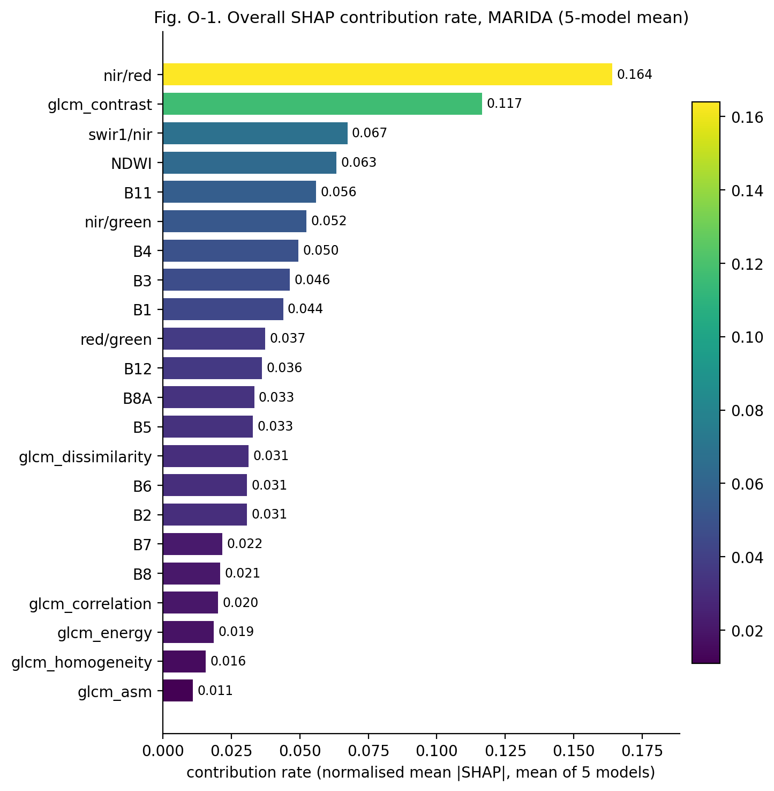
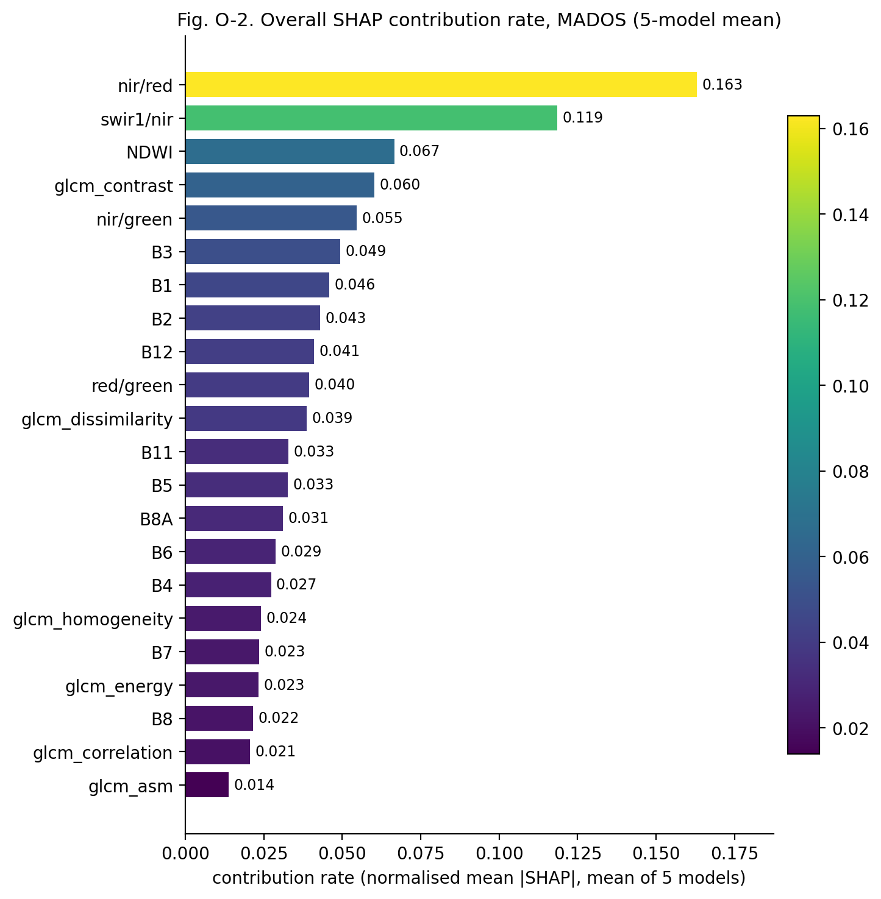
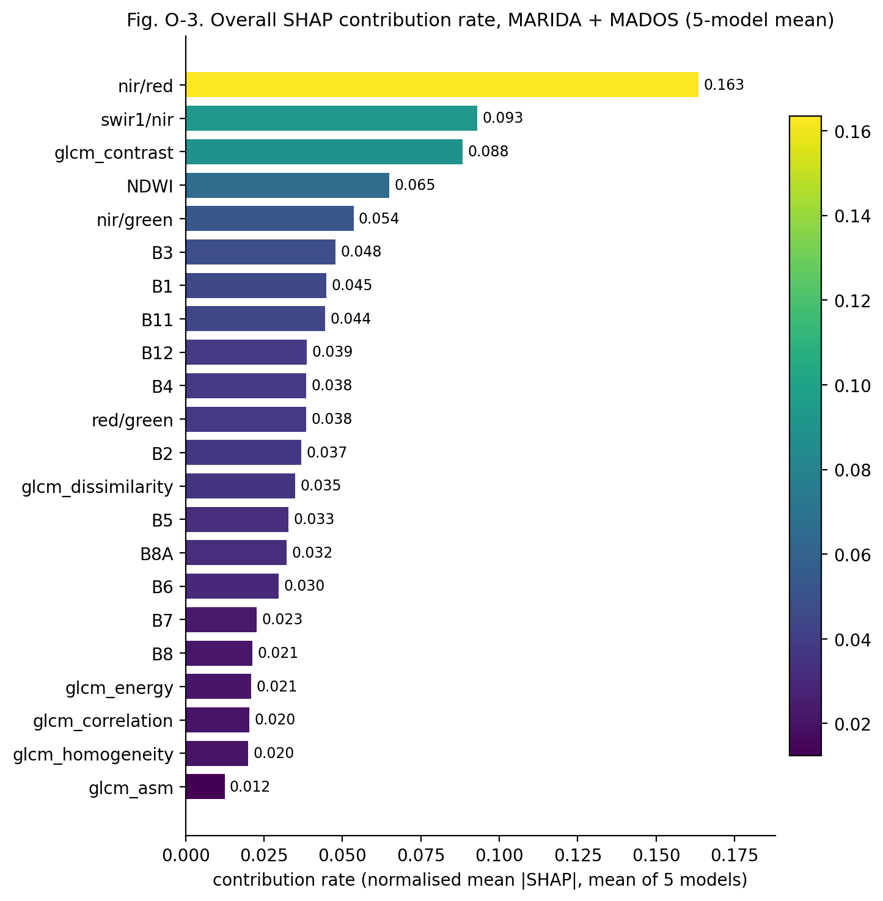

## Overall SHAP contribution rate of all 22 features

Contribution rate of a feature = its normalised SHAP importance (mean |SHAP| / sum over the 22 features, averaged over the 4 class outputs) averaged over the five models, so each model counts equally whatever its output scale; the rates sum to 1. 'Both datasets' averages the MARIDA and MADOS rates with equal weight. Values: `03_cross_model_comparison/overall/overall_contribution_rates.csv`.

#### Fig. O-1. Overall SHAP contribution rate, MARIDA (5-model mean)

- **What it shows:** all 22 features ranked by contribution rate for MARIDA.
- **How to read:** bar length and colour = contribution rate (share of total attribution); labels give the value.
- **Findings:** top five **nir/red** 0.164, **glcm_contrast** 0.117, **swir1/nir** 0.067, **NDWI** 0.063, **B11** 0.056; the top five together carry 0.467. Lowest: glcm_energy 0.019, glcm_homogeneity 0.016, glcm_asm 0.011.
- **Limitations:** unsigned (no direction), averaged over classes and models; per-class and per-model differences are in sections A1, A3 and B6.

#### Fig. O-2. Overall SHAP contribution rate, MADOS (5-model mean)

- **What it shows:** all 22 features ranked by contribution rate for MADOS.
- **How to read:** bar length and colour = contribution rate (share of total attribution); labels give the value.
- **Findings:** top five **nir/red** 0.163, **swir1/nir** 0.119, **NDWI** 0.067, **glcm_contrast** 0.060, **nir/green** 0.055; the top five together carry 0.463. Lowest: B8 0.022, glcm_correlation 0.021, glcm_asm 0.014.
- **Limitations:** unsigned (no direction), averaged over classes and models; per-class and per-model differences are in sections A1, A3 and B6.

#### Fig. O-3. Overall SHAP contribution rate, MARIDA + MADOS (5-model mean)

- **What it shows:** all 22 features ranked by contribution rate for MARIDA + MADOS.
- **How to read:** bar length and colour = contribution rate (share of total attribution); labels give the value.
- **Findings:** top five **nir/red** 0.163, **swir1/nir** 0.093, **glcm_contrast** 0.088, **NDWI** 0.065, **nir/green** 0.054; the top five together carry 0.463. Lowest: glcm_correlation 0.020, glcm_homogeneity 0.020, glcm_asm 0.012.
- **Limitations:** unsigned (no direction), averaged over classes and models; per-class and per-model differences are in sections A1, A3 and B6.

