# SHAP analysis of the stage-8 ML models (MARIDA and MADOS)

## Folder layout

Every figure exists for both datasets (`MARIDA/` and `MADOS/` subfolders) and for all five ML models:
RF, XGBoost, LightGBM, AdaBoost and the linear SVM. The full report,
[`06_reports/REPORT.md`](06_reports/REPORT.md), shows all 299 figures in order. Each figure is
followed by a short explanation filled in from the computed values.

| Folder | What it answers |
|---|---|
| [`00_shap_values/`](00_shap_values) | The raw numbers: SHAP values, feature values, base values and model outputs for every explained pixel (one CSV per model and dataset, plus `.npz`). |
| [`01_global_importance/`](01_global_importance) | Which features does each model use overall? |
| [`02_class_specific/`](02_class_specific) | Which features make a pixel Water, Debris, Sargassum or Other, for every model? Also: class-versus-rest explanations. |
| [`03_cross_model_comparison/`](03_cross_model_comparison) | Do the models agree? Also: the overall contribution-rate charts (`overall/`, MARIDA, MADOS and both together). |
| [`04_dependence_and_interactions/`](04_dependence_and_interactions) | How does a feature's value change the prediction, and which features act together? |
| [`05_individual_predictions/`](05_individual_predictions) | Why was this pixel classified as it was, and what causes the errors? |
| [`06_reports/`](06_reports) | `REPORT.md` (every figure with its explanation), `overall_findings.md`, and `tables/<dataset>/` (rankings, comparisons, validation). |

Reproduce: `scripts/shap_analysis/` (section 9).

This document explains, **class by class**, which features the five ML models
(Random Forest, XGBoost, LightGBM, AdaBoost and the linear SVM) use, and how. It covers:

1. the data, the models, and how the models were recovered (section 1);
2. how every feature is computed (section 2);
3. what the key features look like per class without any model (section 3);
4. how SHAP was computed and checked (section 4);
5. overall and cross-model importance (section 5);
6. SHAP per class for every model (section 6);
7. how feature values shape the prediction, and which features interact (section 7);
8. individual pixels and the main confusions (section 8).

SHAP is the only explanation method used.

## Key findings

- **Each class relies on different features, and the four tree models agree on which ones.**
  The shares below are the mean over RF, XGBoost, LightGBM and AdaBoost.
  - **Water:** nir/red (MARIDA 23%, MADOS 20%) and glcm_contrast. Low nir/red and low texture
    contrast push a pixel towards Water.
  - **Marine Debris:** nir/red and swir1/nir. On MADOS, swir1/nir is the top debris feature (27%).
    The models learned a **window** on nir/red: the debris score rises only for nir/red ≈ 0.8–1.5.
    It is also a **threshold** on swir1/nir: the debris score rises only below ≈ 0.5.
  - **Sargassum:** nir/red dominates (28% / 32%), with high values pushing towards Sargassum.
    Blue and green (B2, B3) come next, with high values pushing away.
  - **Other:** on MARIDA, GLCM contrast (24%) and SWIR1 (B11). On MADOS, swir1/nir (15%),
    B1, glcm_contrast and B12.
- **Debris is the class that relies most on the band ratios:** 46% (MARIDA) and 49% (MADOS) of
  its SHAP mass. **Other** relies most on GLCM texture on MARIDA (37%).
- **The linear SVM is the exception.** It ranks features almost unrelated to the tree models
  (global rank agreement −0.37 to 0.40). It puts large, opposite-sign weights on strongly
  correlated features, for example nir/green and NDWI for debris. Its ranking reflects the
  collinearity of the inputs more than the class signal.
- **Two pairs of stage-8 features carry the same information for a tree.**
  `glcm_energy` = √`glcm_asm`, so XGBoost and LightGBM never use ASM (0.00–0.01% share).
  NDWI is a monotone function of nir/green, so the tree models can split their SHAP credit
  between the two arbitrarily.
- **Interactions matter.** In the tree models, 36–70% of the SHAP interaction mass lies in
  feature *pairs*. For debris, the strongest pair is **nir/red × swir1/nir** in 7 of the 8
  model–dataset combinations.
- **Most errors are pixels whose key feature sits in the other class's range.**
  - Water predicted as Other (the most frequent error on both datasets): on MARIDA these pixels
    have glcm_contrast 2.94, against 0.17 for water and 5.44 for Other.
  - Water predicted as Debris: these pixels have nir/red ≈ 1.0, inside the debris window.

## 1. Data and set-up

- Datasets: `MARIDA_5Class` and `MADOS_5Class`. Labels run 0–4. **Class 0 (unannotated, cloud,
  cloud shadow) is ignored**, leaving four classes. The mapping comes from
  `scripts/utilities/convert.py`:

| Label | Class | Original classes merged |
|---|---|---|
| 1 | Water | Marine Water, Sediment-Laden Water, Turbid, Shallow, Waves, Wakes, Mixed Water |
| 2 | Marine Debris | Marine Debris |
| 3 | Sargassum | dense + sparse Sargassum (MADOS: dense Sargassum + sparse floating algae) |
| 4 | Other | Ship, Natural Organic Material, Foam. MADOS also merges original classes 6, 13, 14 and 15 (Oil Spill, Oil Platform, Jellyfish, Sea snot in the MADOS class list) |

- Pixels: every annotated pixel of the official train split (training) and test split
  (testing). The splits are scene-disjoint.

| Dataset | Train pixels (Water / Debris / Sargassum / Other) | Test pixels (Water / Debris / Sargassum / Other) |
|---|---|---|
| MARIDA | 358,442 (350,057 / 1,943 / 1,961 / 4,481) | 158,371 (154,739 / 381 / 1,641 / 1,610) |
| MADOS | 761,887 (591,224 / 2,561 / 4,397 / 163,705) | 361,147 (294,020 / 973 / 3,089 / 63,065) |

- Models: the five stage-8 models of `scripts/staged_ml/common.py`, unchanged:
  - Random Forest: 100 trees.
  - XGBoost and LightGBM: 100 trees, depth 6.
  - AdaBoost: SAMME, 100 depth-3 trees.
  - Linear SVM: StandardScaler + LinearSVC.
- Class weighting: log weights, 1 / ln(1.03 + class frequency), the paper's main setting. Seed 42.
- **The models had to be re-fitted.** The staged pipeline trains in memory and never saves its
  models, and no saved model existed on disk. `train_stage8_models.py` re-fits them with the
  pipeline's own functions and saves them to `models/stage8_log/<dataset>/`. Every model
  reproduces the recorded test metrics (`outputs/staged/log_weights/stage8_ndwi_ratios_glcm/`)
  to within 1e-16:

| Model | MARIDA macro F1 | Debris F1 | MADOS macro F1 | Debris F1 |
|---|---|---|---|---|
| Random Forest | 0.916 | 0.831 | 0.761 | 0.708 |
| XGBoost | 0.883 | 0.774 | 0.736 | 0.530 |
| LightGBM | 0.885 | 0.778 | 0.736 | 0.540 |
| AdaBoost | 0.799 | 0.488 | 0.602 | 0.165 |
| Linear SVM | 0.847 | 0.745 | 0.714 | 0.615 |

## 2. How each feature is extracted

Every feature is computed **per pixel**. The 16 spectral features come from
`src/features/pixel_features.py`. The 6 texture features come from
`scripts/staged_ml/glcm_features.py`. The models take these **22 features in this order**:
11 bands, NDWI, 4 ratios, 6 GLCM.

### 2.1 Spectral bands (11)

The surface reflectance of the pixel in each band, used as is. MARIDA patches are
Rayleigh-corrected; MADOS uses ACOLITE `rhorc`.

| Index | Band | Centre (nm) | Region |
|---|---|---|---|
| 0 | B1 | 443 | coastal aerosol |
| 1 | B2 | 490 | blue |
| 2 | B3 | 560 | green |
| 3 | B4 | 665 | red |
| 4 | B5 | 705 | red edge 1 |
| 5 | B6 | 740 | red edge 2 |
| 6 | B7 | 783 | red edge 3 |
| 7 | B8 | 842 | NIR |
| 8 | B8A | 865 | narrow NIR |
| 9 | B11 | 1610 | SWIR 1 |
| 10 | B12 | 2190 | SWIR 2 |

### 2.2 NDWI and the band ratios (5)

ε = 1e-6 avoids division by zero.

| Feature | Formula | What it computes |
|---|---|---|
| NDWI (McFeeters) | (B3 − B8) / (B3 + B8 + ε) | green against NIR, scaled to [−1, 1] |
| red/green | B4 / (B3 + ε) | red relative to green |
| nir/red | B8 / (B4 + ε) | NIR relative to red (the simple ratio behind NDVI) |
| nir/green | B8 / (B3 + ε) | NIR relative to green. NDWI = (1 − r)/(1 + r) with r = nir/green, so the two rank pixels identically, in reverse. |
| swir1/nir | B11 / (B8 + ε) | SWIR1 relative to NIR |

### 2.3 GLCM texture (6)

These describe the **neighbourhood** of the pixel, not its own spectrum. The computation follows
the MARIDA reference code:

1. Build an RGB composite of B4, B3 and B2, clip it to [0, 0.15] and scale it to [0, 1].
2. Convert it to grey (0.2125 R + 0.7154 G + 0.0721 B) and quantise to 17 grey levels.
3. Take a 13 × 13 window centred on the pixel, about 130 m × 130 m (image padded by reflection).
4. Compute the grey-level co-occurrence matrix P at distance 1 in 4 directions (0°, 45°, 90°,
   135°), symmetric and normalised, and average it over the directions.
5. Compute six properties of P (i, j = grey levels):

| Feature | Formula | High when |
|---|---|---|
| contrast | Σ P(i,j)(i − j)² | the window contains large grey-level jumps |
| dissimilarity | Σ P(i,j)·abs(i − j) | like contrast, but linear in the jump size |
| homogeneity | Σ P(i,j) / (1 + (i − j)²) | neighbouring pixels have similar grey levels |
| energy | √ASM | few grey-level pairs dominate (uniform window) |
| correlation | Σ P(i,j)(i − μi)(j − μj) / (σi σj) | grey levels of neighbours are linearly related (1 for a flat window) |
| ASM | Σ P(i,j)² | same as energy, squared |

Energy = √ASM, so the two rank pixels identically. A tree model, and therefore SHAP, splits credit
between them arbitrarily. What a texture value means physically for debris or Sargassum is a
**hypothesis**. SHAP only shows how the models use the number.

## 3. Key features per class, without a model

Model-free medians come first, so the SHAP results can be checked against the data itself.
They are computed over every annotated training pixel.

| Feature | MARIDA Water | Debris | Sargassum | Other | MADOS Water | Debris | Sargassum | Other |
|---|---|---|---|---|---|---|---|---|
| nir/red | 0.57 | **1.00** | 2.91 | 0.94 | 0.72 | **1.02** | 2.29 | 0.87 |
| nir/green | 0.49 | 0.97 | 2.28 | 0.96 | 0.58 | 1.00 | 1.74 | 0.79 |
| NDWI | 0.35 | 0.02 | −0.39 | 0.02 | 0.27 | 0.00 | −0.27 | 0.12 |
| swir1/nir | 0.32 | **0.33** | 0.11 | 0.65 | 0.54 | **0.33** | 0.14 | 0.75 |
| B11 (SWIR1) | 0.006 | 0.018 | 0.008 | 0.059 | 0.011 | 0.019 | 0.015 | 0.039 |
| B12 (SWIR2) | 0.004 | 0.010 | 0.004 | 0.036 | 0.008 | 0.011 | 0.010 | 0.031 |
| glcm_contrast | 0.05 | 0.48 | 0.31 | **3.78** | 0.10 | 0.54 | 0.23 | 0.48 |

- **nir/red places debris between the other classes on both datasets.** Debris has nir/red ≈ 1;
  water is below 1 and Sargassum well above 2. Other also sits near 1, so nir/red alone does not
  separate debris from Other.
- **swir1/nir separates debris from Other:** 0.33 for debris against 0.65–0.75 for Other.
- **On MARIDA, "Other" is far more textured than every other class** (glcm_contrast 3.78). On
  MADOS the gap is small (0.48 against 0.54 for debris), so texture cannot play the same role there.

## 4. SHAP method

SHAP gives each feature j a contribution φ(j, k) to each class output k for one pixel. For every
pixel and class, the base value plus the sum of the φ equals the model output. The base value is
the mean output over a background set.

| Model | Explainer | Output explained (one SHAP vector per class) |
|---|---|---|
| Random Forest | interventional TreeSHAP (exact) | class probability |
| XGBoost, LightGBM | interventional TreeSHAP (exact) | raw softmax margin (log-odds scale) |
| AdaBoost | interventional TreeSHAP on an exact rewrite of the SAMME decision function as a tree ensemble (SHAP has no AdaBoost support) | SAMME score d_k = Σ_m (w_m/W)(1 if tree m predicts k, else −1/3); predict_proba = softmax(d/3) |
| Linear SVM | exact linear SHAP (LinearExplainer); KernelSHAP used as a check | one-vs-rest margin (LinearSVC has no probabilities) |

- **Background:** 200 training pixels, 50 per class, shared by all five explainers. Each class
  therefore counts equally in the base value, and no test pixel is used to build an explainer.
- **Explained pixels:** 300 test pixels per class (1,200 per dataset). Every global, class,
  dependence and distribution figure uses these.
  - Section 8 adds the misclassified test pixels: up to 30 per model and confusion pair, which
    makes 615 extra pixels on MARIDA and 1,243 on MADOS.
  - Interaction values use 40 pixels per class (160 per dataset).
- **Comparing models:** the output units differ, so every comparison uses each feature's
  **share**:

  share(j, k) = mean|φ(j, k)| / Σ_f mean|φ(f, k)|

  for feature j and class k. The global share averages |φ| over the four class outputs first.
- **Checks** (all recorded in `06_reports/tables/<dataset>/<dataset>_validation.json`):
  - Every model was loaded and checked for 22 input features and `classes_` = [0, 1, 2, 3].
    For every model, argmax of the explained output equals `predict()`.
  - SHAP arrays have shape (pixels, 22, 4), so no class is dropped.
  - **Additivity:** base + Σφ reproduces the model output to:
    - ≤ 4.2e-6 for XGBoost, LightGBM and the SVM;
    - ≤ 6e-9 for AdaBoost;
    - for RF, exactly on all but 8 of 4,258 pixels. Each of those is off by exactly 0.01 = 1/100
      trees: one tree routes the pixel differently because SHAP stores sklearn's split thresholds
      at lower precision.
  - **SVM:** KernelSHAP (same background, 4,096 coalitions) on 40 pixels matches the exact
    linear values to 2.6e-6.
  - **Interaction values** add up to the model output to ≤ 8e-6.

## 5. Overall importance and model agreement

### 5.1 Overall contribution rate of all 22 features

Contribution rate = global share averaged over the five models, so each model counts equally and
the rates sum to 1. The combined chart averages MARIDA and MADOS with equal weight.


| MARIDA | MADOS |
|---|---|
|  |  |

| Rank | MARIDA | MADOS | Both |
|---|---|---|---|
| 1 | nir/red 0.164 | nir/red 0.163 | nir/red 0.163 |
| 2 | glcm_contrast 0.117 | swir1/nir 0.119 | swir1/nir 0.093 |
| 3 | swir1/nir 0.067 | NDWI 0.067 | glcm_contrast 0.088 |
| 4 | NDWI 0.063 | glcm_contrast 0.060 | NDWI 0.065 |
| 5 | B11 0.056 | nir/green 0.055 | nir/green 0.054 |
| 22 (last) | glcm_asm 0.011 | glcm_asm 0.014 | glcm_asm 0.012 |

### 5.2 Per model

| MARIDA | MADOS |
|---|---|
| 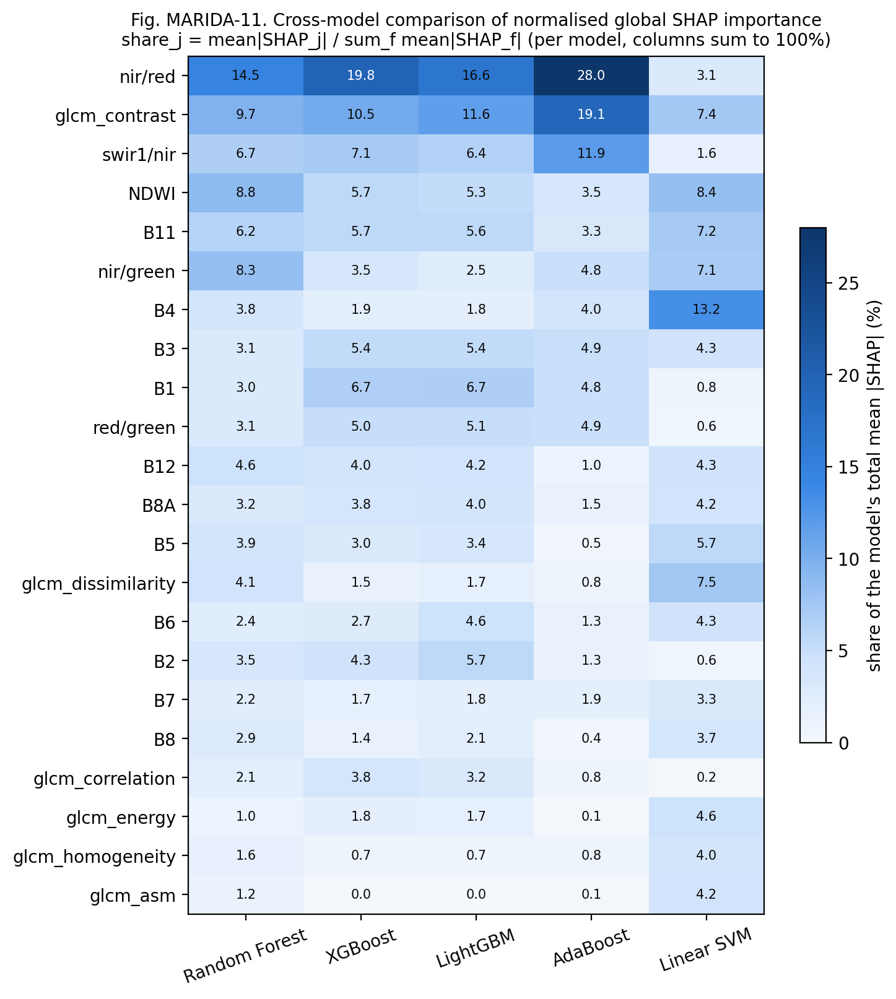 | 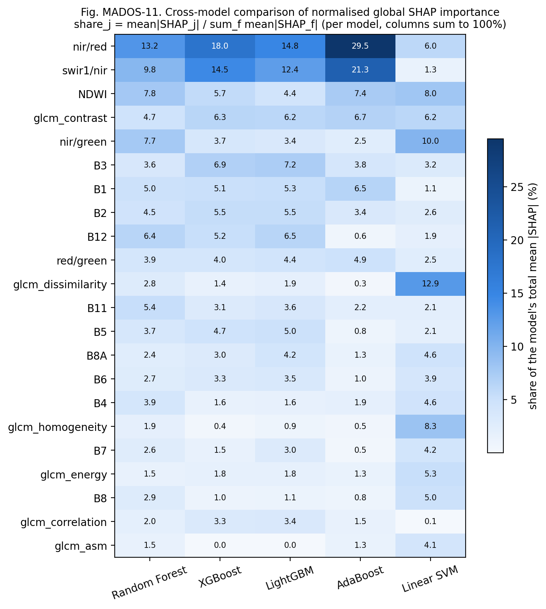 |

- **nir/red is the top feature of all four tree models on both datasets:** 14.5–28.0% on MARIDA
  and 13.2–29.5% on MADOS. AdaBoost is the most concentrated model: its top two features carry
  47% (MARIDA) and 51% (MADOS).
- **The linear SVM's top feature is B4 (MARIDA, 13.2%) or glcm_dissimilarity (MADOS, 12.9%).**
  nir/red gets only 3.1% / 6.0%.
- Shares by feature group (bands / NDWI + ratios / GLCM):

| Model | MARIDA | MADOS |
|---|---|---|
| Random Forest | 39 / 41 / 20 | 43 / 42 / 14 |
| XGBoost | 41 / 41 / 18 | 41 / 46 / 13 |
| LightGBM | 45 / 36 / 19 | 46 / 39 / 14 |
| AdaBoost | 25 / 53 / 22 | 23 / 66 / 12 |
| Linear SVM | 52 / 21 / 28 | 35 / 28 / 37 |

  GLCM carries about a fifth of the tree models' attribution on MARIDA and about an eighth on
  MADOS.

**Agreement between models** (Spearman correlation of the 22 global shares; per-class values in
section 6.3):

| Pair | MARIDA | MADOS |
|---|---|---|
| XGBoost – LightGBM | 0.95 | 0.95 |
| XGBoost – AdaBoost | 0.79 | 0.77 |
| RF – XGBoost / LightGBM | 0.67 / 0.61 | 0.75 / 0.71 |
| RF – AdaBoost | 0.62 | 0.67 |
| Linear SVM – tree models | −0.19 to 0.40 | −0.37 to −0.10 |

## 6. SHAP per class

### 6.1 Beeswarm plots (Random Forest, the best model)

How to read them:
- Each dot is one explained pixel.
- Horizontal position is its SHAP value for that class: right pushes towards the class, left away
  from it.
- Colour is the feature's value: red high, blue low.
- Features are sorted by mean |SHAP|.

| Class | MARIDA | MADOS |
|---|---|---|
| Water | 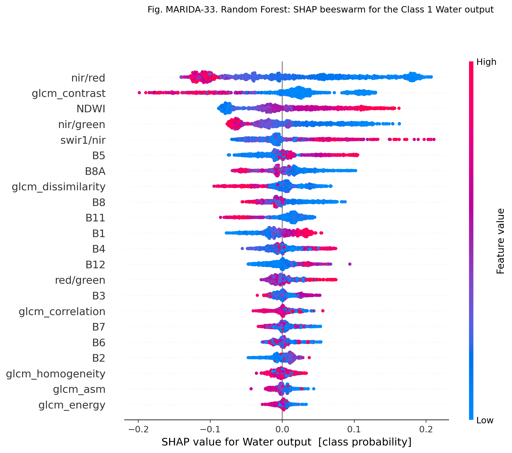 | 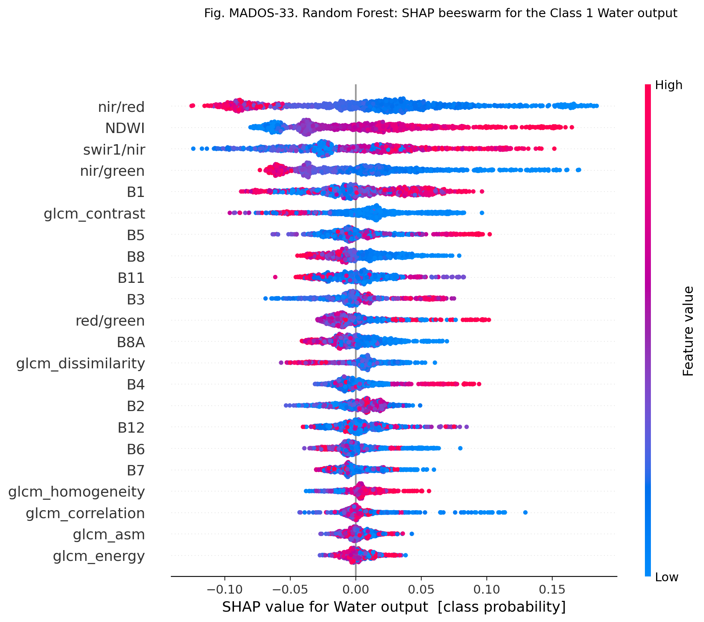 |
| Marine Debris | 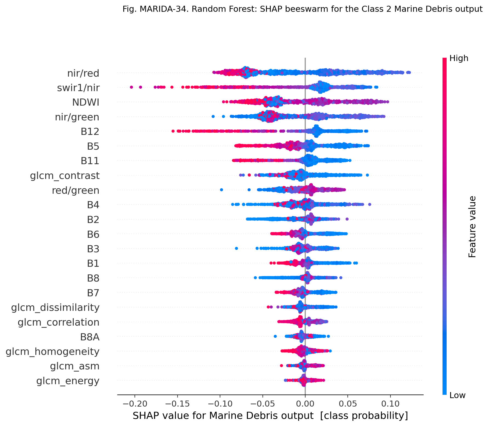 | 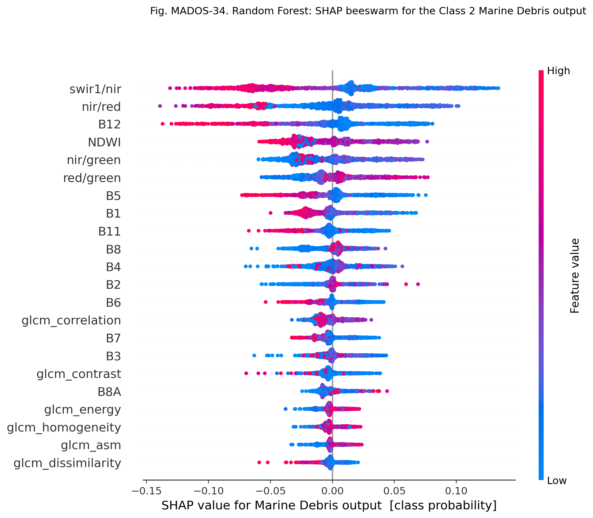 |
| Sargassum | 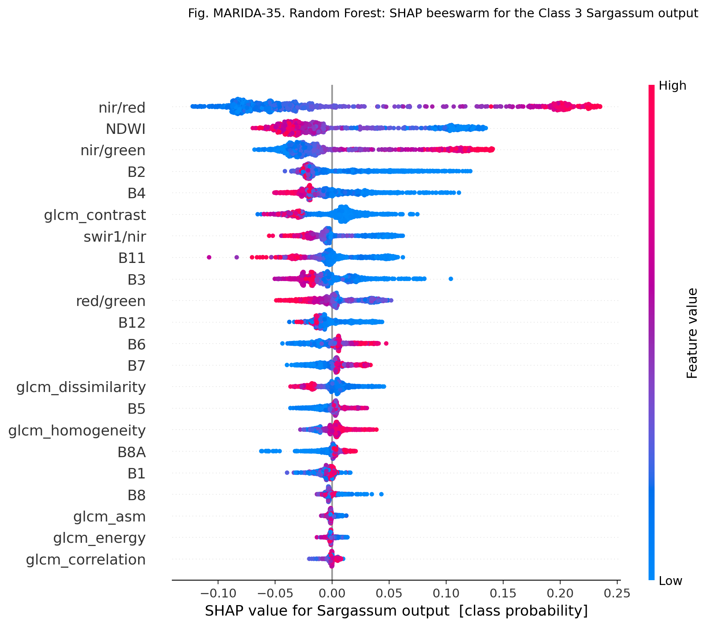 | 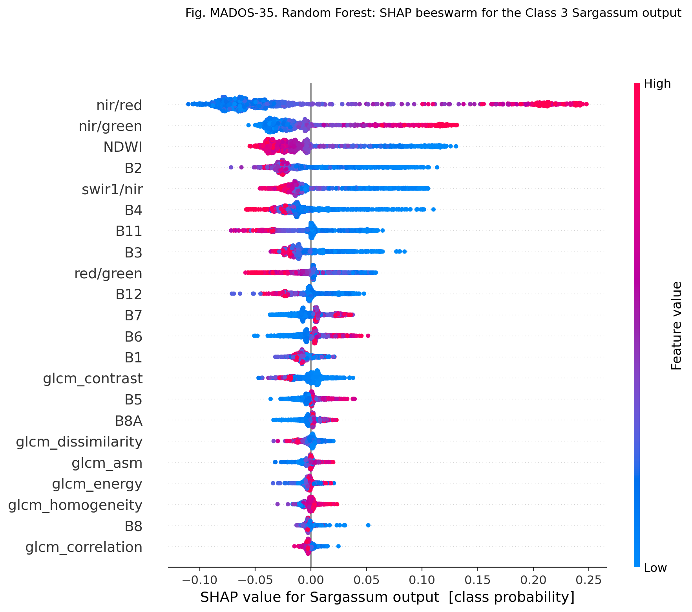 |
| Other | 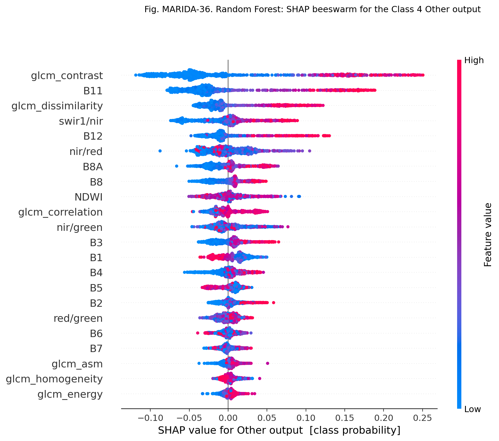 | 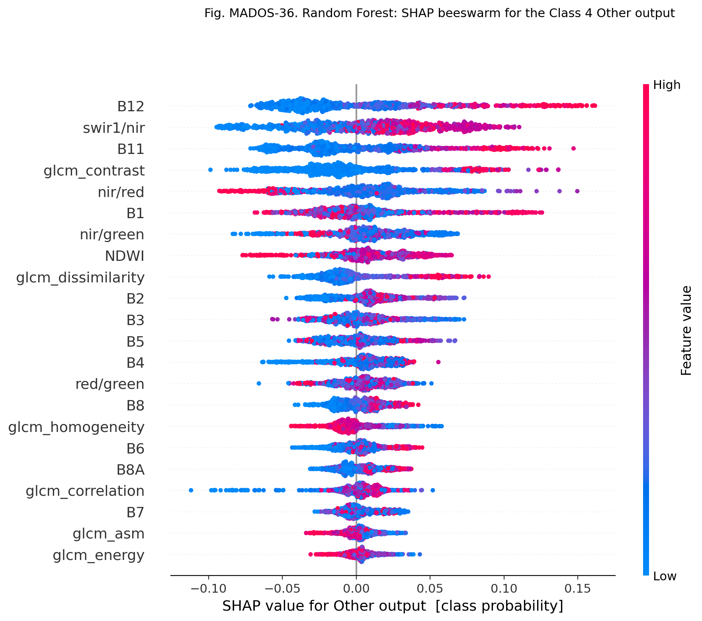 |

The same plots exist for every model, as `02_class_specific/<dataset>/<dataset>_<model>_<class>_beeswarm.png`.
The matching bar plots are `..._bar.png`.

### 6.2 Share of SHAP per class and model

| MARIDA | MADOS |
|---|---|
| 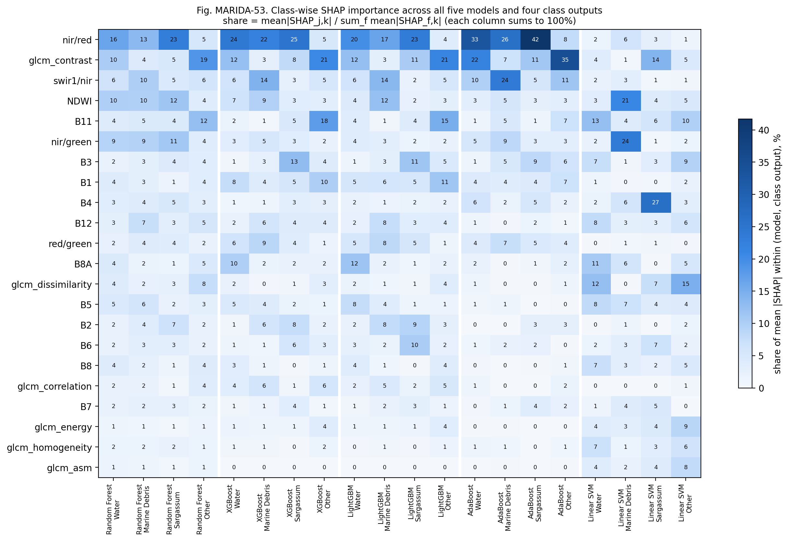 | 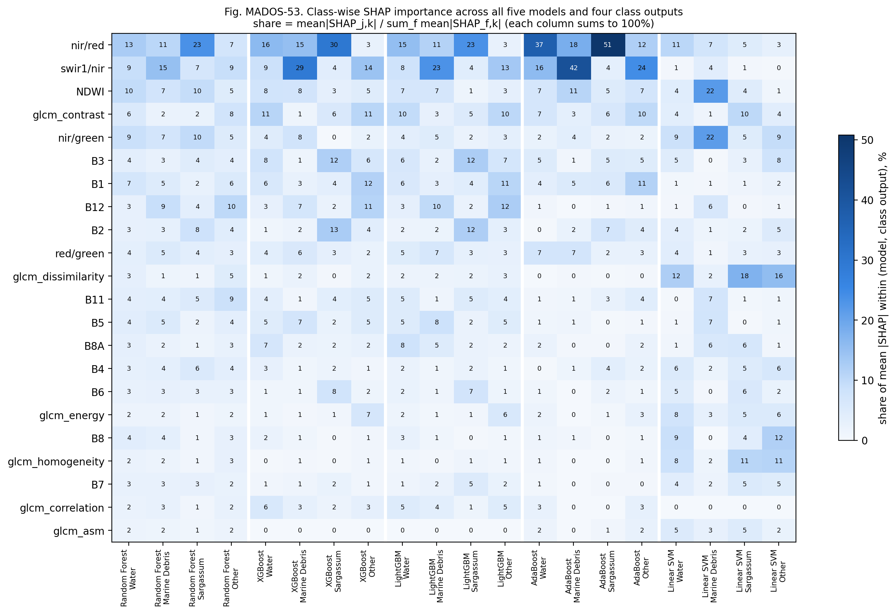 |

Averaged over the five models, by feature group (%):

| Class | MARIDA bands / NDWI / ratios / GLCM | MADOS bands / NDWI / ratios / GLCM |
|---|---|---|
| Water | 38 / 5 / 33 / 23 | 35 / 7 / 37 / 21 |
| Marine Debris | 33 / 12 / **46** / 10 | 31 / 11 / **49** / 9 |
| Sargassum | 45 / 5 / 34 / 16 | 41 / 5 / 37 / 17 |
| Other | 45 / 4 / 15 / **37** | 45 / 4 / 25 / 26 |

Marine Debris is the class that relies most on the ratios: almost half of its SHAP mass on both
datasets. "Other" relies most on texture on MARIDA.

### 6.3 Class by class: what the models use

Top features by mean share over the four **tree** models (RF, XGBoost, LightGBM, AdaBoost). The
linear SVM is discussed separately below. "Direction" is the Spearman correlation ρ between a
feature's value and its SHAP value for that class.

| Class | MARIDA | MADOS |
|---|---|---|
| Water | nir/red 23%, glcm_contrast 14%, swir1/nir 7%, B8A 7%, NDWI 6% | nir/red 20%, swir1/nir 10%, glcm_contrast 8%, NDWI 8%, B1 6% |
| Marine Debris | nir/red 20%, swir1/nir 15%, NDWI 9%, red/green 7%, nir/green 6% | **swir1/nir 27%**, nir/red 14%, NDWI 8%, B12 6%, red/green 6% |
| Sargassum | nir/red 28%, B3 9%, glcm_contrast 9%, B2 7%, B6 5% | nir/red 32%, B2 10%, B3 8%, glcm_contrast 5%, B6 5% |
| Other | glcm_contrast 24%, B11 13%, B1 8%, swir1/nir 7%, nir/red 6% | swir1/nir 15%, B1 10%, glcm_contrast 10%, B12 9%, nir/red 6% |

**Water.**
- High nir/red pushes **away** from Water (ρ −0.90 to −0.97 in every tree model and dataset).
- High glcm_contrast pushes away from Water (ρ −0.70 to −0.90).
- High NDWI pushes towards Water (ρ +0.86 to +0.96).
- This matches section 3: water has the lowest nir/red and the lowest texture contrast. Low NIR
  reflectance of open water is well established. The models' use of texture is an observed
  pattern, not a demonstrated physical mechanism.

**Marine Debris.**
- **nir/red acts as a window.** Mean debris SHAP per nir/red range (test pixels):

  | nir/red | <0.6 | 0.6–0.8 | 0.8–1.0 | 1.0–1.2 | 1.2–1.5 | 1.5–2 | 2–3 | >3 |
  |---|---|---|---|---|---|---|---|---|
  | XGBoost, MARIDA | −1.55 | −0.39 | +1.12 | **+1.33** | +0.38 | −1.15 | −1.42 | −1.42 |
  | LightGBM, MADOS | −1.29 | −0.16 | +0.57 | **+1.19** | +0.41 | −1.24 | −1.43 | −1.08 |

  RF and AdaBoost show the same shape on both datasets: positive only for 0.8–1.5, highest at
  1.0–1.2. The median debris pixel has nir/red 1.00 (MARIDA) / 1.02 (MADOS) (section 3). This is
  why the single feature has a weak overall ρ (−0.15 to +0.28): its effect is not monotonic.
- **Low swir1/nir pushes towards debris** (ρ −0.52 to −0.61 on MARIDA, −0.72 to −0.82 on MADOS).
  The debris SHAP is positive below swir1/nir ≈ 0.5 and clearly negative above 0.6, in every tree
  model and both datasets. XGBoost on MADOS:

  | swir1/nir | <0.2 | 0.2–0.4 | 0.4–0.5 | 0.5–0.6 | 0.6–0.8 | 0.8–1.0 |
  |---|---|---|---|---|---|---|
  | debris SHAP | +1.19 | **+1.96** | +1.41 | +0.03 | −1.69 | −2.95 |

  This is the feature that separates debris (median 0.33) from Other (0.65–0.75), which has a
  similar nir/red.
- NDWI ≈ 0 (debris median 0.00–0.02) also supports debris. NDWI and nir/green carry the same
  ranking, so their individual shares should not be over-read.

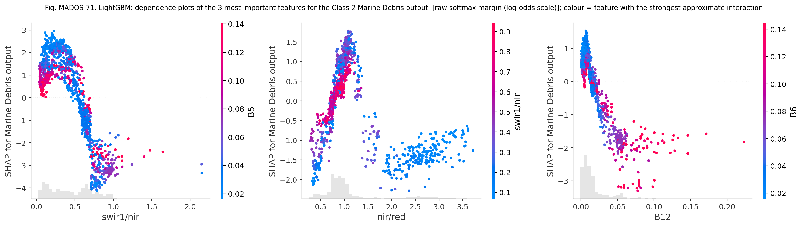

**Sargassum.**
- High nir/red is decisive: 23–42% (MARIDA) and 23–51% (MADOS) of the SHAP mass, depending on
  the model, with ρ +0.79 to +0.94.
- For XGBoost and LightGBM, high B2/B3 (blue, green) push away from Sargassum (ρ −0.81 to −0.95).
- This matches section 3 (nir/red 2.3–2.9 for Sargassum) and the known red-edge rise of vegetation.

**Other.**
- MARIDA: glcm_contrast is the top feature of all four tree models (19–35%). High contrast pushes
  towards Other (ρ +0.85 to +0.96), and so does bright SWIR1 (B11).
- MADOS: swir1/nir leads for XGBoost, LightGBM and AdaBoost (13–24%), and B12 leads for RF. High
  values push towards Other (ρ +0.78 to +0.92).
- The class mixes ships, natural organic material and foam, plus oil-related classes on MADOS.
  The switch from texture to SWIR between the datasets matches section 3: MADOS "Other" is not
  more textured than debris.

**Linear SVM.**
- Its top features per class are often GLCM dissimilarity or homogeneity, B4, B8 or B11.
  Examples:
  - MARIDA Sargassum: B4 27%;
  - MADOS Sargassum: glcm_dissimilarity 18% and glcm_homogeneity 11%;
  - MARIDA debris: nir/green 24% and NDWI 21%, both with ρ = −1.00.
- nir/green and NDWI are near-opposites (section 2.2), so two weights of the same sign on them
  largely cancel. A linear model on standardised, highly correlated inputs gives large offsetting
  weights to near-duplicates, and SHAP reports those weights faithfully.
- Its rankings are therefore less physically interpretable. Its rank agreement with RF per class
  is −0.22 to 0.46.

**How stable the rankings are** (Spearman correlation of the 22 class shares):

| | Water | Debris | Sargassum | Other |
|---|---|---|---|---|
| XGBoost – LightGBM, MARIDA / MADOS | 0.92 / 0.97 | 0.98 / 0.94 | 0.96 / 0.87 | 0.90 / 0.95 |
| RF – XGBoost, MARIDA / MADOS | 0.80 / 0.75 | 0.68 / 0.73 | 0.64 / 0.54 | 0.61 / 0.61 |
| Same model, MARIDA vs MADOS: RF | 0.89 | 0.87 | 0.92 | 0.74 |
| Same model, MARIDA vs MADOS: XGBoost | 0.83 | 0.85 | 0.85 | 0.76 |
| Same model, MARIDA vs MADOS: LightGBM | 0.85 | 0.87 | 0.88 | 0.61 |
| Same model, MARIDA vs MADOS: AdaBoost | 0.58 | 0.66 | 0.77 | 0.73 |
| Same model, MARIDA vs MADOS: Linear SVM | 0.04 | 0.76 | 0.47 | 0.22 |

The tree models use features in much the same way on both datasets for Water, Debris and
Sargassum. "Other" is less stable, because its content differs between the datasets.

### 6.4 Class versus rest

For XGBoost and LightGBM, `02_class_specific/` also has class-versus-rest beeswarms,
SHAP_k − mean of the other three SHAP vectors. That equals each feature's contribution to
log(p_k / geometric mean of the other three probabilities), so it explains the class's
probability *relative to its competitors*. Their rankings agree with the plain class margins
(rank correlation 0.84–0.96).

The other three models need no separate plot:
- For RF and AdaBoost the contrast is exactly 4/3 × the class SHAP (checked to 1e-9), because
  RF's probabilities and AdaBoost's scores are constrained across classes.
- The SVM is one-vs-rest by construction.

## 7. How feature values change predictions, and interactions

- **Dependence plots:** the 3 most important features per model and class are in
  `04_dependence_and_interactions/<dataset>/<dataset>_<model>_<class>_dependence_top3.png`.
  Each is coloured by its strongest interacting feature. The debris window on nir/red and the
  swir1/nir threshold in section 6.3 come from these.
- **Interaction values** (exact path-dependent TreeSHAP, tree models only; the SVM has none by
  construction). The table gives the share of the absolute interaction mass that lies in feature
  pairs, and the strongest debris pair:

| Model | MARIDA pair share (W / D / S / O) | MADOS pair share (W / D / S / O) | Strongest debris pair (MARIDA; MADOS) |
|---|---|---|---|
| Random Forest | 49 / 64 / 55 / 55% | 57 / 65 / 56 / 57% | NDWI × nir/red; nir/red × swir1/nir |
| XGBoost | 52 / 57 / 50 / 55% | 58 / 52 / 49 / 55% | nir/red × swir1/nir (both) |
| LightGBM | 66 / 66 / 59 / 60% | 63 / 70 / 66 / 59% | nir/red × swir1/nir (both) |
| AdaBoost | 36 / 41 / 43 / 45% | 46 / 49 / 50 / 50% | nir/red × swir1/nir (both) |

  The tree models are far from additive. Debris is the clearest case: a pixel is called debris
  when nir/red is near 1 **and** swir1/nir is low. Neither condition is enough on its own.
  Other strongest pairs:
  - Water: nir/red × glcm_contrast (XGBoost, LightGBM, AdaBoost on MARIDA).
  - Other, MARIDA: B11 × glcm_contrast (RF, XGBoost).

| MARIDA | MADOS |
|---|---|
| 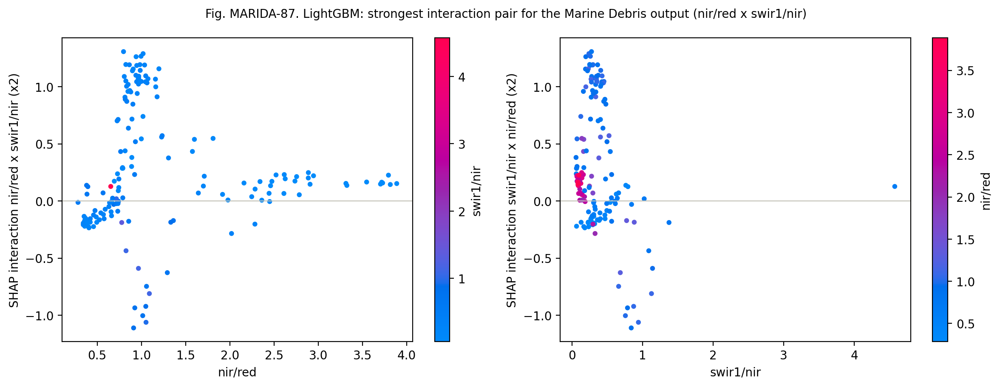 | 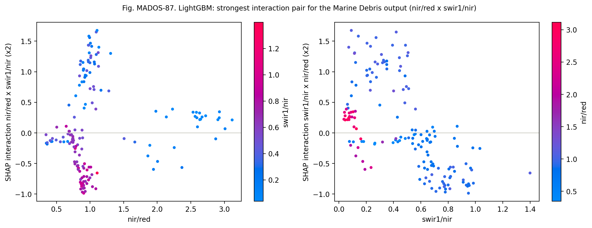 |

## 8. Individual predictions and the main confusions

### 8.1 Errors per class pair

Test errors summed over the five models (true → predicted):

| MARIDA | MADOS |
|---|---|
| Water → Other 2,393 | Water → Other 220,773 |
| Water → Debris 966 | Other → Water 82,222 |
| Water → Sargassum 904 | Water → Debris 5,722 (5,423 from AdaBoost) |
| Other → Water 606 | Other → Debris 4,221 |
| Other → Debris 333 | Sargassum → Water 1,322 |
| Debris → Water 101 | Sargassum → Other 1,166 |
| Sargassum → Other 85, → Debris 67, → Water 39 | Water → Sargassum 996, Sargassum → Debris 940 |
| Debris → Other 38 | Debris → Other 754, Debris → Water 244 |

### 8.2 What pushes pixels into the wrong class

Each case-study figure shows, per model, the mean SHAP difference between the predicted-class and
true-class outputs over the misclassified pixels (bars). It also shows the same quantity for
correctly classified pixels of the true class (diamonds). A bar on the opposite side of its
diamond marks a feature that, on these pixels, looks like the predicted class to the model. For
XGBoost and LightGBM the difference is the feature's contribution to log(p_pred / p_true).

| Confusion | MARIDA | MADOS |
|---|---|---|
| Water → Other | 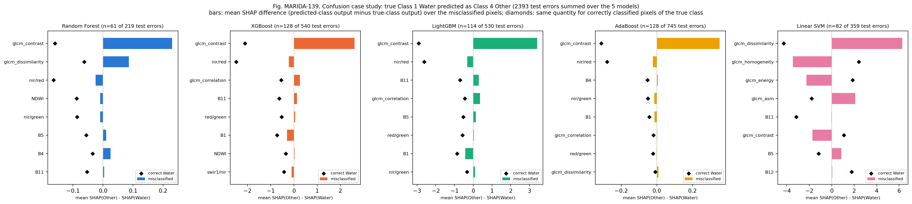 | 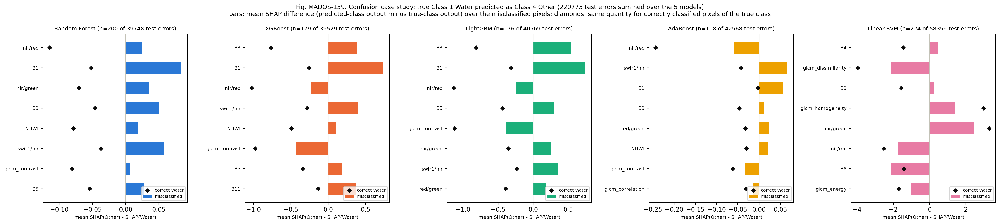 |
| Water → Debris | 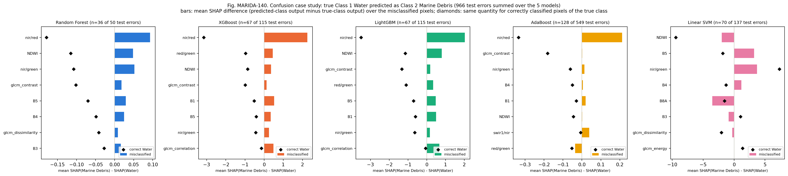 | 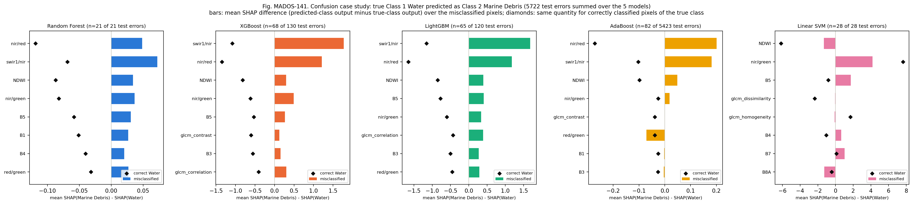 |
| Debris → Water | 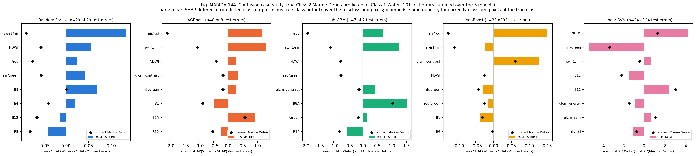 | 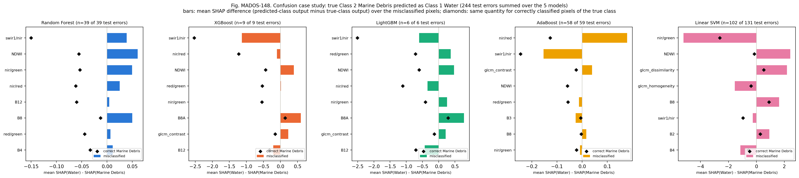 |
| Sargassum → Water | 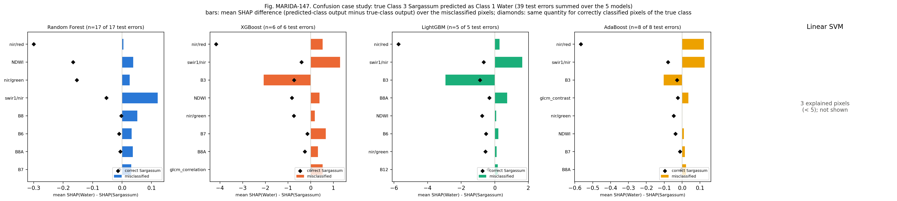 | 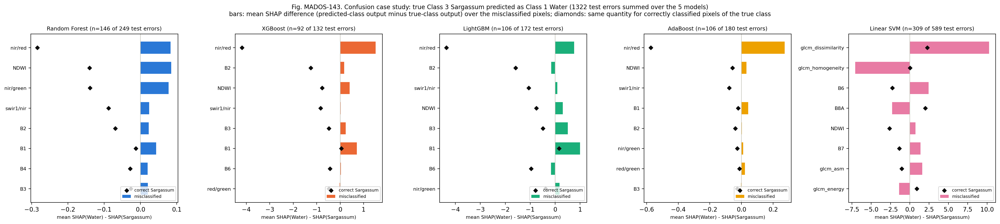 |

The feature values below are means over the misclassified pixels (XGBoost), against all
explained pixels of the true and the predicted class:

- **Water → Other.**
  - MARIDA: glcm_contrast is the main term in all four tree models. These water pixels have
    glcm_contrast 2.94, against 0.17 for water and 5.44 for Other: textured water.
  - MADOS: B3, B1 and nir/red dominate (XGBoost, LightGBM) instead. Texture is not the cause
    there.
- **Water → Debris.**
  - nir/red is the main term in every tree model on MARIDA. On MADOS, swir1/nir leads for XGBoost
    and LightGBM and nir/red for RF and AdaBoost.
  - These water pixels have nir/red 1.00 (MARIDA) / 0.97 (MADOS), inside the debris window,
    against 0.55 / 0.69 for typical water.
- **Debris → Water.** These debris pixels have nir/red 0.76 / 0.85 and NDWI 0.16 / 0.16. That is
  lower nir/red and higher NDWI than typical debris (0.95 / 0.98 and 0.05 / 0.03), so they look
  water-like on both main axes. Plausible causes include a weak floating signal (thin, small or
  submerged debris) or mixed edge pixels, but SHAP alone cannot tell which.
- **Sargassum → Water.** These pixels have nir/red 0.90 (MARIDA) / 0.93 (MADOS), against 2.56 /
  2.16 for typical Sargassum. They lack the high-nir/red signature the models rely on.

### 8.3 One pixel in detail (waterfall)

A MARIDA water pixel that the RF called Other. Left: the Other output. Right: the true Water output.

| RF, Other output | RF, Water output |
|---|---|
| 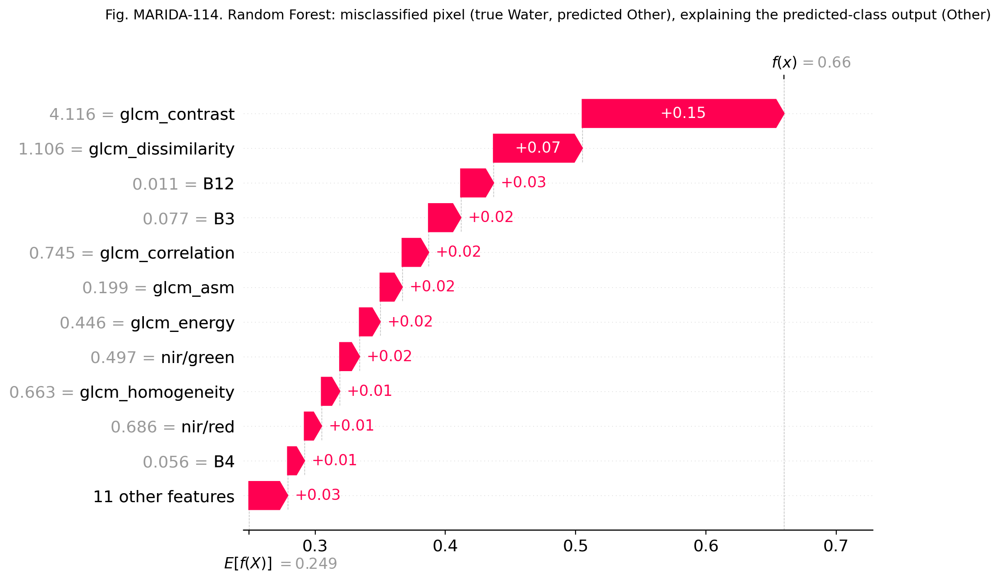 | 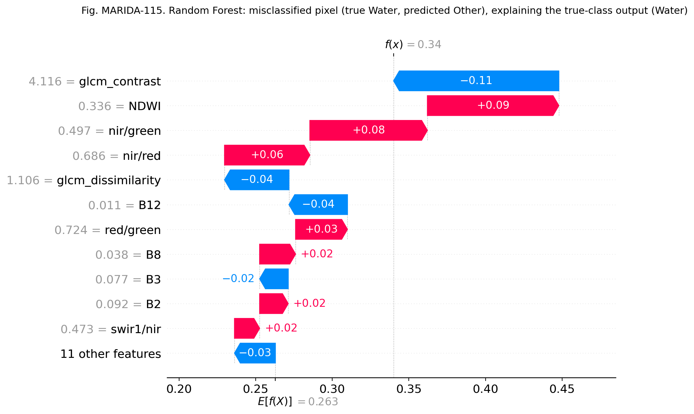 |

- Its glcm_contrast is 4.12, inside the Other range.
- That one feature raises the Other probability by 0.155 (from a 0.25 base to 0.66). It also
  lowers the Water probability by 0.108.
- NDWI (+0.086) and nir/green (+0.077) still argue for Water, but not strongly enough.

`05_individual_predictions/` holds:
- a typical correctly classified pixel per class and model;
- each model's two most frequent confusions, both outputs;
- a multi-output decision plot per model;
- all 10 case studies per dataset.

## 9. Limitations

- **SHAP explains the model, not the physics.** Where a model is wrong, its SHAP values describe
  the wrong reasoning faithfully. Physical readings of the features in this document are labelled
  as hypotheses unless they are standard spectral facts.
- **Correlated features.** Interventional SHAP lets features vary independently. Bands, ratios
  and GLCM features are strongly correlated, so credit within a correlated group can move between
  members (B8/B8A, NDWI/nir/green, energy/ASM). Group shares (6.2) are more stable than
  individual ranks.
- **Different output scales.** RF explains probabilities, XGBoost and LightGBM log-odds margins,
  AdaBoost SAMME scores and the SVM margins. Raw SHAP magnitudes are never compared across
  models, only shares and ranks.
- **Sampling.** 300 explained pixels per class and a 200-pixel background give class-balanced
  importance. Water is 98% of the MARIDA test set, so frequency-weighted importance would mostly
  reflect the Water output. Interaction values use only 160 pixels per dataset and a different
  reference (the training cover) from the main SHAP values.
- **Re-fitted models.** No fitted models existed. The re-fitted ones reproduce the recorded test
  metrics to 1e-16, but the library versions differ from the original run (recorded in
  `models/stage8_log/<dataset>/meta.json`).
- **Case studies** use the explained subset of errors, not every error.

## 10. Reproduce

Environment: a project-local `.venv` that inherits the system Python 3.12 packages (numpy 2.4.3,
scikit-learn 1.8.0, pandas, matplotlib, torch) and adds shap 0.54.1, xgboost 3.4.1,
lightgbm 4.7.0, numba 0.68.0, tifffile, scikit-image and seaborn.

```powershell
python -m venv --system-site-packages .venv
.venv\Scripts\python -m pip install shap==0.54.1 xgboost==3.4.1 lightgbm==4.7.0 numba==0.68.0 tifffile scikit-image seaborn
```

`MARIDA_5Class/` and `MADOS_5Class/` must sit in one folder. Here that is the sibling repo
`../5_class`; drop `--data-root` if they are in `data/`. Pixel and GLCM caches are read from and
written to `outputs/staged/balanced_weights/cache/`.

From the repo root:

```powershell
# 1. Re-fit and save the five stage-8 models; checks them against the recorded metrics (~20 min)
.venv\Scripts\python scripts\shap_analysis\train_stage8_models.py --data-root ..\5_class
# 2. SHAP values, all figures and tables (~2.5 h first run; ~5 min re-plot from the cache)
.venv\Scripts\python scripts\shap_analysis\run_shap_analysis.py --data-root ..\5_class
# 3. Overall contribution-rate charts
.venv\Scripts\python scripts\shap_analysis\plot_overall_contribution.py
# 4. Full report with every figure
.venv\Scripts\python scripts\shap_analysis\make_report.py
```

Options for step 2:
- `--per-class`, `--err-per-pair`, `--bg-per-class` and `--int-per-class` set the sample sizes.
- `--recompute` ignores the SHAP cache in `00_shap_values/<dataset>/<dataset>_explanation_set.npz`.

Every table behind this document is in `06_reports/tables/<dataset>/`:
- `<dataset>_global_importance_all_models.csv`
- `<dataset>_class_importance_all_models.csv` (shares, ranks, ρ)
- `<dataset>_cross_model_comparison.csv`
- `<dataset>_class_wise_comparison_share.csv`
- `<dataset>_confusion_case_studies.csv`
- `<dataset>_validation.json`
- one ranking CSV per model and class
