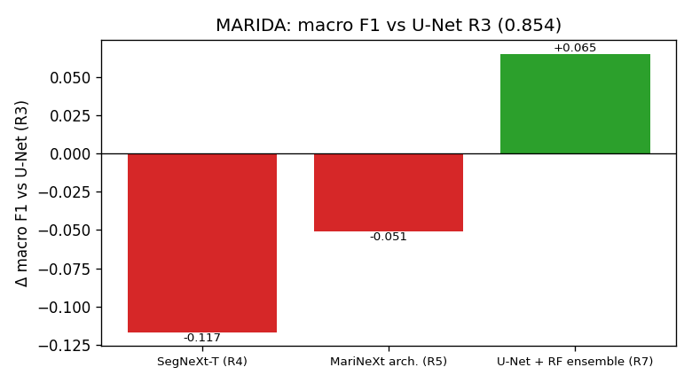
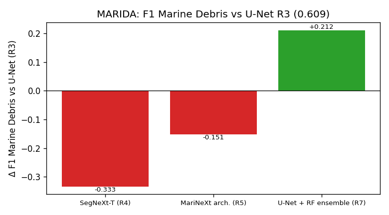

# Deep-learning comparison, 26 features

Test split, every annotated pixel, 4 classes (Water, Marine Debris, Algae/Sargassum, Other); macro = mean over the 4 classes. Each cell: score [95% scene-bootstrap CI where computed] (Δ vs the U-Net, R3, same dataset). All models use the same 26 input features (11 bands, NDVI, NDWI, FAI, FDI, NDMI, 4 ratios, 6 GLCM); R7 = R3 + the Random Forest (R6) on the same features, weight chosen on validation.

Training recipes follow each dataset's paper: MARIDA 45 epochs, no VSCP; MADOS 80 epochs, EMA, VSCP copy-paste. Single seed; the CIs cover test-scene variation, not training randomness.

📄 **Paper rows** (top of each table, values in _italics_) are the published results of the MARIDA (Table 4) and MADOS (Tables 4 and 5) papers. They use the papers' own class schemes (MARIDA 11 classes, MADOS 15 classes), so only marine debris is the same class as ours; their macro scores average over more, and different, classes. Tables without a published value have no paper rows. **Bold** = best of our models.

## MADOS

_Runs not finished yet._

## MARIDA

### Macro F1

| Model | score |
|---|---|
| 📄 **MARIDA paper: RF_SS** (11 classes) | _0.690_ |
| 📄 **MARIDA paper: RF_SS+SI** (11 classes) | _0.700_ |
| 📄 **MARIDA paper: RF_SS+SI+GLCM** (11 classes) | _0.790_ |
| 📄 **MARIDA paper: U-Net** (11 classes) | _0.690_ |
| U-Net (R3, from scratch) | 0.8536 [0.780–0.896] |
| SegNeXt-T (R4) | 0.7368 [0.691–0.780] (-0.1167) |
| MariNeXt arch. (R5) | 0.8025 [0.753–0.838] (-0.0510) |
| U-Net + RF ensemble (R7) | **0.9186 [0.859–0.954] (+0.0651)** |

### Macro IoU

| Model | score |
|---|---|
| 📄 **MARIDA paper: RF_SS** (11 classes) | _0.570_ |
| 📄 **MARIDA paper: RF_SS+SI** (11 classes) | _0.590_ |
| 📄 **MARIDA paper: RF_SS+SI+GLCM** (11 classes) | _0.690_ |
| 📄 **MARIDA paper: U-Net** (11 classes) | _0.570_ |
| U-Net (R3, from scratch) | 0.7751 [0.668–0.832] |
| SegNeXt-T (R4) | 0.6578 [0.577–0.692] (-0.1173) |
| MariNeXt arch. (R5) | 0.7206 [0.639–0.757] (-0.0545) |
| U-Net + RF ensemble (R7) | **0.8590 [0.772–0.917] (+0.0839)** |

### Cohen's κ

| Model | score |
|---|---|
| U-Net (R3, from scratch) | 0.8806 |
| SegNeXt-T (R4) | 0.7120 (-0.1687) |
| MariNeXt arch. (R5) | 0.8183 (-0.0624) |
| U-Net + RF ensemble (R7) | **0.9245 (+0.0438)** |

### F1 Marine Debris

| Model | score |
|---|---|
| 📄 **MARIDA paper: RF_SS** (11 classes) | _0.710_ |
| 📄 **MARIDA paper: RF_SS+SI** (11 classes) | _0.800_ |
| 📄 **MARIDA paper: RF_SS+SI+GLCM** (11 classes) | _0.790_ |
| 📄 **MARIDA paper: U-Net** (11 classes) | _0.500_ |
| U-Net (R3, from scratch) | 0.6087 [0.524–0.709] |
| SegNeXt-T (R4) | 0.2753 [0.173–0.441] (-0.3334) |
| MariNeXt arch. (R5) | 0.4575 [0.351–0.584] (-0.1512) |
| U-Net + RF ensemble (R7) | **0.8203 [0.752–0.892] (+0.2116)** |

### IoU Marine Debris

| Model | score |
|---|---|
| 📄 **MARIDA paper: RF_SS** (11 classes) | _0.550_ |
| 📄 **MARIDA paper: RF_SS+SI** (11 classes) | _0.670_ |
| 📄 **MARIDA paper: RF_SS+SI+GLCM** (11 classes) | _0.650_ |
| 📄 **MARIDA paper: U-Net** (11 classes) | _0.330_ |
| U-Net (R3, from scratch) | 0.4375 |
| SegNeXt-T (R4) | 0.1596 (-0.2779) |
| MariNeXt arch. (R5) | 0.2966 (-0.1409) |
| U-Net + RF ensemble (R7) | **0.6953 (+0.2578)** |

### F1 Algae/Sargassum

| Model | score |
|---|---|
| U-Net (R3, from scratch) | 0.9809 |
| SegNeXt-T (R4) | 0.9631 (-0.0179) |
| MariNeXt arch. (R5) | 0.9771 (-0.0038) |
| U-Net + RF ensemble (R7) | **0.9911 (+0.0102)** |

### IoU Algae/Sargassum

| Model | score |
|---|---|
| U-Net (R3, from scratch) | 0.9626 |
| SegNeXt-T (R4) | 0.9288 (-0.0338) |
| MariNeXt arch. (R5) | 0.9553 (-0.0072) |
| U-Net + RF ensemble (R7) | **0.9824 (+0.0198)** |

### F1 Other

| Model | score |
|---|---|
| U-Net (R3, from scratch) | 0.8270 |
| SegNeXt-T (R4) | 0.7174 (-0.1096) |
| MariNeXt arch. (R5) | 0.7798 (-0.0472) |
| U-Net + RF ensemble (R7) | **0.8646 (+0.0375)** |

### Class accuracy Water (TP / class pixels)

| Model | score |
|---|---|
| U-Net (R3, from scratch) | 0.9959 |
| SegNeXt-T (R4) | 0.9838 (-0.0121) |
| MariNeXt arch. (R5) | 0.9918 (-0.0042) |
| U-Net + RF ensemble (R7) | **0.9979 (+0.0020)** |

### Class accuracy Marine Debris (TP / class pixels)

| Model | score |
|---|---|
| 📄 **MARIDA paper: RF_SS** (11 classes) | _0.910_ |
| 📄 **MARIDA paper: RF_SS+SI** (11 classes) | _0.920_ |
| 📄 **MARIDA paper: RF_SS+SI+GLCM** (11 classes) | _0.920_ |
| 📄 **MARIDA paper: U-Net** (11 classes) | _0.700_ |
| U-Net (R3, from scratch) | 0.8635 |
| SegNeXt-T (R4) | 0.8189 (-0.0446) |
| MariNeXt arch. (R5) | 0.8898 (+0.0262) |
| U-Net + RF ensemble (R7) | **0.9344 (+0.0709)** |

### Class accuracy Algae/Sargassum (TP / class pixels)

| Model | score |
|---|---|
| U-Net (R3, from scratch) | 0.9714 |
| SegNeXt-T (R4) | **0.9933 (+0.0219)** |
| MariNeXt arch. (R5) | 0.9902 (+0.0189) |
| U-Net + RF ensemble (R7) | 0.9854 (+0.0140) |

### Class accuracy Other (TP / class pixels)

| Model | score |
|---|---|
| U-Net (R3, from scratch) | 0.8863 |
| SegNeXt-T (R4) | **0.9019 (+0.0155)** |
| MariNeXt arch. (R5) | 0.8888 (+0.0025) |
| U-Net + RF ensemble (R7) | 0.8901 (+0.0037) |

### Feature importance by group (share of \|SHAP\|, %), MARIDA

Deep models: GradientSHAP; R7: weighted mix of its members' shares (approximation). Per-feature values in `outputs/marida_f26/xai/<run>/`.

| class | group | R3 | R4 | R5 | R7 |
|---|---|---|---|---|---|
| Water | bands | 20.2 | 23.8 | 25.3 | 21.2 |
| Water | indices | 53.5 | 34.5 | 34.5 | 39.9 |
| Water | ratios | 14.6 | 22.2 | 22.6 | 18.5 |
| Water | GLCM | 11.6 | 19.5 | 17.6 | 20.5 |
| Marine Debris | bands | 7.3 | 11.2 | 11.3 | 19.4 |
| Marine Debris | indices | 53.2 | 36.6 | 46.7 | 44.6 |
| Marine Debris | ratios | 35.6 | 26.3 | 23.9 | 29.6 |
| Marine Debris | GLCM | 3.9 | 25.9 | 18.1 | 6.5 |
| Algae/Sargassum | bands | 5.6 | 13.4 | 14.0 | 9.5 |
| Algae/Sargassum | indices | 77.3 | 57.5 | 55.0 | 59.1 |
| Algae/Sargassum | ratios | 9.6 | 13.6 | 13.5 | 26.7 |
| Algae/Sargassum | GLCM | 7.5 | 15.4 | 17.4 | 4.7 |
| Other | bands | 51.3 | 22.8 | 31.5 | 35.7 |
| Other | indices | 13.0 | 12.6 | 12.4 | 10.9 |
| Other | ratios | 11.5 | 11.3 | 11.2 | 9.0 |
| Other | GLCM | 24.3 | 53.3 | 44.9 | 44.4 |

 

