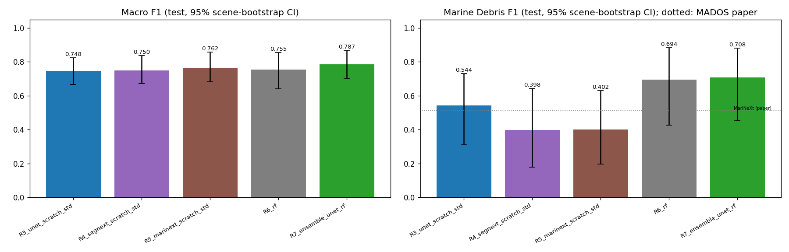
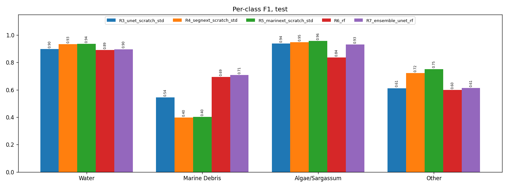
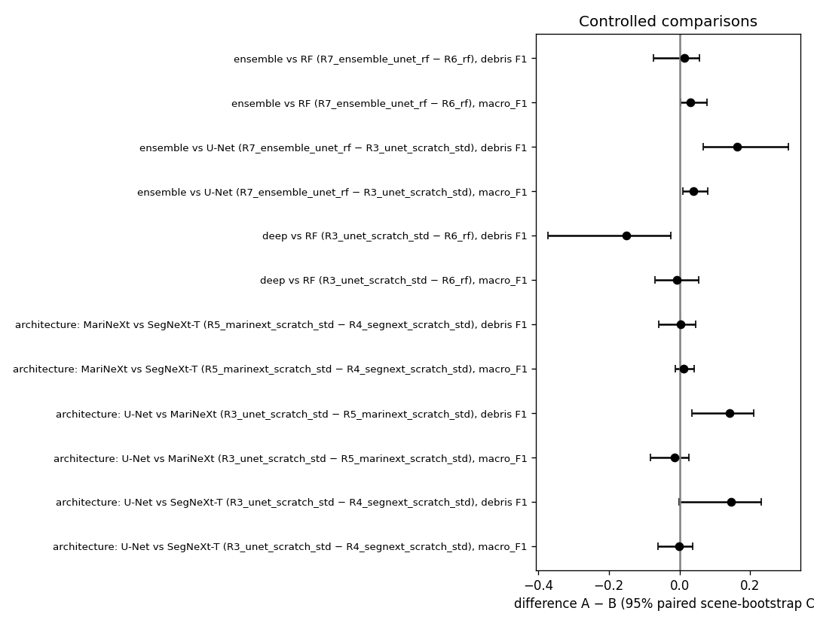
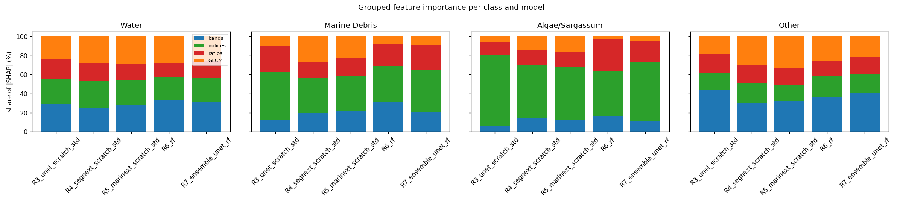
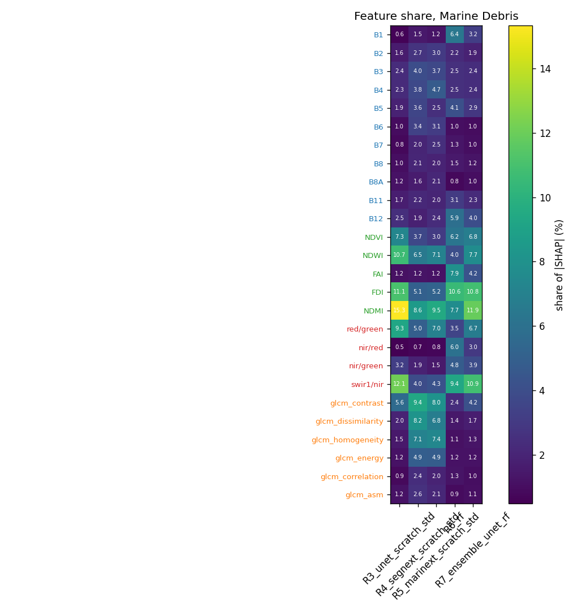
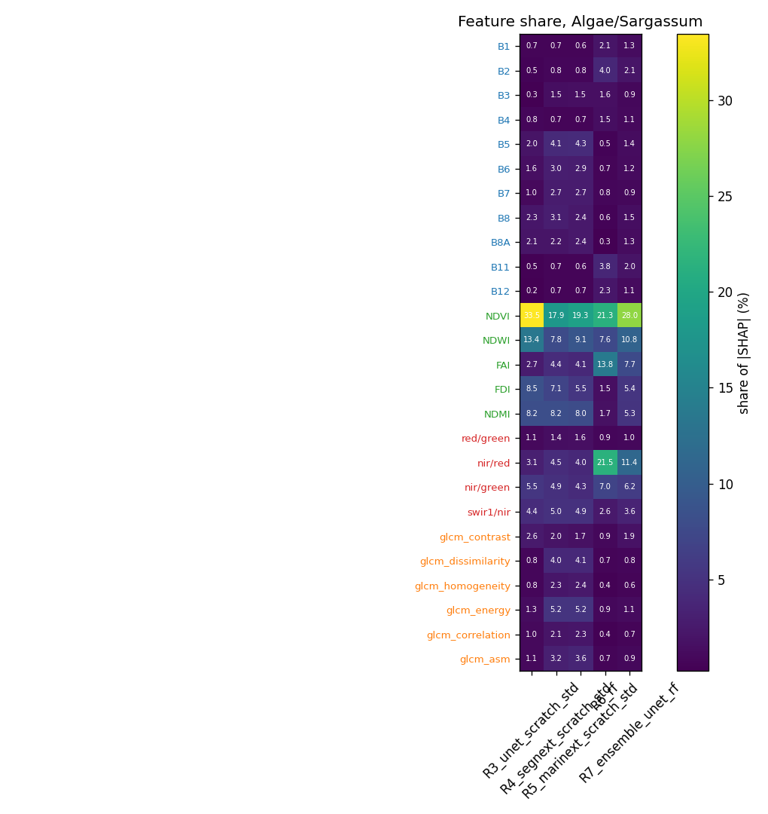
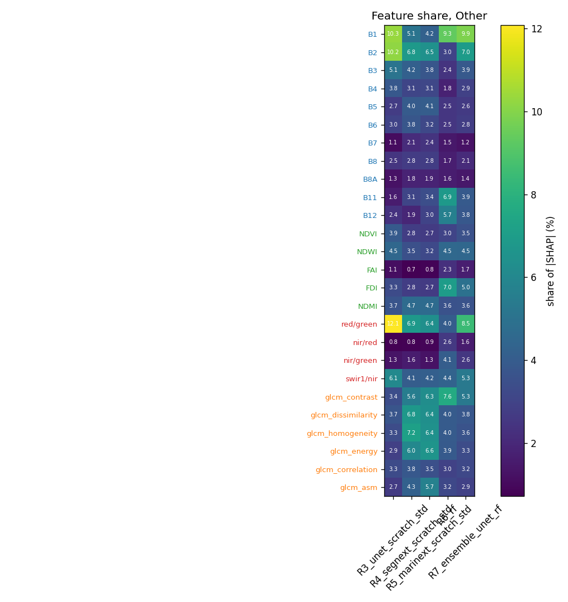

# MADOS, 26 features: comparison of all runs

Test split, every annotated pixel, 4 classes (Water, Marine Debris, Algae/Sargassum, Other). 95% confidence intervals from a scene bootstrap (42 test scenes, 2000 resamples). 📄 rows (italic) are the MADOS paper (Tables 4 and 5) published results. They are in the paper's 15 classes, so only Marine Debris is directly comparable; macro scores average over different classes. **Bold** = best of our runs.

## Overall

| Model | Macro F1 [95% CI] | mIoU | κ | OA | Macro P | Macro R | Macro AUPRC | Debris F1 [95% CI] |
|---|---|---|---|---|---|---|---|---|
| 📄 **RF (paper)** (15 classes) | _0.57_ | _0.44_ | – | – | – | – | – | – |
| 📄 **RF++ (Mikeli et al. 2022, paper)** (15 classes) | _0.64_ | _0.52_ | – | – | – | – | – | – |
| 📄 **U-Net (paper)** (15 classes) | _0.64_ | _0.51_ | – | – | – | – | – | – |
| 📄 **SegNeXt-T (paper)** (15 classes) | _0.61_ | _0.49_ | – | – | – | – | – | – |
| 📄 **MariNeXt (paper)** (15 classes) | _0.76_ | _0.64_ | – | – | – | – | – | _0.51_ |
| R3_unet_scratch_std: U-Net (ResNet-50), from scratch, standardised bands | 0.748 [0.668–0.826] | 0.628 | 0.535 | 0.837 | 0.716 | 0.817 | 0.816 | 0.544 [0.311–0.733] |
| R4_segnext_scratch_std: SegNeXt-T, from scratch, standardised bands | 0.750 [0.673–0.838] | 0.646 | 0.670 | 0.889 | 0.703 | 0.858 | 0.850 | 0.398 [0.178–0.643] |
| R5_marinext_scratch_std: MariNeXt architecture, from scratch, standardised bands | 0.762 [0.682–0.858] | 0.663 | **0.703** | **0.895** | 0.716 | **0.889** | **0.871** | 0.402 [0.195–0.630] |
| R6_rf: Random Forest on the 26 features | 0.755 [0.641–0.855] | 0.620 | 0.515 | 0.828 | 0.764 | 0.772 | 0.787 | 0.694 [0.426–0.883] |
| R7_ensemble_unet_rf: U-Net (R3_unet_scratch_std) + Random Forest (R6_rf) ensemble | **0.787** [0.704–0.869] | **0.668** | 0.535 | 0.837 | **0.771** | 0.819 | 0.842 | **0.708** [0.456–0.882] |

## Per-class F1

| Model | Water | Marine Debris | Algae/Sargassum | Other |
|---|---|---|---|---|
| 📄 **MariNeXt (paper)** | – | _0.51_ | – | – |
| R3_unet_scratch_std: U-Net (ResNet-50), from scratch, standardised bands | 0.897 | 0.544 | 0.938 | 0.612 |
| R4_segnext_scratch_std: SegNeXt-T, from scratch, standardised bands | 0.933 | 0.398 | 0.947 | 0.721 |
| R5_marinext_scratch_std: MariNeXt architecture, from scratch, standardised bands | **0.936** | 0.402 | **0.958** | **0.752** |
| R6_rf: Random Forest on the 26 features | 0.891 | 0.694 | 0.836 | 0.599 |
| R7_ensemble_unet_rf: U-Net (R3_unet_scratch_std) + Random Forest (R6_rf) ensemble | 0.896 | **0.708** | 0.930 | 0.612 |

## Per-class Precision

| Model | Water | Marine Debris | Algae/Sargassum | Other |
|---|---|---|---|---|
| R3_unet_scratch_std: U-Net (ResNet-50), from scratch, standardised bands | 0.939 | 0.417 | 0.979 | 0.527 |
| R4_segnext_scratch_std: SegNeXt-T, from scratch, standardised bands | 0.961 | 0.270 | 0.929 | **0.653** |
| R5_marinext_scratch_std: MariNeXt architecture, from scratch, standardised bands | **0.981** | 0.265 | 0.969 | 0.650 |
| R6_rf: Random Forest on the 26 features | 0.938 | 0.625 | 0.985 | 0.506 |
| R7_ensemble_unet_rf: U-Net (R3_unet_scratch_std) + Random Forest (R6_rf) ensemble | 0.939 | **0.632** | **0.988** | 0.524 |

## Per-class Recall (class accuracy)

| Model | Water | Marine Debris | Algae/Sargassum | Other |
|---|---|---|---|---|
| 📄 **MariNeXt (paper)** | – | _0.70_ | – | – |
| R3_unet_scratch_std: U-Net (ResNet-50), from scratch, standardised bands | 0.860 | 0.780 | 0.900 | 0.729 |
| R4_segnext_scratch_std: SegNeXt-T, from scratch, standardised bands | **0.907** | 0.753 | **0.966** | 0.805 |
| R5_marinext_scratch_std: MariNeXt architecture, from scratch, standardised bands | 0.896 | **0.823** | 0.947 | **0.892** |
| R6_rf: Random Forest on the 26 features | 0.849 | 0.780 | 0.726 | 0.734 |
| R7_ensemble_unet_rf: U-Net (R3_unet_scratch_std) + Random Forest (R6_rf) ensemble | 0.858 | 0.804 | 0.879 | 0.736 |

## Per-class IoU

| Model | Water | Marine Debris | Algae/Sargassum | Other |
|---|---|---|---|---|
| 📄 **MariNeXt (paper)** | – | _0.35_ | – | – |
| R3_unet_scratch_std: U-Net (ResNet-50), from scratch, standardised bands | 0.814 | 0.373 | 0.883 | 0.441 |
| R4_segnext_scratch_std: SegNeXt-T, from scratch, standardised bands | 0.874 | 0.248 | 0.900 | 0.564 |
| R5_marinext_scratch_std: MariNeXt architecture, from scratch, standardised bands | **0.880** | 0.251 | **0.919** | **0.603** |
| R6_rf: Random Forest on the 26 features | 0.804 | 0.532 | 0.718 | 0.427 |
| R7_ensemble_unet_rf: U-Net (R3_unet_scratch_std) + Random Forest (R6_rf) ensemble | 0.812 | **0.548** | 0.870 | 0.441 |

## Per-class AUPRC

| Model | Water | Marine Debris | Algae/Sargassum | Other |
|---|---|---|---|---|
| R3_unet_scratch_std: U-Net (ResNet-50), from scratch, standardised bands | 0.978 | 0.601 | 0.974 | 0.712 |
| R4_segnext_scratch_std: SegNeXt-T, from scratch, standardised bands | 0.990 | 0.642 | **0.988** | 0.780 |
| R5_marinext_scratch_std: MariNeXt architecture, from scratch, standardised bands | **0.993** | 0.677 | 0.979 | **0.836** |
| R6_rf: Random Forest on the 26 features | 0.971 | 0.733 | 0.907 | 0.536 |
| R7_ensemble_unet_rf: U-Net (R3_unet_scratch_std) + Random Forest (R6_rf) ensemble | 0.977 | **0.773** | 0.969 | 0.649 |

## Marine debris pixels

| Model | found (TP) | missed (FN) | false alarms (FP) | FP per TP |
|---|---|---|---|---|
| R3_unet_scratch_std: U-Net (ResNet-50), from scratch, standardised bands | 759 / 973 | 214 | 1060 | 1.40 |
| R4_segnext_scratch_std: SegNeXt-T, from scratch, standardised bands | 733 / 973 | 240 | 1981 | 2.70 |
| R5_marinext_scratch_std: MariNeXt architecture, from scratch, standardised bands | 801 / 973 | 172 | 2216 | 2.77 |
| R6_rf: Random Forest on the 26 features | 759 / 973 | 214 | 455 | 0.60 |
| R7_ensemble_unet_rf: U-Net (R3_unet_scratch_std) + Random Forest (R6_rf) ensemble | 782 / 973 | 191 | 455 | 0.58 |

## Controlled comparisons (paired scene bootstrap)

A − B with its 95% CI; **clear** = the CI excludes 0 (single training run per model, so this covers test-scene sampling, not training randomness).

| Comparison | A vs B | what differs | metric | A − B [95% CI] | P(A > B) |
|---|---|---|---|---|---|
| architecture: U-Net vs SegNeXt-T | R3_unet_scratch_std vs R4_segnext_scratch_std | from scratch, standardised bands | macro_F1 | -0.002 [-0.061, +0.037] | 0.43 |
| architecture: U-Net vs SegNeXt-T | R3_unet_scratch_std vs R4_segnext_scratch_std | from scratch, standardised bands | mIoU | -0.019 [-0.090, +0.032] | 0.25 |
| architecture: U-Net vs SegNeXt-T | R3_unet_scratch_std vs R4_segnext_scratch_std | from scratch, standardised bands | F1_Marine Debris | +0.146 [-0.001, +0.232] | 0.97 |
| architecture: U-Net vs MariNeXt | R3_unet_scratch_std vs R5_marinext_scratch_std | from scratch, standardised bands | macro_F1 | -0.014 [-0.082, +0.026] | 0.24 |
| architecture: U-Net vs MariNeXt | R3_unet_scratch_std vs R5_marinext_scratch_std | from scratch, standardised bands | mIoU | -0.035 [-0.123, +0.017] | 0.09 |
| architecture: U-Net vs MariNeXt | R3_unet_scratch_std vs R5_marinext_scratch_std | from scratch, standardised bands | F1_Marine Debris | **+0.142 [+0.035, +0.210]** | 1.00 |
| architecture: MariNeXt vs SegNeXt-T | R5_marinext_scratch_std vs R4_segnext_scratch_std | MariNeXt adds stage-1 features (1/4 vs 1/8 output) | macro_F1 | +0.012 [-0.011, +0.042] | 0.86 |
| architecture: MariNeXt vs SegNeXt-T | R5_marinext_scratch_std vs R4_segnext_scratch_std | MariNeXt adds stage-1 features (1/4 vs 1/8 output) | mIoU | +0.017 [-0.012, +0.063] | 0.87 |
| architecture: MariNeXt vs SegNeXt-T | R5_marinext_scratch_std vs R4_segnext_scratch_std | MariNeXt adds stage-1 features (1/4 vs 1/8 output) | F1_Marine Debris | +0.004 [-0.060, +0.045] | 0.57 |
| deep vs RF | R3_unet_scratch_std vs R6_rf | U-Net (from scratch, the ensemble member) vs RF on the same 26 features | macro_F1 | -0.007 [-0.069, +0.055] | 0.37 |
| deep vs RF | R3_unet_scratch_std vs R6_rf | U-Net (from scratch, the ensemble member) vs RF on the same 26 features | mIoU | +0.008 [-0.077, +0.075] | 0.50 |
| deep vs RF | R3_unet_scratch_std vs R6_rf | U-Net (from scratch, the ensemble member) vs RF on the same 26 features | F1_Marine Debris | **-0.150 [-0.372, -0.024]** | 0.00 |
| ensemble vs U-Net | R7_ensemble_unet_rf vs R3_unet_scratch_std | adding the RF to the U-Net | macro_F1 | **+0.039 [+0.010, +0.079]** | 1.00 |
| ensemble vs U-Net | R7_ensemble_unet_rf vs R3_unet_scratch_std | adding the RF to the U-Net | mIoU | **+0.040 [+0.007, +0.091]** | 0.99 |
| ensemble vs U-Net | R7_ensemble_unet_rf vs R3_unet_scratch_std | adding the RF to the U-Net | F1_Marine Debris | **+0.164 [+0.068, +0.308]** | 1.00 |
| ensemble vs RF | R7_ensemble_unet_rf vs R6_rf | adding the U-Net to the RF | macro_F1 | **+0.032 [+0.002, +0.079]** | 0.99 |
| ensemble vs RF | R7_ensemble_unet_rf vs R6_rf | adding the U-Net to the RF | mIoU | **+0.048 [+0.005, +0.091]** | 0.99 |
| ensemble vs RF | R7_ensemble_unet_rf vs R6_rf | adding the U-Net to the RF | F1_Marine Debris | +0.014 [-0.074, +0.057] | 0.63 |

## Feature importance across models (SHAP)

Share of |SHAP| per feature group (%), per class; deep models: GradientSHAP, RF: TreeSHAP, ensemble: weighted mix of its members (approximation). Details and figures in `xai/<run>/xai_report.md`.

### Water

| group | R3_unet_scratch_std | R4_segnext_scratch_std | R5_marinext_scratch_std | R6_rf | R7_ensemble_unet_rf |
|---|---|---|---|---|---|
| bands | 29.2 | 24.8 | 28.0 | 33.3 | 31.1 |
| indices | 26.1 | 28.7 | 25.8 | 24.2 | 25.2 |
| ratios | 21.0 | 18.6 | 17.4 | 14.4 | 18.0 |
| GLCM | 23.6 | 28.0 | 28.8 | 28.1 | 25.6 |

### Marine Debris

| group | R3_unet_scratch_std | R4_segnext_scratch_std | R5_marinext_scratch_std | R6_rf | R7_ensemble_unet_rf |
|---|---|---|---|---|---|
| bands | 12.4 | 19.9 | 21.4 | 31.1 | 20.8 |
| indices | 50.0 | 36.8 | 37.7 | 37.7 | 44.4 |
| ratios | 27.4 | 16.9 | 18.8 | 23.7 | 25.7 |
| GLCM | 10.2 | 26.5 | 22.2 | 7.6 | 9.0 |

### Algae/Sargassum

| group | R3_unet_scratch_std | R4_segnext_scratch_std | R5_marinext_scratch_std | R6_rf | R7_ensemble_unet_rf |
|---|---|---|---|---|---|
| bands | 6.4 | 13.8 | 12.5 | 16.5 | 10.9 |
| indices | 74.6 | 56.3 | 55.0 | 47.5 | 62.4 |
| ratios | 13.4 | 15.5 | 16.8 | 33.0 | 22.2 |
| GLCM | 5.6 | 14.3 | 15.7 | 3.0 | 4.4 |

### Other

| group | R3_unet_scratch_std | R4_segnext_scratch_std | R5_marinext_scratch_std | R6_rf | R7_ensemble_unet_rf |
|---|---|---|---|---|---|
| bands | 43.9 | 30.2 | 32.0 | 36.9 | 40.8 |
| indices | 17.7 | 20.2 | 17.4 | 21.5 | 19.4 |
| ratios | 20.0 | 19.5 | 17.2 | 16.1 | 18.2 |
| GLCM | 18.4 | 30.0 | 33.4 | 25.5 | 21.6 |

## Figures

