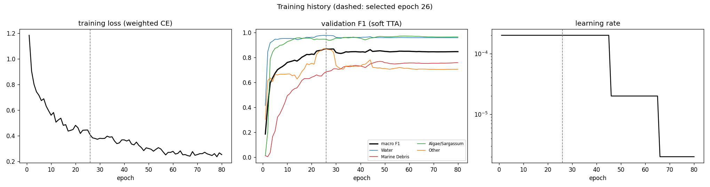
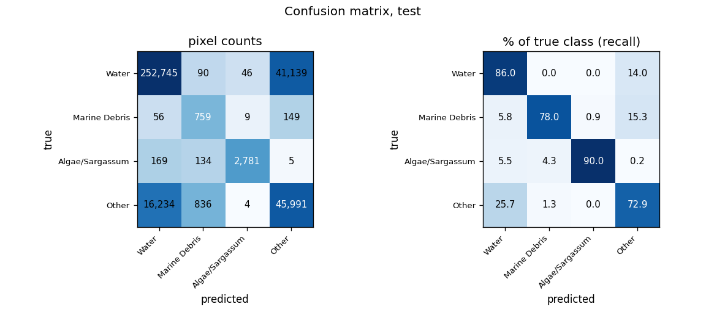
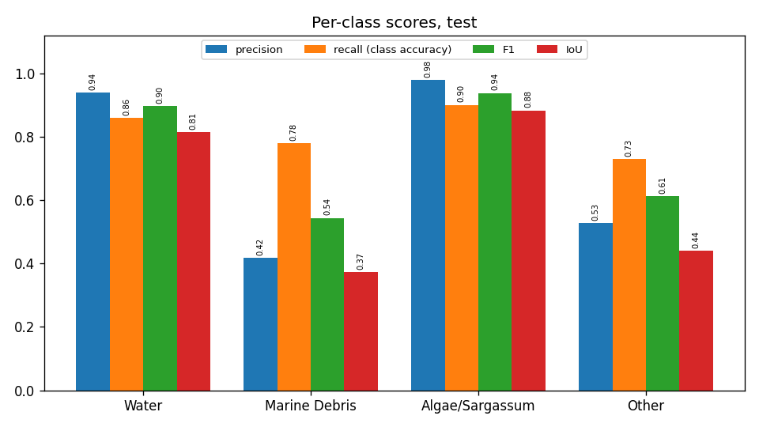
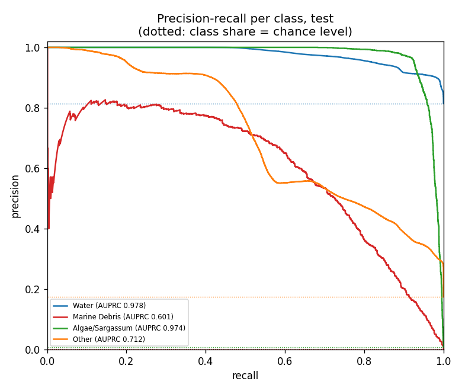
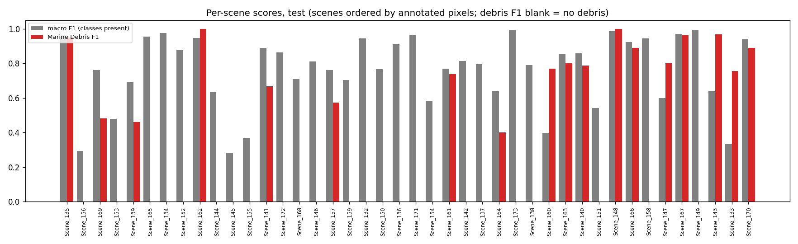
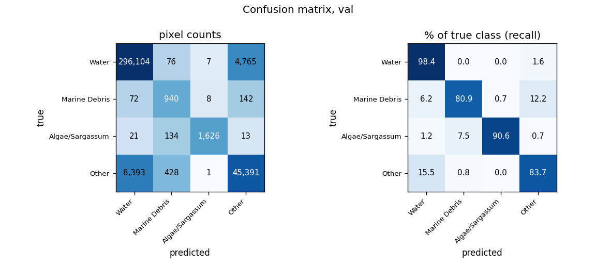
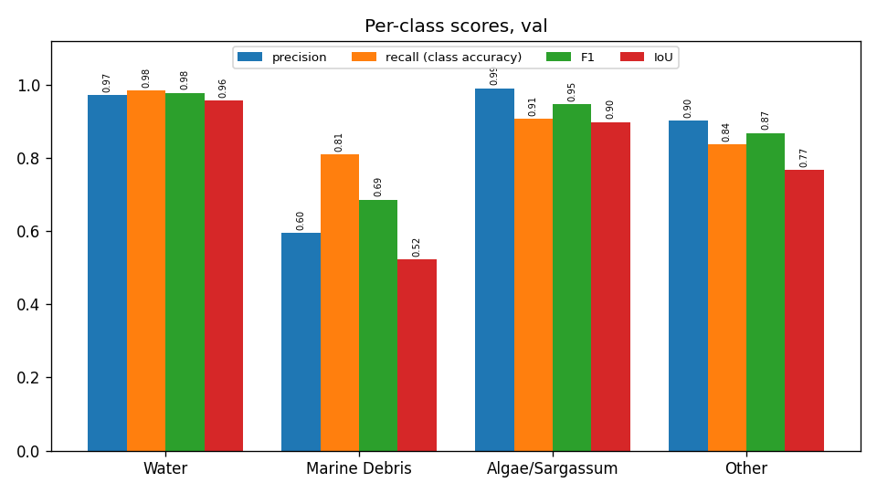
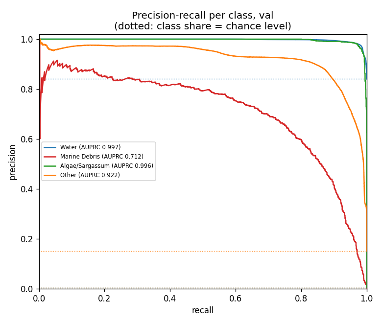
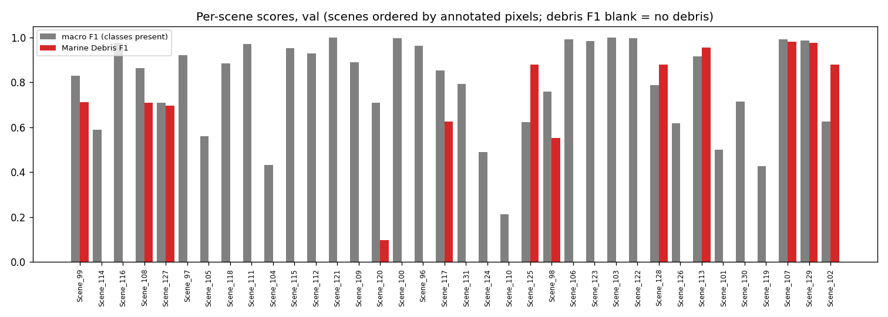
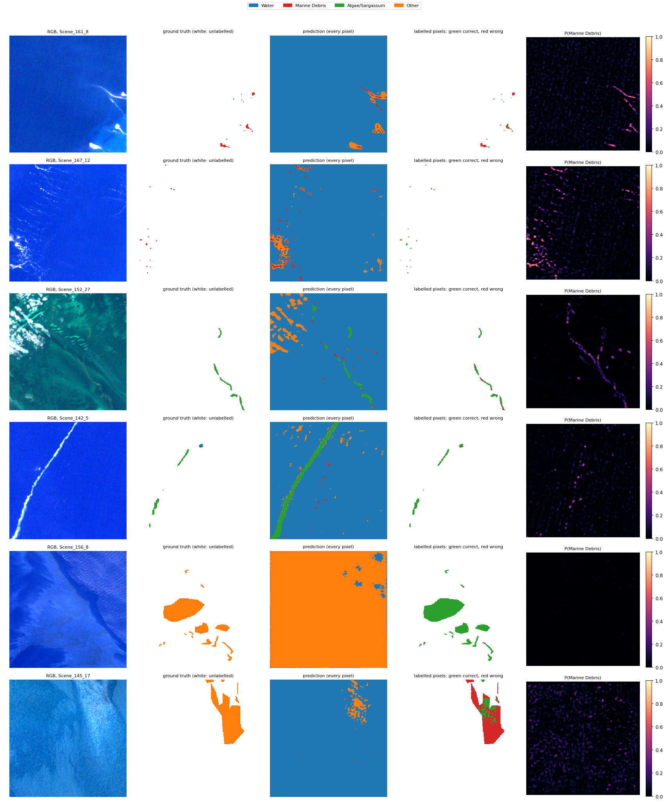

# Run R3_unet_scratch_std: U-Net (ResNet-50), from scratch, standardised bands, MADOS, 4 classes

Inputs: 26 channels (B1, B2, B3, B4, B5, B6, B7, B8, B8A, B11, B12, NDVI, NDWI, FAI, FDI, NDMI, red/green, nir/red, nir/green, swir1/nir, glcm_contrast, glcm_dissimilarity, glcm_homogeneity, glcm_energy, glcm_correlation, glcm_asm). See `architecture.md` for the model and how the features are fed in.

Selected checkpoint: epoch 26 of 80 (best validation macro F1 with soft TTA, 0.8698).

## Test split (361,147 annotated pixels)

### Overall

| metric | value |
|---|---|
| OA | 0.8370 |
| balanced_accuracy | 0.8173 |
| kappa | 0.5354 |
| macro_precision | 0.7156 |
| macro_recall | 0.8173 |
| macro_F1 | 0.7478 |
| mIoU | 0.6279 |
| weighted_precision | 0.8659 |
| weighted_recall | 0.8370 |
| weighted_F1 | 0.8470 |
| micro_F1 | 0.8370 |
| macro_AUPRC | 0.8160 |

### Per class

| | support | share_% | predicted | TP | FP | FN | TN | precision | recall (class accuracy) | F1 | IoU | specificity | FP_per_TP | AUPRC |
|---|---|---|---|---|---|---|---|---|---|---|---|---|---|---|
| Water | 294020.0000 | 81.4128 | 269204.0000 | 252745.0000 | 16459.0000 | 41275.0000 | 50668.0000 | 0.9389 | 0.8596 | 0.8975 | 0.8140 | 0.7548 | 0.0651 | 0.9779 |
| Marine Debris | 973.0000 | 0.2694 | 1819.0000 | 759.0000 | 1060.0000 | 214.0000 | 359114.0000 | 0.4173 | 0.7801 | 0.5437 | 0.3733 | 0.9971 | 1.3966 | 0.6006 |
| Algae/Sargassum | 3089.0000 | 0.8553 | 2840.0000 | 2781.0000 | 59.0000 | 308.0000 | 357999.0000 | 0.9792 | 0.9003 | 0.9381 | 0.8834 | 0.9998 | 0.0212 | 0.9738 |
| Other | 63065.0000 | 17.4624 | 87284.0000 | 45991.0000 | 41293.0000 | 17074.0000 | 256789.0000 | 0.5269 | 0.7293 | 0.6118 | 0.4407 | 0.8615 | 0.8978 | 0.7117 |

### Confusion matrix (rows true, columns predicted): counts / % of true class / % of predicted class

| | Water | Marine Debris | Algae/Sargassum | Other |
|---|---|---|---|---|
| Water | 252,745 | 90 | 46 | 41,139 |
| Marine Debris | 56 | 759 | 9 | 149 |
| Algae/Sargassum | 169 | 134 | 2,781 | 5 |
| Other | 16,234 | 836 | 4 | 45,991 |

| | Water | Marine Debris | Algae/Sargassum | Other |
|---|---|---|---|---|
| Water | 85.96 | 0.03 | 0.02 | 13.99 |
| Marine Debris | 5.76 | 78.01 | 0.92 | 15.31 |
| Algae/Sargassum | 5.47 | 4.34 | 90.03 | 0.16 |
| Other | 25.74 | 1.33 | 0.01 | 72.93 |

| | Water | Marine Debris | Algae/Sargassum | Other |
|---|---|---|---|---|
| Water | 93.89 | 4.95 | 1.62 | 47.13 |
| Marine Debris | 0.02 | 41.73 | 0.32 | 0.17 |
| Algae/Sargassum | 0.06 | 7.37 | 97.92 | 0.01 |
| Other | 6.03 | 45.96 | 0.14 | 52.69 |

### Per scene

`per_scene_test.csv` has every scene; the figure shows macro F1 (classes present) and debris F1.

## Val split (358,121 annotated pixels)

### Overall

| metric | value |
|---|---|
| OA | 0.9607 |
| balanced_accuracy | 0.8841 |
| kappa | 0.8513 |
| macro_precision | 0.8651 |
| macro_recall | 0.8841 |
| macro_F1 | 0.8698 |
| mIoU | 0.7863 |
| weighted_precision | 0.9604 |
| weighted_recall | 0.9607 |
| weighted_F1 | 0.9603 |
| micro_F1 | 0.9607 |
| macro_AUPRC | 0.9071 |

### Per class

| | support | share_% | predicted | TP | FP | FN | TN | precision | recall (class accuracy) | F1 | IoU | specificity | FP_per_TP | AUPRC |
|---|---|---|---|---|---|---|---|---|---|---|---|---|---|---|
| Water | 300952.0000 | 84.0364 | 304590.0000 | 296104.0000 | 8486.0000 | 4848.0000 | 48683.0000 | 0.9721 | 0.9839 | 0.9780 | 0.9569 | 0.8516 | 0.0287 | 0.9972 |
| Marine Debris | 1162.0000 | 0.3245 | 1578.0000 | 940.0000 | 638.0000 | 222.0000 | 356321.0000 | 0.5957 | 0.8090 | 0.6861 | 0.5222 | 0.9982 | 0.6787 | 0.7123 |
| Algae/Sargassum | 1794.0000 | 0.5009 | 1642.0000 | 1626.0000 | 16.0000 | 168.0000 | 356311.0000 | 0.9903 | 0.9064 | 0.9464 | 0.8983 | 1.0000 | 0.0098 | 0.9962 |
| Other | 54213.0000 | 15.1382 | 50311.0000 | 45391.0000 | 4920.0000 | 8822.0000 | 298988.0000 | 0.9022 | 0.8373 | 0.8685 | 0.7676 | 0.9838 | 0.1084 | 0.9225 |

### Confusion matrix (rows true, columns predicted): counts / % of true class / % of predicted class

| | Water | Marine Debris | Algae/Sargassum | Other |
|---|---|---|---|---|
| Water | 296,104 | 76 | 7 | 4,765 |
| Marine Debris | 72 | 940 | 8 | 142 |
| Algae/Sargassum | 21 | 134 | 1,626 | 13 |
| Other | 8,393 | 428 | 1 | 45,391 |

| | Water | Marine Debris | Algae/Sargassum | Other |
|---|---|---|---|---|
| Water | 98.39 | 0.03 | 0.00 | 1.58 |
| Marine Debris | 6.20 | 80.90 | 0.69 | 12.22 |
| Algae/Sargassum | 1.17 | 7.47 | 90.64 | 0.72 |
| Other | 15.48 | 0.79 | 0.00 | 83.73 |

| | Water | Marine Debris | Algae/Sargassum | Other |
|---|---|---|---|---|
| Water | 97.21 | 4.82 | 0.43 | 9.47 |
| Marine Debris | 0.02 | 59.57 | 0.49 | 0.28 |
| Algae/Sargassum | 0.01 | 8.49 | 99.03 | 0.03 |
| Other | 2.76 | 27.12 | 0.06 | 90.22 |

### Per scene

`per_scene_val.csv` has every scene; the figure shows macro F1 (classes present) and debris F1.

## Example test patches

The same 6 test patches (most debris, algae and other pixels) in every run.

