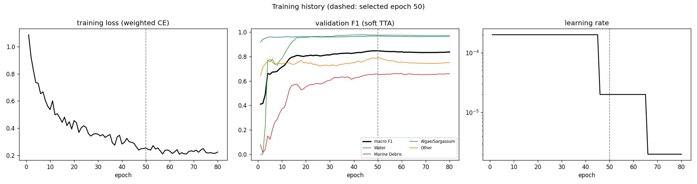
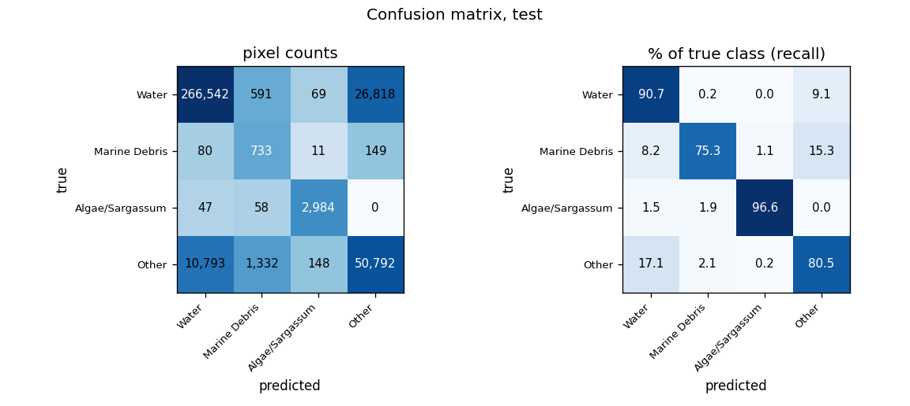
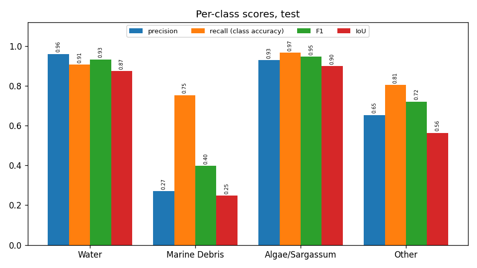
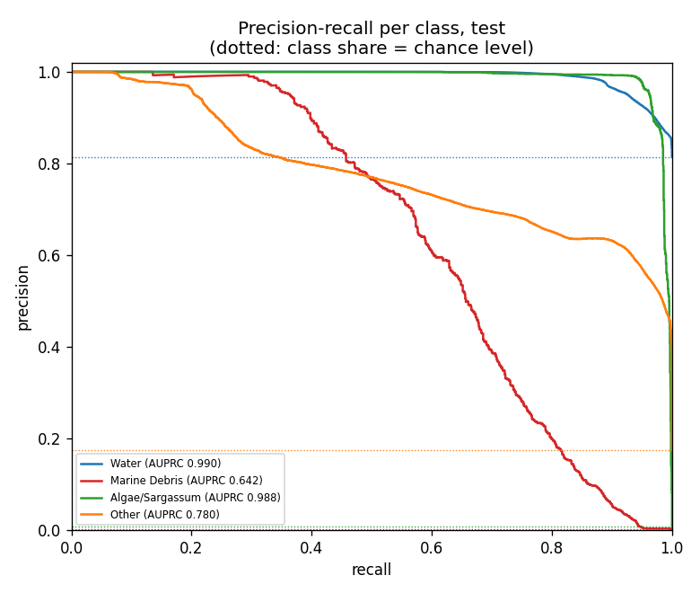
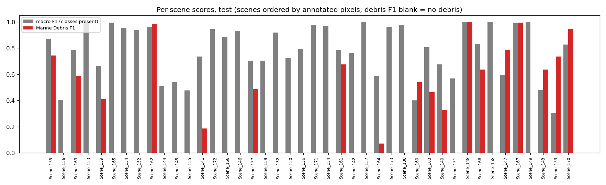
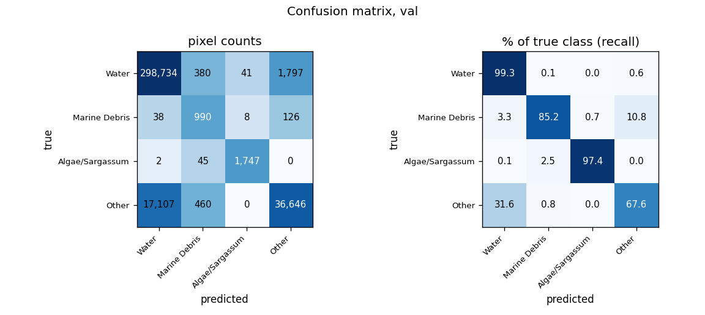
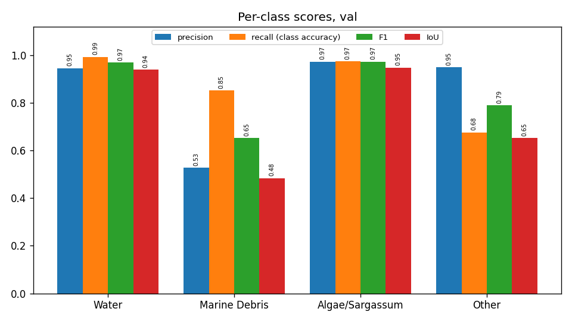
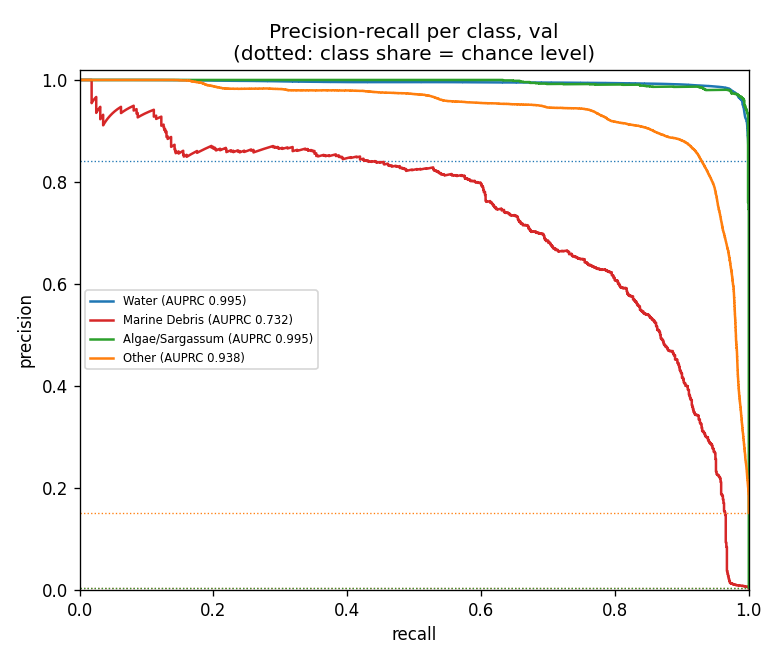
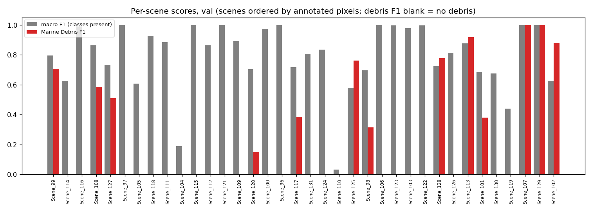
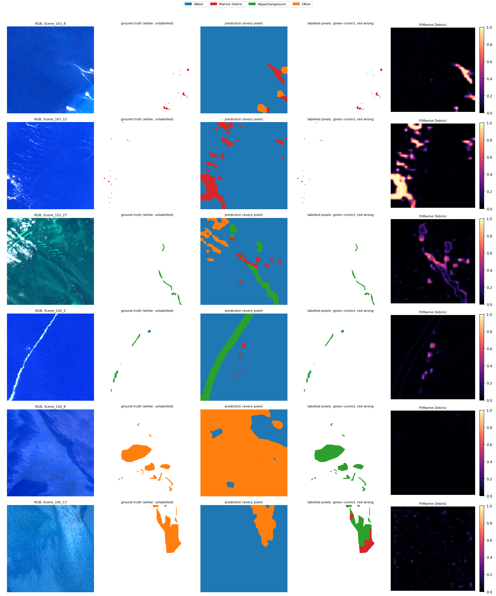

# Run R4_segnext_scratch_std: SegNeXt-T, from scratch, standardised bands, MADOS, 4 classes

Inputs: 26 channels (B1, B2, B3, B4, B5, B6, B7, B8, B8A, B11, B12, NDVI, NDWI, FAI, FDI, NDMI, red/green, nir/red, nir/green, swir1/nir, glcm_contrast, glcm_dissimilarity, glcm_homogeneity, glcm_energy, glcm_correlation, glcm_asm). See `architecture.md` for the model and how the features are fed in.

Selected checkpoint: epoch 50 of 80 (best validation macro F1 with soft TTA, 0.8478).

## Test split (361,147 annotated pixels)

### Overall

| metric | value |
|---|---|
| OA | 0.8890 |
| balanced_accuracy | 0.8578 |
| kappa | 0.6704 |
| macro_precision | 0.7032 |
| macro_recall | 0.8578 |
| macro_F1 | 0.7497 |
| mIoU | 0.6465 |
| weighted_precision | 0.9048 |
| weighted_recall | 0.8890 |
| weighted_F1 | 0.8946 |
| micro_F1 | 0.8890 |
| macro_AUPRC | 0.8501 |

### Per class

| | support | share_% | predicted | TP | FP | FN | TN | precision | recall (class accuracy) | F1 | IoU | specificity | FP_per_TP | AUPRC |
|---|---|---|---|---|---|---|---|---|---|---|---|---|---|---|
| Water | 294020.0000 | 81.4128 | 277462.0000 | 266542.0000 | 10920.0000 | 27478.0000 | 56207.0000 | 0.9606 | 0.9065 | 0.9328 | 0.8741 | 0.8373 | 0.0410 | 0.9904 |
| Marine Debris | 973.0000 | 0.2694 | 2714.0000 | 733.0000 | 1981.0000 | 240.0000 | 358193.0000 | 0.2701 | 0.7533 | 0.3976 | 0.2481 | 0.9945 | 2.7026 | 0.6417 |
| Algae/Sargassum | 3089.0000 | 0.8553 | 3212.0000 | 2984.0000 | 228.0000 | 105.0000 | 357830.0000 | 0.9290 | 0.9660 | 0.9472 | 0.8996 | 0.9994 | 0.0764 | 0.9881 |
| Other | 63065.0000 | 17.4624 | 77759.0000 | 50792.0000 | 26967.0000 | 12273.0000 | 271115.0000 | 0.6532 | 0.8054 | 0.7214 | 0.5642 | 0.9095 | 0.5309 | 0.7801 |

### Confusion matrix (rows true, columns predicted): counts / % of true class / % of predicted class

| | Water | Marine Debris | Algae/Sargassum | Other |
|---|---|---|---|---|
| Water | 266,542 | 591 | 69 | 26,818 |
| Marine Debris | 80 | 733 | 11 | 149 |
| Algae/Sargassum | 47 | 58 | 2,984 | 0 |
| Other | 10,793 | 1,332 | 148 | 50,792 |

| | Water | Marine Debris | Algae/Sargassum | Other |
|---|---|---|---|---|
| Water | 90.65 | 0.20 | 0.02 | 9.12 |
| Marine Debris | 8.22 | 75.33 | 1.13 | 15.31 |
| Algae/Sargassum | 1.52 | 1.88 | 96.60 | 0.00 |
| Other | 17.11 | 2.11 | 0.23 | 80.54 |

| | Water | Marine Debris | Algae/Sargassum | Other |
|---|---|---|---|---|
| Water | 96.06 | 21.78 | 2.15 | 34.49 |
| Marine Debris | 0.03 | 27.01 | 0.34 | 0.19 |
| Algae/Sargassum | 0.02 | 2.14 | 92.90 | 0.00 |
| Other | 3.89 | 49.08 | 4.61 | 65.32 |

### Per scene

`per_scene_test.csv` has every scene; the figure shows macro F1 (classes present) and debris F1.

## Val split (358,121 annotated pixels)

### Overall

| metric | value |
|---|---|
| OA | 0.9441 |
| balanced_accuracy | 0.8736 |
| kappa | 0.7696 |
| macro_precision | 0.8491 |
| macro_recall | 0.8736 |
| macro_F1 | 0.8459 |
| mIoU | 0.7559 |
| weighted_precision | 0.9452 |
| weighted_recall | 0.9441 |
| weighted_F1 | 0.9406 |
| micro_F1 | 0.9441 |
| macro_AUPRC | 0.9151 |

### Per class

| | support | share_% | predicted | TP | FP | FN | TN | precision | recall (class accuracy) | F1 | IoU | specificity | FP_per_TP | AUPRC |
|---|---|---|---|---|---|---|---|---|---|---|---|---|---|---|
| Water | 300952.0000 | 84.0364 | 315881.0000 | 298734.0000 | 17147.0000 | 2218.0000 | 40022.0000 | 0.9457 | 0.9926 | 0.9686 | 0.9391 | 0.7001 | 0.0574 | 0.9946 |
| Marine Debris | 1162.0000 | 0.3245 | 1875.0000 | 990.0000 | 885.0000 | 172.0000 | 356074.0000 | 0.5280 | 0.8520 | 0.6520 | 0.4836 | 0.9975 | 0.8939 | 0.7318 |
| Algae/Sargassum | 1794.0000 | 0.5009 | 1796.0000 | 1747.0000 | 49.0000 | 47.0000 | 356278.0000 | 0.9727 | 0.9738 | 0.9733 | 0.9479 | 0.9999 | 0.0280 | 0.9953 |
| Other | 54213.0000 | 15.1382 | 38569.0000 | 36646.0000 | 1923.0000 | 17567.0000 | 301985.0000 | 0.9501 | 0.6760 | 0.7899 | 0.6528 | 0.9937 | 0.0525 | 0.9385 |

### Confusion matrix (rows true, columns predicted): counts / % of true class / % of predicted class

| | Water | Marine Debris | Algae/Sargassum | Other |
|---|---|---|---|---|
| Water | 298,734 | 380 | 41 | 1,797 |
| Marine Debris | 38 | 990 | 8 | 126 |
| Algae/Sargassum | 2 | 45 | 1,747 | 0 |
| Other | 17,107 | 460 | 0 | 36,646 |

| | Water | Marine Debris | Algae/Sargassum | Other |
|---|---|---|---|---|
| Water | 99.26 | 0.13 | 0.01 | 0.60 |
| Marine Debris | 3.27 | 85.20 | 0.69 | 10.84 |
| Algae/Sargassum | 0.11 | 2.51 | 97.38 | 0.00 |
| Other | 31.56 | 0.85 | 0.00 | 67.60 |

| | Water | Marine Debris | Algae/Sargassum | Other |
|---|---|---|---|---|
| Water | 94.57 | 20.27 | 2.28 | 4.66 |
| Marine Debris | 0.01 | 52.80 | 0.45 | 0.33 |
| Algae/Sargassum | 0.00 | 2.40 | 97.27 | 0.00 |
| Other | 5.42 | 24.53 | 0.00 | 95.01 |

### Per scene

`per_scene_val.csv` has every scene; the figure shows macro F1 (classes present) and debris F1.

## Example test patches

The same 6 test patches (most debris, algae and other pixels) in every run.

