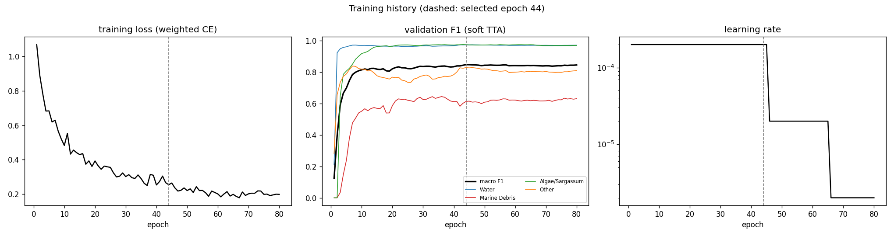
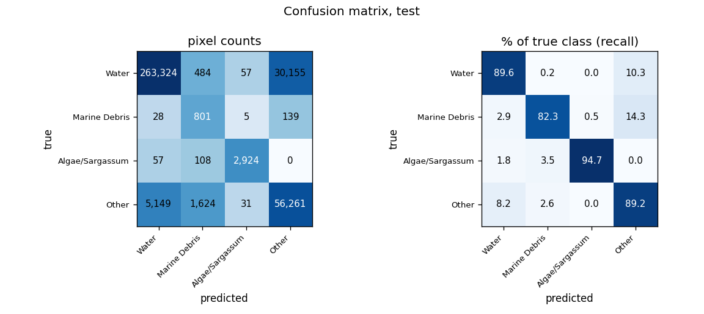
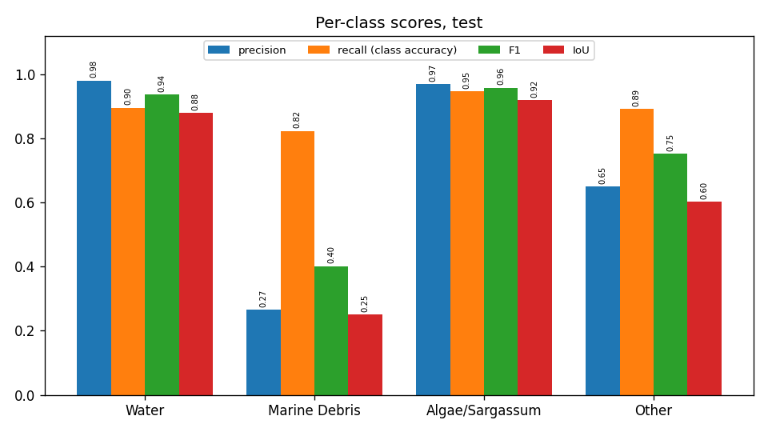
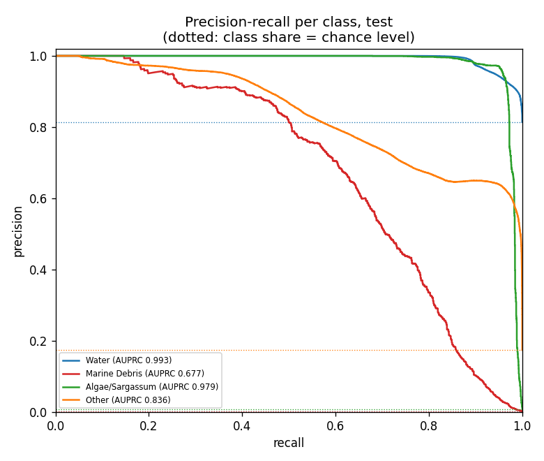
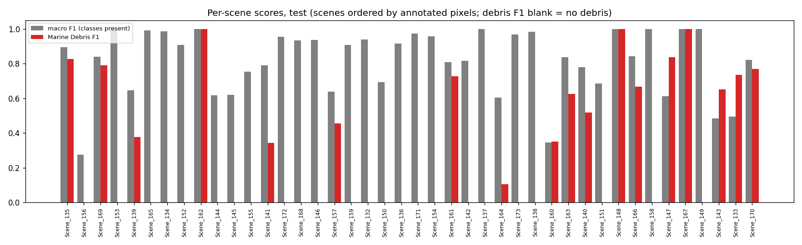
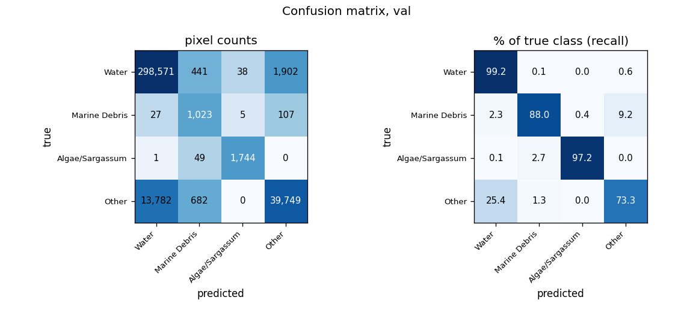
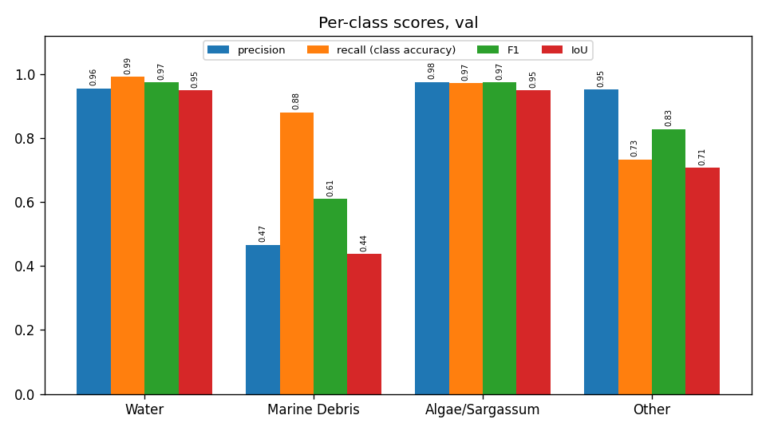
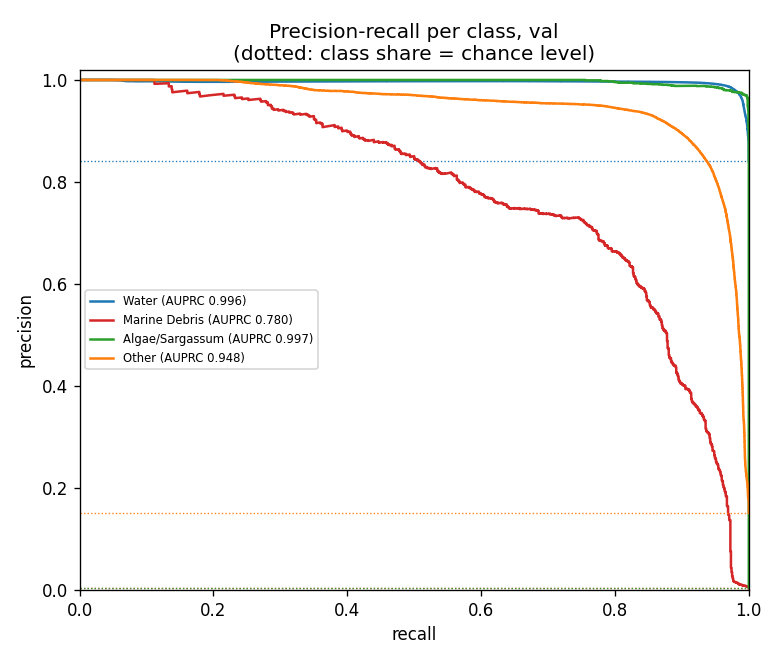
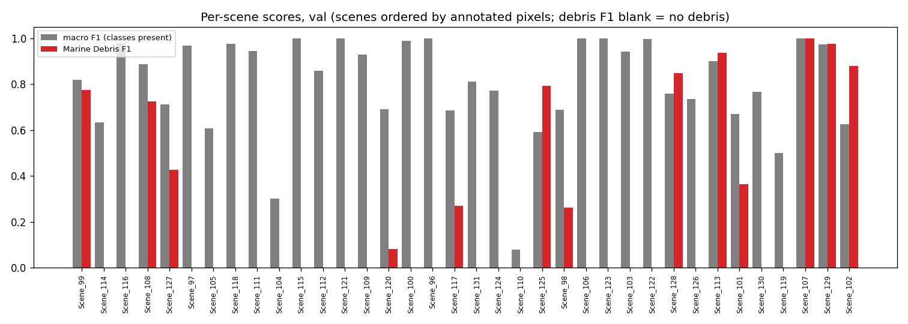
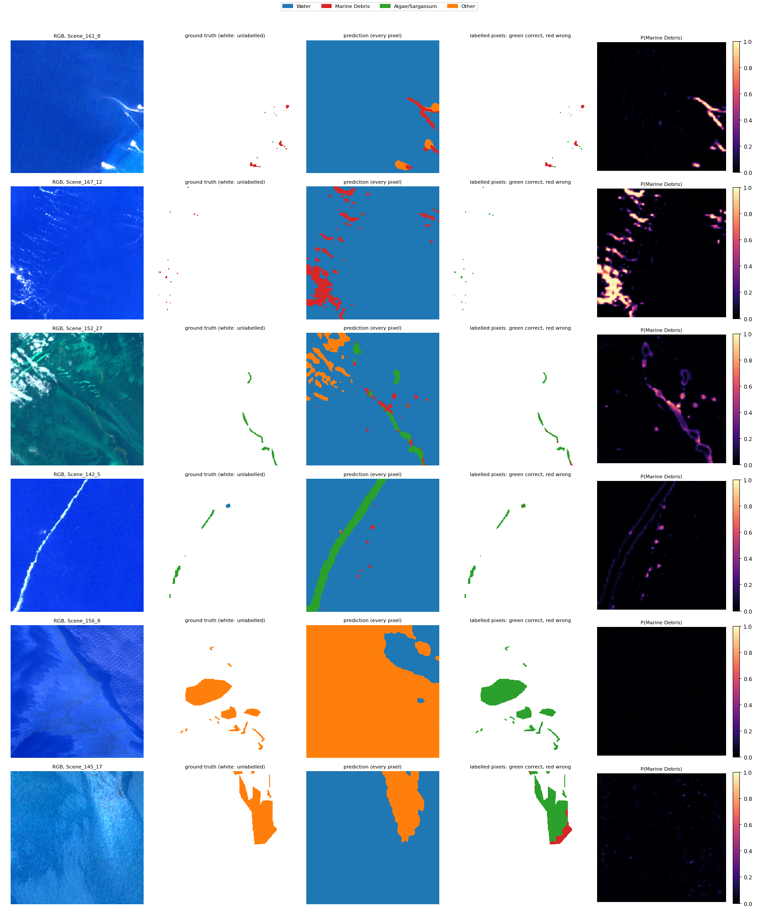

# Run R5_marinext_scratch_std: MariNeXt architecture, from scratch, standardised bands, MADOS, 4 classes

Inputs: 26 channels (B1, B2, B3, B4, B5, B6, B7, B8, B8A, B11, B12, NDVI, NDWI, FAI, FDI, NDMI, red/green, nir/red, nir/green, swir1/nir, glcm_contrast, glcm_dissimilarity, glcm_homogeneity, glcm_energy, glcm_correlation, glcm_asm). See `architecture.md` for the model and how the features are fed in.

Selected checkpoint: epoch 44 of 80 (best validation macro F1 with soft TTA, 0.8474).

## Test split (361,147 annotated pixels)

### Overall

| metric | value |
|---|---|
| OA | 0.8952 |
| balanced_accuracy | 0.8894 |
| kappa | 0.7029 |
| macro_precision | 0.7163 |
| macro_recall | 0.8894 |
| macro_F1 | 0.7619 |
| mIoU | 0.6632 |
| weighted_precision | 0.9208 |
| weighted_recall | 0.8952 |
| weighted_F1 | 0.9027 |
| micro_F1 | 0.8952 |
| macro_AUPRC | 0.8713 |

### Per class

| | support | share_% | predicted | TP | FP | FN | TN | precision | recall (class accuracy) | F1 | IoU | specificity | FP_per_TP | AUPRC |
|---|---|---|---|---|---|---|---|---|---|---|---|---|---|---|
| Water | 294020.0000 | 81.4128 | 268558.0000 | 263324.0000 | 5234.0000 | 30696.0000 | 61893.0000 | 0.9805 | 0.8956 | 0.9361 | 0.8799 | 0.9220 | 0.0199 | 0.9932 |
| Marine Debris | 973.0000 | 0.2694 | 3017.0000 | 801.0000 | 2216.0000 | 172.0000 | 357958.0000 | 0.2655 | 0.8232 | 0.4015 | 0.2512 | 0.9938 | 2.7665 | 0.6766 |
| Algae/Sargassum | 3089.0000 | 0.8553 | 3017.0000 | 2924.0000 | 93.0000 | 165.0000 | 357965.0000 | 0.9692 | 0.9466 | 0.9577 | 0.9189 | 0.9997 | 0.0318 | 0.9790 |
| Other | 63065.0000 | 17.4624 | 86555.0000 | 56261.0000 | 30294.0000 | 6804.0000 | 267788.0000 | 0.6500 | 0.8921 | 0.7521 | 0.6026 | 0.8984 | 0.5385 | 0.8362 |

### Confusion matrix (rows true, columns predicted): counts / % of true class / % of predicted class

| | Water | Marine Debris | Algae/Sargassum | Other |
|---|---|---|---|---|
| Water | 263,324 | 484 | 57 | 30,155 |
| Marine Debris | 28 | 801 | 5 | 139 |
| Algae/Sargassum | 57 | 108 | 2,924 | 0 |
| Other | 5,149 | 1,624 | 31 | 56,261 |

| | Water | Marine Debris | Algae/Sargassum | Other |
|---|---|---|---|---|
| Water | 89.56 | 0.16 | 0.02 | 10.26 |
| Marine Debris | 2.88 | 82.32 | 0.51 | 14.29 |
| Algae/Sargassum | 1.85 | 3.50 | 94.66 | 0.00 |
| Other | 8.16 | 2.58 | 0.05 | 89.21 |

| | Water | Marine Debris | Algae/Sargassum | Other |
|---|---|---|---|---|
| Water | 98.05 | 16.04 | 1.89 | 34.84 |
| Marine Debris | 0.01 | 26.55 | 0.17 | 0.16 |
| Algae/Sargassum | 0.02 | 3.58 | 96.92 | 0.00 |
| Other | 1.92 | 53.83 | 1.03 | 65.00 |

### Per scene

`per_scene_test.csv` has every scene; the figure shows macro F1 (classes present) and debris F1.

## Val split (358,121 annotated pixels)

### Overall

| metric | value |
|---|---|
| OA | 0.9524 |
| balanced_accuracy | 0.8944 |
| kappa | 0.8092 |
| macro_precision | 0.8374 |
| macro_recall | 0.8944 |
| macro_F1 | 0.8464 |
| mIoU | 0.7608 |
| weighted_precision | 0.9537 |
| weighted_recall | 0.9524 |
| weighted_F1 | 0.9504 |
| micro_F1 | 0.9524 |
| macro_AUPRC | 0.9303 |

### Per class

| | support | share_% | predicted | TP | FP | FN | TN | precision | recall (class accuracy) | F1 | IoU | specificity | FP_per_TP | AUPRC |
|---|---|---|---|---|---|---|---|---|---|---|---|---|---|---|
| Water | 300952.0000 | 84.0364 | 312381.0000 | 298571.0000 | 13810.0000 | 2381.0000 | 43359.0000 | 0.9558 | 0.9921 | 0.9736 | 0.9486 | 0.7584 | 0.0463 | 0.9959 |
| Marine Debris | 1162.0000 | 0.3245 | 2195.0000 | 1023.0000 | 1172.0000 | 139.0000 | 355787.0000 | 0.4661 | 0.8804 | 0.6095 | 0.4383 | 0.9967 | 1.1457 | 0.7801 |
| Algae/Sargassum | 1794.0000 | 0.5009 | 1787.0000 | 1744.0000 | 43.0000 | 50.0000 | 356284.0000 | 0.9759 | 0.9721 | 0.9740 | 0.9494 | 0.9999 | 0.0247 | 0.9974 |
| Other | 54213.0000 | 15.1382 | 41758.0000 | 39749.0000 | 2009.0000 | 14464.0000 | 301899.0000 | 0.9519 | 0.7332 | 0.8284 | 0.7070 | 0.9934 | 0.0505 | 0.9479 |

### Confusion matrix (rows true, columns predicted): counts / % of true class / % of predicted class

| | Water | Marine Debris | Algae/Sargassum | Other |
|---|---|---|---|---|
| Water | 298,571 | 441 | 38 | 1,902 |
| Marine Debris | 27 | 1,023 | 5 | 107 |
| Algae/Sargassum | 1 | 49 | 1,744 | 0 |
| Other | 13,782 | 682 | 0 | 39,749 |

| | Water | Marine Debris | Algae/Sargassum | Other |
|---|---|---|---|---|
| Water | 99.21 | 0.15 | 0.01 | 0.63 |
| Marine Debris | 2.32 | 88.04 | 0.43 | 9.21 |
| Algae/Sargassum | 0.06 | 2.73 | 97.21 | 0.00 |
| Other | 25.42 | 1.26 | 0.00 | 73.32 |

| | Water | Marine Debris | Algae/Sargassum | Other |
|---|---|---|---|---|
| Water | 95.58 | 20.09 | 2.13 | 4.55 |
| Marine Debris | 0.01 | 46.61 | 0.28 | 0.26 |
| Algae/Sargassum | 0.00 | 2.23 | 97.59 | 0.00 |
| Other | 4.41 | 31.07 | 0.00 | 95.19 |

### Per scene

`per_scene_val.csv` has every scene; the figure shows macro F1 (classes present) and debris F1.

## Example test patches

The same 6 test patches (most debris, algae and other pixels) in every run.

