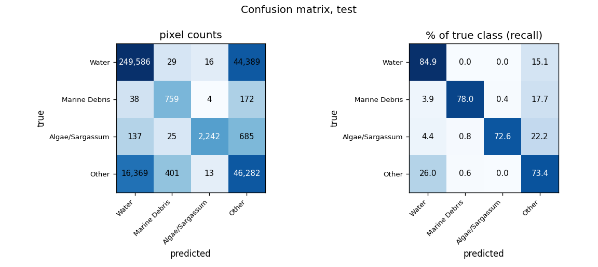
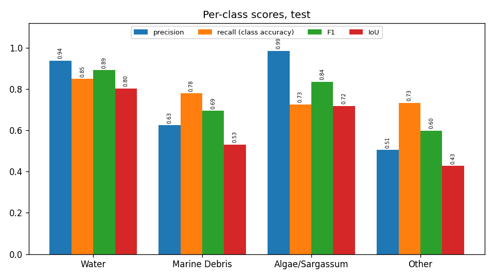
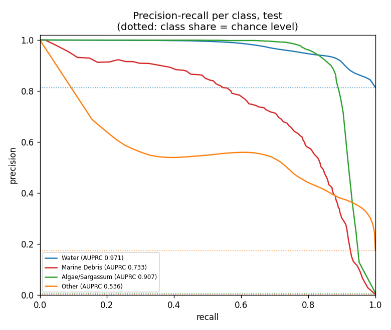
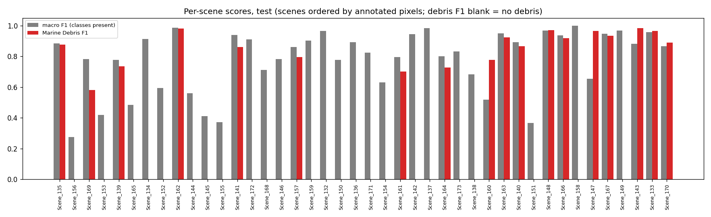
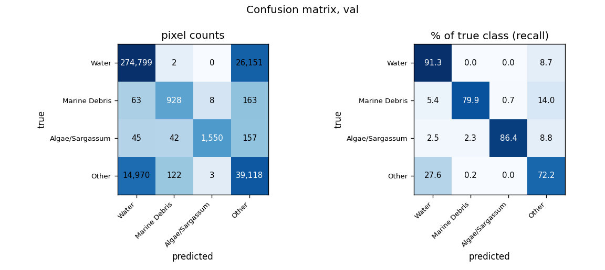
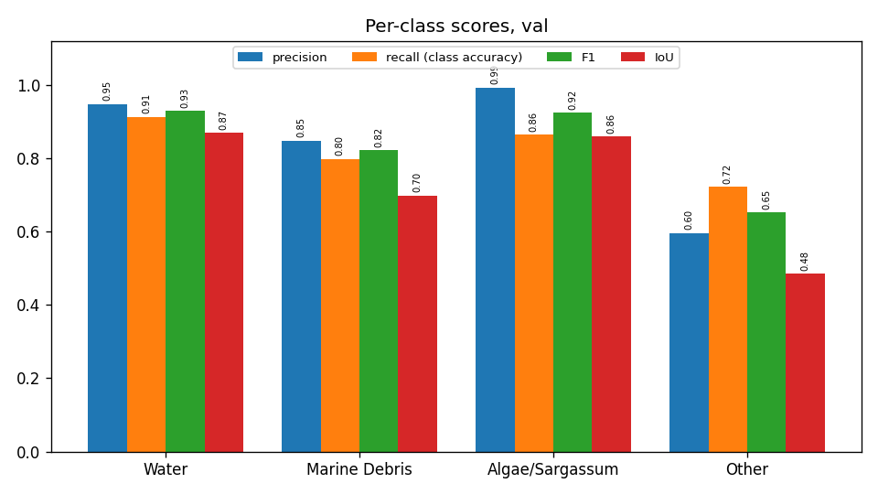
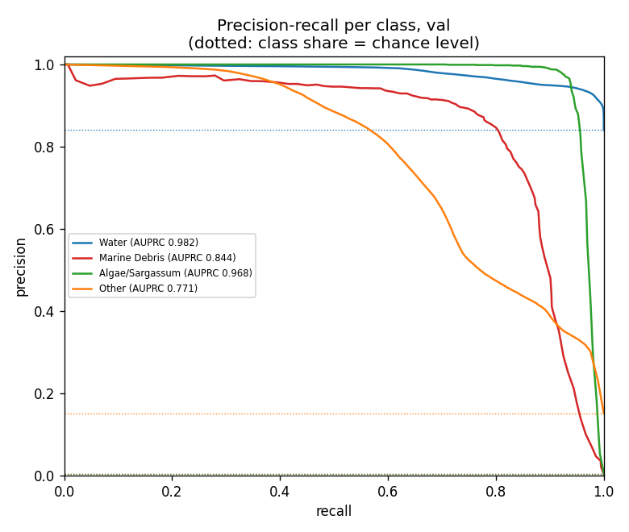
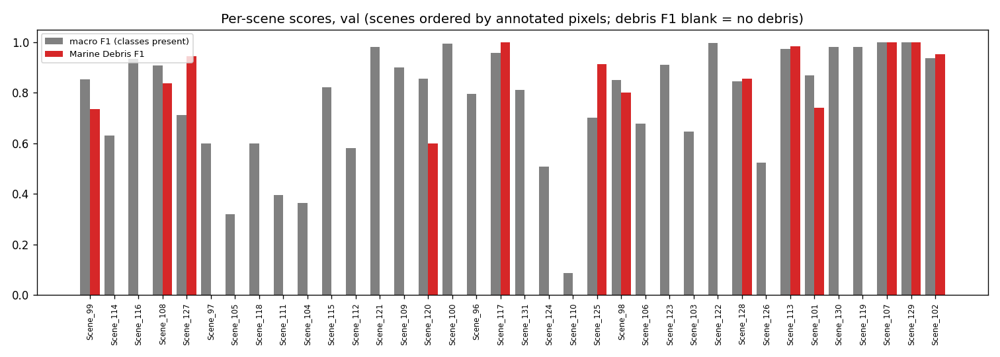
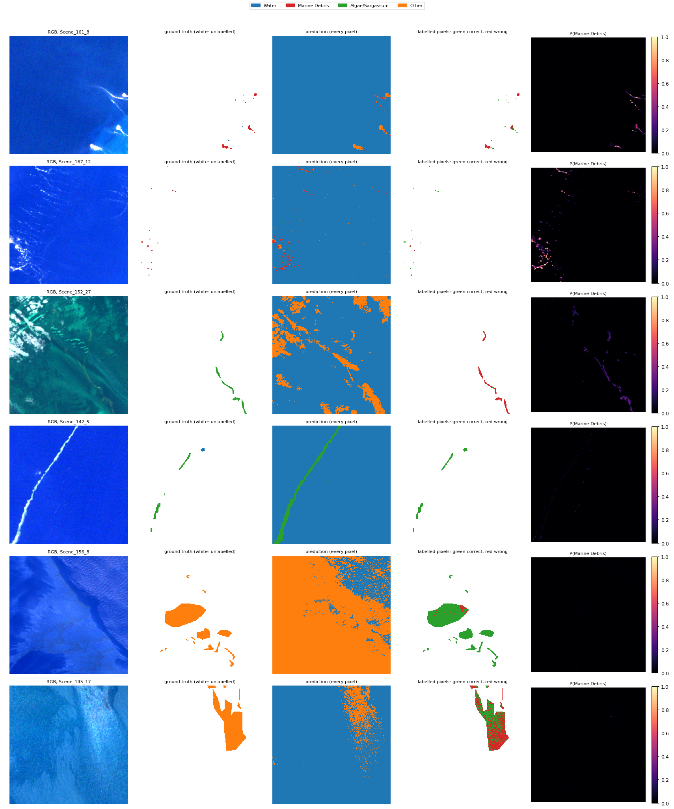

# Run R6_rf: Random Forest on the 26 features, MADOS, 4 classes

Inputs: 26 channels (B1, B2, B3, B4, B5, B6, B7, B8, B8A, B11, B12, NDVI, NDWI, FAI, FDI, NDMI, red/green, nir/red, nir/green, swir1/nir, glcm_contrast, glcm_dissimilarity, glcm_homogeneity, glcm_energy, glcm_correlation, glcm_asm). See `architecture.md` for the model and how the features are fed in.

Random Forest as in the staged ML: 100 trees, seed 42, log class weights (Water 1.692, Marine Debris 30.472, Algae/Sargassum 28.453, Other 4.566) as sample weights, all 761,887 annotated train pixels, fitted in 206 s. Impurity importance in `impurity_importance.csv` (SHAP in the XAI step).

## Test split (361,147 annotated pixels)

### Overall

| metric | value |
|---|---|
| OA | 0.8276 |
| balanced_accuracy | 0.7722 |
| kappa | 0.5153 |
| macro_precision | 0.7635 |
| macro_recall | 0.7722 |
| macro_F1 | 0.7550 |
| mIoU | 0.6202 |
| weighted_precision | 0.8619 |
| weighted_recall | 0.8276 |
| weighted_F1 | 0.8391 |
| micro_F1 | 0.8276 |
| macro_AUPRC | 0.7868 |

### Per class

| | support | share_% | predicted | TP | FP | FN | TN | precision | recall (class accuracy) | F1 | IoU | specificity | FP_per_TP | AUPRC |
|---|---|---|---|---|---|---|---|---|---|---|---|---|---|---|
| Water | 294020.0000 | 81.4128 | 266130.0000 | 249586.0000 | 16544.0000 | 44434.0000 | 50583.0000 | 0.9378 | 0.8489 | 0.8911 | 0.8037 | 0.7535 | 0.0663 | 0.9708 |
| Marine Debris | 973.0000 | 0.2694 | 1214.0000 | 759.0000 | 455.0000 | 214.0000 | 359719.0000 | 0.6252 | 0.7801 | 0.6941 | 0.5315 | 0.9987 | 0.5995 | 0.7332 |
| Algae/Sargassum | 3089.0000 | 0.8553 | 2275.0000 | 2242.0000 | 33.0000 | 847.0000 | 358025.0000 | 0.9855 | 0.7258 | 0.8359 | 0.7181 | 0.9999 | 0.0147 | 0.9075 |
| Other | 63065.0000 | 17.4624 | 91528.0000 | 46282.0000 | 45246.0000 | 16783.0000 | 252836.0000 | 0.5057 | 0.7339 | 0.5988 | 0.4273 | 0.8482 | 0.9776 | 0.5358 |

### Confusion matrix (rows true, columns predicted): counts / % of true class / % of predicted class

| | Water | Marine Debris | Algae/Sargassum | Other |
|---|---|---|---|---|
| Water | 249,586 | 29 | 16 | 44,389 |
| Marine Debris | 38 | 759 | 4 | 172 |
| Algae/Sargassum | 137 | 25 | 2,242 | 685 |
| Other | 16,369 | 401 | 13 | 46,282 |

| | Water | Marine Debris | Algae/Sargassum | Other |
|---|---|---|---|---|
| Water | 84.89 | 0.01 | 0.01 | 15.10 |
| Marine Debris | 3.91 | 78.01 | 0.41 | 17.68 |
| Algae/Sargassum | 4.44 | 0.81 | 72.58 | 22.18 |
| Other | 25.96 | 0.64 | 0.02 | 73.39 |

| | Water | Marine Debris | Algae/Sargassum | Other |
|---|---|---|---|---|
| Water | 93.78 | 2.39 | 0.70 | 48.50 |
| Marine Debris | 0.01 | 62.52 | 0.18 | 0.19 |
| Algae/Sargassum | 0.05 | 2.06 | 98.55 | 0.75 |
| Other | 6.15 | 33.03 | 0.57 | 50.57 |

### Per scene

`per_scene_test.csv` has every scene; the figure shows macro F1 (classes present) and debris F1.

## Val split (358,121 annotated pixels)

### Overall

| metric | value |
|---|---|
| OA | 0.8835 |
| balanced_accuracy | 0.8243 |
| kappa | 0.6010 |
| macro_precision | 0.8464 |
| macro_recall | 0.8243 |
| macro_F1 | 0.8325 |
| mIoU | 0.7280 |
| weighted_precision | 0.8947 |
| weighted_recall | 0.8835 |
| weighted_F1 | 0.8879 |
| micro_F1 | 0.8835 |
| macro_AUPRC | 0.8910 |

### Per class

| | support | share_% | predicted | TP | FP | FN | TN | precision | recall (class accuracy) | F1 | IoU | specificity | FP_per_TP | AUPRC |
|---|---|---|---|---|---|---|---|---|---|---|---|---|---|---|
| Water | 300952.0000 | 84.0364 | 289877.0000 | 274799.0000 | 15078.0000 | 26153.0000 | 42091.0000 | 0.9480 | 0.9131 | 0.9302 | 0.8695 | 0.7363 | 0.0549 | 0.9818 |
| Marine Debris | 1162.0000 | 0.3245 | 1094.0000 | 928.0000 | 166.0000 | 234.0000 | 356793.0000 | 0.8483 | 0.7986 | 0.8227 | 0.6988 | 0.9995 | 0.1789 | 0.8438 |
| Algae/Sargassum | 1794.0000 | 0.5009 | 1561.0000 | 1550.0000 | 11.0000 | 244.0000 | 356316.0000 | 0.9930 | 0.8640 | 0.9240 | 0.8587 | 1.0000 | 0.0071 | 0.9675 |
| Other | 54213.0000 | 15.1382 | 65589.0000 | 39118.0000 | 26471.0000 | 15095.0000 | 277437.0000 | 0.5964 | 0.7216 | 0.6530 | 0.4848 | 0.9129 | 0.6767 | 0.7707 |

### Confusion matrix (rows true, columns predicted): counts / % of true class / % of predicted class

| | Water | Marine Debris | Algae/Sargassum | Other |
|---|---|---|---|---|
| Water | 274,799 | 2 | 0 | 26,151 |
| Marine Debris | 63 | 928 | 8 | 163 |
| Algae/Sargassum | 45 | 42 | 1,550 | 157 |
| Other | 14,970 | 122 | 3 | 39,118 |

| | Water | Marine Debris | Algae/Sargassum | Other |
|---|---|---|---|---|
| Water | 91.31 | 0.00 | 0.00 | 8.69 |
| Marine Debris | 5.42 | 79.86 | 0.69 | 14.03 |
| Algae/Sargassum | 2.51 | 2.34 | 86.40 | 8.75 |
| Other | 27.61 | 0.23 | 0.01 | 72.16 |

| | Water | Marine Debris | Algae/Sargassum | Other |
|---|---|---|---|---|
| Water | 94.80 | 0.18 | 0.00 | 39.87 |
| Marine Debris | 0.02 | 84.83 | 0.51 | 0.25 |
| Algae/Sargassum | 0.02 | 3.84 | 99.30 | 0.24 |
| Other | 5.16 | 11.15 | 0.19 | 59.64 |

### Per scene

`per_scene_val.csv` has every scene; the figure shows macro F1 (classes present) and debris F1.

## Example test patches

The same 6 test patches (most debris, algae and other pixels) in every run.

