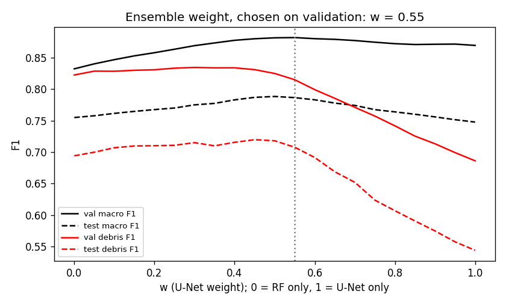
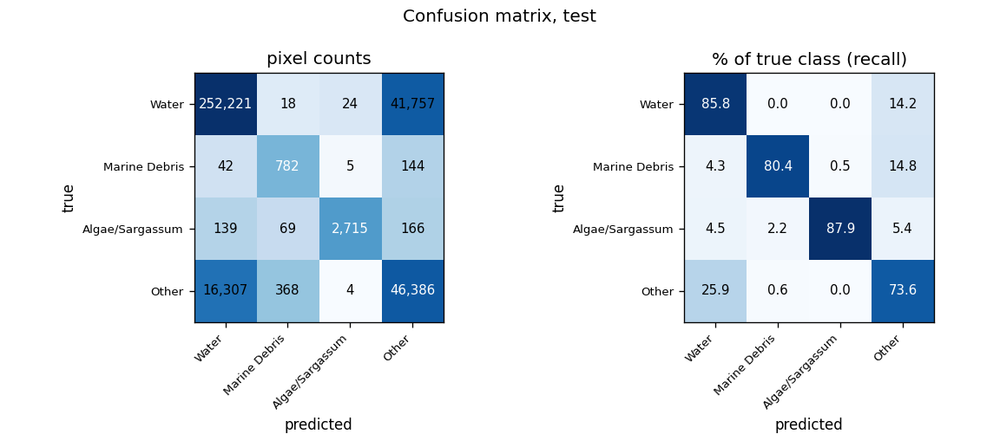
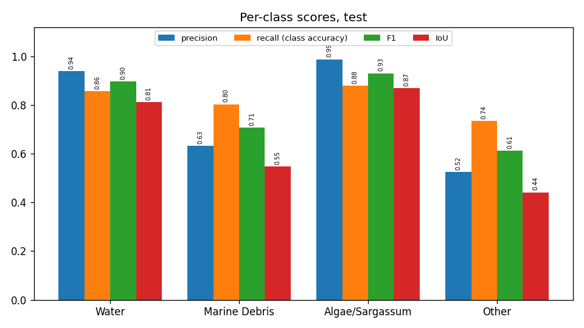
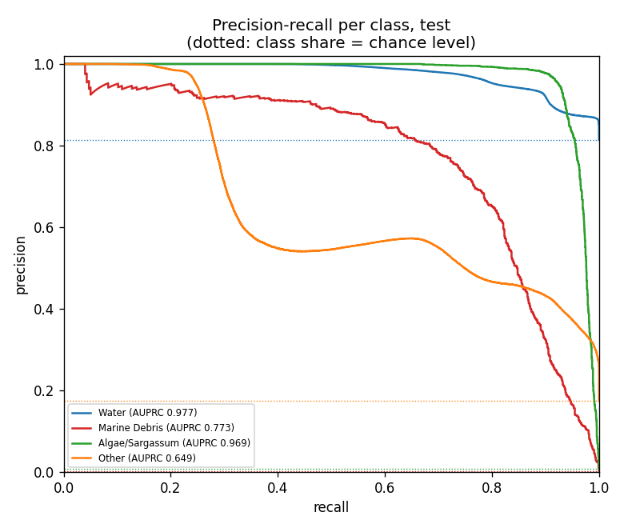
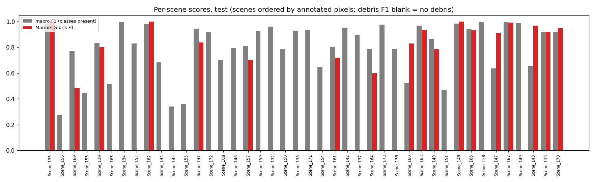
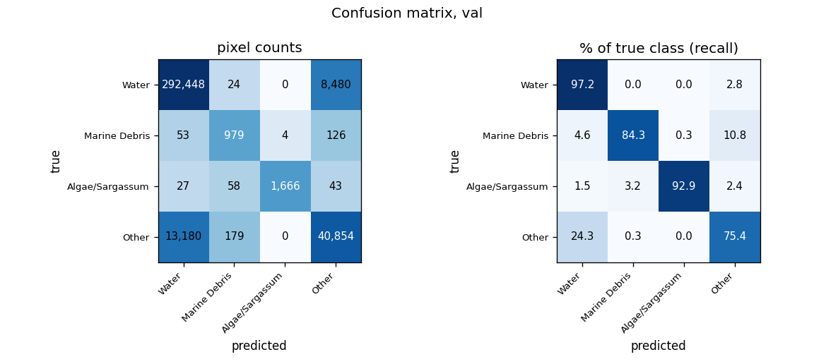
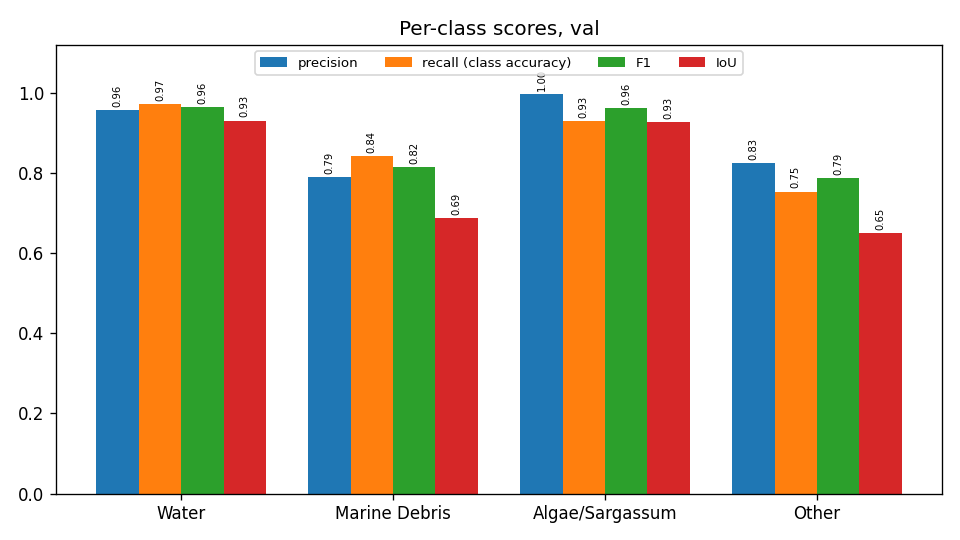
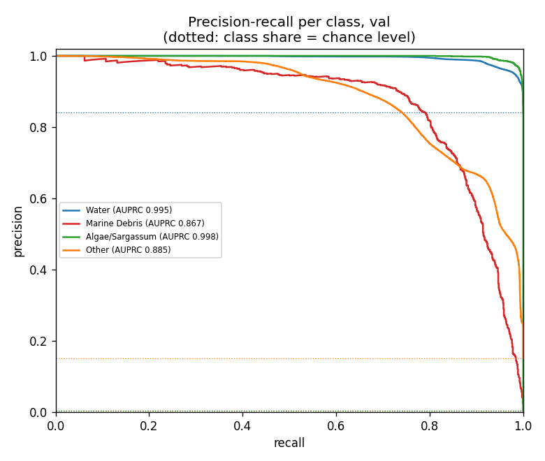
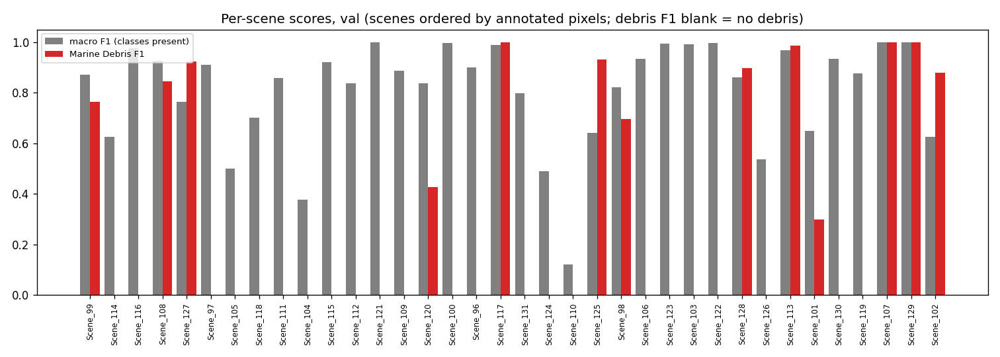
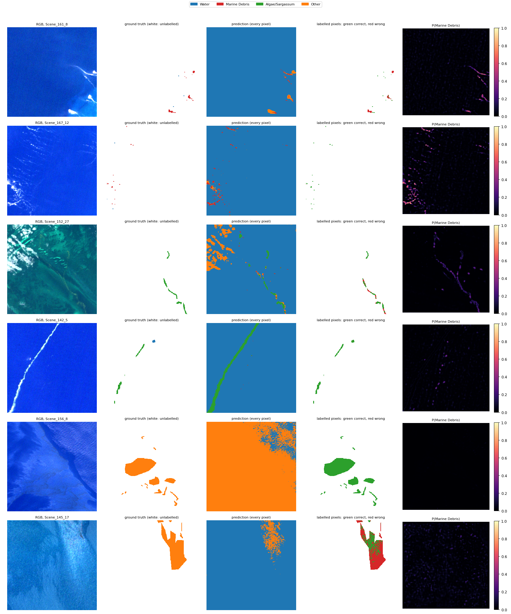

# Run R7_ensemble_unet_rf: U-Net (R3_unet_scratch_std) + Random Forest (R6_rf) ensemble, MADOS, 4 classes

Inputs: 26 channels (B1, B2, B3, B4, B5, B6, B7, B8, B8A, B11, B12, NDVI, NDWI, FAI, FDI, NDMI, red/green, nir/red, nir/green, swir1/nir, glcm_contrast, glcm_dissimilarity, glcm_homogeneity, glcm_energy, glcm_correlation, glcm_asm). See `architecture.md` for the model and how the features are fed in.

p = w · p_U-Net + (1 − w) · p_RF with w = 0.55, chosen by validation macro F1 over w = 0, 0.05, …, 1 (`weight_curve.csv`).

## Test split (361,147 annotated pixels)

### Overall

| metric | value |
|---|---|
| OA | 0.8365 |
| balanced_accuracy | 0.8190 |
| kappa | 0.5348 |
| macro_precision | 0.7708 |
| macro_recall | 0.8190 |
| macro_F1 | 0.7867 |
| mIoU | 0.6677 |
| weighted_precision | 0.8659 |
| weighted_recall | 0.8365 |
| weighted_F1 | 0.8466 |
| micro_F1 | 0.8365 |
| macro_AUPRC | 0.8421 |

### Per class

| | support | share_% | predicted | TP | FP | FN | TN | precision | recall (class accuracy) | F1 | IoU | specificity | FP_per_TP | AUPRC |
|---|---|---|---|---|---|---|---|---|---|---|---|---|---|---|
| Water | 294020.0000 | 81.4128 | 268709.0000 | 252221.0000 | 16488.0000 | 41799.0000 | 50639.0000 | 0.9386 | 0.8578 | 0.8964 | 0.8123 | 0.7544 | 0.0654 | 0.9770 |
| Marine Debris | 973.0000 | 0.2694 | 1237.0000 | 782.0000 | 455.0000 | 191.0000 | 359719.0000 | 0.6322 | 0.8037 | 0.7077 | 0.5476 | 0.9987 | 0.5818 | 0.7730 |
| Algae/Sargassum | 3089.0000 | 0.8553 | 2748.0000 | 2715.0000 | 33.0000 | 374.0000 | 358025.0000 | 0.9880 | 0.8789 | 0.9303 | 0.8696 | 0.9999 | 0.0122 | 0.9694 |
| Other | 63065.0000 | 17.4624 | 88453.0000 | 46386.0000 | 42067.0000 | 16679.0000 | 256015.0000 | 0.5244 | 0.7355 | 0.6123 | 0.4412 | 0.8589 | 0.9069 | 0.6490 |

### Confusion matrix (rows true, columns predicted): counts / % of true class / % of predicted class

| | Water | Marine Debris | Algae/Sargassum | Other |
|---|---|---|---|---|
| Water | 252,221 | 18 | 24 | 41,757 |
| Marine Debris | 42 | 782 | 5 | 144 |
| Algae/Sargassum | 139 | 69 | 2,715 | 166 |
| Other | 16,307 | 368 | 4 | 46,386 |

| | Water | Marine Debris | Algae/Sargassum | Other |
|---|---|---|---|---|
| Water | 85.78 | 0.01 | 0.01 | 14.20 |
| Marine Debris | 4.32 | 80.37 | 0.51 | 14.80 |
| Algae/Sargassum | 4.50 | 2.23 | 87.89 | 5.37 |
| Other | 25.86 | 0.58 | 0.01 | 73.55 |

| | Water | Marine Debris | Algae/Sargassum | Other |
|---|---|---|---|---|
| Water | 93.86 | 1.46 | 0.87 | 47.21 |
| Marine Debris | 0.02 | 63.22 | 0.18 | 0.16 |
| Algae/Sargassum | 0.05 | 5.58 | 98.80 | 0.19 |
| Other | 6.07 | 29.75 | 0.15 | 52.44 |

### Per scene

`per_scene_test.csv` has every scene; the figure shows macro F1 (classes present) and debris F1.

## Val split (358,121 annotated pixels)

### Overall

| metric | value |
|---|---|
| OA | 0.9381 |
| balanced_accuracy | 0.8741 |
| kappa | 0.7634 |
| macro_precision | 0.8923 |
| macro_recall | 0.8741 |
| macro_F1 | 0.8822 |
| mIoU | 0.7988 |
| weighted_precision | 0.9364 |
| weighted_recall | 0.9381 |
| weighted_F1 | 0.9369 |
| micro_F1 | 0.9381 |
| macro_AUPRC | 0.9363 |

### Per class

| | support | share_% | predicted | TP | FP | FN | TN | precision | recall (class accuracy) | F1 | IoU | specificity | FP_per_TP | AUPRC |
|---|---|---|---|---|---|---|---|---|---|---|---|---|---|---|
| Water | 300952.0000 | 84.0364 | 305708.0000 | 292448.0000 | 13260.0000 | 8504.0000 | 43909.0000 | 0.9566 | 0.9717 | 0.9641 | 0.9307 | 0.7681 | 0.0453 | 0.9946 |
| Marine Debris | 1162.0000 | 0.3245 | 1240.0000 | 979.0000 | 261.0000 | 183.0000 | 356698.0000 | 0.7895 | 0.8425 | 0.8152 | 0.6880 | 0.9993 | 0.2666 | 0.8672 |
| Algae/Sargassum | 1794.0000 | 0.5009 | 1670.0000 | 1666.0000 | 4.0000 | 128.0000 | 356323.0000 | 0.9976 | 0.9287 | 0.9619 | 0.9266 | 1.0000 | 0.0024 | 0.9983 |
| Other | 54213.0000 | 15.1382 | 49503.0000 | 40854.0000 | 8649.0000 | 13359.0000 | 295259.0000 | 0.8253 | 0.7536 | 0.7878 | 0.6499 | 0.9715 | 0.2117 | 0.8853 |

### Confusion matrix (rows true, columns predicted): counts / % of true class / % of predicted class

| | Water | Marine Debris | Algae/Sargassum | Other |
|---|---|---|---|---|
| Water | 292,448 | 24 | 0 | 8,480 |
| Marine Debris | 53 | 979 | 4 | 126 |
| Algae/Sargassum | 27 | 58 | 1,666 | 43 |
| Other | 13,180 | 179 | 0 | 40,854 |

| | Water | Marine Debris | Algae/Sargassum | Other |
|---|---|---|---|---|
| Water | 97.17 | 0.01 | 0.00 | 2.82 |
| Marine Debris | 4.56 | 84.25 | 0.34 | 10.84 |
| Algae/Sargassum | 1.51 | 3.23 | 92.87 | 2.40 |
| Other | 24.31 | 0.33 | 0.00 | 75.36 |

| | Water | Marine Debris | Algae/Sargassum | Other |
|---|---|---|---|---|
| Water | 95.66 | 1.94 | 0.00 | 17.13 |
| Marine Debris | 0.02 | 78.95 | 0.24 | 0.25 |
| Algae/Sargassum | 0.01 | 4.68 | 99.76 | 0.09 |
| Other | 4.31 | 14.44 | 0.00 | 82.53 |

### Per scene

`per_scene_val.csv` has every scene; the figure shows macro F1 (classes present) and debris F1.

## Example test patches

The same 6 test patches (most debris, algae and other pixels) in every run.

