# XAI, run R3_unet_scratch_std

Explained output: for class c, the sum of P(c) over the pixels labelled c in a test patch. Importance = mean |SHAP| at the class-c pixels; share = importance / sum over features. Direction (in brackets) = Spearman correlation between the feature value and its SHAP value at the class-c pixels: + means high values push towards the class. Group values add the SHAP values of a group's features at each pixel first. Correlated features share credit (see `features/correlation/`), so read single features together with the grouped results.

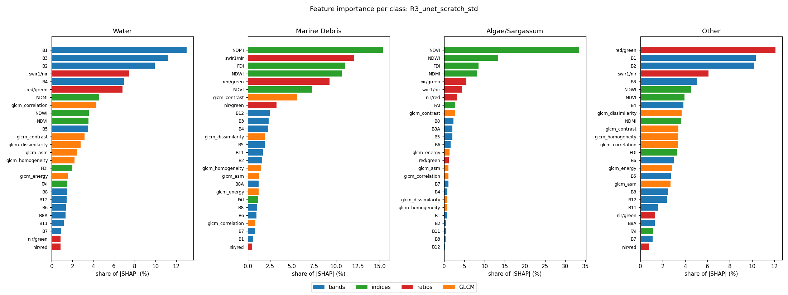

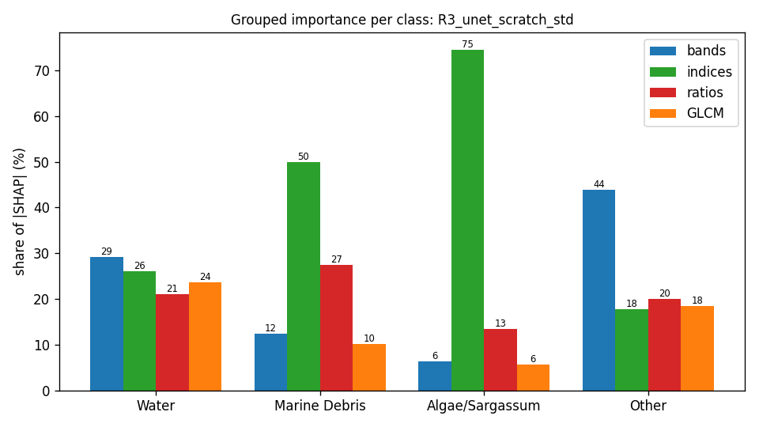

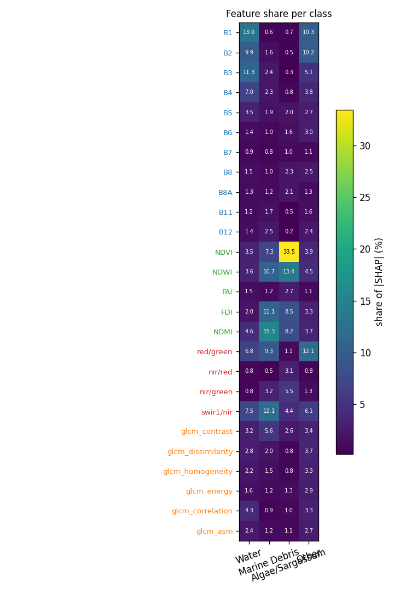

## Grouped importance (share of |SHAP|, %)

| group | Water | Marine Debris | Algae/Sargassum | Other |
|---|---|---|---|---|
| bands | 29.2 | 12.4 | 6.4 | 43.9 |
| indices | 26.1 | 50.0 | 74.6 | 17.7 |
| ratios | 21.0 | 27.4 | 13.4 | 20.0 |
| GLCM | 23.6 | 10.2 | 5.6 | 18.4 |

## Feature importance (share of |SHAP|, %; direction = Spearman of value vs SHAP)

| feature | group | Water | Marine Debris | Algae/Sargassum | Other |
|---|---|---|---|---|---|
| B1 | bands | 13.0 (-0.92) | 0.6 (-0.21) | 0.7 (+0.79) | 10.3 (+0.60) |
| B2 | bands | 9.9 (-0.87) | 1.6 (-0.67) | 0.5 (-0.63) | 10.2 (+0.70) |
| B3 | bands | 11.3 (+0.88) | 2.4 (-0.78) | 0.3 (-0.12) | 5.1 (-0.46) |
| B4 | bands | 7.0 (+0.88) | 2.3 (-0.14) | 0.8 (-0.79) | 3.8 (+0.31) |
| B5 | bands | 3.5 (+0.80) | 1.9 (-0.10) | 2.0 (+0.81) | 2.7 (+0.36) |
| B6 | bands | 1.4 (-0.75) | 1.0 (+0.15) | 1.6 (-0.74) | 3.0 (+0.84) |
| B7 | bands | 0.9 (+0.02) | 0.8 (+0.60) | 1.0 (-0.48) | 1.1 (+0.30) |
| B8 | bands | 1.5 (-0.73) | 1.0 (+0.18) | 2.3 (-0.86) | 2.5 (+0.86) |
| B8A | bands | 1.3 (-0.68) | 1.2 (+0.75) | 2.1 (-0.86) | 1.3 (+0.54) |
| B11 | bands | 1.2 (+0.22) | 1.7 (-0.57) | 0.5 (-0.51) | 1.6 (+0.17) |
| B12 | bands | 1.4 (+0.52) | 2.5 (-0.60) | 0.2 (-0.07) | 2.4 (+0.40) |
| NDVI | indices | 3.5 (-0.24) | 7.3 (+0.73) | 33.5 (+0.75) | 3.9 (-0.64) |
| NDWI | indices | 3.6 (+0.64) | 10.7 (-0.69) | 13.4 (-0.72) | 4.5 (-0.32) |
| FAI | indices | 1.5 (-0.76) | 1.2 (+0.76) | 2.7 (+0.67) | 1.1 (+0.60) |
| FDI | indices | 2.0 (-0.07) | 11.1 (+0.79) | 8.5 (+0.76) | 3.3 (+0.49) |
| NDMI | indices | 4.6 (-0.73) | 15.3 (+0.56) | 8.2 (+0.51) | 3.7 (+0.28) |
| red/green | ratios | 6.8 (-0.88) | 9.3 (+0.72) | 1.1 (-0.60) | 12.1 (+0.62) |
| nir/red | ratios | 0.8 (+0.74) | 0.5 (+0.62) | 3.1 (+0.57) | 0.8 (-0.86) |
| nir/green | ratios | 0.8 (+0.15) | 3.2 (+0.71) | 5.5 (+0.74) | 1.3 (-0.63) |
| swir1/nir | ratios | 7.5 (+0.84) | 12.1 (-0.45) | 4.4 (-0.28) | 6.1 (-0.60) |
| glcm_contrast | GLCM | 3.2 (-0.58) | 5.6 (-0.85) | 2.6 (-0.89) | 3.4 (+0.46) |
| glcm_dissimilarity | GLCM | 2.8 (-0.42) | 2.0 (-0.47) | 0.8 (-0.74) | 3.7 (+0.64) |
| glcm_homogeneity | GLCM | 2.2 (-0.30) | 1.5 (+0.26) | 0.8 (-0.43) | 3.3 (-0.25) |
| glcm_energy | GLCM | 1.6 (+0.01) | 1.2 (+0.35) | 1.3 (+0.57) | 2.9 (-0.58) |
| glcm_correlation | GLCM | 4.3 (-0.80) | 0.9 (-0.62) | 1.0 (-0.52) | 3.3 (+0.63) |
| glcm_asm | GLCM | 2.4 (-0.51) | 1.2 (-0.13) | 1.1 (+0.11) | 2.7 (+0.14) |

## Completeness check (GradientSHAP)

Sum of attributions vs S_c(x) − mean S_c(baseline) over 535 patch × class cases: correlation 0.981, median relative error 13.2 % (32 samples, 20 baselines). `completeness.csv` has every case.

## Context share

Median share of |attribution| that lies on pixels that are not the explained class (the model using the surroundings):

| class | context share (%) |
|---|---|
| Water | 78.6 |
| Marine Debris | 91.8 |
| Algae/Sargassum | 56.1 |
| Other | 62.7 |

## Water

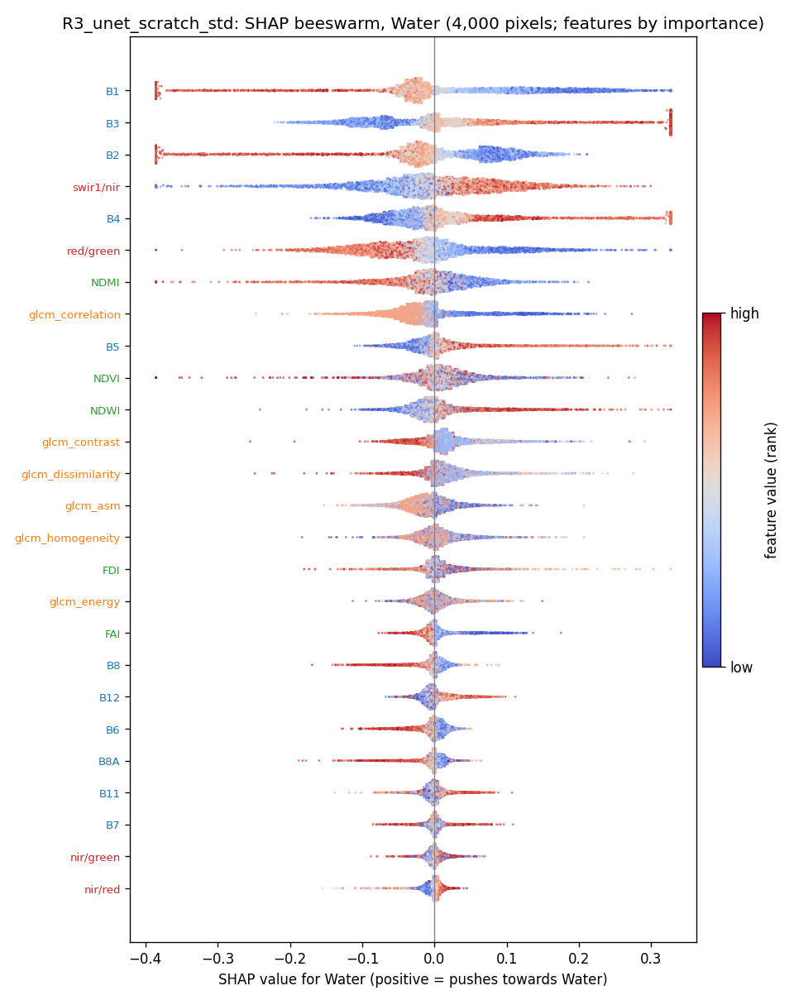

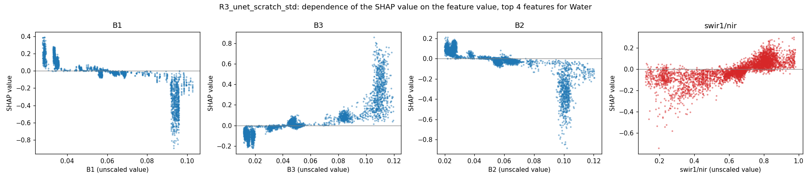

## Marine Debris

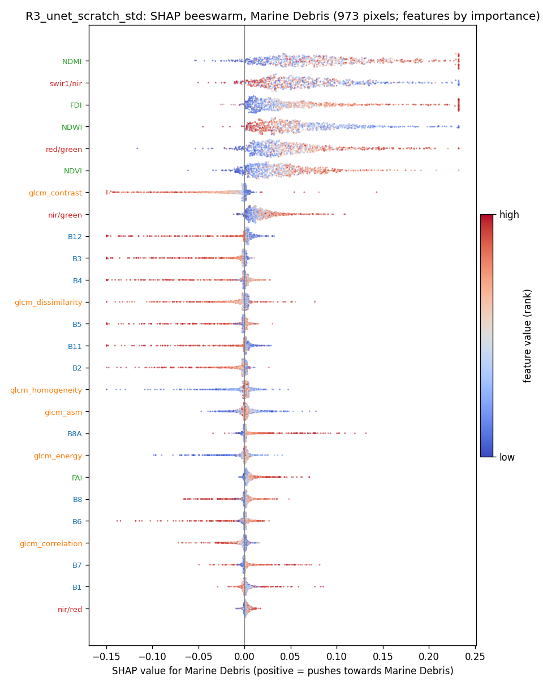

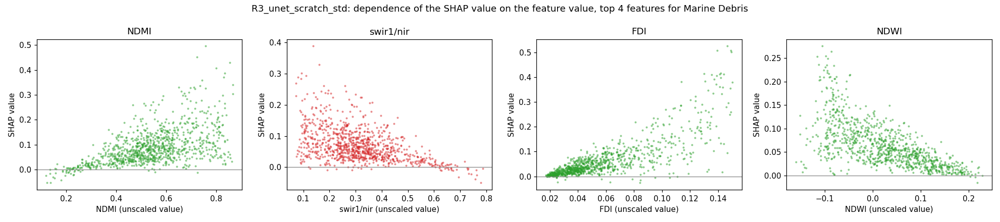

## Algae/Sargassum

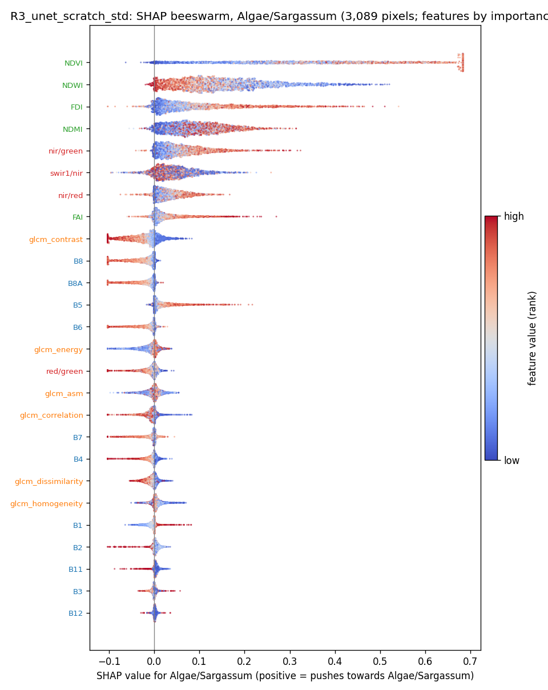

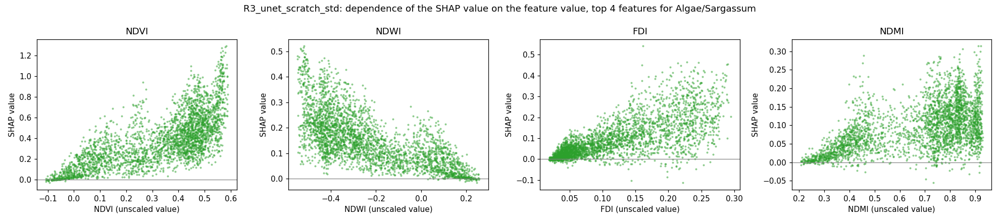

## Other

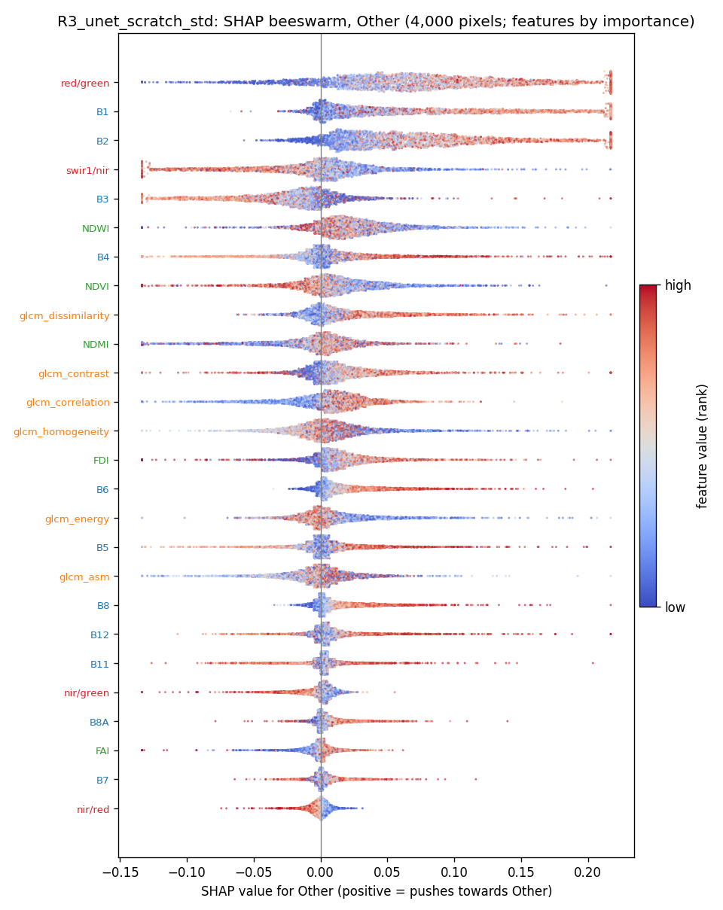

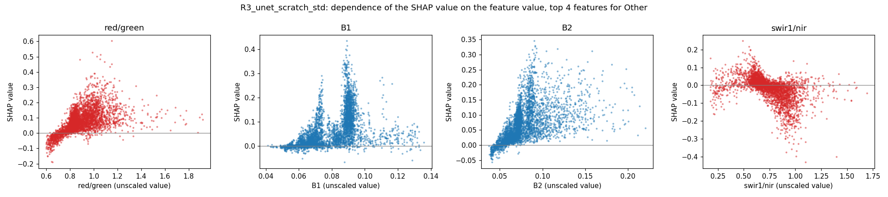

## SHAP maps and Seg-Grad-CAM on example test patches

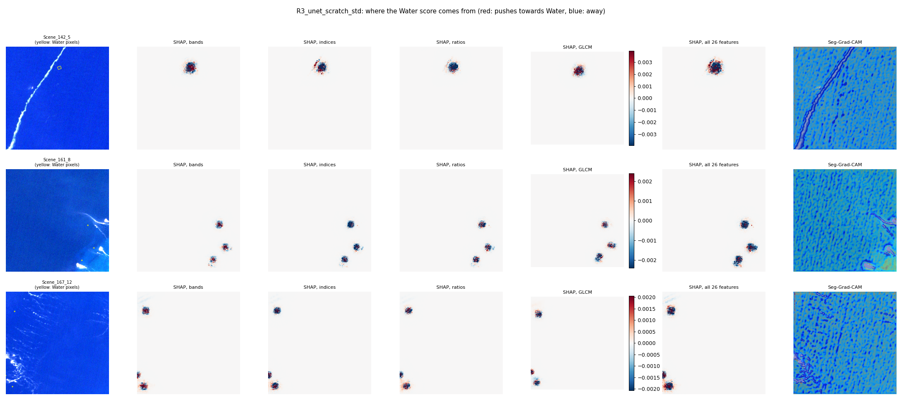
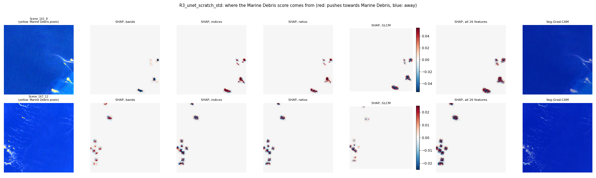
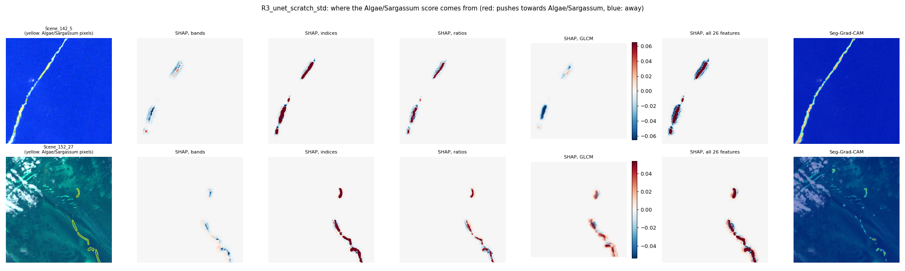
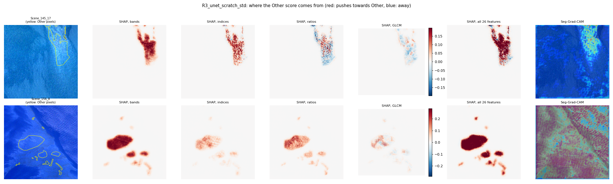
