# XAI, run R4_segnext_scratch_std

Explained output: for class c, the sum of P(c) over the pixels labelled c in a test patch. Importance = mean |SHAP| at the class-c pixels; share = importance / sum over features. Direction (in brackets) = Spearman correlation between the feature value and its SHAP value at the class-c pixels: + means high values push towards the class. Group values add the SHAP values of a group's features at each pixel first. Correlated features share credit (see `features/correlation/`), so read single features together with the grouped results.

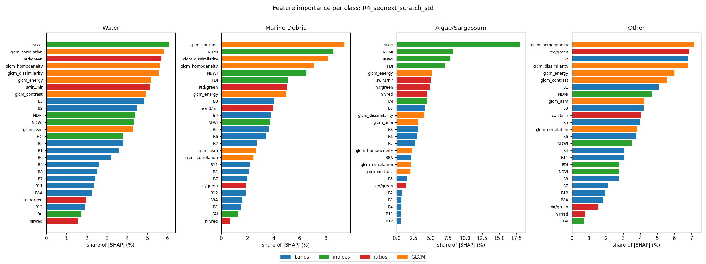

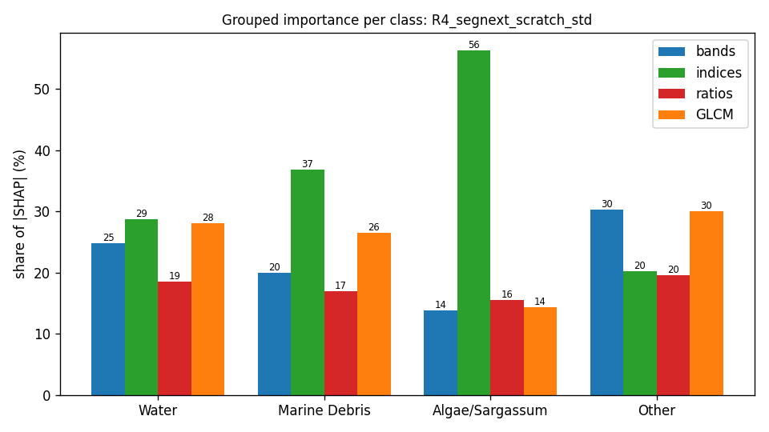

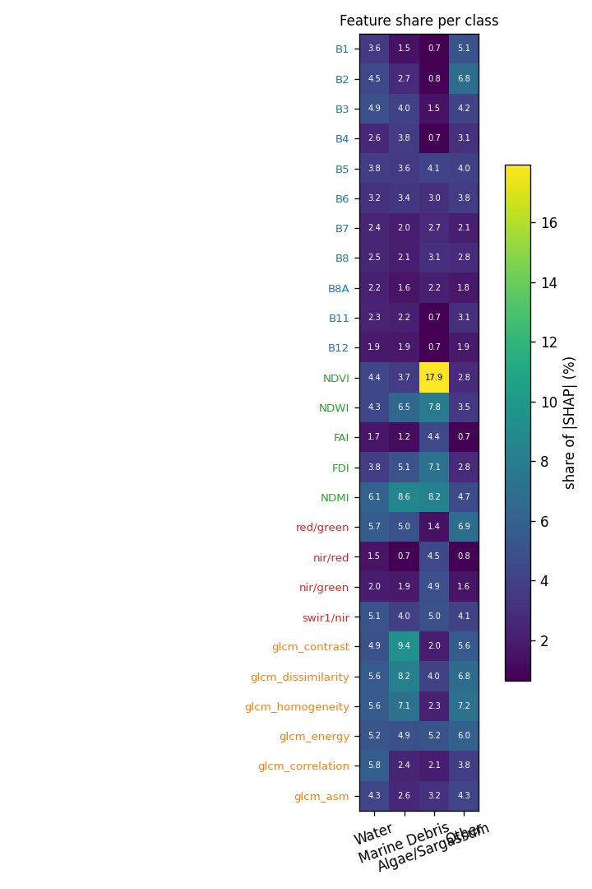

## Grouped importance (share of |SHAP|, %)

| group | Water | Marine Debris | Algae/Sargassum | Other |
|---|---|---|---|---|
| bands | 24.8 | 19.9 | 13.8 | 30.2 |
| indices | 28.7 | 36.8 | 56.3 | 20.2 |
| ratios | 18.6 | 16.9 | 15.5 | 19.5 |
| GLCM | 28.0 | 26.5 | 14.3 | 30.0 |

## Feature importance (share of |SHAP|, %; direction = Spearman of value vs SHAP)

| feature | group | Water | Marine Debris | Algae/Sargassum | Other |
|---|---|---|---|---|---|
| B1 | bands | 3.6 (-0.21) | 1.5 (-0.20) | 0.7 (-0.12) | 5.1 (+0.02) |
| B2 | bands | 4.5 (-0.45) | 2.7 (-0.03) | 0.8 (-0.14) | 6.8 (+0.37) |
| B3 | bands | 4.9 (+0.42) | 4.0 (+0.23) | 1.5 (+0.29) | 4.2 (-0.26) |
| B4 | bands | 2.6 (-0.04) | 3.8 (-0.31) | 0.7 (-0.34) | 3.1 (+0.00) |
| B5 | bands | 3.8 (+0.11) | 3.6 (+0.14) | 4.1 (+0.54) | 4.0 (+0.07) |
| B6 | bands | 3.2 (-0.27) | 3.4 (-0.36) | 3.0 (-0.33) | 3.8 (+0.51) |
| B7 | bands | 2.4 (+0.05) | 2.0 (-0.36) | 2.7 (-0.05) | 2.1 (-0.12) |
| B8 | bands | 2.5 (+0.18) | 2.1 (+0.10) | 3.1 (+0.02) | 2.8 (-0.27) |
| B8A | bands | 2.2 (+0.06) | 1.6 (-0.01) | 2.2 (-0.16) | 1.8 (-0.23) |
| B11 | bands | 2.3 (-0.08) | 2.2 (-0.05) | 0.7 (-0.09) | 3.1 (+0.21) |
| B12 | bands | 1.9 (+0.05) | 1.9 (-0.45) | 0.7 (-0.36) | 1.9 (+0.05) |
| NDVI | indices | 4.4 (+0.07) | 3.7 (+0.39) | 17.9 (+0.60) | 2.8 (-0.22) |
| NDWI | indices | 4.3 (+0.01) | 6.5 (-0.38) | 7.8 (+0.02) | 3.5 (+0.21) |
| FAI | indices | 1.7 (-0.14) | 1.2 (-0.27) | 4.4 (-0.16) | 0.7 (+0.31) |
| FDI | indices | 3.8 (-0.24) | 5.1 (+0.25) | 7.1 (-0.05) | 2.8 (+0.55) |
| NDMI | indices | 6.1 (-0.10) | 8.6 (+0.38) | 8.2 (+0.27) | 4.7 (-0.03) |
| red/green | ratios | 5.7 (-0.33) | 5.0 (+0.37) | 1.4 (-0.20) | 6.9 (+0.25) |
| nir/red | ratios | 1.5 (+0.31) | 0.7 (-0.17) | 4.5 (+0.19) | 0.8 (-0.44) |
| nir/green | ratios | 2.0 (+0.15) | 1.9 (+0.21) | 4.9 (+0.21) | 1.6 (-0.29) |
| swir1/nir | ratios | 5.1 (+0.24) | 4.0 (-0.29) | 5.0 (+0.10) | 4.1 (-0.31) |
| glcm_contrast | GLCM | 4.9 (-0.15) | 9.4 (-0.27) | 2.0 (-0.50) | 5.6 (+0.26) |
| glcm_dissimilarity | GLCM | 5.6 (+0.15) | 8.2 (-0.11) | 4.0 (-0.27) | 6.8 (-0.17) |
| glcm_homogeneity | GLCM | 5.6 (+0.05) | 7.1 (-0.16) | 2.3 (-0.14) | 7.2 (-0.05) |
| glcm_energy | GLCM | 5.2 (+0.08) | 4.9 (+0.07) | 5.2 (-0.03) | 6.0 (-0.09) |
| glcm_correlation | GLCM | 5.8 (-0.08) | 2.4 (-0.07) | 2.1 (-0.18) | 3.8 (-0.03) |
| glcm_asm | GLCM | 4.3 (-0.11) | 2.6 (-0.15) | 3.2 (-0.16) | 4.3 (+0.22) |

## Completeness check (GradientSHAP)

Sum of attributions vs S_c(x) − mean S_c(baseline) over 535 patch × class cases: correlation 0.957, median relative error 19.8 % (32 samples, 20 baselines). `completeness.csv` has every case.

## Context share

Median share of |attribution| that lies on pixels that are not the explained class (the model using the surroundings):

| class | context share (%) |
|---|---|
| Water | 96.5 |
| Marine Debris | 98.6 |
| Algae/Sargassum | 92.2 |
| Other | 86.0 |

## Water

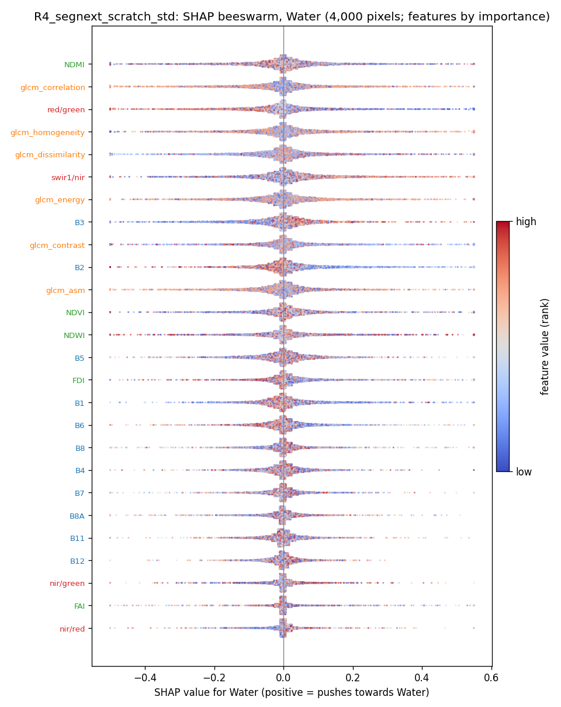

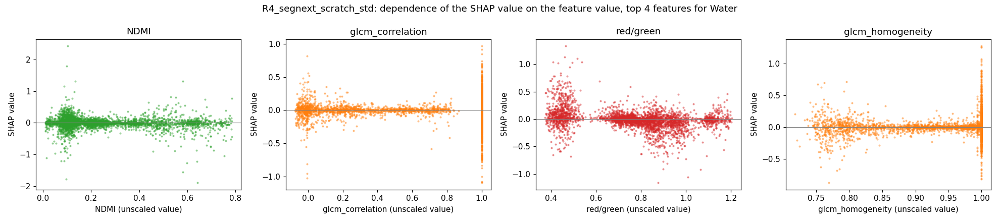

## Marine Debris

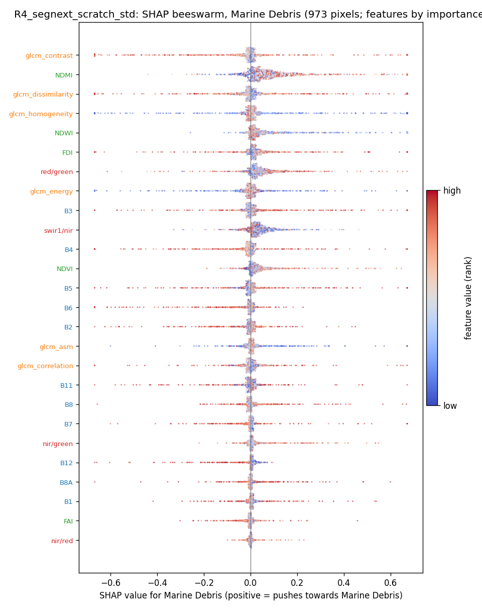

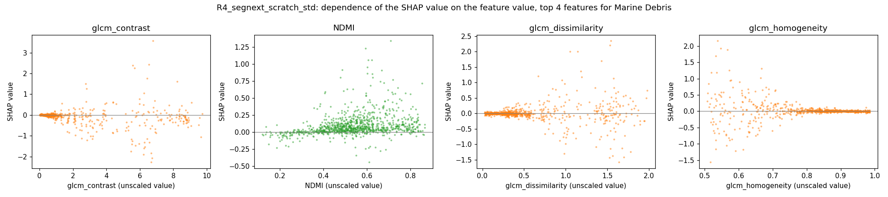

## Algae/Sargassum

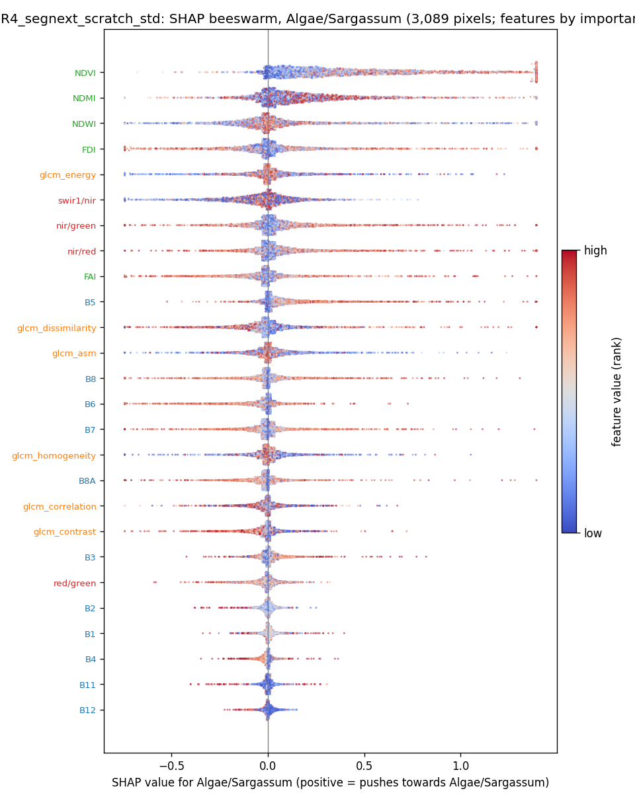

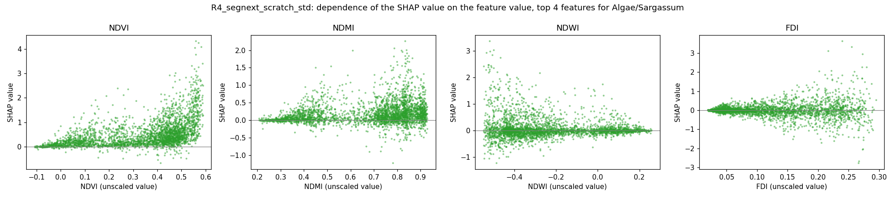

## Other

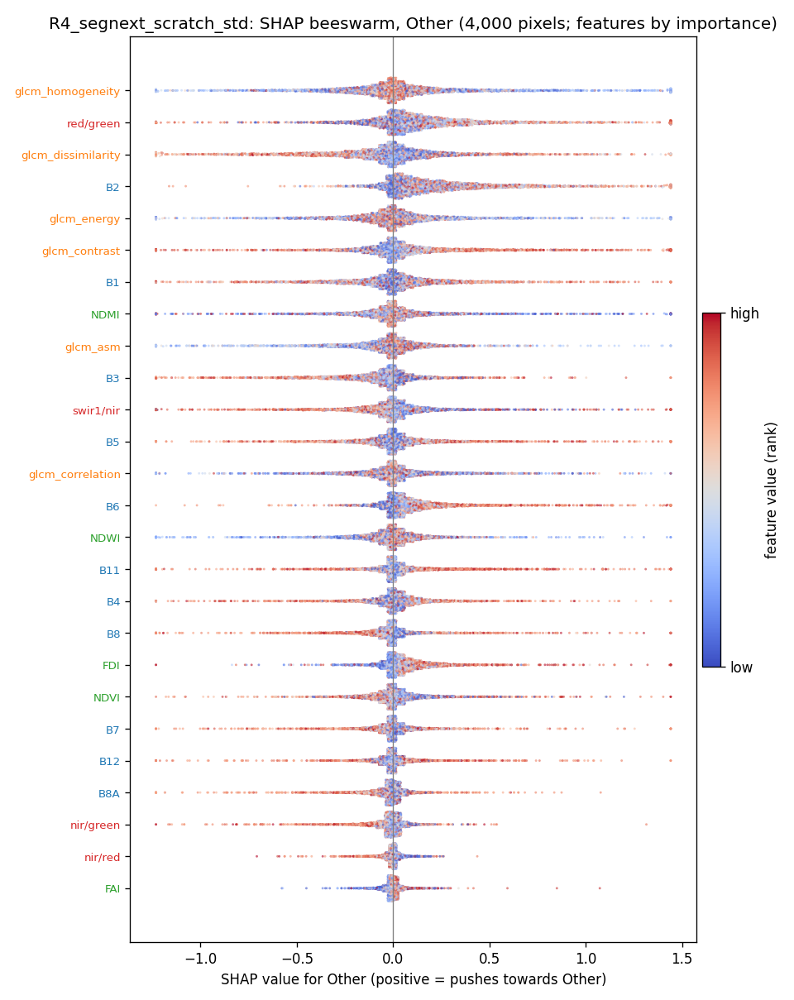

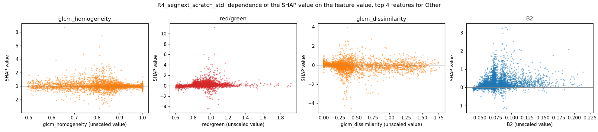

## SHAP maps and Seg-Grad-CAM on example test patches

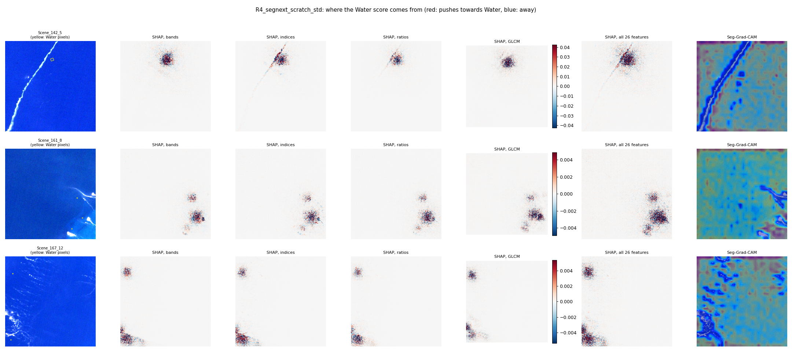
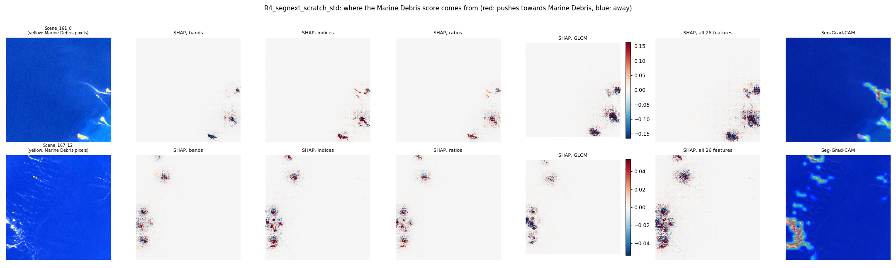
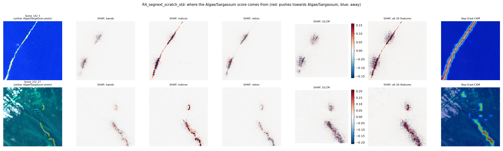
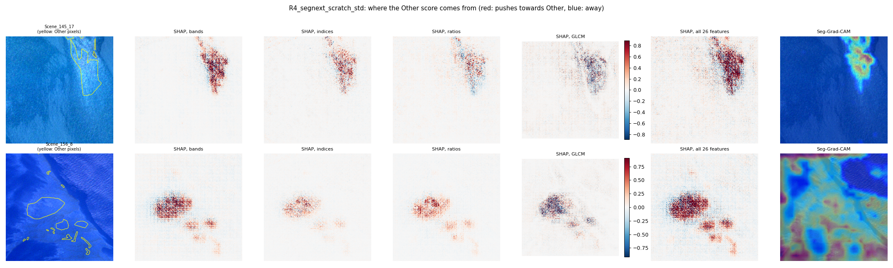
