# XAI, run R5_marinext_scratch_std

Explained output: for class c, the sum of P(c) over the pixels labelled c in a test patch. Importance = mean |SHAP| at the class-c pixels; share = importance / sum over features. Direction (in brackets) = Spearman correlation between the feature value and its SHAP value at the class-c pixels: + means high values push towards the class. Group values add the SHAP values of a group's features at each pixel first. Correlated features share credit (see `features/correlation/`), so read single features together with the grouped results.

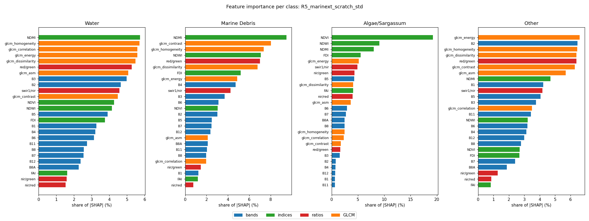

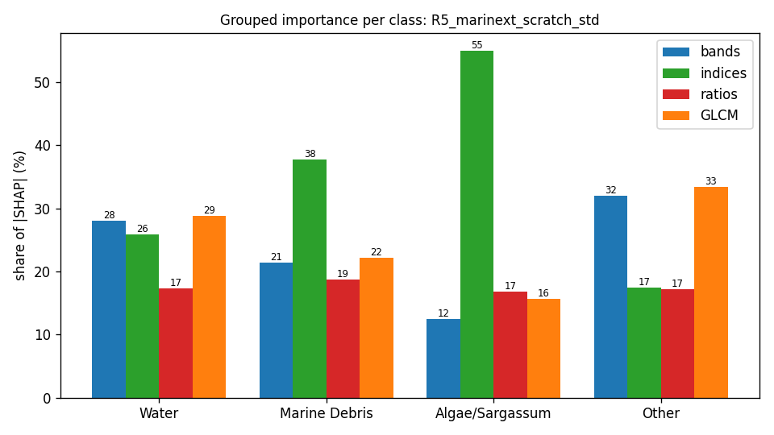

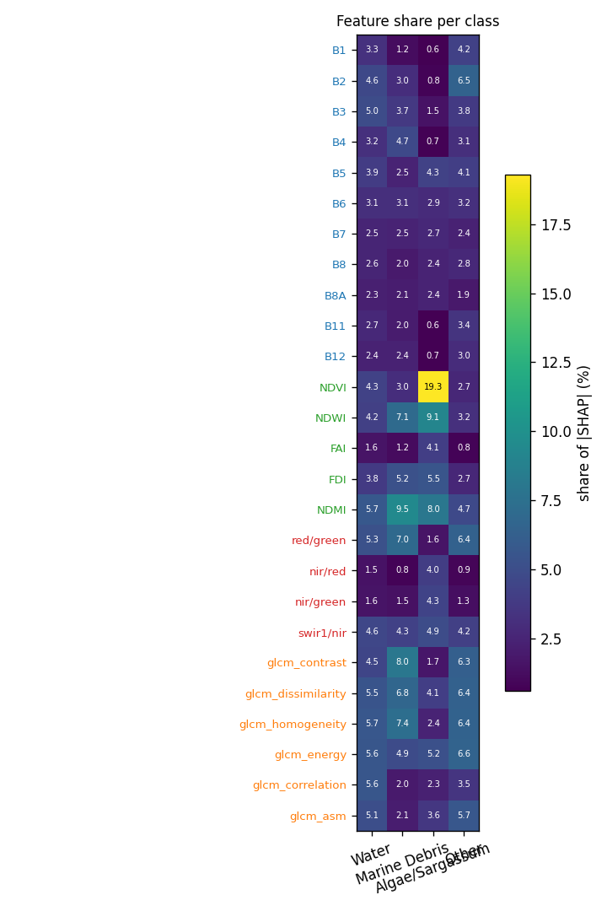

## Grouped importance (share of |SHAP|, %)

| group | Water | Marine Debris | Algae/Sargassum | Other |
|---|---|---|---|---|
| bands | 28.0 | 21.4 | 12.5 | 32.0 |
| indices | 25.8 | 37.7 | 55.0 | 17.4 |
| ratios | 17.4 | 18.8 | 16.8 | 17.2 |
| GLCM | 28.8 | 22.2 | 15.7 | 33.4 |

## Feature importance (share of |SHAP|, %; direction = Spearman of value vs SHAP)

| feature | group | Water | Marine Debris | Algae/Sargassum | Other |
|---|---|---|---|---|---|
| B1 | bands | 3.3 (-0.30) | 1.2 (-0.22) | 0.6 (-0.25) | 4.2 (+0.06) |
| B2 | bands | 4.6 (-0.54) | 3.0 (+0.34) | 0.8 (-0.18) | 6.5 (+0.36) |
| B3 | bands | 5.0 (+0.44) | 3.7 (-0.01) | 1.5 (+0.31) | 3.8 (-0.22) |
| B4 | bands | 3.2 (+0.02) | 4.7 (-0.29) | 0.7 (-0.34) | 3.1 (+0.06) |
| B5 | bands | 3.9 (+0.28) | 2.5 (-0.03) | 4.3 (+0.63) | 4.1 (-0.17) |
| B6 | bands | 3.1 (-0.17) | 3.1 (-0.36) | 2.9 (-0.22) | 3.2 (+0.47) |
| B7 | bands | 2.5 (+0.15) | 2.5 (-0.37) | 2.7 (-0.08) | 2.4 (-0.14) |
| B8 | bands | 2.6 (+0.09) | 2.0 (-0.16) | 2.4 (+0.04) | 2.8 (-0.04) |
| B8A | bands | 2.3 (-0.03) | 2.1 (+0.27) | 2.4 (-0.28) | 1.9 (-0.11) |
| B11 | bands | 2.7 (-0.14) | 2.0 (+0.15) | 0.6 (-0.12) | 3.4 (+0.32) |
| B12 | bands | 2.4 (+0.04) | 2.4 (-0.53) | 0.7 (-0.43) | 3.0 (+0.05) |
| NDVI | indices | 4.3 (+0.11) | 3.0 (+0.28) | 19.3 (+0.61) | 2.7 (-0.37) |
| NDWI | indices | 4.2 (+0.26) | 7.1 (-0.40) | 9.1 (+0.11) | 3.2 (+0.02) |
| FAI | indices | 1.6 (+0.01) | 1.2 (-0.35) | 4.1 (-0.13) | 0.8 (-0.06) |
| FDI | indices | 3.8 (-0.34) | 5.2 (+0.29) | 5.5 (-0.23) | 2.7 (+0.46) |
| NDMI | indices | 5.7 (-0.17) | 9.5 (+0.37) | 8.0 (+0.22) | 4.7 (-0.05) |
| red/green | ratios | 5.3 (-0.34) | 7.0 (+0.52) | 1.6 (-0.00) | 6.4 (+0.28) |
| nir/red | ratios | 1.5 (+0.36) | 0.8 (-0.43) | 4.0 (+0.12) | 0.9 (-0.36) |
| nir/green | ratios | 1.6 (+0.03) | 1.5 (+0.06) | 4.3 (+0.12) | 1.3 (-0.28) |
| swir1/nir | ratios | 4.6 (+0.33) | 4.3 (-0.29) | 4.9 (+0.06) | 4.2 (-0.39) |
| glcm_contrast | GLCM | 4.5 (-0.09) | 8.0 (-0.44) | 1.7 (-0.55) | 6.3 (+0.11) |
| glcm_dissimilarity | GLCM | 5.5 (+0.06) | 6.8 (-0.16) | 4.1 (-0.28) | 6.4 (-0.04) |
| glcm_homogeneity | GLCM | 5.7 (+0.15) | 7.4 (-0.31) | 2.4 (-0.05) | 6.4 (-0.09) |
| glcm_energy | GLCM | 5.6 (+0.00) | 4.9 (-0.08) | 5.2 (-0.12) | 6.6 (-0.05) |
| glcm_correlation | GLCM | 5.6 (-0.13) | 2.0 (+0.03) | 2.3 (-0.20) | 3.5 (-0.03) |
| glcm_asm | GLCM | 5.1 (-0.07) | 2.1 (-0.02) | 3.6 (-0.06) | 5.7 (+0.07) |

## Completeness check (GradientSHAP)

Sum of attributions vs S_c(x) − mean S_c(baseline) over 535 patch × class cases: correlation 0.972, median relative error 17.6 % (32 samples, 20 baselines). `completeness.csv` has every case.

## Context share

Median share of |attribution| that lies on pixels that are not the explained class (the model using the surroundings):

| class | context share (%) |
|---|---|
| Water | 93.7 |
| Marine Debris | 97.7 |
| Algae/Sargassum | 87.7 |
| Other | 83.1 |

## Water

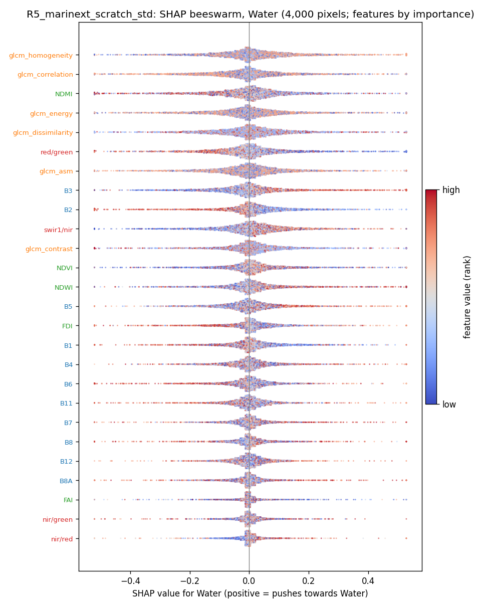

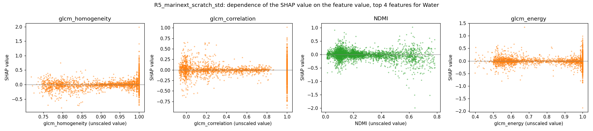

## Marine Debris

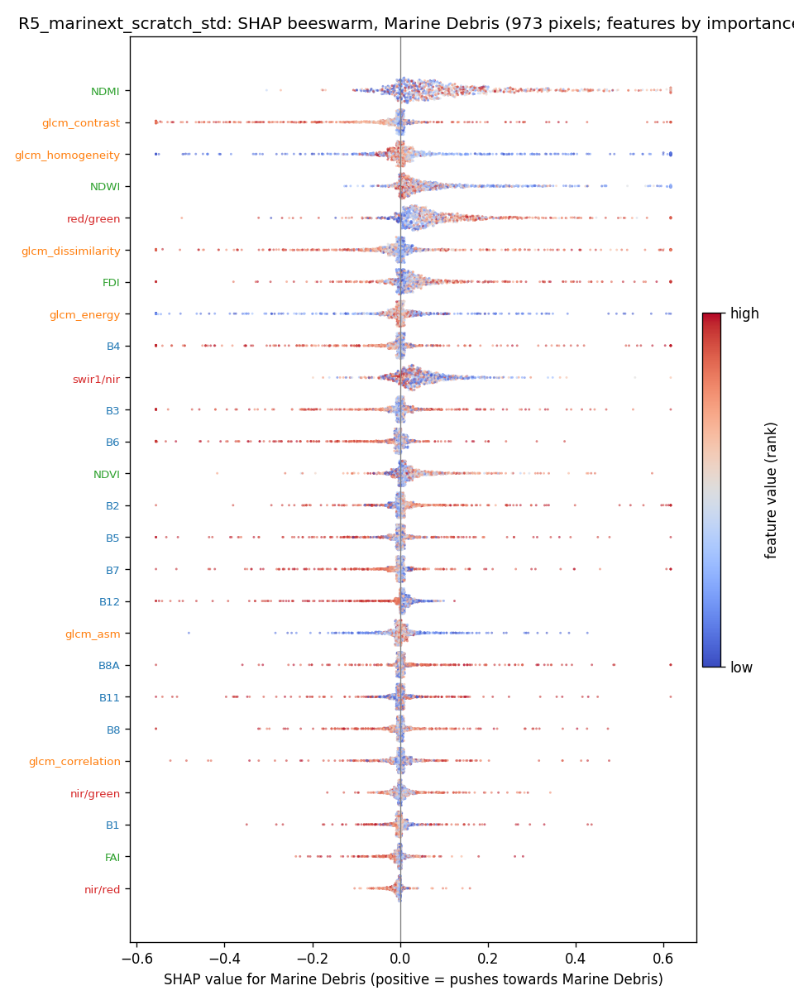

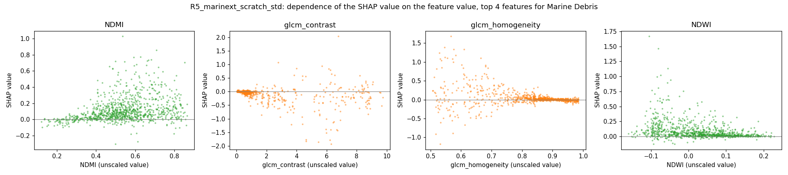

## Algae/Sargassum

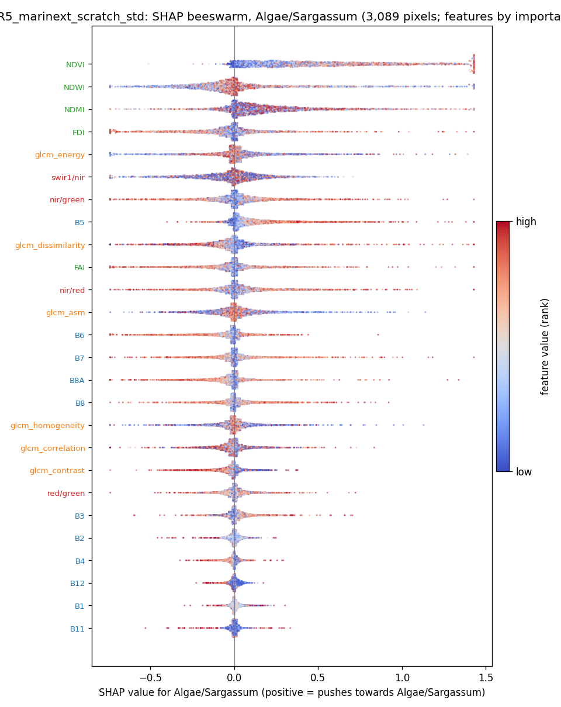

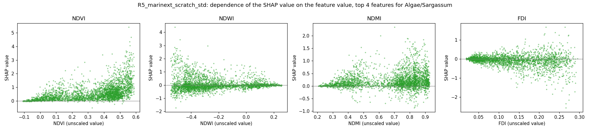

## Other

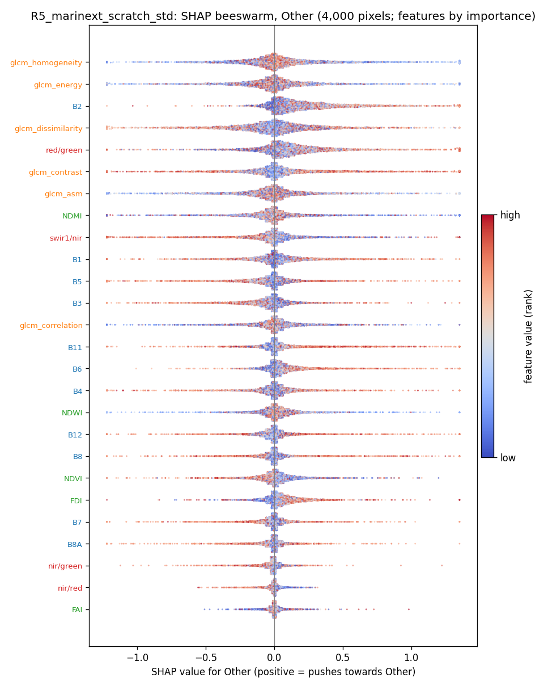

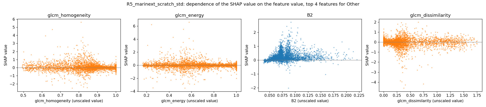

## SHAP maps and Seg-Grad-CAM on example test patches

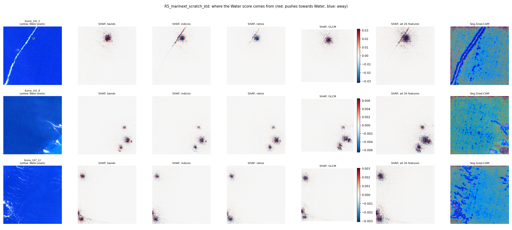
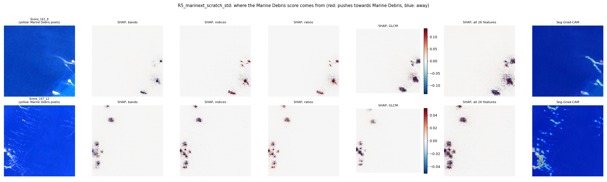
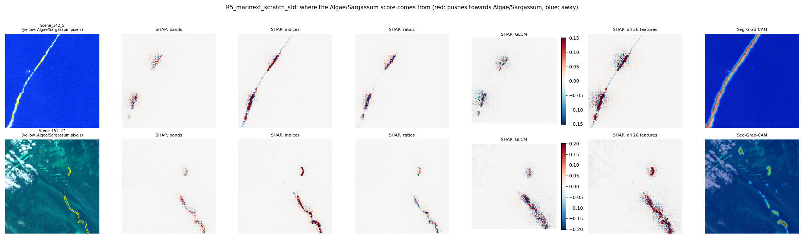
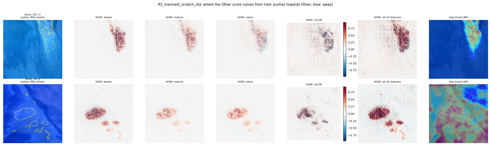
