# XAI, run R6_rf

Explained output: for class c, the sum of P(c) over the pixels labelled c in a test patch. Importance = mean |SHAP| at the class-c pixels; share = importance / sum over features. Direction (in brackets) = Spearman correlation between the feature value and its SHAP value at the class-c pixels: + means high values push towards the class. Group values add the SHAP values of a group's features at each pixel first. Correlated features share credit (see `features/correlation/`), so read single features together with the grouped results.

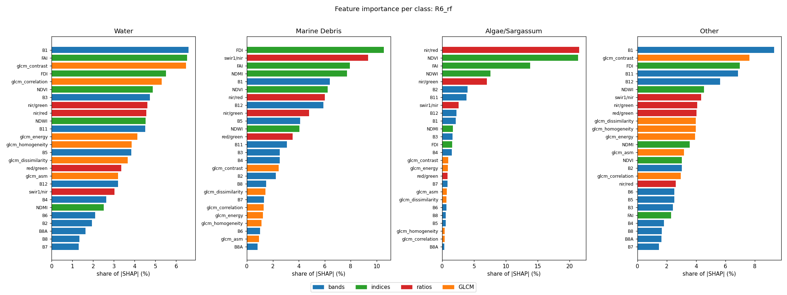

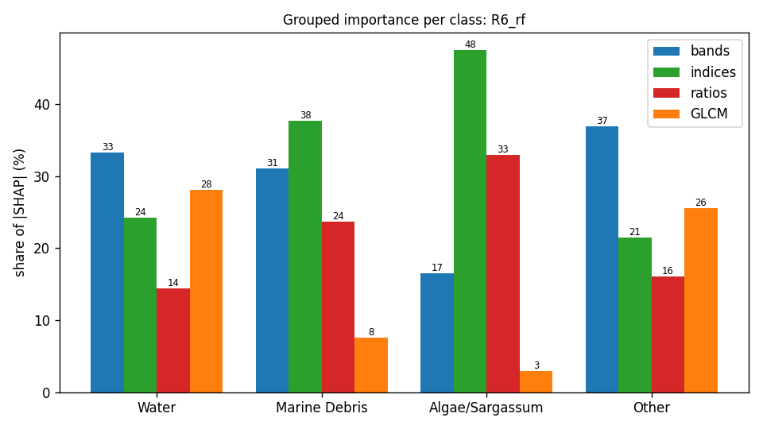

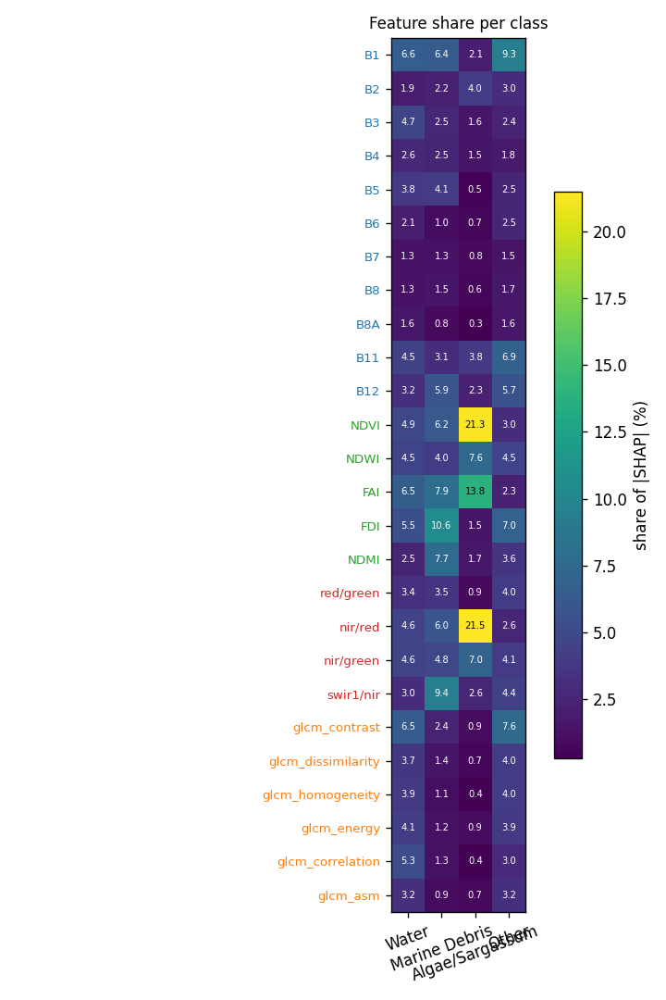

## Grouped importance (share of |SHAP|, %)

| group | Water | Marine Debris | Algae/Sargassum | Other |
|---|---|---|---|---|
| bands | 33.3 | 31.1 | 16.5 | 36.9 |
| indices | 24.2 | 37.7 | 47.5 | 21.5 |
| ratios | 14.4 | 23.7 | 33.0 | 16.1 |
| GLCM | 28.1 | 7.6 | 3.0 | 25.5 |

## Feature importance (share of |SHAP|, %; direction = Spearman of value vs SHAP)

| feature | group | Water | Marine Debris | Algae/Sargassum | Other |
|---|---|---|---|---|---|
| B1 | bands | 6.6 (-0.59) | 6.4 (-0.62) | 2.1 (-0.60) | 9.3 (+0.21) |
| B2 | bands | 1.9 (-0.27) | 2.2 (-0.26) | 4.0 (-0.92) | 3.0 (+0.19) |
| B3 | bands | 4.7 (+0.73) | 2.5 (-0.66) | 1.6 (-0.82) | 2.4 (-0.49) |
| B4 | bands | 2.6 (+0.67) | 2.5 (-0.10) | 1.5 (-0.71) | 1.8 (-0.18) |
| B5 | bands | 3.8 (+0.34) | 4.1 (-0.71) | 0.5 (+0.23) | 2.5 (+0.30) |
| B6 | bands | 2.1 (-0.49) | 1.0 (-0.59) | 0.7 (+0.64) | 2.5 (+0.47) |
| B7 | bands | 1.3 (-0.26) | 1.3 (-0.41) | 0.8 (+0.65) | 1.5 (+0.34) |
| B8 | bands | 1.3 (-0.60) | 1.5 (+0.07) | 0.6 (-0.37) | 1.7 (+0.13) |
| B8A | bands | 1.6 (-0.47) | 0.8 (-0.05) | 0.3 (+0.08) | 1.6 (+0.32) |
| B11 | bands | 4.5 (-0.31) | 3.1 (-0.32) | 3.8 (-0.53) | 6.9 (+0.42) |
| B12 | bands | 3.2 (-0.27) | 5.9 (-0.21) | 2.3 (-0.65) | 5.7 (+0.73) |
| NDVI | indices | 4.9 (-0.71) | 6.2 (+0.55) | 21.3 (+0.64) | 3.0 (-0.36) |
| NDWI | indices | 4.5 (+0.69) | 4.0 (-0.15) | 7.6 (-0.91) | 4.5 (+0.33) |
| FAI | indices | 6.5 (-0.70) | 7.9 (+0.29) | 13.8 (+0.37) | 2.3 (-0.14) |
| FDI | indices | 5.5 (-0.44) | 10.6 (-0.22) | 1.5 (+0.58) | 7.0 (+0.41) |
| NDMI | indices | 2.5 (+0.27) | 7.7 (+0.35) | 1.7 (+0.77) | 3.6 (+0.27) |
| red/green | ratios | 3.4 (+0.00) | 3.5 (+0.52) | 0.9 (-0.37) | 4.0 (-0.15) |
| nir/red | ratios | 4.6 (-0.73) | 6.0 (+0.64) | 21.5 (+0.67) | 2.6 (-0.32) |
| nir/green | ratios | 4.6 (-0.72) | 4.8 (-0.05) | 7.0 (+0.88) | 4.1 (-0.24) |
| swir1/nir | ratios | 3.0 (-0.38) | 9.4 (-0.47) | 2.6 (-0.78) | 4.4 (-0.15) |
| glcm_contrast | GLCM | 6.5 (-0.29) | 2.4 (+0.03) | 0.9 (-0.73) | 7.6 (+0.64) |
| glcm_dissimilarity | GLCM | 3.7 (-0.57) | 1.4 (-0.39) | 0.7 (-0.77) | 4.0 (+0.78) |
| glcm_homogeneity | GLCM | 3.9 (+0.67) | 1.1 (+0.46) | 0.4 (+0.52) | 4.0 (-0.83) |
| glcm_energy | GLCM | 4.1 (+0.28) | 1.2 (+0.43) | 0.9 (-0.17) | 3.9 (-0.75) |
| glcm_correlation | GLCM | 5.3 (-0.31) | 1.3 (-0.26) | 0.4 (-0.46) | 3.0 (-0.10) |
| glcm_asm | GLCM | 3.2 (+0.29) | 0.9 (+0.60) | 0.7 (-0.07) | 3.2 (-0.77) |

## Water

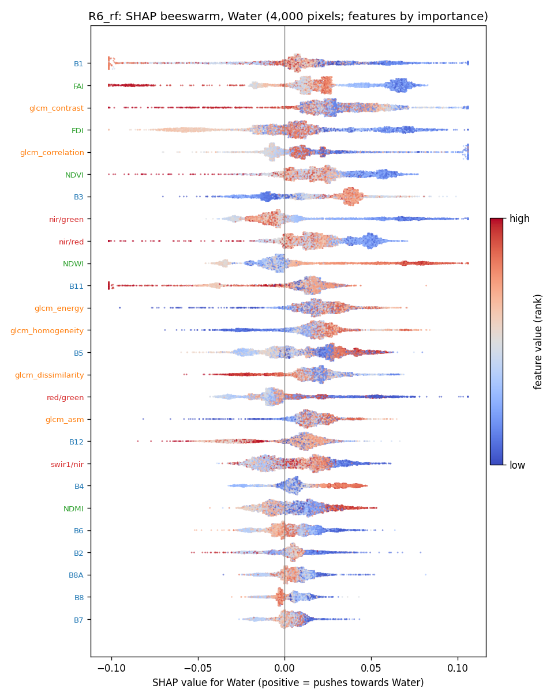

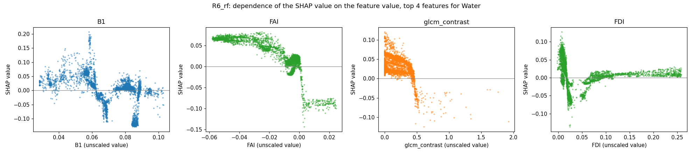

## Marine Debris

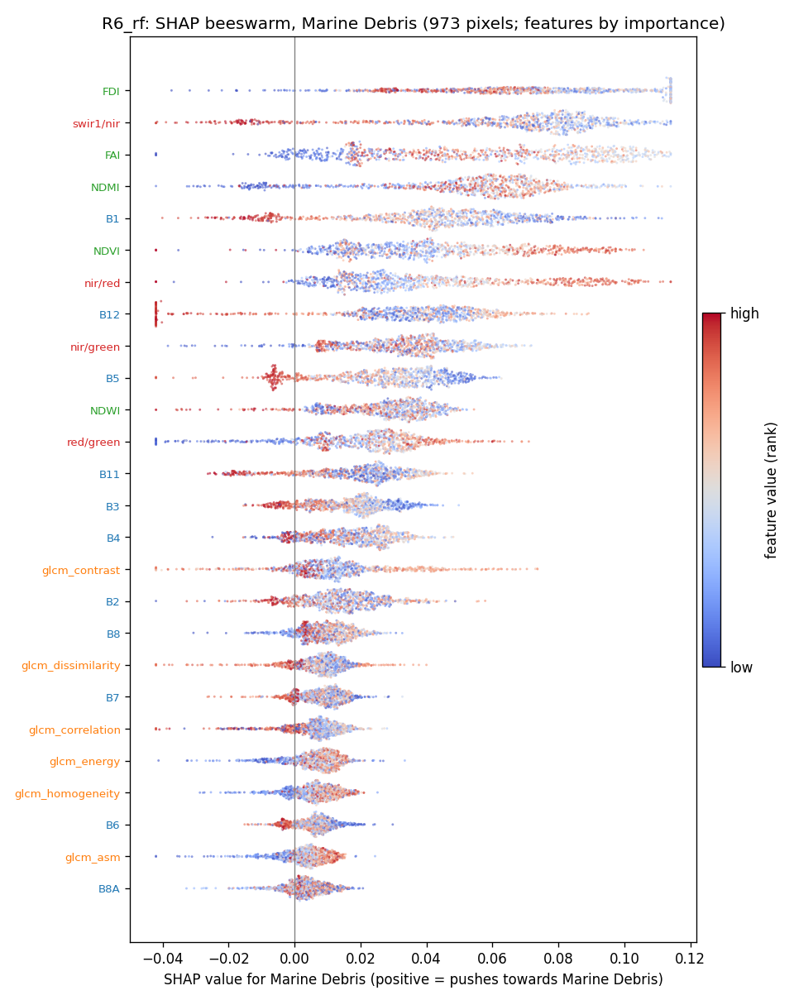

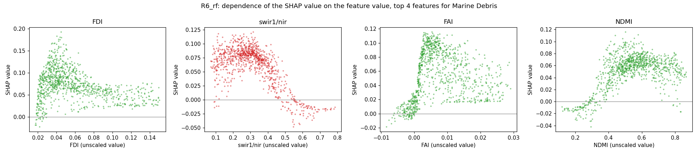

## Algae/Sargassum

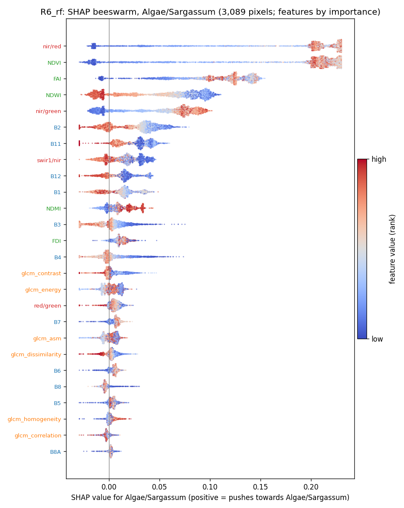

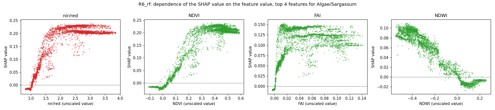

## Other

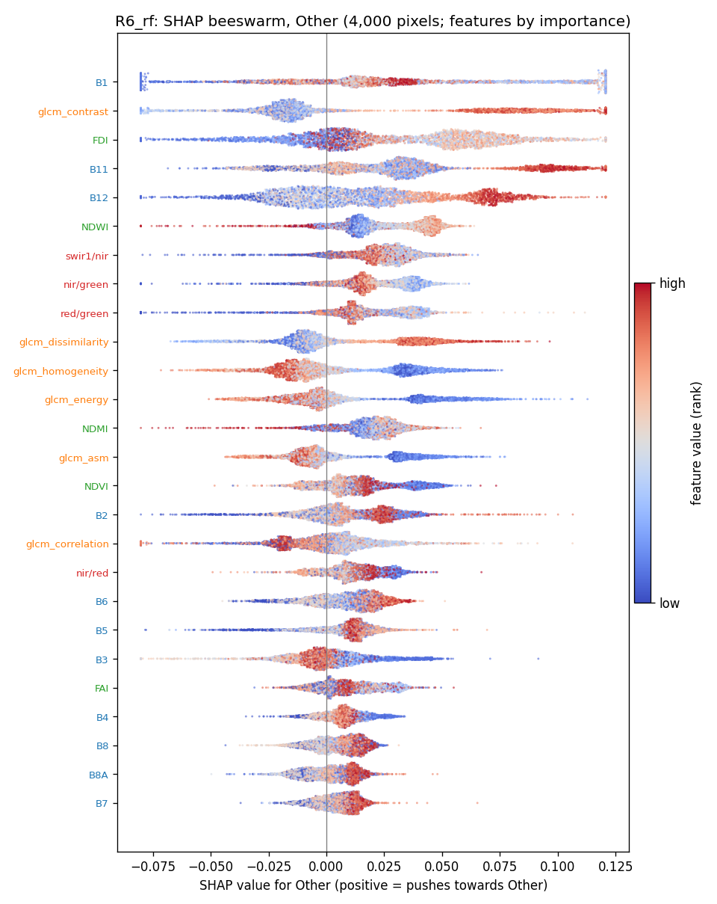

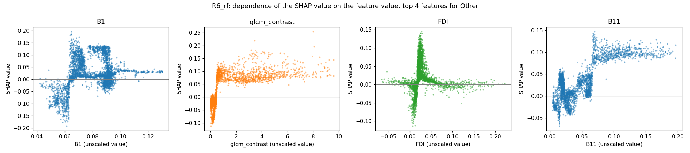

