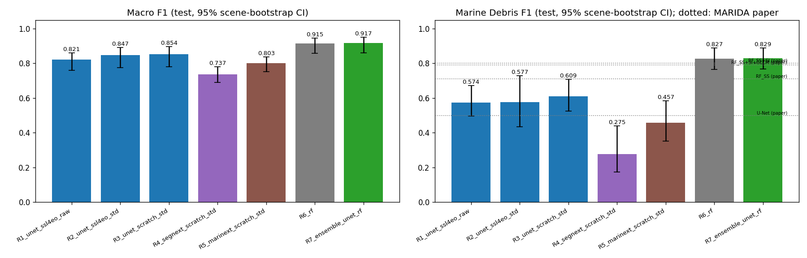
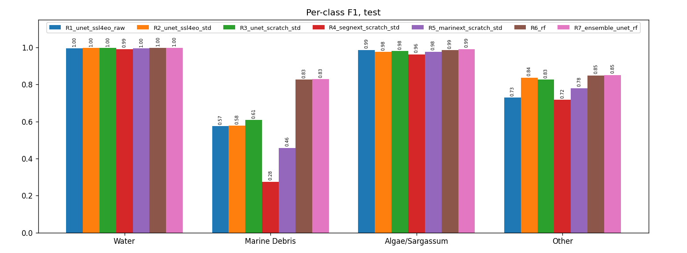
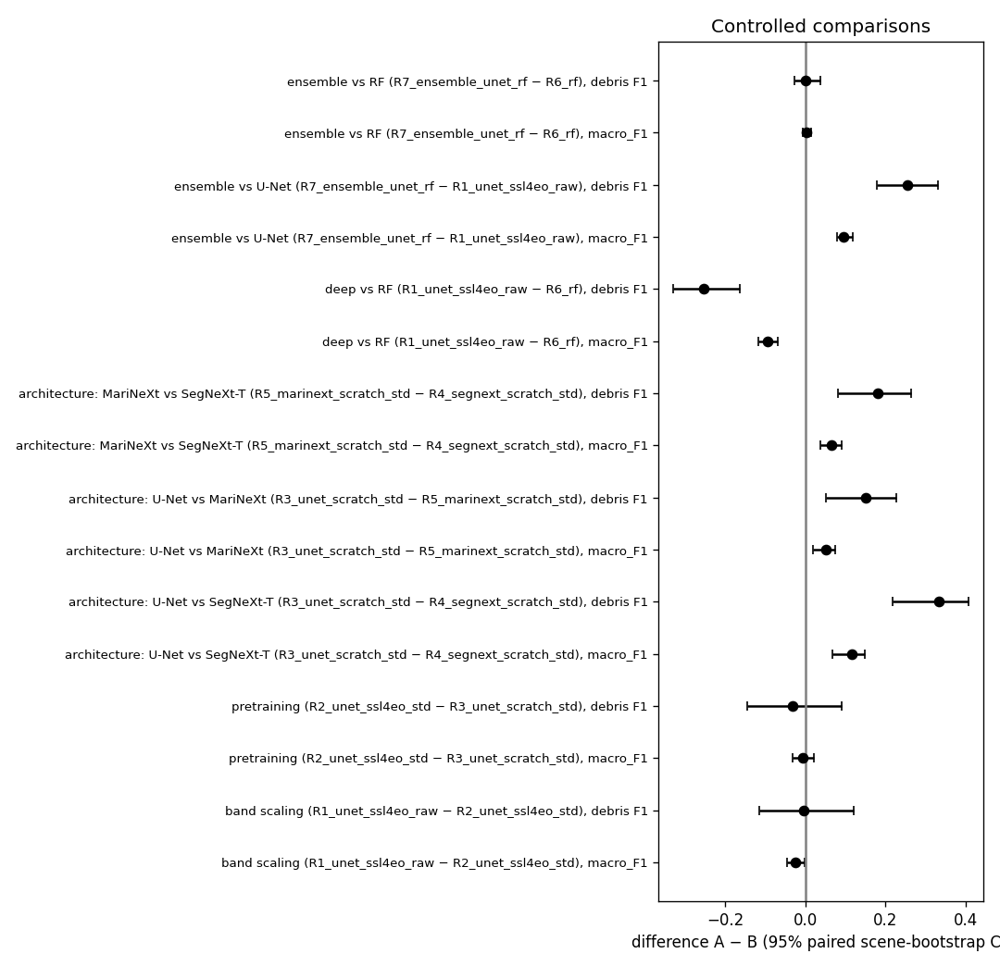
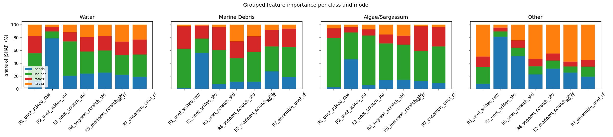
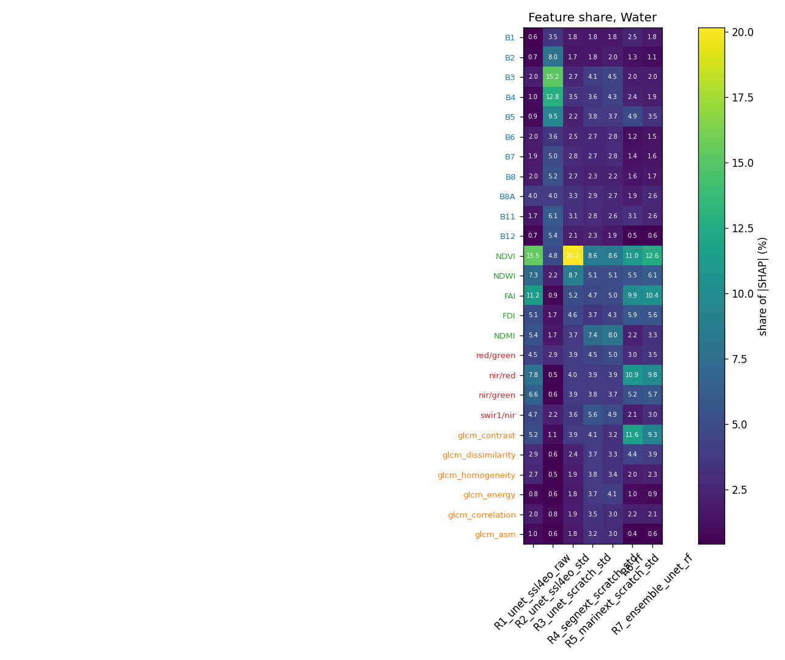
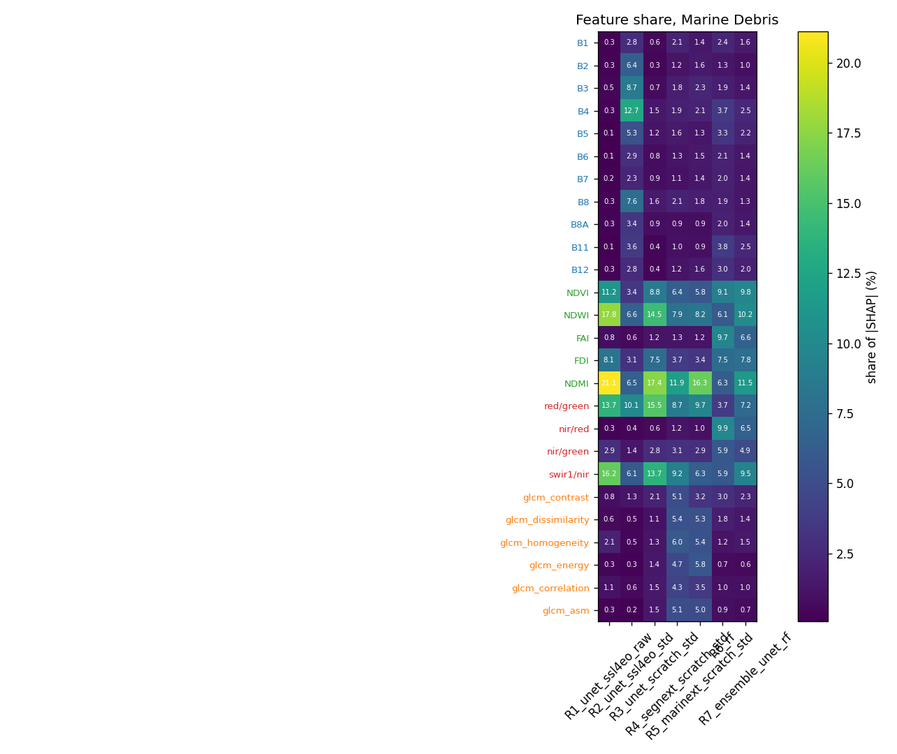
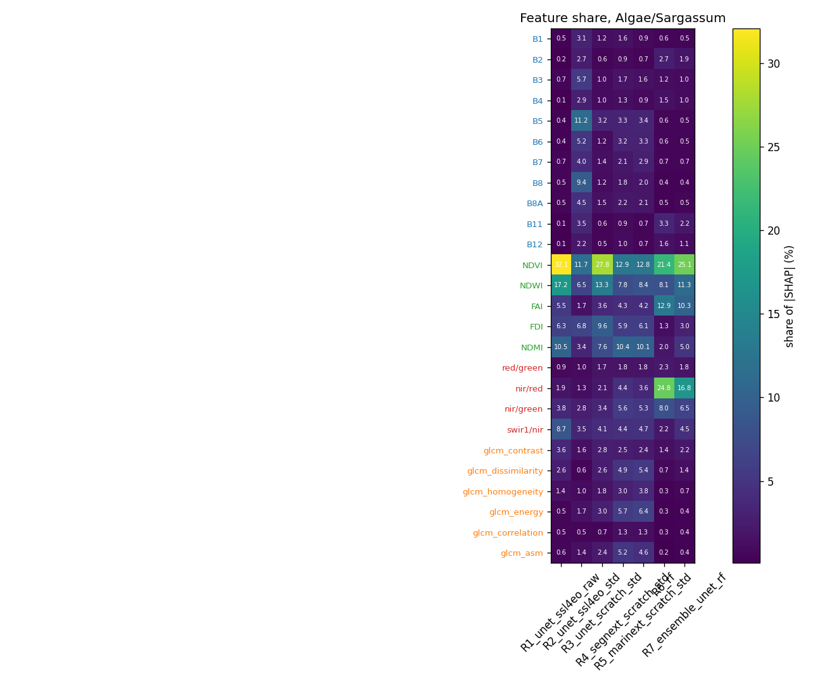
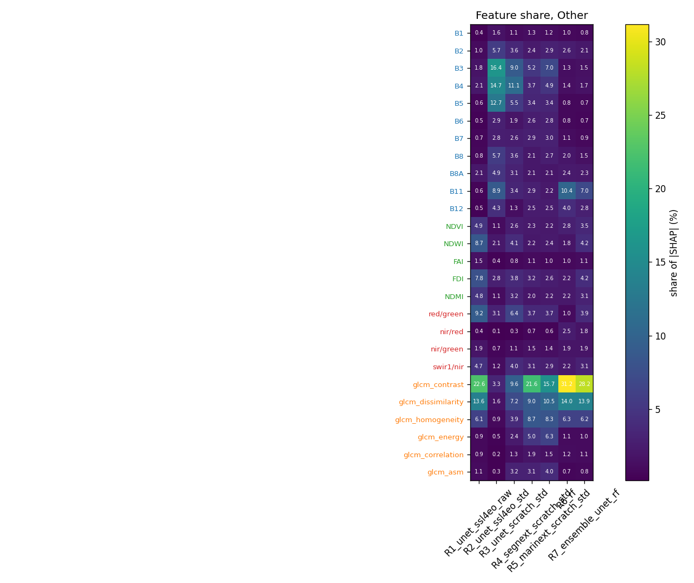

# MARIDA, 26 features: comparison of all runs

Test split, every annotated pixel, 4 classes (Water, Marine Debris, Algae/Sargassum, Other). 95% confidence intervals from a scene bootstrap (15 test scenes, 2000 resamples). 📄 rows (italic) are the MARIDA paper's published results (Table 4). They are in the paper's 11 classes, so only Marine Debris is directly comparable; macro scores average over different classes. Run G2b below compares in the paper's own 11 classes. **Bold** = best of our runs.

## Overall

| Model | Macro F1 [95% CI] | mIoU | κ | OA | Macro P | Macro R | Macro AUPRC | Debris F1 [95% CI] |
|---|---|---|---|---|---|---|---|---|
| 📄 **RF_SS (paper)** (11 classes) | _0.69_ | _0.57_ | – | – | – | _0.72_ | – | _0.71_ |
| 📄 **RF_SS+SI (paper)** (11 classes) | _0.70_ | _0.59_ | – | – | – | _0.73_ | – | _0.80_ |
| 📄 **RF_SS+SI+GLCM (paper)** (11 classes) | _0.79_ | _0.69_ | – | – | – | _0.79_ | – | _0.79_ |
| 📄 **U-Net (paper)** (11 classes) | _0.69_ | _0.57_ | – | – | – | _0.69_ | – | _0.50_ |
| R1_unet_ssl4eo_raw: U-Net (ResNet-50), SSL4EO-S12 pretrained, raw-reflectance bands | 0.821 [0.761–0.860] | 0.735 | 0.826 | 0.991 | 0.762 | 0.930 | 0.900 | 0.574 [0.495–0.673] |
| R2_unet_ssl4eo_std: U-Net (ResNet-50), SSL4EO-S12 pretrained, standardised bands | 0.847 [0.775–0.893] | 0.768 | 0.873 | 0.994 | 0.797 | 0.931 | 0.889 | 0.577 [0.435–0.729] |
| R3_unet_scratch_std: U-Net (ResNet-50), from scratch, standardised bands | 0.854 [0.780–0.896] | 0.775 | 0.881 | 0.994 | 0.809 | 0.929 | 0.919 | 0.609 [0.524–0.709] |
| R4_segnext_scratch_std: SegNeXt-T, from scratch, standardised bands | 0.737 [0.691–0.780] | 0.658 | 0.712 | 0.983 | 0.674 | 0.924 | 0.826 | 0.275 [0.173–0.441] |
| R5_marinext_scratch_std: MariNeXt architecture, from scratch, standardised bands | 0.803 [0.753–0.838] | 0.721 | 0.818 | 0.990 | 0.742 | 0.940 | 0.865 | 0.457 [0.351–0.584] |
| R6_rf: Random Forest on the 26 features | 0.915 [0.859–0.946] | 0.853 | 0.916 | 0.996 | **0.902** | 0.931 | 0.951 | 0.827 [0.764–0.890] |
| R7_ensemble_unet_rf: U-Net (R1_unet_ssl4eo_raw) + Random Forest (R6_rf) ensemble | **0.917** [0.862–0.952] | **0.857** | **0.918** | **0.996** | 0.891 | **0.949** | **0.959** | **0.829** [0.767–0.889] |

## Per-class F1

| Model | Water | Marine Debris | Algae/Sargassum | Other |
|---|---|---|---|---|
| 📄 **RF_SS (paper)** | – | _0.71_ | – | – |
| 📄 **RF_SS+SI (paper)** | – | _0.80_ | – | – |
| 📄 **RF_SS+SI+GLCM (paper)** | – | _0.79_ | – | – |
| 📄 **U-Net (paper)** | – | _0.50_ | – | – |
| R1_unet_ssl4eo_raw: U-Net (ResNet-50), SSL4EO-S12 pretrained, raw-reflectance bands | 0.996 | 0.574 | 0.986 | 0.729 |
| R2_unet_ssl4eo_std: U-Net (ResNet-50), SSL4EO-S12 pretrained, standardised bands | 0.997 | 0.577 | 0.976 | 0.837 |
| R3_unet_scratch_std: U-Net (ResNet-50), from scratch, standardised bands | 0.998 | 0.609 | 0.981 | 0.827 |
| R4_segnext_scratch_std: SegNeXt-T, from scratch, standardised bands | 0.992 | 0.275 | 0.963 | 0.717 |
| R5_marinext_scratch_std: MariNeXt architecture, from scratch, standardised bands | 0.996 | 0.457 | 0.977 | 0.780 |
| R6_rf: Random Forest on the 26 features | 0.998 | 0.827 | 0.986 | 0.849 |
| R7_ensemble_unet_rf: U-Net (R1_unet_ssl4eo_raw) + Random Forest (R6_rf) ensemble | **0.998** | **0.829** | **0.991** | **0.851** |

## Per-class Precision

| Model | Water | Marine Debris | Algae/Sargassum | Other |
|---|---|---|---|---|
| R1_unet_ssl4eo_raw: U-Net (ResNet-50), SSL4EO-S12 pretrained, raw-reflectance bands | 0.999 | 0.427 | 0.998 | 0.624 |
| R2_unet_ssl4eo_std: U-Net (ResNet-50), SSL4EO-S12 pretrained, standardised bands | 0.999 | 0.440 | 0.972 | 0.776 |
| R3_unet_scratch_std: U-Net (ResNet-50), from scratch, standardised bands | 0.999 | 0.470 | 0.991 | 0.775 |
| R4_segnext_scratch_std: SegNeXt-T, from scratch, standardised bands | 1.000 | 0.165 | 0.935 | 0.596 |
| R5_marinext_scratch_std: MariNeXt architecture, from scratch, standardised bands | **1.000** | 0.308 | 0.964 | 0.695 |
| R6_rf: Random Forest on the 26 features | 0.998 | **0.763** | 0.994 | **0.854** |
| R7_ensemble_unet_rf: U-Net (R1_unet_ssl4eo_raw) + Random Forest (R6_rf) ensemble | 0.999 | 0.753 | **0.999** | 0.815 |

## Per-class Recall (class accuracy)

| Model | Water | Marine Debris | Algae/Sargassum | Other |
|---|---|---|---|---|
| 📄 **RF_SS (paper)** | – | _0.91_ | – | – |
| 📄 **RF_SS+SI (paper)** | – | _0.92_ | – | – |
| 📄 **RF_SS+SI+GLCM (paper)** | – | _0.92_ | – | – |
| 📄 **U-Net (paper)** | – | _0.70_ | – | – |
| R1_unet_ssl4eo_raw: U-Net (ResNet-50), SSL4EO-S12 pretrained, raw-reflectance bands | 0.993 | 0.877 | 0.975 | 0.875 |
| R2_unet_ssl4eo_std: U-Net (ResNet-50), SSL4EO-S12 pretrained, standardised bands | 0.995 | 0.840 | 0.981 | **0.909** |
| R3_unet_scratch_std: U-Net (ResNet-50), from scratch, standardised bands | 0.996 | 0.864 | 0.971 | 0.886 |
| R4_segnext_scratch_std: SegNeXt-T, from scratch, standardised bands | 0.984 | 0.819 | **0.993** | 0.902 |
| R5_marinext_scratch_std: MariNeXt architecture, from scratch, standardised bands | 0.992 | 0.890 | 0.990 | 0.889 |
| R6_rf: Random Forest on the 26 features | **0.998** | 0.903 | 0.977 | 0.843 |
| R7_ensemble_unet_rf: U-Net (R1_unet_ssl4eo_raw) + Random Forest (R6_rf) ensemble | 0.998 | **0.921** | 0.984 | 0.891 |

## Per-class IoU

| Model | Water | Marine Debris | Algae/Sargassum | Other |
|---|---|---|---|---|
| 📄 **RF_SS (paper)** | – | _0.55_ | – | – |
| 📄 **RF_SS+SI (paper)** | – | _0.67_ | – | – |
| 📄 **RF_SS+SI+GLCM (paper)** | – | _0.65_ | – | – |
| 📄 **U-Net (paper)** | – | _0.33_ | – | – |
| R1_unet_ssl4eo_raw: U-Net (ResNet-50), SSL4EO-S12 pretrained, raw-reflectance bands | 0.992 | 0.403 | 0.973 | 0.573 |
| R2_unet_ssl4eo_std: U-Net (ResNet-50), SSL4EO-S12 pretrained, standardised bands | 0.994 | 0.406 | 0.954 | 0.720 |
| R3_unet_scratch_std: U-Net (ResNet-50), from scratch, standardised bands | 0.995 | 0.438 | 0.963 | 0.705 |
| R4_segnext_scratch_std: SegNeXt-T, from scratch, standardised bands | 0.983 | 0.160 | 0.929 | 0.559 |
| R5_marinext_scratch_std: MariNeXt architecture, from scratch, standardised bands | 0.991 | 0.297 | 0.955 | 0.639 |
| R6_rf: Random Forest on the 26 features | 0.997 | 0.705 | 0.972 | 0.737 |
| R7_ensemble_unet_rf: U-Net (R1_unet_ssl4eo_raw) + Random Forest (R6_rf) ensemble | **0.997** | **0.708** | **0.983** | **0.741** |

## Per-class AUPRC

| Model | Water | Marine Debris | Algae/Sargassum | Other |
|---|---|---|---|---|
| R1_unet_ssl4eo_raw: U-Net (ResNet-50), SSL4EO-S12 pretrained, raw-reflectance bands | 1.000 | 0.737 | **1.000** | 0.863 |
| R2_unet_ssl4eo_std: U-Net (ResNet-50), SSL4EO-S12 pretrained, standardised bands | 1.000 | 0.626 | 0.994 | **0.938** |
| R3_unet_scratch_std: U-Net (ResNet-50), from scratch, standardised bands | 1.000 | 0.750 | 0.998 | 0.930 |
| R4_segnext_scratch_std: SegNeXt-T, from scratch, standardised bands | 1.000 | 0.494 | 0.992 | 0.819 |
| R5_marinext_scratch_std: MariNeXt architecture, from scratch, standardised bands | 1.000 | 0.554 | 0.998 | 0.907 |
| R6_rf: Random Forest on the 26 features | 1.000 | 0.885 | 0.999 | 0.920 |
| R7_ensemble_unet_rf: U-Net (R1_unet_ssl4eo_raw) + Random Forest (R6_rf) ensemble | **1.000** | **0.914** | 1.000 | 0.924 |

## Marine debris pixels

| Model | found (TP) | missed (FN) | false alarms (FP) | FP per TP |
|---|---|---|---|---|
| R1_unet_ssl4eo_raw: U-Net (ResNet-50), SSL4EO-S12 pretrained, raw-reflectance bands | 334 / 381 | 47 | 448 | 1.34 |
| R2_unet_ssl4eo_std: U-Net (ResNet-50), SSL4EO-S12 pretrained, standardised bands | 320 / 381 | 61 | 408 | 1.27 |
| R3_unet_scratch_std: U-Net (ResNet-50), from scratch, standardised bands | 329 / 381 | 52 | 371 | 1.13 |
| R4_segnext_scratch_std: SegNeXt-T, from scratch, standardised bands | 312 / 381 | 69 | 1574 | 5.04 |
| R5_marinext_scratch_std: MariNeXt architecture, from scratch, standardised bands | 339 / 381 | 42 | 762 | 2.25 |
| R6_rf: Random Forest on the 26 features | 344 / 381 | 37 | 107 | 0.31 |
| R7_ensemble_unet_rf: U-Net (R1_unet_ssl4eo_raw) + Random Forest (R6_rf) ensemble | 351 / 381 | 30 | 115 | 0.33 |

## Controlled comparisons (paired scene bootstrap)

A − B with its 95% CI; **clear** = the CI excludes 0 (single training run per model, so this covers test-scene sampling, not training randomness).

| Comparison | A vs B | what differs | metric | A − B [95% CI] | P(A > B) |
|---|---|---|---|---|---|
| band scaling | R1_unet_ssl4eo_raw vs R2_unet_ssl4eo_std | U-Net SSL4EO: raw reflectance vs standardised bands | macro_F1 | **-0.026 [-0.045, -0.001]** | 0.02 |
| band scaling | R1_unet_ssl4eo_raw vs R2_unet_ssl4eo_std | U-Net SSL4EO: raw reflectance vs standardised bands | mIoU | **-0.033 [-0.053, -0.008]** | 0.01 |
| band scaling | R1_unet_ssl4eo_raw vs R2_unet_ssl4eo_std | U-Net SSL4EO: raw reflectance vs standardised bands | F1_Marine Debris | -0.003 [-0.114, +0.121] | 0.46 |
| pretraining | R2_unet_ssl4eo_std vs R3_unet_scratch_std | U-Net, standardised bands: SSL4EO weights vs from scratch | macro_F1 | -0.007 [-0.032, +0.021] | 0.30 |
| pretraining | R2_unet_ssl4eo_std vs R3_unet_scratch_std | U-Net, standardised bands: SSL4EO weights vs from scratch | mIoU | -0.007 [-0.031, +0.022] | 0.28 |
| pretraining | R2_unet_ssl4eo_std vs R3_unet_scratch_std | U-Net, standardised bands: SSL4EO weights vs from scratch | F1_Marine Debris | -0.032 [-0.144, +0.091] | 0.30 |
| architecture: U-Net vs SegNeXt-T | R3_unet_scratch_std vs R4_segnext_scratch_std | from scratch, standardised bands | macro_F1 | **+0.117 [+0.068, +0.150]** | 1.00 |
| architecture: U-Net vs SegNeXt-T | R3_unet_scratch_std vs R4_segnext_scratch_std | from scratch, standardised bands | mIoU | **+0.117 [+0.064, +0.159]** | 1.00 |
| architecture: U-Net vs SegNeXt-T | R3_unet_scratch_std vs R4_segnext_scratch_std | from scratch, standardised bands | F1_Marine Debris | **+0.333 [+0.218, +0.408]** | 1.00 |
| architecture: U-Net vs MariNeXt | R3_unet_scratch_std vs R5_marinext_scratch_std | from scratch, standardised bands | macro_F1 | **+0.051 [+0.018, +0.075]** | 0.99 |
| architecture: U-Net vs MariNeXt | R3_unet_scratch_std vs R5_marinext_scratch_std | from scratch, standardised bands | mIoU | **+0.054 [+0.016, +0.086]** | 0.99 |
| architecture: U-Net vs MariNeXt | R3_unet_scratch_std vs R5_marinext_scratch_std | from scratch, standardised bands | F1_Marine Debris | **+0.151 [+0.051, +0.227]** | 1.00 |
| architecture: MariNeXt vs SegNeXt-T | R5_marinext_scratch_std vs R4_segnext_scratch_std | MariNeXt adds stage-1 features (1/4 vs 1/8 output) | macro_F1 | **+0.066 [+0.038, +0.092]** | 1.00 |
| architecture: MariNeXt vs SegNeXt-T | R5_marinext_scratch_std vs R4_segnext_scratch_std | MariNeXt adds stage-1 features (1/4 vs 1/8 output) | mIoU | **+0.063 [+0.039, +0.088]** | 1.00 |
| architecture: MariNeXt vs SegNeXt-T | R5_marinext_scratch_std vs R4_segnext_scratch_std | MariNeXt adds stage-1 features (1/4 vs 1/8 output) | F1_Marine Debris | **+0.182 [+0.081, +0.265]** | 1.00 |
| deep vs RF | R1_unet_ssl4eo_raw vs R6_rf | best-setting U-Net vs RF on the same 26 features | macro_F1 | **-0.094 [-0.116, -0.069]** | 0.00 |
| deep vs RF | R1_unet_ssl4eo_raw vs R6_rf | best-setting U-Net vs RF on the same 26 features | mIoU | **-0.117 [-0.143, -0.089]** | 0.00 |
| deep vs RF | R1_unet_ssl4eo_raw vs R6_rf | best-setting U-Net vs RF on the same 26 features | F1_Marine Debris | **-0.253 [-0.329, -0.164]** | 0.00 |
| ensemble vs U-Net | R7_ensemble_unet_rf vs R1_unet_ssl4eo_raw | adding the RF to the U-Net | macro_F1 | **+0.096 [+0.079, +0.119]** | 1.00 |
| ensemble vs U-Net | R7_ensemble_unet_rf vs R1_unet_ssl4eo_raw | adding the RF to the U-Net | mIoU | **+0.122 [+0.101, +0.151]** | 1.00 |
| ensemble vs U-Net | R7_ensemble_unet_rf vs R1_unet_ssl4eo_raw | adding the RF to the U-Net | F1_Marine Debris | **+0.254 [+0.180, +0.333]** | 1.00 |
| ensemble vs RF | R7_ensemble_unet_rf vs R6_rf | adding the U-Net to the RF | macro_F1 | +0.003 [-0.005, +0.014] | 0.77 |
| ensemble vs RF | R7_ensemble_unet_rf vs R6_rf | adding the U-Net to the RF | mIoU | +0.004 [-0.006, +0.022] | 0.81 |
| ensemble vs RF | R7_ensemble_unet_rf vs R6_rf | adding the U-Net to the RF | F1_Marine Debris | +0.002 [-0.027, +0.038] | 0.53 |

## In the MARIDA paper's 11 classes (run G2b)

G2b: U-Net (ResNet-50), SSL4EO-S12 pretrained, raw-reflectance bands, trained and tested on the paper's 11 classes (Waves, Cloud Shadows, Wakes and Mixed Water merged into Marine Water; Clouds a class), so every number is directly comparable with the paper.

| Model | Macro F1 | mIoU | Macro PA (recall) | Marine Debris | Dense Sargassum | Sparse Sargassum | Natural Organic Material | Ship | Clouds | Marine Water | Sediment-Laden Water | Foam | Turbid Water | Shallow Water |
|---|---|---|---|---|---|---|---|---|---|---|---|---|---|---|
| 📄 **RF_SS (paper)** | _0.69_ | _0.57_ | _0.72_ | _0.71_ | _0.93_ | _0.69_ | _0.47_ | _0.70_ | _0.86_ | _0.79_ | _1.00_ | _0.37_ | _0.85_ | _0.16_ |
| 📄 **RF_SS+SI (paper)** | _0.70_ | _0.59_ | _0.73_ | _0.80_ | _0.93_ | _0.82_ | _0.29_ | _0.64_ | _0.85_ | _0.79_ | _1.00_ | _0.47_ | _0.89_ | _0.23_ |
| 📄 **RF_SS+SI+GLCM (paper)** | _0.79_ | _0.69_ | _0.79_ | _0.79_ | _0.93_ | _0.91_ | _0.31_ | _0.80_ | _0.91_ | _0.86_ | _1.00_ | _0.75_ | _0.94_ | _0.46_ |
| 📄 **U-Net (paper)** | _0.69_ | _0.57_ | _0.69_ | _0.50_ | _0.75_ | _0.79_ | _0.04_ | _0.76_ | _0.76_ | _0.76_ | _1.00_ | _0.71_ | _0.91_ | _0.62_ |
| **G2b (ours)** | 0.718 | 0.615 | 0.791 | 0.487 | 0.788 | 0.679 | 0.000 | 0.615 | 0.928 | 0.815 | 0.999 | 0.883 | 0.902 | 0.802 |

(per-class values are F1)

## Feature importance across models (SHAP)

Share of |SHAP| per feature group (%), per class; deep models: GradientSHAP, RF: TreeSHAP, ensemble: weighted mix of its members (approximation). Details and figures in `xai/<run>/xai_report.md`.

### Water

| group | R1_unet_ssl4eo_raw | R2_unet_ssl4eo_std | R3_unet_scratch_std | R4_segnext_scratch_std | R5_marinext_scratch_std | R6_rf | R7_ensemble_unet_rf |
|---|---|---|---|---|---|---|---|
| bands | 12.9 | 78.6 | 20.2 | 23.8 | 25.3 | 21.8 | 18.7 |
| indices | 42.4 | 10.6 | 53.5 | 34.5 | 34.5 | 30.7 | 34.8 |
| ratios | 27.0 | 7.3 | 14.6 | 22.2 | 22.6 | 21.1 | 23.2 |
| GLCM | 17.8 | 3.5 | 11.6 | 19.5 | 17.6 | 26.4 | 23.4 |

### Marine Debris

| group | R1_unet_ssl4eo_raw | R2_unet_ssl4eo_std | R3_unet_scratch_std | R4_segnext_scratch_std | R5_marinext_scratch_std | R6_rf | R7_ensemble_unet_rf |
|---|---|---|---|---|---|---|---|
| bands | 1.2 | 56.2 | 7.3 | 11.2 | 11.3 | 27.4 | 18.2 |
| indices | 61.2 | 22.3 | 53.2 | 36.6 | 46.7 | 38.8 | 46.6 |
| ratios | 34.8 | 20.1 | 35.6 | 26.3 | 23.9 | 25.6 | 28.8 |
| GLCM | 2.9 | 1.4 | 3.9 | 25.9 | 18.1 | 8.2 | 6.3 |

### Algae/Sargassum

| group | R1_unet_ssl4eo_raw | R2_unet_ssl4eo_std | R3_unet_scratch_std | R4_segnext_scratch_std | R5_marinext_scratch_std | R6_rf | R7_ensemble_unet_rf |
|---|---|---|---|---|---|---|---|
| bands | 2.5 | 45.9 | 5.6 | 13.4 | 14.0 | 12.1 | 8.8 |
| indices | 76.5 | 41.8 | 77.3 | 57.5 | 55.0 | 46.9 | 57.3 |
| ratios | 15.0 | 8.5 | 9.6 | 13.6 | 13.5 | 38.1 | 30.0 |
| GLCM | 6.0 | 3.9 | 7.5 | 15.4 | 17.4 | 2.8 | 3.9 |

### Other

| group | R1_unet_ssl4eo_raw | R2_unet_ssl4eo_std | R3_unet_scratch_std | R4_segnext_scratch_std | R5_marinext_scratch_std | R6_rf | R7_ensemble_unet_rf |
|---|---|---|---|---|---|---|---|
| bands | 8.0 | 81.2 | 51.3 | 22.8 | 31.5 | 25.3 | 19.3 |
| indices | 26.3 | 8.3 | 13.0 | 12.6 | 12.4 | 9.5 | 15.4 |
| ratios | 16.0 | 5.7 | 11.5 | 11.3 | 11.2 | 7.4 | 10.4 |
| GLCM | 49.7 | 4.8 | 24.3 | 53.3 | 44.9 | 57.8 | 55.0 |

## Figures

