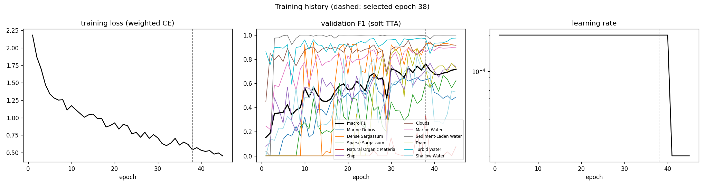
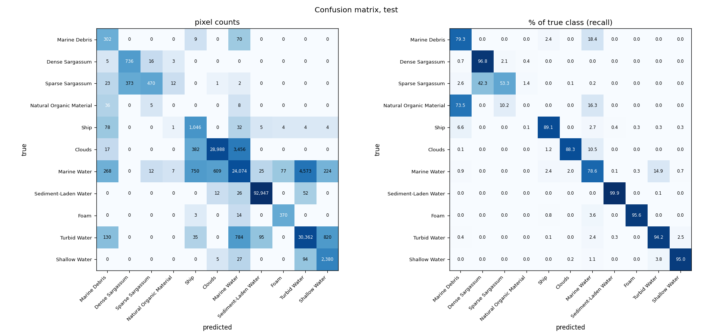
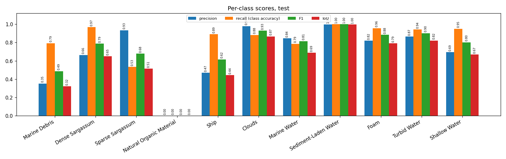
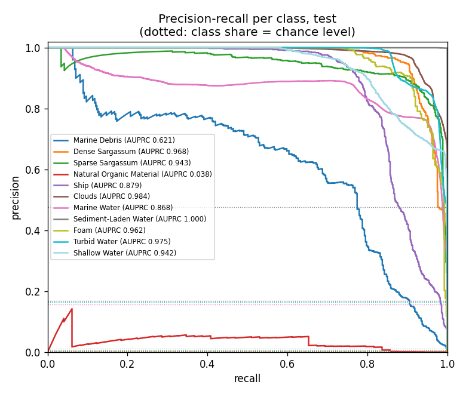
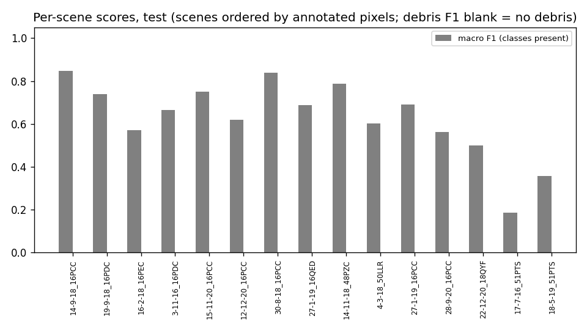
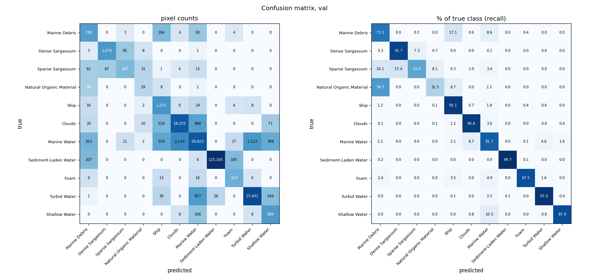
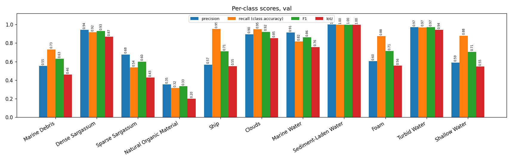
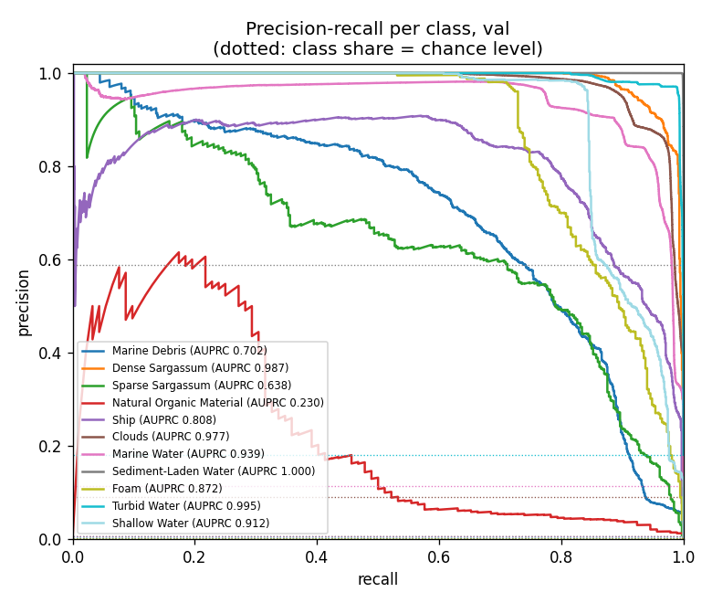
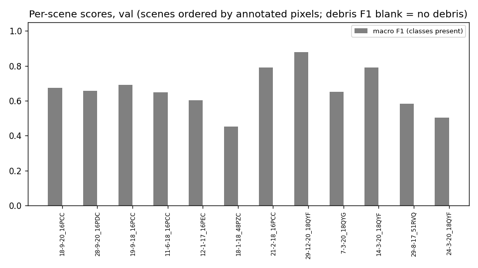
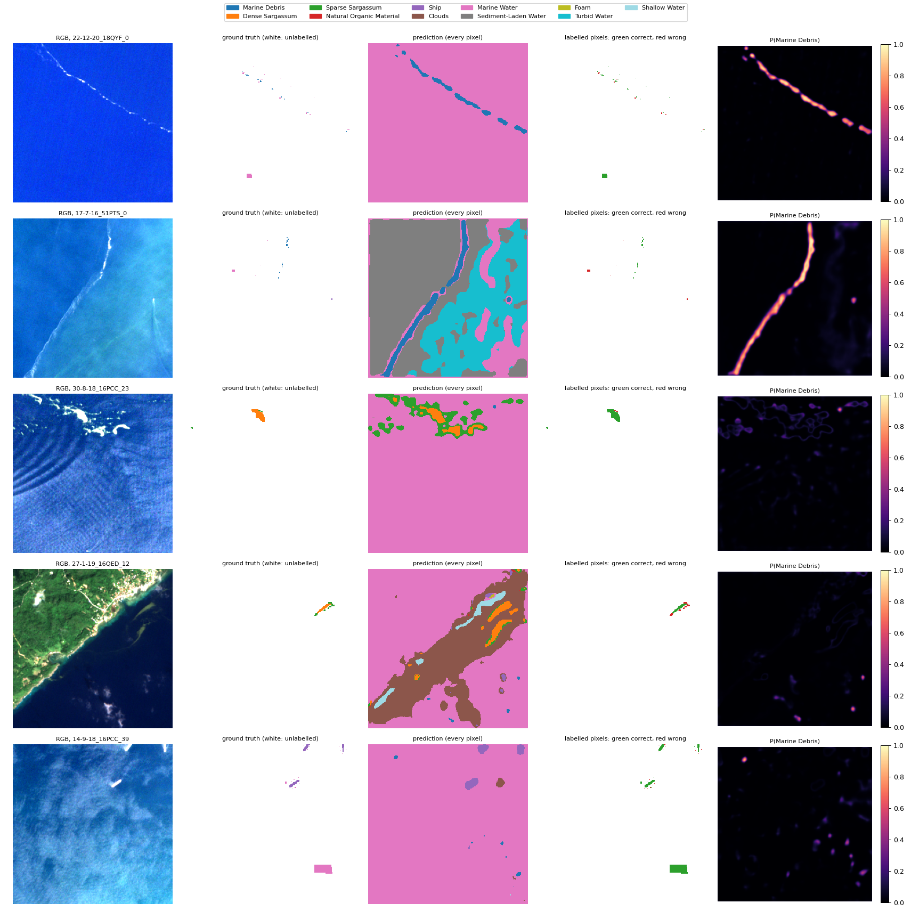

# Run G2b_unet_ssl4eo_raw_11class: U-Net (ResNet-50), SSL4EO-S12 pretrained, raw-reflectance bands, MARIDA, 11 classes

Inputs: 26 channels (B1, B2, B3, B4, B5, B6, B7, B8, B8A, B11, B12, NDVI, NDWI, FAI, FDI, NDMI, red/green, nir/red, nir/green, swir1/nir, glcm_contrast, glcm_dissimilarity, glcm_homogeneity, glcm_energy, glcm_correlation, glcm_asm). See `architecture.md` for the model and how the features are fed in.

Selected checkpoint: epoch 38 of 45 (best validation macro F1 with soft TTA, 0.7612).

## Test split (194,863 annotated pixels)

### Overall

| metric | value |
|---|---|
| OA | 0.9323 |
| balanced_accuracy | 0.7910 |
| kappa | 0.9024 |
| macro_precision | 0.6929 |
| macro_recall | 0.7910 |
| macro_F1 | 0.7180 |
| mIoU | 0.6148 |
| weighted_precision | 0.9385 |
| weighted_recall | 0.9323 |
| weighted_F1 | 0.9334 |
| micro_F1 | 0.9323 |
| macro_AUPRC | 0.8344 |

### Per class

| | support | share_% | predicted | TP | FP | FN | TN | precision | recall (class accuracy) | F1 | IoU | specificity | FP_per_TP | AUPRC |
|---|---|---|---|---|---|---|---|---|---|---|---|---|---|---|
| Marine Debris | 381.0000 | 0.1955 | 859.0000 | 302.0000 | 557.0000 | 79.0000 | 193925.0000 | 0.3516 | 0.7927 | 0.4871 | 0.3220 | 0.9971 | 1.8444 | 0.6214 |
| Dense Sargassum | 760.0000 | 0.3900 | 1109.0000 | 736.0000 | 373.0000 | 24.0000 | 193730.0000 | 0.6637 | 0.9684 | 0.7876 | 0.6496 | 0.9981 | 0.5068 | 0.9676 |
| Sparse Sargassum | 881.0000 | 0.4521 | 503.0000 | 470.0000 | 33.0000 | 411.0000 | 193949.0000 | 0.9344 | 0.5335 | 0.6792 | 0.5142 | 0.9998 | 0.0702 | 0.9426 |
| Natural Organic Material | 49.0000 | 0.0251 | 23.0000 | 0.0000 | 23.0000 | 49.0000 | 194791.0000 | 0.0000 | 0.0000 | 0.0000 | 0.0000 | 0.9999 | – | 0.0382 |
| Ship | 1174.0000 | 0.6025 | 2225.0000 | 1046.0000 | 1179.0000 | 128.0000 | 192510.0000 | 0.4701 | 0.8910 | 0.6155 | 0.4445 | 0.9939 | 1.1272 | 0.8788 |
| Clouds | 32843.0000 | 16.8544 | 29615.0000 | 28988.0000 | 627.0000 | 3855.0000 | 161393.0000 | 0.9788 | 0.8826 | 0.9282 | 0.8661 | 0.9961 | 0.0216 | 0.9835 |
| Marine Water | 30619.0000 | 15.7131 | 28493.0000 | 24074.0000 | 4419.0000 | 6545.0000 | 159825.0000 | 0.8449 | 0.7862 | 0.8145 | 0.6871 | 0.9731 | 0.1836 | 0.8678 |
| Sediment-Laden Water | 93037.0000 | 47.7448 | 93072.0000 | 92947.0000 | 125.0000 | 90.0000 | 101701.0000 | 0.9987 | 0.9990 | 0.9988 | 0.9977 | 0.9988 | 0.0013 | 1.0000 |
| Foam | 387.0000 | 0.1986 | 451.0000 | 370.0000 | 81.0000 | 17.0000 | 194395.0000 | 0.8204 | 0.9561 | 0.8831 | 0.7906 | 0.9996 | 0.2189 | 0.9616 |
| Turbid Water | 32226.0000 | 16.5378 | 35085.0000 | 30362.0000 | 4723.0000 | 1864.0000 | 157914.0000 | 0.8654 | 0.9422 | 0.9021 | 0.8217 | 0.9710 | 0.1556 | 0.9751 |
| Shallow Water | 2506.0000 | 1.2860 | 3428.0000 | 2380.0000 | 1048.0000 | 126.0000 | 191309.0000 | 0.6943 | 0.9497 | 0.8022 | 0.6697 | 0.9946 | 0.4403 | 0.9416 |

### Confusion matrix (rows true, columns predicted): counts / % of true class / % of predicted class

| | Marine Debris | Dense Sargassum | Sparse Sargassum | Natural Organic Material | Ship | Clouds | Marine Water | Sediment-Laden Water | Foam | Turbid Water | Shallow Water |
|---|---|---|---|---|---|---|---|---|---|---|---|
| Marine Debris | 302 | 0 | 0 | 0 | 9 | 0 | 70 | 0 | 0 | 0 | 0 |
| Dense Sargassum | 5 | 736 | 16 | 3 | 0 | 0 | 0 | 0 | 0 | 0 | 0 |
| Sparse Sargassum | 23 | 373 | 470 | 12 | 0 | 1 | 2 | 0 | 0 | 0 | 0 |
| Natural Organic Material | 36 | 0 | 5 | 0 | 0 | 0 | 8 | 0 | 0 | 0 | 0 |
| Ship | 78 | 0 | 0 | 1 | 1,046 | 0 | 32 | 5 | 4 | 4 | 4 |
| Clouds | 17 | 0 | 0 | 0 | 382 | 28,988 | 3,456 | 0 | 0 | 0 | 0 |
| Marine Water | 268 | 0 | 12 | 7 | 750 | 609 | 24,074 | 25 | 77 | 4,573 | 224 |
| Sediment-Laden Water | 0 | 0 | 0 | 0 | 0 | 12 | 26 | 92,947 | 0 | 52 | 0 |
| Foam | 0 | 0 | 0 | 0 | 3 | 0 | 14 | 0 | 370 | 0 | 0 |
| Turbid Water | 130 | 0 | 0 | 0 | 35 | 0 | 784 | 95 | 0 | 30,362 | 820 |
| Shallow Water | 0 | 0 | 0 | 0 | 0 | 5 | 27 | 0 | 0 | 94 | 2,380 |

| | Marine Debris | Dense Sargassum | Sparse Sargassum | Natural Organic Material | Ship | Clouds | Marine Water | Sediment-Laden Water | Foam | Turbid Water | Shallow Water |
|---|---|---|---|---|---|---|---|---|---|---|---|
| Marine Debris | 79.27 | 0.00 | 0.00 | 0.00 | 2.36 | 0.00 | 18.37 | 0.00 | 0.00 | 0.00 | 0.00 |
| Dense Sargassum | 0.66 | 96.84 | 2.11 | 0.39 | 0.00 | 0.00 | 0.00 | 0.00 | 0.00 | 0.00 | 0.00 |
| Sparse Sargassum | 2.61 | 42.34 | 53.35 | 1.36 | 0.00 | 0.11 | 0.23 | 0.00 | 0.00 | 0.00 | 0.00 |
| Natural Organic Material | 73.47 | 0.00 | 10.20 | 0.00 | 0.00 | 0.00 | 16.33 | 0.00 | 0.00 | 0.00 | 0.00 |
| Ship | 6.64 | 0.00 | 0.00 | 0.09 | 89.10 | 0.00 | 2.73 | 0.43 | 0.34 | 0.34 | 0.34 |
| Clouds | 0.05 | 0.00 | 0.00 | 0.00 | 1.16 | 88.26 | 10.52 | 0.00 | 0.00 | 0.00 | 0.00 |
| Marine Water | 0.88 | 0.00 | 0.04 | 0.02 | 2.45 | 1.99 | 78.62 | 0.08 | 0.25 | 14.94 | 0.73 |
| Sediment-Laden Water | 0.00 | 0.00 | 0.00 | 0.00 | 0.00 | 0.01 | 0.03 | 99.90 | 0.00 | 0.06 | 0.00 |
| Foam | 0.00 | 0.00 | 0.00 | 0.00 | 0.78 | 0.00 | 3.62 | 0.00 | 95.61 | 0.00 | 0.00 |
| Turbid Water | 0.40 | 0.00 | 0.00 | 0.00 | 0.11 | 0.00 | 2.43 | 0.29 | 0.00 | 94.22 | 2.54 |
| Shallow Water | 0.00 | 0.00 | 0.00 | 0.00 | 0.00 | 0.20 | 1.08 | 0.00 | 0.00 | 3.75 | 94.97 |

| | Marine Debris | Dense Sargassum | Sparse Sargassum | Natural Organic Material | Ship | Clouds | Marine Water | Sediment-Laden Water | Foam | Turbid Water | Shallow Water |
|---|---|---|---|---|---|---|---|---|---|---|---|
| Marine Debris | 35.16 | 0.00 | 0.00 | 0.00 | 0.40 | 0.00 | 0.25 | 0.00 | 0.00 | 0.00 | 0.00 |
| Dense Sargassum | 0.58 | 66.37 | 3.18 | 13.04 | 0.00 | 0.00 | 0.00 | 0.00 | 0.00 | 0.00 | 0.00 |
| Sparse Sargassum | 2.68 | 33.63 | 93.44 | 52.17 | 0.00 | 0.00 | 0.01 | 0.00 | 0.00 | 0.00 | 0.00 |
| Natural Organic Material | 4.19 | 0.00 | 0.99 | 0.00 | 0.00 | 0.00 | 0.03 | 0.00 | 0.00 | 0.00 | 0.00 |
| Ship | 9.08 | 0.00 | 0.00 | 4.35 | 47.01 | 0.00 | 0.11 | 0.01 | 0.89 | 0.01 | 0.12 |
| Clouds | 1.98 | 0.00 | 0.00 | 0.00 | 17.17 | 97.88 | 12.13 | 0.00 | 0.00 | 0.00 | 0.00 |
| Marine Water | 31.20 | 0.00 | 2.39 | 30.43 | 33.71 | 2.06 | 84.49 | 0.03 | 17.07 | 13.03 | 6.53 |
| Sediment-Laden Water | 0.00 | 0.00 | 0.00 | 0.00 | 0.00 | 0.04 | 0.09 | 99.87 | 0.00 | 0.15 | 0.00 |
| Foam | 0.00 | 0.00 | 0.00 | 0.00 | 0.13 | 0.00 | 0.05 | 0.00 | 82.04 | 0.00 | 0.00 |
| Turbid Water | 15.13 | 0.00 | 0.00 | 0.00 | 1.57 | 0.00 | 2.75 | 0.10 | 0.00 | 86.54 | 23.92 |
| Shallow Water | 0.00 | 0.00 | 0.00 | 0.00 | 0.00 | 0.02 | 0.09 | 0.00 | 0.00 | 0.27 | 69.43 |

### Per scene

`per_scene_test.csv` has every scene; the figure shows macro F1 (classes present) and debris F1.

## Val split (213,102 annotated pixels)

### Overall

| metric | value |
|---|---|
| OA | 0.9630 |
| balanced_accuracy | 0.8126 |
| kappa | 0.9384 |
| macro_precision | 0.7330 |
| macro_recall | 0.8126 |
| macro_F1 | 0.7612 |
| mIoU | 0.6505 |
| weighted_precision | 0.9662 |
| weighted_recall | 0.9630 |
| weighted_F1 | 0.9637 |
| micro_F1 | 0.9630 |
| macro_AUPRC | 0.8236 |

### Per class

| | support | share_% | predicted | TP | FP | FN | TN | precision | recall (class accuracy) | F1 | IoU | specificity | FP_per_TP | AUPRC |
|---|---|---|---|---|---|---|---|---|---|---|---|---|---|---|
| Marine Debris | 1075.0000 | 0.5045 | 1421.0000 | 786.0000 | 635.0000 | 289.0000 | 211392.0000 | 0.5531 | 0.7312 | 0.6298 | 0.4596 | 0.9970 | 0.8079 | 0.7024 |
| Dense Sargassum | 1167.0000 | 0.5476 | 1137.0000 | 1070.0000 | 67.0000 | 97.0000 | 211868.0000 | 0.9411 | 0.9169 | 0.9288 | 0.8671 | 0.9997 | 0.0626 | 0.9868 |
| Sparse Sargassum | 385.0000 | 0.1807 | 306.0000 | 207.0000 | 99.0000 | 178.0000 | 212618.0000 | 0.6765 | 0.5377 | 0.5991 | 0.4277 | 0.9995 | 0.4783 | 0.6380 |
| Natural Organic Material | 92.0000 | 0.0432 | 82.0000 | 29.0000 | 53.0000 | 63.0000 | 212957.0000 | 0.3537 | 0.3152 | 0.3333 | 0.2000 | 0.9998 | 1.8276 | 0.2303 |
| Ship | 1340.0000 | 0.6288 | 2248.0000 | 1275.0000 | 973.0000 | 65.0000 | 210789.0000 | 0.5672 | 0.9515 | 0.7107 | 0.5512 | 0.9954 | 0.7631 | 0.8076 |
| Clouds | 19262.0000 | 9.0389 | 20396.0000 | 18255.0000 | 2141.0000 | 1007.0000 | 191699.0000 | 0.8950 | 0.9477 | 0.9206 | 0.8529 | 0.9890 | 0.1173 | 0.9774 |
| Marine Water | 24270.0000 | 11.3889 | 21731.0000 | 19823.0000 | 1908.0000 | 4447.0000 | 186924.0000 | 0.9122 | 0.8168 | 0.8619 | 0.7572 | 0.9899 | 0.0963 | 0.9388 |
| Sediment-Laden Water | 125565.0000 | 58.9225 | 125193.0000 | 125165.0000 | 28.0000 | 400.0000 | 87509.0000 | 0.9998 | 0.9968 | 0.9983 | 0.9966 | 0.9997 | 0.0002 | 0.9999 |
| Foam | 369.0000 | 0.1732 | 535.0000 | 323.0000 | 212.0000 | 46.0000 | 212521.0000 | 0.6037 | 0.8753 | 0.7146 | 0.5559 | 0.9990 | 0.6563 | 0.8723 |
| Turbid Water | 38566.0000 | 18.0974 | 38546.0000 | 37401.0000 | 1145.0000 | 1165.0000 | 173391.0000 | 0.9703 | 0.9698 | 0.9700 | 0.9418 | 0.9934 | 0.0306 | 0.9947 |
| Shallow Water | 1011.0000 | 0.4744 | 1507.0000 | 889.0000 | 618.0000 | 122.0000 | 211473.0000 | 0.5899 | 0.8793 | 0.7061 | 0.5457 | 0.9971 | 0.6952 | 0.9117 |

### Confusion matrix (rows true, columns predicted): counts / % of true class / % of predicted class

| | Marine Debris | Dense Sargassum | Sparse Sargassum | Natural Organic Material | Ship | Clouds | Marine Water | Sediment-Laden Water | Foam | Turbid Water | Shallow Water |
|---|---|---|---|---|---|---|---|---|---|---|---|
| Marine Debris | 786 | 0 | 3 | 0 | 184 | 6 | 92 | 0 | 4 | 0 | 0 |
| Dense Sargassum | 3 | 1,070 | 85 | 8 | 0 | 0 | 1 | 0 | 0 | 0 | 0 |
| Sparse Sargassum | 62 | 67 | 207 | 31 | 1 | 4 | 13 | 0 | 0 | 0 | 0 |
| Natural Organic Material | 54 | 0 | 0 | 29 | 8 | 0 | 1 | 0 | 0 | 0 | 0 |
| Ship | 16 | 0 | 0 | 2 | 1,275 | 9 | 24 | 0 | 6 | 8 | 0 |
| Clouds | 20 | 0 | 0 | 10 | 218 | 18,255 | 688 | 0 | 0 | 0 | 71 |
| Marine Water | 263 | 0 | 11 | 2 | 519 | 2,114 | 19,823 | 0 | 17 | 1,123 | 398 |
| Sediment-Laden Water | 207 | 0 | 0 | 0 | 0 | 0 | 8 | 125,165 | 185 | 0 | 0 |
| Foam | 9 | 0 | 0 | 0 | 13 | 0 | 18 | 0 | 323 | 6 | 0 |
| Turbid Water | 1 | 0 | 0 | 0 | 30 | 0 | 957 | 28 | 0 | 37,401 | 149 |
| Shallow Water | 0 | 0 | 0 | 0 | 0 | 8 | 106 | 0 | 0 | 8 | 889 |

| | Marine Debris | Dense Sargassum | Sparse Sargassum | Natural Organic Material | Ship | Clouds | Marine Water | Sediment-Laden Water | Foam | Turbid Water | Shallow Water |
|---|---|---|---|---|---|---|---|---|---|---|---|
| Marine Debris | 73.12 | 0.00 | 0.28 | 0.00 | 17.12 | 0.56 | 8.56 | 0.00 | 0.37 | 0.00 | 0.00 |
| Dense Sargassum | 0.26 | 91.69 | 7.28 | 0.69 | 0.00 | 0.00 | 0.09 | 0.00 | 0.00 | 0.00 | 0.00 |
| Sparse Sargassum | 16.10 | 17.40 | 53.77 | 8.05 | 0.26 | 1.04 | 3.38 | 0.00 | 0.00 | 0.00 | 0.00 |
| Natural Organic Material | 58.70 | 0.00 | 0.00 | 31.52 | 8.70 | 0.00 | 1.09 | 0.00 | 0.00 | 0.00 | 0.00 |
| Ship | 1.19 | 0.00 | 0.00 | 0.15 | 95.15 | 0.67 | 1.79 | 0.00 | 0.45 | 0.60 | 0.00 |
| Clouds | 0.10 | 0.00 | 0.00 | 0.05 | 1.13 | 94.77 | 3.57 | 0.00 | 0.00 | 0.00 | 0.37 |
| Marine Water | 1.08 | 0.00 | 0.05 | 0.01 | 2.14 | 8.71 | 81.68 | 0.00 | 0.07 | 4.63 | 1.64 |
| Sediment-Laden Water | 0.16 | 0.00 | 0.00 | 0.00 | 0.00 | 0.00 | 0.01 | 99.68 | 0.15 | 0.00 | 0.00 |
| Foam | 2.44 | 0.00 | 0.00 | 0.00 | 3.52 | 0.00 | 4.88 | 0.00 | 87.53 | 1.63 | 0.00 |
| Turbid Water | 0.00 | 0.00 | 0.00 | 0.00 | 0.08 | 0.00 | 2.48 | 0.07 | 0.00 | 96.98 | 0.39 |
| Shallow Water | 0.00 | 0.00 | 0.00 | 0.00 | 0.00 | 0.79 | 10.48 | 0.00 | 0.00 | 0.79 | 87.93 |

| | Marine Debris | Dense Sargassum | Sparse Sargassum | Natural Organic Material | Ship | Clouds | Marine Water | Sediment-Laden Water | Foam | Turbid Water | Shallow Water |
|---|---|---|---|---|---|---|---|---|---|---|---|
| Marine Debris | 55.31 | 0.00 | 0.98 | 0.00 | 8.19 | 0.03 | 0.42 | 0.00 | 0.75 | 0.00 | 0.00 |
| Dense Sargassum | 0.21 | 94.11 | 27.78 | 9.76 | 0.00 | 0.00 | 0.00 | 0.00 | 0.00 | 0.00 | 0.00 |
| Sparse Sargassum | 4.36 | 5.89 | 67.65 | 37.80 | 0.04 | 0.02 | 0.06 | 0.00 | 0.00 | 0.00 | 0.00 |
| Natural Organic Material | 3.80 | 0.00 | 0.00 | 35.37 | 0.36 | 0.00 | 0.00 | 0.00 | 0.00 | 0.00 | 0.00 |
| Ship | 1.13 | 0.00 | 0.00 | 2.44 | 56.72 | 0.04 | 0.11 | 0.00 | 1.12 | 0.02 | 0.00 |
| Clouds | 1.41 | 0.00 | 0.00 | 12.20 | 9.70 | 89.50 | 3.17 | 0.00 | 0.00 | 0.00 | 4.71 |
| Marine Water | 18.51 | 0.00 | 3.59 | 2.44 | 23.09 | 10.36 | 91.22 | 0.00 | 3.18 | 2.91 | 26.41 |
| Sediment-Laden Water | 14.57 | 0.00 | 0.00 | 0.00 | 0.00 | 0.00 | 0.04 | 99.98 | 34.58 | 0.00 | 0.00 |
| Foam | 0.63 | 0.00 | 0.00 | 0.00 | 0.58 | 0.00 | 0.08 | 0.00 | 60.37 | 0.02 | 0.00 |
| Turbid Water | 0.07 | 0.00 | 0.00 | 0.00 | 1.33 | 0.00 | 4.40 | 0.02 | 0.00 | 97.03 | 9.89 |
| Shallow Water | 0.00 | 0.00 | 0.00 | 0.00 | 0.00 | 0.04 | 0.49 | 0.00 | 0.00 | 0.02 | 58.99 |

### Per scene

`per_scene_val.csv` has every scene; the figure shows macro F1 (classes present) and debris F1.

## Example test patches

The same 6 test patches (most debris, algae and other pixels) in every run.

