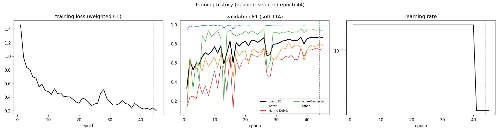
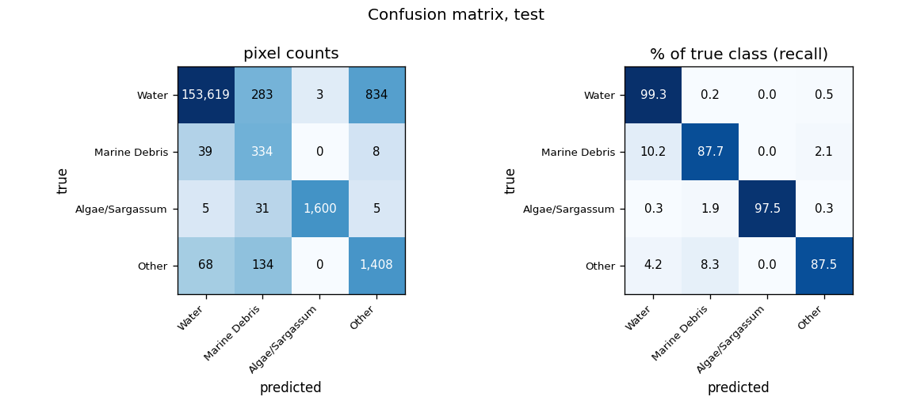
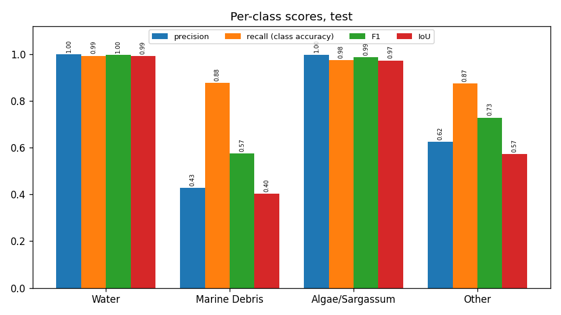
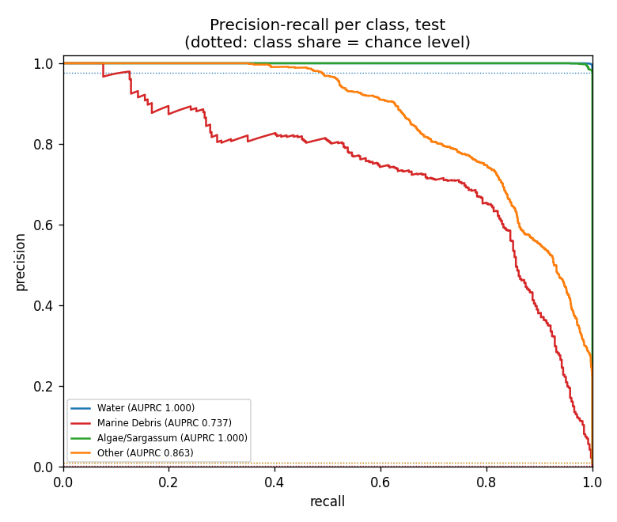
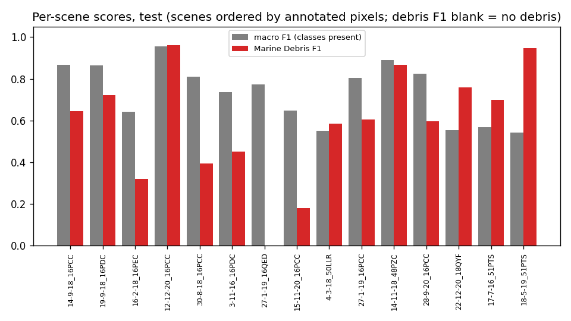
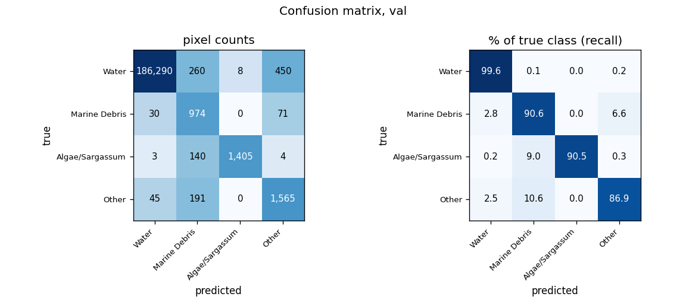
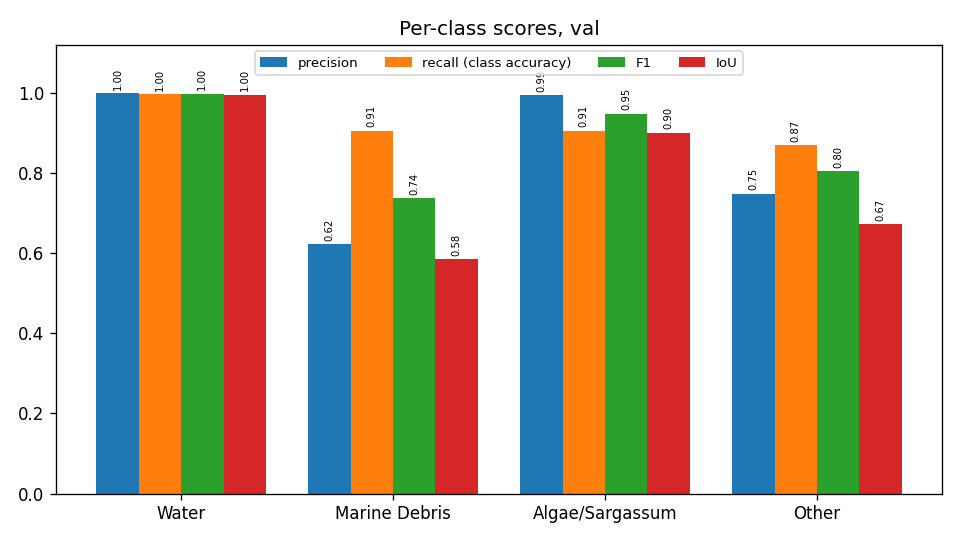
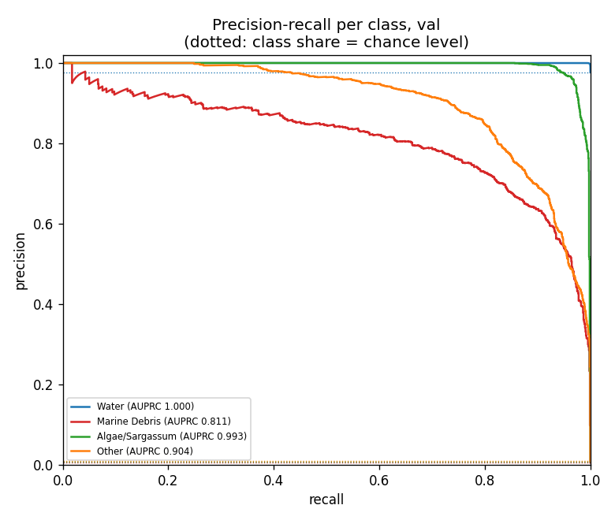
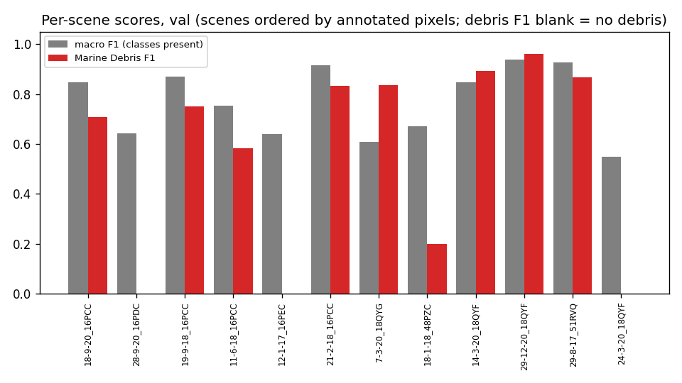
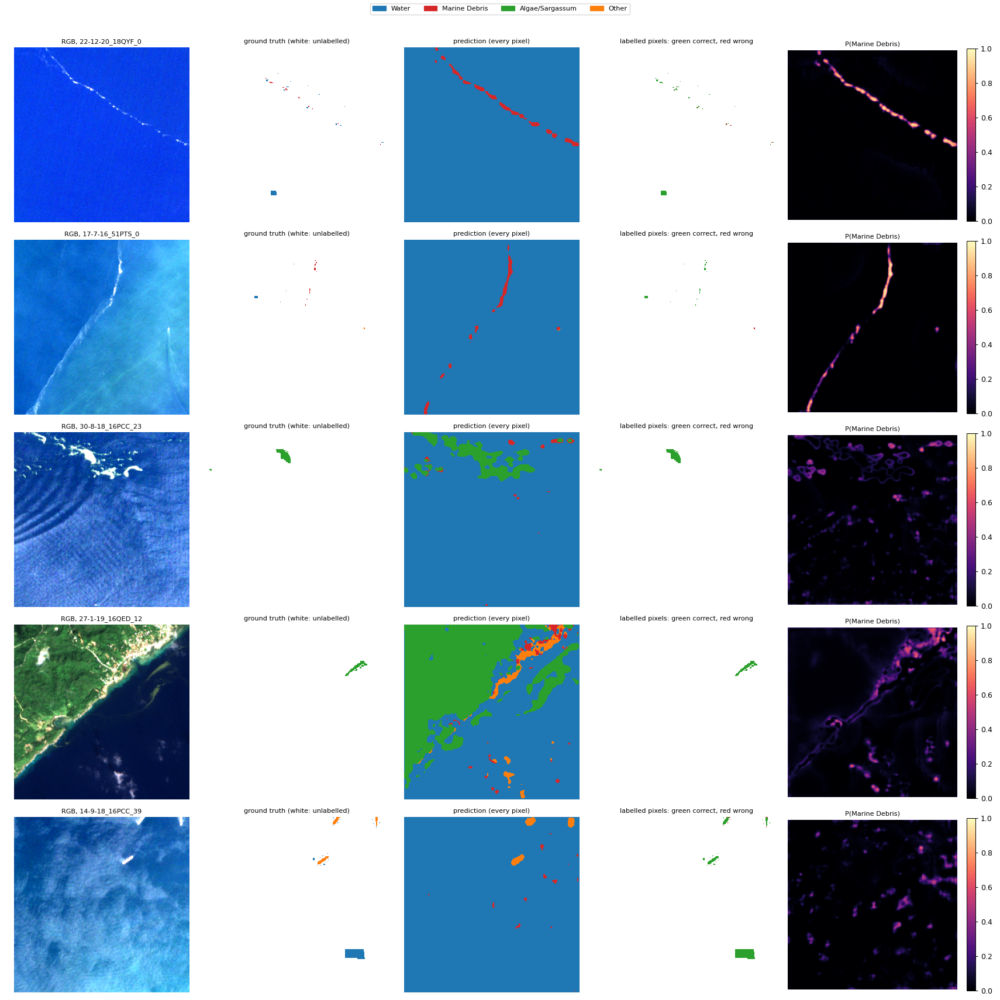

# Run R1_unet_ssl4eo_raw: U-Net (ResNet-50), SSL4EO-S12 pretrained, raw-reflectance bands, MARIDA, 4 classes

Inputs: 26 channels (B1, B2, B3, B4, B5, B6, B7, B8, B8A, B11, B12, NDVI, NDWI, FAI, FDI, NDMI, red/green, nir/red, nir/green, swir1/nir, glcm_contrast, glcm_dissimilarity, glcm_homogeneity, glcm_energy, glcm_correlation, glcm_asm). See `architecture.md` for the model and how the features are fed in.

Selected checkpoint: epoch 44 of 45 (best validation macro F1 with soft TTA, 0.8720).

## Test split (158,371 annotated pixels)

### Overall

| metric | value |
|---|---|
| OA | 0.9911 |
| balanced_accuracy | 0.9297 |
| kappa | 0.8264 |
| macro_precision | 0.7622 |
| macro_recall | 0.9297 |
| macro_F1 | 0.8214 |
| mIoU | 0.7353 |
| weighted_precision | 0.9941 |
| weighted_recall | 0.9911 |
| weighted_F1 | 0.9922 |
| micro_F1 | 0.9911 |
| macro_AUPRC | 0.9000 |

### Per class

| | support | share_% | predicted | TP | FP | FN | TN | precision | recall (class accuracy) | F1 | IoU | specificity | FP_per_TP | AUPRC |
|---|---|---|---|---|---|---|---|---|---|---|---|---|---|---|
| Water | 154739.0000 | 97.7067 | 153731.0000 | 153619.0000 | 112.0000 | 1120.0000 | 3520.0000 | 0.9993 | 0.9928 | 0.9960 | 0.9920 | 0.9692 | 0.0007 | 1.0000 |
| Marine Debris | 381.0000 | 0.2406 | 782.0000 | 334.0000 | 448.0000 | 47.0000 | 157542.0000 | 0.4271 | 0.8766 | 0.5744 | 0.4029 | 0.9972 | 1.3413 | 0.7370 |
| Algae/Sargassum | 1641.0000 | 1.0362 | 1603.0000 | 1600.0000 | 3.0000 | 41.0000 | 156727.0000 | 0.9981 | 0.9750 | 0.9864 | 0.9732 | 1.0000 | 0.0019 | 0.9998 |
| Other | 1610.0000 | 1.0166 | 2255.0000 | 1408.0000 | 847.0000 | 202.0000 | 155914.0000 | 0.6244 | 0.8745 | 0.7286 | 0.5731 | 0.9946 | 0.6016 | 0.8631 |

### Confusion matrix (rows true, columns predicted): counts / % of true class / % of predicted class

| | Water | Marine Debris | Algae/Sargassum | Other |
|---|---|---|---|---|
| Water | 153,619 | 283 | 3 | 834 |
| Marine Debris | 39 | 334 | 0 | 8 |
| Algae/Sargassum | 5 | 31 | 1,600 | 5 |
| Other | 68 | 134 | 0 | 1,408 |

| | Water | Marine Debris | Algae/Sargassum | Other |
|---|---|---|---|---|
| Water | 99.28 | 0.18 | 0.00 | 0.54 |
| Marine Debris | 10.24 | 87.66 | 0.00 | 2.10 |
| Algae/Sargassum | 0.30 | 1.89 | 97.50 | 0.30 |
| Other | 4.22 | 8.32 | 0.00 | 87.45 |

| | Water | Marine Debris | Algae/Sargassum | Other |
|---|---|---|---|---|
| Water | 99.93 | 36.19 | 0.19 | 36.98 |
| Marine Debris | 0.03 | 42.71 | 0.00 | 0.35 |
| Algae/Sargassum | 0.00 | 3.96 | 99.81 | 0.22 |
| Other | 0.04 | 17.14 | 0.00 | 62.44 |

### Per scene

`per_scene_test.csv` has every scene; the figure shows macro F1 (classes present) and debris F1.

## Val split (191,436 annotated pixels)

### Overall

| metric | value |
|---|---|
| OA | 0.9937 |
| balanced_accuracy | 0.9191 |
| kappa | 0.8713 |
| macro_precision | 0.8413 |
| macro_recall | 0.9191 |
| macro_F1 | 0.8720 |
| mIoU | 0.7885 |
| weighted_precision | 0.9951 |
| weighted_recall | 0.9937 |
| weighted_F1 | 0.9942 |
| micro_F1 | 0.9937 |
| macro_AUPRC | 0.9272 |

### Per class

| | support | share_% | predicted | TP | FP | FN | TN | precision | recall (class accuracy) | F1 | IoU | specificity | FP_per_TP | AUPRC |
|---|---|---|---|---|---|---|---|---|---|---|---|---|---|---|
| Water | 187008.0000 | 97.6870 | 186368.0000 | 186290.0000 | 78.0000 | 718.0000 | 4350.0000 | 0.9996 | 0.9962 | 0.9979 | 0.9957 | 0.9824 | 0.0004 | 1.0000 |
| Marine Debris | 1075.0000 | 0.5615 | 1565.0000 | 974.0000 | 591.0000 | 101.0000 | 189770.0000 | 0.6224 | 0.9060 | 0.7379 | 0.5846 | 0.9969 | 0.6068 | 0.8112 |
| Algae/Sargassum | 1552.0000 | 0.8107 | 1413.0000 | 1405.0000 | 8.0000 | 147.0000 | 189876.0000 | 0.9943 | 0.9053 | 0.9477 | 0.9006 | 1.0000 | 0.0057 | 0.9932 |
| Other | 1801.0000 | 0.9408 | 2090.0000 | 1565.0000 | 525.0000 | 236.0000 | 189110.0000 | 0.7488 | 0.8690 | 0.8044 | 0.6728 | 0.9972 | 0.3355 | 0.9042 |

### Confusion matrix (rows true, columns predicted): counts / % of true class / % of predicted class

| | Water | Marine Debris | Algae/Sargassum | Other |
|---|---|---|---|---|
| Water | 186,290 | 260 | 8 | 450 |
| Marine Debris | 30 | 974 | 0 | 71 |
| Algae/Sargassum | 3 | 140 | 1,405 | 4 |
| Other | 45 | 191 | 0 | 1,565 |

| | Water | Marine Debris | Algae/Sargassum | Other |
|---|---|---|---|---|
| Water | 99.62 | 0.14 | 0.00 | 0.24 |
| Marine Debris | 2.79 | 90.60 | 0.00 | 6.60 |
| Algae/Sargassum | 0.19 | 9.02 | 90.53 | 0.26 |
| Other | 2.50 | 10.61 | 0.00 | 86.90 |

| | Water | Marine Debris | Algae/Sargassum | Other |
|---|---|---|---|---|
| Water | 99.96 | 16.61 | 0.57 | 21.53 |
| Marine Debris | 0.02 | 62.24 | 0.00 | 3.40 |
| Algae/Sargassum | 0.00 | 8.95 | 99.43 | 0.19 |
| Other | 0.02 | 12.20 | 0.00 | 74.88 |

### Per scene

`per_scene_val.csv` has every scene; the figure shows macro F1 (classes present) and debris F1.

## Example test patches

The same 6 test patches (most debris, algae and other pixels) in every run.

