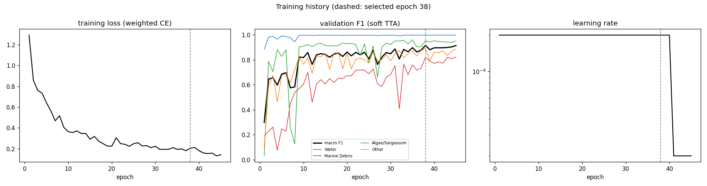
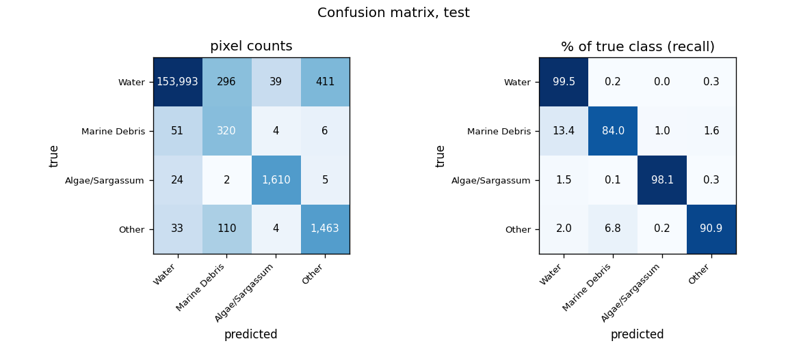
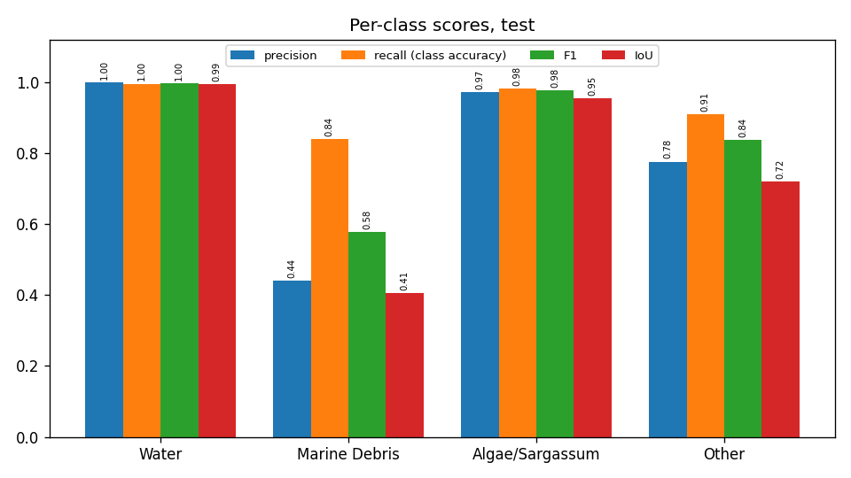
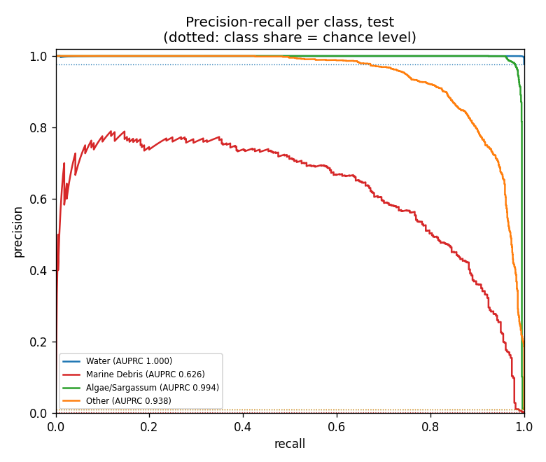
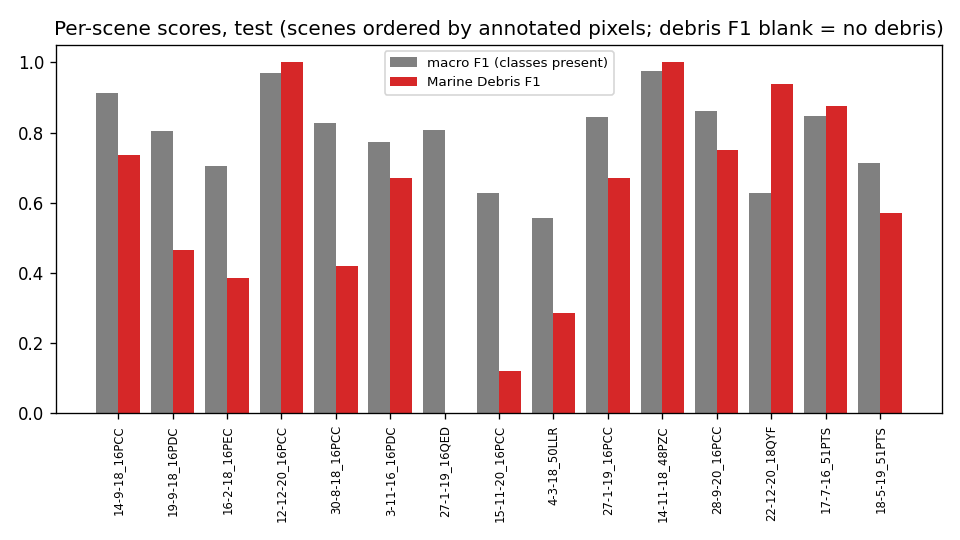
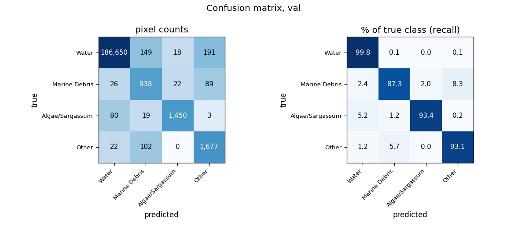
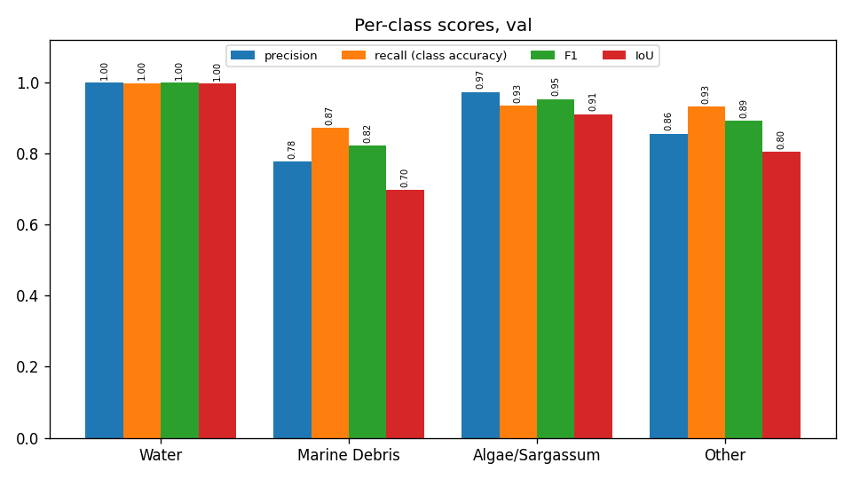
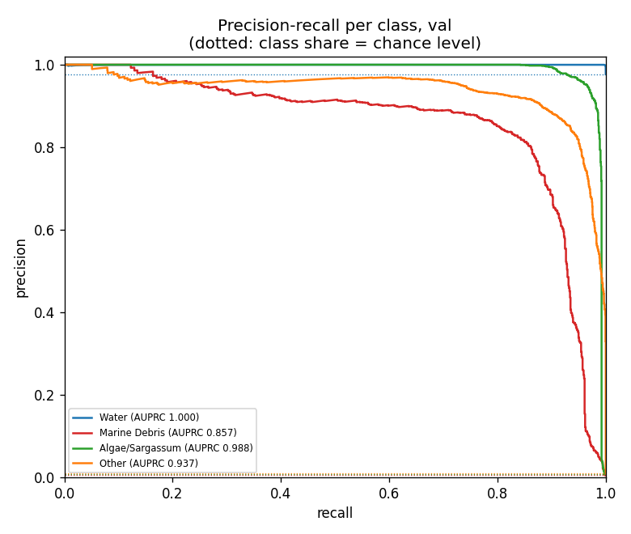
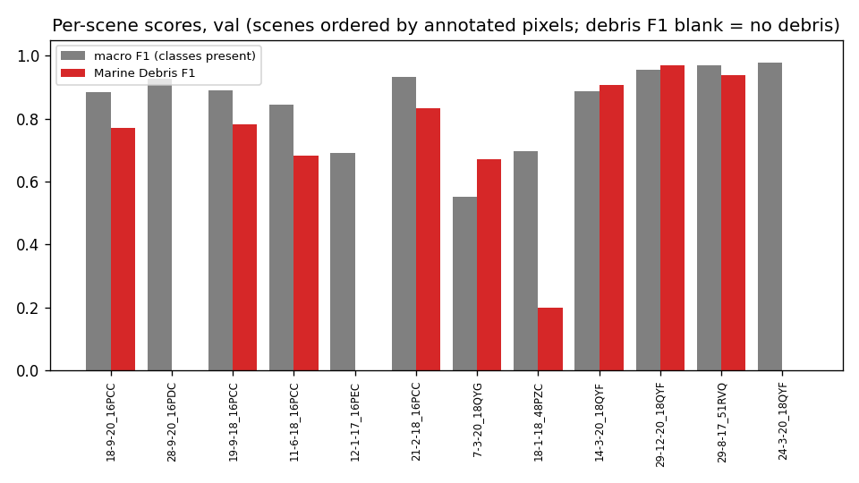
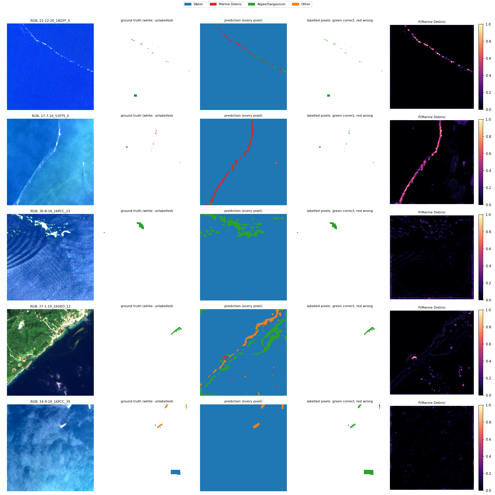

# Run R2_unet_ssl4eo_std: U-Net (ResNet-50), SSL4EO-S12 pretrained, standardised bands, MARIDA, 4 classes

Inputs: 26 channels (B1, B2, B3, B4, B5, B6, B7, B8, B8A, B11, B12, NDVI, NDWI, FAI, FDI, NDMI, red/green, nir/red, nir/green, swir1/nir, glcm_contrast, glcm_dissimilarity, glcm_homogeneity, glcm_energy, glcm_correlation, glcm_asm). See `architecture.md` for the model and how the features are fed in.

Selected checkpoint: epoch 38 of 45 (best validation macro F1 with soft TTA, 0.9164).

## Test split (158,371 annotated pixels)

### Overall

| metric | value |
|---|---|
| OA | 0.9938 |
| balanced_accuracy | 0.9312 |
| kappa | 0.8732 |
| macro_precision | 0.7967 |
| macro_recall | 0.9312 |
| macro_F1 | 0.8470 |
| mIoU | 0.7685 |
| weighted_precision | 0.9954 |
| weighted_recall | 0.9938 |
| weighted_F1 | 0.9944 |
| micro_F1 | 0.9938 |
| macro_AUPRC | 0.8893 |

### Per class

| | support | share_% | predicted | TP | FP | FN | TN | precision | recall (class accuracy) | F1 | IoU | specificity | FP_per_TP | AUPRC |
|---|---|---|---|---|---|---|---|---|---|---|---|---|---|---|
| Water | 154739.0000 | 97.7067 | 154101.0000 | 153993.0000 | 108.0000 | 746.0000 | 3524.0000 | 0.9993 | 0.9952 | 0.9972 | 0.9945 | 0.9703 | 0.0007 | 0.9998 |
| Marine Debris | 381.0000 | 0.2406 | 728.0000 | 320.0000 | 408.0000 | 61.0000 | 157582.0000 | 0.4396 | 0.8399 | 0.5771 | 0.4056 | 0.9974 | 1.2750 | 0.6259 |
| Algae/Sargassum | 1641.0000 | 1.0362 | 1657.0000 | 1610.0000 | 47.0000 | 31.0000 | 156683.0000 | 0.9716 | 0.9811 | 0.9763 | 0.9538 | 0.9997 | 0.0292 | 0.9940 |
| Other | 1610.0000 | 1.0166 | 1885.0000 | 1463.0000 | 422.0000 | 147.0000 | 156339.0000 | 0.7761 | 0.9087 | 0.8372 | 0.7200 | 0.9973 | 0.2884 | 0.9377 |

### Confusion matrix (rows true, columns predicted): counts / % of true class / % of predicted class

| | Water | Marine Debris | Algae/Sargassum | Other |
|---|---|---|---|---|
| Water | 153,993 | 296 | 39 | 411 |
| Marine Debris | 51 | 320 | 4 | 6 |
| Algae/Sargassum | 24 | 2 | 1,610 | 5 |
| Other | 33 | 110 | 4 | 1,463 |

| | Water | Marine Debris | Algae/Sargassum | Other |
|---|---|---|---|---|
| Water | 99.52 | 0.19 | 0.03 | 0.27 |
| Marine Debris | 13.39 | 83.99 | 1.05 | 1.57 |
| Algae/Sargassum | 1.46 | 0.12 | 98.11 | 0.30 |
| Other | 2.05 | 6.83 | 0.25 | 90.87 |

| | Water | Marine Debris | Algae/Sargassum | Other |
|---|---|---|---|---|
| Water | 99.93 | 40.66 | 2.35 | 21.80 |
| Marine Debris | 0.03 | 43.96 | 0.24 | 0.32 |
| Algae/Sargassum | 0.02 | 0.27 | 97.16 | 0.27 |
| Other | 0.02 | 15.11 | 0.24 | 77.61 |

### Per scene

`per_scene_test.csv` has every scene; the figure shows macro F1 (classes present) and debris F1.

## Val split (191,436 annotated pixels)

### Overall

| metric | value |
|---|---|
| OA | 0.9962 |
| balanced_accuracy | 0.9340 |
| kappa | 0.9194 |
| macro_precision | 0.9011 |
| macro_recall | 0.9340 |
| macro_F1 | 0.9164 |
| mIoU | 0.8526 |
| weighted_precision | 0.9965 |
| weighted_recall | 0.9962 |
| weighted_F1 | 0.9963 |
| micro_F1 | 0.9962 |
| macro_AUPRC | 0.9453 |

### Per class

| | support | share_% | predicted | TP | FP | FN | TN | precision | recall (class accuracy) | F1 | IoU | specificity | FP_per_TP | AUPRC |
|---|---|---|---|---|---|---|---|---|---|---|---|---|---|---|
| Water | 187008.0000 | 97.6870 | 186778.0000 | 186650.0000 | 128.0000 | 358.0000 | 4300.0000 | 0.9993 | 0.9981 | 0.9987 | 0.9974 | 0.9711 | 0.0007 | 0.9998 |
| Marine Debris | 1075.0000 | 0.5615 | 1208.0000 | 938.0000 | 270.0000 | 137.0000 | 190091.0000 | 0.7765 | 0.8726 | 0.8217 | 0.6974 | 0.9986 | 0.2878 | 0.8567 |
| Algae/Sargassum | 1552.0000 | 0.8107 | 1490.0000 | 1450.0000 | 40.0000 | 102.0000 | 189844.0000 | 0.9732 | 0.9343 | 0.9533 | 0.9108 | 0.9998 | 0.0276 | 0.9876 |
| Other | 1801.0000 | 0.9408 | 1960.0000 | 1677.0000 | 283.0000 | 124.0000 | 189352.0000 | 0.8556 | 0.9311 | 0.8918 | 0.8047 | 0.9985 | 0.1688 | 0.9371 |

### Confusion matrix (rows true, columns predicted): counts / % of true class / % of predicted class

| | Water | Marine Debris | Algae/Sargassum | Other |
|---|---|---|---|---|
| Water | 186,650 | 149 | 18 | 191 |
| Marine Debris | 26 | 938 | 22 | 89 |
| Algae/Sargassum | 80 | 19 | 1,450 | 3 |
| Other | 22 | 102 | 0 | 1,677 |

| | Water | Marine Debris | Algae/Sargassum | Other |
|---|---|---|---|---|
| Water | 99.81 | 0.08 | 0.01 | 0.10 |
| Marine Debris | 2.42 | 87.26 | 2.05 | 8.28 |
| Algae/Sargassum | 5.15 | 1.22 | 93.43 | 0.19 |
| Other | 1.22 | 5.66 | 0.00 | 93.11 |

| | Water | Marine Debris | Algae/Sargassum | Other |
|---|---|---|---|---|
| Water | 99.93 | 12.33 | 1.21 | 9.74 |
| Marine Debris | 0.01 | 77.65 | 1.48 | 4.54 |
| Algae/Sargassum | 0.04 | 1.57 | 97.32 | 0.15 |
| Other | 0.01 | 8.44 | 0.00 | 85.56 |

### Per scene

`per_scene_val.csv` has every scene; the figure shows macro F1 (classes present) and debris F1.

## Example test patches

The same 6 test patches (most debris, algae and other pixels) in every run.

