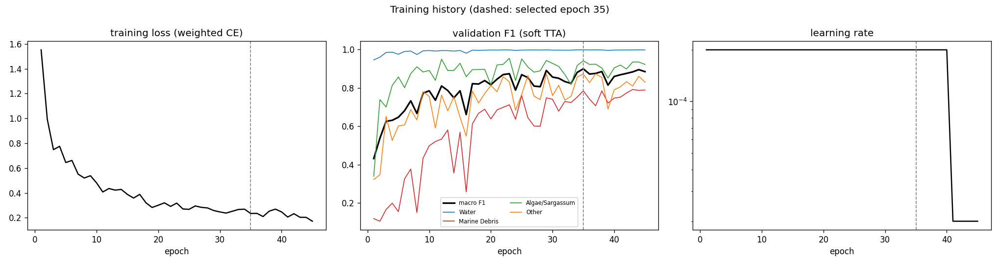
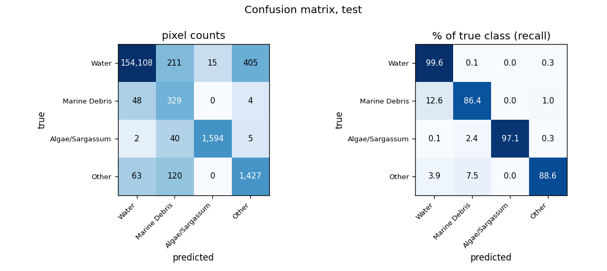
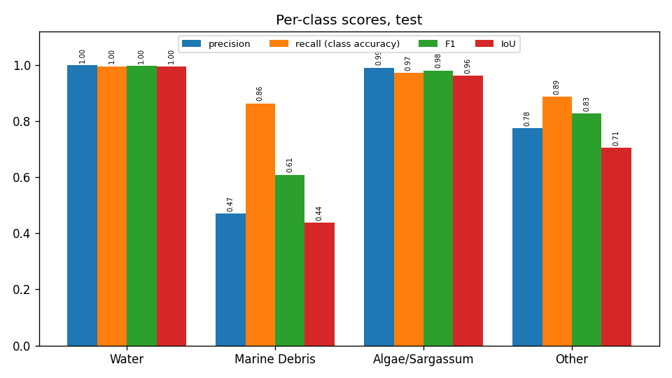
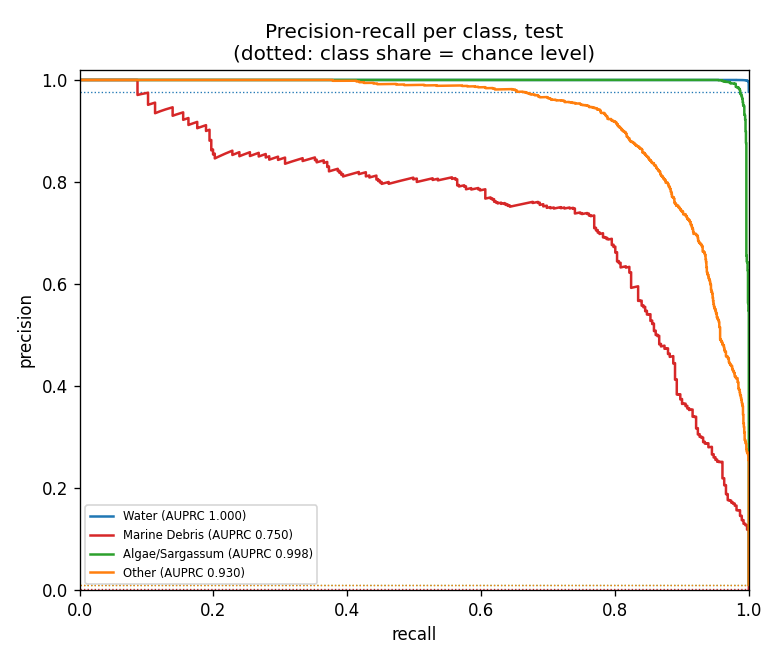
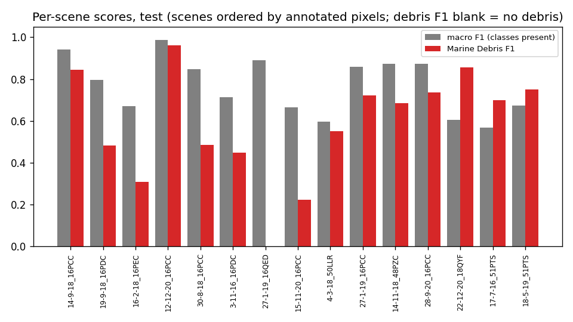
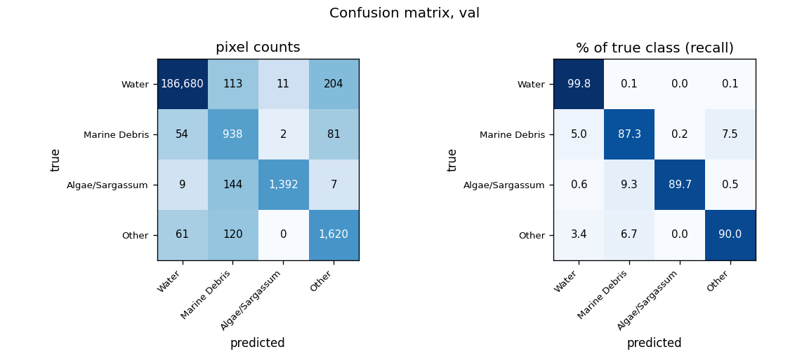
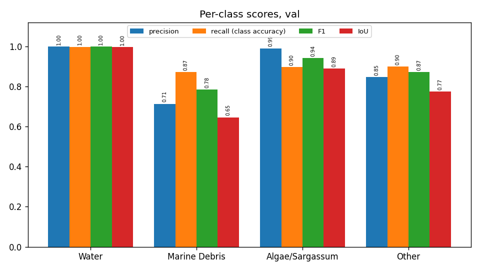
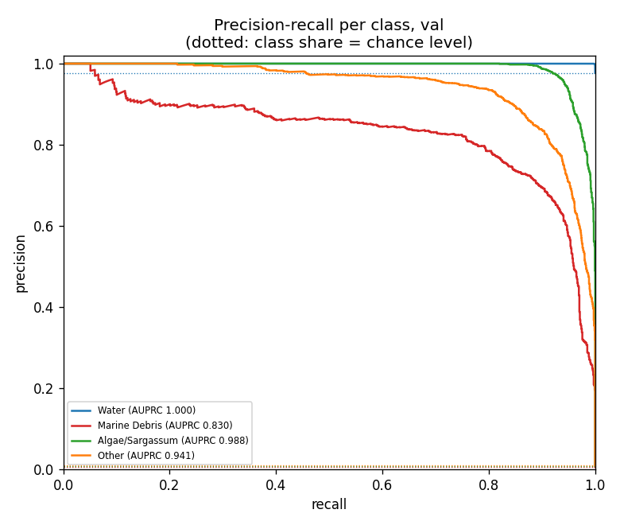
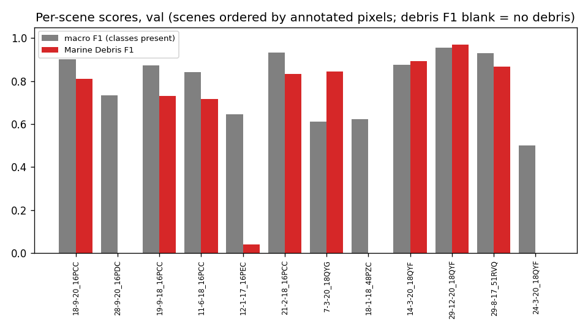
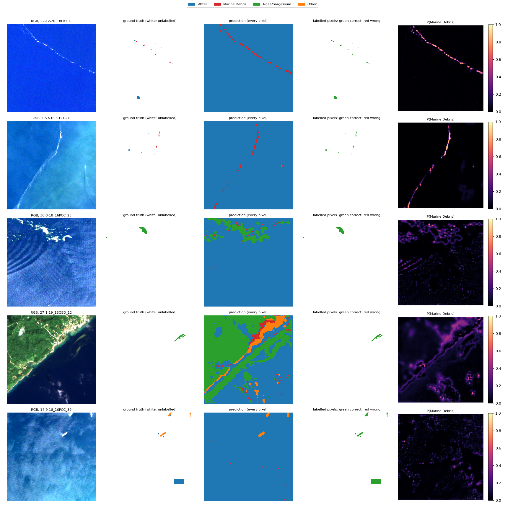

# Run R3_unet_scratch_std: U-Net (ResNet-50), from scratch, standardised bands, MARIDA, 4 classes

Inputs: 26 channels (B1, B2, B3, B4, B5, B6, B7, B8, B8A, B11, B12, NDVI, NDWI, FAI, FDI, NDMI, red/green, nir/red, nir/green, swir1/nir, glcm_contrast, glcm_dissimilarity, glcm_homogeneity, glcm_energy, glcm_correlation, glcm_asm). See `architecture.md` for the model and how the features are fed in.

Selected checkpoint: epoch 35 of 45 (best validation macro F1 with soft TTA, 0.8995).

## Test split (158,371 annotated pixels)

### Overall

| metric | value |
|---|---|
| OA | 0.9942 |
| balanced_accuracy | 0.9293 |
| kappa | 0.8806 |
| macro_precision | 0.8088 |
| macro_recall | 0.9293 |
| macro_F1 | 0.8536 |
| mIoU | 0.7751 |
| weighted_precision | 0.9956 |
| weighted_recall | 0.9942 |
| weighted_F1 | 0.9947 |
| micro_F1 | 0.9942 |
| macro_AUPRC | 0.9192 |

### Per class

| | support | share_% | predicted | TP | FP | FN | TN | precision | recall (class accuracy) | F1 | IoU | specificity | FP_per_TP | AUPRC |
|---|---|---|---|---|---|---|---|---|---|---|---|---|---|---|
| Water | 154739.0000 | 97.7067 | 154221.0000 | 154108.0000 | 113.0000 | 631.0000 | 3519.0000 | 0.9993 | 0.9959 | 0.9976 | 0.9952 | 0.9689 | 0.0007 | 1.0000 |
| Marine Debris | 381.0000 | 0.2406 | 700.0000 | 329.0000 | 371.0000 | 52.0000 | 157619.0000 | 0.4700 | 0.8635 | 0.6087 | 0.4375 | 0.9977 | 1.1277 | 0.7495 |
| Algae/Sargassum | 1641.0000 | 1.0362 | 1609.0000 | 1594.0000 | 15.0000 | 47.0000 | 156715.0000 | 0.9907 | 0.9714 | 0.9809 | 0.9626 | 0.9999 | 0.0094 | 0.9979 |
| Other | 1610.0000 | 1.0166 | 1841.0000 | 1427.0000 | 414.0000 | 183.0000 | 156347.0000 | 0.7751 | 0.8863 | 0.8270 | 0.7050 | 0.9974 | 0.2901 | 0.9296 |

### Confusion matrix (rows true, columns predicted): counts / % of true class / % of predicted class

| | Water | Marine Debris | Algae/Sargassum | Other |
|---|---|---|---|---|
| Water | 154,108 | 211 | 15 | 405 |
| Marine Debris | 48 | 329 | 0 | 4 |
| Algae/Sargassum | 2 | 40 | 1,594 | 5 |
| Other | 63 | 120 | 0 | 1,427 |

| | Water | Marine Debris | Algae/Sargassum | Other |
|---|---|---|---|---|
| Water | 99.59 | 0.14 | 0.01 | 0.26 |
| Marine Debris | 12.60 | 86.35 | 0.00 | 1.05 |
| Algae/Sargassum | 0.12 | 2.44 | 97.14 | 0.30 |
| Other | 3.91 | 7.45 | 0.00 | 88.63 |

| | Water | Marine Debris | Algae/Sargassum | Other |
|---|---|---|---|---|
| Water | 99.93 | 30.14 | 0.93 | 22.00 |
| Marine Debris | 0.03 | 47.00 | 0.00 | 0.22 |
| Algae/Sargassum | 0.00 | 5.71 | 99.07 | 0.27 |
| Other | 0.04 | 17.14 | 0.00 | 77.51 |

### Per scene

`per_scene_test.csv` has every scene; the figure shows macro F1 (classes present) and debris F1.

## Val split (191,436 annotated pixels)

### Overall

| metric | value |
|---|---|
| OA | 0.9958 |
| balanced_accuracy | 0.9168 |
| kappa | 0.9096 |
| macro_precision | 0.8877 |
| macro_recall | 0.9168 |
| macro_F1 | 0.8995 |
| mIoU | 0.8268 |
| weighted_precision | 0.9962 |
| weighted_recall | 0.9958 |
| weighted_F1 | 0.9959 |
| micro_F1 | 0.9958 |
| macro_AUPRC | 0.9398 |

### Per class

| | support | share_% | predicted | TP | FP | FN | TN | precision | recall (class accuracy) | F1 | IoU | specificity | FP_per_TP | AUPRC |
|---|---|---|---|---|---|---|---|---|---|---|---|---|---|---|
| Water | 187008.0000 | 97.6870 | 186804.0000 | 186680.0000 | 124.0000 | 328.0000 | 4304.0000 | 0.9993 | 0.9982 | 0.9988 | 0.9976 | 0.9720 | 0.0007 | 1.0000 |
| Marine Debris | 1075.0000 | 0.5615 | 1315.0000 | 938.0000 | 377.0000 | 137.0000 | 189984.0000 | 0.7133 | 0.8726 | 0.7849 | 0.6460 | 0.9980 | 0.4019 | 0.8299 |
| Algae/Sargassum | 1552.0000 | 0.8107 | 1405.0000 | 1392.0000 | 13.0000 | 160.0000 | 189871.0000 | 0.9907 | 0.8969 | 0.9415 | 0.8895 | 0.9999 | 0.0093 | 0.9884 |
| Other | 1801.0000 | 0.9408 | 1912.0000 | 1620.0000 | 292.0000 | 181.0000 | 189343.0000 | 0.8473 | 0.8995 | 0.8726 | 0.7740 | 0.9985 | 0.1802 | 0.9408 |

### Confusion matrix (rows true, columns predicted): counts / % of true class / % of predicted class

| | Water | Marine Debris | Algae/Sargassum | Other |
|---|---|---|---|---|
| Water | 186,680 | 113 | 11 | 204 |
| Marine Debris | 54 | 938 | 2 | 81 |
| Algae/Sargassum | 9 | 144 | 1,392 | 7 |
| Other | 61 | 120 | 0 | 1,620 |

| | Water | Marine Debris | Algae/Sargassum | Other |
|---|---|---|---|---|
| Water | 99.82 | 0.06 | 0.01 | 0.11 |
| Marine Debris | 5.02 | 87.26 | 0.19 | 7.53 |
| Algae/Sargassum | 0.58 | 9.28 | 89.69 | 0.45 |
| Other | 3.39 | 6.66 | 0.00 | 89.95 |

| | Water | Marine Debris | Algae/Sargassum | Other |
|---|---|---|---|---|
| Water | 99.93 | 8.59 | 0.78 | 10.67 |
| Marine Debris | 0.03 | 71.33 | 0.14 | 4.24 |
| Algae/Sargassum | 0.00 | 10.95 | 99.07 | 0.37 |
| Other | 0.03 | 9.13 | 0.00 | 84.73 |

### Per scene

`per_scene_val.csv` has every scene; the figure shows macro F1 (classes present) and debris F1.

## Example test patches

The same 6 test patches (most debris, algae and other pixels) in every run.

