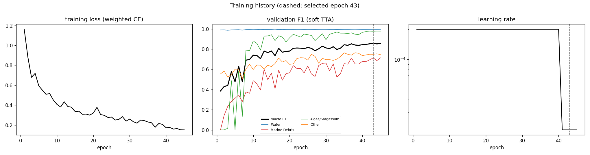
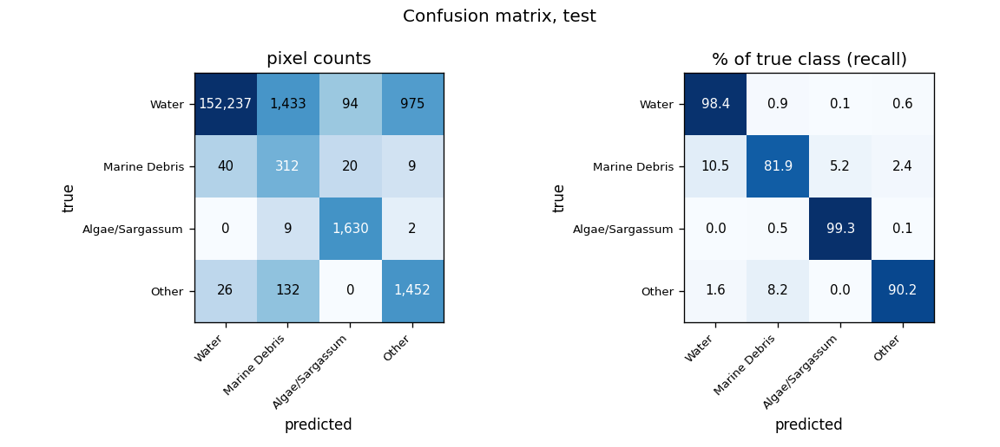
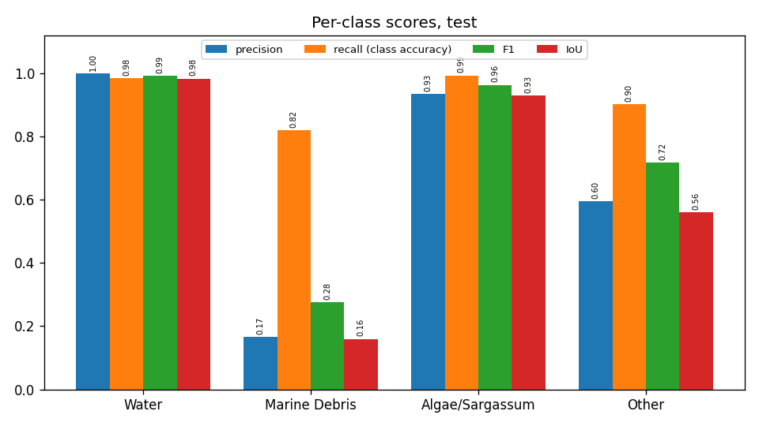
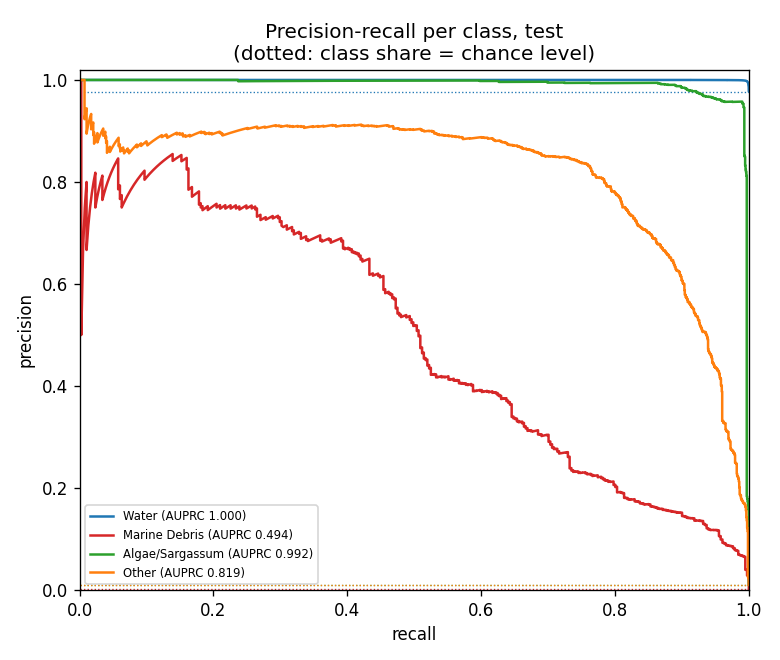
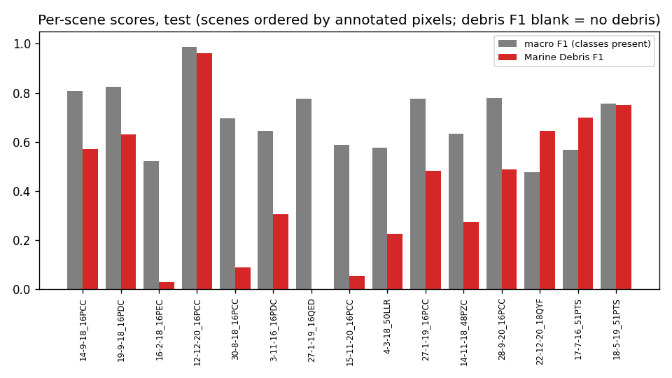
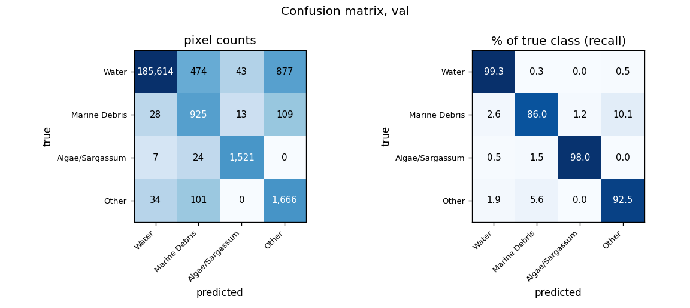
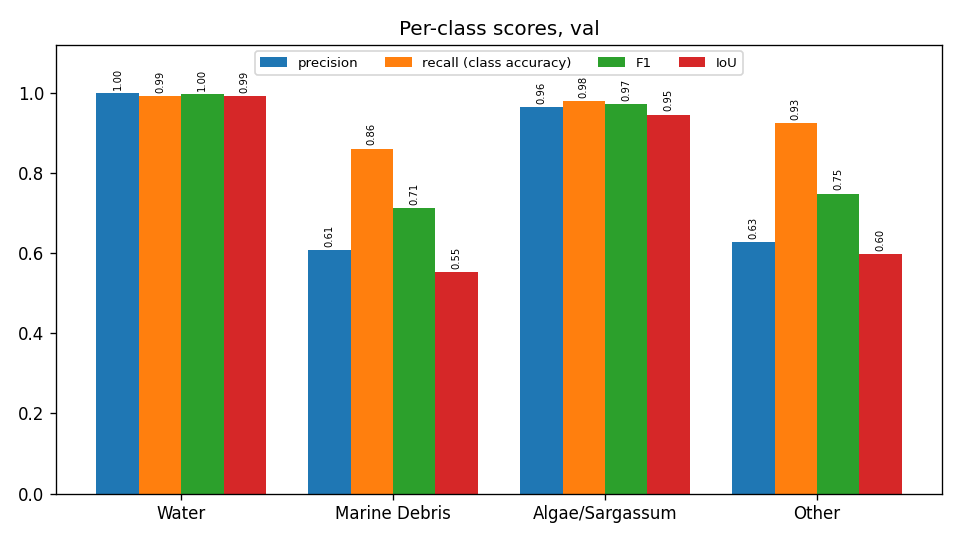
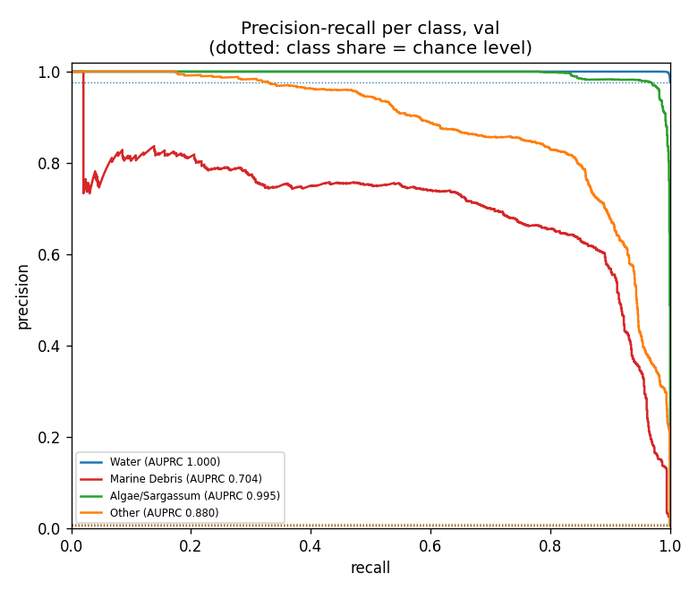
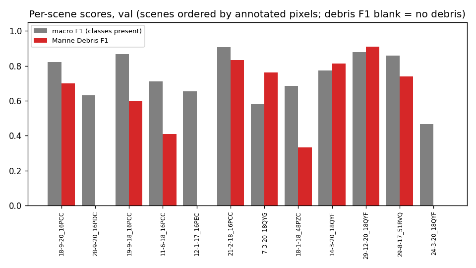
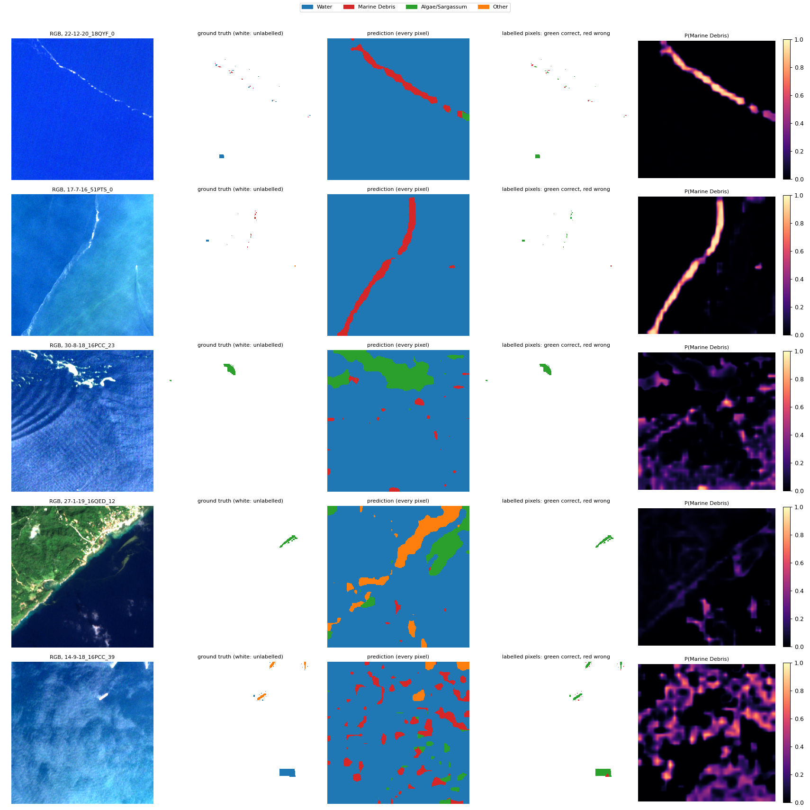

# Run R4_segnext_scratch_std: SegNeXt-T, from scratch, standardised bands, MARIDA, 4 classes

Inputs: 26 channels (B1, B2, B3, B4, B5, B6, B7, B8, B8A, B11, B12, NDVI, NDWI, FAI, FDI, NDMI, red/green, nir/red, nir/green, swir1/nir, glcm_contrast, glcm_dissimilarity, glcm_homogeneity, glcm_energy, glcm_correlation, glcm_asm). See `architecture.md` for the model and how the features are fed in.

Selected checkpoint: epoch 43 of 45 (best validation macro F1 with soft TTA, 0.8576).

## Test split (158,371 annotated pixels)

### Overall

| metric | value |
|---|---|
| OA | 0.9827 |
| balanced_accuracy | 0.9245 |
| kappa | 0.7120 |
| macro_precision | 0.6738 |
| macro_recall | 0.9245 |
| macro_F1 | 0.7368 |
| mIoU | 0.6578 |
| weighted_precision | 0.9928 |
| weighted_recall | 0.9827 |
| weighted_F1 | 0.9868 |
| micro_F1 | 0.9827 |
| macro_AUPRC | 0.8261 |

### Per class

| | support | share_% | predicted | TP | FP | FN | TN | precision | recall (class accuracy) | F1 | IoU | specificity | FP_per_TP | AUPRC |
|---|---|---|---|---|---|---|---|---|---|---|---|---|---|---|
| Water | 154739.0000 | 97.7067 | 152303.0000 | 152237.0000 | 66.0000 | 2502.0000 | 3566.0000 | 0.9996 | 0.9838 | 0.9916 | 0.9834 | 0.9818 | 0.0004 | 1.0000 |
| Marine Debris | 381.0000 | 0.2406 | 1886.0000 | 312.0000 | 1574.0000 | 69.0000 | 156416.0000 | 0.1654 | 0.8189 | 0.2753 | 0.1596 | 0.9900 | 5.0449 | 0.4938 |
| Algae/Sargassum | 1641.0000 | 1.0362 | 1744.0000 | 1630.0000 | 114.0000 | 11.0000 | 156616.0000 | 0.9346 | 0.9933 | 0.9631 | 0.9288 | 0.9993 | 0.0699 | 0.9916 |
| Other | 1610.0000 | 1.0166 | 2438.0000 | 1452.0000 | 986.0000 | 158.0000 | 155775.0000 | 0.5956 | 0.9019 | 0.7174 | 0.5593 | 0.9937 | 0.6791 | 0.8192 |

### Confusion matrix (rows true, columns predicted): counts / % of true class / % of predicted class

| | Water | Marine Debris | Algae/Sargassum | Other |
|---|---|---|---|---|
| Water | 152,237 | 1,433 | 94 | 975 |
| Marine Debris | 40 | 312 | 20 | 9 |
| Algae/Sargassum | 0 | 9 | 1,630 | 2 |
| Other | 26 | 132 | 0 | 1,452 |

| | Water | Marine Debris | Algae/Sargassum | Other |
|---|---|---|---|---|
| Water | 98.38 | 0.93 | 0.06 | 0.63 |
| Marine Debris | 10.50 | 81.89 | 5.25 | 2.36 |
| Algae/Sargassum | 0.00 | 0.55 | 99.33 | 0.12 |
| Other | 1.61 | 8.20 | 0.00 | 90.19 |

| | Water | Marine Debris | Algae/Sargassum | Other |
|---|---|---|---|---|
| Water | 99.96 | 75.98 | 5.39 | 39.99 |
| Marine Debris | 0.03 | 16.54 | 1.15 | 0.37 |
| Algae/Sargassum | 0.00 | 0.48 | 93.46 | 0.08 |
| Other | 0.02 | 7.00 | 0.00 | 59.56 |

### Per scene

`per_scene_test.csv` has every scene; the figure shows macro F1 (classes present) and debris F1.

## Val split (191,436 annotated pixels)

### Overall

| metric | value |
|---|---|
| OA | 0.9911 |
| balanced_accuracy | 0.9395 |
| kappa | 0.8290 |
| macro_precision | 0.7998 |
| macro_recall | 0.9395 |
| macro_F1 | 0.8571 |
| mIoU | 0.7721 |
| weighted_precision | 0.9936 |
| weighted_recall | 0.9911 |
| weighted_F1 | 0.9920 |
| micro_F1 | 0.9911 |
| macro_AUPRC | 0.8947 |

### Per class

| | support | share_% | predicted | TP | FP | FN | TN | precision | recall (class accuracy) | F1 | IoU | specificity | FP_per_TP | AUPRC |
|---|---|---|---|---|---|---|---|---|---|---|---|---|---|---|
| Water | 187008.0000 | 97.6870 | 185683.0000 | 185614.0000 | 69.0000 | 1394.0000 | 4359.0000 | 0.9996 | 0.9925 | 0.9961 | 0.9922 | 0.9844 | 0.0004 | 1.0000 |
| Marine Debris | 1075.0000 | 0.5615 | 1524.0000 | 925.0000 | 599.0000 | 150.0000 | 189762.0000 | 0.6070 | 0.8605 | 0.7118 | 0.5526 | 0.9969 | 0.6476 | 0.7042 |
| Algae/Sargassum | 1552.0000 | 0.8107 | 1577.0000 | 1521.0000 | 56.0000 | 31.0000 | 189828.0000 | 0.9645 | 0.9800 | 0.9722 | 0.9459 | 0.9997 | 0.0368 | 0.9948 |
| Other | 1801.0000 | 0.9408 | 2652.0000 | 1666.0000 | 986.0000 | 135.0000 | 188649.0000 | 0.6282 | 0.9250 | 0.7483 | 0.5978 | 0.9948 | 0.5918 | 0.8797 |

### Confusion matrix (rows true, columns predicted): counts / % of true class / % of predicted class

| | Water | Marine Debris | Algae/Sargassum | Other |
|---|---|---|---|---|
| Water | 185,614 | 474 | 43 | 877 |
| Marine Debris | 28 | 925 | 13 | 109 |
| Algae/Sargassum | 7 | 24 | 1,521 | 0 |
| Other | 34 | 101 | 0 | 1,666 |

| | Water | Marine Debris | Algae/Sargassum | Other |
|---|---|---|---|---|
| Water | 99.25 | 0.25 | 0.02 | 0.47 |
| Marine Debris | 2.60 | 86.05 | 1.21 | 10.14 |
| Algae/Sargassum | 0.45 | 1.55 | 98.00 | 0.00 |
| Other | 1.89 | 5.61 | 0.00 | 92.50 |

| | Water | Marine Debris | Algae/Sargassum | Other |
|---|---|---|---|---|
| Water | 99.96 | 31.10 | 2.73 | 33.07 |
| Marine Debris | 0.02 | 60.70 | 0.82 | 4.11 |
| Algae/Sargassum | 0.00 | 1.57 | 96.45 | 0.00 |
| Other | 0.02 | 6.63 | 0.00 | 62.82 |

### Per scene

`per_scene_val.csv` has every scene; the figure shows macro F1 (classes present) and debris F1.

## Example test patches

The same 6 test patches (most debris, algae and other pixels) in every run.

