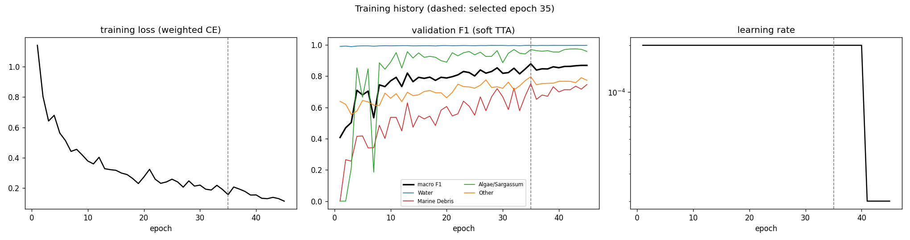
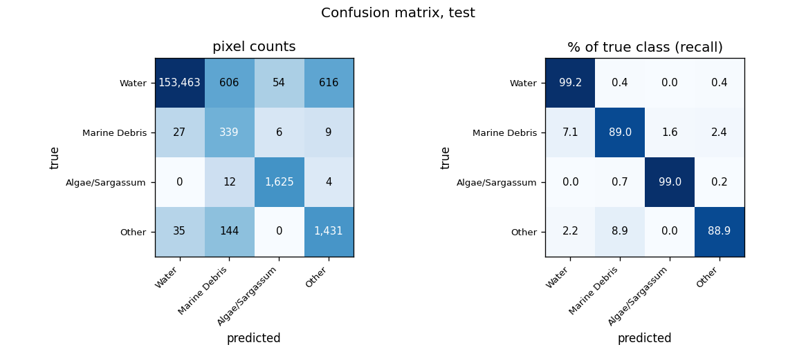
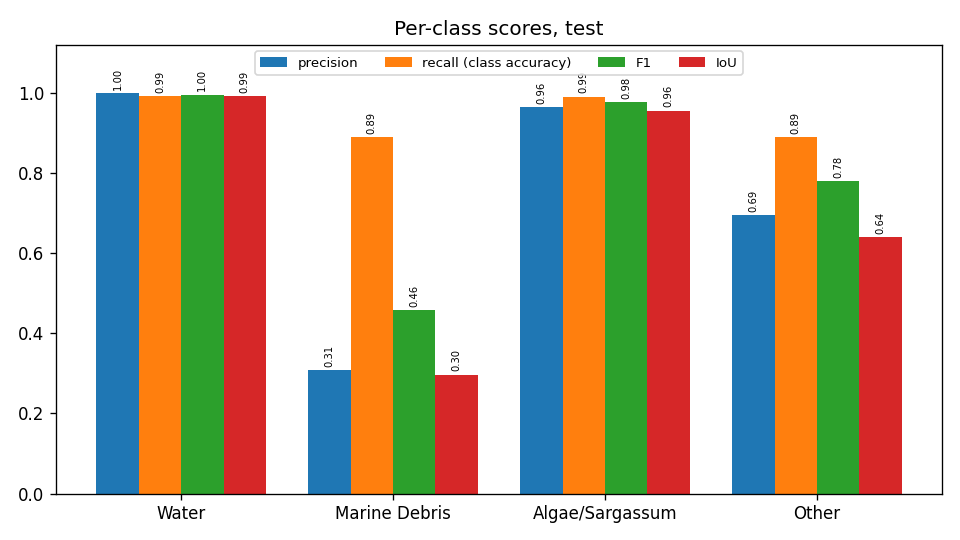
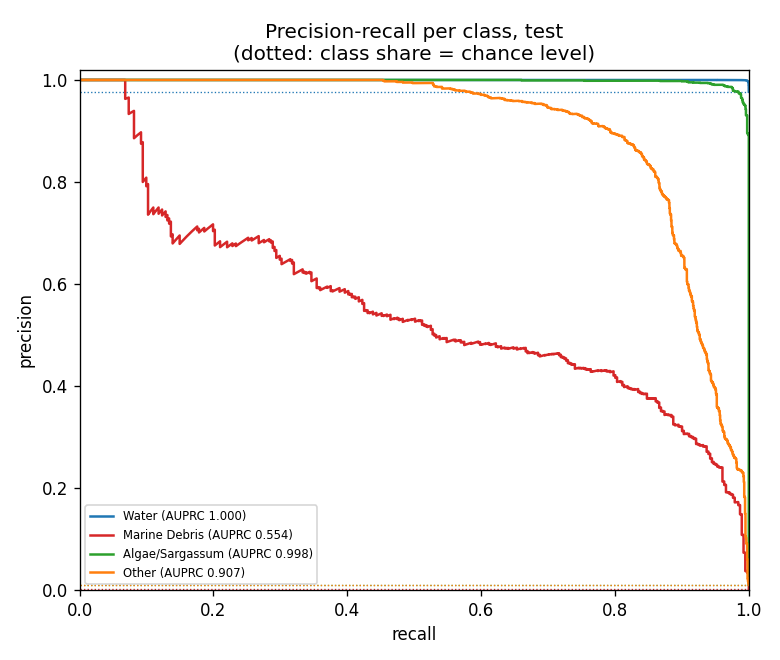
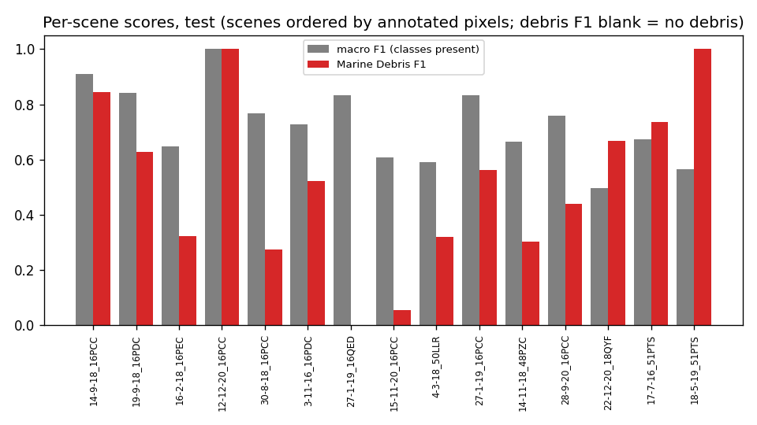
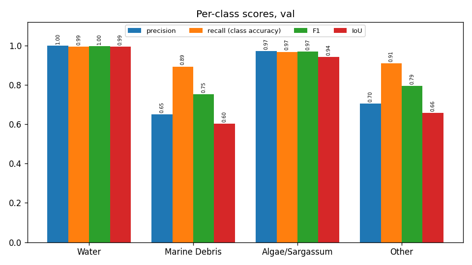
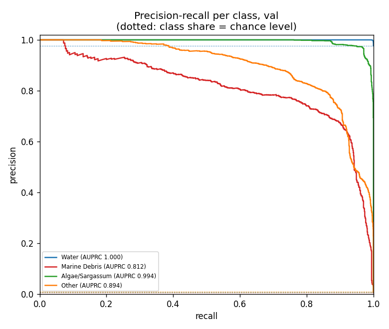
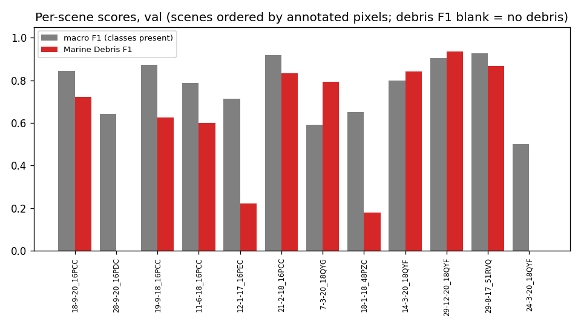
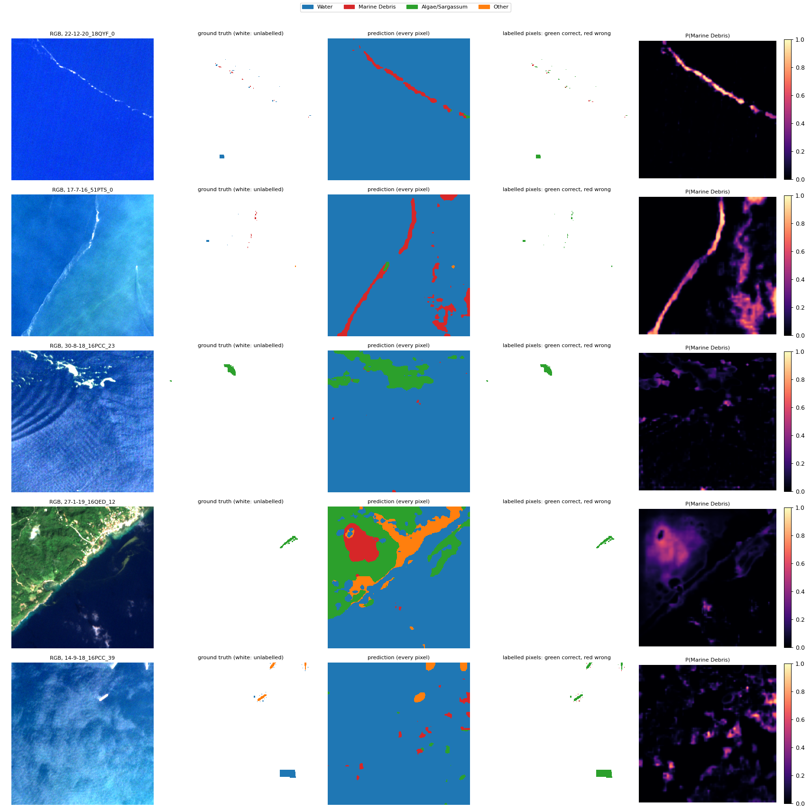

# Run R5_marinext_scratch_std: MariNeXt architecture, from scratch, standardised bands, MARIDA, 4 classes

Inputs: 26 channels (B1, B2, B3, B4, B5, B6, B7, B8, B8A, B11, B12, NDVI, NDWI, FAI, FDI, NDMI, red/green, nir/red, nir/green, swir1/nir, glcm_contrast, glcm_dissimilarity, glcm_homogeneity, glcm_energy, glcm_correlation, glcm_asm). See `architecture.md` for the model and how the features are fed in.

Selected checkpoint: epoch 35 of 45 (best validation macro F1 with soft TTA, 0.8789).

## Test split (158,371 annotated pixels)

### Overall

| metric | value |
|---|---|
| OA | 0.9904 |
| balanced_accuracy | 0.9401 |
| kappa | 0.8183 |
| macro_precision | 0.7416 |
| macro_recall | 0.9401 |
| macro_F1 | 0.8025 |
| mIoU | 0.7206 |
| weighted_precision | 0.9945 |
| weighted_recall | 0.9904 |
| weighted_F1 | 0.9920 |
| micro_F1 | 0.9904 |
| macro_AUPRC | 0.8647 |

### Per class

| | support | share_% | predicted | TP | FP | FN | TN | precision | recall (class accuracy) | F1 | IoU | specificity | FP_per_TP | AUPRC |
|---|---|---|---|---|---|---|---|---|---|---|---|---|---|---|
| Water | 154739.0000 | 97.7067 | 153525.0000 | 153463.0000 | 62.0000 | 1276.0000 | 3570.0000 | 0.9996 | 0.9918 | 0.9957 | 0.9914 | 0.9829 | 0.0004 | 1.0000 |
| Marine Debris | 381.0000 | 0.2406 | 1101.0000 | 339.0000 | 762.0000 | 42.0000 | 157228.0000 | 0.3079 | 0.8898 | 0.4575 | 0.2966 | 0.9952 | 2.2478 | 0.5538 |
| Algae/Sargassum | 1641.0000 | 1.0362 | 1685.0000 | 1625.0000 | 60.0000 | 16.0000 | 156670.0000 | 0.9644 | 0.9902 | 0.9771 | 0.9553 | 0.9996 | 0.0369 | 0.9981 |
| Other | 1610.0000 | 1.0166 | 2060.0000 | 1431.0000 | 629.0000 | 179.0000 | 156132.0000 | 0.6947 | 0.8888 | 0.7798 | 0.6391 | 0.9960 | 0.4396 | 0.9069 |

### Confusion matrix (rows true, columns predicted): counts / % of true class / % of predicted class

| | Water | Marine Debris | Algae/Sargassum | Other |
|---|---|---|---|---|
| Water | 153,463 | 606 | 54 | 616 |
| Marine Debris | 27 | 339 | 6 | 9 |
| Algae/Sargassum | 0 | 12 | 1,625 | 4 |
| Other | 35 | 144 | 0 | 1,431 |

| | Water | Marine Debris | Algae/Sargassum | Other |
|---|---|---|---|---|
| Water | 99.18 | 0.39 | 0.03 | 0.40 |
| Marine Debris | 7.09 | 88.98 | 1.57 | 2.36 |
| Algae/Sargassum | 0.00 | 0.73 | 99.02 | 0.24 |
| Other | 2.17 | 8.94 | 0.00 | 88.88 |

| | Water | Marine Debris | Algae/Sargassum | Other |
|---|---|---|---|---|
| Water | 99.96 | 55.04 | 3.20 | 29.90 |
| Marine Debris | 0.02 | 30.79 | 0.36 | 0.44 |
| Algae/Sargassum | 0.00 | 1.09 | 96.44 | 0.19 |
| Other | 0.02 | 13.08 | 0.00 | 69.47 |

### Per scene

`per_scene_test.csv` has every scene; the figure shows macro F1 (classes present) and debris F1.

## Val split (191,436 annotated pixels)

### Overall

| metric | value |
|---|---|
| OA | 0.9932 |
| balanced_accuracy | 0.9413 |
| kappa | 0.8639 |
| macro_precision | 0.8314 |
| macro_recall | 0.9413 |
| macro_F1 | 0.8783 |
| mIoU | 0.7992 |
| weighted_precision | 0.9947 |
| weighted_recall | 0.9932 |
| weighted_F1 | 0.9937 |
| micro_F1 | 0.9932 |
| macro_AUPRC | 0.9251 |

### Per class

| | support | share_% | predicted | TP | FP | FN | TN | precision | recall (class accuracy) | F1 | IoU | specificity | FP_per_TP | AUPRC |
|---|---|---|---|---|---|---|---|---|---|---|---|---|---|---|
| Water | 187008.0000 | 97.6870 | 186087.0000 | 186028.0000 | 59.0000 | 980.0000 | 4369.0000 | 0.9997 | 0.9948 | 0.9972 | 0.9944 | 0.9867 | 0.0003 | 1.0000 |
| Marine Debris | 1075.0000 | 0.5615 | 1478.0000 | 960.0000 | 518.0000 | 115.0000 | 189843.0000 | 0.6495 | 0.8930 | 0.7521 | 0.6026 | 0.9973 | 0.5396 | 0.8121 |
| Algae/Sargassum | 1552.0000 | 0.8107 | 1545.0000 | 1502.0000 | 43.0000 | 50.0000 | 189841.0000 | 0.9722 | 0.9678 | 0.9700 | 0.9417 | 0.9998 | 0.0286 | 0.9944 |
| Other | 1801.0000 | 0.9408 | 2326.0000 | 1638.0000 | 688.0000 | 163.0000 | 188947.0000 | 0.7042 | 0.9095 | 0.7938 | 0.6581 | 0.9964 | 0.4200 | 0.8941 |

### Confusion matrix (rows true, columns predicted): counts / % of true class / % of predicted class

| | Water | Marine Debris | Algae/Sargassum | Other |
|---|---|---|---|---|
| Water | 186,028 | 358 | 29 | 593 |
| Marine Debris | 22 | 960 | 14 | 79 |
| Algae/Sargassum | 5 | 29 | 1,502 | 16 |
| Other | 32 | 131 | 0 | 1,638 |

| | Water | Marine Debris | Algae/Sargassum | Other |
|---|---|---|---|---|
| Water | 99.48 | 0.19 | 0.02 | 0.32 |
| Marine Debris | 2.05 | 89.30 | 1.30 | 7.35 |
| Algae/Sargassum | 0.32 | 1.87 | 96.78 | 1.03 |
| Other | 1.78 | 7.27 | 0.00 | 90.95 |

| | Water | Marine Debris | Algae/Sargassum | Other |
|---|---|---|---|---|
| Water | 99.97 | 24.22 | 1.88 | 25.49 |
| Marine Debris | 0.01 | 64.95 | 0.91 | 3.40 |
| Algae/Sargassum | 0.00 | 1.96 | 97.22 | 0.69 |
| Other | 0.02 | 8.86 | 0.00 | 70.42 |

### Per scene

`per_scene_val.csv` has every scene; the figure shows macro F1 (classes present) and debris F1.

## Example test patches

The same 6 test patches (most debris, algae and other pixels) in every run.

