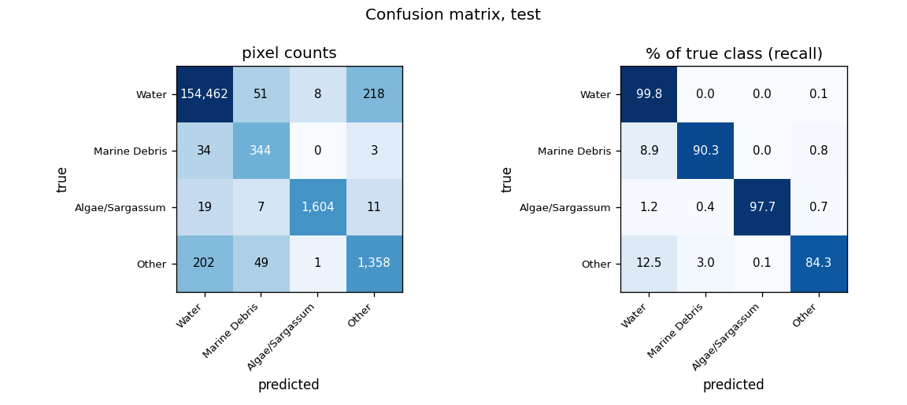
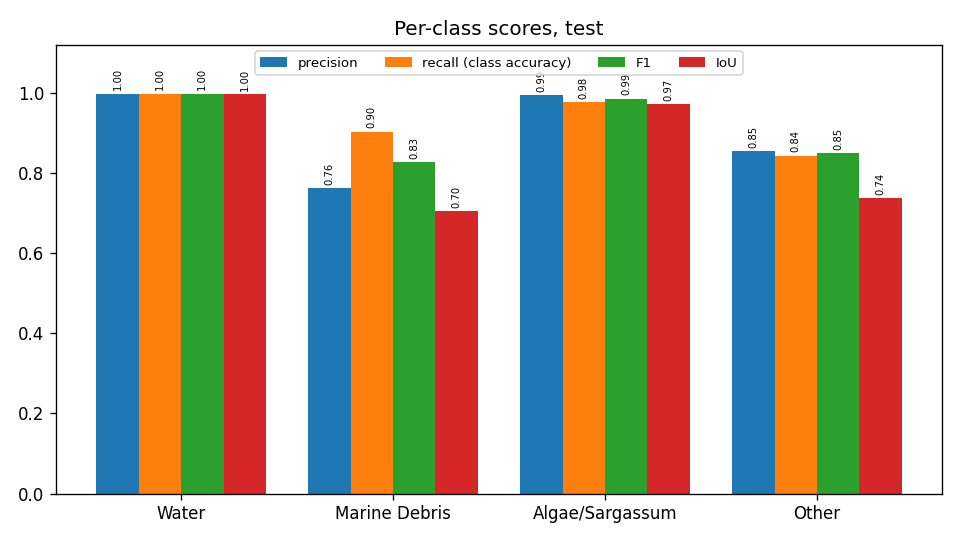
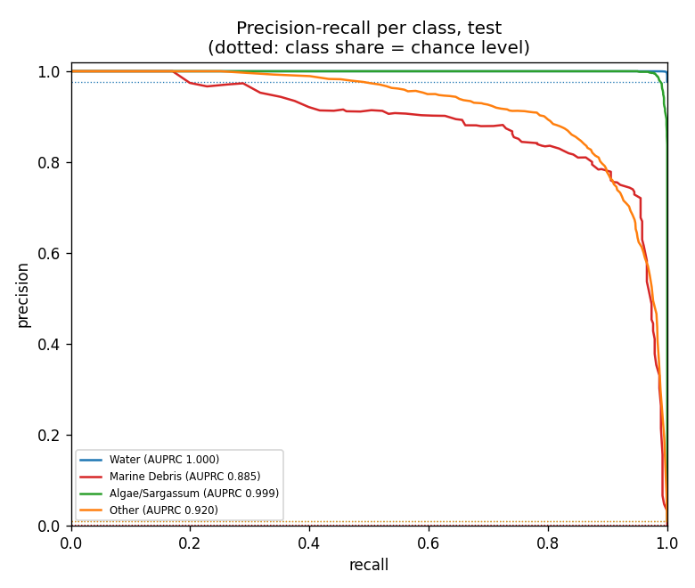
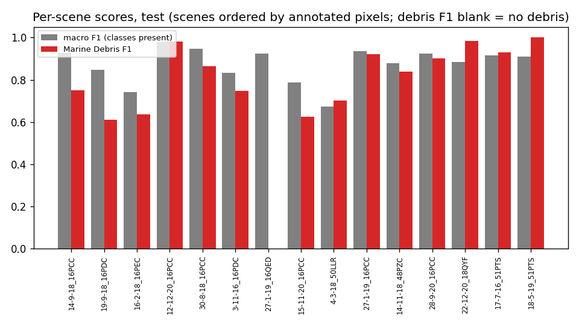
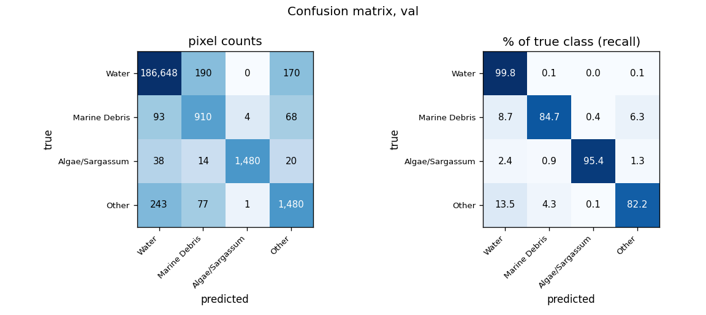
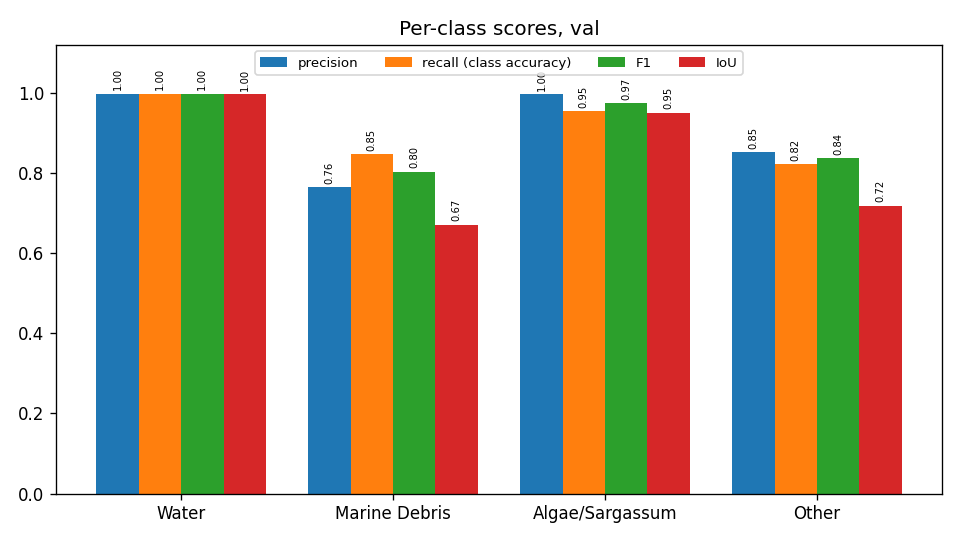
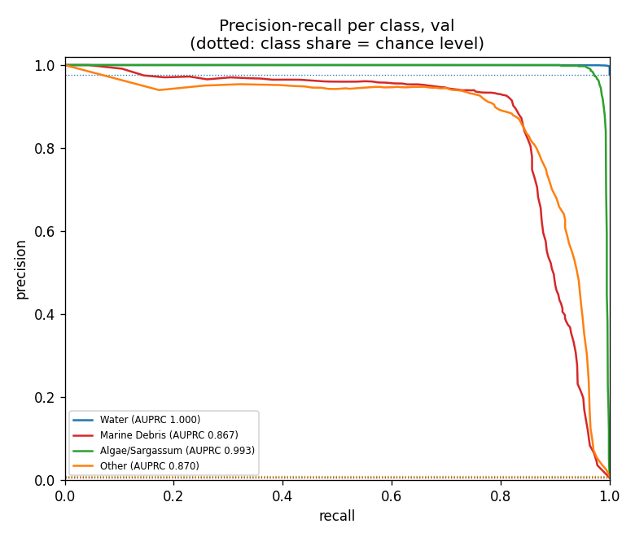
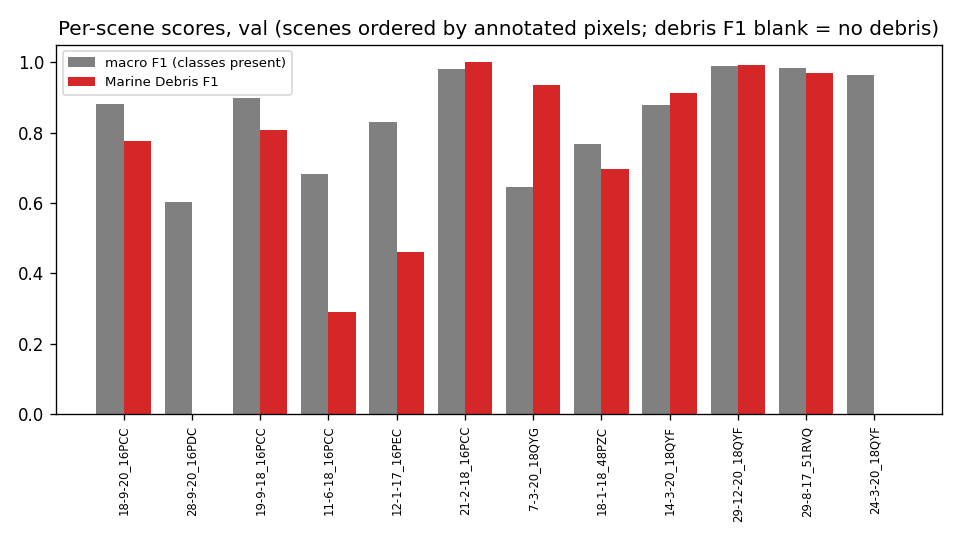
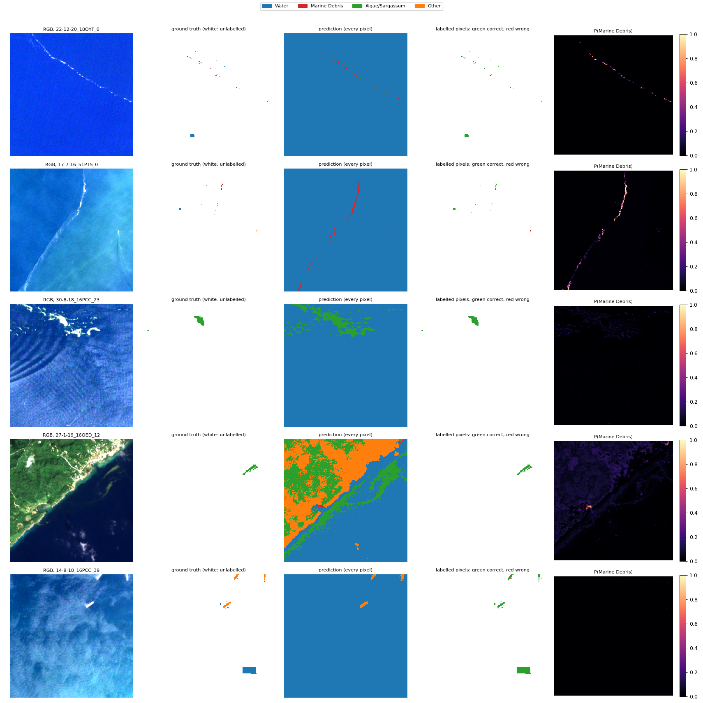

# Run R6_rf: Random Forest on the 26 features, MARIDA, 4 classes

Inputs: 26 channels (B1, B2, B3, B4, B5, B6, B7, B8, B8A, B11, B12, NDVI, NDWI, FAI, FDI, NDMI, red/green, nir/red, nir/green, swir1/nir, glcm_contrast, glcm_dissimilarity, glcm_homogeneity, glcm_energy, glcm_correlation, glcm_asm). See `architecture.md` for the model and how the features are fed in.

Random Forest as in the staged ML: 100 trees, seed 42, log class weights (Water 1.436, Marine Debris 28.729, Algae/Sargassum 28.689, Other 24.025) as sample weights, all 358,442 annotated train pixels, fitted in 49 s. Impurity importance in `impurity_importance.csv` (SHAP in the XAI step).

## Test split (158,371 annotated pixels)

### Overall

| metric | value |
|---|---|
| OA | 0.9962 |
| balanced_accuracy | 0.9305 |
| kappa | 0.9159 |
| macro_precision | 0.9024 |
| macro_recall | 0.9305 |
| macro_F1 | 0.9150 |
| mIoU | 0.8527 |
| weighted_precision | 0.9963 |
| weighted_recall | 0.9962 |
| weighted_F1 | 0.9962 |
| micro_F1 | 0.9962 |
| macro_AUPRC | 0.9510 |

### Per class

| | support | share_% | predicted | TP | FP | FN | TN | precision | recall (class accuracy) | F1 | IoU | specificity | FP_per_TP | AUPRC |
|---|---|---|---|---|---|---|---|---|---|---|---|---|---|---|
| Water | 154739.0000 | 97.7067 | 154717.0000 | 154462.0000 | 255.0000 | 277.0000 | 3377.0000 | 0.9984 | 0.9982 | 0.9983 | 0.9966 | 0.9298 | 0.0017 | 1.0000 |
| Marine Debris | 381.0000 | 0.2406 | 451.0000 | 344.0000 | 107.0000 | 37.0000 | 157883.0000 | 0.7627 | 0.9029 | 0.8269 | 0.7049 | 0.9993 | 0.3110 | 0.8853 |
| Algae/Sargassum | 1641.0000 | 1.0362 | 1613.0000 | 1604.0000 | 9.0000 | 37.0000 | 156721.0000 | 0.9944 | 0.9775 | 0.9859 | 0.9721 | 0.9999 | 0.0056 | 0.9990 |
| Other | 1610.0000 | 1.0166 | 1590.0000 | 1358.0000 | 232.0000 | 252.0000 | 156529.0000 | 0.8541 | 0.8435 | 0.8488 | 0.7372 | 0.9985 | 0.1708 | 0.9197 |

### Confusion matrix (rows true, columns predicted): counts / % of true class / % of predicted class

| | Water | Marine Debris | Algae/Sargassum | Other |
|---|---|---|---|---|
| Water | 154,462 | 51 | 8 | 218 |
| Marine Debris | 34 | 344 | 0 | 3 |
| Algae/Sargassum | 19 | 7 | 1,604 | 11 |
| Other | 202 | 49 | 1 | 1,358 |

| | Water | Marine Debris | Algae/Sargassum | Other |
|---|---|---|---|---|
| Water | 99.82 | 0.03 | 0.01 | 0.14 |
| Marine Debris | 8.92 | 90.29 | 0.00 | 0.79 |
| Algae/Sargassum | 1.16 | 0.43 | 97.75 | 0.67 |
| Other | 12.55 | 3.04 | 0.06 | 84.35 |

| | Water | Marine Debris | Algae/Sargassum | Other |
|---|---|---|---|---|
| Water | 99.84 | 11.31 | 0.50 | 13.71 |
| Marine Debris | 0.02 | 76.27 | 0.00 | 0.19 |
| Algae/Sargassum | 0.01 | 1.55 | 99.44 | 0.69 |
| Other | 0.13 | 10.86 | 0.06 | 85.41 |

### Per scene

`per_scene_test.csv` has every scene; the figure shows macro F1 (classes present) and debris F1.

## Val split (191,436 annotated pixels)

### Overall

| metric | value |
|---|---|
| OA | 0.9952 |
| balanced_accuracy | 0.9050 |
| kappa | 0.8945 |
| macro_precision | 0.9026 |
| macro_recall | 0.9050 |
| macro_F1 | 0.9031 |
| mIoU | 0.8341 |
| weighted_precision | 0.9953 |
| weighted_recall | 0.9952 |
| weighted_F1 | 0.9952 |
| micro_F1 | 0.9952 |
| macro_AUPRC | 0.9326 |

### Per class

| | support | share_% | predicted | TP | FP | FN | TN | precision | recall (class accuracy) | F1 | IoU | specificity | FP_per_TP | AUPRC |
|---|---|---|---|---|---|---|---|---|---|---|---|---|---|---|
| Water | 187008.0000 | 97.6870 | 187022.0000 | 186648.0000 | 374.0000 | 360.0000 | 4054.0000 | 0.9980 | 0.9981 | 0.9980 | 0.9961 | 0.9155 | 0.0020 | 0.9999 |
| Marine Debris | 1075.0000 | 0.5615 | 1191.0000 | 910.0000 | 281.0000 | 165.0000 | 190080.0000 | 0.7641 | 0.8465 | 0.8032 | 0.6711 | 0.9985 | 0.3088 | 0.8673 |
| Algae/Sargassum | 1552.0000 | 0.8107 | 1485.0000 | 1480.0000 | 5.0000 | 72.0000 | 189879.0000 | 0.9966 | 0.9536 | 0.9746 | 0.9505 | 1.0000 | 0.0034 | 0.9934 |
| Other | 1801.0000 | 0.9408 | 1738.0000 | 1480.0000 | 258.0000 | 321.0000 | 189377.0000 | 0.8516 | 0.8218 | 0.8364 | 0.7188 | 0.9986 | 0.1743 | 0.8700 |

### Confusion matrix (rows true, columns predicted): counts / % of true class / % of predicted class

| | Water | Marine Debris | Algae/Sargassum | Other |
|---|---|---|---|---|
| Water | 186,648 | 190 | 0 | 170 |
| Marine Debris | 93 | 910 | 4 | 68 |
| Algae/Sargassum | 38 | 14 | 1,480 | 20 |
| Other | 243 | 77 | 1 | 1,480 |

| | Water | Marine Debris | Algae/Sargassum | Other |
|---|---|---|---|---|
| Water | 99.81 | 0.10 | 0.00 | 0.09 |
| Marine Debris | 8.65 | 84.65 | 0.37 | 6.33 |
| Algae/Sargassum | 2.45 | 0.90 | 95.36 | 1.29 |
| Other | 13.49 | 4.28 | 0.06 | 82.18 |

| | Water | Marine Debris | Algae/Sargassum | Other |
|---|---|---|---|---|
| Water | 99.80 | 15.95 | 0.00 | 9.78 |
| Marine Debris | 0.05 | 76.41 | 0.27 | 3.91 |
| Algae/Sargassum | 0.02 | 1.18 | 99.66 | 1.15 |
| Other | 0.13 | 6.47 | 0.07 | 85.16 |

### Per scene

`per_scene_val.csv` has every scene; the figure shows macro F1 (classes present) and debris F1.

## Example test patches

The same 6 test patches (most debris, algae and other pixels) in every run.

