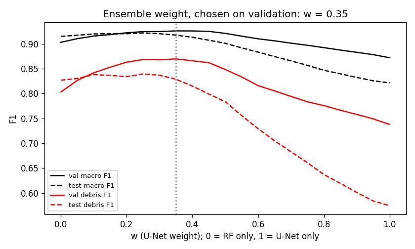
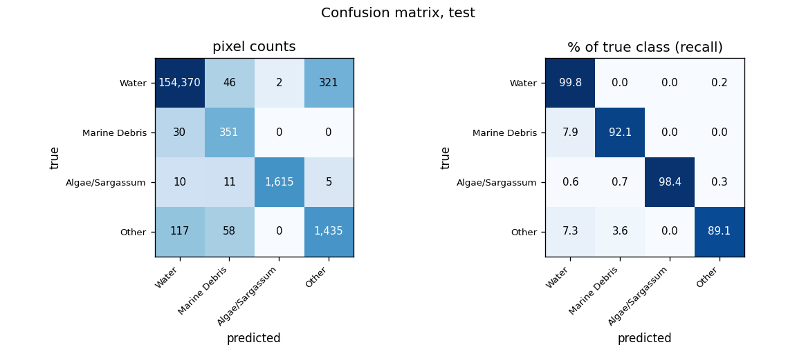
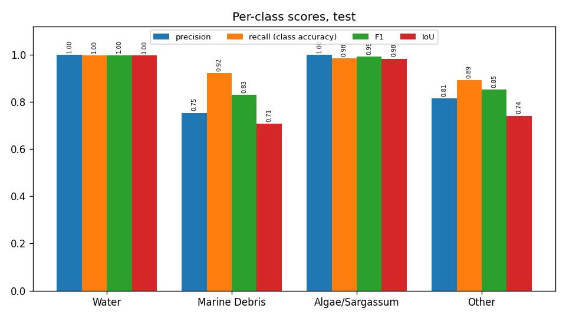
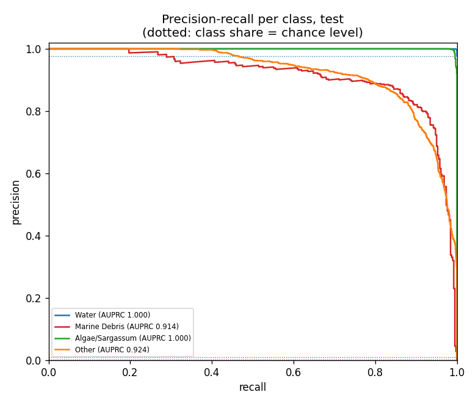
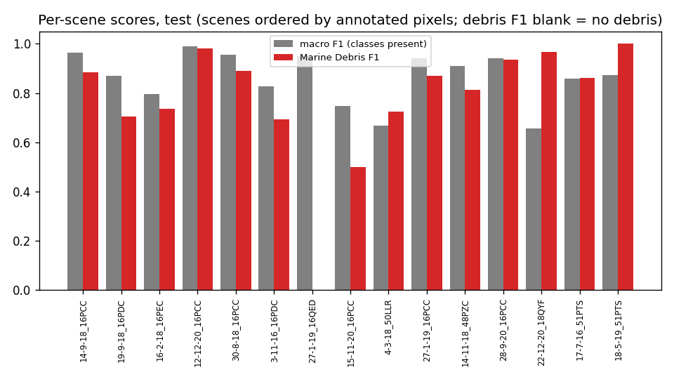
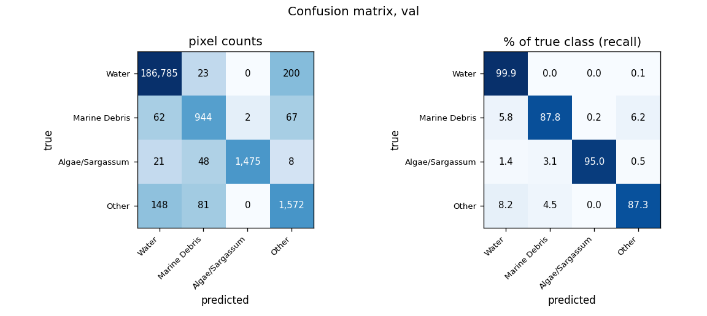
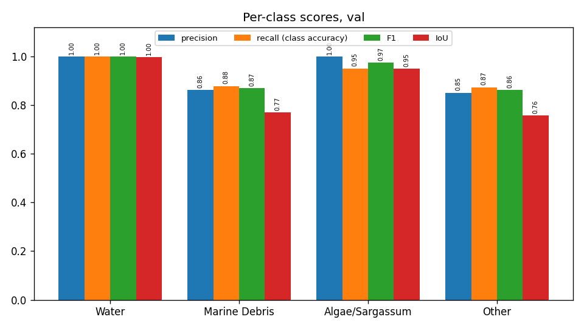
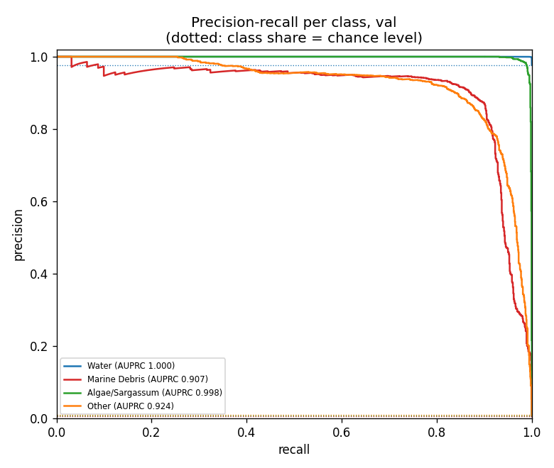
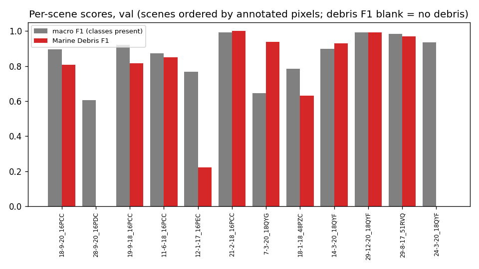
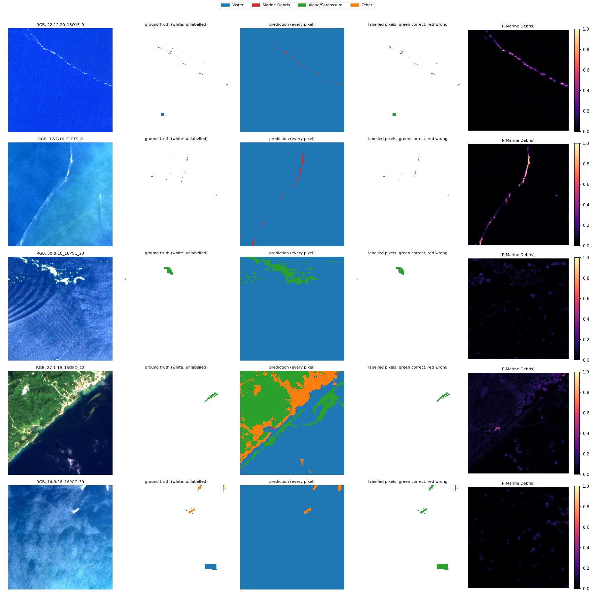

# Run R7_ensemble_unet_rf: U-Net (R1_unet_ssl4eo_raw) + Random Forest (R6_rf) ensemble, MARIDA, 4 classes

Inputs: 26 channels (B1, B2, B3, B4, B5, B6, B7, B8, B8A, B11, B12, NDVI, NDWI, FAI, FDI, NDMI, red/green, nir/red, nir/green, swir1/nir, glcm_contrast, glcm_dissimilarity, glcm_homogeneity, glcm_energy, glcm_correlation, glcm_asm). See `architecture.md` for the model and how the features are fed in.

p = w · p_U-Net + (1 − w) · p_RF with w = 0.35, chosen by validation macro F1 over w = 0, 0.05, …, 1 (`weight_curve.csv`).

## Test split (158,371 annotated pixels)

### Overall

| metric | value |
|---|---|
| OA | 0.9962 |
| balanced_accuracy | 0.9486 |
| kappa | 0.9184 |
| macro_precision | 0.8915 |
| macro_recall | 0.9486 |
| macro_F1 | 0.9175 |
| mIoU | 0.8571 |
| weighted_precision | 0.9965 |
| weighted_recall | 0.9962 |
| weighted_F1 | 0.9963 |
| micro_F1 | 0.9962 |
| macro_AUPRC | 0.9595 |

### Per class

| | support | share_% | predicted | TP | FP | FN | TN | precision | recall (class accuracy) | F1 | IoU | specificity | FP_per_TP | AUPRC |
|---|---|---|---|---|---|---|---|---|---|---|---|---|---|---|
| Water | 154739.0000 | 97.7067 | 154527.0000 | 154370.0000 | 157.0000 | 369.0000 | 3475.0000 | 0.9990 | 0.9976 | 0.9983 | 0.9966 | 0.9568 | 0.0010 | 1.0000 |
| Marine Debris | 381.0000 | 0.2406 | 466.0000 | 351.0000 | 115.0000 | 30.0000 | 157875.0000 | 0.7532 | 0.9213 | 0.8288 | 0.7077 | 0.9993 | 0.3276 | 0.9143 |
| Algae/Sargassum | 1641.0000 | 1.0362 | 1617.0000 | 1615.0000 | 2.0000 | 26.0000 | 156728.0000 | 0.9988 | 0.9842 | 0.9914 | 0.9830 | 1.0000 | 0.0012 | 0.9997 |
| Other | 1610.0000 | 1.0166 | 1761.0000 | 1435.0000 | 326.0000 | 175.0000 | 156435.0000 | 0.8149 | 0.8913 | 0.8514 | 0.7412 | 0.9979 | 0.2272 | 0.9240 |

### Confusion matrix (rows true, columns predicted): counts / % of true class / % of predicted class

| | Water | Marine Debris | Algae/Sargassum | Other |
|---|---|---|---|---|
| Water | 154,370 | 46 | 2 | 321 |
| Marine Debris | 30 | 351 | 0 | 0 |
| Algae/Sargassum | 10 | 11 | 1,615 | 5 |
| Other | 117 | 58 | 0 | 1,435 |

| | Water | Marine Debris | Algae/Sargassum | Other |
|---|---|---|---|---|
| Water | 99.76 | 0.03 | 0.00 | 0.21 |
| Marine Debris | 7.87 | 92.13 | 0.00 | 0.00 |
| Algae/Sargassum | 0.61 | 0.67 | 98.42 | 0.30 |
| Other | 7.27 | 3.60 | 0.00 | 89.13 |

| | Water | Marine Debris | Algae/Sargassum | Other |
|---|---|---|---|---|
| Water | 99.90 | 9.87 | 0.12 | 18.23 |
| Marine Debris | 0.02 | 75.32 | 0.00 | 0.00 |
| Algae/Sargassum | 0.01 | 2.36 | 99.88 | 0.28 |
| Other | 0.08 | 12.45 | 0.00 | 81.49 |

### Per scene

`per_scene_test.csv` has every scene; the figure shows macro F1 (classes present) and debris F1.

## Val split (191,436 annotated pixels)

### Overall

| metric | value |
|---|---|
| OA | 0.9966 |
| balanced_accuracy | 0.9250 |
| kappa | 0.9242 |
| macro_precision | 0.9275 |
| macro_recall | 0.9250 |
| macro_F1 | 0.9260 |
| mIoU | 0.8683 |
| weighted_precision | 0.9966 |
| weighted_recall | 0.9966 |
| weighted_F1 | 0.9966 |
| micro_F1 | 0.9966 |
| macro_AUPRC | 0.9573 |

### Per class

| | support | share_% | predicted | TP | FP | FN | TN | precision | recall (class accuracy) | F1 | IoU | specificity | FP_per_TP | AUPRC |
|---|---|---|---|---|---|---|---|---|---|---|---|---|---|---|
| Water | 187008.0000 | 97.6870 | 187016.0000 | 186785.0000 | 231.0000 | 223.0000 | 4197.0000 | 0.9988 | 0.9988 | 0.9988 | 0.9976 | 0.9478 | 0.0012 | 1.0000 |
| Marine Debris | 1075.0000 | 0.5615 | 1096.0000 | 944.0000 | 152.0000 | 131.0000 | 190209.0000 | 0.8613 | 0.8781 | 0.8696 | 0.7694 | 0.9992 | 0.1610 | 0.9074 |
| Algae/Sargassum | 1552.0000 | 0.8107 | 1477.0000 | 1475.0000 | 2.0000 | 77.0000 | 189882.0000 | 0.9986 | 0.9504 | 0.9739 | 0.9492 | 1.0000 | 0.0014 | 0.9981 |
| Other | 1801.0000 | 0.9408 | 1847.0000 | 1572.0000 | 275.0000 | 229.0000 | 189360.0000 | 0.8511 | 0.8728 | 0.8618 | 0.7572 | 0.9985 | 0.1749 | 0.9239 |

### Confusion matrix (rows true, columns predicted): counts / % of true class / % of predicted class

| | Water | Marine Debris | Algae/Sargassum | Other |
|---|---|---|---|---|
| Water | 186,785 | 23 | 0 | 200 |
| Marine Debris | 62 | 944 | 2 | 67 |
| Algae/Sargassum | 21 | 48 | 1,475 | 8 |
| Other | 148 | 81 | 0 | 1,572 |

| | Water | Marine Debris | Algae/Sargassum | Other |
|---|---|---|---|---|
| Water | 99.88 | 0.01 | 0.00 | 0.11 |
| Marine Debris | 5.77 | 87.81 | 0.19 | 6.23 |
| Algae/Sargassum | 1.35 | 3.09 | 95.04 | 0.52 |
| Other | 8.22 | 4.50 | 0.00 | 87.28 |

| | Water | Marine Debris | Algae/Sargassum | Other |
|---|---|---|---|---|
| Water | 99.88 | 2.10 | 0.00 | 10.83 |
| Marine Debris | 0.03 | 86.13 | 0.14 | 3.63 |
| Algae/Sargassum | 0.01 | 4.38 | 99.86 | 0.43 |
| Other | 0.08 | 7.39 | 0.00 | 85.11 |

### Per scene

`per_scene_val.csv` has every scene; the figure shows macro F1 (classes present) and debris F1.

## Example test patches

The same 6 test patches (most debris, algae and other pixels) in every run.

