# XAI, run R1_unet_ssl4eo_raw

Explained output: for class c, the sum of P(c) over the pixels labelled c in a test patch. Importance = mean |SHAP| at the class-c pixels; share = importance / sum over features. Direction (in brackets) = Spearman correlation between the feature value and its SHAP value at the class-c pixels: + means high values push towards the class. Group values add the SHAP values of a group's features at each pixel first. Correlated features share credit (see `features/correlation/`), so read single features together with the grouped results.

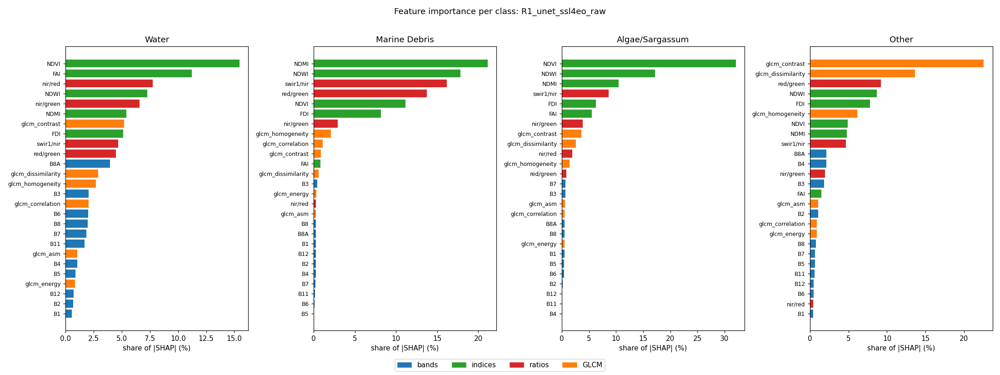

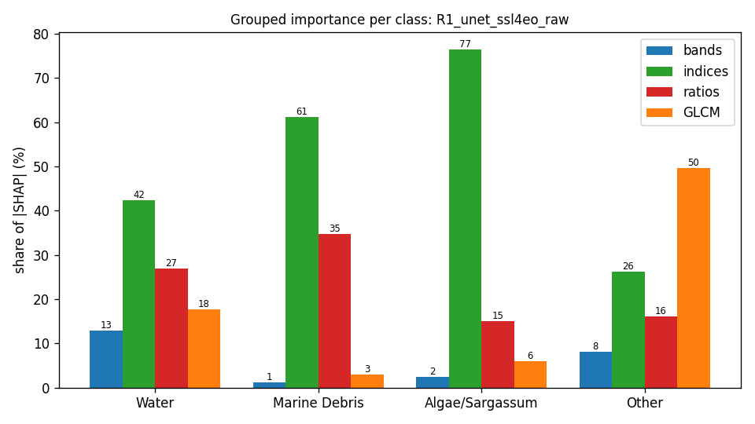

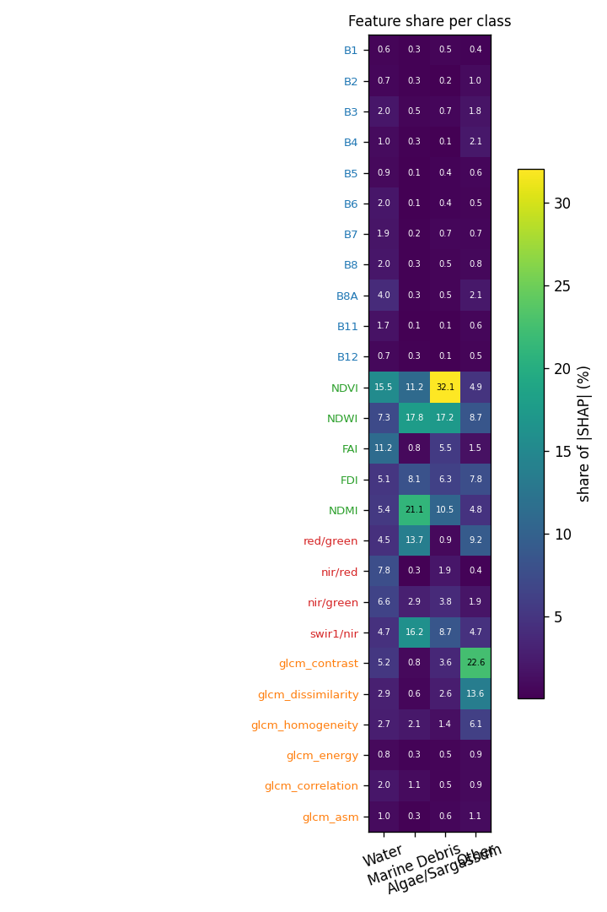

## Grouped importance (share of |SHAP|, %)

| group | Water | Marine Debris | Algae/Sargassum | Other |
|---|---|---|---|---|
| bands | 12.9 | 1.2 | 2.5 | 8.0 |
| indices | 42.4 | 61.2 | 76.5 | 26.3 |
| ratios | 27.0 | 34.8 | 15.0 | 16.0 |
| GLCM | 17.8 | 2.9 | 6.0 | 49.7 |

## Feature importance (share of |SHAP|, %; direction = Spearman of value vs SHAP)

| feature | group | Water | Marine Debris | Algae/Sargassum | Other |
|---|---|---|---|---|---|
| B1 | bands | 0.6 (-0.26) | 0.3 (+0.70) | 0.5 (+0.46) | 0.4 (-0.77) |
| B2 | bands | 0.7 (-0.06) | 0.3 (+0.78) | 0.2 (+0.24) | 1.0 (+0.72) |
| B3 | bands | 2.0 (+0.31) | 0.5 (-0.79) | 0.7 (-0.59) | 1.8 (+0.38) |
| B4 | bands | 1.0 (+0.36) | 0.3 (+0.66) | 0.1 (-0.14) | 2.1 (+0.80) |
| B5 | bands | 0.9 (+0.18) | 0.1 (-0.29) | 0.4 (-0.64) | 0.6 (+0.20) |
| B6 | bands | 2.0 (+0.16) | 0.1 (+0.54) | 0.4 (-0.32) | 0.5 (-0.16) |
| B7 | bands | 1.9 (+0.12) | 0.2 (+0.71) | 0.7 (-0.67) | 0.7 (+0.30) |
| B8 | bands | 2.0 (+0.14) | 0.3 (+0.57) | 0.5 (+0.06) | 0.8 (+0.01) |
| B8A | bands | 4.0 (+0.02) | 0.3 (+0.67) | 0.5 (-0.12) | 2.1 (+0.64) |
| B11 | bands | 1.7 (+0.16) | 0.1 (-0.46) | 0.1 (-0.18) | 0.6 (-0.15) |
| B12 | bands | 0.7 (-0.02) | 0.3 (+0.43) | 0.1 (+0.15) | 0.5 (+0.44) |
| NDVI | indices | 15.5 (+0.02) | 11.2 (+0.77) | 32.1 (+0.77) | 4.9 (+0.43) |
| NDWI | indices | 7.3 (-0.02) | 17.8 (-0.57) | 17.2 (-0.80) | 8.7 (-0.53) |
| FAI | indices | 11.2 (-0.38) | 0.8 (+0.74) | 5.5 (+0.92) | 1.5 (-0.66) |
| FDI | indices | 5.1 (-0.07) | 8.1 (+0.76) | 6.3 (+0.14) | 7.8 (+0.36) |
| NDMI | indices | 5.4 (-0.03) | 21.1 (+0.47) | 10.5 (+0.46) | 4.8 (-0.36) |
| red/green | ratios | 4.5 (+0.14) | 13.7 (+0.53) | 0.9 (-0.22) | 9.2 (+0.47) |
| nir/red | ratios | 7.8 (-0.01) | 0.3 (+0.17) | 1.9 (+0.28) | 0.4 (-0.61) |
| nir/green | ratios | 6.6 (+0.15) | 2.9 (+0.63) | 3.8 (+0.61) | 1.9 (+0.59) |
| swir1/nir | ratios | 4.7 (+0.12) | 16.2 (-0.37) | 8.7 (-0.44) | 4.7 (+0.42) |
| glcm_contrast | GLCM | 5.2 (+0.18) | 0.8 (-0.59) | 3.6 (-0.82) | 22.6 (+0.67) |
| glcm_dissimilarity | GLCM | 2.9 (+0.13) | 0.6 (+0.62) | 2.6 (-0.83) | 13.6 (+0.71) |
| glcm_homogeneity | GLCM | 2.7 (-0.01) | 2.1 (-0.85) | 1.4 (-0.41) | 6.1 (-0.21) |
| glcm_energy | GLCM | 0.8 (-0.09) | 0.3 (+0.68) | 0.5 (-0.37) | 0.9 (+0.21) |
| glcm_correlation | GLCM | 2.0 (+0.43) | 1.1 (-0.52) | 0.5 (-0.34) | 0.9 (+0.57) |
| glcm_asm | GLCM | 1.0 (+0.03) | 0.3 (-0.17) | 0.6 (-0.14) | 1.1 (-0.11) |

## Completeness check (GradientSHAP)

Sum of attributions vs S_c(x) − mean S_c(baseline) over 267 patch × class cases: correlation 0.981, median relative error 19.7 % (32 samples, 20 baselines). `completeness.csv` has every case.

## Context share

Median share of |attribution| that lies on pixels that are not the explained class (the model using the surroundings):

| class | context share (%) |
|---|---|
| Water | 89.0 |
| Marine Debris | 92.8 |
| Algae/Sargassum | 60.3 |
| Other | 86.7 |

## Water

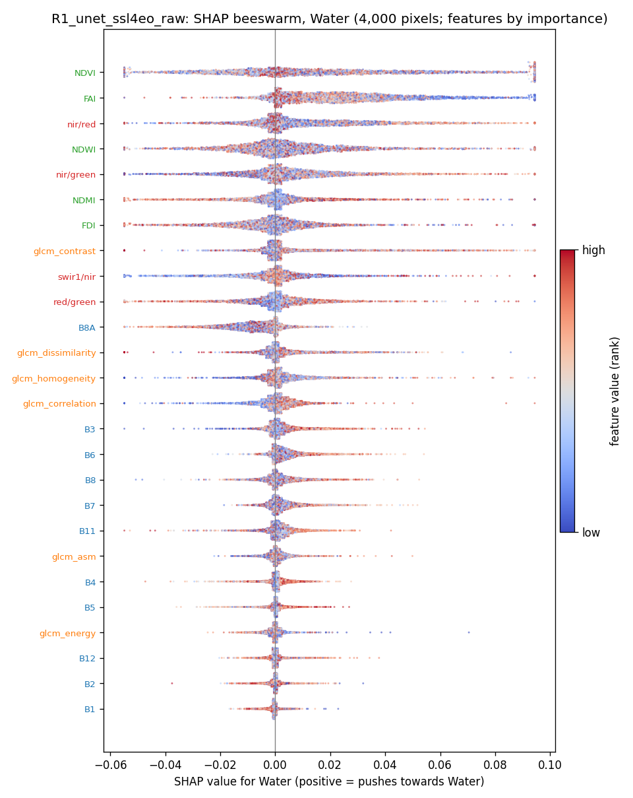

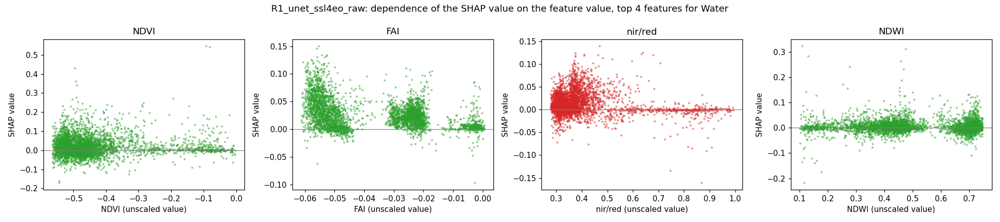

## Marine Debris

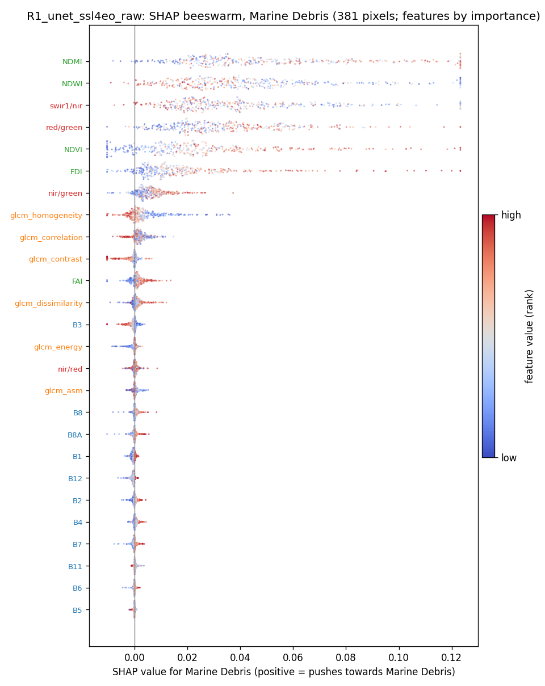

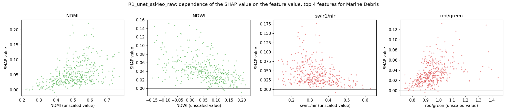

## Algae/Sargassum

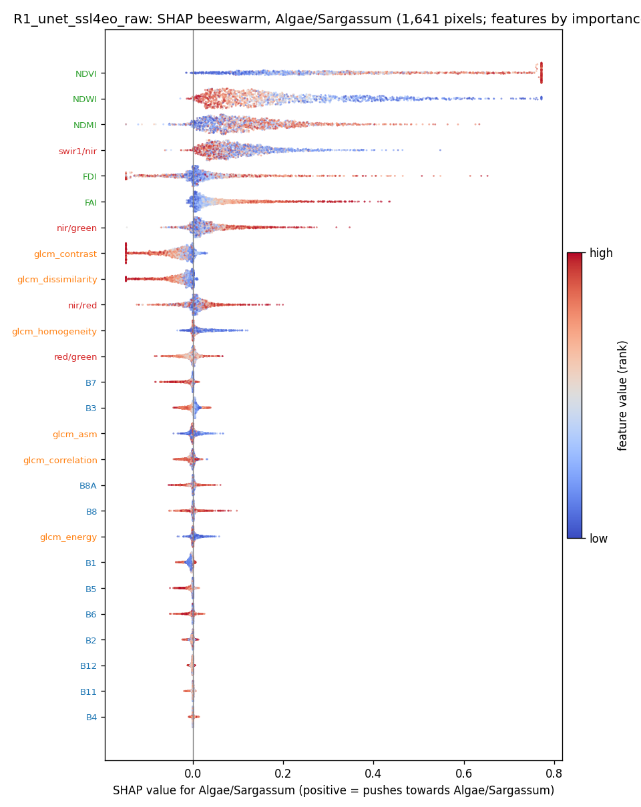

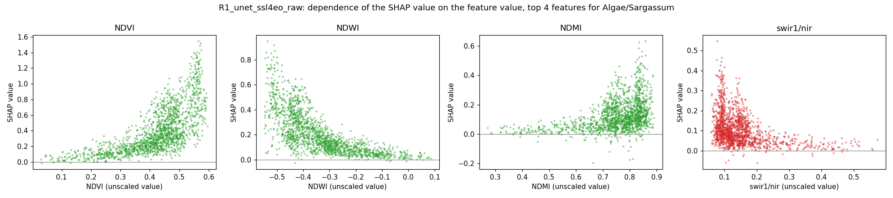

## Other

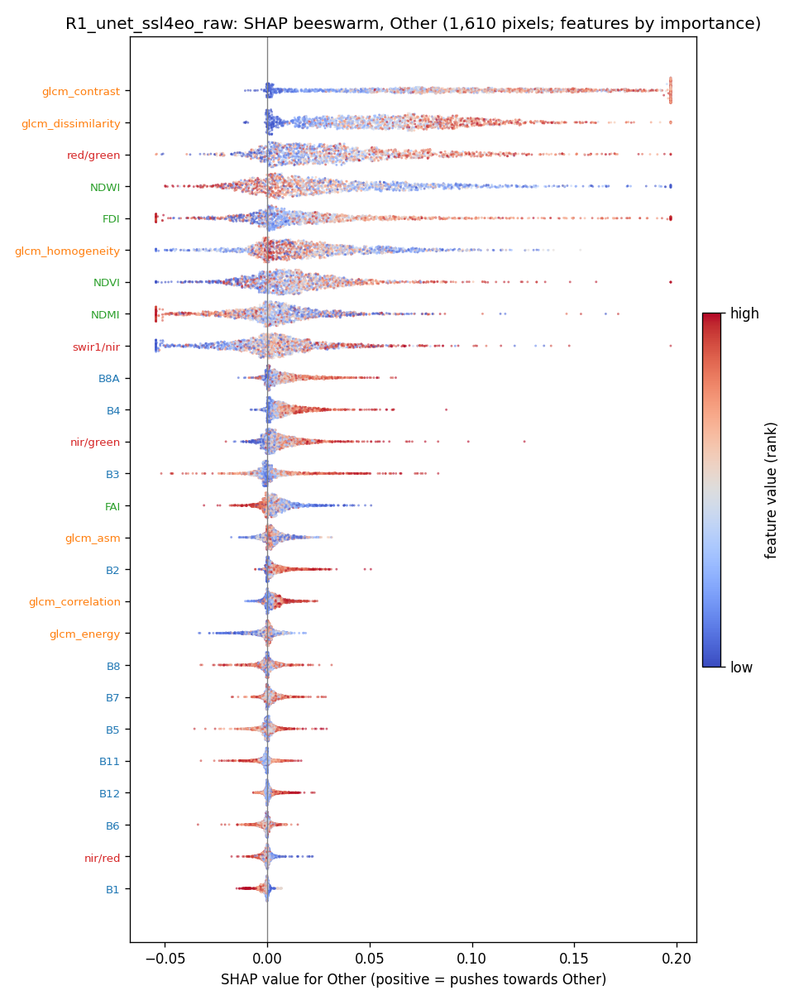

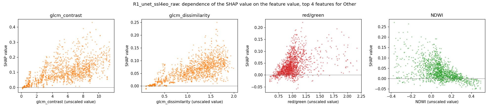

## SHAP maps and Seg-Grad-CAM on example test patches

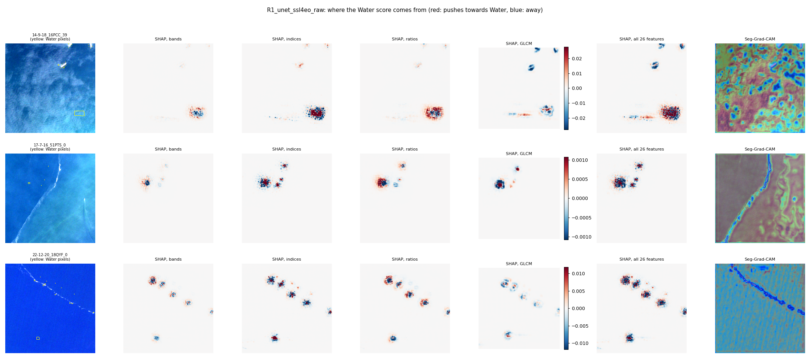
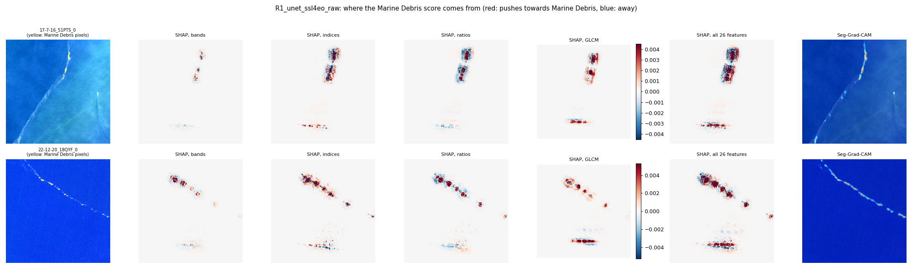
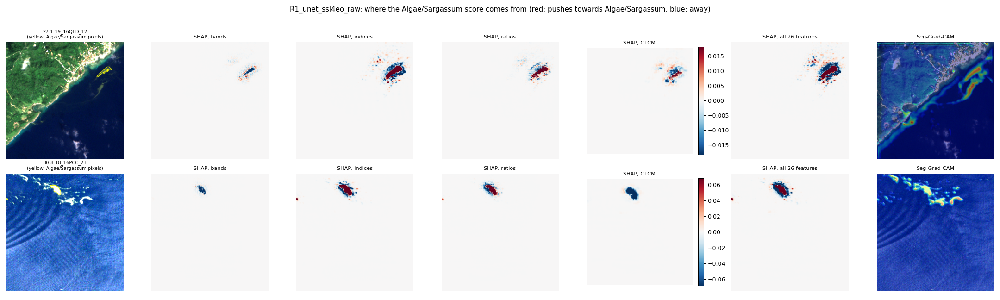
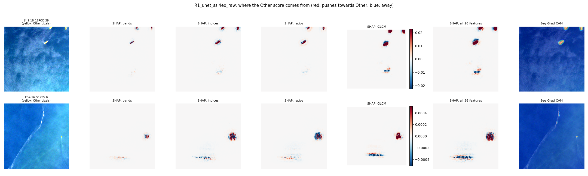
