# XAI, run R2_unet_ssl4eo_std

Explained output: for class c, the sum of P(c) over the pixels labelled c in a test patch. Importance = mean |SHAP| at the class-c pixels; share = importance / sum over features. Direction (in brackets) = Spearman correlation between the feature value and its SHAP value at the class-c pixels: + means high values push towards the class. Group values add the SHAP values of a group's features at each pixel first. Correlated features share credit (see `features/correlation/`), so read single features together with the grouped results.

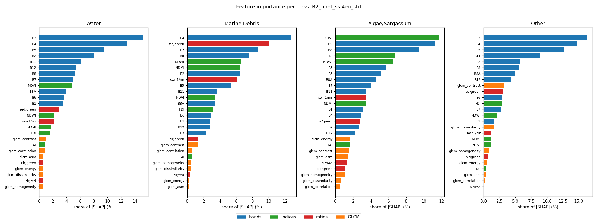

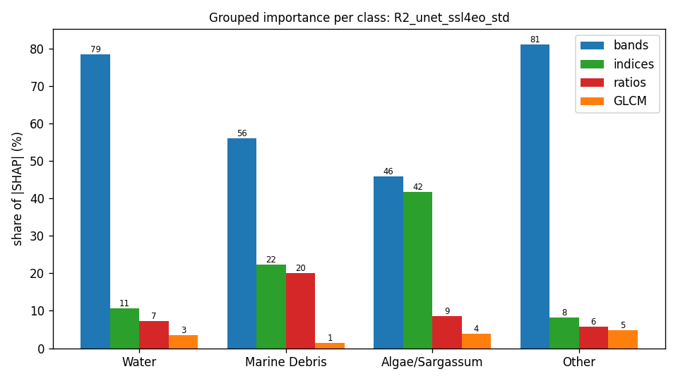

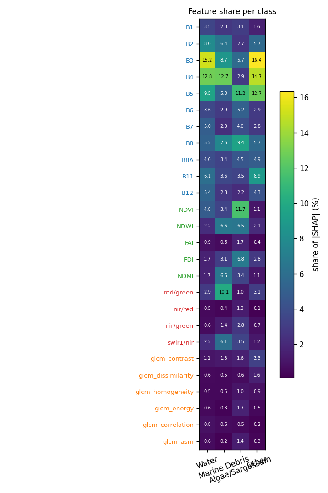

## Grouped importance (share of |SHAP|, %)

| group | Water | Marine Debris | Algae/Sargassum | Other |
|---|---|---|---|---|
| bands | 78.6 | 56.2 | 45.9 | 81.2 |
| indices | 10.6 | 22.3 | 41.8 | 8.3 |
| ratios | 7.3 | 20.1 | 8.5 | 5.7 |
| GLCM | 3.5 | 1.4 | 3.9 | 4.8 |

## Feature importance (share of |SHAP|, %; direction = Spearman of value vs SHAP)

| feature | group | Water | Marine Debris | Algae/Sargassum | Other |
|---|---|---|---|---|---|
| B1 | bands | 3.5 (+0.05) | 2.8 (+0.62) | 3.1 (+0.12) | 1.6 (-0.61) |
| B2 | bands | 8.0 (+0.05) | 6.4 (+0.65) | 2.7 (-0.42) | 5.7 (+0.06) |
| B3 | bands | 15.2 (+0.13) | 8.7 (+0.52) | 5.7 (-0.41) | 16.4 (+0.74) |
| B4 | bands | 12.8 (-0.06) | 12.7 (+0.58) | 2.9 (+0.33) | 14.7 (+0.63) |
| B5 | bands | 9.5 (-0.09) | 5.3 (+0.69) | 11.2 (+0.62) | 12.7 (+0.66) |
| B6 | bands | 3.6 (-0.04) | 2.9 (+0.61) | 5.2 (+0.19) | 2.9 (+0.08) |
| B7 | bands | 5.0 (-0.04) | 2.3 (+0.63) | 4.0 (-0.16) | 2.8 (-0.43) |
| B8 | bands | 5.2 (+0.03) | 7.6 (+0.52) | 9.4 (+0.31) | 5.7 (+0.29) |
| B8A | bands | 4.0 (+0.11) | 3.4 (+0.64) | 4.5 (-0.27) | 4.9 (+0.61) |
| B11 | bands | 6.1 (+0.06) | 3.6 (+0.56) | 3.5 (-0.07) | 8.9 (+0.77) |
| B12 | bands | 5.4 (+0.04) | 2.8 (+0.61) | 2.2 (-0.14) | 4.3 (-0.65) |
| NDVI | indices | 4.8 (+0.12) | 3.4 (+0.07) | 11.7 (+0.26) | 1.1 (+0.44) |
| NDWI | indices | 2.2 (-0.06) | 6.6 (-0.09) | 6.5 (-0.23) | 2.1 (-0.60) |
| FAI | indices | 0.9 (-0.10) | 0.6 (-0.11) | 1.7 (+0.05) | 0.4 (-0.47) |
| FDI | indices | 1.7 (-0.15) | 3.1 (+0.28) | 6.8 (+0.52) | 2.8 (-0.52) |
| NDMI | indices | 1.7 (-0.19) | 6.5 (+0.36) | 3.4 (+0.14) | 1.1 (-0.64) |
| red/green | ratios | 2.9 (+0.11) | 10.1 (+0.20) | 1.0 (-0.03) | 3.1 (+0.48) |
| nir/red | ratios | 0.5 (-0.07) | 0.4 (-0.33) | 1.3 (-0.27) | 0.1 (+0.38) |
| nir/green | ratios | 0.6 (-0.03) | 1.4 (-0.09) | 2.8 (+0.14) | 0.7 (+0.71) |
| swir1/nir | ratios | 2.2 (+0.31) | 6.1 (-0.24) | 3.5 (-0.09) | 1.2 (+0.53) |
| glcm_contrast | GLCM | 1.1 (+0.26) | 1.3 (-0.42) | 1.6 (-0.64) | 3.3 (-0.10) |
| glcm_dissimilarity | GLCM | 0.6 (+0.15) | 0.5 (-0.01) | 0.6 (-0.25) | 1.6 (+0.44) |
| glcm_homogeneity | GLCM | 0.5 (+0.14) | 0.5 (-0.58) | 1.0 (-0.70) | 0.9 (+0.24) |
| glcm_energy | GLCM | 0.6 (+0.31) | 0.3 (+0.10) | 1.7 (-0.64) | 0.5 (+0.44) |
| glcm_correlation | GLCM | 0.8 (+0.31) | 0.6 (+0.11) | 0.5 (-0.19) | 0.2 (+0.36) |
| glcm_asm | GLCM | 0.6 (+0.41) | 0.2 (+0.20) | 1.4 (-0.63) | 0.3 (+0.21) |

## Completeness check (GradientSHAP)

Sum of attributions vs S_c(x) − mean S_c(baseline) over 267 patch × class cases: correlation 0.985, median relative error 33.4 % (32 samples, 20 baselines). `completeness.csv` has every case.

## Context share

Median share of |attribution| that lies on pixels that are not the explained class (the model using the surroundings):

| class | context share (%) |
|---|---|
| Water | 93.5 |
| Marine Debris | 96.6 |
| Algae/Sargassum | 79.6 |
| Other | 86.1 |

## Water

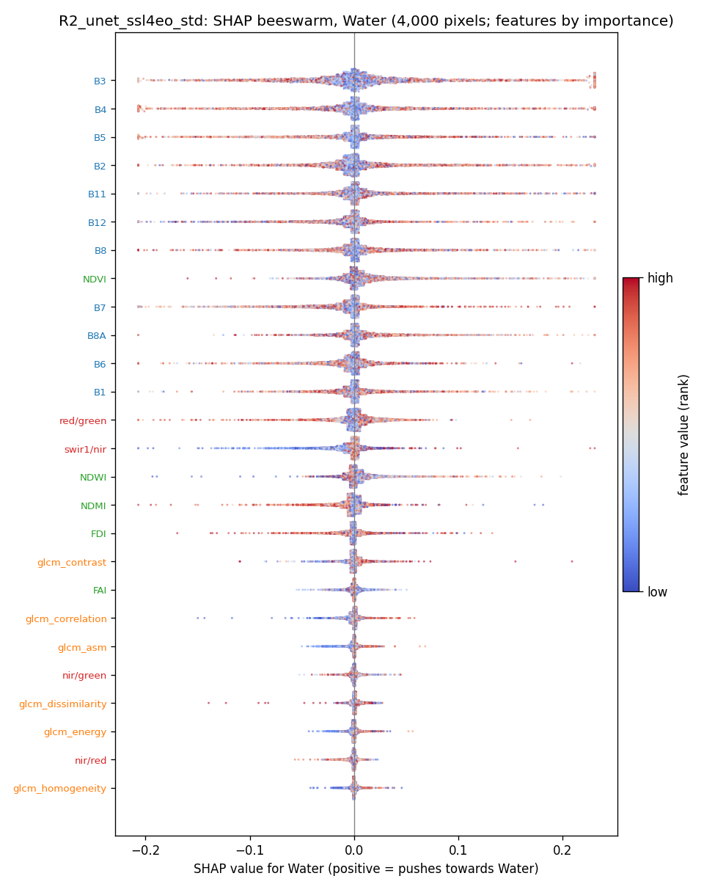

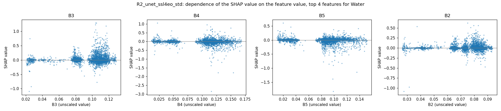

## Marine Debris

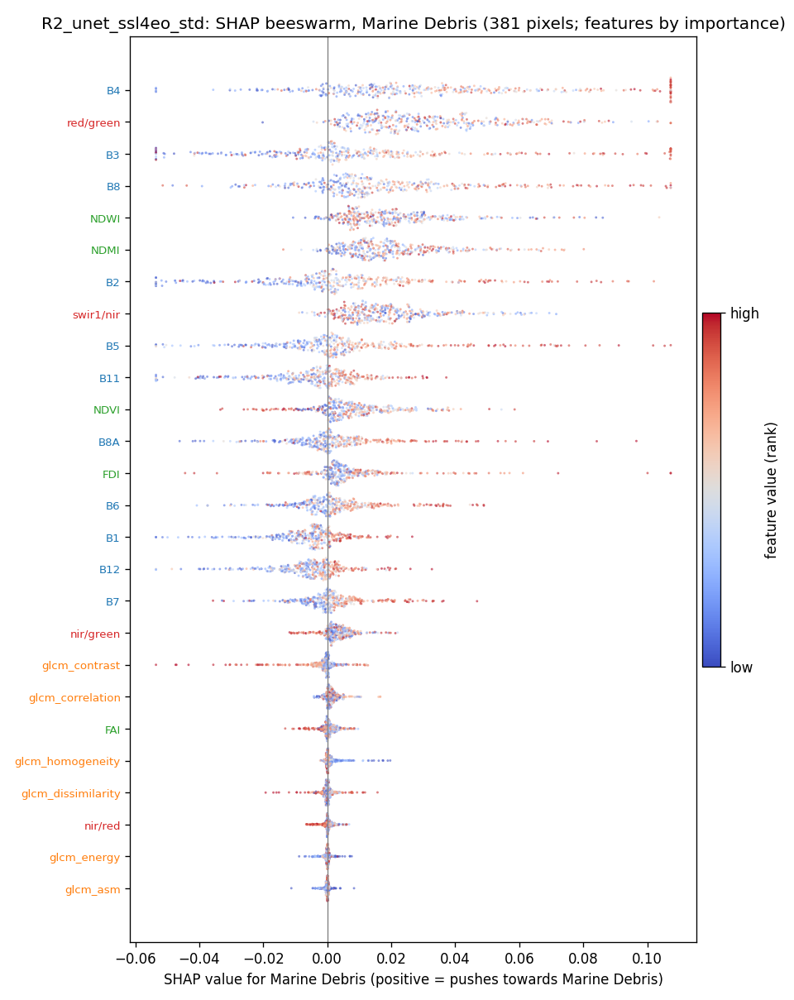

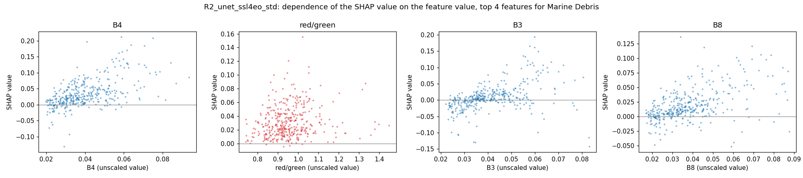

## Algae/Sargassum

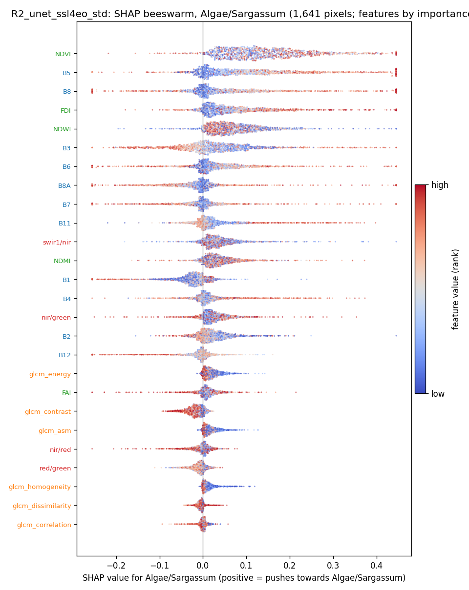

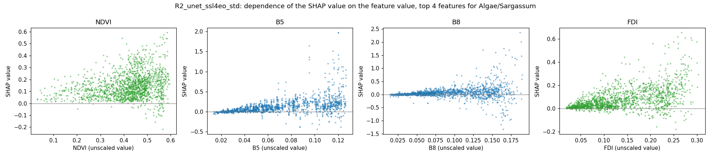

## Other

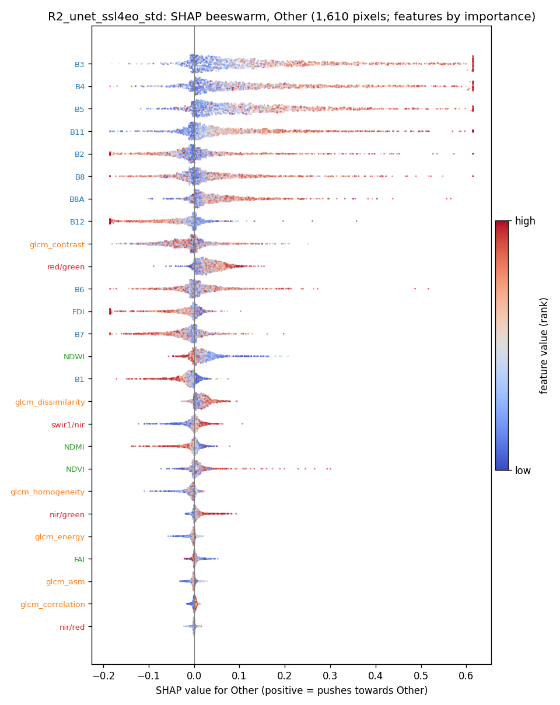

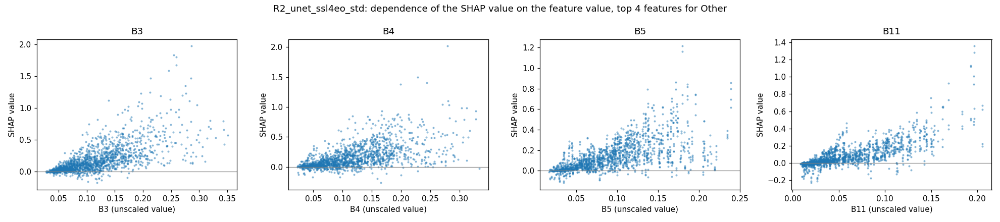

## SHAP maps and Seg-Grad-CAM on example test patches

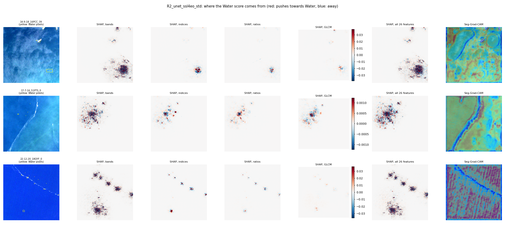
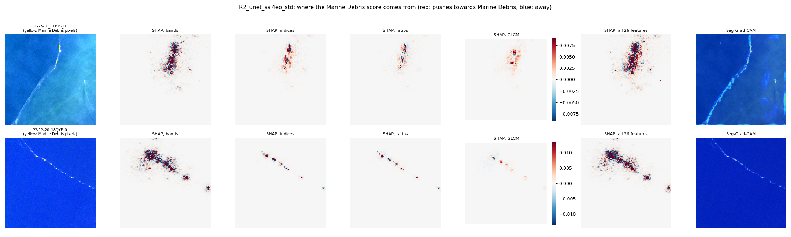
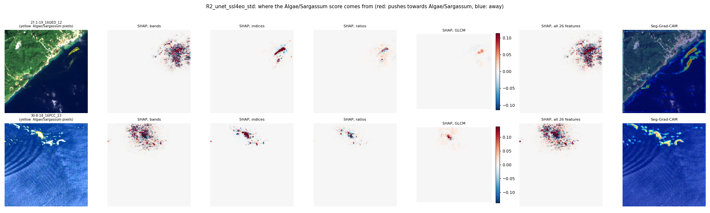
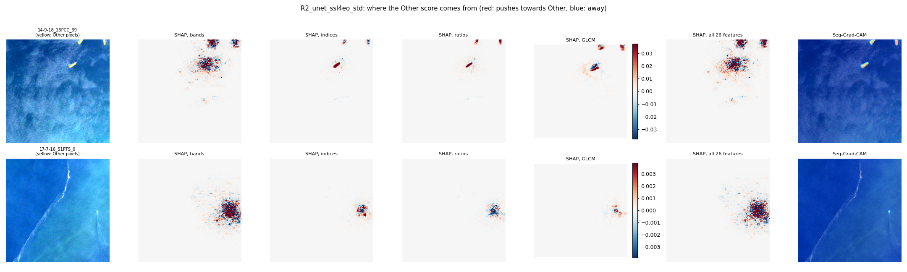
