# XAI, run R3_unet_scratch_std

Explained output: for class c, the sum of P(c) over the pixels labelled c in a test patch. Importance = mean |SHAP| at the class-c pixels; share = importance / sum over features. Direction (in brackets) = Spearman correlation between the feature value and its SHAP value at the class-c pixels: + means high values push towards the class. Group values add the SHAP values of a group's features at each pixel first. Correlated features share credit (see `features/correlation/`), so read single features together with the grouped results.

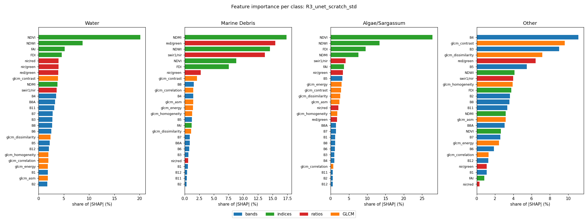

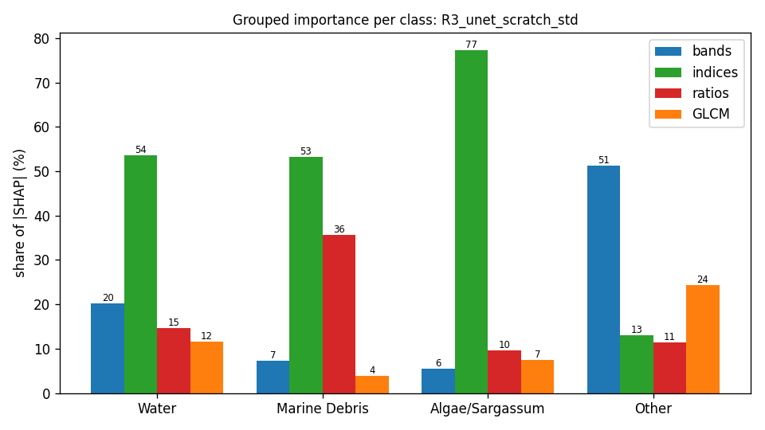

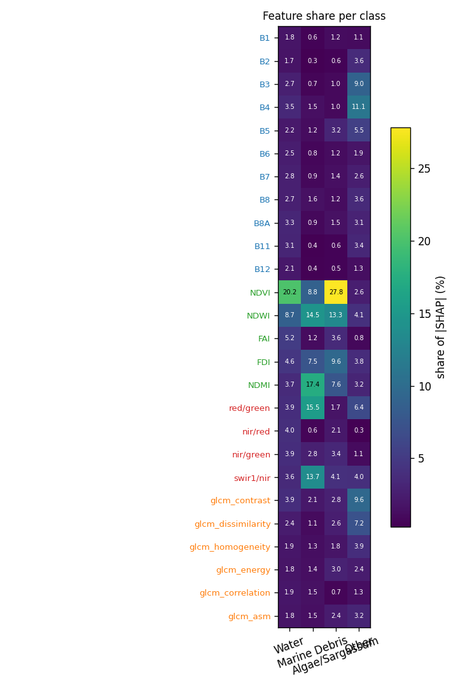

## Grouped importance (share of |SHAP|, %)

| group | Water | Marine Debris | Algae/Sargassum | Other |
|---|---|---|---|---|
| bands | 20.2 | 7.3 | 5.6 | 51.3 |
| indices | 53.5 | 53.2 | 77.3 | 13.0 |
| ratios | 14.6 | 35.6 | 9.6 | 11.5 |
| GLCM | 11.6 | 3.9 | 7.5 | 24.3 |

## Feature importance (share of |SHAP|, %; direction = Spearman of value vs SHAP)

| feature | group | Water | Marine Debris | Algae/Sargassum | Other |
|---|---|---|---|---|---|
| B1 | bands | 1.8 (-0.34) | 0.6 (-0.24) | 1.2 (+0.46) | 1.1 (-0.63) |
| B2 | bands | 1.7 (-0.21) | 0.3 (+0.06) | 0.6 (-0.27) | 3.6 (+0.77) |
| B3 | bands | 2.7 (+0.29) | 0.7 (+0.59) | 1.0 (-0.67) | 9.0 (+0.83) |
| B4 | bands | 3.5 (+0.48) | 1.5 (+0.73) | 1.0 (-0.67) | 11.1 (+0.83) |
| B5 | bands | 2.2 (-0.14) | 1.2 (+0.80) | 3.2 (+0.87) | 5.5 (+0.69) |
| B6 | bands | 2.5 (+0.03) | 0.8 (+0.69) | 1.2 (+0.27) | 1.9 (+0.39) |
| B7 | bands | 2.8 (+0.06) | 0.9 (+0.68) | 1.4 (-0.19) | 2.6 (+0.56) |
| B8 | bands | 2.7 (-0.01) | 1.6 (+0.78) | 1.2 (-0.15) | 3.6 (+0.72) |
| B8A | bands | 3.3 (-0.00) | 0.9 (+0.70) | 1.5 (-0.59) | 3.1 (+0.70) |
| B11 | bands | 3.1 (+0.04) | 0.4 (+0.36) | 0.6 (-0.43) | 3.4 (+0.87) |
| B12 | bands | 2.1 (+0.15) | 0.4 (-0.27) | 0.5 (+0.22) | 1.3 (-0.10) |
| NDVI | indices | 20.2 (-0.08) | 8.8 (+0.81) | 27.8 (+0.74) | 2.6 (+0.70) |
| NDWI | indices | 8.7 (+0.20) | 14.5 (-0.57) | 13.3 (-0.77) | 4.1 (-0.58) |
| FAI | indices | 5.2 (-0.07) | 1.2 (+0.73) | 3.6 (+0.61) | 0.8 (-0.49) |
| FDI | indices | 4.6 (-0.16) | 7.5 (+0.78) | 9.6 (+0.68) | 3.8 (+0.04) |
| NDMI | indices | 3.7 (-0.17) | 17.4 (+0.49) | 7.6 (+0.23) | 3.2 (-0.59) |
| red/green | ratios | 3.9 (+0.06) | 15.5 (+0.51) | 1.7 (-0.63) | 6.4 (+0.41) |
| nir/red | ratios | 4.0 (+0.03) | 0.6 (+0.57) | 2.1 (+0.06) | 0.3 (-0.12) |
| nir/green | ratios | 3.9 (-0.02) | 2.8 (+0.65) | 3.4 (+0.38) | 1.1 (+0.55) |
| swir1/nir | ratios | 3.6 (+0.14) | 13.7 (-0.38) | 4.1 (-0.11) | 4.0 (+0.58) |
| glcm_contrast | GLCM | 3.9 (+0.14) | 2.1 (-0.87) | 2.8 (-0.72) | 9.6 (+0.41) |
| glcm_dissimilarity | GLCM | 2.4 (-0.01) | 1.1 (+0.36) | 2.6 (-0.64) | 7.2 (+0.29) |
| glcm_homogeneity | GLCM | 1.9 (+0.00) | 1.3 (-0.31) | 1.8 (+0.26) | 3.9 (+0.02) |
| glcm_energy | GLCM | 1.8 (+0.11) | 1.4 (-0.66) | 3.0 (-0.43) | 2.4 (-0.15) |
| glcm_correlation | GLCM | 1.9 (+0.20) | 1.5 (-0.06) | 0.7 (-0.12) | 1.3 (+0.57) |
| glcm_asm | GLCM | 1.8 (+0.18) | 1.5 (-0.12) | 2.4 (-0.10) | 3.2 (-0.33) |

## Completeness check (GradientSHAP)

Sum of attributions vs S_c(x) − mean S_c(baseline) over 267 patch × class cases: correlation 0.990, median relative error 16.1 % (32 samples, 20 baselines). `completeness.csv` has every case.

## Context share

Median share of |attribution| that lies on pixels that are not the explained class (the model using the surroundings):

| class | context share (%) |
|---|---|
| Water | 86.0 |
| Marine Debris | 95.1 |
| Algae/Sargassum | 69.3 |
| Other | 87.5 |

## Water

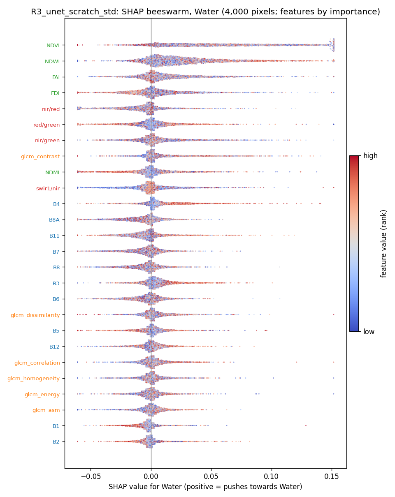

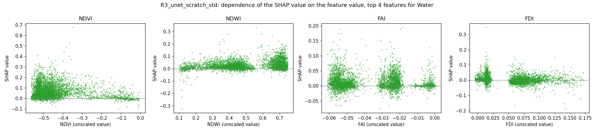

## Marine Debris

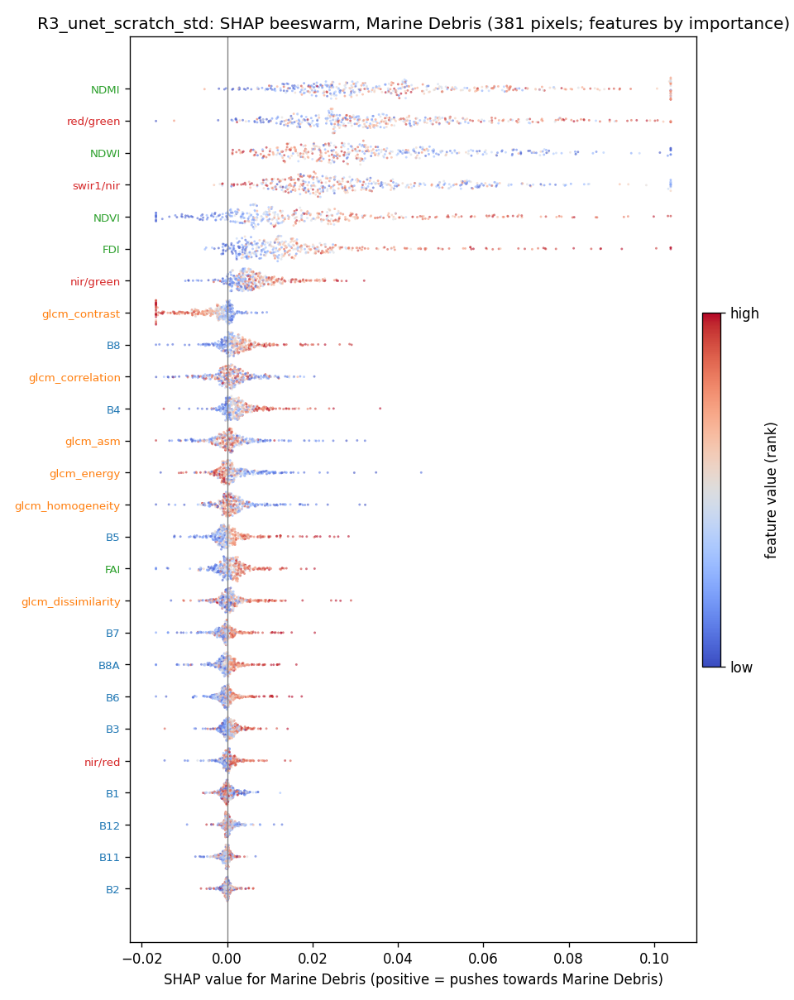

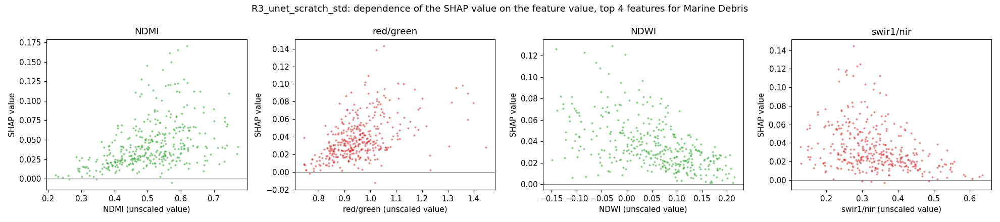

## Algae/Sargassum

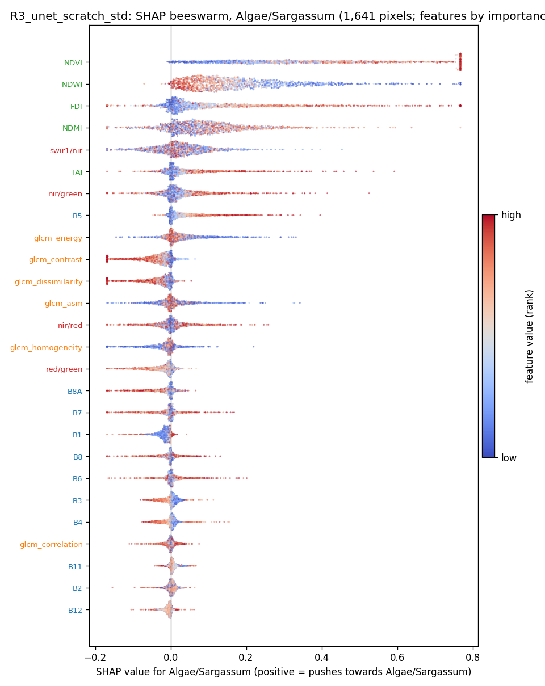

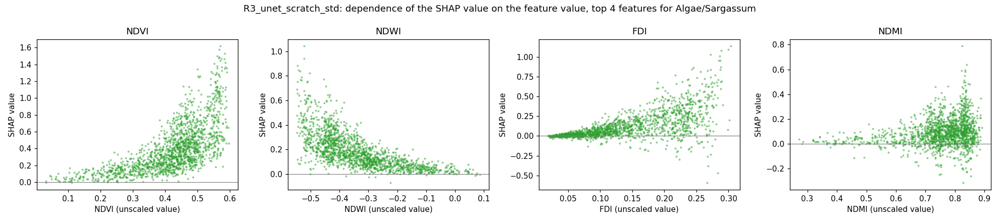

## Other

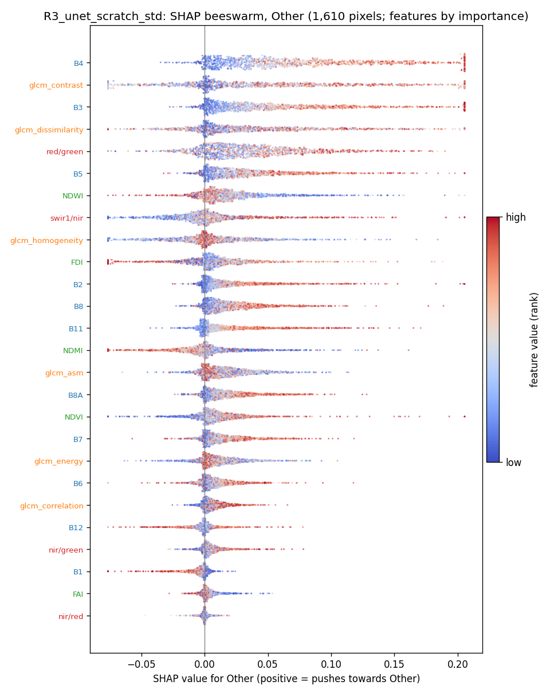

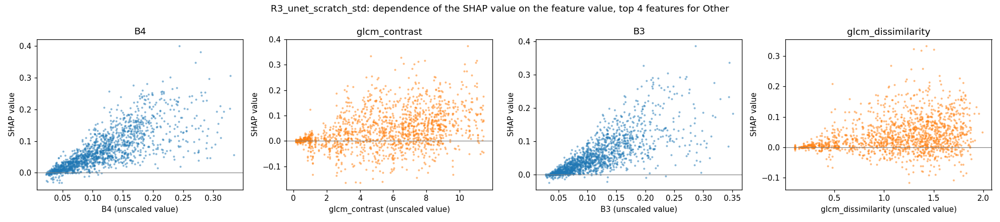

## SHAP maps and Seg-Grad-CAM on example test patches

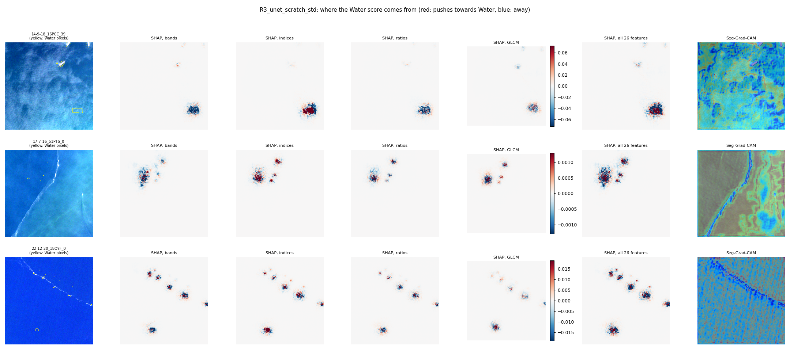
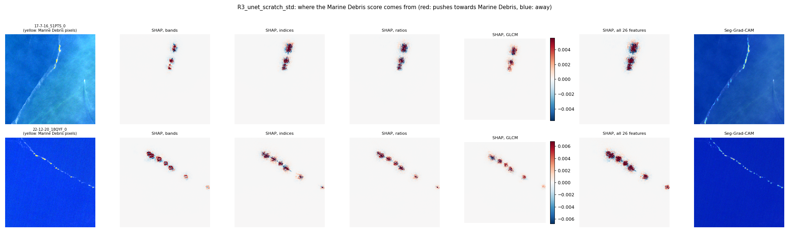
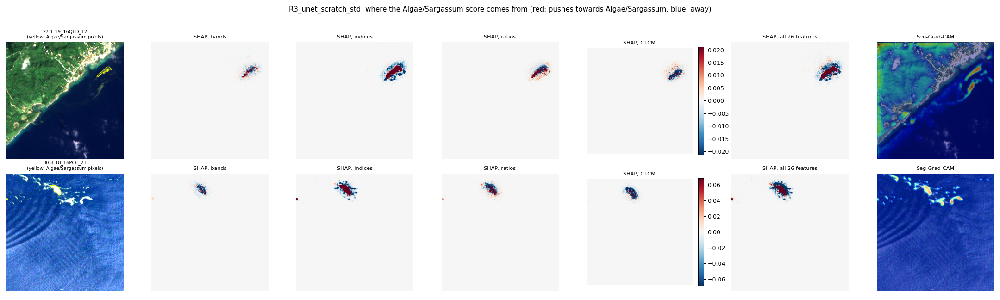
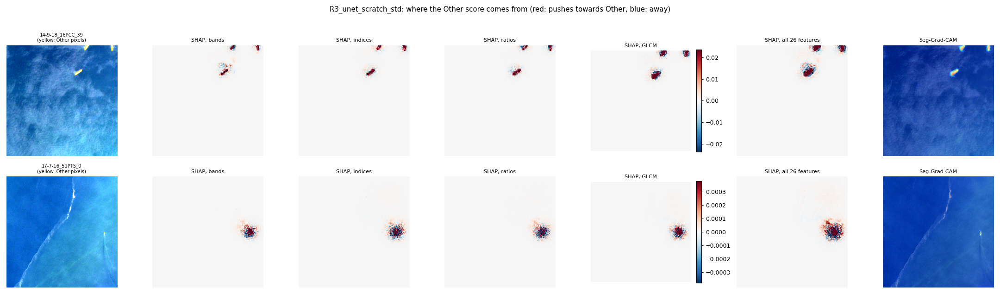
