# XAI, run R6_rf

Explained output: for class c, the sum of P(c) over the pixels labelled c in a test patch. Importance = mean |SHAP| at the class-c pixels; share = importance / sum over features. Direction (in brackets) = Spearman correlation between the feature value and its SHAP value at the class-c pixels: + means high values push towards the class. Group values add the SHAP values of a group's features at each pixel first. Correlated features share credit (see `features/correlation/`), so read single features together with the grouped results.

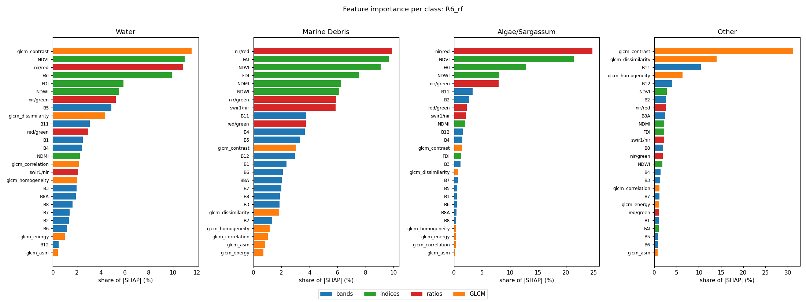

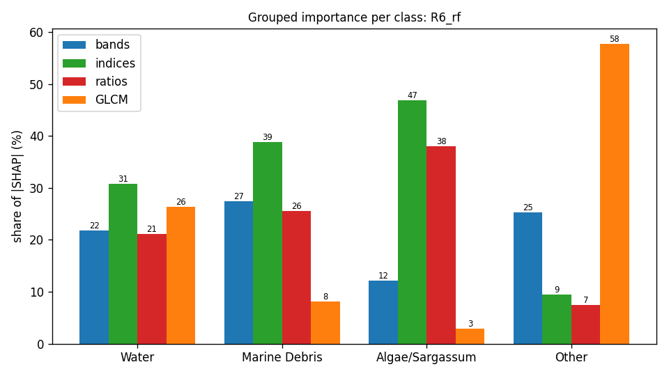

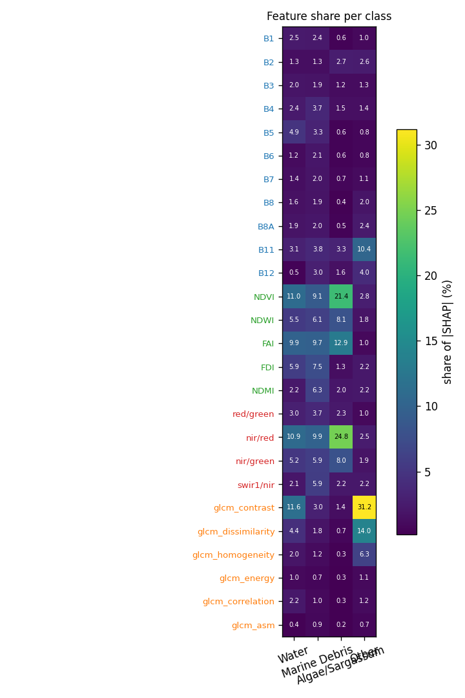

## Grouped importance (share of |SHAP|, %)

| group | Water | Marine Debris | Algae/Sargassum | Other |
|---|---|---|---|---|
| bands | 21.8 | 27.4 | 12.1 | 25.3 |
| indices | 30.7 | 38.8 | 46.9 | 9.5 |
| ratios | 21.1 | 25.6 | 38.1 | 7.4 |
| GLCM | 26.4 | 8.2 | 2.8 | 57.8 |

## Feature importance (share of |SHAP|, %; direction = Spearman of value vs SHAP)

| feature | group | Water | Marine Debris | Algae/Sargassum | Other |
|---|---|---|---|---|---|
| B1 | bands | 2.5 (+0.87) | 2.4 (-0.79) | 0.6 (-0.08) | 1.0 (-0.67) |
| B2 | bands | 1.3 (+0.68) | 1.3 (+0.61) | 2.7 (-0.94) | 2.6 (+0.71) |
| B3 | bands | 2.0 (+0.71) | 1.9 (+0.09) | 1.2 (-0.80) | 1.3 (+0.80) |
| B4 | bands | 2.4 (+0.69) | 3.7 (+0.43) | 1.5 (-0.61) | 1.4 (+0.76) |
| B5 | bands | 4.9 (+0.91) | 3.3 (-0.47) | 0.6 (+0.67) | 0.8 (-0.05) |
| B6 | bands | 1.2 (+0.17) | 2.1 (-0.59) | 0.6 (+0.35) | 0.8 (+0.10) |
| B7 | bands | 1.4 (+0.10) | 2.0 (-0.58) | 0.7 (+0.66) | 1.1 (+0.37) |
| B8 | bands | 1.6 (-0.79) | 1.9 (+0.30) | 0.4 (+0.14) | 2.0 (+0.80) |
| B8A | bands | 1.9 (-0.71) | 2.0 (-0.30) | 0.5 (+0.37) | 2.4 (+0.63) |
| B11 | bands | 3.1 (-0.15) | 3.8 (+0.13) | 3.3 (-0.36) | 10.4 (+0.90) |
| B12 | bands | 0.5 (+0.59) | 3.0 (-0.10) | 1.6 (-0.55) | 4.0 (+0.81) |
| NDVI | indices | 11.0 (-0.68) | 9.1 (+0.59) | 21.4 (+0.40) | 2.8 (+0.80) |
| NDWI | indices | 5.5 (+0.88) | 6.1 (-0.19) | 8.1 (-0.89) | 1.8 (+0.12) |
| FAI | indices | 9.9 (-0.90) | 9.7 (+0.70) | 12.9 (-0.13) | 1.0 (+0.06) |
| FDI | indices | 5.9 (-0.42) | 7.5 (+0.32) | 1.3 (+0.19) | 2.2 (-0.14) |
| NDMI | indices | 2.2 (-0.62) | 6.3 (+0.45) | 2.0 (+0.71) | 2.2 (-0.72) |
| red/green | ratios | 3.0 (+0.13) | 3.7 (+0.51) | 2.3 (-0.43) | 1.0 (+0.39) |
| nir/red | ratios | 10.9 (-0.71) | 9.9 (+0.57) | 24.8 (+0.25) | 2.5 (+0.77) |
| nir/green | ratios | 5.2 (-0.90) | 5.9 (+0.22) | 8.0 (+0.85) | 1.9 (-0.05) |
| swir1/nir | ratios | 2.1 (+0.52) | 5.9 (-0.46) | 2.2 (-0.67) | 2.2 (+0.72) |
| glcm_contrast | GLCM | 11.6 (-0.03) | 3.0 (+0.27) | 1.4 (-0.17) | 31.2 (+0.45) |
| glcm_dissimilarity | GLCM | 4.4 (-0.60) | 1.8 (+0.01) | 0.7 (-0.28) | 14.0 (+0.66) |
| glcm_homogeneity | GLCM | 2.0 (+0.37) | 1.2 (-0.09) | 0.3 (+0.67) | 6.3 (-0.65) |
| glcm_energy | GLCM | 1.0 (-0.33) | 0.7 (-0.04) | 0.3 (-0.52) | 1.1 (+0.11) |
| glcm_correlation | GLCM | 2.2 (-0.05) | 1.0 (-0.22) | 0.3 (-0.08) | 1.2 (+0.54) |
| glcm_asm | GLCM | 0.4 (-0.00) | 0.9 (-0.05) | 0.2 (-0.39) | 0.7 (+0.66) |

## Water

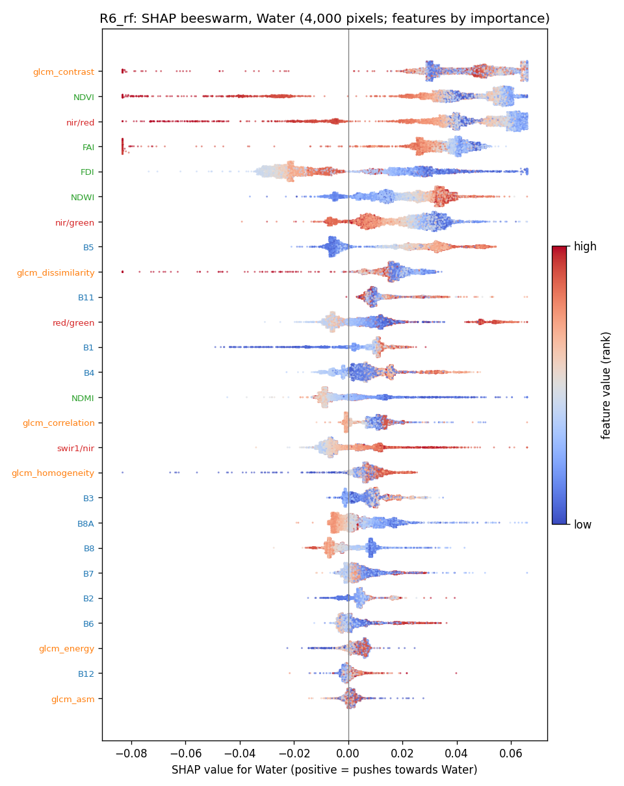

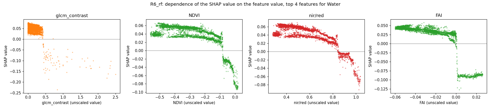

## Marine Debris

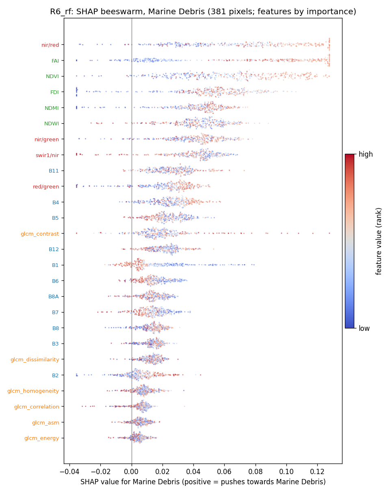

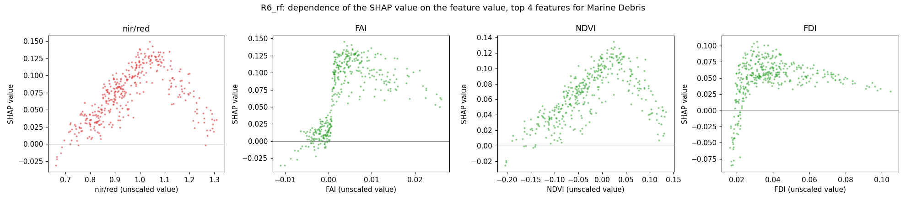

## Algae/Sargassum

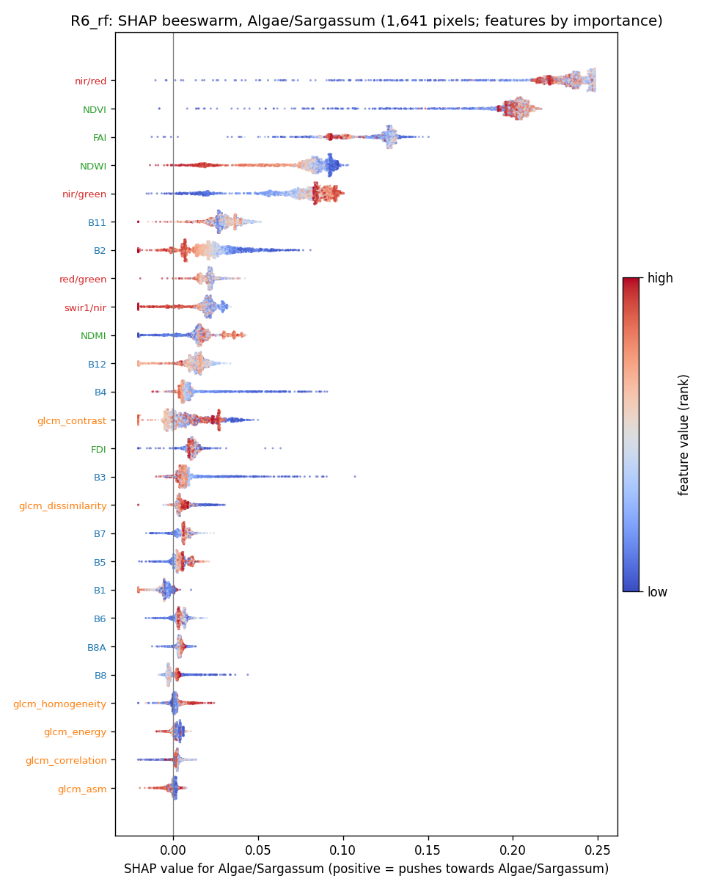

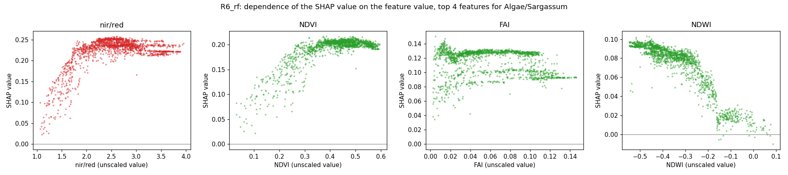

## Other

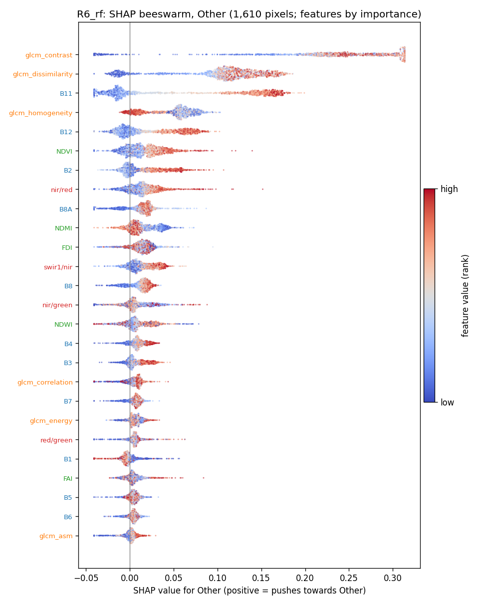

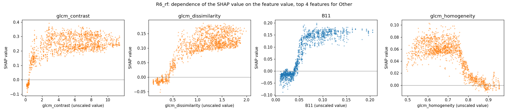

