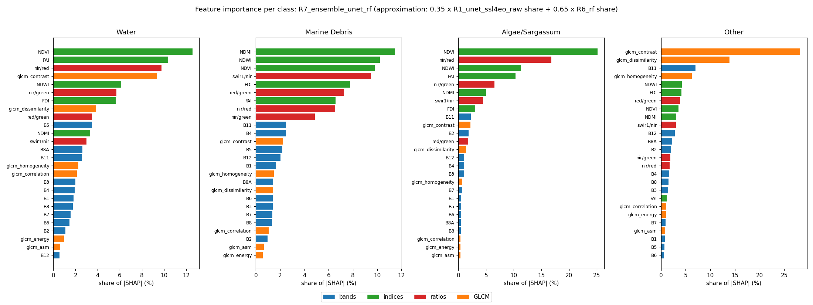
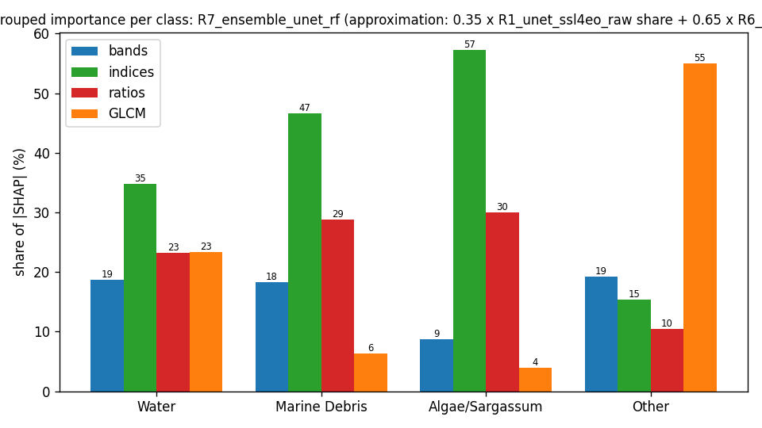

# XAI, R7_ensemble_unet_rf

Approximation: the ensemble's feature shares are w × (R1_unet_ssl4eo_raw share) + (1 − w) × (R6_rf share) with w = 0.35. The members are explained with different estimators (GradientSHAP, TreeSHAP), so these shares are indicative; see the members' reports for detail.

## Grouped importance (share of |SHAP|, %)

| group | Water | Marine Debris | Algae/Sargassum | Other |
|---|---|---|---|---|
| bands | 18.7 | 18.2 | 8.8 | 19.3 |
| indices | 34.8 | 46.6 | 57.3 | 15.4 |
| ratios | 23.2 | 28.8 | 30.0 | 10.4 |
| GLCM | 23.4 | 6.3 | 3.9 | 55.0 |

## Feature importance (share of |SHAP|, %; direction = Spearman of value vs SHAP)

| feature | group | Water | Marine Debris | Algae/Sargassum | Other |
|---|---|---|---|---|---|
| B1 | bands | 1.8 | 1.6 | 0.5 | 0.8 |
| B2 | bands | 1.1 | 1.0 | 1.9 | 2.1 |
| B3 | bands | 2.0 | 1.4 | 1.0 | 1.5 |
| B4 | bands | 1.9 | 2.5 | 1.0 | 1.7 |
| B5 | bands | 3.5 | 2.2 | 0.5 | 0.7 |
| B6 | bands | 1.5 | 1.4 | 0.5 | 0.7 |
| B7 | bands | 1.6 | 1.4 | 0.7 | 0.9 |
| B8 | bands | 1.7 | 1.3 | 0.4 | 1.5 |
| B8A | bands | 2.6 | 1.4 | 0.5 | 2.3 |
| B11 | bands | 2.6 | 2.5 | 2.2 | 7.0 |
| B12 | bands | 0.6 | 2.0 | 1.1 | 2.8 |
| NDVI | indices | 12.6 | 9.8 | 25.1 | 3.5 |
| NDWI | indices | 6.1 | 10.2 | 11.3 | 4.2 |
| FAI | indices | 10.4 | 6.6 | 10.3 | 1.1 |
| FDI | indices | 5.6 | 7.8 | 3.0 | 4.2 |
| NDMI | indices | 3.3 | 11.5 | 5.0 | 3.1 |
| red/green | ratios | 3.5 | 7.2 | 1.8 | 3.9 |
| nir/red | ratios | 9.8 | 6.5 | 16.8 | 1.8 |
| nir/green | ratios | 5.7 | 4.9 | 6.5 | 1.9 |
| swir1/nir | ratios | 3.0 | 9.5 | 4.5 | 3.1 |
| glcm_contrast | GLCM | 9.3 | 2.3 | 2.2 | 28.2 |
| glcm_dissimilarity | GLCM | 3.9 | 1.4 | 1.4 | 13.9 |
| glcm_homogeneity | GLCM | 2.3 | 1.5 | 0.7 | 6.2 |
| glcm_energy | GLCM | 0.9 | 0.6 | 0.4 | 1.0 |
| glcm_correlation | GLCM | 2.1 | 1.0 | 0.4 | 1.1 |
| glcm_asm | GLCM | 0.6 | 0.7 | 0.4 | 0.8 |
